# 2. Epidemiology for Neonatologists
> Source attribution: [Source credits](../../SOURCE_CREDITS.md).

## PDF page 39 | printed page 20

2 Epidemiology for Neonatologists

### ANDREA N. TREMBATH

### Introduction

Epidemiology is the study of health and disease and the associated causes.1,2 The role of epidemiology in neonatalperinatal medicine is to define the prevalence and causes of illness in women and children by exploring risk factors and their associations. Specifically, maternal and infant mortality rates are used to assess the levels of health, access to needed health care, and quality of health care provided by a region or country. A summary of key health statistics in the United States is presented in Table 2.1.

### Common Epidemiologic Concepts

In epidemiology, risk describes the probability of disease occurrence; however, it may represent a wide variety of statistical measures that include incidence, prevalence, rate, or odds. A risk factor often implies an increase in the outcome of interest with exposure, although risk measures may also represent protective effects. Risks are often compared using relative measures such as the risk ratio, odds ratio, and rate ratio (Table 2.2). Relative measures are helpful in the identification of risk factors but can be misleading if not accompanied by absolute measures such as the risk difference. For example, a relative risk of 2.0 indicates that the exposed group is twice as likely to develop the disease as the unexposed group. However, twice as likely may represent an absolute change in risk from 0.2 (20%) to 0.1 (10%; risk difference of 0.1 or 10%) or may represent an absolute change in risk from 0.002 (0.2%) to 0.001 (0.1%; risk difference of 0.001 or 0.1%). Therefore a small change in absolute risk may have little to no clinical impact.

In neonatology, the impact of single risk factors on outcomes is generally small, and caution should be used when inferring causality. Most diseases such as intraventricular hemorrhage (IVH), necrotizing enterocolitis (NEC), and bronchopulmonary dysplasia (BPD) have many component causes, some of which remain either unknown or unmeasurable. These component causes can occur at different times, and the sequence of their occurrence may be important in the development of the disease.

20

### Health Statistics and Data Sources

A clear understanding of the definitions used to calculate the epidemiologic data for health statistics is essential. In the United States, population-level health data are primarily derived from birth and death certificates submitted to the National Vital Statistics System (NVSS) by individual states and territories.3 The standardized terminology and definitions allow direct comparison of important populationlevel health markers such as birth, death, and outcome rates (Table 2.3).2 A standard set of health measures is reported to the NVSS; however, individual states may choose to collect additional data of importance to their specific population. In the United States, completion of a birth certificate form is required for all births regardless of length of gestation or weight and uses uniform definitions (Table 2.4).2–4 However, fetal death reporting requirements vary by state and may be based on gestational age or birth weight criteria.5

The ability to make inferences based on health statistics relies on the availability of large datasets such as those found through the NVSS. However, many of the important questions regarding survival and neurodevelopmental outcomes of the smallest and sickest infants in neonatology represent only a small total number nationwide. Single centers often do not have large enough populations of neonates to have the statistical power to determine clinically important differences in outcomes. To meet this need, several networks of neonatal and maternal centers have been established. Several will be highlighted here, and others will be covered in detail in Chapter 3.

The National Institute of Child Health and Human Development (NICHD) Neonatal Research Network (NRN), established in 1986 to improve the medical care for newborns and their families, is a consortium of US neonatal intensive care units (NICUs) that conducts multicenter clinical trials and observational trials on infants.6 Among the ongoing observational trials, the Generic Database Study (GDB) has been collecting information on very low birth weight (VLBW) infants since 1987, including data on hospital admission as well as follow-up data that includes standardized neurodevelopmental assessments. In addition, the NRN designs and executes high-quality clinical trials

## PDF page 40 | printed page 21

TABLE

### Key Health Statistics in the United States

2.1

Number of births 3,613,647

Birth rate 11.0/1,000 population

Fertility rate 56.0 births/1,000 women

aged 15–44 years

Percent born preterm

10.09%

(<37 weeks)

Percent cesarean delivery 31.4%

Infant mortality ratea 5.8/1,000 live births

Pregnancy-related death rateb 17.3/100,000 live births

a2019. b2017. Key Birth Statistics in the United States 2020. Adapted from NVSS, March 10, 2022.

TABLE

### Common Measures and Definitions

2.2

Risk ratio Ratio of the incidence of risk in an

exposed group to the incidence of risk in the unexposed group

Odds ratio Ratio of the odds of an event in the

exposed group to the odds of an event in the unexposed group

Incidence Proportion of individuals who are

initially free of an outcome who subsequently develop the outcome over a specified period of time

Prevalence Proportion of individuals who have a

specific outcome at a given time

TABLE

### Commonly Reported Rates

2.3

Perinatal mortality

Infant deaths <7 days of

age and fetal deaths ≥28 weeks’ gestation per 1000 live births plus fetal deaths

(PMR)a

Infant mortality rate

Deaths prior to 1 year of life

(IMR)

per 1000 live births

Neonatal mortality Deaths prior to 28 days of life

per 1000 live births

Postneonatal mortality Deaths from 28 days to <365

days per 1000 live births

aPMR definition I (PMR 1) is used for international and state-specific comparisons because of differences among countries and states in the completeness of reporting of fetal deaths prior to 28 weeks’ gestation.

that provide epidemiologic data on subset populations and specific neonatal diseases.

The Vermont Oxford Network (VON) is an international collaborative of more than 1200 NICU and medical

TABLE

### Vital Statistics Definitions

2.4

Live birth The complete expulsion or extraction

from the mother of a product of human conception, irrespective of the duration of the pregnancy, which, after such expulsion or extraction, breathes or shows any other evidence of life, such as beating of the heart, pulsation of the umbilical cord, or definite movement of voluntary muscles, regardless of whether the umbilical cord has been cut or the placenta is attached. Heartbeats are to be distinguished from transient cardiac contractions; respirations are to be distinguished from fleeting respiratory efforts or gasps.

Fetal death Death before the complete expulsion or

extraction from the mother of a product of human conception, irrespective of the duration of pregnancy that is not an induced termination of pregnancy. The death is indicated by the fact that, after such expulsion or extraction, the fetus does not breathe or show any other evidence of life such as beating of the heart, pulsation of the umbilical cord, or definite movement of voluntary muscles. Heartbeats are to be distinguished from transient cardiac contractions; respirations are to be distinguished from fleeting respiratory efforts or gasps.

Infant death Live birth (as above) that results in death

prior to 1 year of life (<365 days)

Neonatal

Death before 28 days of life

death

Postneonatal

Death at 28 days to 364 days of life

death

centers established in 1988.7 The mission of VON is “to improve the quality and safety of medical care for newborn infants and their families through a coordinated program of research, education, and quality improvement projects.” VON maintains a database of inpatient hospital information on VLBW infants using standardized measures. In total, more than 2 million infants are represented in this database, providing a rich resource for information on the care and hospital outcomes of high-risk infants.

National and international quality collaboratives are filling an important role in neonatology by providing a platform to gather information on maternal child health as well as improving the care delivered to newborns. Although the scope and direction of the quality initiatives vary, several perinatal state collaboratives, such as California Perinatal Quality Care Collaborative, the Ohio Perinatal Quality Collaborative, the Perinatal Quality Collaborative of North Carolina, and Tennessee Initiative for Perinatal Quality Care, have contributed

## PDF page 41

valuable data on rates of late onset sepsis, nonindicated cesarean section, antenatal corticosteroid use, and narcotic abstinence syndrome.8,9

### Birth Data

There were 3,613,647 births in the United States in 2020, a number that has consistently decreased over the past decade (Fig. 2.1).10 The mean age of a mother at first birth has risen to 27.1 years in the United States and 30.7 in the United Kingdom.10–12 The increase in maternal age at first birth is reflected in a steady rise in birth rate for women age 30 and older. However, the teenage birth rate (ages 15–19) has continued to decline to 15.4 per 1,000 live births—a greater than 75% reduction from its peak in 1991 (Fig. 2.2).10

In the United States, the overwhelming majority of births occur in a hospital, approximately 98%, and are attended by an allopathic doctor of medicine (84%) or nurse midwife (8%).13 In 2020, 45,646 deliveries occurred at home, a relative increase of 22%; this change is believed to be related to the start of the COVID-19 pandemic. Of the births occurring in the hospital setting in 2020, the rate of delivery by cesarean section is 31.8% overall, with increasing rates among all age groups as compared with 2019. Significant disparities exist in rates of cesarean section, with non-Hispanic Black women having the highest rate at 36.3% as compared with non-Hispanic White women at 30.8%.10,14

In 2020, 112,437 infants were born as twins in the United States, a rate of 31.15 per 1000 births—the lowest

5

4

Number of births (millions)

3

1970 1975 1980 0

1985 1990 1995

• Fig. 2.1 Number of live births and general fertility rates, 1970–2020. (Source: NCHS. National Vital Statistics System. Natl Vital Stat Rep. February 7, 2022;70[17] [cdc.gov].)

rate in nearly 20 years. The twin birth rate increased steadily by 76% between 1980 and 2009. The increase has slowed since the mid-2000s; however, the peak rate was in 2014, at 33.9 per 1000 births.10,15 The increases in twinning rates have been associated with increased use of assistive reproductive therapies (ARTs) such as fertility-enhancing drugs and are reflected by the increasing mean maternal age. In contrast, the rate of higher-order multiples has decreased dramatically (79.6/100,000) since the 1998 peak of 193.5 per 100,000 births. The reduction in higher-order births has been associated with more conservative use of ART, such as limiting the numbers of implanted embryos during in vitro fertilization.

### Fetal Deaths

Rates of fetal death are the most difficult-to-interpret statistic because of inconsistencies in reporting. For statistical purposes, the fetal period is defined as the in utero period from 8 weeks after conception until term. A fetal death is commonly referred to as a miscarriage if it occurs at less than 20 weeks’ gestation and a stillbirth if it occurs after 20 weeks’ gestation.5

### Infant Deaths

Infant mortality (IM) is a critical measure of the health and welfare of a population. In 2019, 20,927 infants died before reaching age 1 year, resulting in an IM rate of 5.8 deaths per 1000 live births (Fig. 2.3).15 This rate achieved the Healthy

100

Rate per 1000 women aged 15–44

Number

80

Rate

60

0

2000 2010 2005 2020 2015

## PDF page 42 | printed page 23

200

25–29 years

100

30–34 years

Rate per 1000 women

35–39 years

10

40–44 years

5

1990 1995 1

2000 2005

• Fig. 2.2 Birth rates by age of mother, 1990–2020. (Source: NCHS. National Vital Statistics System, Natality. Natl Vital Stat Rep. February 7, 2022;70[17] [cdc.gov].)

8

Infant

6

Deaths per 1000 live births

Neonatal

4

Postneonatal

2

0

2007 2005 2003 2001 1999 1997 1995

• Fig. 2.3 Infant mortality rates, United States, 1995–2019. (Source: NCHS. National Vital Statistics System. Linked birth/infant death file. Natl Vital Stat Rep. December 8, 2021;70[14] [cdc.gov].)

People 2020 IM goal of 6 per 1000 live births, and overall, the rates of IM in the United States have been declining steadily for at least 40 years.14 The Healthy People 2030 IM goal is 5.0 per 1000 live births. Currently, the United States ranks 33rd in IM when compared with other developed countries, well behind Sweden, Japan, Singapore, and Hong Kong. Eleven countries had an IM rate less than half the US rate.

200

100

20–24 years

15–19 years

10

5

1

2010 2015 2020

2019 2017 2015 2013 2011 2009

The leading causes of IM in the United States include congenital defects (21%), premature birth and/or low birth weight (17%) and sleep-related deaths, maternalrelated complications, and unintentional injuries (each 6%).10,15 Although these are primarily medical diagnoses, they are highly influenced by the social determinants of health. Social determinants of health are defined as those “nonmedical factors that influence health, including

## PDF page 43

12

10.75 10.62

10

Infant deaths per 1000 live births

8.15 7.87

8

6

4.63 4.49

4

2

0

White

Black

American Indian or Alaska Native

Non-Hispanic

• Fig. 2.4 Infant mortality rate by maternal race/ethnicity, United States, 2018–2019. (Source: NCHS. National Vital Statistics System. Linked birth/infant death file. Natl Vital Stat Rep. December 8, 2021;70[14] [cdc.gov].)

health-related knowledge, attitudes, beliefs, or behaviors.”16 These include socioeconomic factors such as education, employment, and neighborhoods, as well as health behaviors such as tobacco use and diet/exercise. The impact of these social determinants of health can be seen in the marked health disparities that exist in IM rates by race. The rate of IM among non-Hispanic Black infants is more than two times the rate of that for non-Hispanic White infants (10.62 vs. 4.49) (Fig. 2.4).15

### Pregnancy-Related Deaths

Pregnancy-related deaths, also known as maternal mortality, is defined as death of a woman either during pregnancy or in the 1 year following the end of pregnancy and is related to pregnancy or its management, excluding those caused by accidents or incidental causes. In 1983, the Centers for Disease Control and Prevention (CDC) began surveillance of pregnancy-related deaths, using death certificates voluntarily submitted by the 50 states, New York City, and the District of Columbia.17 From 1987 to 2017, the rate of pregnancyrelated deaths has increased from 7.2 to 17.3 per 100,000 live births.17 The reasons for the increased rates of mortality are unclear, although they may be due in part to increased reporting. However, it is well recognized that there has been an increase in the number of pregnant women with chronic health conditions such as obesity, hypertension, diabetes mellitus, and cardiovascular disease.17,18 These conditions place a pregnant woman at a higher risk of adverse outcomes.

In addition, significant disparities in rates of pregnancyrelated deaths occur according to race and sociodemographic

2018 2019

9.39

8.19

4.86 5.03

3.63 3.38

Asian

Native Hawaiian or other Pacific Islander

Hispanic

levels. Non-Hispanic Black women experience pregnancyrelated mortality rates three times higher than those of non-Hispanic White women (41.7 vs. 13.4 per 100,000 live births) (Fig. 2.5).17

### Maternal Morbidity

Severe maternal morbidity is any unexpected outcome of the pregnancy or labor and delivery process that results in short- and long-term impacts on a woman’s health. The rate of severe maternal morbidity has increased in recent years.17 The increase is likely due to an overall increase in the rates of maternal chronic conditions that predispose to higher rates of complications, such as the need for blood transfusions or hysterectomy (Fig. 2.6).

### Neonatal Morbidity

### Prematurity and Low Birth Weight

Prematurity and low birth weight are leading causes of IM and the primary driver of serious neonatal morbidity. In total, 364,487 preterm births (<37 weeks) occurred in the United States in 2020, and the rate of low birth weight (defined as <2500 g) infants was 8.24%—a number that has continued to rise nearly 4% from the low in 2014.10,15

Traditionally, prematurity has been defined as birth prior to 37 weeks’ gestation and is still the primary definition used in most national health statistics. However, in 2013, the American College of Obstetricians and Gynecologists (ACOG) recognized the role that a few weeks

## PDF page 44 | printed page 25

### Pregnancy-related mortality ratio by race/ethnicity: 2014–2017

41.7

40

35

Pregnancy-related deathsa

28.3

30

25

20

13.8

15

10

5

0

Non-Hispanic Asian or Pacific Islander

Non-Hispanic Black

Non-Hispanic American Indian or Alaska native

aPer 100,000 live births

### • Fig. 2.5 Maternal mortality rate by maternal race/ethnicity, United States, 2018–2019. (Source: NCHS.

National Vital Statistics System. Linked birth/infant death file. Natl Vital Stat Rep. December 8, 2021;70[14] [cdc.gov].)

### Rates of severe maternal morbidity per 10,000 delivery hospitalizations

160

140

120

100

80

60

40

20

0

1993 1995 1997 1999 2001 2003 2004

### • Fig. 2.6 Rates of the most common severe maternal morbidities per 100,000 delivery hospitalizations.

(Source: NCHS, National Vital Statistics System, Reproductive Health, Severe Maternal Morbidity in the United States | Pregnancy | Reproductive Health | CDC.)

makes in the risk for morbidity or mortality in the preterm infant by reclassifying full-term delivery as 39 0/7 weeks through 40 6/7 weeks’ gestation (Table 2.5).19 The change in terminology acknowledges that the morbidity and mortality due to prematurity does not abruptly cease after 37

13.4

11.6

Hispanic or Latino

Non-Hispanic White

Overall rate of severe maternal morbidity with blood transfusions

Blood transfusions

Severe maternal morbidity without blood transfusions

2006 2008 2010 2012 2014

weeks. Rather, infants born at 37 to 38 weeks’ gestation have an IM rate nearly double that of infants born at 39 to 40 weeks (3.09 vs. 1.58).15 Infants delivered by elective cesarean section at 37 to 38 weeks’ gestation are twice as likely to have adverse respiratory outcomes and require

### Automatic table extraction — verify rendered original

|41.7 Pregnancy-related mortality ratio by race/ethnicity: 2014–2017|Col2|Col3|Col4|Col5|
|---|---|---|---|---|
|41.7 28.3 13.8 13.4 11|41.7 28.3 13.8 13.4 11|41.7 28.3 13.8 13.4 11|41.7 28.3 13.8 13.4 11|41.7 28.3 13.8 13.4 11|
||||||

[Original table](../../tables/ch002_p0044_1.jpg)

## PDF page 45

### Definitions of Premature and Term

TABLE

2.5

### Gestation

Extremely preterm <28 weeks

Very preterm 28 0/7 to 31 6/7 weeks

Moderate preterm 32 0/7 to 33 6/7 weeks

Late preterma 34 0/7 to 36 6/7 weeks

Early terma 37 0/7 to 38 6/7 weeks

Full terma 39 0/7 to 40 6/7 weeks

Late terma 41 0/7 to 41 6/7 weeks

Post terma 42 0/7 weeks or beyond

aBased on American College of Obstetricians and Gynecologists definition of term pregnancy.

intensive care unit admission compared with infants delivered at 39 completed weeks of gestation.19 In addition to the medical morbidity and mortality, prematurity comes with a significant cost to the health care system, because the average cost of caring for a preterm infant (<37 weeks) was nearly 10 times that of caring for a term infant ($4389 vs. $54,149).20

Key Points

### • Birth rates in the United States have decreased over the

past decade.

### • Pregnancy-related deaths and maternal morbidity rates

continue to rise.

### References

1. Fletcher G. Clinical Epidemiology. 6th ed. Lippincott Williams &

Wilkins; 2020. 2. Rothman K, Greenland S, Lash T. Modern Epidemiology. 4th ed.

Lippincott Williams & Wilkins; 2012. 3. Hamilton BE, Hoyert DL, Martin JA, et al. Annual summary of

vital statistics: 2010-2011. Pediatrics. 2013;131:548–558. 4. Barfield WD. Standard terminology for fetal, infant and perinatal

deaths. Pediatrics. 2016;137(5):e1–e5. 5. National Center for Health Statistics. Guide to Completing the

Facility Worksheets for the Certificate of Live Birth and Report of Fetal Death (2003 Revision). 2016. 6. Eunice Shriver NICHD Neonatal Research Network. Accessed

March 10, 2022. https://neonatal.rti.org 7. Vermont Oxford Network. Accessed March 10, 2022. https://

public.vtoxford.org 8. California Perinatal Quality Collaborative. Accessed March 10,

2022. https://www.cpqcc.org/ 9. Kaplan HC, Lannon C, Walsh MC, et al; Ohio Perinatal Qual-

ity Collaborative. Ohio statewide quality-improvement collaborative to reduce late-onset sepsis in preterm infants. Pediatrics. 2011;127:427–435.

Multiple perinatal quality collaborative organizations nationwide, the March of Dimes, and other national organizations including the American Academy of Pediatrics have campaigns to educate the public about these increased risks and to encourage delays in delivery until 39 completed weeks of gestation.21 In 2010, the Joint Commission on Hospital Accreditation established a perinatal core measure requiring the reporting of rates of nonmedically indicated deliveries performed between 37 and 39 weeks’ gestational age.

Because of these initiatives and many others, the rate of preterm birth in the United States declined to 12.3% in 2008, following three decades of increases, and by 2011, the rate dropped further to 11.72%. In 2020, the percentage of preterm births was 10.09%, based on best obstetric estimate of delivery prior to 37 weeks’ gestation.10 Infants in multiple-gestation pregnancies are more likely to be born prematurely and are more likely to be low birth weight than those in singleton pregnancies. Thus they are at a greater risk of early death—with twins 5 times (and triplets 10 times) as likely to die in infancy. In addition, rates of preterm birth demonstrate marked health disparities with the highest rates of prematurity among non-Hispanic Black births, as compared with non-Hispanic White births (14.36% vs. 9.10%).10

### • The US infant mortality (IM) rate was 5.8 deaths per

1000 live births.

### • Congenital anomalies, followed by prematurity/low

birth weight, are the leading causes of IM and demonstrate significant health disparities.

10. Osterman MJ Hamilton BE, Martin JA, et al. Births: final data

for 2020. Natl Vital Stat Rep. 2021;70:1–50. 11. Mathews TJ, Hamilton BE. Mean Age of Mother Is on the

Rise: United States, 2000-2014. NCHS Data Brief; 2016. No 232. 12. Office for National Statistics. Births by Characteristics in England

and Wales: 2020. Statistical Bulletin; 2022. 13. Martin JA, Hamilton BE, Osterman MJ, et al. Births: final data

for 2015. Natl Vital Stat Rep. 2017;66:1. 14. Healthy People 2030. Objectives and Data. Accessed March 10,

2022. https://health.gov/healthypeople/objectives-and-data 15. Ely DM, Driscoll AK. Infant mortality in the United States,

2019: data from the period linked birth/infant death file. Natl Vital Stat Rep. 2021;70:1–18. 16. Braveman P, Egerter S, Williams DR. The social deter-

minants of health: coming of age. Annu Rev Public Health. 2001;32:381–398. 17. Centers for Disease Control and Prevention. Pregnancy Mortality

Surveillance System. Accessed March 10, 2022. www.cdc.gov/re productivehealth/MaternalInfantHealth/PMSS.html 18. Lau C, Ambalavanan N, Chakraborty H, et al. Extremely low

birth weight and infant mortality rates in the United States. Pediatrics. 2013;131:855–860.

## PDF page 46 | printed page 27

19. ACOG Committee Opinion No 579: Definition of term preg-

nancy. Obstet Gynecol. 2013;122:1139–1140. 20. Agency for Healthcare Research and Quality. Healthcare Cost

and Utilization Project (HCUP). 2011. Accessed March 10, 2022. http://hcupnet.ahrq.gov

21. Bailit JL, Iams J, Silber A, et al. Changes in the indications

for scheduled births to reduce nonmedically indicated deliveries occurring before 39 weeks of gestation. Obstet Gynecol. 2012;120:241–245.

<!-- SOURCE_LAYOUT_VIEWS -->

## Original layout views and recovered diagrams

Automatic extraction can flatten tables and superscripts. Check the original layout for numeric data, footnotes and image credits. [Source review notes](../../SOURCE_REVIEW_NOTES.md).

### Original source page 39

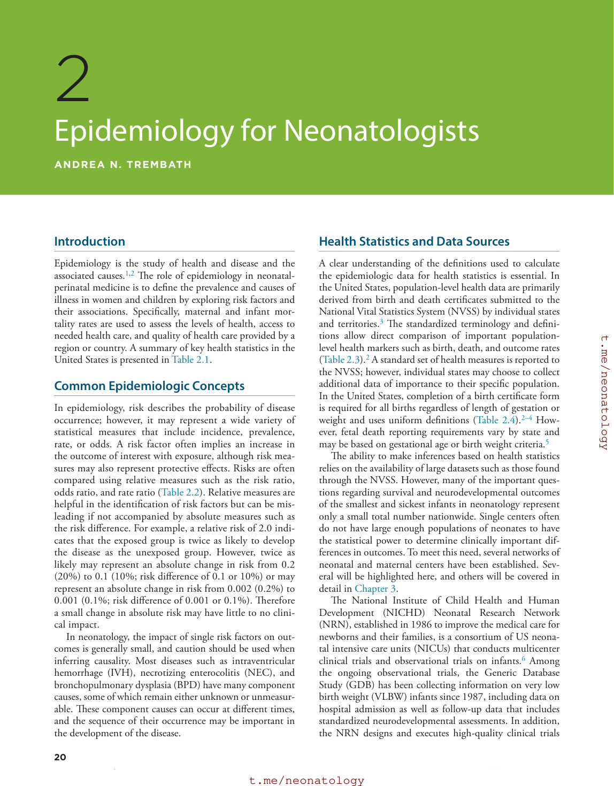

### Original source page 40

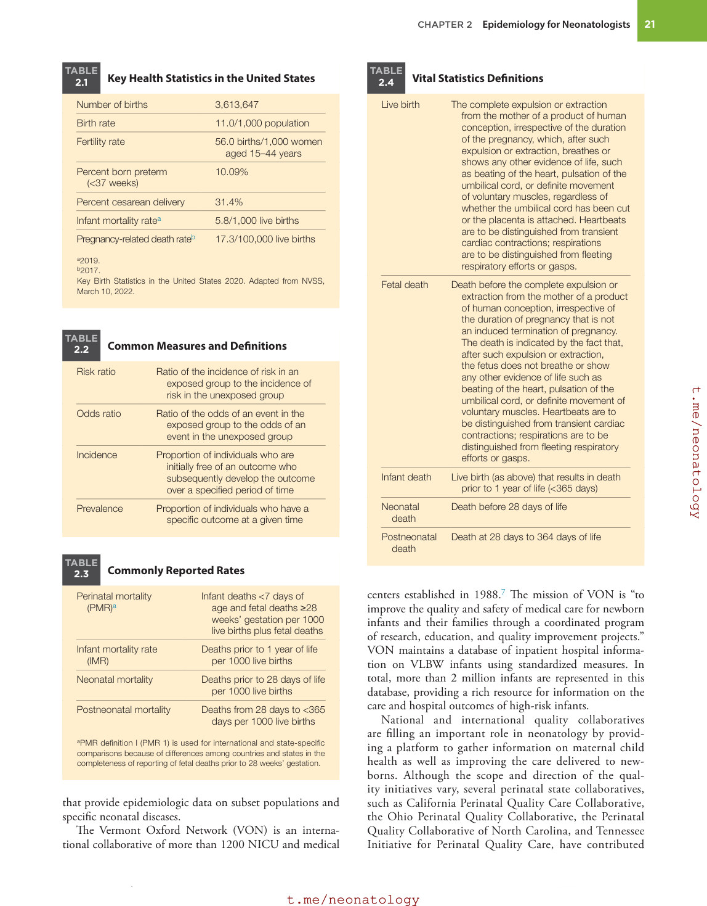

### Original source page 41

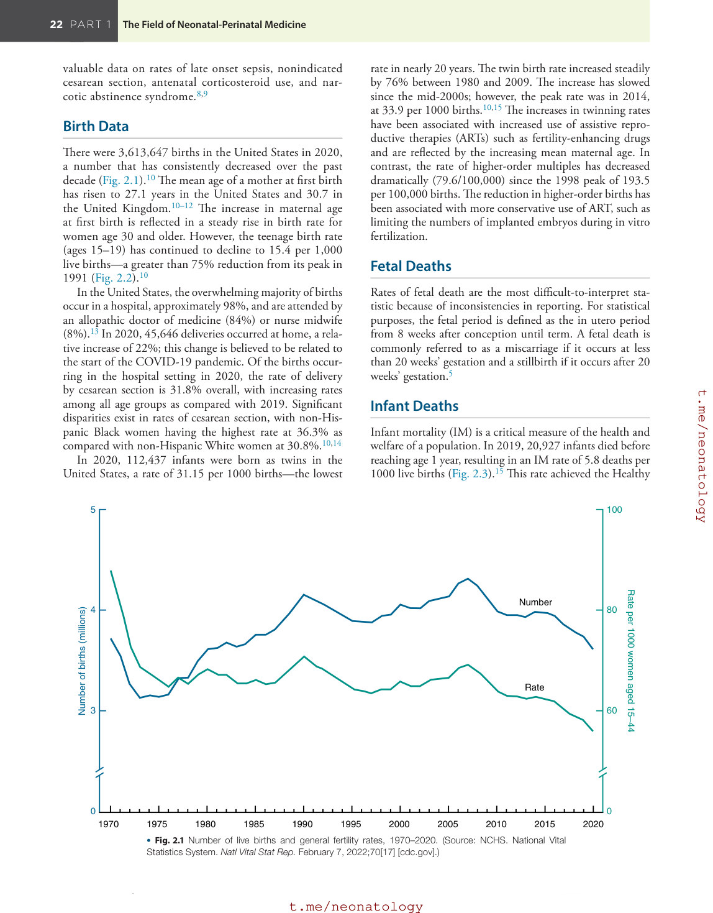

### Original source page 42

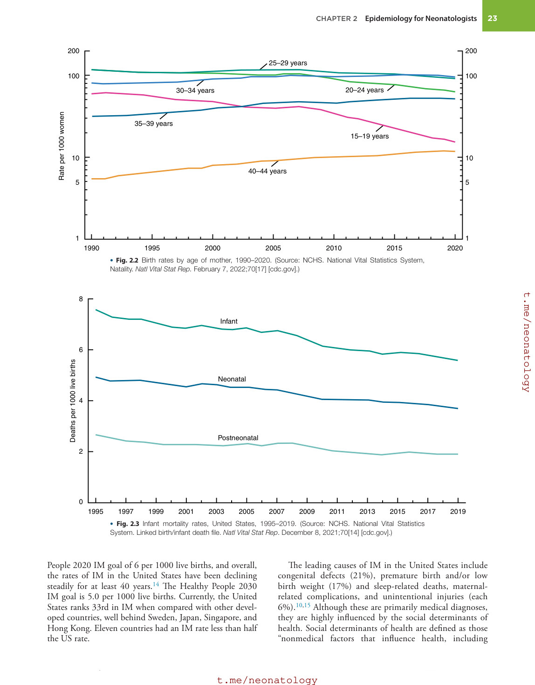

### Original source page 43

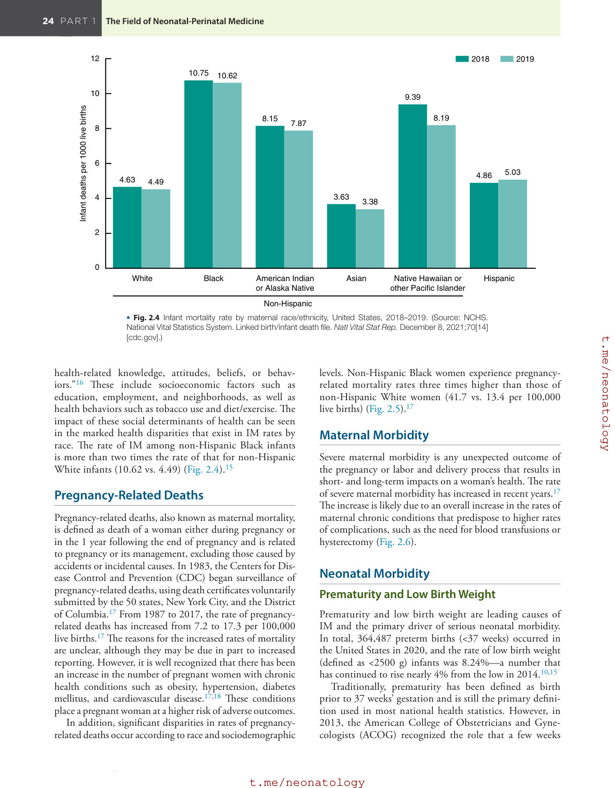

### Original source page 44

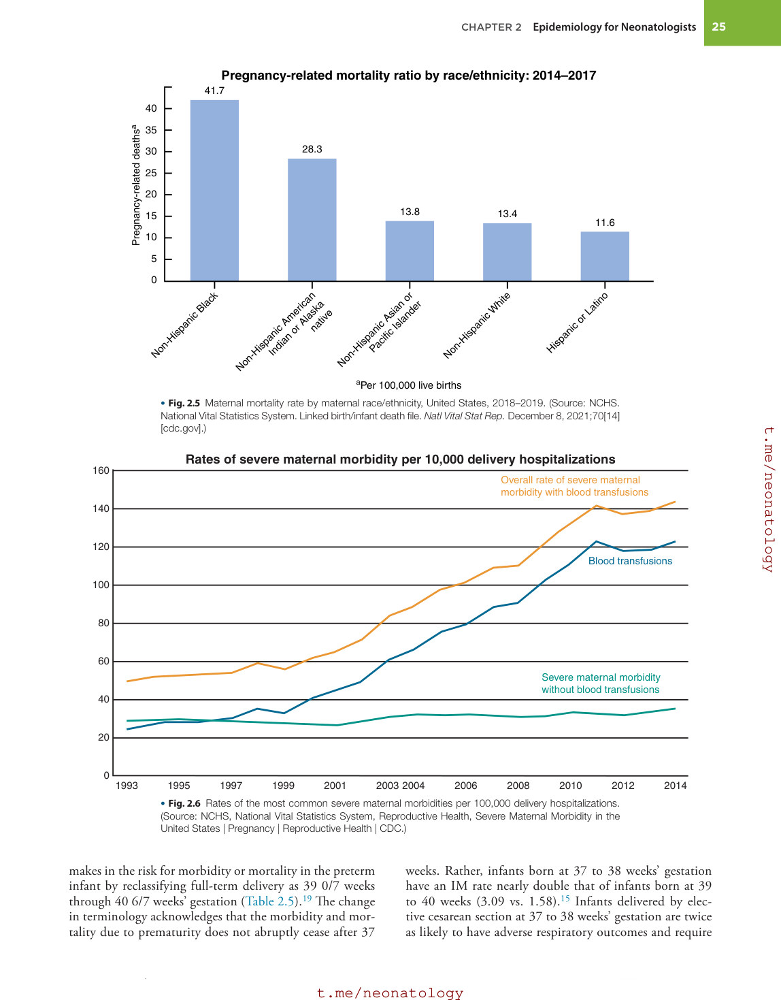

### Original source page 45

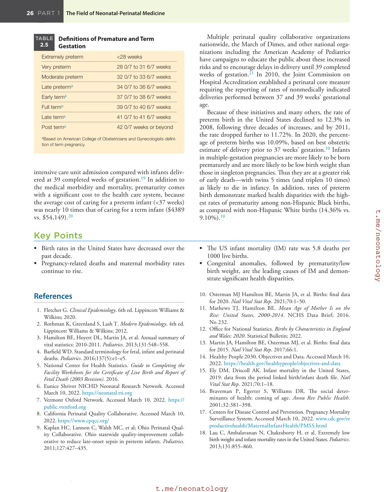

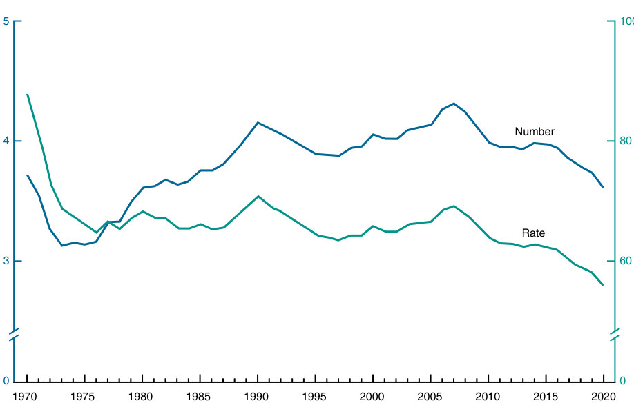

• Fig. 2.1 Number of live births and general fertility rates, 1970–2020. (Source: NCHS. National Vital Statistics System. Natl Vital Stat Rep. February 7, 2022;70[17] [cdc.gov].)

PDF p. 41

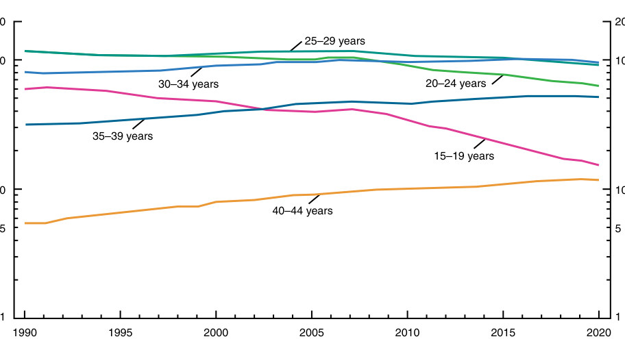

• Fig. 2.2 Birth rates by age of mother, 1990–2020. (Source: NCHS. National Vital Statistics System, Natality. Natl Vital Stat Rep. February 7, 2022;70[17] [cdc.gov].)

PDF p. 42

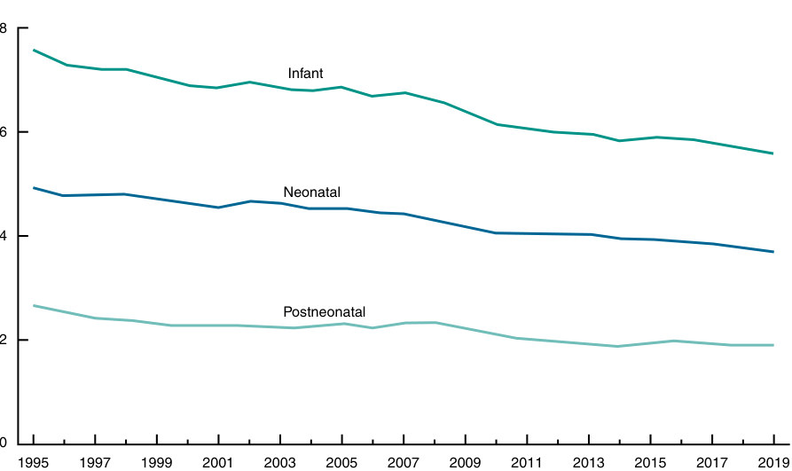

• Fig. 2.3 Infant mortality rates, United States, 1995–2019. (Source: NCHS. National Vital Statistics System. Linked birth/infant death file. Natl Vital Stat Rep. December 8, 2021;70[14] [cdc.gov].)

PDF p. 42

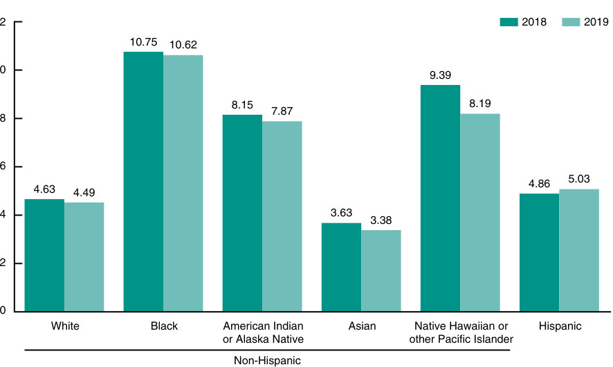

• Fig. 2.4 Infant mortality rate by maternal race/ethnicity, United States, 2018–2019. (Source: NCHS. National Vital Statistics System. Linked birth/infant death file. Natl Vital Stat Rep. December 8, 2021;70[14] [cdc.gov].)

PDF p. 43

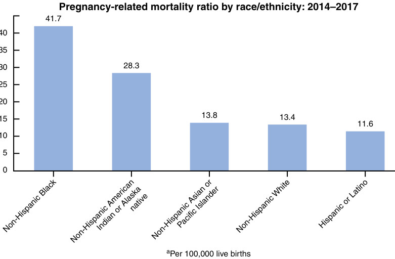

• Fig. 2.5 Maternal mortality rate by maternal race/ethnicity, United States, 2018–2019. (Source: NCHS. National Vital Statistics System. Linked birth/infant death file. Natl Vital Stat Rep. December 8, 2021;70[14] [cdc.gov].)

PDF p. 44

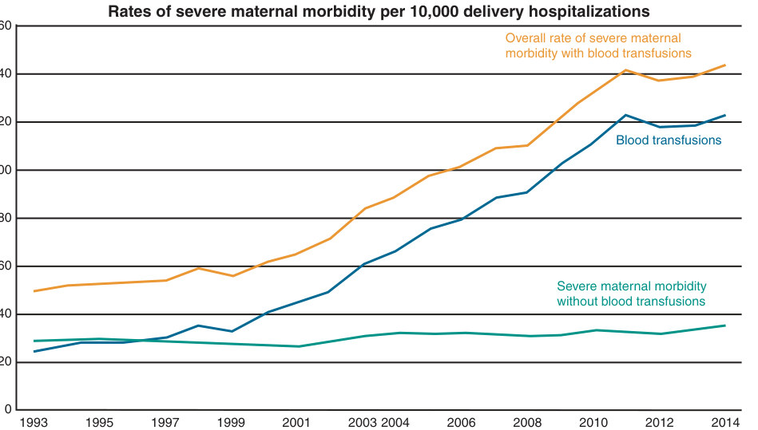

• Fig. 2.6 Rates of the most common severe maternal morbidities per 100,000 delivery hospitalizations. (Source: NCHS, National Vital Statistics System, Reproductive Health, Severe Maternal Morbidity in the United States | Pregnancy | Reproductive Health | CDC.)

PDF p. 44
