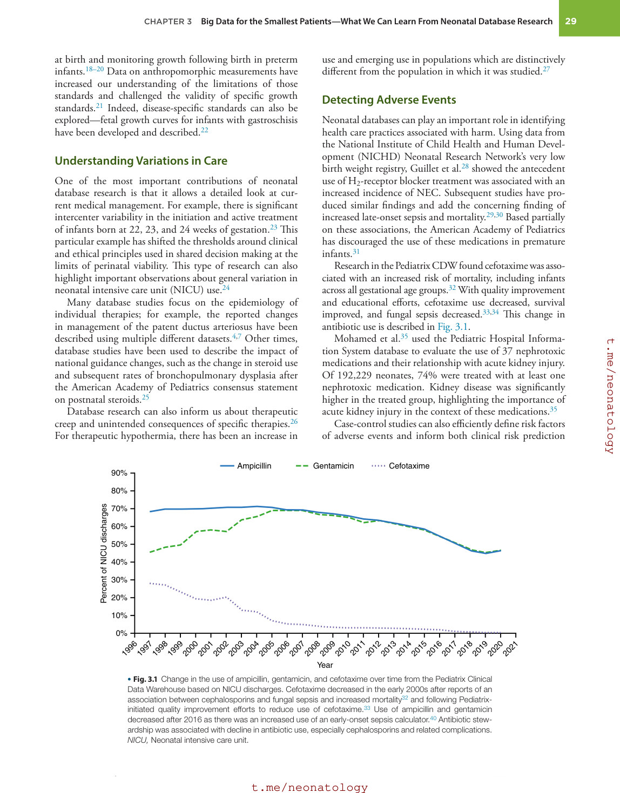
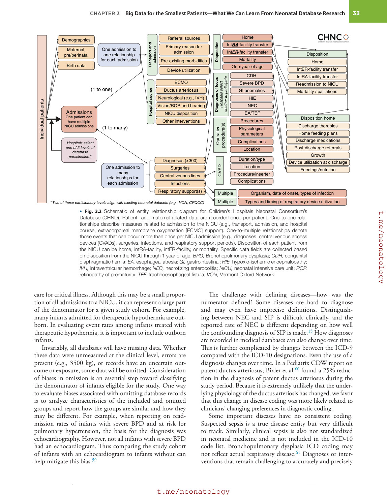
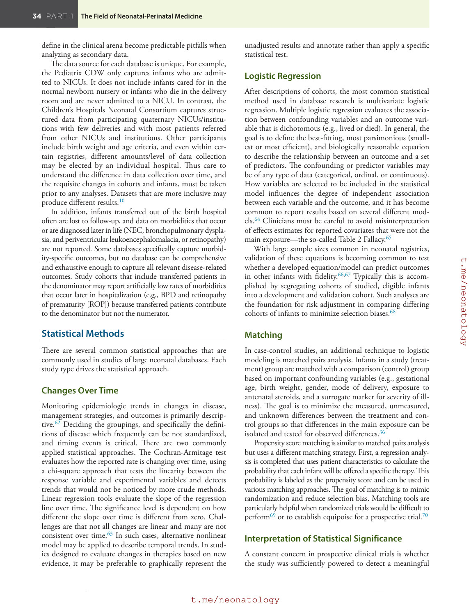
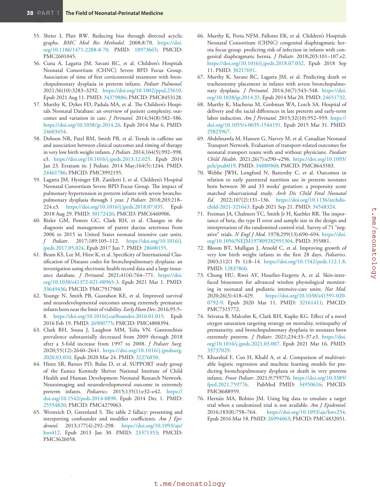
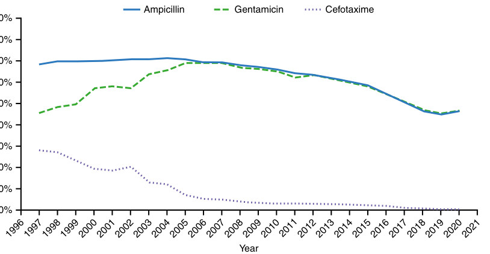
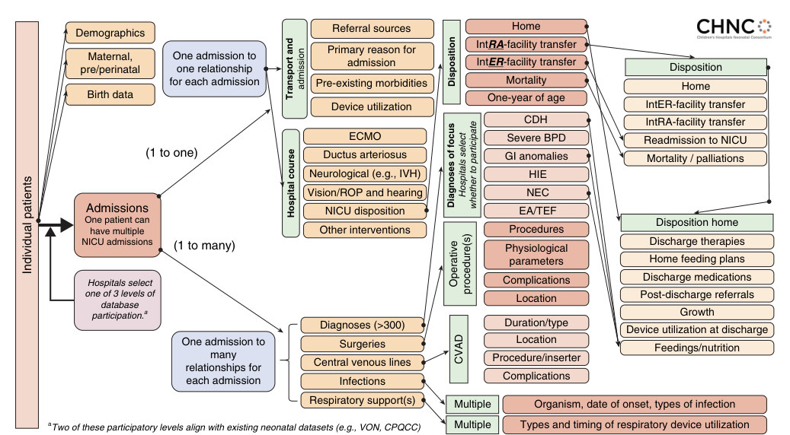

# 3. Big Data for the Smallest Patients—What We Can Learn From Neonatal Database Research
> Source attribution: [Source credits](../../SOURCE_CREDITS.md).

## PDF page 47 | printed page 28

3 Big Data for the Smallest Patients—What We Can Learn From Neonatal Database Research

### VEERAL NALIN TOLIA, REESE H. CLARK, AND KARNA MURTHY

### Introduction: Neonatal Database Research

A recent systematic review identified more than 82 neonatal clinical databases.1 These databases, which include both regional and national sources and originate in many different countries, are a rich source of data for observational research and have resulted in more than 2000 publications.

Important insights can be made using observational studies from these sources of “big data.” Big data describes large, complex data that are both structured and unstructured. Structured data are captured in predefined methods such as pick list (e.g., International Classification of Diseases codes, gestational age, and birth weight). Unstructured data are not predefined and not coded (e.g., free text comments, pictures, and audio messages). With overwhelming amounts of data stored in electronic medical records, electronic bedside patient monitors, ventilators, laboratory equipment, and smartphones, data scientists spend 50% to 80% of their time curating and preparing data before they can be analyzed. Big data should be organized and easily retrievable and should inform the care we provide to our current and future patients. Big data are valuable only if they are explored and validated.

In neonatology, we are fortunate to have many highquality datasets, including (but not limited to) the Centers for Disease Control and Prevention National Vital Statistics System,2 National Institute of Child Health and Development Generic Database,3 Canadian Neonatal Network,4 Children’s Hospitals Neonatal Consortium,5 Vermont Oxford Network (VON),6 California Perinatal Quality Care Collaborative,7 UK National Neonatal Research Database,8 Neonatal Research Network of Japan,9 and Pediatrix Clinical Data Warehouse (CDW),10 and others. Although database studies cannot replace prospective randomized trials,

28

they have become an essential tool to incorporate real-world clinical data and observations toward expanding our knowledge in neonatal medicine.

### The Scope of Research Using Neonatal

### Databases

### Defining Neonatal Diseases

Research studies from neonatal databases have been critical in defining the incidence of neonatal disease, such as reporting important neonatal morbidities among extremely premature infants.3 They have also been used to identify emerging diseases and the associated health care cost, such as in the rapid rise in neonatal opioid withdrawal syndrome.11,12 Database research also can provide important benchmarks for care, such as the data provided by the VON.13

Sometimes, database research can help elucidate differences between similar diseases, especially when the incidence is uncommon. For example, factors to help distinguish spontaneous intestinal perforation (SIP) from necrotizing enterocolitis (NEC) have come from comparing these uncommon diseases using large clinical data sets.14 Compared with infants with NEC, patients with SIP are smaller and less mature and required more support.15 Database queries can be used to discriminate between the severities of a single disease, such as distinguishing surgical NEC from other forms.16 In addition, database queries can isolate outcomes related to multiple definitions of disease in circumstances where clinical definitions are changing or imprecise.17

Neonatal databases have been critical in the development of standards for assigning small and large for gestational age

## PDF page 48 | printed page 29

at birth and monitoring growth following birth in preterm infants.18–20 Data on anthropomorphic measurements have increased our understanding of the limitations of those standards and challenged the validity of specific growth standards.21 Indeed, disease-specific standards can also be explored—fetal growth curves for infants with gastroschisis have been developed and described.22

### Understanding Variations in Care

One of the most important contributions of neonatal database research is that it allows a detailed look at current medical management. For example, there is significant intercenter variability in the initiation and active treatment of infants born at 22, 23, and 24 weeks of gestation.23 This particular example has shifted the thresholds around clinical and ethical principles used in shared decision making at the limits of perinatal viability. This type of research can also highlight important observations about general variation in neonatal intensive care unit (NICU) use.24

Many database studies focus on the epidemiology of individual therapies; for example, the reported changes in management of the patent ductus arteriosus have been described using multiple different datasets.4,7 Other times, database studies have been used to describe the impact of national guidance changes, such as the change in steroid use and subsequent rates of bronchopulmonary dysplasia after the American Academy of Pediatrics consensus statement on postnatal steroids.25

Database research can also inform us about therapeutic creep and unintended consequences of specific therapies.26 For therapeutic hypothermia, there has been an increase in

Ampicillin Gentamicin

90%

80%

Percent of NICU discharges

70%

60%

50%

40%

30%

20%

10%

0%

1997 1998 1999 2000 2001 2002 2003 2004 2005 2006 2007 2008 2009

1996

Year

• Fig. 3.1 Change in the use of ampicillin, gentamicin, and cefotaxime over time from the Pediatrix Clinical Data Warehouse based on NICU discharges. Cefotaxime decreased in the early 2000s after reports of an association between cephalosporins and fungal sepsis and increased mortality32 and following Pediatrixinitiated quality improvement efforts to reduce use of cefotaxime.33 Use of ampicillin and gentamicin decreased after 2016 as there was an increased use of an early-onset sepsis calculator.40 Antibiotic stewardship was associated with decline in antibiotic use, especially cephalosporins and related complications. NICU, Neonatal intensive care unit.

use and emerging use in populations which are distinctively different from the population in which it was studied.27

### Detecting Adverse Events

Neonatal databases can play an important role in identifying health care practices associated with harm. Using data from the National Institute of Child Health and Human Development (NICHD) Neonatal Research Network’s very low birth weight registry, Guillet et al.28 showed the antecedent use of H2-receptor blocker treatment was associated with an increased incidence of NEC. Subsequent studies have produced similar findings and add the concerning finding of increased late-onset sepsis and mortality.29,30 Based partially on these associations, the American Academy of Pediatrics has discouraged the use of these medications in premature infants.31

Research in the Pediatrix CDW found cefotaxime was associated with an increased risk of mortality, including infants across all gestational age groups.32 With quality improvement and educational efforts, cefotaxime use decreased, survival improved, and fungal sepsis decreased.33,34 This change in antibiotic use is described in Fig. 3.1.

Mohamed et al.35 used the Pediatric Hospital Information System database to evaluate the use of 37 nephrotoxic medications and their relationship with acute kidney injury. Of 192,229 neonates, 74% were treated with at least one nephrotoxic medication. Kidney disease was significantly higher in the treated group, highlighting the importance of acute kidney injury in the context of these medications.35

Case-control studies can also efficiently define risk factors of adverse events and inform both clinical risk prediction

Cefotaxime

2010 2011 2012 2013 2014 2015 2016 2017 2018 2019 2020 2021

## PDF page 49

and the construction of future prospective trials. In a recent example, risk factors for neonatal thromboses were identified which can lead to targeted surveillance and controlled testing of potential anticoagulating interventions.36

### Development of Risk Estimators

Neonatal database research has been used to develop risk of mortality and morbidity calculators. One important example is the NICHD outcome estimator—which calculates potential risks for both in-hospital and 2-year outcomes based on a few clinical variables. The developers of this calculator leveraged the large number of included patients to offer insights to clinicians and families.37,38 These types of calculators have also been used to define risk of future development of chronic lung disease and can be used to make sample size calculations for prospective clinical studies.39

Another widely used calculator was developed and tested using data from hospitals managed by Kaiser Permanente in Northern California.40 The authors studied 200,000 newborns born at 35 weeks’ gestation or later to understand factors associated with early-onset sepsis. They demonstrated that clinical care algorithms developed using multivariable risk prediction modeling could safely reduce the proportion of newborns undergoing laboratory testing and empiric antibiotic treatment.

### Clinical Questions Not Suited for Randomized Trials

Database research can be a useful tool for hypothesis generation in cases where a randomized trial would be challenging to perform. In such cases, enrolling a large enough sample size to be able to identify possible harms and benefits might preclude a full trial. In a recent study, several dosing amounts of hydrocortisone were evaluated, and higher dosages were associated with a greater risk of death.41

There are other instances where a randomized trial is not feasible. One example is examining models of care and the effects related to how the medical system(s) administer provisions of neonatal intensive care. In one study, short-term in-hospital outcomes were examined as a function of the duration of neonatology rotations.42 Although this study found few differences, large clinical datasets were important to examine the intersection of a clinical-administrative question that is pervasively discussed, and varied, in our field. Another recent study found important risk factors that were associated with attendance at high-risk follow-up clinic visits.43

Database research permits the examination of how changes in care impact patient outcomes in the context of natural experiments where lack of equipoise may preclude a clinical trial. With the national supply shortage of vitamin A in 2011, rates of BPD remained unchanged despite marked reductions in vitamin A use.44 Database research can also be helpful in elucidating factors that cannot be randomly

assigned—particularly important when describing ongoing concerns of the differences in equity of care.45

### Comparative Effectiveness Research

Generating real-world evidence on the effectiveness and safety of preventive and therapeutic interventions can be done using neonatal databases. Neonatal databases reflect routine care delivery and provide timely, generalizable evidence from a large, diverse group of patients. For example, understanding the outcome of infants with congenital diaphragmatic hernia (CDH) who are treated with inhaled nitric oxide is limited by the rare nature of this anomaly. Meta-analysis is helpful, but the sample size for assessing important outcomes in CDH infants is small.46 Using the administrative Pediatric Health Information System database, 1713 neonates with CDH admitted to 33 US pediatric hospitals were examined. More than half received nitric oxide during their inpatient stay, and use varied dramatically between hospitals. Neonates treated with nitric oxide accumulated greater than $81 million in pharmacy charges. Although the proportion of infants receiving nitric oxide and their duration of therapy increased significantly, extracorporeal membrane oxygenation (ECMO) utilization and mortality did not change significantly. Likewise, hospitalspecific mortality rates did not correlate with nitric oxide therapy, ECMO utilization, or case volume.47

Understanding the comparative effectiveness of specific surfactant preparations is important. However, randomized trials comparing the efficacy of different surfactant preparations often demonstrated equivocal results or were terminated early due to lack of enrollment. There are no clinical trials that compare the three surfactant preparations used in the United States, and it is unlikely a head-to-head randomized trial of different surfactant preparations will be done, because of cost and recruitment issues. In this setting, comparative effectiveness analyses or meta-analyses are justified to determine the differences in safety and efficacy, if any, between surfactant preparations.48

### Linkage Analyses

Linking databases can be used to overcome each individual dataset’s limitations and provide novel questions to be asked and answered. Some clinical databases can offer strengths in disease definitions and clinical outcomes, whereas some administrative datasets offer measures in charges/costs and resource utilizations. Combining these at the patient level can offer insights into both variation and “value” or some metric of outcomes relative to costs. For example, 29% of the total variations in costs were noted between centers for infants with hypoxic-ischemic encephalopathy, and sources of these variations could be identified using the combined strengths of both linked datasets.49

Database research can also inform about the real-world effectiveness of interventions that are based in prospective research. Large randomized clinical trials suggested a need

## PDF page 50 | printed page 31

for changes in pulse oximetry alarm policies, but changing the polices was unrelated to both mortality and severe retinopathy among infants born very preterm.50

### Supporting Quality Improvement Initiatives

Large databases in neonatal medicine have transformed the creation, execution, and implementation of quality improvement initiatives. With pre-existing definitions of process and outcome measures, databases can be used to follow change and improve health care delivery and services with the implementation of new approaches. Moreover, these databases can serve to underpin improvements in patient-centered clinical outcomes and foster collaborations within and across institutions to support novel and future improvements to babies’ care and outcomes.

Unit-level quality improvement has been successfully implemented at a large scale to increase compliance with predetermined best practices and outcomes, including both survival and multiple prematurity-associated morbidities.33 Databases and their associated networks can be used to increase compliance and alignment with external recommendations such as a large reduction in antibiotic use achieved across 146 NICUs participating in an antibiotic stewardship quality initiative.51 In parallel endeavors, multidisciplinary collaborations were used to reduce postoperative health care adverse events.52,53

### Interpretation of Neonatal Database Studies

There are several points to consider when analyzing and interpreting research findings from large neonatal databases. Database studies are inherently different from randomized trials. Randomized controlled trials are prospectively defined to mitigate biases. Each data element of the electronic case report form is designed to insure precise reporting of demographic, laboratory, treatment, and outcome data. Randomization is used to create unbiased groups for comparison. Using this approach, cause and effect can be established. However, generalizability is often a concern in randomized studies to determine whether the studied group of patients is similar to other real-world cohorts.

Neonatal database research incorporates real-world data and is infrequently subject to the biases that occur with soliciting consent to participate. Two of the biggest limitations of database research are that the population was not randomly selected and that the data collection was not necessarily designed to assess the investigative question. This becomes particularly problematic if the tested hypothesis was subject to confounding by indication or there are covariates that remained unmeasured or unknown. Limitations in data capture become limitations in the extent to which the analyses can be performed. As such, results from observation studies from databases can only report associations between exposure and outcome variables and

are best used as hypothesis-generating tools. These studies can inform sample size calculations and identify safe ways to change care to improve outcomes. Although investigators may include factors to account for severity of illness and/or proxies used to account for selection bias, they can be incomplete and may not reflect adequately the true severity of illness. Missing data can prevent us from capturing important confounding variables that may strengthen or even nullify the observed associations. Care is variable across sites, and site variations in the process of care influence outcome. Evaluating the interactions between treatment approaches is difficult. Understanding these limitations is critical to thoughtful evaluation of database research studies. Use of the Strengthening the Reporting of Observational Studies in Epidemiology (STROBE) guidelines may provide a more complete view of the strengths and weaknesses of observation studies.54 Directed acyclic graphs may be useful in study design and interpretation when causal pathways are complex.55

Intent is another variable difficult to discern in database research, often because intent is difficult to isolate in clinical bedside care and challenging to code for specifically in datasets. Although later administration of systemic corticosteroids was associated with developing more severe forms of BPD, preventive measures of BPD or treatment of inflammatory changes associated with evolving BPD cannot be easily discerned. Thus confounding by indication must be considered in these complex interpretations.56

### Common Types of Bias in Database Research

The biggest challenge for data analysis of neonatal databases is the ability to detect and account for bias. Bias in the analysis can lead to underestimating or overestimating the primary outcome signal. There are many different types of bias, but four of the most important are ascertainment bias, referral bias, selection bias, and survivor bias.

Ascertainment bias occurs where there are systematic differences in subject definition such that the identification and inclusion of subjects create bias. In database research, this often results from how infants are classified with a disease state. For example, SIP was poorly defined in the late 1980s, but NEC was well defined. As the clinical distinction was reported, reporting of SIPs became more commonly used and this led to an (apparent) increased incidence of the disease. This change was driven by education and not by an underlying change in the disease or therapies/interventions. Ascertainment bias can also occur retrospectively if changes in data collection occurred prior to when the research query is being asked and answered. Knowledge and management of these changes are essential to creating and executing an accurate analysis.

Selection bias is introduced by the selection of infants such that there are measured or unmeasured differences between the groups of infants that are being compared. For example, we know from prospective clinical trials that inhaled nitric oxide is unrelated to risks of mortality in term infants who meet criteria for treatment with ECMO.

## PDF page 51

However, in most database studies, it will appear that infants treated with inhaled nitric oxide are more likely to die—particularly when data analyses of infants are not corrected for severity of illness. What drives this finding is that nitric oxide is generally reserved for infants who deteriorate even with mechanical ventilation and have significant lung disease with pulmonary hypertension. Without clear, reproducible, and measured markers of pulmonary hypertension, the use of nitric oxide in this population becomes a surrogate marker for severity of illness, rather than a possible cause of harm.

Referral bias occurs where the sample of infants in the study does not accurately reflect the general population of infants who are being studied and is a subset of selection bias. This bias clusters in infants hospitalized in quaternary, referral-based NICUs. Infants admitted to these facilities are typically outborn and are referred for complex management and highly specialized care (e.g., pediatric subspecialty care/ services). The proportion of infants with genetic diseases and major congenital anomalies is higher in these types of hospitals than in a similar level of care hospital with a delivery service. Given the complexities of disease(s)—and their interactions—the anticipated morbidities are greater.57 For example, infants with suspected NEC or NEC that can be managed medically are often managed in perinatal centers without pediatric surgical support; conversely, infants with severe NEC and/or pneumoperitoneum require access to surgical services and require transfer to a quaternary center. Referral biases would invalidate comparisons in outcomes related to NEC between NICUs offering pediatric surgical services and NICUs that did not. Furthermore, the outcomes of infants with NEC who were cared for at NICUs with pediatric services will be different than those reported from NICUs without surgical support. Correcting for referral bias requires careful reporting of the study cohort and the severity of illness.

In contrast, a NICU with an internal delivery service that refers complex infants to a quaternary center will have fewer complex patients and likely have fewer patients with morbidities and/or risks for adverse events. For these reasons, many neonatal databases used in quality improvement stratify results by carefully defined levels of care. These distinctions are not standardized, and the level of care offered at a single institution can change over time. Even within the same hospital, complex infants are referred for subspecialty care in units outside of the NICU, which further reduces the complexity of the population remaining in the NICU. This leads to systematic and differential biases in the populations that are cared for in each unit that is not always accounted for in the definitions or classifications of NICUs.

Survivor bias is another form of selection bias that is caused by differential inclusion or exclusion of infants who have died in comparison groups. For example, if we are comparing mortality of infants who received a specific medication early in life to other infants treated later in age with the same drug, we may see that the “early use” is associated with a higher mortality. This is the distortion introduced

by survivor bias. When comparing these two infants, we have artificially exclusively selected survivors to the group of infants who were treated late. Dobson et al.58 found this scenario in a study of early caffeine use in premature infants. Infants receiving early caffeine, particularly those at younger than 24 weeks’ gestational age, had a higher incidence of death. Although this finding is of potential concern, the lower mortality observed in the late caffeine group is more likely a result of survival bias. Mortality at this gestation is high, and most deaths occur early after birth. In this study, an infant who received early caffeine (shortly after birth) remained at higher risk of dying through day of life 4. In contrast, an infant in late caffeine cohort (who received caffeine on day of life 5) had already survived this period.58

### Understanding Data Sources

The data in neonatal databases are typically derived data from two broad groups—first, patient registries that are designed to support quality improvement and/or research efforts. These data are typically extracted into structured data from a medical record by trained personnel. They offer benefits: abstraction permit adherence to prespecific definitions in a standard method, the ability to conduct interrater and intra-rater reliability testing and even validation of inter-rater coding that can augment the validity and accuracy of data collected. Although very resource intensive, this time-honored method of data collection permits reliable, accurate, and reproducible data collection.

The second broad group is data captured as part of electronic documentation of the medical record. These data are typically considered administrative, are less structured, and generally need more curation and coding. A subset of these ascertain data from the nonclinical parts of the medical record, even the billing record (e.g., Pediatric Health Information Systems) that can be used to glean what types of clinical interventions were performed in relationship to the outcomes achieved. A clear strength is the amount of data types, structured and unstructured, as well as the volume of data that can be harnessed. Because each neonatal database has its own unique set of limitations with regards to data source, it is important to be thoughtful when evaluating how each study chose to define the denominator and the numerator. A schematic representing data capture in the Children’s Hospitals Neonatal Consortium’s Database in Fig. 3.2 describes the complex relationship of data capture.

Choices made in defining the study cohort are important—how was the denominator defined? Inclusion and exclusion factors meaningfully influence the denominator in cohort studies. Examples include: if outborn infant referrals are included; if infants with congenital anomalies are excluded; and if infants transferred to another service or higher level of care institution are included in the study cohort. A key consideration is often whether the infants included in the study were eligible to achieve the outcome. Outborn infants are generally referred to a higher level of

## PDF page 52 | printed page 33

Referral sources

Demographics

Transport and admission

Primary reason for admission

One admission to one relationship for each admission

Maternal, pre/perinatal

Pre-existing morbidities

Birth data

Device utilization

ECMO

(1 to one)

Ductus arteriosus

Hospital course

Neurological (e.g., IVH)

Individual patients

Vision/ROP and hearing

Admissions One patient can have multiple NICU admissions

NICU disposition

Other interventions

(1 to many)

Hospitals select one of 3 levels of database participation.a

Diagnoses (>300)

One admission to many relationships for each admission

Surgeries

Central venous lines

Infections

Respiratory support(s)

aTwo of these participatory levels align with existing neonatal datasets (e.g., VON, CPQCC)

• Fig. 3.2 Schematic of entity relationship diagram for Children’s Hospitals Neonatal Consortium’s Database (CHND). Patient- and maternal-related data are recorded once per patient. One-to-one relationships describe measures related to admission to the NICU (e.g., transport, admission, and hospital course, extracorporeal membrane oxygenation [ECMO] support). One-to-multiple relationships denote those events that can occur more than once per NICU admission (e.g., diagnoses, central venous access devices (CVADs), surgeries, infections, and respiratory support periods). Disposition of each patient from the NICU can be home, intRA-facility, intER-facility, or mortality. Specific data fields are collected based on disposition from the NICU through 1 year of age. BPD, Bronchopulmonary dysplasia; CDH, congenital diaphragmatic hernia; EA, esophageal atresia; GI, gastrointestinal; HIE, hypoxic-ischemic encephalopathy; IVH, intraventricular hemorrhage; NEC, necrotizing enterocolitis; NICU, neonatal intensive care unit; ROP, retinopathy of prematurity; TEF, tracheoesophageal fistula; VON, Vermont Oxford Network.

care for critical illness. Although this may be a small proportion of all admissions to a NICU, it can represent a large part of the denominator for a given study cohort. For example, many infants admitted for therapeutic hypothermia are outborn. In evaluating event rates among infants treated with therapeutic hypothermia, it is important to include outborn infants.

Invariably, all databases will have missing data. Whether these data were unmeasured at the clinical level, errors are present (e.g., 3500 kg), or records have an uncertain outcome or exposure, some data will be omitted. Consideration of biases in omission is an essential step toward classifying the denominator of infants eligible for the study. One way to evaluate biases associated with omitting database records is to analyze characteristics of the included and omitted groups and report how the groups are similar and how they may be different. For example, when reporting on readmission rates of infants with severe BPD and at risk for pulmonary hypertension, the basis for the diagnosis was echocardiography. However, not all infants with severe BPD had an echocardiogram. Thus comparing the study cohort of infants with an echocardiogram to infants without can help mitigate this bias.59

Home

Disposition

IntRA-facility transfer

IntER-facility transfer

Disposition

Mortality

Home

One-year of age

IntER-facility transfer

CDH

IntRA-facility transfer

Diagnoses of focus Hospitals select whether to participate

Severe BPD

Readmission to NICU

GI anomalies

Mortality / palliations

HIE

NEC

EA/TEF

Disposition home

Procedures

CVAD Operative procedure(s)

Discharge therapies

Physiological parameters

Home feeding plans

Discharge medications

Complications

Post-discharge referrals

Location

Growth

Duration/type

Device utilization at discharge

Location

Feedings/nutrition

Procedure/inserter

Complications

Multiple

Organism, date of onset, types of infection

Multiple

Types and timing of respiratory device utilization

The challenge with defining diseases—how was the numerator defined? Some diseases are hard to diagnose and may even have imprecise definitions. Distinguishing between NEC and SIP is difficult clinically, and the reported rate of NEC is different depending on how well the confounding diagnosis of SIP is made.15 How diagnoses are recorded in medical databases can also change over time. This is further complicated by changes between the ICD-9 compared with the ICD-10 designations. Even the use of a diagnosis changes over time. In a Pediatrix CDW report on patent ductus arteriosus, Bixler et al.60 found a 25% reduction in the diagnosis of patent ductus arteriosus during the study period. Because it is extremely unlikely that the underlying physiology of the ductus arteriosis has changed, we favor that this change in disease coding was more likely related to clinicians’ changing preferences in diagnostic coding.

Some important diseases have no consistent coding. Suspected sepsis is a true disease entity but very difficult to track. Similarly, clinical sepsis is also not standardized in neonatal medicine and is not included in the ICD-10 code list. Bronchopulmonary dysplasia ICD coding may not reflect actual respiratory disease.61 Diagnoses or interventions that remain challenging to accurately and precisely

## PDF page 53

define in the clinical arena become predictable pitfalls when analyzing as secondary data.

The data source for each database is unique. For example, the Pediatrix CDW only captures infants who are admitted to NICUs. It does not include infants cared for in the normal newborn nursery or infants who die in the delivery room and are never admitted to a NICU. In contrast, the Children’s Hospitals Neonatal Consortium captures structured data from participating quaternary NICUs/institutions with few deliveries and with most patients referred from other NICUs and institutions. Other participants include birth weight and age criteria, and even within certain registries, different amounts/level of data collection may be elected by an individual hospital. Thus care to understand the difference in data collection over time, and the requisite changes in cohorts and infants, must be taken prior to any analyses. Datasets that are more inclusive may produce different results.10

In addition, infants transferred out of the birth hospital often are lost to follow-up, and data on morbidities that occur or are diagnosed later in life (NEC, bronchopulmonary dysplasia, and periventricular leukoencephalomalacia, or retinopathy) are not reported. Some databases specifically capture morbidity-specific outcomes, but no database can be comprehensive and exhaustive enough to capture all relevant disease-related outcomes. Study cohorts that include transferred patients in the denominator may report artificially low rates of morbidities that occur later in hospitalization (e.g., BPD and retinopathy of prematurity [ROP]) because transferred patients contribute to the denominator but not the numerator.

### Statistical Methods

There are several common statistical approaches that are commonly used in studies of large neonatal databases. Each study type drives the statistical approach.

### Changes Over Time

Monitoring epidemiologic trends in changes in disease, management strategies, and outcomes is primarily descriptive.62 Deciding the groupings, and specifically the definitions of disease which frequently can be not standardized, and timing events is critical. There are two commonly applied statistical approaches. The Cochran-Armitage test evaluates how the reported rate is changing over time, using a chi-square approach that tests the linearity between the response variable and experimental variables and detects trends that would not be noticed by more crude methods. Linear regression tools evaluate the slope of the regression line over time. The significance level is dependent on how different the slope over time is different from zero. Challenges are that not all changes are linear and many are not consistent over time.63 In such cases, alternative nonlinear model may be applied to describe temporal trends. In studies designed to evaluate changes in therapies based on new evidence, it may be preferable to graphically represent the

unadjusted results and annotate rather than apply a specific statistical test.

### Logistic Regression

After descriptions of cohorts, the most common statistical method used in database research is multivariate logistic regression. Multiple logistic regression evaluates the association between confounding variables and an outcome variable that is dichotomous (e.g., lived or died). In general, the goal is to define the best-fitting, most parsimonious (smallest or most efficient), and biologically reasonable equation to describe the relationship between an outcome and a set of predictors. The confounding or predictor variables may be of any type of data (categorical, ordinal, or continuous). How variables are selected to be included in the statistical model influences the degree of independent association between each variable and the outcome, and it has become common to report results based on several different models.64 Clinicians must be careful to avoid misinterpretation of effects estimates for reported covariates that were not the main exposure—the so-called Table 2 Fallacy.65

With large sample sizes common in neonatal registries, validation of these equations is becoming common to test whether a developed equation/model can predict outcomes in other infants with fidelity.66,67 Typically this is accomplished by segregating cohorts of studied, eligible infants into a development and validation cohort. Such analyses are the foundation for risk adjustment in comparing differing cohorts of infants to minimize selection biases.68

### Matching

In case-control studies, an additional technique to logistic modeling is matched pairs analysis. Infants in a study (treatment) group are matched with a comparison (control) group based on important confounding variables (e.g., gestational age, birth weight, gender, mode of delivery, exposure to antenatal steroids, and a surrogate marker for severity of illness). The goal is to minimize the measured, unmeasured, and unknown differences between the treatment and control groups so that differences in the main exposure can be isolated and tested for observed differences.36

Propensity score matching is similar to matched pairs analysis but uses a different matching strategy. First, a regression analysis is completed that uses patient characteristics to calculate the probability that each infant will be offered a specific therapy. This probability is labeled as the propensity score and can be used in various matching approaches. The goal of matching is to mimic randomization and reduce selection bias. Matching tools are particularly helpful when randomized trials would be difficult to perform69 or to establish equipoise for a prospective trial.70

### Interpretation of Statistical Significance

A constant concern in prospective clinical trials is whether the study was sufficiently powered to detect a meaningful

## PDF page 54 | printed page 35

difference between the intervention and control groups. Factors that drive this analysis are the occurrence rate for the primary outcome, the magnitude of the expected difference between the two groups, and the achievable sample size. It requires a larger sample to evaluate the differences between outcomes if the effect size is small or the event rate is rare. This becomes problematic in randomized controlled trials if the a priori estimates overestimate the primary outcome rate and/or the difference between intervention and control groups. Single center trials are oftentimes underpowered to detect a difference.71

When using big data, the opposite is true. Because the sample sizes are large, it is much easier for investigators to detect differences that are statistically significant. These may not be clinically important. For example, in a recent NICHD study evaluating extremely preterm infants, maternal age differed significantly across gestational age.3 Although this difference was statistically significant, the clinical significance of some gestational age infants having a maternal age that was 1 year greater is probably marginal. Similarly, Bloom et al.72 found a difference in head circumference at the time of hospital discharge in a continuous quality improvement project aimed at improving growth of very low birth weight infants during the first 28 days. The difference after the intervention was an increase in the mean of 0.2 cm. Although statistically significant, the difference is within the error of the measurement and it is unlikely that the difference was clinically meaningful.

### The Future of Big Data in Neonatology

In the NICU, there remain many opportunities for additional data collection. Nursing assessments include vital signs, pain/comfort assessments, and the interventions that infants require (e.g., suction, repositioning, titration of FiO2). Respiratory therapists and rehabilitation specialists provide insights on other critical functions to assess

Key Points

• Neonatal database research is increasing and has the

potential to add meaningful clinical evidence. • Database research has been used to describe disease

incidence and variations in care, identify adverse

### References

1. Statnikov Y, Ibrahim B, Modi N. A systematic review of admin-

istrative and clinical databases of infants admitted to neonatal units. Arch Dis Child Fetal Neonatal Ed. 2017;102(3):F270– F276. https://doi.org/10.1136/archdischild-2016-312010. Epub 2017 Jan 13. PMID: 28087722. 2. National Vital Statistics System. Centers for Disease Control and

Prevention; 2022. Reviewed March 1. Accessed April 12, 2022. https://www.cdc.gov/nchs/nvss/births.htm 3. Bell EF, Hintz SR, Hansen NI, et al. Eunice Kennedy Shriver

National Institute of Child Health and Human Development Neonatal Research Network. Mortality, in-hospital morbidity, care

swallowing, tone, responses to therapy, and even whether cardiorespiratory support can be sufficient to promote an acceptable neurodevelopmental trajectory. Patient electronic monitors routinely display real-time trends in heart rate, pulse oximetry, respiratory rate measure by impedance changes, and, when arterial access is present, blood pressure. In infants with respiratory failure, mechanical ventilation devices have evolved to display, track, and store trends in numerous markers of pulmonary function/physiology. Ancillary monitors for indirect markers of cardiac output (e.g., near-infrared spectroscopy) and the up-and-coming generation of wearable devices73 will continue to expand the trend of incorporating large data sources into neonatology’s clinical practice, research, and quality improvement.

Creating real-time dashboards that allow monitoring of changes in care and associated changes in outcome may allow us to identify important associations.74 If we carefully document the diagnoses we make and the care we provide in a structured way, there is much we can learn from the patterns that accumulate. Changes in the way that data are analyzed, using techniques such as machine learning75 and target trials,76 may also offer greater insights into neonatal care. Database research might also be used to augment future clinical trials by identifying high-risk populations, decreasing sample sizes, and gaining efficiency in time and costs of these trials.

There is a difference between knowledge and wisdom. Knowledge is the accumulation of meaningful facts. Wisdom is integration of knowledge in a way that offers benefits. In health care, we may know the precisely correct diagnosis and the treatment, but it takes wisdom to apply that knowledge to plans that takes into account the clinical context of the patient and the impact of the diagnosis and treatment on our patients. Neonatal database research can be instrumental in increasing both diagnostic precision and therapeutic effectiveness to minimize burdens and improve outcomes for children and their families.

events, design risk estimators and evaluate comparative effectiveness. • Careful attention to sources of bias in the design and

interpretation of these studies is critical.

practices, and 2-year outcomes for extremely preterm infants in the US, 2013-2018. JAMA. 2022;327(3):248–263. https://doi. org/10.1001/jama.2021.23580. PMID: 35040888; PMCID: PMC8767441. 4. Lokku A, Mirea L, Lee SK, Shah PS, Canadian Neonatal Net-

work. Trends and outcomes of patent ductus arteriosus treatment in very preterm infants in Canada. Am J Perinatol. 2017;34(5):441–450. https://doi.org/10.1055/s-0036-1593351. Epub 2016 Sep 20. PMID: 27649293. 5. Mahmood B, Murthy K, Rintoul N, et al. Children’s Hospi-

tals Neonatal Consortium. Predicting treatment of pulmonary hypertension at discharge in infants with congenital diaphragmatic hernia. J Perinatol. 2022;42(1):45–52. https://doi.

## PDF page 55

org/10.1038/s41372-021-01249-6. Epub 2021 Oct 28. PMID: 34711937. 6. Edwards EM, Ehret DEY, Soll RF, Horbar JD. Vermont Oxford

Network: a worldwide learning community. Transl Pediatr. 2019;8(3):182–192. https://doi.org/10.21037/tp.2019.07.01. PMID: 31413952; PMCID: PMC6675680. 7. Ngo S, Profit J, Gould JB, Lee HC. Trends in patent ductus arteri-

osus diagnosis and management for very low birth weight infants. Pediatrics. 2017;139(4):e20162390. https://doi.org/10.1542/ peds.2016-2390. PMID: 28562302; PMCID: PMC5369670. 8. Gale C, Morris I. Neonatal Data Analysis Unit (NDAU) Steer-

ing Board. The UK National Neonatal Research Database: using neonatal data for research, quality improvement and more. Arch Dis Child Educ Pract Ed. 2016;101(4):216–218. https://doi. org/10.1136/archdischild-2015-309928. Epub 2016 Mar 11. PMID: 26968617; PMCID: PMC4975807. 9. Kawasaki H, Yamada T, Takahashi Y, et al. Neonatal Research

Network of Japan. Epidemiology of birth defects in very low birth weight infants in Japan. J Pediatr. 2020;226:106–111.e10. https://doi.org/10.1016/j.jpeds.2020.07.012. Epub 2020 Jul 5. PMID: 32634406. 10. Tolia VN, Clark RH. The denominator matters! Lessons from

large database research in neonatology. Children. 2020;7(11):216. https://doi.org/10.3390/children7110216. PMID: 33171732; PMCID:. 11. Patrick SW, Schumacher RE, Benneyworth BD, et al. Neona-

tal abstinence syndrome and associated health care expenditures: United States, 2000-2009. JAMA. 2012;307(18):1934–1940. https://doi.org/10.1001/jama.2012.3951. Epub 2012 Apr 30. PMID: 22546608. 12. Tolia VN, Patrick SW, Bennett MM, et al. Increasing incidence

of the neonatal abstinence syndrome in U.S. neonatal ICUs. N Engl J Med. 2015;372(22):2118–2126. https://doi.org/10.1056/ NEJMsa1500439. Epub 2015 Apr 26. PMID: 25913111. 13. Horbar JD, Edwards EM, Greenberg LT, et al. Variation in per-

formance of neonatal intensive care units in the United States. JAMA Pediatr. 2017;171(3):e164396. https://doi.org/10.1001/ jamapediatrics.2016.4396. Epub 2017 Mar 6. Erratum in: JAMA Pediatr. 2017 Mar 1;171(3):306. PMID: 28068438. 14. Swanson JR, Hair A, Clark RH, Gordon PV. Spontaneous

intestinal perforation (SIP) will soon become the most common form of surgical bowel disease in the extremely low birth weight (ELBW) infant. J Perinatol. 2022. https://doi.org/10.1038/ s41372-022-01347-z. Epub ahead of print. PMID: 35177793. 15. Attridge JT, Clark R, Walker MW, Gordon PV. New insights

into spontaneous intestinal perforation using a national data set: (1) SIP is associated with early indomethacin exposure. J Perinatol. 2006;26(2):93–99. https://doi.org/10.1038/sj.jp.7211429. PMID: 16319937. 16. Murthy K, Yanowitz TD, DiGeronimo R, et al. Short-term out-

comes for preterm infants with surgical necrotizing enterocolitis. J Perinatol. 2014;34(10):736–740. https://doi.org/10.1038/ jp.2014.153. Epub 2014 Aug 21. PMID: 25144157. 17. Vyas-Read S, Logan JW, Cuna AC, et al. A comparison of newer

classifications of bronchopulmonary dysplasia: findings from the Children’s Hospitals Neonatal Consortium Severe BPD Group. J Perinatol. 2022;42(1):58–64. https://doi.org/10.1038/s41372- 021-01178-4. Epub 2021 Aug 5. PMID: 34354227; PMCID: PMC8340076. 18. Fenton TR, Kim JH. A systematic review and meta-analysis

to revise the Fenton growth chart for preterm infants. BMC

Pediatr. 2013;13:59. https://doi.org/10.1186/1471-2431-13-59. PubMed PMID: 23601190; PMCID: PMC3637477. 19. Olsen IE, Groveman SA, Lawson ML, et al. New intrauter-

ine growth curves based on United States data. Pediatrics. 2010;125(2):e214–e224. https://doi.org/10.1542/peds.2009- 0913. Epub 2010 Jan 25. PMID: 20100760. 20. Boghossian NS, Geraci M, Edwards EM, et al. Anthropomet-

ric charts for infants born between 22 and 29 weeks’ gestation. Pediatrics. 2016;138(6):e20161641. https://doi.org/10.1542/ peds.2016-1641. Epub 2016 Nov 18. PMID: 27940694. 21. Ferguson AN, Olsen IE, Clark RH, et al. Differential classifi-

cation of infants in United States neonatal intensive care units for weight, length, and head circumference by United States and international growth curves. Ann Hum Biol. 2020;47(6):564– 571. https://doi.org/10.1080/03014460.2020.1817555. Epub 2020 Sep 18. PMID: 32945183. 22. Murthy K, Evans JR, Bhatia AM, et al. The association of type of

surgical closure on length of stay among infants with gastroschisis born ≥34 weeks’ gestation. J Pediatr Surg. 2014;49(8):1220– 1225. https://doi.org/10.1016/j.jpedsurg.2013.12.020. Epub 2014 Jan 2. PMID: 25092080. 23. Rysavy MA, Li L, Bell EF, et al. Eunice Kennedy Shriver

National Institute of Child Health and Human Development Neonatal Research Network. Between-hospital variation in treatment and outcomes in extremely preterm infants. N Engl J Med. 2015;372(19):1801–1811. https://doi.org/10.1056/NEJ- Moa1410689. Erratum in: N Engl J Med. 2015;372(25):2469. PMID: 25946279; PMCID: PMC4465092. 24. Edwards EM, Horbar JD. Variation in use by NICU types in the

United States. Pediatrics. 2018;142(5):e20180457. https://doi. org/10.1542/peds.2018-0457. Epub 2018 Oct 3. PMID: 30282782. 25. Yoder BA, Harrison M, Clark RH. Time-related changes in ste-

roid use and bronchopulmonary dysplasia in preterm infants. Pediatrics. 2009;124(2):673–679. https://doi.org/10.1542/ peds.2008-2793. Epub 2009 Jul 20. PMID: 19620192. 26. Ellsworth MA, Harris MN, Carey WA, et al. Off-label use of

inhaled nitric oxide after release of NIH consensus statement. Pediatrics. 2015;135(4):643–648. https://doi.org/10.1542/ peds.2014-3290. Epub 2015 Mar 9. PMID: 25755237. 27. Stetson RC, Brumbaugh JE, Weaver AL, et al. Association of

outborn versus inborn birth status on the in-hospital outcomes of neonates treated with therapeutic hypothermia: a propensity score-weighted cohort study. Resuscitation. 2021;167:82–88. https://doi.org/10.1016/j.resuscitation.2021.08.022. Epub 2021 Aug 21. PMID: 34425153. 28. Guillet R, Stoll BJ, Cotten CM, et al. National Institute of Child

Health and Human Development Neonatal Research Network. Association of H2-blocker therapy and higher incidence of necrotizing enterocolitis in very low birth weight infants. Pediatrics. 2006;117(2):e137–e142. https://doi.org/10.1542/peds.2005- 1543. Epub 2006 Jan 3. PMID: 16390920. 29. Terrin G, Passariello A, De Curtis M, et al. Ranitidine is asso-

ciated with infections, necrotizing enterocolitis, and fatal outcome in newborns. Pediatrics. 2012;129(1):e40–e45. https:// doi.org/10.1542/peds.2011-0796. Epub 2011 Dec 12. PMID: 22157140. 30. Santana RNS, Santos VS, Ribeiro-Júnior RF, et al. Use of raniti-

dine is associated with infections in newborns hospitalized in a neonatal intensive care unit: a cohort study. BMC Infect Dis. 2017;17(1):375. https://doi.org/10.1186/s12879-017-2482-x. PMID: 28558748; PMCID: PMC5450121.

## PDF page 56 | printed page 37

31. Eichenwald EC, Committee on Fetus and Newborn, Cummings

JJ, et al. Diagnosis and management of gastroesophageal reflux in preterm infants. Pediatrics. 2018;142(1):e20181061. https://doi. org/10.1542/peds.2018-1061. 32. Clark RH, Bloom BT, Spitzer AR, Gerstmann DR. Empiric

use of ampicillin and cefotaxime, compared with ampicillin and gentamicin, for neonates at risk for sepsis is associated with an increased risk of neonatal death. Pediatrics. 2006;117(1):67–74. https://doi.org/10.1542/peds.2005-0179. PMID: 16396862. 33. Ellsbury DL, Clark RH, Ursprung R, et al. A multifaceted

approach to improving outcomes in the NICU: the Pediatrix 100 000 babies campaign. Pediatrics. 2016;137(4):e20150389. https://doi.org/10.1542/peds.2015-0389. Epub 2016 Mar 2. PMID: 26936860. 34. Aliaga S, Clark RH, Laughon M, et al. Changes in the inci-

dence of candidiasis in neonatal intensive care units. Pediatrics. 2014;133(2):236–242. https://doi.org/10.1542/ peds.2013-0671. Epub 2014 Jan 20. PMID: 24446441. 35. Mohamed TH, Abdi HH, Magers J, et al. Nephrotoxic

medications and associated acute kidney injury in hospitalized neonates. J Nephrol. 2022;35(6):1679–1687. PMID: 35167057. 36. Bhat R, Kwon S, Zaniletti I, Murthy K, Liem RI. Risk factors

associated with venous and arterial neonatal thrombosis in the intensive care unit: a multicentre case-control study. Lancet Haematol. 2022;9(3):e200–e207. https://doi.org/10.1016/S2352- 3026(21)00399-9. Epub 2022 Feb 8. PMID: 35148820. 37. Rysavy MA, Horbar JD, Bell EF, et al. Eunice Kennedy Shriver

National Institute of Child Health and Human Development Neonatal Research Network and Vermont Oxford Network. Assessment of an updated neonatal research network extremely preterm birth outcome model in the Vermont Oxford Network. JAMA Pediatr. 2020;174(5):e196294. https://doi.org/10.1001/ jamapediatrics.2019.6294. Epub 2020 May 4. PMID: 32119065; PMCID: PMC7052789. 38. Tyson JE, Parikh NA, Langer J, et al. National Institute of Child

Health and Human Development Neonatal Research Network. Intensive care for extreme prematurity--moving beyond gestational age. N Engl J Med. 2008;358(16):1672–1681. https:// doi.org/10.1056/NEJMoa073059. PubMed PMID: 18420500; PMCID: PMC2597069. 39. Laughon MM, Langer JC, Bose CL, et al. Eunice Kennedy

Shriver National Institute of Child Health and Human Development Neonatal Research Network. Prediction of bronchopulmonary dysplasia by postnatal age in extremely premature infants. Am J Respir Crit Care Med. 2011;183(12):1715–1722. https:// doi.org/10.1164/rccm.201101-0055OC. Epub 2011 Mar 4. PMID: 21471086; PMCID: PMC3136997. 40. Kuzniewicz MW, Puopolo KM, Fischer A, et al. A quantita-

tive, risk-based approach to the management of neonatal earlyonset sepsis. JAMA Pediatr. 2017;171(4):365–371. https://doi. org/10.1001/jamapediatrics.2016.4678. PMID: 28241253. 41. Tolia VN, Bahr TM, Bennett MM, et al. The association of

hydrocortisone dosage on mortality in infants born extremely premature. J Pediatr. 2019;207:143–147.e3. https://doi. org/10.1016/j.jpeds.2018.11.023. Epub 2018 Dec 21. PMID: 30580973. 42. Machut KZ, Datta A, Stoller JZ, et al. Association of neona-

tologist continuity of care and short-term patient outcomes. J Pediatr. 2019;212:131–136.e1. https://doi.org/10.1016/j. jpeds.2019.05.023. Epub 2019 Jun 11. PMID: 31201026.

43. Fuller MG, Lu T, Gray EE, et al. Rural residence and factors associ-

ated with attendance at the second high-risk infant follow-up clinic visit for very low birth weight infants in California. Am J Perinatol. 2023;40(5):546–556. https://doi.org/10.1055/s-0041-1729889. Epub ahead of print. PMID: 34044453. 44. Tolia VN, Murthy K, McKinley PS, Bennett MM, Clark RH. The

effect of the national shortage of vitamin A on death or chronic lung disease in extremely low-birth-weight infants. JAMA Pediatr. 2014;168(11):1039–1044. https://doi.org/10.1001/jamapediatrics.2014.1353. PubMed PMID: 25222512. 45. Edwards EM, Greenberg LT, Profit J, et al. Qual-

ity of care in US NICUs by race and ethnicity. Pediatrics. 2021;148(2):e2020037622. https://doi.org/10.1542/peds.2020- 037622. Epub 2021 Jul 22. PMID: 34301773; PMCID: PMC8344358. 46. Barrington KJ, Finer N, Pennaforte T, Altit G. Nitric oxide

for respiratory failure in infants born at or near term. Cochrane Database Syst Rev. 2017;1(1):CD000399. https://doi. org/10.1002/14651858.CD000399.pub3. PubMed PMID: 28056166; PMCID: PMC6464941. 47. Campbell BT, Herbst KW, Briden KE, et al. Inhaled nitric oxide

use in neonates with congenital diaphragmatic hernia. Pediatrics. 2014;134(2):e420–e426. https://doi.org/10.1542/peds.2013- 2644. Epub 2014 Jul 14. PMID: 25022736. 48. Trembath A, Hornik CP, Clark R, et al. Best Pharmaceuti-

cals for Children Act—Pediatric Trials Network. Comparative effectiveness of surfactant preparations in premature infants. J Pediatr. 2013;163(4):955–960.e1. https://doi.org/10.1016/j. jpeds.2013.04.053. Epub 2013 Jun 12. PMID: 23769501; PMCID: PMC3779477. 49. Massaro AN, Murthy K, Zaniletti I, et al. Children’s Hos-

pital Neonatal Consortium. Intercenter cost variation for perinatal hypoxic-ischemic encephalopathy in the era of therapeutic hypothermia. J Pediatr. 2016;173:76–83.e1. https://doi. org/10.1016/j.jpeds.2016.02.033. Epub 2016 Mar 16. PMID: 26995699. 50. Foglia EE, Carper B, Gantz M, et al. Eunice Kennedy Shriver

National Institute of Child Health and Human Development Neonatal Research Network. Association between policy changes for oxygen saturation alarm settings and neonatal morbidity and mortality in infants born very preterm. J Pediatr. 2019;209:17– 22.e2. https://doi.org/10.1016/j.jpeds.2019.01.048. Epub 2019 Apr 5. PMID: 30961990; PMCID: PMC6535348. 51. Dukhovny D, Buus-Frank ME, Edwards EM, et al. A collab-

orative multicenter qi initiative to improve antibiotic stewardship in newborns. Pediatrics. 2019;144(6):e20190589. https:// doi.org/10.1542/peds.2019-0589. Epub 2019 Nov 1. PMID: 31676682. 52. Brozanski BS, Piazza AJ, Chuo J, et al. STEPP IN: working together

to keep infants warm in the perioperative period. Pediatrics. 2020;145(4):e20191121. https://doi.org/10.1542/peds.2019- 1121. Epub 2020 Mar 19. PMID: 32193210. 53. Piazza AJ, Brozanski B, Grover T, et al. STEPP IN: a multicenter

quality improvement collaborative standardizing postoperative handoffs. Pediatrics. 2021;148(6):e2020016402. https://doi. org/10.1542/peds.2020-016402. PMID: 34851419. 54. Vandenbroucke JP, von Elm E, Altman DG, et al. STROBE

initiative. Strengthening the reporting of observational studies in epidemiology (STROBE): explanation and elaboration. PLoS Med. 2007;4(10):e297. https://doi.org/10.1371/journal.pmed.0040297. PubMed PMID: 17941715; PMCID: PMC2020496.

## PDF page 57

55. Shrier I, Platt RW. Reducing bias through directed acyclic

graphs. BMC Med Res Methodol. 2008;8:70. https://doi. org/10.1186/1471-2288-8-70. PMID: 18973665; PMCID: PMC2601045. 56. Cuna A, Lagatta JM, Savani RC, et al. Children’s Hospitals

Neonatal Consortium (CHNC) Severe BPD Focus Group. Association of time of first corticosteroid treatment with bronchopulmonary dysplasia in preterm infants. Pediatr Pulmonol. 2021;56(10):3283–3292. https://doi.org/10.1002/ppul.25610. Epub 2021 Aug 11. PMID: 34379886; PMCID: PMC8453128. 57. Murthy K, Dykes FD, Padula MA, et al. The Children’s Hospi-

tals Neonatal Database: an overview of patient complexity, outcomes and variation in care. J Perinatol. 2014;34(8):582–586. https://doi.org/10.1038/jp.2014.26. Epub 2014 Mar 6. PMID: 24603454. 58. Dobson NR, Patel RM, Smith PB, et al. Trends in caffeine use

and association between clinical outcomes and timing of therapy in very low birth weight infants. J Pediatr. 2014;164(5):992–998. e3. https://doi.org/10.1016/j.jpeds.2013.12.025. Epub 2014 Jan 23. Erratum in: J Pediatr. 2014 May;164(5):1244. PMID: 24461786; PMCID: PMC3992195. 59. Lagatta JM, Hysinger EB, Zaniletti I, et al. Children’s Hospital

Neonatal Consortium Severe BPD Focus Group. The impact of pulmonary hypertension in preterm infants with severe bronchopulmonary dysplasia through 1 year. J Pediatr. 2018;203:218– 224.e3. https://doi.org/10.1016/j.jpeds.2018.07.035. Epub 2018 Aug 29. PMID: 30172426; PMCID: PMC6460906. 60. Bixler GM, Powers GC, Clark RH, et al. Changes in the

diagnosis and management of patent ductus arteriosus from 2006 to 2015 in United States neonatal intensive care units. J Pediatr. 2017;189:105–112. https://doi.org/10.1016/j. jpeds.2017.05.024. Epub 2017 Jun 7. PMID: 28600155. 61. Beam KS, Lee M, Hirst K, et al. Specificity of International Clas-

sification of Diseases codes for bronchopulmonary dysplasia: an investigation using electronic health record data and a large insurance database. J Perinatol. 2021;41(4):764–771. https://doi. org/10.1038/s41372-021-00965-3. Epub 2021 Mar 1. PMID: 33649436; PMCID: PMC7917960. 62. Younge N, Smith PB, Gustafson KE, et al. Improved survival

and neurodevelopmental outcomes among extremely premature infants born near the limit of viability. Early Hum Dev. 2016;95:5– 8. https://doi.org/10.1016/j.earlhumdev.2016.01.015. Epub 2016 Feb 19. PMID: 26900775; PMCID: PMC4808394. 63. Clark RH, Sousa J, Laughon MM, Tolia VN. Gastroschisis

prevalence substantially decreased from 2009 through 2018 after a 3-fold increase from 1997 to 2008. J Pediatr Surg. 2020;55(12):2640–2641. https://doi.org/10.1016/j.jpedsurg. 2020.03.010. Epub 2020 Mar 24. PMID: 32276850. 64. Hintz SR, Barnes PD, Bulas D, et al. SUPPORT study group

of the Eunice Kennedy Shriver National Institute of Child Health and Human Development Neonatal Research Network. Neuroimaging and neurodevelopmental outcome in extremely preterm infants. Pediatrics. 2015;135(1):e32–e42. https:// doi.org/10.1542/peds.2014-0898. Epub 2014 Dec 1. PMID: 25554820; PMCID: PMC4279063. 65. Westreich D, Greenland S. The table 2 fallacy: presenting and

interpreting confounder and modifier coefficients. Am J Epidemiol. 2013;177(4):292–298. https://doi.org/10.1093/aje/ kws412. Epub 2013 Jan 30. PMID: 23371353; PMCID: PMC3626058.

66. Murthy K, Porta NFM, Pallotto EK, et al. Children’s Hospitals

Neonatal Consortium (CHNC) congenital diaphragmatic hernia focus group. predicting risk of infection in infants with congenital diaphragmatic hernia. J Pediatr. 2018;203:101–107.e2. https://doi.org/10.1016/j.jpeds.2018.07.032. Epub 2018 Sep 11. PMID: 30217691. 67. Murthy K, Savani RC, Lagatta JM, et al. Predicting death or

tracheostomy placement in infants with severe bronchopulmonary dysplasia. J Perinatol. 2014;34(7):543–548. https://doi. org/10.1038/jp.2014.35. Epub 2014 Mar 20. PMID: 24651732. 68. Murthy K, Macheras M, Grobman WA, Lorch SA. Hospital of

delivery and the racial differences in late preterm and early-term labor induction. Am J Perinatol. 2015;32(10):952–959. https:// doi.org/10.1055/s-0035-1544191. Epub 2015 Mar 31. PMID: 25825967. 69. Abdelmawla M, Hansen G, Narvey M, et al. Canadian Neonatal

Transport Network. Evaluation of transport-related outcomes for neonatal transport teams with and without physicians. Paediatr Child Health. 2021;26(7):e290–e296. https://doi.org/10.1093/ pch/pxab019. PMID: 34880960; PMCID: PMC8643583. 70. Webbe JWH, Longford N, Battersby C, et al. Outcomes in

relation to early parenteral nutrition use in preterm neonates born between 30 and 33 weeks’ gestation: a propensity score matched observational study. Arch Dis Child Fetal Neonatal Ed. 2022;107(2):131–136. https://doi.org/10.1136/archdischild-2021-321643. Epub 2021 Sep 21. PMID: 34548324. 71. Freiman JA, Chalmers TC, Smith Jr H, Kuebler RR. The impor-

tance of beta, the type II error and sample size in the design and interpretation of the randomized control trial. Survey of 71 “negative” trials. N Engl J Med. 1978;299(13):690–694. https://doi. org/10.1056/NEJM197809282991304. PMID: 355881. 72. Bloom BT, Mulligan J, Arnold C, et al. Improving growth of

very low birth weight infants in the first 28 days. Pediatrics. 2003;112(1 Pt 1):8–14. https://doi.org/10.1542/peds.112.1.8. PMID: 12837860. 73. Chung HU, Rwei AY, Hourlier-Fargette A, et al. Skin-inter-

faced biosensors for advanced wireless physiological monitoring in neonatal and pediatric intensive-care units. Nat Med. 2020;26(3):418–429. https://doi.org/10.1038/s41591-020- 0792-9. Epub 2020 Mar 11. PMID: 32161411; PMCID: PMC7315772. 74. Srivatsa B, Malcolm K, Clark RH, Kupke KG. Effect of a novel

oxygen saturation targeting strategy on mortality, retinopathy of prematurity, and bronchopulmonary dysplasia in neonates born extremely preterm. J Pediatr. 2021;234:33–37.e3. https://doi. org/10.1016/j.jpeds.2021.03.007. Epub 2021 Mar 16. PMID: 33737029. 75. Khurshid F, Coo H, Khalil A, et al. Comparison of multivari-

able logistic regression and machine learning models for predicting bronchopulmonary dysplasia or death in very preterm infants. Front Pediatr. 2021;9:759776. https://doi.org/10.3389/ fped.2021.759776. PubMed PMID: 34950616; PMCID: PMC8688959. 76. Hernán MA, Robins JM. Using big data to emulate a target

trial when a randomized trial is not available. Am J Epidemiol. 2016;183(8):758–764. https://doi.org/10.1093/aje/kwv254. Epub 2016 Mar 18. PMID: 26994063; PMCID: PMC4832051.

<!-- SOURCE_LAYOUT_VIEWS -->

## Original layout views and recovered diagrams

Automatic extraction can flatten tables and superscripts. Check the original layout for numeric data, footnotes and image credits. [Source review notes](../../SOURCE_REVIEW_NOTES.md).

### Original source page 48

### Original source page 52

### Original source page 53

### Original source page 57

• Fig. 3.1 Change in the use of ampicillin, gentamicin, and cefotaxime over time from the Pediatrix Clinical Data Warehouse based on NICU discharges. Cefotaxime decreased in the early 2000s after reports of an association between cephalosporins and fungal sepsis and increased mortality32 and following Pediatrixinitiated quality improvement efforts to reduce use of cefotaxime.33 Use of ampicillin and gentamicin decreased after 2016 as there was an increased use of an early-onset sepsis calculator.40 Antibiotic stewardship was associated with decline in antibiotic use, especially cephalosporins and related complications. NICU, Neonatal intensive care unit.

PDF p. 48

• Fig. 3.2 Schematic of entity relationship diagram for Children’s Hospitals Neonatal Consortium’s Database (CHND). Patient- and maternal-related data are recorded once per patient. One-to-one relationships describe measures related to admission to the NICU (e.g., transport, admission, and hospital course, extracorporeal membrane oxygenation [ECMO] support). One-to-multiple relationships denote those events that can occur more than once per NICU admission (e.g., diagnoses, central venous access devices (CVADs), surgeries, infections, and respiratory support periods). Disposition of each patient from the NICU can be home, intRA-facility, intER-facility, or mortality. Specific data fields are collected based on disposition from the NICU through 1 year of age. BPD, Bronchopulmonary dysplasia; CDH, congenital diaphragmatic hernia; EA, esophageal atresia; GI, gastrointestinal; HIE, hypoxic-ischemic encephalopathy; IVH, intraventricular hemorrhage; NEC, necrotizing enterocolitis; NICU, neonatal intensive care unit; ROP, retinopathy of prematurity; TEF, tracheoesophageal fistula; VON, Vermont Oxford Network.

PDF p. 52
