# 10. Perinatal Ultrasound
> Source attribution: [Source credits](../../SOURCE_CREDITS.md).

## PDF page 188 | printed page 171

10 Perinatal Ultrasound

### NOAM LAZEBNIK, TULIN OZCAN, AND ROEE S. LAZEBNIK

Ultrasound technology has revolutionized perinatal imaging, increased expectations of correct diagnoses, and improved outcomes in maternal and neonatal care. The method is safe, real time, relatively inexpensive, and readily available in health care facilities worldwide. Fetal imaging is the most common application for medical ultrasound imaging. Identifying anomalies related to fetal and placental development or dating errors is crucial. Sonographic genetic screening, cervical assessment, Doppler vascular measurements, and 3D examinations evolved from investigational to established screening and diagnostic tools. Over the past two decades, magnetic resonance imaging (MRI) joined sonography in enabling prenatal diagnoses of a broad spectrum of disorders.

### Ultrasound Equipment

During an ultrasound exam, a transducer (probe) is placed directly on the skin, inside the vagina, other body cavity, or directly on the organ of interest intraoperatively. A thin layer of water-based gel acts as a coupling agent to optimize sound-wave transmission. Obstetric studies are performed via a transabdominal or transvaginal approach, using transducers of appropriate frequency, typically ranging between 1.5 and 10 MHz. The choice of transducer is a trade-off between penetration using lower frequencies (essential in the obese patient) and resolution using higher frequencies (required for visualizing small fetal structures).

### Fetal Imaging Techniques

Real-time sonography, in which image brightness varies with the intensity of returning signals (B-mode), is the standard method of fetal imaging (Fig. 10.1). It is essential for confirmation of cardiac activity and fetal movement in living gestations. Brief signal bursts are followed by relatively long receptive intervals (1:10 ratios or greater); lower signal frequencies encounter less interference but reflect from fewer informative interfaces. Image quality varies with distance to the target, structure size, movement relative to the signal, and tissue transmission characteristics. Ideally, the transducer is close to its target; the transvaginal approach

is preferable in early gestation for cervical studies and for gynecologic investigations. Suboptimal images are common with obesity, limited intrauterine fluid interfaces, intervening structures such as abdominal meshes, gas-filled viscera, scar tissue, and poor positioning relative to the sound beam. Diagnostic difficulty arises when different materials have similar echo characteristics (e.g., blood, urine, ascites fluid, contents of many cysts).

M-mode ultrasound is a direct representation of beam reflection by moving edges such as cardiac muscle or valve motion. Interpretation requires standardized, often difficult-to-achieve, stable views. M-mode is useful in assessing cardiac arrhythmias and function, myocardial contractility, and pericardial effusions. M-mode “snapshots” efficiently document cardiac activity and rate (Fig. 10.2).

Doppler ultrasound uses the frequency shift that occurs when sound beams are reflected off moving objects to demonstrate the presence, velocity, and direction of blood flow (Fig. 10.3). Direct calculations from narrow, tortuous fetal and uterine vessels lack accuracy; to compensate, prenatal Doppler findings ideally are obtained at beam angles less than 35 degrees relative to umbilical vessels and 15 degrees for middle cerebral arteries. The flow indices are the most commonly used Doppler parameters in fetal medicine and represent the impedance (indirectly resistance to flow in

• Fig. 10.1 Transabdominal B-mode, two-dimensional scan showing the profile of a 20-week fetus.

171

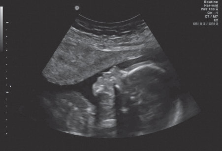

• Fig. 10.1 Transabdominal B-mode, two-dimensional scan showing the profile of a 20-week fetus.

## PDF page 189

• Fig. 10.2 Transvaginal M-mode demonstration of embryonic cardiac activity at 5 5/7 weeks’ gestation. Upper frame: Embryo with cursor across thorax. Lower frame: M-mode display of wall movement during two cardiac cycles, 114 beats per minute (between vertical lines).

• Fig. 10.3 Upper frame: Color Doppler highlights a segment of the umbilical cord (trapezoid). The gate (transverse parallel lines) identifies the sampling site within the umbilical artery (UA). Lower frame: Pulse Doppler waveform recorded from the UA.

the downstream) generally expressed as ratios, relative to median values. Color Doppler semiquantitatively assigns direction to blood flow; by convention, warm colors (red) denote movement toward the transducer, and saturation is keyed to velocity. Color Doppler illuminates cardiac, arterial, and venous structures (Figs. 10.4 and 10.5). Color Doppler energy (power Doppler) reflects signal intensity; amplitude corresponds to blood cell motion. Power Doppler is sensitive to very low flow and is effective independent of angulation; it is helpful for mapping vascular beds and for quick visualization of any fetal vessel (Figs. 10.6 and 10.7).

Three-dimensional (3D) ultrasound analyzes returned sound waves (echoes) along a third axis in addition to the standard two dimensions. Images are manipulated electronically to render surfaces and volumes from multiple perspectives, as both static and real-time (“four-dimensional”) views. Surface renderings of subtle organ details enhance detection of anomalies, partially overcoming positional limits of standard

RT KID

LT KID

• Fig. 10.4 Color flow Doppler demonstration of a right pelvic kidney, descending aorta, and inferior vena cava in a 28-week fetus. Flow toward the transducer is the color of the upper bar; flow away corresponds to the lower bar colors. LT KID, Left kidney; RT KID, right kidney.

BLADDER 3VC

UA

UC

UB UA

UB

UA

UA

• Fig. 10.5 Transverse view of fetal pelvis, umbilical cord (UC), and urinary bladder (UB) with color Doppler showing bifurcation of the umbilical arteries (UA).

• Fig. 10.6 Color Doppler demonstration of the anterior cerebral, pericallosal, and vertebral arteries (thin, first thick, and second thick arrows). Lower velocities are shown as more saturated hues. Turbulent flow and flow more rapid than the scale parameters demonstrate aliasing (mixture of colors). Compare with Fig. 10.7, which shows power Doppler of the same structures.

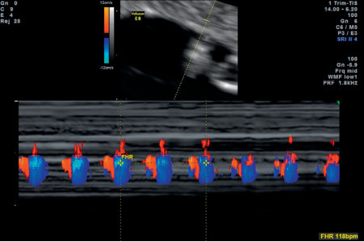

• Fig. 10.2 Transvaginal M-mode demonstration of embryonic cardiac activity at 5 5/7 weeks’ gestation. Upper frame: Embryo with cursor across thorax. Lower frame: M-mode display of wall movement during two cardiac cycles, 114 beats per minute (between vertical lines).

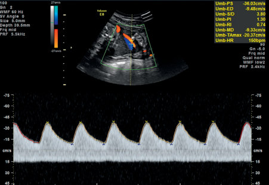

• Fig. 10.3 Upper frame: Color Doppler highlights a segment of the umbilical cord (trapezoid). The gate (transverse parallel lines) identifies the sampling site within the umbilical artery (UA). Lower frame: Pulse Doppler waveform recorded from the UA.

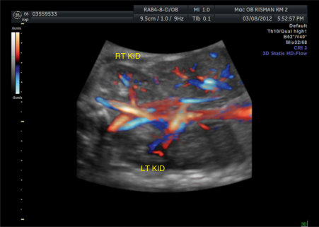

• Fig. 10.4 Color flow Doppler demonstration of a right pelvic kidney, descending aorta, and inferior vena cava in a 28-week fetus. Flow toward the transducer is the color of the upper bar; flow away corresponds to the lower bar colors. LT KID, Left kidney; RT KID, right kidney.

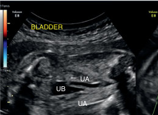

• Fig. 10.5 Transverse view of fetal pelvis, umbilical cord (UC), and urinary bladder (UB) with color Doppler showing bifurcation of the umbilical arteries (UA).

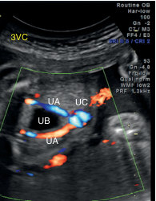

Unmatched source image; PDF page 189. Consult the original caption.

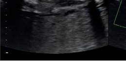

• Fig. 10.5 Transverse view of fetal pelvis, umbilical cord (UC), and urinary bladder (UB) with color Doppler showing bifurcation of the umbilical arteries (UA).

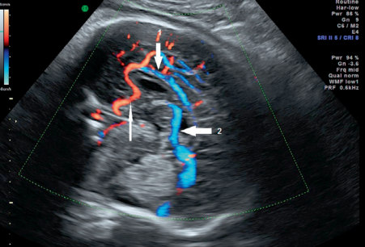

• Fig. 10.6 Color Doppler demonstration of the anterior cerebral, pericallosal, and vertebral arteries (thin, first thick, and second thick arrows). Lower velocities are shown as more saturated hues. Turbulent flow and flow more rapid than the scale parameters demonstrate aliasing (mixture of colors). Compare with Fig. 10.7, which shows power Doppler of the same structures.

## PDF page 190 | printed page 173

• Fig. 10.7 Power Doppler demonstration of the anterior cerebral (thin arrow), pericallosal (top thick arrow), and vertebral (right thick arrow) arteries.

• Fig. 10.8 Two-dimensional profile (compare with normal profile in Fig. 10.1) and three-dimensional coronal rendering of a 26-week fetus with a large, right-sided cleft lip and palate. The fetus is in a frank breech position with the foot (arrow) visible on the head.

scans and permitting a comprehensive review of fetal organs and skeleton (Fig. 10.8). 3D studies have improved volume calculations, facilitated analysis of complex spatial relationships, and better explained abnormal findings.1 Spatiotemporal correlation (by a database managing both space and time inputs) of heart movement with color and power Doppler augments standard cardiac imaging (Fig. 10.9).

Despite challenges, the most clinically mature applications for volume ultrasound technology are within the realm of obstetrics. The ability to reorient the active view for optimal visualization permits rapid identification of normal and abnormal structures. Advantages of volume imaging further include presentation of recognizable fetal anatomy and anomalies to parents, thus aiding informed decisionmaking and maternal-infant bonding.

### MRI Utility in Obstetrics

Magnetic resonance studies of pregnancies are typically performed after the first trimester, although no specific biologic

• Fig. 10.9 Spatiotemporal color flow imaging of normal four-chamber heart at 18 weeks. Transverse chest with four-chamber view. Upper left: Cardiac apex facing right. Upper right: Axial view. Lower left: Coronal view. Lower right: Cardiac apex facing left (three-dimensional).

adverse effects are documented for earlier exams.2 Maternal oblique positioning prevents undesirable inferior vena cava (IVC) compression, and images are obtained with ultrafast sequences in less than 1 second; claustrophobia can be difficult for some patients, even after sedation or anxiolytic use. The wide field of view, extremely high resolution, excellent soft-tissue contrast, and multiple potential planes of construction make MRI an appealing imaging modality, particularly useful when ultrasound studies are compromised by obesity or oligohydramnios.3 MRI is often utilized to elucidate problems initially identified by ultrasound examinations. Images are acquired in the axial, coronal, and sagittal planes relative to the fetus or orthogonal to the maternal pelvis. Gadolinium crosses the placenta and is thus contraindicated during pregnancy because of its exceptional persistence in tissue and known potential for adult renal injury. Its use rarely may be justified for assessment of placenta accreta or serious maternal disease.2

### Bioeffects and Safety

As part of the initiative by the US Food and Drug Administration (FDA) to reduce unnecessary radiation exposure from medical imaging, health care providers are advised to consider techniques with little or no ionizing radiation (for example, ultrasound or MRI) and only if medically appropriate. Diagnostic ultrasound energy has the potential to affect tissues (bioeffects); two recognized mechanisms are heating and cavitation. Data collected during routine studies show that gray-scale B-mode ultrasound is associated with a negligible rise in temperature.4 To date, there has been no convincing evidence of harm to the human fetus.

By definition, ultrasound is inaudible to humans; moreover, oncogenic effects have not been identified. At nonclinical levels, ultrasound energy causes cell lysis, intracellular shearing, streaming effects, altered membrane permeability, and abnormal chromosome function. Heat exposure triples with each change in modality: from

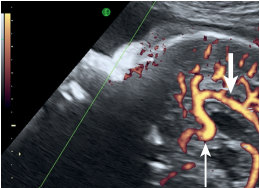

• Fig. 10.7 Power Doppler demonstration of the anterior cerebral (thin arrow), pericallosal (top thick arrow), and vertebral (right thick arrow) arteries.

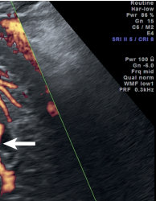

Unmatched source image; PDF page 190. Consult the original caption.

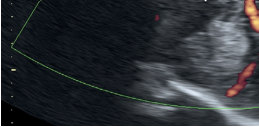

• Fig. 10.7 Power Doppler demonstration of the anterior cerebral (thin arrow), pericallosal (top thick arrow), and vertebral (right thick arrow) arteries.

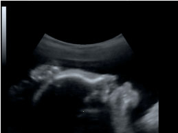

• Fig. 10.8 Two-dimensional profile (compare with normal profile in Fig. 10.1) and three-dimensional coronal rendering of a 26-week fetus with a large, right-sided cleft lip and palate. The fetus is in a frank breech position with the foot (arrow) visible on the head.

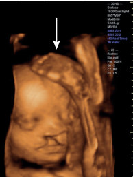

Unmatched source image; PDF page 190. Consult the original caption.

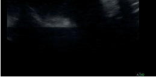

• Fig. 10.8 Two-dimensional profile (compare with normal profile in Fig. 10.1) and three-dimensional coronal rendering of a 26-week fetus with a large, right-sided cleft lip and palate. The fetus is in a frank breech position with the foot (arrow) visible on the head.

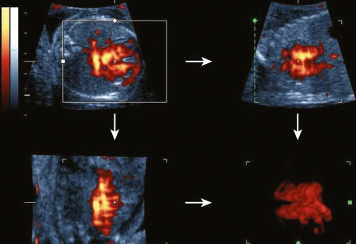

• Fig. 10.9 Spatiotemporal color flow imaging of normal four-chamber heart at 18 weeks. Transverse chest with four-chamber view. Upper left: Cardiac apex facing right. Upper right: Axial view. Lower left: Coronal view. Lower right: Cardiac apex facing left (three-dimensional).

## PDF page 191

d1

d2 d3

• Fig. 10.10 Transvaginal longitudinal and transverse axis ultrasound images of a 4 4/7-week intrauterine pregnancy showing a small yolk sac (thin arrows) within the gestational sac (calipers) and echogenic surrounding decidual reaction (thick arrows). The embryo is not yet visible. Note mechanical index and thermal index notations at top center.

two-dimensional (2D) to 3D, B-mode to M-mode, then color flow, before peaking during pulsed Doppler. Harmful levels should not be attained routinely but might occur during focal cranial pulsed Doppler interrogation or in a febrile patient, without unusually long exposures. Mechanical disruption from cavitating gas bubbles is improbable in the fetus. Both temperature and disruption risks are now displayed on equipment (Fig. 10.10). The thermal index (TI), the ratio between transducer output and the energy required to warm up tissue temperature by 1° C, with a desired value below 2, is also categorized by tissue type: TI soft tissues, TI cranial structures, and TI bone. The mechanical index (MI) references pulse amplitude effects of compression and decompression, ideally maintained below 0.4 in fetal studies. Publication standards now usually require that these indices be displayed on submitted images. For safety, only medically essential examinations should be performed; settings and duration should be the minimum required to achieve adequate views.

Strong magnetic fields and radiofrequency waves are used in MRI with no known specific harmful effects, but large longitudinal studies are lacking. However, as with ultrasound, heat delivery to the fetus is a recognized hazard. During MRI, the maternal surface receives the greatest thermal exposure. Noise from the magnetic coils (up to 120 dB) is, in theory, capable of causing acute hearing damage; fortunately, maternal tissue attenuation decreases fetal intensities by 25% to relatively safe levels. Direct magnetic bioeffects remain unproven; the FDA states that safety to the fetus “has not been established.”

The FDA has recommended that health care providers attempt to minimize exposure while maintaining diagnostic quality when using ultrasound. The lowest possible ultrasound exposure settings that obtain adequate image quality and gain the necessary diagnostic information should be used, following the principle of as low as reasonably

achievable (ALARA). Spectral or “flow” Doppler should not routinely be used to “auscultate” the fetal heart rate in the first trimester because of its higher energy delivery; instead, adequate documentation of viability can be obtained with use of M-mode or conventional 2D real-time ultrasonography with video or cine archiving.

### Who Should Perform Fetal Ultrasound Examination?

Evaluating the unborn fetus is an enormous responsibility. A true hazard of performing obstetrical ultrasound studies lies in the potential for error in image interpretation. Either under- or overdiagnosis may trigger a chain of events with tragic consequences. Some radiologists who perform ultrasound studies may have had relatively limited exposure during training to obstetrical imaging; in contrast, obstetrical services may offer extensive bedside experience but fewer didactic hours, particularly for complex cases. As a result, many practitioners prefer to delegate the task of scanning to sonographers, themselves of variable competencies, choosing instead to emphasize image interpretation and case management.

All practitioners who perform or supervise the performance of obstetric ultrasonography should be licensed medical practitioners, with specific training in obstetric ultrasonography; this is especially necessary when providing specialized obstetric ultrasound examinations. Certification programs, continuing education, and credentialing for both sonographers and the interpreting sonologists are important steps toward improving safety and diagnostic accuracy. To ensure the highest quality and accuracy in the interpretation of obstetric imaging, the American Institute of Ultrasound in Medicine and the American College of Radiology offer ultrasound facility accreditation. The process involves a review of submitted case studies, practice volume, equipment utilization and maintenance, report generation, image storage, and qualifications of all providers. Practices, not individuals, are accredited for obstetrics, gynecology, or both; practices maintaining ultrasound accreditation have been shown to demonstrate improved compliance with published standards and guidelines for the performance of ultrasound examinations.

### Ethical Considerations

The education of physician sonologists encompasses visual recognition and interpretative tasks common to diagnostic imaging but also demands mastery of specific mechanical skills (or, at least, an ability to assess the latter in sonographers). Both ultrasound and MRI have rapidly evolved; clinically relevant frontiers are often explored by collaborators with pooled data, prerelease technology, and funding for staff and statistical analysis. Nuchal translucency measurement, a deceptively simple sonographic method for aneuploidy screening, provides a cautionary example (Fig. 10.11).5 Its orderly dissemination, including certification

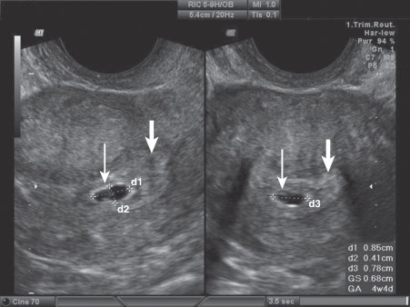

• Fig. 10.10 Transvaginal longitudinal and transverse axis ultrasound images of a 4 4/7-week intrauterine pregnancy showing a small yolk sac (thin arrows) within the gestational sac (calipers) and echogenic surrounding decidual reaction (thick arrows). The embryo is not yet visible. Note mechanical index and thermal index notations at top center.

## PDF page 192 | printed page 175

• Fig. 10.11 Nuchal lucency measurement (calipers) in a 13-week fetus. The nasal bone is visible (down arrow), and the amnion (up arrow) is clearly distinguished from the skin fold.

• Fig. 10.12 Vulvar skin folds (arrow) of normal female fetus in the midtrimester.

courses, ongoing audits, professional society, and laboratory coordination, stands in sharp contrast to the viral dissemination of most techniques; yet, erosion of competency, once achieved, remains a concern.

Ethical practitioners should be candid when informing patients of their ability to provide a requested service and assiduous in improving their skills. Professional judgment remains paramount in deciding how and when to incorporate new developments into personal clinical practice. The ability to conduct a knowledgeable, balanced discussion regarding interventions both local and international is essential when counseling patients overwhelmed by online information.

Prenatal identification of fetal sex for the purpose of selective termination is available for serious X-linked disorders but has been more widely applied to abort normal female fetuses because of a lower perceived value (Fig. 10.12). The addition of preimplantation genetic evaluations and noninvasive prenatal screening has redistributed the onus without fully resolving the problem.

Nonmedical fetal ultrasound (also known as “keepsake” ultrasound) uses ultrasound to provide nondiagnostic pictures or to determine the sex of a fetus (for a reveal party) without a practitioner referral, directly paid for by the

patient. Notwithstanding governmental and professional guidelines and warnings regarding ultrasound safety, their popularity with prospective parents, evident profitability, and absence of proven harm have provided keepsake ultrasound businesses with the impetus for rapid expansion. Several ethical issues are raised, including conflicts of interest for the commercial enterprise, the fetus, and the parents, with respect to long-term effects. Current epidemiological evidence is not synchronous with advancing ultrasound technology; a lack of evidence of harm is not the same as lack of harm. Applying four major theories of ethics and principles (the precautionary principle, theories of consequentialism and impartiality, duty-based theory, and rights-based theories) leads to the conclusion that obstetric ultrasound practice is ethical only if the indication for use is based on medical evidence, rendering “keepsake studies” ethically unjustifiable.

Multiple gestations may result in a number of ethical dilemmas. Advances and regulation in assisted reproductive technology (ART) have decreased the incidence of multifetal pregnancies, but fetal reduction remains a painful choice for parents facing the prospect of extreme prematurity in higher order multiples. Management of twin-twin transfusion syndrome (TTTS), anomalous co-twins, discordant growth, or distress far from term also necessitates choosing among unsatisfactory alternatives. An excellent review of the psychosocial consequences and the ethical issues associated with procedures of selective termination of the fetus affected by a lethal pathology and reduction of probably normal fetuses to lessen the fetal and maternal morbidity has been published.6

Nondiagnostic studies, varying prognoses for a given diagnosis, and the inherent limitations of ultrasound and MRI studies lead to ethical issues in management and counseling. Patients and physicians alike may share unrealistic expectations for the predictive accuracy of targeted diagnoses.

Anomalies and variants linked to Down syndrome and other serious conditions (sonographic “markers”) identified during routine studies present patients and caregivers with unanticipated, unwelcome options, particularly if patients had previously explicitly refused serum screening or direct genetic testing. Ideally, informed consent discussions addressing risks, benefits, consequences, alternative strategies, and limitations of ultrasound and MRI should be provided to all patients before performing such imaging. Given the irreversible nature of both birth and abortion, prospective parents must ultimately judge for themselves their tolerance for uncertainty in diagnosis and for imperfection in their offspring.

### Classification of Fetal Sonographic Examinations First-Trimester Examination

First-trimester transvaginal scans exclude ectopic implantation by demonstrating an intrauterine asymmetric or

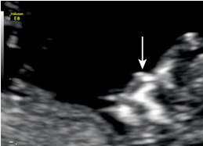

• Fig. 10.11 Nuchal lucency measurement (calipers) in a 13-week fetus. The nasal bone is visible (down arrow), and the amnion (up arrow) is clearly distinguished from the skin fold.

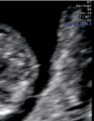

Unmatched source image; PDF page 192. Consult the original caption.

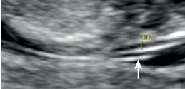

• Fig. 10.11 Nuchal lucency measurement (calipers) in a 13-week fetus. The nasal bone is visible (down arrow), and the amnion (up arrow) is clearly distinguished from the skin fold.

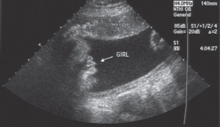

• Fig. 10.12 Vulvar skin folds (arrow) of normal female fetus in the midtrimester.

## PDF page 193

“double sac” gestational sac with yolk sac or embryo, ideally with visible cardiac activity; identifiable embryos in the fallopian tubes are uncommon. Heterotopic pregnancy (combined intra- and extrauterine pregnancies) occurs in less than 0.1% of spontaneous conceptions, leading to the pragmatic conclusion that finding an intrauterine pregnancy excludes an ectopic one, except after ART. Nevertheless, careful study of the adnexa, ovaries, and cervix is generally prudent. A “double sac” is usually seen transvaginally at levels of 1000 to 1500 international units of human chorionic gonadotropin before 5-1/2 menstrual weeks (Fig. 10.10), but serum human chorionic gonadotropin (hCG) and visualization thresholds are variable. Finding a yolk sac or embryo confirms an intrauterine site, with growth of the gestational sac diameter of about 1 mm daily in early pregnancy. The embryonic disc is usually visible transvaginally when sac diameters exceed 15 mm. Embryonic length also increases daily by 1 mm; transvaginally identified cardiac activity is customary by the end of the sixth week (4 mm embryonic length) and obligatory by the seventh. Current practice postpones diagnosing a failed pregnancy until well past the accepted normal thresholds for appearance and progressive development of these structures.

Embryonic heart rates, slower at initiation, increase to more than 160 beats per minute (bpm) by the 9th week, declining slightly through the 13th week.7 Persistent rates below 100 bpm have been linked to risk for missed abortion, aneuploidy, and anomalies.7 When an embryonic heart rate below 80 bpm is detected between 6 and 7 weeks, a firsttrimester demise is anticipated in approximately 25%, even if the rate subsequently normalizes. In such pregnancies, a follow-up scan is warranted. Prior to 6 weeks, an embryonic heart rate below 100 bpm is not necessarily indicative of a poor prognosis. Likelihood of survival into the second trimester is also significantly higher when there is concordance between biometrically calculated gestational age and menstrual dating.8

Progress in the field of late first-trimester ultrasound between 12 weeks and 13 weeks and 6 days continues in two intertwined directions. One is screening by using sonographic markers that increase the accuracy and sensitivity of detecting chromosomal abnormalities, especially Down syndrome. The other is improving the early detection of congenital anomalies. A negative aneuploidy screen and normal early fetal organ screen provide assurance and reduce the need for invasive testing and the associated risk of miscarriages. A positive aneuploidy and fetal anomaly screen enables further testing, genetic counseling, and early invasive diagnosis using chorionic villi sampling rather than a second-trimester amniocentesis and allows the safer and more private option of first-trimester termination of an abnormal pregnancy before the pregnancy is advanced.9

First-trimester aneuploidy screen should be offered to all women regardless of maternal age. Ultrasound-associated aneuploidy screen options include measurement of

the subcutaneous skin thickness at the neck and nuchal translucency (NT), combined with first-trimester maternal serum screen. NT measurement detects only about 70% of Down syndrome cases. Combined first-trimester screen calculates an aneuploidy risk considering maternal age, maternal serum analytes, and NT and detects 82% to 87% of Down syndrome cases.10 Although noninvasive prenatal aneuploidy screening (NIPS) by evaluation of placental cell-free DNA from maternal blood is highly efficient with a detection rate of 99% for Down syndrome, the replacement of late first-trimester ultrasound examination by NIPS is not recommended, as doing so would lead to missing about one-third of the congenital fetal abnormalities, notably major cardiac defects, and chromosomal aberrations other than aneuploidy occurring in fetuses with increased NT.11,12 In cases with abnormally thickened NT measurement, an early second-trimester ultrasound study at 14 to 16 weeks and fetal echocardiogram should be considered. Additional benefits of a late firsttrimester ultrasound examination include accurate dating in pregnancies without previous imaging, confirmation of viability, diagnosis of multiple gestations, assessment of chorionicity and amnionicity, assessment of location of the placenta and cord insertion site, and diagnosis of ovarian and other pelvic pathologies, uterine fibroids, and Müllerian uterine anomalies.

### Standard Second- or Third-Trimester Examination

A standard second- or third-trimester sonogram includes an evaluation of fetal number, presentation, cardiac activity, fetal biometry, amniotic fluid and placental characteristics, and fetal organ survey. Second-trimester transvaginal cervical measurement is encouraged for patients at risk for prematurity; however, the role of universal screening remains controversial. Examination of the maternal pelvic structures is otherwise performed transabdominally at this time, if feasible.

### Limited Examination

A limited examination is performed to investigate a specific concern, usually under exigent circumstances. For example, a limited examination might identify fetal cardiac activity in the presence of bleeding or confirm presentation in early labor. Abbreviated sonographic studies are more acceptable when there has been a prior complete study; pragmatically, a full examination should be documented when the acute situation has stabilized for ongoing pregnancies.

### Specialized Examinations

A detailed “targeted” anatomic examination is performed when an anomaly is suspected based on history, biochemical, or genetic results or findings on prior scans. Other specialized examinations include fetal Doppler ultrasound, 3D imaging, biophysical profile (BPP), fetal echocardiogram, detailed neurosonography, and additional biometry

## PDF page 194 | printed page 177

or evaluation of organs not usually imaged on routine studies.

### Applications of Ultrasound Studies

### Genetic Screening

Genetic screening combines ultrasound study and serum biochemical testing to enhance the detection of common chromosomal abnormalities. This approach has resulted in greater scrutiny of younger patients and less frequent agebased invasive testing.13 Currently, noninvasive screening for fetal aneuploidy (trisomies 13, 18, and 21) is encouraged for all low-risk patients. Common noninvasive screening options include (1) first-trimester screening (nuchal translucency measurement and maternal serum biochemical marker algorithm), (2) first- and second-trimester cellfree fetal DNA fragment analysis from maternal blood, (3) second-trimester serum screening (maternal age and serum biochemical marker algorithm), or (4) two-step integrated screening, which includes first- and second-trimester serum screening with or without nuchal translucency (integrated prenatal screen, serum integrated prenatal screening only, contingent and sequential screening variations). Different algorithms noticeably affect sensitivity, specificity, and predictive values; cost or convenience may factor in choosing a strategy.14 Analysis of cell-free fetal DNA (cfDNA) has revealed concentrations almost 25 times higher than those from intact nucleated fetal blood cells extracted from similar volumes of maternal blood. cfDNA noninvasive prenatal screening is now in wide use for specific targeted chromosomal abnormalities, especially trisomy (an extra copy of a chromosome) or monosomy (a missing chromosome), and numerous commercial products are currently marketed for this indication.15 Patient acceptance has been high, perhaps in part because of early identification of fetal sex. Insufficient fetal fractions and indeterminate results appear more frequently in obese patients but may also occur with chromosomal abnormalities. Direct prenatal diagnosis by chorionic villus biopsy or amniocentesis should be routinely recommended for at-risk individuals based on age, family history, abnormal screening, or ultrasound findings.

One-third of fetuses with Down syndrome will have anomalies, characteristically endocardial cushion defects (Fig. 10.13), duodenal atresia (Fig. 10.14), and, more subtly, small atrioseptal and ventriculoseptal cardiac defects (Fig. 10.15). Two-thirds may have second-trimester sonographic markers, such as increased nuchal translucency, hypoplastic or absent nasal bones, and abnormal cardiovascular Doppler patterns in the first trimester, as well as thickened nuchal fold (Fig. 10.16) and nasal hypoplasia, ventriculomegaly, choroid plexus cysts (Fig. 10.17), hypoplasia of the fifth digit, decreased long-bone ratios, enhanced echogenicity of papillary muscles and bowel, and renal pyelectasis (Fig. 10.18). The predictive value of screening components is affected by ethnicity, habitus, maternal diet, and fetal sex, as well as by device- and operator-dependent detection rates. The

• Fig. 10.13 Fetus with trisomy 21 and large atrioventricular canal defect on transverse thoracic view. Note the absence of a normal crux. Common atrium (thin arrow) connecting into a common ventricle (thick, double-headed arrow) can be seen.

### D

### S

• Fig. 10.14 “Double bubble” sign of duodenal atresia in a 35-week pregnancy, with the dilated stomach (S) and the obstructed proximal duodenum (D) seen on transverse abdominal view, spine to right of image. The finding is uncommon before the late second trimester.

permutations may confound counselors attempting to elucidate (and patients trying to grasp) the difference between screening and diagnosis and the basic descriptions of risks and benefits. Recently described first-trimester evaluation of the posterior brain (intracranial translucency) provides an additional screening tool for open neural tube defects and other intracranial abnormalities (Figs. 10.19A and B).16 Second-trimester sonographic follow-up and genetic evaluation may add critical information to the assessment of these abnormal findings. First-trimester identification of tricuspid regurgitation and increased ductus venosus (DV) resistance seems a promising, albeit technically challenging, addition to early screening protocols.17

### Assisted Reproduction

Ultrasound is essential for timing and guiding oocyte retrieval and is helpful in embryo transfer; however, its

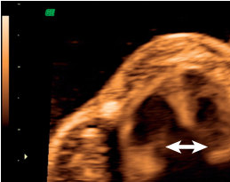

• Fig. 10.13 Fetus with trisomy 21 and large atrioventricular canal defect on transverse thoracic view. Note the absence of a normal crux. Common atrium (thin arrow) connecting into a common ventricle (thick, double-headed arrow) can be seen.

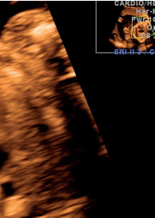

Unmatched source image; PDF page 194. Consult the original caption.

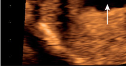

• Fig. 10.13 Fetus with trisomy 21 and large atrioventricular canal defect on transverse thoracic view. Note the absence of a normal crux. Common atrium (thin arrow) connecting into a common ventricle (thick, double-headed arrow) can be seen.

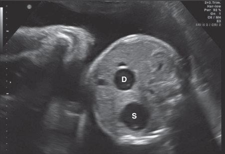

• Fig. 10.14 “Double bubble” sign of duodenal atresia in a 35-week pregnancy, with the dilated stomach (S) and the obstructed proximal duodenum (D) seen on transverse abdominal view, spine to right of image. The finding is uncommon before the late second trimester.

## PDF page 195

### LV

### RV

### RA

### LA

• Fig. 10.15 Ventriculoseptal defect (arrow) demonstrated by color flow Doppler in 28-week fetus. LA, Left aorta; LV, left ventricle; RA, right aorta; RV, right ventricle.

### CSP C NF

• Fig. 10.16 Thickened nuchal fold (NF) (calipers) at a level demarcated by the cavum septum pellucidum (CSP) and the cerebellum (C), here noted at 18 weeks, is considered a marker for trisomy 21 (Down syndrome) and cardiac and other anomalies. The finding is infrequent, even in affected infants, limiting its utility.

role in judging endometrial receptivity is less clear. Saline ultrasound studies prior to fertility treatments routinely complement or replace the hysterosalpingogram in assessment of the uterus and adnexa. Use of MRI may play an expanded role in structural and functional evaluation in the future.

ART results in more twins and higher-order multiples; early ultrasound study of embryos, amnionicity, and chorionicity is essential to subsequent management. With the increasing popularity of ART, obstetricians and radiologists are more likely to encounter associated complications,

• Fig. 10.17 Choroid plexus cysts. Coronal view of the brain shows bilateral choroid plexus cysts (arrows).

Kidneys

lt rt

1 2

### GB

• Fig. 10.18 Transverse abdominal view, backup. Gallbladder (arrow GB) at right, with asymmetric renal pelves (calipers) illustrating the normal left renal appearance (1) (short, thin arrow) and right pyelectasis/ caliectasis (2) (thick arrow). Between 1% and 5% of normal fetuses have pyelectasis, limiting its utility as an isolated marker.

especially in an emergency setting. These complications include ovarian hyperstimulation or torsion, ectopic, or heterotopic pregnancy, and pregnancies of unknown location or undetermined viability. Ovarian hyperstimulation syndrome may occur following ovulation induction or ovarian stimulation and is characterized by bilateral ovarian enlargement, multiple cysts, and third spacing of fluids (Fig. 10.20). Additional clinical findings may range from gastrointestinal discomfort to life-threatening renal failure and coagulopathy. Ovarian torsion and hyperstimulation should be excluded in any woman undergoing ART who presents with severe abdominal pain. Ectopic pregnancy resulting from ART has a relatively increased frequency of rarer and more lethal forms, including interstitial and cervical locations. Heterotopic pregnancies and simultaneous intrauterine and ectopic implantations are more common in ART patients.

Ultrasonography is the first-line choice for identifying ART complications, although lack of specific symptoms

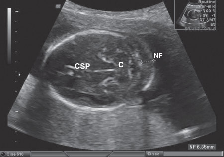

• Fig. 10.16 Thickened nuchal fold (NF) (calipers) at a level demarcated by the cavum septum pellucidum (CSP) and the cerebellum (C), here noted at 18 weeks, is considered a marker for trisomy 21 (Down syndrome) and cardiac and other anomalies. The finding is infrequent, even in affected infants, limiting its utility.

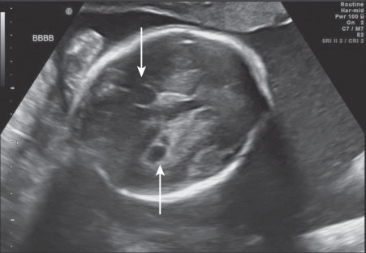

• Fig. 10.17 Choroid plexus cysts. Coronal view of the brain shows bilateral choroid plexus cysts (arrows).

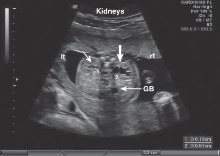

• Fig. 10.18 Transverse abdominal view, backup. Gallbladder (arrow GB) at right, with asymmetric renal pelves (calipers) illustrating the normal left renal appearance (1) (short, thin arrow) and right pyelectasis/ caliectasis (2) (thick arrow). Between 1% and 5% of normal fetuses have pyelectasis, limiting its utility as an isolated marker.

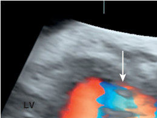

• Fig. 10.15 Ventriculoseptal defect (arrow) demonstrated by color flow Doppler in 28-week fetus. LA, Left aorta; LV, left ventricle; RA, right aorta; RV, right ventricle.

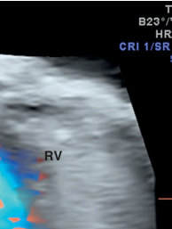

Unmatched source image; PDF page 195. Consult the original caption.

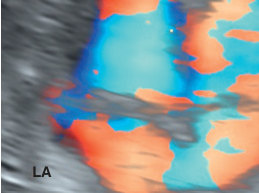

• Fig. 10.15 Ventriculoseptal defect (arrow) demonstrated by color flow Doppler in 28-week fetus. LA, Left aorta; LV, left ventricle; RA, right aorta; RV, right ventricle.

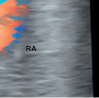

Unmatched source image; PDF page 195. Consult the original caption.

## PDF page 196 | printed page 179

A

• Fig. 10.19 (A) Ultrasound image in the mid-sagittal plane of the fetal profile showing the nasal bone (NB), palate (P), mandible (Ma), nuchal translucency (NT), thalamus (T), midbrain (M), brainstem (B), and medulla oblongata (MO). (B) Mid-sagittal ultrasound images of fetal brain in a case of Dandy-Walker malformation at 12 weeks’ gestation; note only two posterior brain spaces (arrows) and enlarged brainstem (BS).

• Fig. 10.20 Three-dimensional (3D) color-enhanced volume rendering of seven follicles in the right ovary. The echo-free follicles are outlined by the operator in orthogonal planes. The generated volumes are then displayed in the 3D rendering (lower right) with color correlation.

may first trigger other approaches. Familiarity with characteristic strengths and limitations of these and other techniques will facilitate accurate, timely diagnosis and avert potentially serious consequences.

### Multiple Gestations

Multiple gestation accounts for about 3% of all pregnancies. With an increase in the number of fetuses, scans become more complex, time consuming, and error prone;

Badditionally, determination of zygosity is essential. The management of anomalous, discordant, or moribund co-twins differs significantly based on chorionicity (Fig. 10.21). Monochorionic twins occur with a relatively constant frequency (1:250 pregnancies), unlike dichorionic twinning, which may be influenced by race, heredity, maternal age, parity, and ART. Ultrasound assignment of chorionicity is most accurate for different-sexed dizygotic twins, but evaluating sac appearance in early gestation approaches this accuracy in gender-concordant pairs.

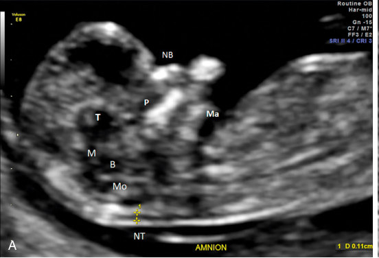

• Fig. 10.19 (A) Ultrasound image in the mid-sagittal plane of the fetal profile showing the nasal bone (NB), palate (P), mandible (Ma), nuchal translucency (NT), thalamus (T), midbrain (M), brainstem (B), and medulla oblongata (MO). (B) Mid-sagittal ultrasound images of fetal brain in a case of Dandy-Walker malformation at 12 weeks’ gestation; note only two posterior brain spaces (arrows) and enlarged brainstem (BS).

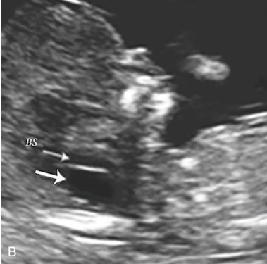

Unmatched source image; PDF page 196. Consult the original caption.

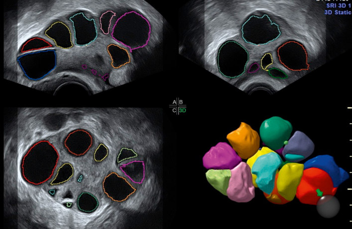

• Fig. 10.20 Three-dimensional (3D) color-enhanced volume rendering of seven follicles in the right ovary. The echo-free follicles are outlined by the operator in orthogonal planes. The generated volumes are then displayed in the 3D rendering (lower right) with color correlation.

## PDF page 197

Twin amnionicity/chorionicity

Di/Di Di/Mono Mono/Mono

• Fig. 10.21 Diagram (left) of variations in appearance of the dividing membrane for dichorionic, monochorionic, and monoamniotic twins. Upper-right image shows typical thick first-trimester appearance of the chorion (arrow) in dichorionic diamniotic twins. Lower image shows the peaked dividing membrane (arrow) of dichorionic twins in the latter half of pregnancy.

Successful identification may occur throughout gestation by examining the dividing membranes at their placental origin. Dichorionic diamniotic twins are usually (95%) dizygotic, with independent risks for anomalies and placental malfunction. Monochorionic pairs are predictably monozygotic; attrition rates exceed 30% from early abortion, anomalies, and prematurity. Matched and isolated anomalies are both more common in monochorionic gestations; because of shared vasculature, loss of a co-twin may kill its sibling outright or produce severe neurologic damage in up to one-third of survivors.18

TTTS is characterized by unbalanced, shared perfusion that restricts growth and amniotic fluid production in the donor and causes volume overload, cardiac dysfunction, and polyhydramnios in the recipient. Ultrasound staging has been used to time and to guide a variety of vascular ablation strategies. Untreated TTTS leads to a high rate of fetal loss. Endoscopic laser ablation of shared vessels results in improved survival and long-term outcome. Serial amniocentesis may be helpful in milder cases to relieve polyhydramnios and reduce the risk of preterm labor. Management by these approaches has been modestly effective in reducing stillbirths and prematurity in TTTS. Monoamniotic twins rarely experience TTTS but routinely encounter cord entanglements, resulting in a high lethality rate of both fetuses (Fig. 10.22). Management usually consists of a scheduled preterm cesarean section prior to onset of labor. For all multiple gestations, serial ultrasound monitoring

• Fig. 10.22 Monochorionic monoamniotic twins with entangled umbilical cords at 10 weeks’ gestation.

of growth, well-being, placental performance, and cervical length is common practice.

Twin reversed arterial perfusion (TRAP) sequence is another complication of monochorionic twinning,

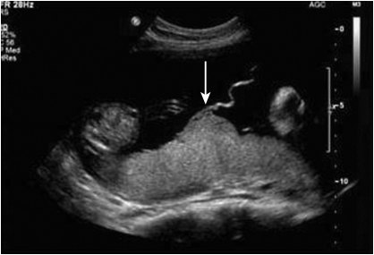

• Fig. 10.22 Monochorionic monoamniotic twins with entangled umbilical cords at 10 weeks’ gestation.

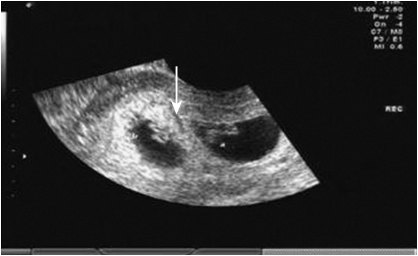

• Fig. 10.22 Monochorionic monoamniotic twins with entangled umbilical cords at 10 weeks’ gestation.

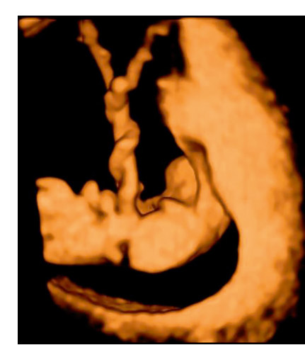

• Fig. 10.22 Monochorionic monoamniotic twins with entangled umbilical cords at 10 weeks’ gestation.

## PDF page 198 | printed page 181

complicating approximately 1% of monozygotic pregnancies.19 Placentation among TRAP cases has been predominantly reported to be monochorionic diamniotic and to a lesser degree monochorionic monoamniotic twins. The proposed pathogenesis is the association of paired artery-toartery and vein-to-vein anastomoses through the placenta, combined with delayed cardiac function of one of the twins early in pregnancy. This situation allows blood pumped from the healthy twin, the “pump twin,” to perfuse retrogradely the heart of the other twin, also known as the “acardiac” twin or “parabiotic twin.” Thus flow in the artery and vein are reversed in the umbilical cord of the acardiac twin, giving rise to the acronym TRAP. Retrograde perfusion interferes with normal cardiac development, which rarely goes beyond the stage of tubular heart. Common abnormal findings in the acardiac twin include impaired or absent development of the cephalic pole, rudimentary or absent heart, abnormal or absent upper limbs, relative preservation of the lower limbs (although clubbing and abnormal toes are common), abnormal viscera, and single umbilical artery (UA). A common finding is massive edema around the upper body including the neck of the acardiac twin (Figs. 10.23A–C).

### Pregnancy Evaluation

One of the most powerful applications of prenatal ultrasound is using biometrics to establish or confirm gestational age.20 Through 22 weeks of gestation, most genetically normal individuals cluster closely on normographic curves. Sonographic measurements of fetal ultrasound parameters are the basis for accurate determination of gestational age and detection of fetal growth abnormalities. It has been shown that a fixed error of about 8% (plus or minus) can be anticipated when determining gestational age by ultrasound, consistent with the observation that the earlier gestational age is determined, the lower the margin of error in days. If accelerated or restricted growth supervenes, however, biometric markers are generally compromised accordingly.

Selection of the most useful single parameter depends on the timing and purpose of measurement and is influenced by specific limitations. Commercial equipment has a variety of preinstalled normograms, biometry-based dating, and weight estimation formulae. Embryonic pole and crownrump lengths are considered most precise for early dating of pregnancy, becoming more variable with fetal flexion effects at the end of the first trimester. Biparietal diameter (BPD), obtainable after parietal bone calcification in week 12, maintains the closest correlation with gestational age in the second trimester. BPD is measured from the outer to the inner table of the skull, perpendicular to the parietal bones and central falx cerebri. The proper plane contains the cavum septum pellucidum, thalami, third ventricle, and tentorial hiatus, within the bony table of a complete head circumference (HC) (Fig. 10.24). In cases of variation in the shape of the skull, an HC measurement obtained in the same plane may be an effective alternative. Microcephaly may be suspected when the HC measurement is more than 3

A

B

C

• Fig. 10.23 (A) Monochorionic diamniotic parabiotic (acardiac) twin. Note the massive edema and abnormal and disorganized organs. (B) Parabiotic twin with massive pleural effusion and ascites. Note the presence of a completely dysfunctional heart (H) and echogenic bowel (B). The diaphragm is clearly seen (pointing hands). (C) The same fetus following premature delivery at 34 weeks. The upper portion of the body has never been formed.

standard deviations (SDs) below the mean but is rarely diagnosed prenatally. Additionally, antenatal sonographic estimation of HC is associated with significant underestimation compared with the actual postnatal HC. This discrepancy may have important clinical implications and should be taken into account in the interpretation of sonographically

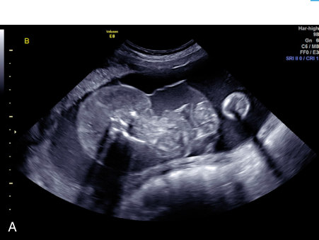

• Fig. 10.23 (A) Monochorionic diamniotic parabiotic (acardiac) twin. Note the massive edema and abnormal and disorganized organs. (B) Parabiotic twin with massive pleural effusion and ascites. Note the presence of a completely dysfunctional heart (H) and echogenic bowel (B). The diaphragm is clearly seen (pointing hands). (C) The same fetus following premature delivery at 34 weeks. The upper portion of the body has never been formed.

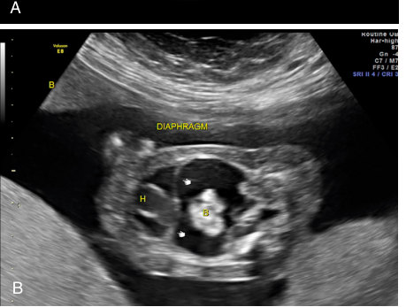

• Fig. 10.23 (A) Monochorionic diamniotic parabiotic (acardiac) twin. Note the massive edema and abnormal and disorganized organs. (B) Parabiotic twin with massive pleural effusion and ascites. Note the presence of a completely dysfunctional heart (H) and echogenic bowel (B). The diaphragm is clearly seen (pointing hands). (C) The same fetus following premature delivery at 34 weeks. The upper portion of the body has never been formed.

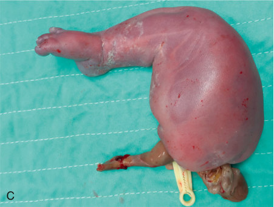

• Fig. 10.23 (A) Monochorionic diamniotic parabiotic (acardiac) twin. Note the massive edema and abnormal and disorganized organs. (B) Parabiotic twin with massive pleural effusion and ascites. Note the presence of a completely dysfunctional heart (H) and echogenic bowel (B). The diaphragm is clearly seen (pointing hands). (C) The same fetus following premature delivery at 34 weeks. The upper portion of the body has never been formed.

## PDF page 199

### HC

### BPD

• Fig. 10.24 Measurement of the biparietal diameter (BPD) (vertical calipers) and head circumference. The required landmarks include the midline falx cerebri (long, thick arrow), the cavum septum pellucidum (thin arrow), and the thalami (short, thick arrow). The BPD calipers are placed on the upper outer table and the inner margin to compensate for signal scatter.

### AC

• Fig. 10.25 The abdominal circumference (AC) indirectly reflects hepatic glycogen stores. The correct level should include the gastric bubble (thin arrow) and the junction of the portal veins (thick arrow); the circumference should be fitted to the outer diameter of the skin line.

measured HC.21 BPD and HC are relatively spared in nutritional and perfusional disorders of growth, although cranial measurements may also be distorted by compression effects. The abdominal circumference (AC), measured along the outer margin of the abdominal skin line at the level of the gastric bubble and the intrahepatic portion of the umbilical vein (UV) at the bifurcation of the portal veins, is the best single predictor of growth aberrations but is less helpful for dating (Fig. 10.25). Femoral length (FL) is the fourth measurement commonly included in biometric formulae, less affected by hypoperfusion but potentially influenced by familial stature. Extraocular and transcerebellar diameters and humeral and pedal lengths are common additional dating parameters. Special curves are available for non- Caucasian ethnicity and multiple gestations, although not universally accepted as essential.

Use of multiple predictors improves the accuracy of estimates, and an individualized approach is recommended for fetal growth assessment. The various epidemiologic factors influencing fetal growth should be considered. Clinical application of fetal biometry is of utmost importance in recognizing dating errors, growth abnormalities, chromosomal anomalies, and skeletal dysplasias.

### Fetal Growth

Serial measurements over time are the best way to judge fetal growth. The sac and embryo grow perceptibly each day; by the second trimester, intervals of 2 or 3 weeks between studies are more reliable. Problems arise when attempting simultaneously to assign age and weight percentiles without reliable dating. The AC is a better indicator of decreased perfusion or increased glycogen storage than the cranial measures; ratios of AC to the HC and FL amplify differences but have poor sensitivity and specificity. Strategies to identify small-for-dates fetuses have included risk panels, Doppler ratios, amniotic fluid volume, placental scores, and biometry-based weights; none has had completely satisfactory results, although outcomes appear to have improved.

Correctly identifying fetal growth abnormalities remains an elusive goal despite their major contribution to adverse perinatal outcomes and stillbirth. Current clinical screening relies on the symphyseal-fundal height measurement, but fewer than 25% of small-for-gestational-age infants will be identified using this methodology in a low-risk population. Routine third-trimester ultrasound study for growth assessment has a better detection rate, ranging from 50% to 80%, but the impact on perinatal outcome is unclear.22

Several common findings, in addition to risk panels, underlying maternal diseases (particularly with vascular components) and prior stillbirth or growth-restricted outcomes may raise concern for fetal growth restriction (FGR).23 These include a modest size-dates discrepancy (within-method error) on a first-trimester study, abnormal maternal serum levels of pregnancy-associated plasma protein-A (PAPP-A), and free β-human chorionic gonadotropin at 9 to 13 weeks, usually obtained as part of genetic screens. Other findings include early elevation of maternal blood pressure and abnormal uterine artery resistance by Doppler at 11 0/7 to 13 6/7 weeks, and a hypoglycemic response to glucose testing may be an early third-trimester observation. By combining uterine artery Doppler findings and baseline maternal characteristics, detection rates for early-onset FGR have reached clinically acceptable levels. Unfortunately, FGR developing later in pregnancy still goes largely undetected.24

### Placental Abnormalities

Placental conditions affecting the mother and/or fetus include gestational trophoblastic diseases, placental hematoma, chorangioma, abruption, placenta previa, placenta accreta/increta/ percreta, vasa previa, choriocarcinoma, chorioamnionitis, viral

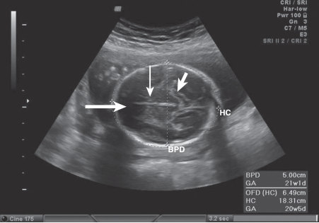

• Fig. 10.24 Measurement of the biparietal diameter (BPD) (vertical calipers) and head circumference. The required landmarks include the midline falx cerebri (long, thick arrow), the cavum septum pellucidum (thin arrow), and the thalami (short, thick arrow). The BPD calipers are placed on the upper outer table and the inner margin to compensate for signal scatter.

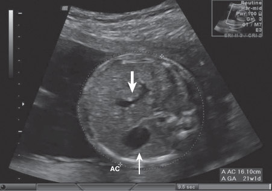

• Fig. 10.25 The abdominal circumference (AC) indirectly reflects hepatic glycogen stores. The correct level should include the gastric bubble (thin arrow) and the junction of the portal veins (thick arrow); the circumference should be fitted to the outer diameter of the skin line.

## PDF page 200 | printed page 183

and parasitic villitis and placentitis, decidual and thrombotic vasculopathies, infarction, polyps, and retained products of conception. Although gross inspection and histopathology provide the ultimate diagnosis, ultrasonography is the definitive prenatal modality for evaluating the majority of these conditions. MRI and computed tomography (CT) are infrequent adjunctive measures, and the latter is occasionally helpful in tumor staging or trauma cases.25

### Placental Location

Placental location can be confidently established by abdominal and transvaginal ultrasound studies. Low-lying placentation, present in up to 60% of early second-trimester studies, persists as placenta previa in only 1% to 2% of patients at term (Fig. 10.26). Fetal vessels near the cervix can be visualized using color Doppler, facilitating the diagnosis of funic (umbilical cord) presentation and vasa previa (fetal vessels overlying the os) (Fig. 10.27). Normally inserted centrally in the placenta, the umbilical cord may later, as a result of asymmetric placental growth, be located marginally or even on the membranes; in the latter situation, traumatic

Placenta

Placenta

• Fig. 10.26 Placenta previa: the internal os (arrow) is completely covered by the placental tissue in this transabdominal view.

PCI

• Fig. 10.27 Fetal vessels (thick arrow) within the membranes overlying the internal os (thin arrow) are termed vasa previa. Rupture of the vessels can rapidly exsanguinate the fetus; artificial membrane rupture and labor are contraindicated. PCI, placental cord insertion.

lacerations, hemorrhage, and compression-linked heart rate changes are potential consequences.

Morbidly adherent placenta (MAP) or placenta accreta spectrum (PAS) encompasses the histopathological diagnoses of placenta accreta (a small focus or more generalized muscular invasion), placenta increta (deeper myometrial invasion up to the uterine serosal layer), and placenta percreta (invasion through the serosa to adjacent visceral or vascular structures).26 It is potentially life threatening, as forced removal of an abnormally invasive placenta can lead to catastrophic maternal hemorrhage; management of all but the most circumscribed lesions usually requires hysterectomy (Figs. 10.28A and B).

PAS was previously diagnosed only when failed attempts to remove the placenta were followed by massive bleeding. Improvements in antenatal diagnosis enabled reductions in maternal mortality and morbidity by allowing planned cesarean delivery at 34 to 35 weeks by experienced multidisciplinary teams.27 Placental accretion is significantly more likely in women with the combination of placenta previa and a history of one or more cesarean sections, after myomectomy or curettage, and with high parity.28 The

Cervix

CERVIX

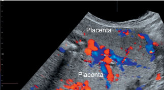

• Fig. 10.26 Placenta previa: the internal os (arrow) is completely covered by the placental tissue in this transabdominal view.

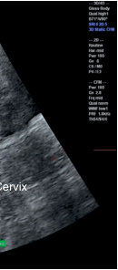

Unmatched source image; PDF page 200. Consult the original caption.

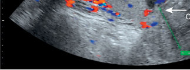

• Fig. 10.26 Placenta previa: the internal os (arrow) is completely covered by the placental tissue in this transabdominal view.

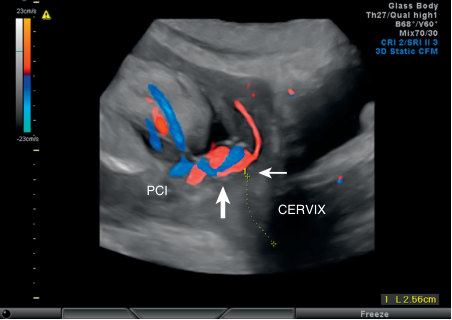

• Fig. 10.27 Fetal vessels (thick arrow) within the membranes overlying the internal os (thin arrow) are termed vasa previa. Rupture of the vessels can rapidly exsanguinate the fetus; artificial membrane rupture and labor are contraindicated. PCI, placental cord insertion.

## PDF page 201

A B

• Fig. 10.28 (A) Anterior placenta accreta showing multiple cysts (vascular lacunae). The hypoechoic interface between the placenta and the myometrium is not seen. (B) Anterior wall placenta previa and percreta. The wall of the maternal bladder (Bl) is invaded by placental vessels (narrow arrow). A sizable venous lake (V) is seen where one would normally expect to view the placental myometrial interface. The placental margin covers the internal cervical os (IO) (wide arrow). CX, Cervix.

frequency of accretion, now complicating 1 in 2500 deliveries, has increased more than 10-fold in the past 25 years, echoing rising cesarean rates.28

Sonographic criteria for placenta accreta were developed using conventional gray-scale, 2D and 3D color and power Doppler transabdominal and transvaginal ultrasonography in high-risk women.29 In the early first trimester between 6 and 9 weeks, ultrasound markers of PAS include low implantation of the gestational sac and cesarean scar pregnancy. Studies show that most PAS cases have a low implantation in the early first trimester scans; however, low implantation is noted in only 28% in the late first trimester.30 A cesarean scar pregnancy is diagnosed if the chorionic sac is adjacent to or embedded in the scar of a previous cesarean delivery, in close proximity to the bladder, wedged in a niche, and demonstrates extensive vascularization or an arteriovenous malformation. Cesarean scar pregnancy is considered to be a precursor of PAS, as histopathology of both appear indistinguishable.31 The implantation in the niche rather than the scar and a thin remaining myometrium may be helpful to define cases that will evolve into the most severe types of PAS. In the late first, second, and third trimester, the sonographic characteristics of PAS are lacunae (multiple large sonolucent spaces in the placenta), abnormal uteroplacental interface (described as loss/irregularity of the echo-free “clear space” between the uterus and the placental basal plate, myometrial thinning, or increased vascularity on Doppler), abnormal uterovesical interface (bridging vessels extending from the placenta across the myometrium and/or beyond the serosa, increased vascularity between the uterus and bladder, and interruption of the bladder wall), placental bulge, and exophytic mass (diagnostic for placenta percreta).32 Among these markers, loss of the clear zone performs best with a sensitivity of 84% and a specificity of 82%, with a diagnostic odds ratio of 24 in the late first trimester (i.e., at 11–14 weeks).33 Coexisting markers such

• Fig. 10.29 Hysterectomy specimen with placenta accreta. There is no visible distinction between the uterine muscle and the placental tissue, with the exception of a small area in the lower right (arrow).

as lacunae or bladder wall interruption improve the diagnostic performance.31,34

In the second and third trimester, the presence of large multiple lacunae (>3) with irregular borders and high turbulent flow is the most sensitive marker with a negative predictive value of 88% to 100%. The presence of an exophytic mass or placental bulge increases the risk for deep invasion (i.e., increta or percreta).30,35

Antepartum diagnosis of abnormal attachment permits multidisciplinary planning for prematurity management, anesthesia, transfusion, hemostatic and uterotonic medications, balloon tamponade, arterial embolization, or scheduled preterm (around 34–35 weeks) cesarean hysterectomy prior to the onset of labor (Fig. 10.29). MRI mapping is most helpful when there is posterior placentation or suspected lateral extension, after myomectomies, for evaluation of adjacent viscera with percreta, or when ultrasound findings are ambiguous.36

Placental abruption is defined as complete or partial separation of the placenta that presents with hemorrhage in the retroplacental, subchorionic, or placental chorionic

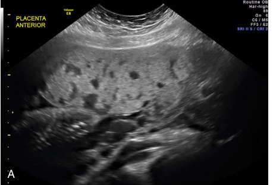

• Fig. 10.28 (A) Anterior placenta accreta showing multiple cysts (vascular lacunae). The hypoechoic interface between the placenta and the myometrium is not seen. (B) Anterior wall placenta previa and percreta. The wall of the maternal bladder (Bl) is invaded by placental vessels (narrow arrow). A sizable venous lake (V) is seen where one would normally expect to view the placental myometrial interface. The placental margin covers the internal cervical os (IO) (wide arrow). CX, Cervix.

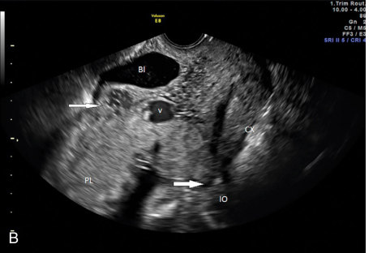

• Fig. 10.29 Hysterectomy specimen with placenta accreta. There is no visible distinction between the uterine muscle and the placental tissue, with the exception of a small area in the lower right (arrow).

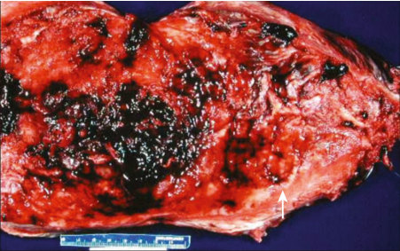

• Fig. 10.29 Hysterectomy specimen with placenta accreta. There is no visible distinction between the uterine muscle and the placental tissue, with the exception of a small area in the lower right (arrow).

## PDF page 202 | printed page 185

space on ultrasound. Most patients have pain and bleeding except for rare cases of concealed abruption. The diagnosis of placental abruption remains a clinical one due to low sensitivity of ultrasound. The role of imaging in this disorder is to exclude placenta previa and other sources of bleeding. One series reported 24% sensitivity and 53% negative predictive value for ultrasound diagnosis of abruption. Subchorionic hematomas are often noted on transvaginal scans early in gestation. Size and persistence have been traditionally linked to poorer outcomes such as abortion, stillbirth, preterm delivery, and preterm rupture of the membrane. In contrast, a recent study reported that subchorionic hematomas were not independent risk factors for adverse outcome when controlled for other maternal risk factors, vaginal bleeding, and gestational age.37 Later abruptions are more difficult to visualize; acute bleeding is isoechoic with placenta and can be mistaken for placentomegaly. Hypoechoic fluid collections and hyperechoic infarcted areas appear in more chronic presentations.

Placenta previa is defined as placenta overlying the internal os. In the second trimester, placenta previa or a low-lying placenta with the inferior edge 2 cm from the internal os is seen frequently, in approximately in 5% to 20% of ultrasound studies. The prevalence decreases to 0.3% to 0.5% at term. A posterior low-positioned placenta is more likely to persist into the third trimester.38 Transvaginal ultrasound is superior to the transabdominal approach and is safe for the evaluation of placenta previa. A persistent low-lying placenta or placenta previa is an indication for cesarean delivery, and follow-up scans are recommended at 32 weeks and 36 weeks for delivery planning.39

Vasa previa is characterized by the presence of unprotected fetal blood vessels by the umbilical cord or placenta over the cervical os or within 2 cm from the cervical os. It complicates 1 in 2500 deliveries. Membrane rupture prior to labor can lead to fetal hemorrhage, exsanguination, death, and bad long-term sequelae in survivors. Prenatal identification prior to the onset of labor or rupture of membranes improves survival to 98.6% from 72% and intact survival to 96.7% from 28.1%.40 An ultrasound study typically shows fetal vessels over the cervical os that appear like bubbles or lines on gray scale (Fig. 10.27). Fetal arterial waveforms can be confirmed by Doppler. Vessels with venous flow should be followed to their origin if possible to differentiate maternal vessels. Low-lying placenta, resolved placenta previa, velamentous cord insertion, accessory lobes, bilobed placenta, multiple pregnancies, and artificial reproductive therapy increase the risk of vasa previa. In these cases, consideration should be given to rule out vasa previa, preferably by transvaginal imaging.41

Grading placental appearance to detect disturbed growth or maturation is of limited benefit. Persistent immaturity is linked to hydrops fetalis, although not as often as increased echogenicity and thickening (Fig. 10.30). Placental lakes are hypoechoic spaces with slow venous flow and are benign findings; however, they must be differentiated from retroplacental or subchorionic hemorrhage. Partial or complete

• Fig. 10.30 Grade III placenta, characterized by echogenic outlines of the cotyledons with hypoechoic centers.

mole in the first trimester, PAS, mesenchymal dysplasia, chorioangioma, and confined placental mosaicism can present with cystic spaces in the placenta.42

### Amniotic Fluid Volume

Amniotic fluid is initially secreted by the amnion; by the 16th week of pregnancy, fetal renal production accounts for the majority, with nearly complete turnover during a 24-hour period. Malformations of the esophagus and upper gastrointestinal tract, inhibited fetal swallowing, aneuploidy, intermittent renal obstruction, maternal diabetes, TTTS, some forms of dwarfism, and fetal hydrops are associated with marked polyhydramnios. Severe growth restriction with polyhydramnios carries a poor prognosis. Polyhydramnios is idiopathic in almost half of the cases; associated complications include maternal respiratory compromise, premature membrane rupture, preterm labor and delivery, malposition, abruption, cord prolapse, preeclampsia, amniotic fluid embolism, and puerperal hemorrhage. Maximum vertical pocket or summed depths across quadrants conveniently serve as proxies for volume calculation in clinical settings (Fig. 10.31). Oligohydramnios may occur after membrane rupture, after fetal renal compensation for placental hypoperfusion, due to functional or obstructive urogenital anomalies, with maternal dehydration, or following exposure to some medications, including indomethacin and angiotensin-converting-enzyme inhibitors. Maternal obesity is associated with underestimation of amniotic volumes. Amniotic fluid measurements may be combined with non-stress and fetal biophysical testing to provide reassurance of fetal well-being.

### Cervical Length and Pelvic Structures

Cervical length and appearance are frequently assessed during routine antenatal ultrasound; transvaginal measurements (Fig. 10.32) are more reliable and reproducible than transabdominal views. The closed endocervical canal length is positively correlated with duration of gestation in

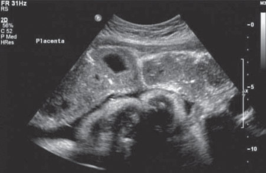

• Fig. 10.30 Grade III placenta, characterized by echogenic outlines of the cotyledons with hypoechoic centers.

## PDF page 203

### Q1

### Q2

• Fig. 10.31 Four-quadrant vertical pocket assessment of amniotic fluid; other techniques include measurement of the single greatest vertical pocket or identification of a 2 × 2-cm cord-free area.

• Fig. 10.32 Transvaginal study showing cervix (dotted line) with MacDonald cerclage (arrows) in situ.

a continuous fashion. Moreover, when values fall below 25 mm, preterm deliveries increase. In patients with prematurity risks, shorter cervical length is strongly predictive of delivery before 36 weeks; in combination with fetal fibronectin and other biomarker assays, ultrasound aids in identifying those at highest risk for imminent delivery.43

Attempts to prevent premature births by tocolysis have been ineffective; postponing delivery for 48 hours to permit steroid enhancement of lung maturity has proven more feasible. First-trimester ultrasound prediction of the need for cervical cerclage has not been reliable. Specific candidates may benefit from elective cerclage based on previous pregnancy history, ultrasound-indicated cerclage with shortened cervical length, and prior history of spontaneous

### Q3

### Q4

• Fig. 10.33 Müllerian anomaly: bicornuate uterus in transverse view with two decidualized cavities (arrows) and indented external contours.

preterm delivery, or “rescue” cerclage with an open cervix on physical examination. Progesterone prophylaxis against prematurity by intramuscular injection or vaginal preparation has increased in recent years; the former has supporting evidence for effectiveness in women with a previous history of preterm delivery, whereas the latter is shown to be effective when a short cervix is noted by ultrasound.43

The gravid uterus is conveniently studied by ultrasound. Congenital Müllerian anomalies, including duplications and septations, occur in about 0.5% of the population (Fig. 10.33). Patients with bicornuate uteri may experience irregular bleeding in early pregnancy, altered cervical competency, and, rarely, torsions or ruptures of the horn in which the gestational sac is located. Poorly vascularized septations are etiologically

• Fig. 10.31 Four-quadrant vertical pocket assessment of amniotic fluid; other techniques include measurement of the single greatest vertical pocket or identification of a 2 × 2-cm cord-free area.

• Fig. 10.32 Transvaginal study showing cervix (dotted line) with MacDonald cerclage (arrows) in situ. • Fig. 10.33 Müllerian anomaly: bicornuate uterus in transverse view with two decidualized cavities (arrows) and indented external contours.

Unmatched source image; PDF page 203. Consult the original caption.

• Fig. 10.32 Transvaginal study showing cervix (dotted line) with MacDonald cerclage (arrows) in situ. • Fig. 10.33 Müllerian anomaly: bicornuate uterus in transverse view with two decidualized cavities (arrows) and indented external contours.

Unmatched source image; PDF page 203. Consult the original caption.

## PDF page 204 | printed page 187

associated with abruption and pregnancy failure. Myomas complicate 1% to 2% of pregnancies with more frequent cesareans and prematurity, abruption, degeneration, and fetal malpresentation; less common complications include fetal deformation, dystocia (7.5%), puerperal hemorrhage, and hysterectomy.44 Adverse obstetric outcomes are rare; studies are confounded by age, ethnicity, and other differences in those who develop myomas. Generally, good maternal and neonatal outcomes are expected in most pregnancies with uterine fibroids.44

Normal adnexal structures are not palpable after the first trimester; ultrasound is the first choice for ovarian evaluation during pregnancy, although often augmented by MRI and CT. Ovarian torsion is a rare but acute surgical emergency; it is more likely with ART, ovarian cysts, and adnexal masses, favoring first-trimester or puerperal onset. When an adnexal mass has been discovered by ultrasound, better characterization by MRI may be essential to avoiding unnecessary surgery during pregnancy. Asymptomatic lesions, even when quite large, are now generally expectantly managed until delivery or the postpartum period if malignancy is not suspected. Ultrasound is frequently sufficient for a secure diagnosis of corpus luteal cysts, benign cystic teratomas, and endometriomas. Use of MRI for atypical lesions can confirm the presence of fat, key to the diagnosis of teratoma and the exclusion of endometrioma. MRI aids in the identification of hydrosalpinges and nongynecological lesions. Expectant management of many adnexal masses past delivery is now more common, based on benign ultrasound, Doppler, and MRI characteristics.45

### Second-Trimester Ultrasound Study of the Fetus

During second-trimester studies, a number of normal fetal structures are routinely identified, and anomalies excluded.

• Fig. 10.34 Three-dimensional rendering of the fetal spine permits localization of the neural tube defect (arrows). Compare with the MRI in Fig. 10.40.

Basic anatomic surveys usually include documentation of fetal cranial integrity and central nervous system anatomy: midline brain structures, cavum septum pellucidum and thalami, lateral and third ventricles, choroid plexus, cerebellum, and posterior fossa.

Views confirming facial symmetry, intact orbits, clear lenses, paired nares, intact lips and hard palate, and normal profile are part of comprehensive studies. Fetal swallowing, respiratory movements, and nuchal structures may be noted. The spinal column is normally imaged in the longaxis, transverse, and coronal views. Distinct advantages for the visualization of the facial features, small parts, and spine are provided by 3D imaging (Fig. 10.34). Views of the thorax, including the axis, site, and relative proportions of cardiac and mediastinal structures with respect to the lungs and pulmonary vessels, yield indirect support for the integrity of the diaphragm. Over time, the basic cardiac examination has expanded from obtaining the axis, laterality, and rate to requiring symmetric four-chamber apical views and, as feasible, images of normal outflows, ductal and aortic arches, and additional arterial and venous tracts (Fig. 10.35). Prenatal echocardiography adds M-mode rhythm, color flow Doppler, and structural studies capable of details and diagnostic accuracy approaching those of postnatal examinations, subject to predictable limitations.46 Fetal abdominal views confirm the closure of the ventral wall; presence, normal size, and site of hepatic, gastric, splenic, pancreatic, vascular, and choledochal structures; renal and adrenal contours; normal bowel dimensions and echogenicity; bladder filling; and umbilical cord appearance. Accuracy of fetal sex assignment exceeds 99% by the midtrimester (Figs. 10.12 and 10.36). Fetal digits, small parts, cerebellar vermis, and palatal components are often imaged by a combination of 2D and 3D. As gestation progresses, neurosonography may identify additional features of intracranial architecture and cerebral maturation.

• Fig. 10.34 Three-dimensional rendering of the fetal spine permits localization of the neural tube defect (arrows). Compare with the MRI in Fig. 10.40.

Unmatched source image; PDF page 204. Consult the original caption.

• Fig. 10.34 Three-dimensional rendering of the fetal spine permits localization of the neural tube defect (arrows). Compare with the MRI in Fig. 10.40.

Unmatched source image; PDF page 204. Consult the original caption.

## PDF page 205

### RV

### LV

### RA

### LA

### AO

• Fig. 10.35 View of the thorax showing a normal four-chamber heart; apex is up and to the left of the picture. The right and left atria (RA, LA) and corresponding ventricles (RV, LV) are seen in the transverse plane of the fetal chest. AO, Aorta.

### Doppler Ultrasound

Initially considered revolutionary, obstetric Doppler has been hampered by costs, time constraints, safety concerns, and lack of clear utility for most patients. Currently accepted applications, originally employed in research and referral centers, commonly include identification and localization of blood flow, resistance to flow, vessel patterns, and directionality and velocity in cardiopulmonary structures and in a wide range of additional vessels, most commonly the uterine arteries, umbilical vessels, DV, and middle cerebral artery.

Uterine blood flow patterns reflect both maternal vascular resistance and placental site. Abnormal Doppler results in these and other vessels precede growth restriction and maternal hypertensive complications. Paired umbilical cord arteries are readily shown by color Doppler to bifurcate around the bladder (Fig. 10.5). Absence of one umbilical cord artery may have associated cardiac and renal anomalies, aneuploidies, or growth restriction. Abnormally high UA resistance is more often characteristic of uteroplacental constraints on fetal growth than of anomalies or aneuploidy. Doppler findings may suggest the origin of a size/date discrepancy, but weight estimation more reliably identifies the small-for-gestational-age fetus. Persistent absence or reversal of end-diastolic flow, albeit rare, is associated with severe growth restriction, and increased perinatal morbidity and mortality.47 Decreased middle cerebral artery resistance indices indicating brain sparing and increased DV resistance indices usually develop later in the course of compromised perfusion; paradoxical DV and umbilical venous patterns are considered premorbid. Schemes combining clinical risks, gestational age, biometry, Doppler measurements of the umbilical and middle cerebral vessels, and biophysical testing appear to have improved outcomes for growthrestricted fetuses while reducing the frequency of iatrogenic prematurity.13

A

B

### UT

### B

C

• Fig. 10.36 The male fetus (A) can reliably be distinguished from the female fetus (B) by ultrasound after the first trimester. (C) A female fetus with hydrometrocolpos. The arrows point to sediment of red blood cells in the uterus (UT). B, Bladder.

Doppler measurement of peak systolic velocity in the middle cerebral artery has become integral to detection of fetal anemia and management of isoimmunization (Fig. 10.37). Previously, isoimmunization and related fetal anemia were screened for invasively by serial amniocentesis to detect hemoglobin products in the amniotic fluid, but such screening was complicated by technical challenges,

• Fig. 10.35 View of the thorax showing a normal four-chamber heart; apex is up and to the left of the picture. The right and left atria (RA, LA) and corresponding ventricles (RV, LV) are seen in the transverse plane of the fetal chest. AO, Aorta.

Unmatched source image; PDF page 205. Consult the original caption.

• Fig. 10.35 View of the thorax showing a normal four-chamber heart; apex is up and to the left of the picture. The right and left atria (RA, LA) and corresponding ventricles (RV, LV) are seen in the transverse plane of the fetal chest. AO, Aorta.

• Fig. 10.36 The male fetus (A) can reliably be distinguished from the female fetus (B) by ultrasound after the first trimester. (C) A female fetus with hydrometrocolpos. The arrows point to sediment of red blood cells in the uterus (UT). B, Bladder.

• Fig. 10.36 The male fetus (A) can reliably be distinguished from the female fetus (B) by ultrasound after the first trimester. (C) A female fetus with hydrometrocolpos. The arrows point to sediment of red blood cells in the uterus (UT). B, Bladder.

• Fig. 10.36 The male fetus (A) can reliably be distinguished from the female fetus (B) by ultrasound after the first trimester. (C) A female fetus with hydrometrocolpos. The arrows point to sediment of red blood cells in the uterus (UT). B, Bladder.

Unmatched source image; PDF page 205. Consult the original caption.

• Fig. 10.36 The male fetus (A) can reliably be distinguished from the female fetus (B) by ultrasound after the first trimester. (C) A female fetus with hydrometrocolpos. The arrows point to sediment of red blood cells in the uterus (UT). B, Bladder.

## PDF page 206 | printed page 189

prematurity, and fetal losses. Furthermore, hemoglobin products have low screening sensitivity in Kell antibodyrelated anemia, which causes bone marrow suppression in addition to red blood cell destruction. Peak systolic velocity of the middle cerebral artery by noninvasive Doppler, relatively easily obtained, is inversely correlated with fetal hemoglobin values.48 At a cutoff of 1.5 multiples of the median, the sensitivity for clinically significant anemia approaches 100%, with a false-positive rate from 0% to 28%. The false-positive rate may increase starting at 34 to 35 weeks; however, the false-negative rate remains similar to that at 34 to 35 weeks.48 Severe growth restriction may contribute to false-positive results but is usually distinguished by clinical context. Color flow Doppler distinguishes between cystic and vascular lesions, confirms the presence or site of organs, and aids in evaluating brain, cardiac, and pulmonary vasculature. When combined with 3D, color flow generates dramatic virtual vascular casts, although with more limited prenatal applications.

### Doppler Studies of the Growth-Restricted Fetus

Placental dysfunction leading to FGR is an important risk factor for neurodevelopmental delay. Observations clarify that FGR evolves prenatally from a preclinical phase of abnormal vascular, nutrient, and endocrine milieu to a clinical phase differing in characteristics in preterm versus term pregnancies. Relating childhood neurodevelopment to prenatal characteristics may aid in identifying mechanisms and timing of critical insults. Based on available studies, lagging HC, degree of FGR, gestational age, umbilical artery (UA), aortic, and cerebral Doppler parameters may be independent prenatal predictors of infant and childhood neurodevelopment. HC is meaningful independent of gestational age, but a generalized growth delay has greater impact in early-onset FGR. Gestational age at

• Fig. 10.37 Middle cerebral artery (MCA) (in trapezoid) Doppler flow velocity in a fetus with Rhesus sensitization. The peak systolic velocity (shown in lower portion) increases as fetal anemia progresses. Doppler measurements in the fetus are often expressed as ratios to compensate for inaccuracies introduced by narrow, tortuous vessels.

delivery becomes the chief determinant of neurodevelopment before 32 to 34 weeks’ gestation. Doppler evidence of placental resistance to flow is increasingly important after 27 weeks, with maximum concern when flow reversals are noted in the UA, aorta, ductus venosus (DV), or the UV. These findings predominate in early-onset FGR; cerebral vascular impedance changes, sometimes expressed as a ratio between the pulsatility indices of the middle cerebral and umbilical arteries, are important in later FGR. Abnormal motor and neurologic delays occurring in preterm FGR give way to cognitive effects and abnormalities related to specific brain areas as gestation advances, suggesting different pathophysiologies or evolving vulnerabilities of the fetal brain. Current studies do not suggest that fetal deterioration has an independent effect on neurodevelopment in early-onset FGR. The role of intervention in late FGR requires more research, as risks for damage and patterns of deterioration may differ in the third trimester.49

### Doppler Studies of the Fetal Venous System

Elucidation of normal venous anatomy and its roles in normal fetal development and in the evaluation and management of intrauterine growth restriction and other cardiovascular disorders, as well as its association as a part of complex structural anomalies, are being researched extensively. In the fetus, oxygen- and nutrient-rich blood from the placenta is delivered through the UV and the DV to the fetal heart. The DV connects to the inferior vena cava (IVC) distally, together with the left hepatic vein (LHV) and the middle hepatic vein (MHV), proximal to the entrance into the right atrium (Fig. 10.38). The UV and DV atrophy after birth.49

Within the developing fetal liver, two apposed venous systems develop, the afferent and efferent. The afferent venous system, composed of the fetal liver, UV, portal vein, portal system, and DV, and the efferent venous system (the hepatic veins [HVs]) form two systems positioned in the caudal and cranial portions of the liver, respectively.50 The main function of the fetal venous system is to deliver blood rich with oxygen and nutrients from the placenta. The DV plays a critical role in this important function. The venous system represents one component of the four that comprise the fetomaternal vascular system, the others being the heart, the placenta, and the arterial system. In order to provide a normal amount of blood flow toward the heart, low placental resistance and improved cardiac contraction must work in synergy. A pressure gradient is created between the atria and ventricles which reduces the preload in the venous circulatory system and allows blood to flow toward the heart. This pressure gradient is further accentuated by the physiologic stenosis of the DV.

Doppler waveforms of the fetal precordial veins mirror the heart cycle. Their typical three-peak form represents the ventricular systolic phase (S), passive diastolic phase (D), and active diastolic phase (A). As opposed to the IVC and HVs, DV blood flows forward throughout the entire heart

• Fig. 10.37 Middle cerebral artery (MCA) (in trapezoid) Doppler flow velocity in a fetus with Rhesus sensitization. The peak systolic velocity (shown in lower portion) increases as fetal anemia progresses. Doppler measurements in the fetus are often expressed as ratios to compensate for inaccuracies introduced by narrow, tortuous vessels.

## PDF page 207

• Fig. 10.38 (A) Color Doppler study illustrating the ductus venosus (DV) and its pulse wave. (B) Transverse section illustrating the aorta (AO), inferior venal cava (IVC), and the DV.

cycle, assuring a constant high-quality blood supply to the heart. The DV is sampled at its inlet with a large sample volume in a near-sagittal scan at a low angle of insonation (Fig. 10.38). Alternatively, DV flow can be sampled in an oblique transverse section of the fetal abdomen. Changes in DV flow are seen in fetal hypoxia and hypovolemia in experimental animal models and in human fetuses.51

### Ultrasound-Guided Procedures

Real-time ultrasound is well suited by virtue of safety, economy, and convenience for guiding placement of needles, cannulae, catheters, and other devices used in fetal diagnosis and therapy. The range of procedures includes oocyte retrieval and embryo transfers, embryonic and fetal reduction, selective termination in multiple gestations, chorionic villus sampling, placental and skin biopsies, amniocentesis and amnioreduction, cord blood sampling, intrauterine transfusion, aspiration of fluid from various fetal and maternal sites, bladder and thoracic shunts, intrauterine surgical procedures such as neural tube defect repair, and an adjunct to fetoscopy and vascular ablation. The effectiveness of and complications from procedures are often apparent in real time. Important accepted applications include determinations of fetal status; relative fetal and umbilical cord positions during external version for malpresentations, labors, and immediately before transfusions; surgical interventions; and the ex utero intrapartum treatment (EXIT) procedure.

### Fetal Well-Being Assessment

A tenet of antepartum testing is that more accurate predictions of fetal wellness are achieved in proportion to the number of variables considered. The biophysical profile (BPP) is a noninvasive, ultrasound-based clinical tool that integrates levels of dynamic biophysical activities into a useable standard. The BPP attempts to predict the presence or absence of fetal asphyxia to prevent progression to

DV IVC

AO

metabolic acidosis and fetal death. The BPP seeks to identify four parameters in a 30-minute period, each of which is assigned two points: (1) observation of continuous tidal fetal breathing for 30 seconds, (2) a vertical amniotic fluid pocket of at least 2 cm (or 2 cm in two planes), (3) three obvious fetal movements, and (4) fetal tone, manifested by brisk flexion of small parts or hands. Death or injury within 1 week is more likely with scores below six, with loss of tone considered a late finding. Conversely, scores of eight are considered highly reassuring for well-being during the same period. A fetal non-stress test, sometimes included for an additional two points (total score of 10), does not usually affect the predictive value of the BPP.

Antepartum testing by BPP should not be performed prior to viability or when fetal or maternal conditions preclude successful intervention. Cautious interpretation is appropriate for extreme fetal prematurity, in the presence of anomalies, for maternal metabolic abnormalities, during labor, and with some drugs, including opiates, sedatives, and antenatal corticosteroids.

Doppler investigation is the only noninvasive in utero method for assessing fetoplacental hemodynamic status. Each component of the fetomaternal circulation has a different role in placental function and fetal well-being. Doppler evaluation of the venous system aims to assess fetal cardiac function, which in severe cases may deteriorate to an acute event of congestive heart failure. Cardiac events are apparent in the DV waveform. Reversed or zero flow in the A-wave is a simple sign of disordered cardiac function. There is reduced velocity in the A-wave in intrauterine growth restriction, and as the situation worsens it is further deflected due to increased afterload and preload, as well as increased end-diastolic pressure, the direct effects of hypoxia, and increased adrenergic drive.

The evolution of fetoplacental Doppler abnormalities is dependent on the gestational age at onset and the severity of the placental disease. Mild cases present with UA and middle cerebral artery Doppler abnormalities at 32 weeks.

Unmatched source image; PDF page 207. Consult the original caption.

• Fig. 10.38 (A) Color Doppler study illustrating the ductus venosus (DV) and its pulse wave. (B) Transverse section illustrating the aorta (AO), inferior venal cava (IVC), and the DV.

## PDF page 208 | printed page 191

Severe cases establish abnormal UA Doppler values at 27 weeks, followed by rapid progression to severe arterial and venous Doppler abnormalities, such as absent/reversed UA diastolic velocity, absent/reversed DV A-wave, and UV pulsation.52

### Fetal Anomalies

### Ultrasound Examination for Fetal Abnormalities in the Late First Trimester

Late first-trimester ultrasound study without an established protocol on low-risk populations can detect approximately 30% of the major fetal anomalies after exclusion of chromosomal aberrations.11,12 The detection rate increases to 61% in high-risk populations.11 Use of a standard protocol increases the yield for fetal anomalies. As such, the American Institute of Ultrasound in Medicine published detailed first-trimester scanning guidelines for high-risk pregnancies in 2021.53 Other factors improving performance include adequate examination time, the experience and training of the performing sonographer, the quality of the ultrasound equipment, maternal body mass index, use of transvaginal ultrasound study for cases with suboptimal transabdominal imaging, and the presence of an easily detectable marker for an underlying abnormality.54–56 In some cases, late first-trimester scans may not be diagnostic; however, they may demonstrate findings suggestive of a structural anomaly (Fig. 10.39). In these patients, secondtrimester ultrasound studies before 18 weeks can lead to earlier prenatal diagnoses. To decrease false positivity, the natural history of abnormal findings should be known. Two such examples are the resolution of isolated bowel herniation (physiologic omphalocele) and isolated megacystis in euploid fetuses with longitudinal bladder length less than 15 mm with advancing gestation.57 The detection

• Fig. 10.39 Eleven-week embryo with a thickened nuchal lucency and an omphalocele (arrow) containing fetal liver. The fetal liver does not undergo physiologic herniation. A study at 18 weeks identified a lumbosacral spina bifida in addition to confirming the omphalocele. CRL, Crown-rump length.

rate of fetal anomalies during late first trimester scan varies for different types of major anomalies in the various organ systems as summarized below.53

### Central Nervous System

Most cases of acrania, alobar holoprosencephaly, and encephalocele can be accurately diagnosed. Posterior fossa malformations (Fig. 10.19B), callosal agenesis, ventriculomegaly, destructive lesions, cortical development abnormalities, hemorrhage, thrombosis, and tumors are usually diagnosed in the second and third trimester as they develop or become more prominent with advancing pregnancy. It is feasible to correctly diagnose more than half of fetuses with open spina bifida (OSB) in the first trimester. There are many suggestive markers of OSB in the late first-trimester scan, including obliterated fourth ventricle (intracranial translucency) and cisterna magna (Fig. 10.19B), increased brainstem distance, peduncles and aqueduct of Sylvius, increased choroid plexus/frontooccipital diameter ratio, an abnormal frontomaxillary facial angle, and the dry brain sign.58

### Face

Up to one-third of cases with cleft lip and palate are detectable in the first trimester. Isolated cleft lip and palate, unilateral cleft lip, and micrognathia, unless severe, are usually diagnosed in the second trimester.56 Suggestive signs of facial abnormalities shown to be helpful include absent mandibular gap for micrognathia, maxillary gap for cleft palate, and retronasal view abnormalities for cleft lip and palate.58

### Ocular Anomalies

Conditions such as hyper- and hypotelorism, anophthalmia, and microphthalmia have been diagnosed from 12 weeks to 16 weeks by measuring the interocular distance, ocular diameter, and biocular distance. Isolated anomalies are rare, and most of the anomalies are associated with other malformations, especially those of the developing brain (alobar holoprosencephaly), as well as with aneuploidy (trisomy 13) and nonchromosomal syndromes.

### Chest

Approximately 29% of congenital diaphragmatic hernia (CDH) cases can be detected in the first trimester. Mediastinal shift and upturned superior mesenteric artery sign can be suggestive of CDH.58 Most chest masses were diagnosed after the first trimester in one large case series.56,58

### Cardiac

Most cases of tricuspid atresia, hypoplastic left heart, atrioventricular septal defects, and more than half of complex heart defects and left atrial isomerism can be detected in the first trimester.56 For other defects, detection rate remains lower than 50%. Increased nuchal translucency, abnormal DV blood flow pattern as demonstrated by a Doppler study, tricuspid regurgitation, and abnormal cardiac axis in the

• Fig. 10.39 Eleven-week embryo with a thickened nuchal lucency and an omphalocele (arrow) containing fetal liver. The fetal liver does not undergo physiologic herniation. A study at 18 weeks identified a lumbosacral spina bifida in addition to confirming the omphalocele. CRL, Crown-rump length.

Unmatched source image; PDF page 208. Consult the original caption.

• Fig. 10.39 Eleven-week embryo with a thickened nuchal lucency and an omphalocele (arrow) containing fetal liver. The fetal liver does not undergo physiologic herniation. A study at 18 weeks identified a lumbosacral spina bifida in addition to confirming the omphalocele. CRL, Crown-rump length.

## PDF page 209

first trimester are associated with an increased risk for congenital cardiac disease.58,59–61

### Gastrointestinal and Genitourinary

Most cases with omphalocele, gastroschisis, or limb-body wall complex and more than 70% of lower urinary tract obstructions are detected in the first trimester.58 When the enlarged hyperechogenic kidneys are noted in the first trimester, polycystic kidney disease should be suspected. Though autosomal recessive polycystic kidney disease also has been diagnosed in the first trimester, follow-up examination in the second trimester is needed to confirm the diagnosis. Abdominal cysts, bowel atresia, abnormal genitalia, and renal anomalies are not usually detected in the first trimester.58

### Skeleton

More than 70% of absent extremities, fetal akinesia deformation sequence, and lethal skeletal dysplasias are detected in the first trimester.58 Most cases with talipes anomaly and nonlethal skeletal dysplasias and approximately more than 60% of abnormal digits and hemivertebrae of the spine are detected after the first trimester.58

### Disadvantages Compared With Second-Trimester Ultrasound

Although the 11+0 to 13+6-week scan is effective in identifying a large variety of fetal defects, there are some important possible disadvantages compared with secondtrimester ultrasound examination. First, due to the small size of anomalous organs, the number of major anomalies that can be detected through a systematic scan is limited, and the scan can be done only in highly experienced hands. Second, undetectable anomalies mostly relate to structures not yet fully developed prior to 14 weeks—for example, cerebellar anomalies and echogenic lung cysts. In addition, some anomalies, such as aortic and pulmonary stenosis, can progress into more severe malformations with advancing gestation, so there may not be an obvious abnormality at this period. Finally, some defects may resolve in utero, such as ventricular septal defects.61

### Ultrasound Examination for Fetal Abnormalities in the Second or Third Trimester

Neonatal outcomes can be optimized by forewarning and timely preparation when fetal abnormalities are present. Unfortunately, more than one-third of birth defects remain unrecognized prenatally. False-positive diagnoses are less frequent, but the up to 10% discordancy with autopsy findings highlights the inherent uncertainties of prenatal diagnosis. Familiarity with imaging pitfalls associated with common anomalies is imperative to avoid misdiagnosis. Suspected structural defects should always be visualized in the correct plane with attempted confirmation in other planes. Precise

measurements using specific criteria, appropriate gain settings, and additional modalities may be required for correct interpretation and management. Expert second opinions by patient referral or image review are available for most findings. Despite acknowledged limitations, prenatal ultrasound is the standard method for recognition of fetal anomalies.

### Central Nervous System Fetal Ventriculomegaly

Hydrocephalus and ventriculomegaly are not strictly synonymous. Hydrocephalus connotes raised intracranial pressure, a functional observation not directly amenable to ultrasound. Prenatal enlargement of the lateral ventricles (Fig. 10.40) may occur without altered pressure because of developmental abnormalities. Enlargement of the atria and posterior horns of the lateral cerebral ventricles (colpocephaly) may be associated with agenesis of the corpus callosum or type II Chiari malformations.62 Dilated lateral ventricles may also result from obstructed cerebrospinal fluid flow by hemorrhage or from brain destruction by a variety of causes, including ischemia and infection (e.g., cytomegalovirus, toxoplasmosis, Zika virus). A single measurement over 10 mm at the level of the posterior atria of the lateral ventricles defines ventriculomegaly between 16 and 40 weeks of gestational age.

Atrial widths tend to decrease slightly during pregnancy. Choroid plexus positioning is gravity dependent; on axial views, the choroid, attached at the level of the foramen of Monro, rests on the dependent wall of the lateral ventricle, marking the limit of the lateral ventricle, even when the wall cannot be visualized. A “dangling” choroid plexus

• Fig. 10.40 Fetal MRI at 23 weeks’ gestation showing massive enlargement of the lateral ventricles with a thin rim of remaining brain parenchyma.

• Fig. 10.40 Fetal MRI at 23 weeks’ gestation showing massive enlargement of the lateral ventricles with a thin rim of remaining brain parenchyma.

## PDF page 210 | printed page 193

• Fig. 10.41 “Dangling choroid” (thick arrow) with bilaterally dilated lateral ventricles secondary to an open neural tube defect. The latter is signaled by the frontal depression “lemon sign” (thin arrow) in up to 90% of cases.

conveys the extent and severity of ventricular enlargement (Fig. 10.41).

Clinical outcomes of severe ventriculomegaly (atrial size greater than 15 mm) are discouraging; survivors are often mentally and physically impaired. Hydrocephalus associated with arachnoid cyst, atresia of Monro, absence of the corpus callosum, or minor intracranial hemorrhage may have a better prognosis. By contrast, hydrocephaly seen with holoprosencephaly, encephalocele, congenital syndromes, or infection generally leads to loss or greater disability. Formal diagnostic and management algorithms, combining ultrasound, MRI, genetic diagnosis, and infectious disease screening, play an essential role in counseling and care when hydrocephaly is identified.63

In utero shunting has no current role in the treatment of prenatal ventriculomegaly. Asymmetric or rounded lateral ventricles and mild ventriculomegaly (widths between 10 and 12 mm) convey an uncertain prognosis, as most infants are normal, particularly when resolution occurs; slightly wider dimensions (12–15 mm) carry an intermediate prognosis.

Agenesis of the corpus callosum can be isolated but is commonly associated with other anomalies of abnormal neuronal migration. Midtrimester diagnosis of many brain lesions is hampered by ongoing differentiation and growth of the central nervous system; third-trimester transvaginal cranial ultrasound and MRI are particularly helpful in assessing the progressive development of gyri and sulci of the brain (Fig. 10.42).

### Meningomyelocele and (Type II) Chiari Malformation

Meningomyelocele (Fig. 10.43) may be associated with a Chiari II malformation (that is, downward displacement of the hindbrain), as well as with other brain anomalies,

• Fig. 10.42 Fetal MRI at 35 weeks’ gestation demonstrating agenesis of corpus callosum. Axial scan shows parallel lateral ventricles enlarged posteriorly (colpocephaly) in a teardrop shape.

• Fig. 10.43 MRI of sacral meningomyelocele (thick arrow) at 21 weeks’ gestation; normal posterior fossa including cerebellum and fourth ventricle (thin arrow).

• Fig. 10.41 “Dangling choroid” (thick arrow) with bilaterally dilated lateral ventricles secondary to an open neural tube defect. The latter is signaled by the frontal depression “lemon sign” (thin arrow) in up to 90% of cases.

• Fig. 10.42 Fetal MRI at 35 weeks’ gestation demonstrating agenesis of corpus callosum. Axial scan shows parallel lateral ventricles enlarged posteriorly (colpocephaly) in a teardrop shape.

• Fig. 10.43 MRI of sacral meningomyelocele (thick arrow) at 21 weeks’ gestation; normal posterior fossa including cerebellum and fourth ventricle (thin arrow).

Unmatched source image; PDF page 210. Consult the original caption.

• Fig. 10.43 MRI of sacral meningomyelocele (thick arrow) at 21 weeks’ gestation; normal posterior fossa including cerebellum and fourth ventricle (thin arrow).

Unmatched source image; PDF page 210. Consult the original caption.

• Fig. 10.43 MRI of sacral meningomyelocele (thick arrow) at 21 weeks’ gestation; normal posterior fossa including cerebellum and fourth ventricle (thin arrow).

## PDF page 211

• Fig. 10.44 Fetal MRI at 19 weeks demonstrates Chiari II malformation. Note dilated lateral ventricle (straight arrow) and communication between lower lumbar spinal canal and amniotic fluid–open neural tube defect (curved arrow).

including ventriculomegaly (Fig. 10.44). Progressive hydrocephalus can develop requiring shunting early after delivery. Open neural tube defect (Fig. 10.45) is usually accompanied by markedly elevated alpha-fetoprotein levels in both maternal serum and amniotic fluid. A meningomyelocele appears on ultrasound as splaying or divergence of the posterior ossification centers, best appreciated on axial spinal views. A fluid-filled sac may be seen and the integrity of the overlying skin can be visibly disrupted on axial and sagittal images. The level of the meningomyelocele can be ascertained more accurately with 3D ultrasound and MRI (Figs. 10.34 and 10.43), helpful for predicting the outcome in affected children. Severe cases may be associated with kyphoscoliotic spinal deformity or clubbing of one or both feet. Prenatally, extremity movement may seem to be preserved; however, absence of normal activity better correlates with postnatal motor function.

### The Skull and Brain in Spina Bifida

The “lemon sign” refers to the altered appearance of the calvarium, similar in shape to a lemon, on an axial view of the skull and brain (Fig. 10.41). Biconcave frontal bones produce the calvarial distortion. The sign is best demonstrated between 18 and 24 weeks but is not specific, appearing sometimes in otherwise normal children. The “banana sign” refers to abnormal cerebellar positioning, curled in a crescent (banana-like) around the brainstem (Fig. 10.45). Obliteration of the cisterna magna and cerebellar distortion are secondary to type II Chiari malformation. One or both signs are seen in the majority of spina

• Fig. 10.45 Open neural tube defects may be associated with an obliterated posterior fossa “banana sign” (arrow) in 60% of cases.

bifida cases during the midtrimester and should prompt a more detailed examination of the spine. Prenatal surgical closure of defects may improve outcomes in appropriate candidates, particularly with respect to preservation of motor function, to decrease the need for shunting in the early newborn period, and for the prevention of hindbrain displacement.

### Anencephaly

Anencephaly, the absence of normal brain and calvarium superior to the orbits, can be detected as early as 10 weeks but is recognizable throughout gestation (Fig. 10.46). Maternal serum alpha fetoprotein is usually very elevated. About half of cases have associated anomalies, such as meningomyelocele, cleft palate, or clubfoot. Occasionally, the typical appearance is altered by the presence of echogenic material superior to the orbits, identified pathologically as angiomatous stroma (“area cerebrovasculosa”). Polyhydramnios and malpresentation are common later findings. Abnormal prolongation of pregnancy may occur, presumably secondary to lack of fetal neurohormonal cues for labor. Anencephaly is considered incompatible with meaningful survival; most affected liveborn infants succumb in the immediate neonatal period. Intervention for purely fetal indications is futile and is not recommended.

### Encephalocele

Extracranial protrusion of brain tissue within a meningeal sac is a straightforward ultrasound diagnosis, although dependent on site and size of lesion and appropriate visualization. Most encephaloceles in the Western world are occipital and midline and should be distinguished from soft tissue edema, hemangioma, or lymphangioma of the neck. The identification of a calvarial defect allows a specific diagnosis (Fig. 10.47). Encephaloceles may be isolated or associated with amniotic band syndrome (when off midline) and genetic syndromes such as Meckel-Gruber. Prognosis is affected by the site, size, and amount of extruded tissue and is adversely affected by ventriculomegaly, microcephaly, and syndromic etiology. Anterior sites

• Fig. 10.44 Fetal MRI at 19 weeks demonstrates Chiari II malformation. Note dilated lateral ventricle (straight arrow) and communication between lower lumbar spinal canal and amniotic fluid–open neural tube defect (curved arrow).

Unmatched source image; PDF page 211. Consult the original caption.

• Fig. 10.44 Fetal MRI at 19 weeks demonstrates Chiari II malformation. Note dilated lateral ventricle (straight arrow) and communication between lower lumbar spinal canal and amniotic fluid–open neural tube defect (curved arrow).

Unmatched source image; PDF page 211. Consult the original caption.

• Fig. 10.45 Open neural tube defects may be associated with an obliterated posterior fossa “banana sign” (arrow) in 60% of cases.

Unmatched source image; PDF page 211. Consult the original caption.

• Fig. 10.45 Open neural tube defects may be associated with an obliterated posterior fossa “banana sign” (arrow) in 60% of cases.

## PDF page 212 | printed page 195

### • Fig. 10.46 Three-dimensional orthogonal image of anencephaly at 17 weeks’ gestation. The cranial vault

is absent above the orbits.

### • Fig. 10.47 Upper image: Occipital encephalocele with herniation of meninges through the defect (arrow).

Lower images: Posterior encephalocele with meninges and neuronal tissue.

• Fig. 10.46 Three-dimensional orthogonal image of anencephaly at 17 weeks’ gestation. The cranial vault is absent above the orbits.

• Fig. 10.47 Upper image: Occipital encephalocele with herniation of meninges through the defect (arrow). Lower images: Posterior encephalocele with meninges and neuronal tissue.

Unmatched source image; PDF page 212. Consult the original caption.

• Fig. 10.47 Upper image: Occipital encephalocele with herniation of meninges through the defect (arrow). Lower images: Posterior encephalocele with meninges and neuronal tissue.

Unmatched source image; PDF page 212. Consult the original caption.

• Fig. 10.47 Upper image: Occipital encephalocele with herniation of meninges through the defect (arrow). Lower images: Posterior encephalocele with meninges and neuronal tissue.

## PDF page 213

are more common in Asian populations; small nasal or frontoethmoidal encephaloceles may initially elude even postnatal detection.

### Holoprosencephaly

Holoprosencephaly, a malformation resulting from early failure of division of the embryologic prosencephalon or forebrain, is frequently associated with facial abnormalities (Fig. 10.48A). Its incidence ranges from 0.6 to 1.9 per 10,000 live births, although this is likely an underestimate because many cases spontaneously abort and milder variants can be unrecognized. In cases without chromosomal abnormalities, recurrence risk is estimated to be 6%. The etiology of holoprosencephaly is heterogeneous and not fully known, as most cases are sporadic. Environmental, mechanical, and genetic factors have all been implicated. Several chromosomal disorders are linked to this anomaly, most notably trisomy 13, with 70% exhibiting holoprosencephaly.

A

Bfalx chor

C

• Fig. 10.48 (A) Fetal MRI at 24 weeks. Alobar holoprosencephaly. Profile of the face demonstrated no orbits or nose but a proboscis (arrow). Massive single ventricle with little remaining brain. (B) Reconstructed three-dimensional image of a fetus with alobar holoprosencephaly. A proboscis (arrows) is seen but no orbits. (C) The fetal choroids are seen to be symmetrical and intact in this 12-week fetus.

Holoprosencephaly in association with extra-cephalic malformations strongly suggests aneuploidy; there are also autosomal dominant and recessive familial forms. The condition has been induced by a variety of teratogenic agents in animal models. In alobar holoprosencephaly, the most severe form, there is a complete failure of cleavage of the forebrain into two hemispheres. The cerebral hemispheres are fused and enclose a single prosencephalic ventricle. In addition to a single ventricular cavity, the thalami are fused, and the cavum septum pellucidum, corpus callosum, falx cerebri, optic tracts, and olfactory bulbs are all absent. The alobar condition is often associated with fetal loss; the vast majority of liveborn infants experience severe neurologic dysfunction or death in early infancy; less severe variants have a wider, less predictable range of outcomes. Partial cleavage results in semilobar holoprosencephaly, with posterior separation of the cerebral hemispheres, variable degrees of thalamic fusion, and absent olfactory bulbs and corpus callosum. In lobar

cran

Unmatched source image; PDF page 213. Consult the original caption.

Unmatched source image; PDF page 213. Consult the original caption.

Unmatched source image; PDF page 213. Consult the original caption.

Unmatched source image; PDF page 213. Consult the original caption.

• Fig. 10.48 (A) Fetal MRI at 24 weeks. Alobar holoprosencephaly. Profile of the face demonstrated no orbits or nose but a proboscis (arrow). Massive single ventricle with little remaining brain. (B) Reconstructed three-dimensional image of a fetus with alobar holoprosencephaly. A proboscis (arrows) is seen but no orbits. (C) The fetal choroids are seen to be symmetrical and intact in this 12-week fetus.

• Fig. 10.48 (A) Fetal MRI at 24 weeks. Alobar holoprosencephaly. Profile of the face demonstrated no orbits or nose but a proboscis (arrow). Massive single ventricle with little remaining brain. (B) Reconstructed three-dimensional image of a fetus with alobar holoprosencephaly. A proboscis (arrows) is seen but no orbits. (C) The fetal choroids are seen to be symmetrical and intact in this 12-week fetus.

• Fig. 10.48 (A) Fetal MRI at 24 weeks. Alobar holoprosencephaly. Profile of the face demonstrated no orbits or nose but a proboscis (arrow). Massive single ventricle with little remaining brain. (B) Reconstructed three-dimensional image of a fetus with alobar holoprosencephaly. A proboscis (arrows) is seen but no orbits. (C) The fetal choroids are seen to be symmetrical and intact in this 12-week fetus.

• Fig. 10.48 (A) Fetal MRI at 24 weeks. Alobar holoprosencephaly. Profile of the face demonstrated no orbits or nose but a proboscis (arrow). Massive single ventricle with little remaining brain. (B) Reconstructed three-dimensional image of a fetus with alobar holoprosencephaly. A proboscis (arrows) is seen but no orbits. (C) The fetal choroids are seen to be symmetrical and intact in this 12-week fetus.

Unmatched source image; PDF page 213. Consult the original caption.

• Fig. 10.48 (A) Fetal MRI at 24 weeks. Alobar holoprosencephaly. Profile of the face demonstrated no orbits or nose but a proboscis (arrow). Massive single ventricle with little remaining brain. (B) Reconstructed three-dimensional image of a fetus with alobar holoprosencephaly. A proboscis (arrows) is seen but no orbits. (C) The fetal choroids are seen to be symmetrical and intact in this 12-week fetus.

Unmatched source image; PDF page 213. Consult the original caption.

## PDF page 214 | printed page 197

holoprosencephaly, the abnormalities may be confined to absence of the cavum septum pellucidum and corpus callosum with fusion of the lateral ventricles and cingulate gyrus; hemispheres are separated anteriorly and posteriorly. The mildest form, septal optic dysplasia, lacks only the cavum septum pellucidum. Severe forms of holoprosencephaly may exhibit cyclopia (median mono-ophthalmia) with or without proboscis, cebocephaly (ocular hypotelorism and a blind single nostril), ethmocephaly (ocular hypotelorism with proboscis) (Fig. 10.48B), and median facial clefts. The diagnosis of holoprosencephaly was typically made during the midtrimester anatomic survey by noting fused lateral ventricles and thalami and the absence of normal midline structures. Early prenatal detection of holoprosencephaly can occur between 11 and 14 weeks’ gestation by obtaining transverse cranial images in which the normal “butterfly sign” of choroid and ventricles is absent (Fig. 10.48C).

### Dandy-Walker Malformation

The Dandy-Walker malformation is a fluid-filled posterior fossa cyst, with variable occurrence of lateral ventriculomegaly; the posterior fossa is always enlarged and the tentorium uplifted.62 The cerebellar hemispheres, separated by the cyst, are rudimentary. Agenesis of the cerebellar vermis is difficult to confirm before 20 weeks because wide variations in developmental timing mean that full formation may not yet be present. The Dandy-Walker variant consists of direct communication between the fourth ventricle and cisterna magna, without posterior fossa enlargement and with only mild hypoplasia of the inferior vermis. The subtle ultrasound findings can be associated with serious abnormalities of neuronal migration; confirmation from MRI is helpful (Fig. 10.49). The fetal brainstem-vermis (BV) and

• Fig. 10.49 Fetal MRI of Dandy-Walker variant at 22 weeks’ gestation. Note communication of the fourth ventricle with the cisterna magna (arrow) and uplifting of the upper cerebellum.

brainstem-tentorium (BT) angles are of great help in the differential diagnosis of upward rotation of the fetal cerebellar vermis. These simple and reproducible measurements provide valuable additional information for the categorization of upward rotation of the fetal cerebellar vermis and posterior fossa cyst. A BV angle >45 degrees is strongly suggestive of a Dandy-Walker malformation, whereas a measurement of <30 degrees favors the diagnosis of a Blake’s pouch cyst.62

### Choroid Plexus Cyst

Cysts in the choroid plexus, noted in 1% to 2% of normal second-trimester pregnancies, usually resolve by the early third trimester (Fig. 10.17). Cyst number, size, or persistence imparts no additional clinical significance. Isolated choroid plexus cysts are generally associated with normal karyotype, do not require follow-up to confirm resolution, and do not affect postnatal development.64 Choroid cysts have been associated with trisomy 18.

### Spine

3D imaging is extremely useful for studying fetal spine, vertebrae, ribs, pelvic bones, and spinal cord. Operators can simultaneously visualize three orthogonal planes, scroll through volumes along any given orientation, and precisely locate abnormalities by use of stable anatomic reference points (Fig. 10.50). Sacrococcygeal teratomas (SCTs) are congenital germ cell tumors, usually benign but often large, arising posteriorly at the medial spinal base. Posterior bony elements of the lumbosacral spine are typically intact. Often SCT is associated with polyhydramnios and prematurity, and more rarely with anemia, high-output cardiac failure, and hydrops. Maternal serum alpha fetoprotein is usually elevated. Generally, SCTs are not related to aneuploidy, although rare cases of chromosomal abnormalities have been reported. The typical teratoma is a complex cystic and solid mass protruding from the fetal rump, with arterial and venous flow seen by color Doppler. Uncommonly,

1

2

1

3 3

2

4

5 5

4

6 6

7 7 8 8 9

9 10

11

10

11

12 13

• Fig. 10.50 Coronal view through the fetal spine showing hemivertebrae and an uneven number of ribs.

• Fig. 10.49 Fetal MRI of Dandy-Walker variant at 22 weeks’ gestation. Note communication of the fourth ventricle with the cisterna magna (arrow) and uplifting of the upper cerebellum.

Unmatched source image; PDF page 214. Consult the original caption.

• Fig. 10.49 Fetal MRI of Dandy-Walker variant at 22 weeks’ gestation. Note communication of the fourth ventricle with the cisterna magna (arrow) and uplifting of the upper cerebellum.

Unmatched source image; PDF page 214. Consult the original caption.

• Fig. 10.50 Coronal view through the fetal spine showing hemivertebrae and an uneven number of ribs.

Unmatched source image; PDF page 214. Consult the original caption.

• Fig. 10.50 Coronal view through the fetal spine showing hemivertebrae and an uneven number of ribs.

## PDF page 215

• Fig. 10.51 Fetal MRI of sacrococcygeal teratoma at 27 weeks’ gestation. The tumor (thick arrow) extends into the fetal pelvis between the spine (thin arrow) and the urinary bladder (curved arrow).

it may be entirely cystic or solid, extend into the fetal pelvis (Fig. 10.51) and abdomen, or undergo malignant degeneration. Some SCTs have unique characteristics, including those found in Currarino syndrome (presacral SCT, sacral malformation, and anorectal anomalies, with or without associated Hirschsprung disease and cloacal anomalies). Prenatal diagnosis is extremely important in planning the timing and route of delivery, given tumor size and potential for hemorrhage, and in anticipation of postnatal surgery. Critically ill fetuses distant from term may benefit from referral to a fetal surgery center for early delivery for signs of fetal heart failure. Emergency delivery may be precipitated by tumor hemorrhage, mass effects, or by obstetric mirror syndrome, a rare maternal complication simulating severe preeclampsia. The prognosis for uncomplicated SCT is generally excellent, although anterior extension and high levels of circulating alpha-fetoprotein and other markers, particularly in immature teratomas, convey elevated risks for recurrence or malignancy.65,66

### Head and Neck

After 14 weeks, visualization of the nose, nares, orbits, forehead, lips, eyes, and ears is feasible. Orbits are clearly seen axially; the ocular diameters and interocular and binocular distances (defining hypertelorism and hypotelorism) are measurable. The profile reveals the forehead, nose, and jaw sagittally (contrast Fig. 10.1 with Fig. 10.52). The coronal view, best for facial structures, includes the orbits (and lenses), eyelids, nose, and lips. Coronal and 3D views identify facial clefting, including cleft lip and palate; clefts may be central or lateral, unilateral or bilateral, involving nasal structures or, more subtly, the soft palate. Sagittal views should include the nasal bones; nasal bone hypoplasia or absence is associated with an increased risk for Down syndrome. The complex anatomy of the fetal face is shown exquisitely by 3D sonography. The distinction between

• Fig. 10.52 Fetal retrognathia (recessed chin) is a feature of a variety of syndromes and aneuploidies, as noted in this fetus with trisomy 18.

• Fig. 10.53 Unremarkable fetal face shown on three-dimensional imaging at 34 weeks’ gestation. Views are optimized by adequate fluid interface, lack of fetal movement, limited maternal adipose and scarring tissues, and posterior placentation.

normal and abnormal facial features can be seen clearly by comparing Figure 10.8 with Figure 10.53.

Cystic hygroma is a septate, cystic mass arising from the neck and occipital region secondary to lymphatic malformation; it may extend over the entire trunk (Fig. 10.54A). Posterior septation of the nuchal ligament and bony integrity distinguish this lesion from neural tube defects. Associated aneuploidies, particularly monosomy X (45,X), are common. When associated with generalized edema, cystic hygromas carry a grim prognosis; when small, isolated, and with normal karyotype, more favorable outcomes, including regression, are well documented. Less common neck lesions include teratomas, hemangiomas, branchial cleft cysts, and, anteriorly, thyroid goiters and thymic absence.

Increased nuchal translucency (Fig. 10.11) and nuchal fold thickness (Fig. 10.16) are associated with aneuploidies, including trisomies 21 and 18, cardiac malformations, diaphragmatic herniation, skeletal dysplasias, a wide range of other anomalies and genetically inherited disorders (Noonan syndrome), lymphatic obstruction sequence, and

• Fig. 10.51 Fetal MRI of sacrococcygeal teratoma at 27 weeks’ gestation. The tumor (thick arrow) extends into the fetal pelvis between the spine (thin arrow) and the urinary bladder (curved arrow).

• Fig. 10.52 Fetal retrognathia (recessed chin) is a feature of a variety of syndromes and aneuploidies, as noted in this fetus with trisomy 18.

• Fig. 10.53 Unremarkable fetal face shown on three-dimensional imaging at 34 weeks’ gestation. Views are optimized by adequate fluid interface, lack of fetal movement, limited maternal adipose and scarring tissues, and posterior placentation.

## PDF page 216 | printed page 199

3 V VIEW

A

B

• Fig. 10.54 (A) Transverse image through the head showing a posteriorly located cystic hygroma with multiple septate cysts (C). (B) Three-vessel view of the fetal heart. The pulmonary artery (PA), aorta (AO), and superior vena cava (SVC) can be seen.

fetal loss. With normal karyotypes and reassuring midtrimester surveys with resolved edema and normal anatomical examination, outcomes are generally good.67

### Heart

Optimal timing of the fetal heart study is a compromise between finding defects as soon as possible and accurately assessing complex anatomy, recognizing that some lesions manifest late in pregnancy. Basic heart evaluation is now an integral part of anatomic surveys at 18 to 22 weeks’ gestation. Initial appreciation of first-trimester cardiac anatomy is feasible by either a transvaginal or a transabdominal approach, augmented by color Doppler; however, the best timing for early imaging of the four chambers and great arteries is usually at 13 to 14 weeks. In experienced hands, first-trimester fetal echocardiography is quite sensitive for the detection of major structural cardiac abnormalities. Some features useful in combination with nuchal measurements for aneuploidy screening include abnormal flow patterns in the DV and tricuspid valve; these are also early markers for cardiac abnormalities and should prompt more detailed assessment. A focused cardiac examination should be performed for known medical or historical risks, with teratogen exposures, and when any significant extra-cardiac anomaly or chromosomal defect has been identified. Cardiac defects should also be excluded in the presence of an aberrant right subclavian artery or other vascular anomalies.67

Screening for fetal cardiac abnormalities was introduced more than 35 years ago, yet prenatal detection remains challenging. Most major congenital heart defects are amenable to prenatal identification, with tertiary centers reporting high diagnostic accuracy; however, overall detection rates remain low and highly operator dependent. Pregnancies with predisposing factors are usually referred for echocardiogram, but most cases of congenital heart disease occur

PA AO SVC

in low-risk pregnancies. Prenatal diagnosis, particularly for babies at risk for acute cardiovascular collapse (for example, with ductal-dependent or restrictive lesions), could reduce both morbidity and mortality.46

Basic cardiac studies attempt to obtain symmetric, appropriately oriented four-chamber views of the fetal heart (Fig. 10.35), showing pulmonary veins, atrioventricular valves, intra-atrial and intraventricular septa, as well as aortic and ductal arches and normal outflow views that link the aorta and neck vessels with the left ventricle and the bifurcating pulmonary artery with the right. The echocardiographic three-vessel view (Fig. 10.54B) allows assessment of the superior vena cava, ascending aorta, and main pulmonary artery. These views aid in identification of transposition of the great arteries, tetralogy of Fallot, truncus arteriosus, and some aortic abnormalities. Fetal arrhythmias may also be analyzed (Fig. 10.55). Sensitivity for complex cardiac lesions exceeds that for isolated septal defects; accurate diagnosis remains dependent on experience and the absence of obstacles posed by poor resolution or unfavorable fetal position.

### Gastrointestinal Tract Normal Bowel Appearance

Physiologic migration of the gut into the proximal umbilical cord occurs between gestational weeks 7 and 10 and may be seen on first-trimester scans (Fig. 10.56) up to 12 weeks. The normal liver always remains intra-abdominal; bowel migration should not be mistaken for a ventral abdominal wall defect. The fetal stomach, seen transvaginally by 9 to 10 weeks of gestation, is an echo-free structure in the upper left abdomen, varying in size as it empties and fills.

Fetal small bowel is not differentiated in appearance early in gestation but appears as central abdominal fluid-filled loops by the late second trimester (Fig. 10.57). Fetal colon is clearly evident by the third trimester as a hypoechoic, haustrated tube at the abdominal periphery. Meconium in

• Fig. 10.54 (A) Transverse image through the head showing a posteriorly located cystic hygroma with multiple septate cysts (C). (B) Three-vessel view of the fetal heart. The pulmonary artery (PA), aorta (AO), and superior vena cava (SVC) can be seen.

Unmatched source image; PDF page 216. Consult the original caption.

Unmatched source image; PDF page 216. Consult the original caption.

Unmatched source image; PDF page 216. Consult the original caption.

## PDF page 217

A

PLACENTA

B

• Fig. 10.55 Fetal arrhythmia by M-mode (A), consistent with paroxysmal atrial tachycardia at 218 beats per minute (bpm). Sustained rates greater than 200 bpm may be associated with fetal hydrops (B). The fetus has ascites (short arrow), pleural effusion (long arrow), and skin edema (thin arrow).

the large bowel is normal in the third trimester; second-trimester meconium normally may have transiently increased echogenicity. Hyperechogenic bowel, bright as adjacent osseous structures, is a concerning but nonspecific finding associated with trisomy 21, cystic fibrosis, bowel atresia, congenital infections (e.g., cytomegalovirus), growth restriction, placental abruption, and poor outcome.68

Gastrointestinal tract obstruction can often be diagnosed by ultrasound. Blockage of the proximal alimentary canal interferes with normal amniotic fluid regulation by fetal swallowing and gut absorption. In complete proximal obstructions, assuming intact membranes and normal renal production, polyhydramnios is noted in the majority, although this may develop in late gestation.

### Esophageal Atresia and Tracheoesophageal Fistula

A nonvisualized fetal stomach combined with polyhydramnios should alert the examiner to the possibility of esophageal atresia. Unfortunately, these signs coincide in only 40% of cases. Nonvisualization of the stomach is not specific for esophageal atresia; proximal esophageal pouches are rarely

• Fig. 10.56 An 11-week fetus within its gestational sac. Physiologic midgut herniation (arrow) occurs from week 8 to week 12.

Cl

• Fig. 10.57 Cross-section of the abdomen at the level of the umbilical vessels, demonstrating heterogeneous-appearing, nondistended, fluid-filled loops of normal small bowel. The abdominal wall is clearly intact adjacent to the cord insertion (CI).

visualized. Polyhydramnios, although present in two-thirds of cases, may not develop until the third trimester. The VACTERL complex consists of three or more components of vertebral, anal, cardiovascular, tracheal, esophageal, renal, and limb malformations; these systems should be scrutinized if tracheoesophageal fistula is suspected. The stomach may also fail to fill when there is little fluid to swallow (e.g., as in oligohydramnios, or secondary to neuromuscular conditions such as Pena-Shokeir syndrome that interfere with swallowing).

### Small Bowel Obstruction

In duodenal atresia, the distended stomach and proximal duodenum produce a “double-bubble” sign akin to the neonatal radiologic finding (Fig. 10.14). A strong (25%) association with trisomy 21 warrants genetic testing when duodenal atresia is suspected. Other etiologies include annular pancreas, duodenal web, malrotation, and severe duodenal stenosis. Ileal and jejunal atresias usually cause multiple distended bowel loops, often exhibiting exaggerated peristalsis (Fig. 10.58). More distal obstruction, as seen in meconium ileus, Hirschsprung disease, and anal

• Fig. 10.55 Fetal arrhythmia by M-mode (A), consistent with paroxysmal atrial tachycardia at 218 beats per minute (bpm). Sustained rates greater than 200 bpm may be associated with fetal hydrops (B). The fetus has ascites (short arrow), pleural effusion (long arrow), and skin edema (thin arrow).

• Fig. 10.55 Fetal arrhythmia by M-mode (A), consistent with paroxysmal atrial tachycardia at 218 beats per minute (bpm). Sustained rates greater than 200 bpm may be associated with fetal hydrops (B). The fetus has ascites (short arrow), pleural effusion (long arrow), and skin edema (thin arrow).

• Fig. 10.57 Cross-section of the abdomen at the level of the umbilical vessels, demonstrating heterogeneous-appearing, nondistended, fluid-filled loops of normal small bowel. The abdominal wall is clearly intact adjacent to the cord insertion (CI).

• Fig. 10.56 An 11-week fetus within its gestational sac. Physiologic midgut herniation (arrow) occurs from week 8 to week 12.

Unmatched source image; PDF page 217. Consult the original caption.

• Fig. 10.56 An 11-week fetus within its gestational sac. Physiologic midgut herniation (arrow) occurs from week 8 to week 12.

## PDF page 218 | printed page 201

Stomach

• Fig. 10.58 Massive dilation of bowel loops secondary to in utero volvulus with obstruction. The stomach and duodenal bulb are marked with arrows. Polyhydramnios is present.

• Fig. 10.59 Dilation of small bowel loops associated with ileal obstruction and perforation. The echogenic material (arrow) is a meconium pseudocyst.

• Fig. 10.60 Three-dimensional views of an omphalocele (star) at 18 weeks’ gestation.

atresia, may not result in visible bowel dilation until the third trimester or postpartum. Meconium peritonitis, a sterile but morbid chemical response to intrauterine bowel perforation, is characterized by echogenic peritoneal calcifications and free intraperitoneal fluid (Fig. 10.59); some cases progress to echogenic pseudocysts. An Australian study noted the increased prevalence of aneuploidy, cytomegalovirus, cystic fibrosis, and FGR in pregnancies complicated by the midtrimester sonographic finding of fetal echogenic bowel. However, reassuringly, 67% of cases with ultrasound-detected echogenic bowel in the second trimester had a normal short-term neonatal outcome.68

### Anterior Abdominal Wall Defects

A midline ventral abdominal wall defect involving the base of the umbilical cord is characteristic of omphalocele (Fig. 10.60). A sac of amnion and peritoneum surrounds the herniated viscera and may include the liver and bowel (Figs. 10.61 and 10.62). Omphaloceles are often associated with other anomalies (Beckwith-Wiedemann syndrome, pentalogy of Cantrell) and aneuploidies (trisomies 13 and 18). In contrast, in cases with gastroschisis, herniated bowel loops float freely in the amniotic cavity without a covering membrane (Fig. 10.63). Defects are usually to the right of the umbilical insertion; aneuploidy, extraintestinal abnormalities, familial forms, and recurrence are not customary with gastroschisis. Gastroschisis is thought to be caused by a vascular accident with wall infarction; young maternal age, and the use of vasoactive substances or nonsteroidal anti-inflammatory drugs (NSAIDs) have been related to increased risk for this lesion.

### Diaphragmatic Hernia and Thoracic Lesions

Congenital diaphragmatic hernia (Fig. 10.64) is a defect in the formation of the diaphragm. Most cases are left sided

• Fig. 10.58 Massive dilation of bowel loops secondary to in utero volvulus with obstruction. The stomach and duodenal bulb are marked with arrows. Polyhydramnios is present.

• Fig. 10.59 Dilation of small bowel loops associated with ileal obstruction and perforation. The echogenic material (arrow) is a meconium pseudocyst.

• Fig. 10.60 Three-dimensional views of an omphalocele (star) at 18 weeks’ gestation.

## PDF page 219

• Fig. 10.61 Color Doppler view of a massive omphalocele (outline) that includes the liver and hepatic vessels (color). The extruded portion and the sac are almost equal in diameter to the torso (to the right).

• Fig. 10.62 Fetal MRI of omphalocele at 24 weeks’ gestation. Note membrane (thin arrow) covering the omphalocele that includes the liver. Fetal stomach and bladder are shown by thick arrows. Note normal smooth brain surface at 24 weeks without gyri or sulci.

and are diagnosed when abdominal organs (usually stomach and bowel) are seen in the thorax. Fluid-filled intrathoracic bowel loops with visible peristalsis and stomach seen at the level of the four-chamber view help confirm the diagnosis. The liver is in the thorax in almost all cases with right-sided herniation. Associated congenital heart disease, other structural defects, prematurity, and chromosomal abnormalities worsen a guarded prognosis. Hernia contents produce a mass effect, shifting the mediastinum and compressing the lungs (Fig. 10.65); the resulting pulmonary hypoplasia and

### ACI

• Fig. 10.63 Gastroschisis. Transverse abdominal image of the spine (left, short arrow) demonstrates free bowel loops (thick arrow) to the right of the umbilical cord insertion (long arrow). This lesion is more common in younger gravidas and is usually isolated.

• Fig. 10.64 MRI of posterior Bochdalek diaphragmatic hernia at 28 weeks’ gestation. Note the loops of bowel occupying the left hemithorax and compressing the lung.

secondary pulmonary hypertension are major determinants of mortality. Polyhydramnios and lagging abdominal circumference (AC) are common associations. Estimation of survival with ultrasound is based on contralateral lung measurements at the level of the four-chamber heart normalized for gestational age (expressed as observed to expected lung area/HC). Calculated 3D lung volumes by ultrasound study and MRI provide more precise measurements of the lungs but with only minor impact on prognostic accuracy. Liver herniation into the chest (Fig. 10.66) indicates a worse

• Fig. 10.61 Color Doppler view of a massive omphalocele (outline) that includes the liver and hepatic vessels (color). The extruded portion and the sac are almost equal in diameter to the torso (to the right).

Unmatched source image; PDF page 219. Consult the original caption.

• Fig. 10.61 Color Doppler view of a massive omphalocele (outline) that includes the liver and hepatic vessels (color). The extruded portion and the sac are almost equal in diameter to the torso (to the right).

• Fig. 10.62 Fetal MRI of omphalocele at 24 weeks’ gestation. Note membrane (thin arrow) covering the omphalocele that includes the liver. Fetal stomach and bladder are shown by thick arrows. Note normal smooth brain surface at 24 weeks without gyri or sulci.

• Fig. 10.63 Gastroschisis. Transverse abdominal image of the spine (left, short arrow) demonstrates free bowel loops (thick arrow) to the right of the umbilical cord insertion (long arrow). This lesion is more common in younger gravidas and is usually isolated.

• Fig. 10.64 MRI of posterior Bochdalek diaphragmatic hernia at 28 weeks’ gestation. Note the loops of bowel occupying the left hemithorax and compressing the lung.

## PDF page 220 | printed page 203

RT

Bowel

Stomach Lung

LT

• Fig. 10.65 Fetal ultrasound image of the chest. Left-sided diaphragmatic hernia results in shifting of the mediastinum to the right. Loops of bowel are seen in the left thorax. Note the small compressed right lung marked by the calipers.

• Fig. 10.66 Fetal MRI of right-sided diaphragmatic hernia at 32 weeks’ gestation. Liver (thick arrow) has herniated into the right thorax with compressed right lung. Thin arrow shows incidental nuchal cord.

prognosis in left-sided hernias. Right-sided hernias are more difficult to recognize and may also increase mortality. Bilateral herniation is generally lethal with few documented exceptions.

Congenital pulmonary adenomatoid malformations (CPAMs) (Fig. 10.67) may have cysts with an appearance similar to that of the bowel but lack peristalsis and displacement of identified abdominal organs. Microcystic forms are echogenic and resemble sequestrations; the latter usually have systemic arterial feeding vessels (Fig. 10.68), although blended forms have been described. Growth is variable, with spontaneous regression during pregnancy commonly reported. “Vanishing” lesions, not identified by postnatal x-rays, are always present on chest CT. Fetal hydrops may develop,69 and fetal surgery may be indicated to avert this

• Fig. 10.67 Congenital pulmonary adenomatoid malformation. MRI at 26 weeks in the fetal coronal plane showing both lungs. Multiple large fluid-filled cysts are present.

• Fig. 10.68 Pulmonary sequestration is shown. Power Doppler highlights the feeding vessel (arrow).

potentially fatal complication. The cystic adenomatoid malformation volume ratio (CPAM volume/HC) is a marker used for prediction of hydrops and the need for shunting in macrocystic CPAM, in addition to identifying the need for fetal intervention in early gestation in severe cases. In predominantly microcystic lesions, maternal betamethasone therapy has been reported to lower risks for polyhydramnios and fetal hydrops.69

• Fig. 10.65 Fetal ultrasound image of the chest. Left-sided diaphragmatic hernia results in shifting of the mediastinum to the right. Loops of bowel are seen in the left thorax. Note the small compressed right lung marked by the calipers.

Unmatched source image; PDF page 220. Consult the original caption.

• Fig. 10.65 Fetal ultrasound image of the chest. Left-sided diaphragmatic hernia results in shifting of the mediastinum to the right. Loops of bowel are seen in the left thorax. Note the small compressed right lung marked by the calipers.

• Fig. 10.66 Fetal MRI of right-sided diaphragmatic hernia at 32 weeks’ gestation. Liver (thick arrow) has herniated into the right thorax with compressed right lung. Thin arrow shows incidental nuchal cord.

• Fig. 10.67 Congenital pulmonary adenomatoid malformation. MRI at 26 weeks in the fetal coronal plane showing both lungs. Multiple large fluid-filled cysts are present.

• Fig. 10.68 Pulmonary sequestration is shown. Power Doppler highlights the feeding vessel (arrow).

## PDF page 221

GB

• Fig. 10.69 Fetal gallbladder (GB) (arrow) with echogenic sludge and small calculi in the third trimester. Findings usually resolve when maternal hormonal levels decrease. Compare with normal echo-free appearance in Fig. 10.18.

Renals

• Fig. 10.70 Transverse view of the fetal abdomen, spine up, demonstrating the normal renal appearance (arrows).

### Gallbladder and Bile Ducts

A choledochal cyst is a localized circular dilation of the biliary system, often involving the common bile duct and located in the upper right abdominal quadrant, separate from the gallbladder. Echogenic gallstones and sludge are noted in the gallbladder lumen on third-trimester scans (Fig. 10.69) in one out of every 200 fetuses. The prognosis of fetal gallstones and biliary sludge is favorable. Followup studies in neonates generally confirm resolution when separated from the maternal hormonal milieu; infants are usually asymptomatic. The fetal gallbladder can often be seen after 14 weeks’ gestation. Persistent nonvisualization is associated with a variety of abnormal conditions, most notably biliary atresia and cystic fibrosis.70

### Genitourinary Tract

The kidneys, readily visible by 12 to 14 weeks’ gestation, are located lateral to the fetal spine (Fig. 10.70) below the

### B

• Fig. 10.71 Power Doppler demonstration of two umbilical cord arteries (arrows) outlining the fetal bladder (B).

diaphragm and prominent fetal adrenal glands. Normal renal size and volume can be plotted against gestational age. By the late third trimester, fat deposition creates an echogenic border, enhancing visualization. The bladder may be seen by 11 weeks of gestation, flanked by paired umbilical arteries (Fig. 10.71). Normal fetal ureters are not visible by ultrasound. Fetal adrenal glands are usually identifiable because of a relatively large cortex and unique, contrasting echo textures.

Lethal renal malfunctions, including bilateral multicystic dysplasia, bilateral agenesis, and some cases of congenital autosomal recessive polycystic kidney disease result in failure of fetal urine production. After 16 weeks, amniotic fluid is almost entirely fetal urine, but oligohydramnios may not become apparent until 18 to 20 weeks of gestation. Infants born after prolonged oligohydramnios have a characteristic facial appearance, limb deformities, and pulmonary hypoplasia, termed Potter syndrome (or sequence). The finding of oligohydramnios should direct attention to the fetal urinary tract with rescanning at 30-minute intervals for confirmation if the fetal bladder is not initially visualized. Anhydramnios (no measurable fluid), a persistently empty bladder, and an inability to identify fetal kidneys or renal arteries are strongly suggestive of bilateral renal agenesis. Unfortunately, absence of amniotic fluid may impede making a secure diagnosis with its associated implications for management, particularly because fetal adrenal glands, losing their normal angulation in renal agenesis, may be mistaken for kidneys. Fetal MRI can be ideal in establishing this lethal diagnosis. Care must be exercised when suspecting unilateral renal agenesis to exclude renal ectopy (pelvic kidney); color Doppler may reveal the aberrant course of the renal artery (Fig. 10.4).

Pyelectasis (dilation of the renal pelvis) occurs in up to 5% of pregnancies and is a variant that should not be misinterpreted as hydronephrosis. Pyelectasis is considered a minor marker for trisomy 21 but when isolated is not usually an indication for amniocentesis; transient urinary reflux is a common underlying cause.71 Measurements of

• Fig. 10.69 Fetal gallbladder (GB) (arrow) with echogenic sludge and small calculi in the third trimester. Findings usually resolve when maternal hormonal levels decrease. Compare with normal echo-free appearance in Fig. 10.18.

• Fig. 10.70 Transverse view of the fetal abdomen, spine up, demonstrating the normal renal appearance (arrows).

• Fig. 10.71 Power Doppler demonstration of two umbilical cord arteries (arrows) outlining the fetal bladder (B).

## PDF page 222 | printed page 205

• Fig. 10.72 Fetal MRI at 35 weeks’ gestation. Note massive hydronephrosis with dilated tortuous ureter on contralateral side (thick arrow). Fetal urinary bladder is shown (thin arrow).

anteroposterior views of the kidneys and renal pelves in the transverse plane are used to identify both pyelectasis and hydronephrosis. Upper limits of 4 mm and 7 mm in the second and third trimesters, respectively, define pyelectasis, with normalization routinely anticipated by the third trimester. Pelvic dilation above 1 cm is suspicious for hydronephrosis, particularly with calyceal involvement. Vague correlation exists between the magnitude of fetal renal pyelectasis and renal abnormalities. Persistent pyelectasis should be confirmed neonatally and followed until either resolved or an etiology is established.71

Urinary tract obstruction may have a variable sonographic appearance, depending mainly on timing of onset. Renal dysplasia, sometimes with cyst formation, is the consequence of early obstruction; obstruction occurring later in gestation is more likely to result in dilation of the collecting system (Fig. 10.72). Hydronephrosis may be unilateral, resulting from obstruction of the ureteropelvic or ureterocystic junctions, or bilateral, secondary to lower tract obstruction by posterior urethral valves or urethral agenesis. A distended, thick-walled bladder may be seen in males with a posterior urethral valve along with hydroureters; urinary ascites may occur as a result of calyceal or bladder rupture with intraperitoneal accumulation of urine. “Keyhole” dilation of the posterior urethra helps in distinguishing this lesion from Eagle-Barrett (prune belly) syndrome (Fig. 10.73).

Multicystic dysplastic kidney disease (MCDKD) is commonly an incidental unilateral finding on prenatal examination. Bilaterality is less frequent but lethal. In unilateral cases, abnormalities of the contralateral kidney

• Fig. 10.73 Posterior urethral valve. Coronal scan of the fetal pelvis shows an enlarged bladder and dilated posterior urethra. Arrows are proximal to the posterior urethral valves. Note the oligohydramnios.

are common.72 Associated nonrenal abnormalities occur frequently with both unilateral and bilateral MCDKD, increasing risks for chromosomal abnormality. Males predominate in unilateral MCDKD (ratio of 2.4:1), but females are four times more likely to have chromosomal abnormalities and twice as likely to have nonrenal anomalies or lethal bilateral disease.72 The option of chromosomal analysis should be discussed whenever there are extrarenal abnormalities or bilaterality. Unilateral isolated MCDKD with normal amniotic fluid is not associated with abnormal genetic studies and usually has a favorable outcome; however, a neonatal work-up to exclude reflux in the unaffected kidney should be performed.72

Severe hydronephrosis, in contrast to MCDKD, is an orderly arrangement of the enlarged renal pelvis with connecting, dilated calyces. Bilateral renal anomalies including bilateral secondary multicystic renal dysplasia are common (4%) in the fetus (Fig. 10.74). Dilated ureters occur in ureterovesical junction obstruction, in primary megaureter, or secondary to reflux. Infantile autosomal recessive polycystic kidney disease causes bilaterally enlarged, echogenic reniform kidneys (Fig. 10.75). Other renal and urogenital anomalies identified prenatally include cysts, masses, duplicated collecting systems, and bladder exstrophy; in the last, a nonvisualized bladder coincides with normal amniotic fluid and renal appearance, as well as a short or bifid male phallus.

Reliable identification of male and female sex is anticipated after 16 weeks’ gestation (Fig. 10.36) by external genital examination, with interposition of uterus noticeably separating the fetal bladder from the rectum. Fetal ovarian cysts, fluid-filled or septate, are difficult to distinguish from gastrointestinal and other lesions, although they are in a lateral abdominal location with typical findings of motherdaughter cysts and fluid levels. Hydrometrocolpos may produce a complex fluid-filled midline pelvic structure (Fig. 10.36C).

• Fig. 10.72 Fetal MRI at 35 weeks’ gestation. Note massive hydronephrosis with dilated tortuous ureter on contralateral side (thick arrow). Fetal urinary bladder is shown (thin arrow).

• Fig. 10.73 Posterior urethral valve. Coronal scan of the fetal pelvis shows an enlarged bladder and dilated posterior urethra. Arrows are proximal to the posterior urethral valves. Note the oligohydramnios.

## PDF page 223

• Fig. 10.74 Multiple views of bilateral multicystic dysplastic kidneys. This diagnosis is considered incompatible with postnatal survival and is always associated with severe oligohydramnios in the second half of gestation. Note the lack of fluid interface.

P

• Fig. 10.75 Congenital infantile polycystic kidney disease. Transverse abdominal scan shows echogenic, enlarged kidneys filling the fetal abdomen (arrows). The renal pelvis (P) is seen in the superior kidney. Oligohydramnios is present.

Identification of genes involved in sex differentiation, noninvasive prenatal genetic screening, and measurements of key mediating hormones, combined with ultrasound, have allowed multidisciplinary teams to identify

cases of ambiguity, conduct detailed prenatal evaluations, and provide informed parental counseling.73 Following characterization of the sex-determining region on the Y chromosome in 1990, a number of genes were discovered that play a role in sex development.73 The most common disorders of sex development (DSDs) result from disruption of androgen levels and activity affecting later embryonal development—for example, congenital adrenal hyperplasia and androgen insensitivity syndrome. Available powerful genetic techniques can interrogate the entire genome for causative changes; it is important to critically assess the flood of genetic data for meaningful information. Recent discoveries have clarified roles of various transcription factors in DSDs, including SOX9, SF1, and WT1 genes. Disruption of signaling molecules, such as hedgehog, WNT, cyclin-dependent kinase, and Ras/MAP kinase is known to cause some DSDs. Dosage dependence of genes involved in gonadal development is a recurrent theme; genetic changes in promoter and repressor regions are being probed by microarray analysis and other techniques. Multiple phenotypes result from deletion, duplication, homozygous, heterozygous, and regulatory region changes in the same gene. Ongoing studies may yield clinically applicable insights into DSDs and the underlying genetic basis.73

• Fig. 10.74 Multiple views of bilateral multicystic dysplastic kidneys. This diagnosis is considered incompatible with postnatal survival and is always associated with severe oligohydramnios in the second half of gestation. Note the lack of fluid interface.

• Fig. 10.75 Congenital infantile polycystic kidney disease. Transverse abdominal scan shows echogenic, enlarged kidneys filling the fetal abdomen (arrows). The renal pelvis (P) is seen in the superior kidney. Oligohydramnios is present.

## PDF page 224 | printed page 207

• Fig. 10.76 Thanatophoric dysplasia. Sagittal view of the fetus reveals severe deformation of the rib cage with protrusion of the abdomen (arrows).

### Musculoskeletal System

Examination of all four extremities and determination of femur length is routine in prenatal studies. Normograms exist for all fetal long bones, feet, and many other skeletal components. Measurements falling more than 3 SDs below the mean for age are very suspicious for skeletal dysplasia. Because normal individuals by definition populate the fifth percentile, it is reassuring that most skeletal dysplasias are dramatic; an abnormal femur-to-foot ratio (<0.89) provides additional diagnostic support.74 There are more than 400 molecular types of skeletal dysplasia. Prediction of lethality is not difficult; however, the exact molecular type may not be established easily.75

Careful measurement of all bones in the peripheral skeleton is required in suspected cases, first to define the category of dysplasia and then, if possible, to make a diagnosis. Extreme generalized limb reduction or absence is termed phocomelia; overall limb shortening is micromelia; rhizomelia refers to proximal (femurs and humeri) reduction; mesomelia refers to more distal (forearms and lower legs) dysplasias; and acromelia refers to the most distal (feet and hands) dysplasias. Fractures and curvatures; altered bone density; the appearance of the spine, skull, and ribs; and extraskeletal anomalies may be keys to more specific diagnoses.75 Polyhydramnios may also be present and is often a poor prognostic sign.

Pulmonary hypoplasia from restrictive thoracic deformation is often the cause of death in severe skeletal dysplasias. Lung volume can be assessed by MRI or 3D imaging, but a ratio of FL/AC below 0.16 functions as a convenient proxy for more cumbersome estimators for lethality.74

Thanatophoric dysplasia is a uniformly fatal and relatively common, often recognizable condition, with in utero presentation of telephone receiver femur bone in

• Fig. 10.77 Osteogenesis imperfecta. The humerus is shortened and abnormal in shape secondary to multiple fractures; it is indicated by cursors.

one type and cloverleaf-shaped skull in the other type with dramatic long bone shortening (Fig. 10.76). Achondrogenesis, also lethal, can manifest with severe micromelia with poor vertebral ossification, nuchal thickening, and hydrops. Lethal type II osteogenesis imperfecta presents with short, angulated fractures of long bones and ribs (Fig. 10.77) poor calvarial ossification, and beaded ribs due to healed fractures. Fatal forms of hypophosphatasia may have similar severe demineralization with strikingly clear resultant central nervous system imaging and easy compressability of the skull. Short-ribbed polydactyly syndrome, also lethal, is characterized by a small chest with hypoechoic truncated ribs, postaxial polydactyly, and polyhydramnios (Fig. 10.78).

Heterozygous achondroplasia is the most common nonlethal skeletal dysplasia; homozygous status is incompatible with survival. Shortening of the femur, frontal bossing, trident hand shape, and increased amniotic fluid volume characterize this autosomal dominant rhizomelic disorder, rarely apparent prior to the third trimester. Prenatal genetic diagnosis is limited to known carriers. Eighty percent of cases are new mutations; some are associated with advanced paternal age.

Other abnormalities of the musculoskeletal system include the malformation or absence (dysostosis) of various skeletal portions, such as limb reduction anomalies including radial-ray syndromes (hypoplasia or absence, often affecting thumb development) and hemimelia. Amniotic band syndrome (Fig. 10.79) asymmetrically amputates or truncates an extremity, although the narrow strand may not persist. Valgus deformities of the feet (Fig. 10.80) may be isolated, familial, positional, or secondary to central nervous system and spinal cord abnormalities.

Pitfalls in the diagnosis of skeletal dysplasia are appreciable. Complete current classification from the International Skeletal Dysplasia Society is available online.75 Classification of skeletal dysplasias is constantly being altered by new genetic information.

• Fig. 10.76 Thanatophoric dysplasia. Sagittal view of the fetus reveals severe deformation of the rib cage with protrusion of the abdomen (arrows).

• Fig. 10.77 Osteogenesis imperfecta. The humerus is shortened and abnormal in shape secondary to multiple fractures; it is indicated by cursors.

## PDF page 225

• Fig. 10.78 Fetus with short-ribbed polydactyly syndrome. Multiple images show a small chest with hypoechoic ribs, large amount of amniotic fluid, and postaxial polydactyly.

• Fig. 10.79 Truncated fetal arm (arrow) secondary to amniotic band.

• Fig. 10.80 Valgus deformity of the fetal foot may be isolated, familial, positional, or secondary to central nervous system and spinal cord abnormality.

• Fig. 10.81 Single umbilical artery. A transverse scan of the umbilical cord shoes the umbilical vein and single artery. On colorflow, one of the branches of the normal “Y” shape is absent (see Fig. 10.5).

### Two-Vessel Umbilical Cord

A single UA may be identified on transverse views of free cord loops or at the bladder bifurcation based on color Doppler (Figs. 10.81 and 10.82). Single umbilical arteries have been linked to other anomalies, unfortunately without a consistent pattern. Lack of normal coiling and short cords are also linked to abnormalities, particularly those

• Fig. 10.78 Fetus with short-ribbed polydactyly syndrome. Multiple images show a small chest with hypoechoic ribs, large amount of amniotic fluid, and postaxial polydactyly.

• Fig. 10.79 Truncated fetal arm (arrow) secondary to amniotic band.

• Fig. 10.80 Valgus deformity of the fetal foot may be isolated, familial, positional, or secondary to central nervous system and spinal cord abnormality.

• Fig. 10.81 Single umbilical artery. A transverse scan of the umbilical cord shoes the umbilical vein and single artery. On colorflow, one of the branches of the normal “Y” shape is absent (see Fig. 10.5).

## PDF page 226 | printed page 209

### • Fig. 10.82 Transverse view of color Doppler imaging of the normal

fetal liver circulation showing the left hepatic vein (LHV), middle hepatic vein (MHV), ductus venosus (DV), aorta (AO), and inferior vena cava (IVC). RHV, Right hepatic vein.

Key Points

### • All practitioners who perform or supervise the perfor-

mance of obstetric ultrasonography should be licensed medical practitioners who have received specific training in obstetric ultrasonography.

### • Gray-scale B-mode ultrasound is associated with a neg-

ligible rise in temperature. Strong magnetic fields and radiofrequency waves are used in MRI with no known harmful effects. Large longitudinal studies confirming the safety of ultrasound and MRI are lacking.

### • A standard ultrasound study should follow the guidelines

published by the American Institute of Ultrasound in Medicine.

### References

1. Benacerraf BR, Shipp TD, Bromley B. Three-dimensional US of

the fetus: volume imaging. Radiology. 2006;238(3):988–996. 2. Wang PI, Chong ST, Kielar AZ, et al. Imaging of pregnant and

lactating patients: part 1, evidence-based review and recommendations. AJR Am J Roentgenol. 2012;198(4):778–784. 3. Maxwell C, Glanc P. Imaging and obesity: a perspective during

pregnancy. AJR Am J Roentgenol. 2011;196(2):311–319. 4. Sheiner E, Abramowicz JS. Acoustic output as measured by ther-

mal and mechanical indices during fetal nuchal translucency ultrasound examinations. Fetal Diagn Ther. 2009;25(1):8–10. 5. Sonek JD, Nicolaides KH, Janku P. Screening at 11-13+6 weeks’

gestation. Ceska Gynekol. 2012;77(2):92–104. 6. Legendre CM, Moutel G, Drouin R, et al. Differences between

selective termination of pregnancy and fetal reduction in multiple pregnancy: a narrative review. Reprod Biomed Online. 2013;26(6):542–554. 7. Doubilet PM, Benson CB. Outcome of first-trimester pregnancies

with slow embryonic heart rate at 6-7 weeks gestation and normal heart rate by 8 weeks at US. Radiology. 2005;236(2):643–646. 8. Arleo EK, Troiano RN. Outcome of early first-trimester preg-

nancies (<6.1 weeks) with slow embryonic heart rate. AJR Am J Roentgenol. 2011;197(1):252–255.

affecting movement. An isolated single UA is not associated with aneuploidy. The laterality of the absent vessel does not appear to have significance. A careful study should be performed to rule out renal and cardiac malformations. Being small for gestational age is more common in neonates with single UA. Counseling, selective use of amniocentesis, and serial third-trimester examinations to document fetal growth may be helpful in management.

### Summary

As sonography nears maturity, it has had gratifying success in fulfilling its early potential. Initial limitations have yielded to advances in technology and technique or have been augmented by genetic and biochemical breakthroughs. MRI is now well established as a versatile partner to ultrasound in prenatal diagnosis. The future of imaging holds immense promise for continued progress in improving neonatal outcomes.

### • An important application of prenatal ultrasound is using

biometrics to establish gestational age and the utility of the biophysical profile to confirm fetal well-being.

### • Genetic screening of the fetus should combine ultrasound

study and biochemical testing or cell-free fetal DNA to enhance the detection of chromosomal abnormalities.

### • Neonatal outcomes can be optimized by forewarning and

timely preparation when fetal abnormalities are present.

### • Nondiagnostic studies, varying prognoses for a given

diagnosis, and the inherent limitations of ultrasound and MRI studies might lead to ethical issues in management and counseling.

9. Chasen ST, Kalish RB. Can early ultrasound reduce the ges-

tational age at abortion for fetal anomalies? Contraception. 2013;87:63–66. 10. Screening for Fetal Chromosomal Abnormalities: ACOG Practice

Bulletin Summary, Number 226. Obstet Gynecol. 2020;136:859–867. 11. Bardi F, Bosschieter P, Verheij J, et al. Is there still a role for

nuchal translucency measurement in the changing paradigm of first trimester screening? Prenat Diagn. 2020;40(2):197–205. 12. Karim JN, Roberts NW, Salomon LJ, Papageorghiou AT. System-

atic review of first trimester ultrasound screening for detection of fetal structural anomalies and factors that affect screening performance. Ultrasound Obstet Gynecol. 2017;50(4):429–441. 13. American College of Obstetricians and Gynecologists. ACOG

Practice Bulletin No 98: ultrasonography in pregnancy. Obstet Gynecol. 2008;112(4):951–962. 14. Cuckle HS, Malone FD, Wright D, et al. Contingent screen-

ing for Down syndrome—results from the FaSTER trial. Prenat Diagn. 2008;28:89–94. 15. Song Y, Huang S, Zhou X, et al. Non-invasive prenatal testing for

fetal aneuploidies in the first trimester of pregnancy. Ultrasound Obstet Gynecol. 2015;45(1):55–56. 16. Katorza E, Gat I, Duvdevani N, et al. Fetal brain anomalies

detection during the first trimester: expanding the scope of antenatal sonography. J Matern Fetal Neonatal Med. 2017:1–7.

• Fig. 10.82 Transverse view of color Doppler imaging of the normal fetal liver circulation showing the left hepatic vein (LHV), middle hepatic vein (MHV), ductus venosus (DV), aorta (AO), and inferior vena cava (IVC). RHV, Right hepatic vein.

## PDF page 227

17. Maiz N, Wright D, Ferreira AF, et al. A mixture model of ductus

venosus pulsatility index in screening for aneuploidies at 11-13 weeks’ gestation. Fetal Diagn Ther. 2012;31(4):221–229. 18. Manso P, Vaz A, Taborda A, Silva IS. Chorionicity and perinatal

complications in twin pregnancy: a 10 years case series. Acta Med Port. 2011;24(5):695–698. 19. Oliver ER, Coleman BG, Goff DA, et al. Twin reversed arte-

rial perfusion sequence; a new method of parabiotic twin mass estimation correlated with pump twin compromise. J Ultrasound Med. 2013;32:2115–2123. 20. Campbell S, Warsof SL, Little D, et al. Routine ultrasound

screening for the prediction of gestational age. Obstet Gynecol. 1985;65:613–620. 21. Melamed N, Yogev Y, Danon D, et al. Sonographic estimation of

fetal head circumference: how accurate are we? Ultrasound Obstet Gynecol. 2011;37(1):65–71. 22. Souka AP, Papastefanou I, Pilalis A, et al. Performance of third-

trimester ultrasound for prediction of small-for-gestational-age neonates and evaluation of contingency screening policies. Ultrasound Obstet Gynecol. 2012;39:535–542. 23. Crovetto F, Crispi F, Scazzocchio E, et al. First-trimester screen-

ing for early and late small-for-gestational-age neonates using maternal serum biochemistry, blood pressure and uterine artery Doppler. Ultrasound Obstet Gynecol. 2014;43:34–40. 24. Bricker L, Neilson JP, Dowswell T. Routine ultrasound in late

pregnancy (after 24 weeks’ gestation). Cochrane Database Syst Rev. 2008;4:CD001451. 25. Nguyen D, Nguyen C, Yacobozzi M, et al. Imaging of the pla-

centa with pathologic correlation. Semin Ultrasound CT MR. 2012;33(1):65–77. 26. Eshkoli T, Weintraub AY, Sergienko R, et al. Placenta accreta:

risk factors, perinatal outcomes, and consequences for subsequent births. Am J Obstet Gynecol. 2013;208(3):219, e1–7. 27. Fox KA, Shamshirsaz AA, Carusi D, et al. Conservative manage-

ment of morbidly adherent placenta: expert review. Am J Obstet Gynecol. 2015;213:755–760. 28. Wortman AC, Alexander JM. Placenta accreta, increta, and per-

creta. Obstet Gynecol Clin North Am. 2013;40(1):137–154. 29. Publications Committee, Society for Maternal-Fetal Medi-

cine, Belfort MA. Placenta accreta. Am J Obstet Gynecol. 2010;203(5):430–439. 30. Shainker SA, Coleman B, Timor-Tritsch IE, et al. Special Report

of the Society for Maternal-Fetal Medicine Placenta Accreta Spectrum Ultrasound Marker Task Force: Consensus on definition of markers and approach to the ultrasound examination in pregnancies at risk for placenta accreta spectrum. Am J Obstet Gynecol. 2021;224:B2–B14. 31. Timor-Tritsch IE, Monteagudo A, Cali G, et al. Cesarean scar

pregnancy and early placenta accreta share common histology. Ultrasound Obstet Gynecol. 2014;43(4):383–395. 32. Collins SL, Ashcroft A, Braun T, et al. Proposal for standardized

ultrasound descriptors of abnormally invasive placenta. Ultrasound Obstet Gynecol. 2016;47:271–275. 33. Pilloni E, Alemanno MG, Gaglioti P, et al. Accuracy of ultra-

sound in antenatal diagnosis of placental attachment disorders. Ultrasound Obstet Gynecol. 2016;47:302–307. 34. Cali G, Forlani F, Foti F, et al. Diagnostic accuracy of first-tri-

mester ultrasound in detecting abnormally invasive placenta in high-risk women with placenta previa. Ultrasound Obstet Gynecol. 2018;52(2):258–264. 35. Calì G, Giambanco L, Puccio G, et al. Morbidly adher-

ent placenta: evaluation of ultrasound diagnostic criteria and

differentiation of placenta accreta from percreta. Ultrasound Obstet Gynecol. 2013;41(4):406–412. 36. Elhawary TM, Dabees NL, Youssef MA. Diagnostic value of

ultrasonography and magnetic resonance imaging in pregnant women at risk for placenta accreta. J Matern Fetal Neonatal Med. 2013;26(14):1443–1449. 37. Naert MN, Muniz Rodriguez A, Khadraoui H, et al. Associa-

tion between first-trimester subchorionic hematomas and adverse pregnancy outcomes after 20 weeks of gestation in singleton pregnancies. Obstet Gynecol. 2019;134(4):863–868. 38. Jansen CHJR, Kleinrouweler CE, Kastelein AW, et al. Follow-

up ultrasound in second-trimester low-positioned anterior and posterior placentae: prospective cohort study. Ultrasound Obstet Gynecol. 2020;56(5):725–731. 39. Jauniaux E, Alfirevic Z, Bhide AG, et al. Royal College of Obste-

tricians and Gynaecologists. Placenta praevia and placenta accreta: diagnosis and management: Green-top guideline No. 27a. BJOG. 2019;126(1):e1–e48. 40. Zhang W, Geris S, Al-Emara N, et al. Perinatal outcome of

pregnancies with prenatal diagnosis of vasa previa: systematic review and meta-analysis. Ultrasound Obstet Gynecol. 2021;57(5): 710–719. 41. Society of Maternal-Fetal (SMFM) Publications Committee, Sin-

key RG, Odibo AO, Dashe JS. #37: diagnosis and management of vasa previa. Am J Obstet Gynecol. 2015;213:615–619. 42. Gavanier D, Berthet G, Hajri T, et al. Vesicules or placental

lakes in ultrasonography, determining the correct etiology. J Gynecol Obstet Hum Reprod. 2021;50(6):101738. https://doi. org/10.1016/j.jogoh.2020.101738. Epub 2020 Apr 29. 43. Berghella V. Universal cervical length screening for predic-

tion and prevention of preterm birth. Obstet Gynecol Surv. 2012;67(10):653–658. 44. Klatsky PC, Tran ND, Caughey AB, Fujimoto VY. Fibroids and

reproductive outcomes: a systematic literature review from conception to delivery. Am J Obstet Gynecol. 2008;198(4):357–366. 45. Yacobozzi M, Nguyen D, Rakita D. Adnexal masses in preg-

nancy. Semin Ultrasound CT MR. 2012;33(1):55–64. 46. Sharland G. Fetal cardiac screening and variation in prena-

tal detection rates of congenital heart disease: why bother with screening at all? Future Cardiol. 2012;8(2):189–202. 47. Baschat AA. Neurodevelopment following fetal growth restric-

tion and its relationship with antepartum parameters of placental dysfunction. Ultrasound Obstet Gynecol. 2011;37(5):501–514. 48. Mari G, Deter RL, Carpenter RL, et al. Noninvasive diagnosis by

Doppler ultrasonography of fetal anemia due to maternal red-cell alloimmunization: collaborative group for Doppler assessment of the blood velocity in anemic fetuses. N Engl J Med. 2000;342:9– 14. 49. Mavrides E, Moscoso G, Carvalho JS, et al. The anatomy of

the umbilical, portal and hepatic venous systems in the human fetus at 14–19 weeks of gestation. Ultrasound Obstet Gynecol. 2001;18:598–604. 50. Mavrides E, Moscoso G, Carvalho JS, et al. The anatomy of

the umbilical, portal and hepatic venous systems in the human fetus at 14–19 weeks of gestation. Ultrasound Obstet Gynecol. 2001;18:598–604. 51. Reed KL, Appleton CP, Anderson CF, et al. Doppler studies

of vena cava flows in human fetuses. Insights into normal and abnormal cardiac physiology. Circulation. 1990;81:498–505. 52. Turan OM, Turan S, Gungor S, et al. Progression of Doppler

abnormalities in intrauterine growth restriction. Ultrasound Obstet Gynecol. 2008;32:160–167.

## PDF page 228 | printed page 211

53. AIUM Practice Parameter for the Performance of Detailed Diag-

nostic Obstetric Ultrasound Examinations Between 12 Weeks 0 Days and 13 Weeks 6 Days. J Ultrasound Med. 2021;40(5):E1– E16. 54. Souka AP, Pilalis A, Kavalakis I, et al. Screening for major struc-

tural abnormalities at the 11- to 14-week ultrasound scan. Am J Obstet Gynecol. 2006;194(2):393–396. 55. Syngelaki A, Chelemen T, Dagklis T, et al. Challenges in the

diagnosis of fetal non-chromosomal abnormalities at 11-13 weeks. Prenat Diagn. 2011;31(1):90–102. 56. Syngelaki A, Hammami A, Bower S, et al. Diagnosis of fetal

non-chromosomal abnormalities on routine ultrasound examination at 11-13 weeks’ gestation. Ultrasound Obstet Gynecol. 2019;54(4):468–476. 57. Liao AW, Sebire NJ, Geerts L, et al. Megacystis at 10-14 weeks of

gestation: chromosomal defects and outcome according to bladder length. Ultrasound Obstet Gynecol. 2003;21(4):338–341. 58. Ding W, Nan L, Chen M. Ultrasound screening of fetal anoma-

lies at 11–13+6 Weeks. Maternal-Fetal Medicine. 2020;2:175– 180. 59. Clur SA, Bilardo CM. Early detection of fetal cardiac abnormali-

ties: how effective is it and how should we manage these patients? Prenat Diagn. 2014;34:1235–1245. 60. Sinkovskaya ES, Chaoui R, Karl K, et al. Fetal cardiac axis

and congenital heart defects in early gestation. Obstet Gynecol. 2015;125:453–460. 61. Salomon LJ, Alfirevic Z, Bilardo CM, et al. ISUOG practice

guidelines: performance of first-trimester fetal ultrasound scan. Ultrasound Obstet Gynecol. 2013;41(1):102–113. 62. Volpe P, Contro E, De Musso F, et al. Brainstem-vermis and

brainstem-tentorium angles allow accurate categorization of fetal upward rotation of cerebellar vermis. Ultrasound Obstet Gynecol. 2012;39(6):632–635. 63. Yamasaki M, Nonaka M, Bamba Y, et al. Diagnosis, treatment,

and long-term outcomes of fetal hydrocephalus. Semin Fetal Neonatal Med. 2012;17(6):330–335.

64. DiPietro JA, Cristofalo EA, Voegtline KM, et al. Isolated prena-

tal choroid plexus cysts do not affect child development. Prenat Diagn. 2011;31(8):745–749. 65. Paradies G, Zullino F, Orofino A, et al. Unusual presentation of

sacrococcygeal teratomas and associated malformations in children. Clinical experience and review of the literature. Ann Ital Chir. 2013;84:333–346. 66. Penny SM. Sacrococcygeal teratoma: a literature review. Radiol

Technol. 2012;84(1):11–17. 67. Quarello E, Lafouge A, Fries N, et al. Basic heart examination:

feasibility study of first-trimester systematic simplified fetal echocardiography. Ultrasound Obstet Gynecol. 2017;49(2):224–230. 68. Ameratunga DM, Said JM, Reidy K, et al. Perinatal outcomes

following the ultrasound diagnosis of echogenic bowel: an Australian perspective. Fetal Diagn Ther. 2012;31(3):179–184. 69. Curran PF, Jelin EB, Rand L, et al. Prenatal steroids for microcys-

tic congenital cystic adenomatoid malformations. J Pediatr Surg. 2010;45(1):145–150. 70. Duguépéroux I, Scotet V, Audrézet MP, et al. Nonvisualization

of fetal gallbladder increases the risk of cystic fibrosis. Prenat Diagn. 2012;32(1):21–28. 71. Srinivasan HB, Srinivasan N, Dhungel P, et al. Natural his-

tory of fetal renal pyelectasis. J Matern Fetal Neonatal Med. 2013;26(2):166–168. 72. Lazebnik N, Bellinger MF, Ferguson 2nd JE, et al. Insights into

the pathogenesis and natural history of fetuses with multicystic dysplastic kidney disease. Prenat Diagn. 1999;19(5):418–423. 73. Larson A, Nokoff NJ, Travers S. Disorders of sex development:

clinically relevant genes involved in gonadal differentiation. Discov Med. 2012;14(78):301–309. 74. Rahemtullah A, McGillivray B, Wilson RD. Suspected skeletal

dysplasias: femur length to abdominal circumference ratio can be used in ultrasonographic prediction of fetal outcome. Am J Obstet Gynecol. 1997;177:864–869. 75. The International Skeletal Dysplasia Society. http://www.

isds.ch/

<!-- SOURCE_LAYOUT_VIEWS -->

## Original layout views and recovered diagrams

Automatic extraction can flatten tables and superscripts. Check the original layout for numeric data, footnotes and image credits. [Source review notes](../../SOURCE_REVIEW_NOTES.md).

### Original source page 188

### Original source page 189

### Original source page 190

### Original source page 191

### Original source page 192

### Original source page 194

### Original source page 195

### Original source page 196

### Original source page 197

### Original source page 198

### Original source page 199

### Original source page 200

### Original source page 201

### Original source page 202

### Original source page 203

### Original source page 204

### Original source page 205

### Original source page 206

### Original source page 207

### Original source page 208

### Original source page 209

### Original source page 210

### Original source page 211

### Original source page 212

### Original source page 213

### Original source page 214

### Original source page 215

### Original source page 216

### Original source page 217

### Original source page 218

### Original source page 219

### Original source page 220

### Original source page 221

### Original source page 222

### Original source page 223

### Original source page 224

### Original source page 225

### Original source page 226

• Fig. 10.21 Diagram (left) of variations in appearance of the dividing membrane for dichorionic, monochorionic, and monoamniotic twins. Upper-right image shows typical thick first-trimester appearance of the chorion (arrow) in dichorionic diamniotic twins. Lower image shows the peaked dividing membrane (arrow) of dichorionic twins in the latter half of pregnancy.

PDF p. 197
