# 11. Estimation of Fetal Well-Being
> Source attribution: [Source credits](../../SOURCE_CREDITS.md).

## PDF page 229 | printed page 212

11 Estimation of Fetal Well-Being

### DAVID N. HACKNEY

In high-risk populations at increased risk of perinatal mortality, antenatal fetal surveillance is often used in an attempt to prevent stillbirth. Stillbirth can arise from a wide range of potential etiologies, not all of which are preventable or predictable. Pregnancies at risk for progressive deterioration of placental function leading to fetal hypoxemia and acidosis are most likely to benefit from the methods currently in use. The various modalities, including non-stress test (NST), contraction stress test (CST), and biophysical profile, rely on fetal biophysical parameters that are significantly associated with the presence or absence of fetal hypoxemia. Because all tests are associated with a falsepositive rate, each test result should be interpreted within the clinical context presented by the patient.

Despite the inherent stress of labor, most fetuses are able to tolerate the transient episodes of hypoxemia without harm. Rarely, the process of labor and delivery places a fetus in jeopardy of long-term neurologic damage or death as a result of profound hypoxemia and metabolic acidosis. Since the 1970s, electronic fetal heart rate (FHR) monitoring has emerged as the most common technology to monitor fetuses during labor in the hopes of identifying at-risk fetuses to achieve delivery before permanent harm. Although not without benefit, monitoring has also likely resulted in a dramatic increase in cesarean deliveries without reducing the rate of cerebral palsy. Strategies to prevent fetal harm while reducing the incidence of cesarean delivery have been difficult to achieve, although potential benefits can be derived from standardization of practice.

### Introduction

Antepartum testing entails the evaluation of fetal health through a variety of modalities, including FHR monitoring and ultrasound, occurring at points in pregnancy that are remote from delivery, as opposed to intrapartum testing, which is performed in the patient experiencing labor. A false-negative test will be one that fails to identify a fetus at risk of death or major morbidity, which could have been prevented by delivery. However, false-positive results can

212

lead to iatrogenic preterm birth, which itself can be associated with significant morbidity. Even if testing does not lead to delivery, positive results can also generate significant maternal anxiety and stress, as well as cost. The optimal antepartum fetal testing strategy would appropriately identify an at-risk fetus prior to an irreversible event while minimizing maternal anxiety, cost, and iatrogenic prematurity. However, such optimization has been difficult to achieve.

### Antepartum Fetal Surveillance

### Indications for Surveillance

Intrauterine fetal death may result from a wide range of potential etiologies, including congenital structural malformations, genetic abnormalities, fetomaternal hemorrhage, infection (TORCH and chorioamnionitis), umbilical cord obstruction, placental abruption, and uteroplacental insufficiency.1 The methods commonly used for antenatal fetal surveillance rely on fetal biophysical parameters that are sensitive to hypoxemia and acidemia, such as heart rate and movement. Thus it is primarily useful in a fetus at risk for hypoxemia specifically because of chronic uteroplacental insufficiency. Intrauterine demise from sudden catastrophic events, such as abruption, maternal trauma, or cord occlusion, is likely not predictable by antepartum monitoring.

The indications for antenatal testing include those that increase the risk of uteroplacental insufficiency, many of which are listed in Table 11.1. The optimal antenatal testing strategy for each of these would be beyond the scope of a single chapter, and in many circumstances, the exact strategy is controversial. Many conditions for which testing has been suggested are those for which epidemiologic studies have identified an increased risk of intrauterine demise. However, in some circumstances the risk of stillbirth, although achieving statistical significance in large studies, may remain small in actual magnitude. In addition, an association between a particular risk factor and stillbirth alone does not necessarily demonstrate a benefit from antenatal surveillance because that would require

## PDF page 230 | printed page 213

TABLE

Indications for Antenatal Surveillance

11.1

Pregnancy-Related Conditions

Maternal Conditions

• Antiphospholipid

• Preeclampsia • Decreased fetal

syndrome • Hyperthyroidism

movement • Oligohydramnios • Polyhydramnios • Intrauterine growth

(poorly controlled) • Pregestational

diabetes mellitus • Cyanotic heart disease • Systemic lupus

restriction • Complicated multiple

erythematosus • Chronic hypertension • Chronic renal disease • Hemoglobinopathies

gestation • Gestational diabetes

with poor control • Premature rupture of

(hemoglobin SS, SC, or S-thalassemia)

membranes

Adapted from American College of Obstetricians and Gynecologists’ Committee on Obstetric Practice, Society for Maternal-Fetal Medicine. Indications for Outpatient Antenatal Fetal Surveillance: ACOG Committee Opinion, Number 828. Obstet Gynecol. 2021;137(6):e177–e197. doi: 10.1097/AOG.0000000000004407. PMID: 34011892.

a specific study of antepartum testing for the given risk factor. Ideally, prospective studies would exist for which antepartum testing for that risk factor improves neonatal outcomes. Absent such data, there will be a potential that increased testing could increase the risks of iatrogenic interventions without benefit. For example, maternal obesity is associated with an increased risk of stillbirth,2 but because there are few or no prospective interventional studies, optimal strategies for antenatal monitoring in this context is unclear. Unfortunately, large prospective studies are unlikely to be feasible for most conditions given the low absolute incidence of stillbirth. In their absence, alternate strategies include the adoption of a stillbirth incidence threshold or recommendations for antenatal testing when the risk of stillbirth is balanced against the false-positive rate for a given antenatal test.

Of note, uterine contraction monitoring (tocometry) is performed simultaneously with electronic fetal cardiac monitoring as part of the NST and CST. This is primarily to allow for the interpretation of FHR decelerations relative to uterine contractile activity. Uterine contraction monitoring alone as a method of identifying patients at increased risk of preterm birth is of low clinical utility.

### Physiologic Basis for Antenatal Surveillance

The application and interpretation of antepartum fetal monitoring necessitate an understanding of the progressive fetal changes that occur secondary to increasing placental insufficiency progressing to intrauterine demise. In experiments involving animal and human fetuses, hypoxemia and acidosis have been shown consistently to alter fetal biophysical parameters such as heart rate, movement, breathing, and tone. The FHR is normally controlled by the fetal

central nervous system (CNS) and mediated by sympathetic or parasympathetic nerve impulses originating in the fetal brainstem. The presence of intermittent FHR accelerations associated with fetal movement is believed to be an indicator of an intact fetal autonomic nervous system. In historic studies of fetal blood sampling of pregnancies resulting in healthy neonates, Weiner and colleagues established a range of normal fetal venous pH measurements.3 In this population, the lower 2.5 percentile of fetal venous pH was 7.37. Manning and colleagues showed that fetuses without heart rate accelerations had a mean umbilical vein pH of 7.28 (±0.11) and that fetuses with abnormal movement had a mean pH of 7.16 (±0.08).4 These and similar observations were the basis for the development of antenatal fetal testing modalities that are currently in use.

### Patient Assessment of Fetal Movement

The patient’s own subjective assessment of the fetal activity is perhaps the simplest and most universal of antepartum surveillance methods, although its subjective nature leads to difficulty in quantification and empiric evaluation. As described earlier, fetal movement decreases with increasing hypoxia, which also serves as the physiologic basis of the biophysical profile as described later. As a result, a decrease in subjective fetal movement should usually be evaluated. Beyond this generalized recommendation, various formalized strategies of fetal monitoring (colloquially referred to as “kick counts”) have been proposed. One of the more common is to determine the time it takes for the perception of 10 movements during a period of specific, restful evaluation and to contact one’s provider if the duration is 2 hours or more. However, systematic reviews have identified neither an optimal strategy nor clear evidence that routine, quantified fetal movement assessment can prevent stillbirth.5 In addition, formalized fetal movement monitoring has the potential to increased interventions such as labor induction.6

### Non-Stress Test

In most institutions, the first-line assessment tool for fetal surveillance is the NST. In the outpatient setting, the patient typically rests in a reclining chair with a lateral tilt or semi- Fowler. Ideally, they should have not have recently smoked. Although commonly provided in antepartum testing units, the maternal ingestion of juice or food has not been demonstrated to increase the probability of a reactive NST. The FHR is monitored with an external transducer for up to 40 minutes and observed for the presence of accelerations above the baseline. A reactive test is one in which there are at least two accelerations that peak 15 beats/min above the baseline and last (not at the peak) for at least 15 seconds before returning to baseline (Fig. 11.1), colloquially referred to as “15 × 15.” Most NSTs are reactive within the first 20 minutes. For tests that are not, possibly because of a fetal sleep cycle, an additional 20 minutes of monitoring may

## PDF page 231

• Fig. 11.1 Reactive non-stress test showing accelerations occurring with fetal movement. Note the arrows on the contraction channel. (From Freeman R, Garite T. Fetal Heart Rate Monitoring. Baltimore, MD: Williams & Wilkins; 1981.)

be needed. A nonreactive NST is one in which two such accelerations do not occur within 40 minutes.

The optimal gestational age at which to begin antenatal surveillance depends on the clinical condition. In making this decision, the physician must weigh the risk of intervention at a premature gestational age against the risk of intrauterine fetal death. Initiation at 32 to 34 weeks’ gestation is reasonable for most at-risk patients, with the acknowledgment that some situations may warrant testing earlier at 26 to 28 weeks of gestation. FHR variability and reactivity vary with gestational age, with an increasing frequency of tracings that lack “15 × 15” accelerations with decreasing gestational age less than 32 weeks. Thus, prior to 32 weeks, NSTs are considered reactive if there are two accelerations that peak 10 beats/min above baseline and last for at least 10 seconds (“10 × 10”). Of note, the magnitude of accelerations in fetuses less than 32 weeks can vary normally over time; thus a fetus at less than 32 weeks is reactive by 10 × 10 criteria even if it had previously demonstrated 15 × 15 accelerations.7

Although the NST is noninvasive and easy to perform, it is limited by a high false-positive rate. Normal fetuses often have periods of nonreactivity because of benign variations such as sleep cycles. Vibroacoustic stimulation may be used safely in the setting of a nonreactive NST to elicit FHR accelerations without compromising the sensitivity of the NST. In this situation, the operator places an artificial larynx on the maternal abdomen and activates the device for 1 to 3 seconds. This technique is often useful in situations in which the FHR has normal beat-to-beat variability and no decelerations but does not show any accelerations. If the test remains nonreactive, further evaluation with a biophysical profile or CST is warranted as long as the FHR is otherwise reassuring. However, if the tracing is overtly concerning (see Category III later in this chapter), additional testing may need to be deferred in favor of delivery depending upon the exact gestational age and clinical circumstance.

### Contraction Stress Test

The CST is designed to evaluate FHR response to maternal uterine contractions. The principles that are applied to

the evaluation of intrapartum FHR monitoring (see FHR Monitoring) are used here. In response to the stress of the contraction, a hypoxemic fetus shows FHR patterns of concern, such as late decelerations.

Similar to the NST, for the CST the patient is placed in a recumbent tilted position, and FHR is monitored with an external fetal monitor. The FHR pattern is evaluated while the patient experiences at least three contractions lasting 40 seconds within a 10-minute period. If the patient is not contracting spontaneously, contractions may be induced with nipple stimulation or intravenous oxytocin. Nipple stimulation can be self-administered by the patient, or a breast pump can be used. If no late or significant variable decelerations are noted on FHR tracing, CST is considered to be negative. If there are late decelerations after at least 50% of the contractions, CST is positive. If late decelerations are present less than 50% of the time or if significant variable decelerations are present, the test is considered to be equivocal. Contraindications to the performance of CST include clinical situations in which labor would be undesirable (e.g., placenta previa or previous classic cesarean section).

### Biophysical Profile

The biophysical profile is based upon the general principle that a progressively hypoxic fetus will be less likely to engage in elective activities such as breathing or body motions, whereas an active fetus is likely also healthy. As originally described, it combines NST with four components evaluated by ultrasound (Box 11.1). In a 30-minute period, either 2 or 0 points are assigned depending upon if the criteria are fulfilled or unfulfilled. The final score will thus range from 0 to 10 with no odd numbers (either 0 or 2; 1 point is never awarded for each criterion). A combined score of 8 or 10 indicates fetal well-being. A score of 6 is considered to be equivocal; it usually merits delivery if the pregnancy is at term or additional or repeat (24 hours) testing if the pregnancy is preterm. A score of 4 or less is considered to be abnormal, and in the absence of reversible causes, consideration would need to be given to delivery except in uncommon extenuating circumstances. Of note, one of the

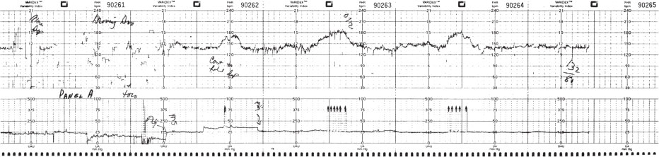

• Fig. 11.1 Reactive non-stress test showing accelerations occurring with fetal movement. Note the arrows on the contraction channel. (From Freeman R, Garite T. Fetal Heart Rate Monitoring. Baltimore, MD: Williams & Wilkins; 1981.)

## PDF page 232 | printed page 215

five criteria in the biophysical profile is the amniotic fluid volume. This can complicate interpretation of the testing in situations where the fluid volume is low for reasons that are independent of placental function, such as membrane rupture or congenital anomalies of the urinary tract.

It is important to differentiate fetal breathing from fetal gasping motions, the latter of which is acute, nonrhythmic, and an ominous, rather than reassuring, finding. Of note, fetal breathing is not usually present during active labor, to the extent that the absence of fetal breathing on ultrasound had previously been evaluated as an assessment tool for the presence of “true” preterm labor. Thus biophysical profiles are not performed in patients who are actively laboring.

### Amniotic Fluid Volume Assessment

Amniotic fluid volume is commonly estimated by ultrasound via one of two primary methods. The amniotic fluid index (AFI) is calculated by measuring and adding the maximal vertical pockets of fluid (without loops of umbilical cord) in each of the four quadrants of the maternal abdomen as demarcated by the umbilicus (Fig. 11.2). Alternatively, the single deepest vertical pocket of fluid alone can be measured. Decreased amniotic fluid volume, or oligohydramnios, is defined as either an AFI of 5 cm or less or no single measurable vertical pocket greater than 2 cm.

• BOX 11.1 Biophysical Profile Scoring System

1. Fetal breathing movements (one or more episodes lasting

at least 30 s) 2. Fetal movement (three or more discrete body or limb

movements) 3. Fetal tone (one or more episodes of active extension with

return to flexion of a limb or trunk, or the opening and closing of a fetal hand) 4. Amniotic fluid volume 5. Reactive non-stress test

• Fig. 11.2 Ultrasound image of the maximal vertical pocket measured as part of either the biophysical profile or the amniotic fluid index. Note the absence of umbilical cord in the measured pocket.

Gestational age-specific nomograms are also available, although they are less commonly used. Neither AFI nor single deepest pocket is perfectly sensitive or specific for the detection of oligohydramnios.8 Oligohydramnios can occur secondary to a range of causes, including rupture of the fetal membranes and congenital fetal anomalies of the urinary tract. However, in the absence of membrane rupture or congenital anomalies, the most concerning etiology would be decreased fetal urine production secondary to the shunting of blood flow away from the fetal kidneys in the context of uteroplacental insufficiency.

When oligohydramnios is diagnosed, the first step is to rule out membrane rupture and congenital anomalies and, if not present, assess the fetus for other evidence of uteroplacental insufficiency, including fetal biometric measurements to assess growth restriction. Delivery is usually performed for oligohydramnios at term, although at preterm gestations, delivery decisions will involve multiple factors, including the exact gestational age and presumed etiology of the decreased fluid, with conservative management being reasonable in many circumstances. More information on the management of amniotic fluid disorders is covered in Chapter 23.

### Doppler Flow Velocimetry

Quantitative evaluation of fetal blood vessels by Doppler provides valuable additional information regarding fetal well-being. The list of clinical scenarios in which it has been used includes the evaluation of the fetal middle cerebral artery in cases of red blood cell isoimmunization, monochorionic twins with twin-twin transfusion syndrome, the screening and diagnosis of congenital cardiac anomalies, and the diagnosis of congenital vascular anomalies. These indications will likely continue to expand. However, the primary utility of Doppler sonography is in the evaluation of a fetus with possible intrauterine growth restriction. In normal pregnancies or when the fetus has demonstrated normal growth, there is no current role for Doppler sonography of

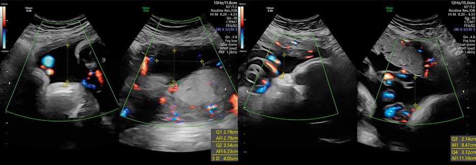

• Fig. 11.2 Ultrasound image of the maximal vertical pocket measured as part of either the biophysical profile or the amniotic fluid index. Note the absence of umbilical cord in the measured pocket.

## PDF page 233

fetal vessels, because they have not been found to convey benefit in a low-risk population. Use of Doppler velocimetry in the setting of intrauterine growth restriction is presented in Chapter 14.

### Interpretation of Test Results

The realistic goal of antepartum testing is to decrease the risk of intrauterine fetal demise or perinatal mortality in the tested population so that it approaches the rate for a lowrisk population without an unacceptable false-positive rate that may result in unnecessary intervention. The false-negative rate for commonly used antepartum tests is very low, with residual stillbirth rates after reassuring testing approximating those of the general population. However, the falsepositive rate is more difficult to ascertain because a positive test usually results in obstetric intervention, significantly decreasing the likelihood of intrauterine death. However, babies delivered after abnormal testing do not always demonstrate abnormal findings such as acidemia or low Apgar scores. For example, Manning et al. reported on a cohort of 913 infants delivered after biophysical profile score of 6 or less.9 Nearly 40% of infants with scores of 6 showed no markers of fetal compromise at delivery, as defined by fetal distress in labor, admission to the neonatal intensive care unit, a 5-minute Apgar score of 7 or less, or an umbilical cord pH less than or equal to 7.20. However, there was a significant inverse linear association between biophysical profile score and these markers, and all fetuses with scores of 0 had at least one of these markers at delivery.

In a clinically stable situation, reassuring tests (reactive NST, negative CST, and biophysical profile of 8 or 10) are considered reliable for 1 week, and so testing is usually performed on a weekly basis. Labile conditions may merit more frequent testing; the frequency is left to the discretion of the physician. In certain high-risk populations, the false-negative rate of NST may be unacceptably high. The stillbirth rate within 1 week of a reactive NST is markedly higher for patients with diabetes mellitus and fetal growth restriction. Boehm and co-workers found that the stillbirth rate decreased from 6.1 per 1000 to 1.9 per 1000 in their highrisk population when the frequency of testing was changed from once weekly to twice weekly.10 For this reason, testing twice weekly may be appropriate in certain populations, such as those described.

Clinically, one should always give consideration to maternal illness as a cause of nonreassuring fetal status. For example, if the mother is acidemic from any etiology, placental equilibration will eventually lead to acidemia in an otherwise healthy fetus, which in turn can lead to abnormal antenatal testing results. A classic example is maternal diabetic ketoacidosis. In such circumstances, the appropriate course of action is to correct the maternal condition first and not necessarily directly intervene on behalf of the fetus despite the nonreassuring antenatal testing. The fetal status will improve as the maternal status is improved, thus avoiding iatrogenic delivery, and cesarean sections or other efforts

to deliver the fetus may not be safe if the mother is critically ill.

### Evaluation of the Intrapartum Fetus

The process of labor and delivery is a period of stress for both the laboring mother and her baby, although in the great majority of cases these stressors are easily tolerated, and labor results in a healthy mother and child. However, in some cases, the process is tolerated poorly, and the fetus develops a degree of acidosis that places it at risk of multiorgan dysfunction or even death. Thus, in the 1970s, FHR monitoring during labor was introduced, with the hope of identifying heart rate patterns that were predictive of adverse outcomes and would allow for intervention prior to irreversible events. Subsequently, continuous electronic FHR monitoring during labor has been used in the majority of laboring patients in developed countries for the last several decades. However, the initial hopes and promises of continuous FHR monitoring have not been fulfilled. The incidence of cerebral palsy has remained stable, whereas the cesarean section rate has progressively increased, in part because of operative deliveries being performed for FHR patterns that may not be sufficiently predictive of adverse outcomes.11 The contemporary practitioner using FHR monitoring during labor must thus be cautious to both intervene prior to an irreversible event and to avoid iatrogenic operative delivery. This has proved to be a difficult balance.

### Intrapartum Oxygenation and Neurologic Morbidity

The strongest correlate to adverse outcomes is decreased tissue concentrations of oxygen (hypoxia) and decreased tissue pH (acidosis). However, what is more easily and often evaluated is decreased oxygenation or pH in the peripheral blood, referred to respectively as hypoxemia and acidemia. These are what is measured when the blood from the umbilical artery and vein is sampled after delivery and thus serve as common surrogate outcomes in clinical research. Although significant hypoxemia will eventually lead to tissue-level hypoxia and acidosis, the presence of the former does not necessarily guarantee the latter. Although hypoxemia and acidemia can be easily evaluated by laboratory methods, determining the presence or absence of hypoxia or acidosis is more complex and often involves physical and clinical more so than laboratory assessments.

Another important differentiation is between respiratory and metabolic acidosis in the fetus and neonate. The concept of a “respiratory” acidosis in a fetus may seem unusual because they are not literally using their lungs to exchange air, although the same concepts that are useful outside of the uterus can be applied to the transplacental exchange of oxygen and carbon dioxide. A respiratory acidosis occurs when carbon dioxide accumulates secondary to impaired clearance by the lungs or, in the case of a fetus, the placenta. A fetal

## PDF page 234 | printed page 217

metabolic acidosis will be the result of a prolonged or severe deprivation of oxygen, triggering lactate production in fetal tissue. A respiratory or metabolic acidosis, although often occurring in combination, can be differentiated from one another by the measurement of base deficit, with a high base deficit indicating a metabolic process. Metabolic processes are more concerning than respiratory ones for several reasons. First, an umbilical artery acidemia with an increased base deficit strongly implies excess tissue lactate generation. Thus there is probable acidosis and not just acidemia. In addition, a respiratory acidemia can rapidly correct itself once normal ventilation is established and excessive carbon dioxide is cleared, whereas the correction of a metabolic acidosis requires the cessation of lactate generation at a tissue level and is thus delayed relative to the onset of appropriate oxygenation. Clinically, the newborn with an isolated respiratory acidosis (or acidemia) will have a low umbilical cord pH at birth and low 1-minute Apgar score, although once ventilation is established, will enjoy rapid clinical improvement and a subsequent uneventful newborn period. By contrast, the neonate who remains clinically depressed through the first several minutes of life despite adequate ventilation is more likely to have a metabolic acidosis and an increased umbilical artery base deficit.

As discussed previously, various findings in the FHR patterns have been correlated with fetal hypoxemia and acidemia. However, the outcomes of hypoxemia and acidemia are in and of themselves surrogate outcomes. Although fetal risks increase with increasing metabolic derangements, many fetuses with hypoxemia and acidemia, especially if it is a purely respiratory process, will subsequently have a normal newborn course. If an operative delivery is performed in a fetus that has hypoxemia or acidemia but that would have, if left alone, delivered vaginally without permanent neurologic injury, then the intervention has not been clearly beneficial. The most meaningful clinical question then is if continuous FHR monitoring can predict the fetus that will not survive the labor process or survive with permanent neurologic injury secondary to intrapartum events. Given the multitude of complex factors that contribute to neurologic injury, it is perhaps not unsurprising that an evaluation of FHR alone has not proved to be sufficiently predictive in this regard. Using cerebral palsy as an end point, the positive predictive value of FHR monitoring is very low.

The overall determination of neonatal health following the stress of delivery is not determined by a single laboratory value, but by a combination of laboratory and clinical evidence of metabolic acidemia with a clinical course that is consistent with a hypoxic event. For the child who is subsequently diagnosed as having cerebral palsy, a multitude of other potential etiologies (anatomic, infectious, genetic, thrombotic, and metabolic, among others) needs to be ruled out as well because intrapartum hypoxic events account for only a small percentage of cases of neonatal neurologic injury. To provide guidance in these complicated issues, the American College of Obstetricians and Gynecologists and

• BOX 11.2 Criteria to Define an Acute Intrapartum

Event as Sufficient to Cause Cerebral Palsy

• Apgar score of less than 5 at 5 and 10 min • Evidence of a metabolic acidosis in fetal umbilical cord

arterial blood obtained at delivery (pH <7 and base deficit ≥12 mmol/L) • Evidence of acute brain injury on neuroimaging • Multisystem organ failure consistent with neonatal

encephalopathy • A sentinel hypoxic event occurring immediately before or

during labor and delivery • Cerebral palsy of the spastic quadriplegic or dyskinetic

type • Exclusion of other identifiable etiologies such as trauma,

coagulation disorders, infectious conditions, or genetic disorders

Adapted from Executive summary: Neonatal encephalopathy and neurologic outcome, second edition. Report of the American College of Obstetricians and Gynecologists’ Task Force on Neonatal Encephalopathy. Obstet Gynecol. 2014;123(4):896–901. doi: 10.1097/01. AOG.0000445580.65983.d2. PMID: 24785633.

American Academy of Pediatricians convened a joint task force that in 2003 established criteria to define an acute intrapartum event as having been sufficient to cause cerebral palsy,12 with an update in 2014.13 These criteria are outlined in Box 11.2, and the evaluation of neonatal encephalopathy is covered in detail in Chapter 56. In the absence of these explicit criteria, it is not optimal for a provider to ascribe neurologic outcomes to a potential intrauterine event, and appropriate caution should always be applied to the potentially inappropriate use of the expressions asphyxia, newborn encephalopathy, and hypoxic-ischemic encephalopathy in the medical records.

### Continuous Versus Intermittent Fetal Heart Rate Monitoring

Two options for fetal monitoring are available for laboring women: continuous and intermittent fetal monitoring. Provider and patient opinions vary regarding which is optimal, although for low-risk patients guidelines exist for both, and both options are considered acceptable and within usual standards of care. A meta-analysis by the Cochrane Collaborative identified 12 studies that compared continuous electronic FHR monitoring with either no monitoring or intermittent monitoring during labor.14 The use of continuous FHR monitoring was not associated with a decreased risk of perinatal mortality or cerebral palsy. However, there was a significant reduction in neonatal seizures. This benefit was balanced against a significant increase in the risk of undergoing either cesarean section or operative vaginal delivery. Thus the optimal mode of fetal monitoring is unclear. The occurrence of neonatal seizures, low Apgar scores, and hypoxemia at the time of birth can all cause significant emotional distress for new parents even in the absence of clear

## PDF page 235

differences in long-term neurologic outcomes or survival, and many parents would potentially be willing to accept an increased risk of operative delivery to prevent neonatal seizures. In contrast, many patients are highly motivated to have a spontaneous vaginal delivery and would be willing to accept a risk of transient neonatal seizures if there are no significant differences in longer-term neurologic outcomes. For low-risk patients who would be candidates for either approach, the most optimal approach may be to discuss the relative advantages and disadvantages of either early in pregnancy and allow the patients to then make the choice that works best for them.

Continuous electronic FHR monitoring may be performed externally or internally. Telemetry units are available so that a patient need not be confined to a bed to be monitored. In addition, many modern units are waterproof and would thus allow for continuous monitoring while a patient is laboring in a bath or tub. Most external monitors use a Doppler device with computerized logic to interpret and count the Doppler signals. Internal FHR monitoring may be performed in circumstances in which external monitoring is technically difficult, such as maternal obesity. Internal monitoring uses an electrode that is attached to the fetal scalp, and contraindications to fetal scalp puncture (transmittable maternal infections such as hepatitis or human immunodeficiency virus [HIV]) are likewise relative contraindications for internal fetal monitoring. Internal monitoring also necessitates rupture of the fetal membranes. If the membranes are intact and internal monitoring is determined to be necessary, they can be artificially ruptured to facilitate monitoring, although this can carry a risk of umbilical cord prolapse if the fetal presenting part is not engaged.

Internal fetal scalp electrodes also have the advantage of overcoming monitoring difficulties secondary to maternal obesity. The rates of obesity have been steadily increasing throughout the world and present technical difficulties for external Doppler monitoring when the amniotic membranes are still intact. However, electrohysterography (EHG) and fetal electrocardiograms are expanding alternate technologies that can provide similar degrees of monitoring through maternal abdominal

• Fig. 11.3 Fetal tachycardia, with a baseline fetal heart rate of 165 beats/min. This was in the setting of a maternal fever. (From Freeman R, Garite T. Fetal Heart Rate Monitoring. Baltimore, MD: Williams & Wilkins; 1981:70.)

electrodes and are less sensitive to differences in maternal habitus.15,16

### Interpretation of Continuous Fetal Heart Rate Recordings Baseline Fetal Heart Rate

Baseline FHR is the average FHR rounded to increments of 5 beats/min during a 10-minute segment, excluding periodic or episodic changes, periods of marked variability, or baseline segments that differ by more than 25 beats/min. In any given 10-minute window, the minimal baseline duration must be at least 2 minutes or the baseline is considered indeterminate. A normal FHR baseline rate ranges from 110 to 160 beats/min. If the baseline FHR is less than 110 beats/min, it is termed bradycardia. If the baseline FHR is greater than 160 beats/min, it is termed tachycardia (Fig. 11.3). Of note, although rates of 110 and 160 beats/min are the accepted cutoff values for FHR, many fetuses with heart rates greater or less than these values will be otherwise healthy outliers. For example, a fetus that is experiencing otherwise uncomplicated labor with an FHR tracing that is perfectly reassuring other than a baseline in the 100s is likely normal.

As described later, events that can be associated with hypoxemia or the later development of hypoxemia, such as umbilical cord compression, produce decelerations of the FHR. However, it is worth noting that the primary response to hypoxemia is not bradycardia but tachycardia secondary to sympathetic discharges. A progressive increase in the heart rate baseline during labor can raise concern for hypoxemia if other FHR anomalies, such as decreasing variability, become progressively apparent over the same time period. Tachycardia may also be associated with conditions other than hypoxia, such as maternal fever, intra-amniotic infection, thyroid disease, the presence of medication, and cardiac arrhythmia.

### Fetal Heart Rate Variability

The presence of baseline FHR variability is a useful indicator of fetal CNS integrity. Variability is defined as fluctuations in FHR baseline of two cycles per minute or greater, with irregular amplitude and inconstant frequency. Of note,

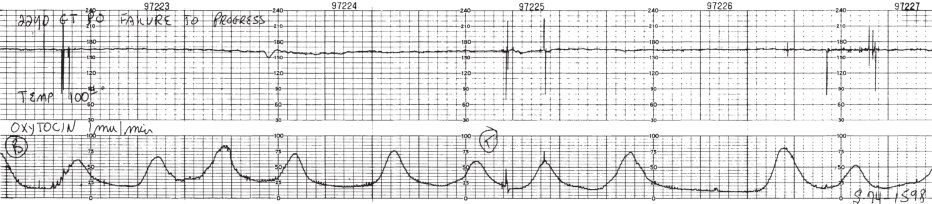

• Fig. 11.3 Fetal tachycardia, with a baseline fetal heart rate of 165 beats/min. This was in the setting of a maternal fever. (From Freeman R, Garite T. Fetal Heart Rate Monitoring. Baltimore, MD: Williams & Wilkins; 1981:70.)

## PDF page 236 | printed page 219

although the fetus will normally have beat-to-beat heart rate variation, the actual PQRS complexes themselves are normal, differentiating this healthy phenomenon from atrial fibrillation or other pathologic arrhythmias. The variation represents alternating responses to sympathetic and parasympathetic inputs. If either the sympathetic or parasympathetic system instead predominates, such as would be the case of vagal nerve stimulation or increased sympathetic activity owing to hypoxia, this variability would be lost (Fig. 11.4). Thus moderate FHR variability is strongly associated (98%) with an umbilical pH greater than 7.15 and, in combination with a normal FHR baseline, generates a high degree of reassurance regardless of the presence or absence of accelerations or decelerations.

FHR variability is visually assessed as the amplitude of the peak to trough in beats per minute as follows:

Amplitude Range Classification Undetectable Absent 1–5 beats/min Minimal 6–25 beats/min Moderate >25 beats/min Marked

### Accelerations

Accelerations in FHR are periodic elevations above the baseline, and they are usually associated with fetal movement. The presence of FHR accelerations during labor is always reassuring, as it is in a nonlaboring patient. However, their absence during labor is not necessarily concerning if other aspects of the FHR pattern are reassuring (see subsection Category I). Unlike an NST in an antepartum patient, a

• Fig. 11.4 Abnormal (absent) fetal heart rate (FHR) variability. Because there are no decelerations present, this would qualify as a category II FHR tracing. (From Freeman R, Garite T. Fetal Heart Rate Monitoring. Baltimore, MD: Williams & Wilkins; 1981:138.)

“reactive” FHR tracing with “15 × 15” accelerations is not required for reassurance in the laboring patient.

### Decelerations

Decelerations in FHR are episodic decreases below the baseline. Most decelerations are mediated through parasympathetic stimulation from the vagal nerve. These, in turn, are triggered by a variety of stimuli, including transient increases in intracranial pressure (“early” decelerations), increased systemic vascular resistance (“variable” decelerations), and hypoxemia (some “late” decelerations). Thus most decelerations do not specifically signify the presence of fetal acidosis, and in fact many are simply interesting demonstrations of physiologic reflexes. However, a portion of “late” decelerations occurs secondary to the suppression of myocardial function by tissue-level hypoxia, which is clinically concerning. However, clinically differentiating these from other deceleration patterns is often imprecise.

Decelerations are classified by their morphology and then by whether they are recurrent or prolonged. Decelerations are defined as “recurrent” if they occur with at least 50% of the contractions. A “prolonged” deceleration is one that lasts for more than 2 minutes. Three types of decelerations are described: early, variable, and late. Early decelerations are shallow and symmetric, gradual in onset and recovery, and associated with a contraction such that the nadir of the deceleration occurs at the same time as the peak of the contraction (Fig. 11.5). Physiologically, early decelerations are a demonstration of Cushing reflex, in which increased intracranial pressure generates bradycardia through stimulation of the vagal nerve. Because of the unfused cranial fontanelles, pressure applied to the fetal cranium, such as

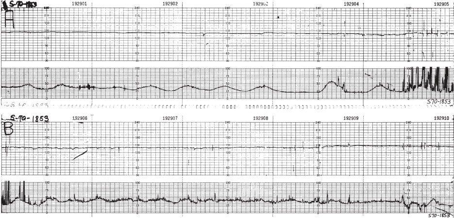

• Fig. 11.4 Abnormal (absent) fetal heart rate (FHR) variability. Because there are no decelerations present, this would qualify as a category II FHR tracing. (From Freeman R, Garite T. Fetal Heart Rate Monitoring. Baltimore, MD: Williams & Wilkins; 1981:138.)

## PDF page 237

• Fig. 11.5 Early decelerations. Note the way in which the decelerations appear to “mirror” the uterine contractions. (From Freeman R, Garite T. Fetal Heart Rate Monitoring. Baltimore, MD: Williams & Wilkins; 1981:74.)

• Fig. 11.6 Variable decelerations. Note the normal fetal heart rate baseline and variability between the decelerations. (From Freeman R, Garite T. Fetal Heart Rate Monitoring. Baltimore, MD: Williams & Wilkins; 1981:78.)

• Fig. 11.7 Variable decelerations. In contrast to Fig. 11.8, note the tachycardic fetal heart rate (FHR) baseline and absent variability between the decelerations. Also note the prolonged FHR “overshoot” in the middle portion of the panel. This FHR tracing is more concerning for the presence of fetal hypoxia and acidosis and would be considered category III.

when the head is pressed against maternal tissue during a contraction, is translated into increased intracranial pressure and can trigger activation of the vagal nerve. Like most reflexes, the response is virtually instantaneous, and the magnitude of vagal nerve stimulation correlates with the magnitude of pressure applied against the fetal head. This is why “early” decelerations appear as mirror images of the contractions. This entire process is unrelated to fetal oxygenation and acid-base balance, which is why early decelerations, although conceptually interesting, are not of clinical importance.

Variable decelerations are typically associated with an abrupt onset and abrupt return to baseline. They vary in shape, depth, duration, and the occurrence of contractions.

They are also frequently preceded and followed by small accelerations in FHR (Figs. 11.6 and 11.7). Variable decelerations are usually associated with compression of the umbilical cord and represent physiologic changes in response to alterations in vascular resistance and preload. The umbilical cord contains a single large, thin-walled vein and two smaller, muscular arteries. When the umbilical cord is initially compressed, the thinner umbilical vein is occluded first. This causes a decrease in venous blood returning to the fetal heart and thus a decrease in preload, which in turn triggers tachycardia. This is why variable decelerations are often preceded and followed by small increases in FHR, referred to colloquially as “shoulders.” As increasing compressive force is applied to the umbilical cord, the muscular arteries

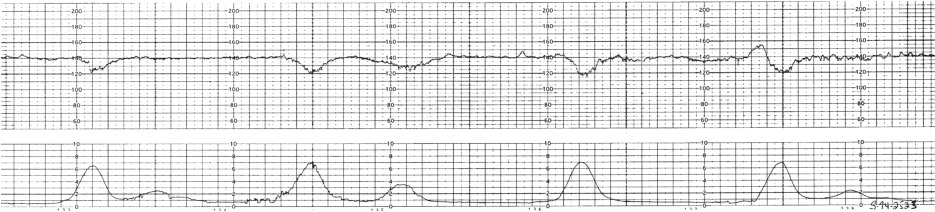

• Fig. 11.5 Early decelerations. Note the way in which the decelerations appear to “mirror” the uterine contractions. (From Freeman R, Garite T. Fetal Heart Rate Monitoring. Baltimore, MD: Williams & Wilkins; 1981:74.)

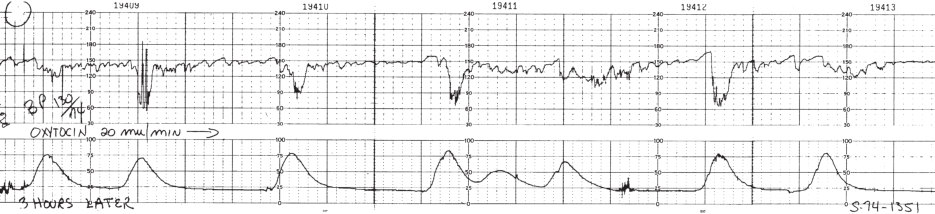

• Fig. 11.6 Variable decelerations. Note the normal fetal heart rate baseline and variability between the decelerations. (From Freeman R, Garite T. Fetal Heart Rate Monitoring. Baltimore, MD: Williams & Wilkins; 1981:78.)

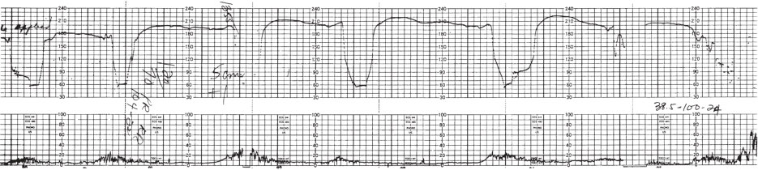

• Fig. 11.7 Variable decelerations. In contrast to Fig. 11.8, note the tachycardic fetal heart rate (FHR) baseline and absent variability between the decelerations. Also note the prolonged FHR “overshoot” in the middle portion of the panel. This FHR tracing is more concerning for the presence of fetal hypoxia and acidosis and would be considered category III.

## PDF page 238 | printed page 221

are eventually compressed as well. This then leads to a significant increase in vascular resistance, which in turn generates bradycardia via vagal nerve stimulation via baroreceptors. Although variable decelerations can sometimes occur normally during the labor process or even antenatal testing, their presence should alert the practitioner to the potential presence of umbilical cord compression, causes for which could include low amniotic fluid (oligohydramnios) or prolapse of the umbilical cord through the cervix. Overall, variable decelerations represent anticipated physiologic reflexes to umbilical cord compression and not the presence of hypoxemia or acidemia per se. However, severe, prolonged, or repetitive compression can eventually compromise oxygenation and overall health, and thus interventions (which can be as simple as maternal positional changes) would be warranted in this circumstance. In addition, some fetuses can develop hypoxemia during periods of umbilical cord compression, which then normalizes after the compression is released. This can present as a period of tachycardia that follows resolution of the variable deceleration, owing to a sympathetic response to the hypoxemia. These are referred to as “overshoots” (see Fig. 11.7).

By contrast, late decelerations have a more gradual onset and return to baseline—typically 30 seconds or more from onset to nadir. The onset, nadir, and recovery of the deceleration occur after the onset, peak, and end of the contraction, respectively (Fig. 11.8). During a uterine contraction, placental perfusion is temporarily impaired secondary to myometrial compression of the spiral arteries, which lose their muscularis in early pregnancy and are thus compressible. In a fetus that is undergoing the labor process normally, this transient event is well tolerated without clinically meaningful hypoxemia. However, for fetuses that are experiencing a decreasing oxygen reserve, the perfusion reduction during a contraction can have more significant effects, albeit not always tissue acidosis or multiorgan dysfunction. These effects and their resolution will always be delayed relative to the contraction itself, because the impact of decreased perfusion will be progressive and then require time to resolve once the contraction is complete. This is why “late” decelerations have their characteristic appearance relative to uterine contractions.

• Fig. 11.8 Late decelerations. Note the timing of the onset, nadir, and recovery of the deceleration, which occur after the onset, peak, and end of the contraction. (From Freeman R, Garite T. Fetal Heart Rate Monitoring. Baltimore, MD: Williams & Wilkins; 1981:201.)

The actual mechanism of late decelerations occurs secondary to two separate although interrelated processes, one of which is related to hypoxemia and the other to tissue-level hypoxia. Although hypoxemia generates a sympathetic response that leads to tachycardia and thus an increasing FHR baseline, it can also generate bradycardia through a more indirect pathway: the decrease in peripheral oxygen concentration triggers a sympathetic output, which in turn transiently increases the blood pressure, which in turn triggers baroreceptors, which in turn stimulate the vagal nerve, which then decreases the heart rate. Thus the presence of late decelerations can signify transient hypoxemia during and resolving after uterine contractions. In this situation, it would be optimal to resolve the transient hypoxemia, and interventional measures such as positional changes are usually undertaken. However, the fetus in this scenario is not necessarily acidotic (or even has tissue-level hypoxia) and, presuming it can recover appropriately between contractions, can still potentially proceed with a normal labor course and uncomplicated vaginal delivery. However, the other underlying mechanisms for some late decelerations involve direct suppression of myocardial activity secondary to tissue-level changes in which the bradycardia reflects the inability of the myocardium to function properly in the setting of hypoxia. Secondary to differences between respiratory and metabolic acidosis and all of the other complex variables involved in organ function, many of the fetuses in this scenario will still have normal long-term outcomes, although this is the scenario of greatest clinical concern and the one in which consideration could be given to expedition through operative delivery. However, for the patient experiencing late decelerations, it can be difficult to determine if they are occurring secondary to which of these two underlying pathways. Context is important in this regard, such that in the case of a persistently hypoxic fetus, other FHR changes, such as progressive tachycardia and loss of variability, should accompany the late decelerations. The fetus who is experiencing late decelerations, but for whom the FHR has a normal rate and variability between contractions, is more likely to be experiencing only transient hypoxemia.

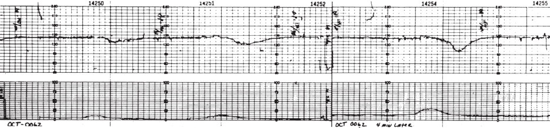

• Fig. 11.8 Late decelerations. Note the timing of the onset, nadir, and recovery of the deceleration, which occur after the onset, peak, and end of the contraction. (From Freeman R, Garite T. Fetal Heart Rate Monitoring. Baltimore, MD: Williams & Wilkins; 1981:201.)

## PDF page 239

• Fig. 11.9 Sinusoidal fetal heart rate pattern. This fetus was severely anemic and hydropic because of maternal Rh isoimmunization. (From Freeman R, Garite T. Fetal Heart Rate Monitoring. Baltimore, MD: Williams & Wilkins; 1981:166.)

A sinusoidal heart rate pattern consists of a regular oscillation of the baseline variability in a smooth, undulating pattern. This pattern typically lasts at least 10 minutes, has a relatively fixed period of three to five cycles per minute, and has an amplitude of 5 to 15 beats/min above and below the baseline (Fig. 11.9). This pattern is quite rare but can be associated with severe chronic anemia or severe hypoxia and acidosis, although rarely it can also be an incidental finding.

### Interpretative Systems for Classification of Fetal Heart Rate Patterns

Since its introduction, the utility of electronic fetal monitoring has been limited by the subjective nature of its interpretation. Despite continual efforts at standardization, interpretation of FHR tracing is subjective and prone to significant interobserver and intraobserver variation.17 Although many interpretative systems exist for FHR tracings, the 2008 National Institutes of Child Health and Human Development (NICHD) workshop dealing with Standardization of Nomenclature for Intrapartum Electronic Fetal Monitoring, jointly sponsored by NICHD, the American College of Obstetricians and Gynecologists, and the Society for Maternal Fetal Medicine, has been an important step toward standardization.18 In this system, fetal tracings are divided into three categories.

### Category I

These are “normal” tracings, which are strongly predictive of normal fetal acid-base status at the time of observation and can be followed in a routine manner without any specific action required. They necessitate all of the following: • Baseline rate of 110 to 160 beats/min • Moderate variability • Absence of any late or variable decelerations • Early decelerations may or may not be present. • Accelerations may or may not be present.

Of note, an FHR pattern during labor does not have to have accelerations that would meet the “reactivity” criteria of an antepartum NST to still be a category I tracing.

### Category II

These are indeterminate tracings that, although not predictive of abnormal fetal acid-base status, cannot be classified as category I or III and require evaluation and continued surveillance and re-evaluation. These tracings are frequently encountered in clinical care and include any tracing that does not meet the more specified criteria for category I or III. Except for patterns that are sinusoidal, category III tracings require the combination of absent variability plus one more additional finding as described later. Thus a tracing that has appropriate variability but has other findings, such as late or variable decelerations that would exclude it from category I, would fall into category II.

### Category III

These are abnormal tracings that are potentially predictive of an abnormal fetal acid-base status at the time of observation. As such, they require prompt evaluation and initiation of attempts at correction. These tracings include either: 1. Absent baseline FHR variability along with any of the

following:

a. Recurrent late decelerations b. Recurrent variable decelerations c. Bradycardia

2. Sinusoidal pattern

“Recurrent” decelerations would be those that occur

with greater than 50% of contractions.

### Management of Non–Category I Fetal Heart Rate Patterns During Labor

The evaluation of a category II or III pattern begins with a search for an underlying etiology that would itself require immediate delivery. For example, an acute change in the

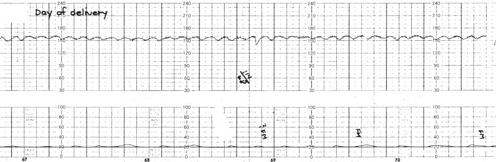

• Fig. 11.9 Sinusoidal fetal heart rate pattern. This fetus was severely anemic and hydropic because of maternal Rh isoimmunization. (From Freeman R, Garite T. Fetal Heart Rate Monitoring. Baltimore, MD: Williams & Wilkins; 1981:166.)

## PDF page 240 | printed page 223

FHR pattern with prolonged deceleration (Fig. 11.10) could have occurred secondary to umbilical cord prolapse, placental abruption, or uterine rupture. In the absence of such events, one should search for a remediable cause of the concerning FHR tracing. Uterine perfusion is very sensitive to maternal blood pressure, and even relative redistributions of maternal blood flow, such as can occur after the initiation of regional anesthesia, can impact the FHR pattern. Abnormal FHR patterns may also result from contractions that are too frequent in timing to allow for recovery between them. The occurrence of uterine contractions more frequently than 5 in 10 minutes, averaged over 30 minutes, is referred to as tachysystole (Fig. 11.11) and can occur as a consequence of labor induction agents. When the tachysystole is resolved, either by discontinuing or decreasing an oxytocin infusion or administering a tocolytic, the fetal status typically improves. Maternal position in labor can affect the FHR tracing because the supine position decreases uterine blood flow and placental perfusion. Repositioning a patient to the lateral recumbent position can improve a concerning FHR pattern with no other intervention. Classically, supplemental oxygen administered to the patient in these contexts does not provide benefit19 and is no longer recommended for fetal well-being alone. When recurrent variable decelerations are present, amnioinfusion, in which fluid is infused into the uterine cavity, has been shown to decrease the rate of variable decelerations and cesarean delivery for nonreassuring fetal status, although not other neonatal outcomes.20

• Fig. 11.10 Prolonged deceleration associated with acute prolapse of the umbilical cord. Note the reassuring fetal heart rate tracing leading up to the deceleration, indicating an acute event. (From Freeman R, Garite T. Fetal Heart Rate Monitoring. Baltimore, MD: Williams & Wilkins; 1981:83.)

• Fig. 11.11 Prolonged deceleration associated with uterine hyperstimulation. Note the recovery of the deceleration after discontinuation of the oxytocin infusion. (From Freeman R, Garite T. Fetal Heart Rate Monitoring. Baltimore: Williams & Wilkins; 1981:85.)

When faced with a concerning FHR tracing with no clear secondary cause and which persists despite attempts at conservative management, some options do exist for additional reassurance because many of these fetuses will still have a normal acid-base status secondary to the imprecision of continuous FHR monitoring. An acceleration in FHR after vibroacoustic stimulation or fetal scalp stimulation with a digital examination provides reliable reassurance of a normal fetal pH and allows labor to continue.

Many FHR tracings will remain indeterminate without either a reversible cause or additional reassurance from scalp stimulation or pH measurement. Management of these cases is complicated and depends upon the exact clinical circumstances, including the stage and progress of labor. Because of this common scenario, there has been long-standing interest in technological advancements to provide additional information regarding the fetal status. The two areas of greatest promise had been the fetal pulse oximetry and ST segment analysis. Unfortunately, neither of these technologies has demonstrated a reduction in cesarean delivery or neonatal outcomes in large clinical trials. Specifically, a randomized trial of ST segment analysis in 11,108 subjects was published in 2015 and demonstrated no differences in either composite neonatal morbidity or cesarean delivery between open and masked monitoring.21

Although research in this important area is continuing, at this time there are no technologies available for additional fetal reassurance that are either evidence-based or standard

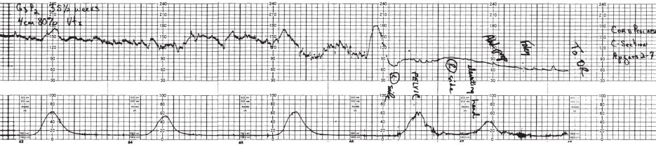

• Fig. 11.10 Prolonged deceleration associated with acute prolapse of the umbilical cord. Note the reassuring fetal heart rate tracing leading up to the deceleration, indicating an acute event. (From Freeman R, Garite T. Fetal Heart Rate Monitoring. Baltimore, MD: Williams & Wilkins; 1981:83.)

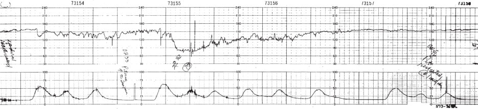

• Fig. 11.11 Prolonged deceleration associated with uterine hyperstimulation. Note the recovery of the deceleration after discontinuation of the oxytocin infusion. (From Freeman R, Garite T. Fetal Heart Rate Monitoring. Baltimore: Williams & Wilkins; 1981:85.)

## PDF page 241

of care. In lieu of current or future technological advancements, there has been increased focus on optimizing our available fetal monitoring protocols through the increased use of guidelines and practice standardization. In particular, there is interest in increasing the uniformity of management for category II tracings because these are both common and of indeterminate significance. For example, the occurrence of any late deceleration would exclude a designation of category I, and thus a tracing that was otherwise entirely reassuring with the exception of a single late deceleration would be category II. On the other end of the spectrum would be a tracing with absent variability and four late decelerations out of 10 contractions in a 30-minute period because category III requires “recurrent” late decelerations, which

Key Points

### • Antepartum testing can decrease the risk of stillbirth in

many pregnancies at risk of fetal compromise secondary to uteroplacental dysfunction.

### • The most common strategy for antepartum testing is the

weekly non-stress test (NST) performed after 32 weeks. An NST is reassuring if the fetal heart rate demonstrates two accelerations that are 15 seconds in duration and 15 beats/min above the baseline.

### • The biophysical profile is an alternate antenatal testing

modality that uses ultrasound to track fetal activity using

### References

1. Stillbirth Collaborative Research Network Writing Group.

Causes of death among stillbirths. JAMA. 2011;306:2459–2468. 2. Bodnar LM, Parks WT, Perkins K, et al. Maternal prepreg-

nancy obesity and cause-specific stillbirth. Am J Clin Nutr. 2015;102:858–864. 3. Weiner CP, Sipes SL, Wenstrom K. The effect of fetal age upon

normal fetal laboratory values and venous pressure. Obstet Gynecol. 1992;79:713–718. 4. Manning FA, et al. Fetal biophysical profile score. VI. Correla-

tion with antepartum umbilical venous fetal pH. Am J Obstet Gynecol. 1993;169:755–763. 5. Mangesi L, Hofmeyr GJ, Smith V, Smyth RM. Fetal movement

counting for assessment of fetal wellbeing. Cochrane Database Syst Rev. 2015;10:CD004909. 6. Norman JE, Heazell AEP, Rodriguez A, et al.; AFFIRM Investi-

gators. Awareness of fetal movements and care package to reduce fetal mortality (AFFIRM): a stepped wedge, cluster-randomised trial. Lancet. 2018;392(10158):1629–1638. 7. Glantz JC, Bertoia N. Preterm nonstress testing: 10-beat com-

pared with 15-beat criteria. Obstet Gynecol. 2011;118:87–93. 8. Magann EF, et al. How well do the amniotic fluid index and sin-

gle deepest pocket indices (below the 3rd and 5th and above the 95th and 97th percentiles) predict oligohydramnios and hydramnios? Am J Obstet Gynecol. 2004;190:164–169. 9. Manning FA, et al. Fetal assessment based on fetal biophysical

profile scoring. IV. An analysis of perinatal morbidity and mortality. Am J Obstet Gynecol. 1990;162:703–709. 10. Boehm FH, et al. Improved outcome of twice weekly nonstress

testing. Obstet Gynecol. 1986;67:566–568.

would be greater than half of contractions. In addition to the wide range of severity, the overall clinical context needs to come under consideration as well, including the course of labor and degree to which longitudinal changes may be occurring within category II.22 It would be more reasonable to continue with a category II tracing in a patient with normal labor progress who is nearing delivery than it may be for the same tracing for a patient who is either early in the latent phase or experiencing abnormal labor progress. Thus attempts have been made at guideline development for category II management, including the publication of collaborative exert opinion.23 These provide useful guidance, although they have not been formally adopted as national standards of care.

a scoring system from 0 to 10. Values of 8 and 10 are reassuring and values of 6 are indeterminate.

### • Low-risk fetuses during labor can be monitored with

either intermittent or continuous monitoring.

### • Continuous electronic fetal monitoring has not clearly

resulted in a decreased incidence of cerebral palsy and may increase the risk of cesarean and operative delivery.

### • A three-category scoring system is used for the interpre-

tation of fetal monitoring during labor.

11. MacLennan AH, Thompson SC, Gecz J. Cerebral palsy: causes,

pathways, and the role of genetic variants. Am J Obstet Gynecol. 2015;213:779–788. 12. Neonatal Encephalopathy and Cerebral Palsy: Defining the Patho-

genesis and Pathophysiology. Washington, DC: American College of Obstetricians and Gynecologists; 2003. 13. Executive summary: Neonatal encephalopathy and neurologic

outcome, second edition. Report of the American College of Obstetricians and Gynecologists’ task force on neonatal encephalopathy. Obstet Gynecol. 2014;123(4):896–901. 14. Alfirevic Z, Devane D, Gyte GM, Cuthbert A. Continuous car-

diotocography (CTG) as a form of electronic fetal monitoring (EFM) for fetal assessment during labour. Cochrane Database Syst Rev. 2017;2. 15. Cohen WR, Hayes-Gill B. Influence of maternal body mass

index on accuracy and reliability of external fetal monitoring techniques. Acta Obstet Gynecol Scand. 2014;93:590– 595. 16. Euliano TY, Nguyen MT, Darmanjian S, et al. Monitoring uter-

ine activity during labor: a comparison of 3 methods. Am J Obstet Gynecol. 2013;208:66.e1–66.e6. 17. Blackwell S, et al. Interobserver and intraobserver reliability of

the NICHD 3-Tier fetal heart rate interpretation system. Am J Obstet Gynecol. 2011;205:378.e1–378.e5. 18. Macones G, et al. The 2008 National Institute of Child Health

and Human Development workshop report on electronic fetal monitoring: update on definitions, interpretation, and research guidelines. Obstet Gynecol. 2008;112:661–666. 19. Raghuraman N, López JD, Carter EB, et al. The effect of intra-

partum oxygen supplementation on category II fetal monitoring. Am J Obstet Gynecol. 2020;223:905.e1–905.e7.

## PDF page 242 | printed page 225

20. Hofmeyr GJ, Lawrie TA. Amnioinfusion for potential or sus-

pected umbilical cord compression in labour. Cochrane Database Syst Rev. 2012;1:CD000013. 21. Belfort MA, Saade GR, Thom E, et al. Eunice Kennedy Shriver

National Institute of Child Health and Human Development Maternal–Fetal Medicine Units Network. A randomized trial of intrapartum fetal ECG ST-segment analysis. N Engl J Med. 2015;373:632–641.

22. Vintzileos AM, Smulian JC. Decelerations, tachycardia, and

decreased variability: have we overlooked the significance of longitudinal fetal heart rate changes for detecting intrapartum fetal hypoxia? Am J Obstet Gynecol. 2016;215:261–264. 23. Clark SL, Nageotte MP, Garite TJ, et al. Intrapartum manage-

ment of category II fetal heart rate tracings: towards standardization of care. Am J Obstet Gynecol. 2013;209:89–97.

<!-- SOURCE_LAYOUT_VIEWS -->

## Original layout views and recovered diagrams

Automatic extraction can flatten tables and superscripts. Check the original layout for numeric data, footnotes and image credits. [Source review notes](../../SOURCE_REVIEW_NOTES.md).

### Original source page 229

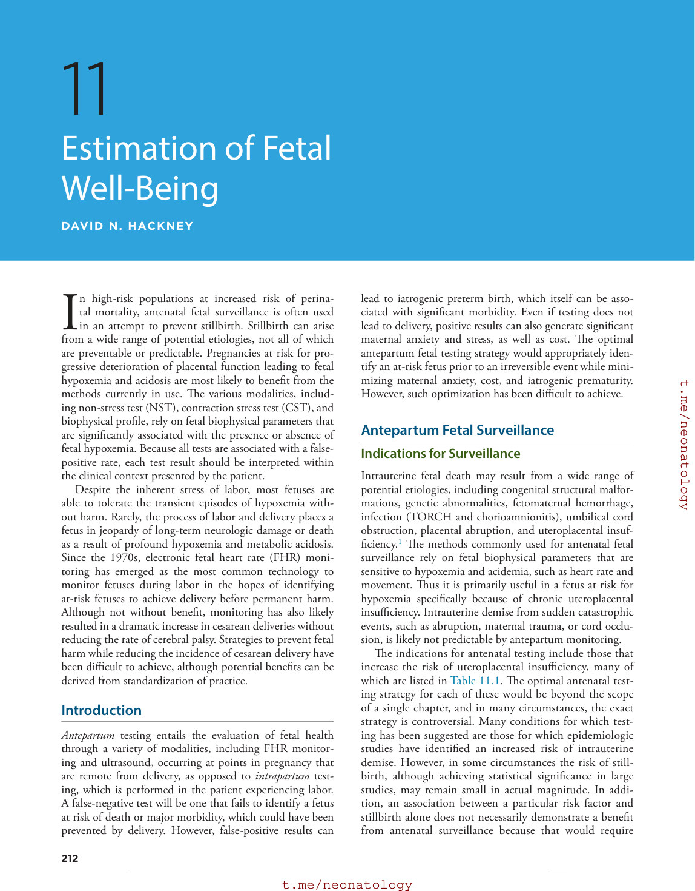

### Original source page 230

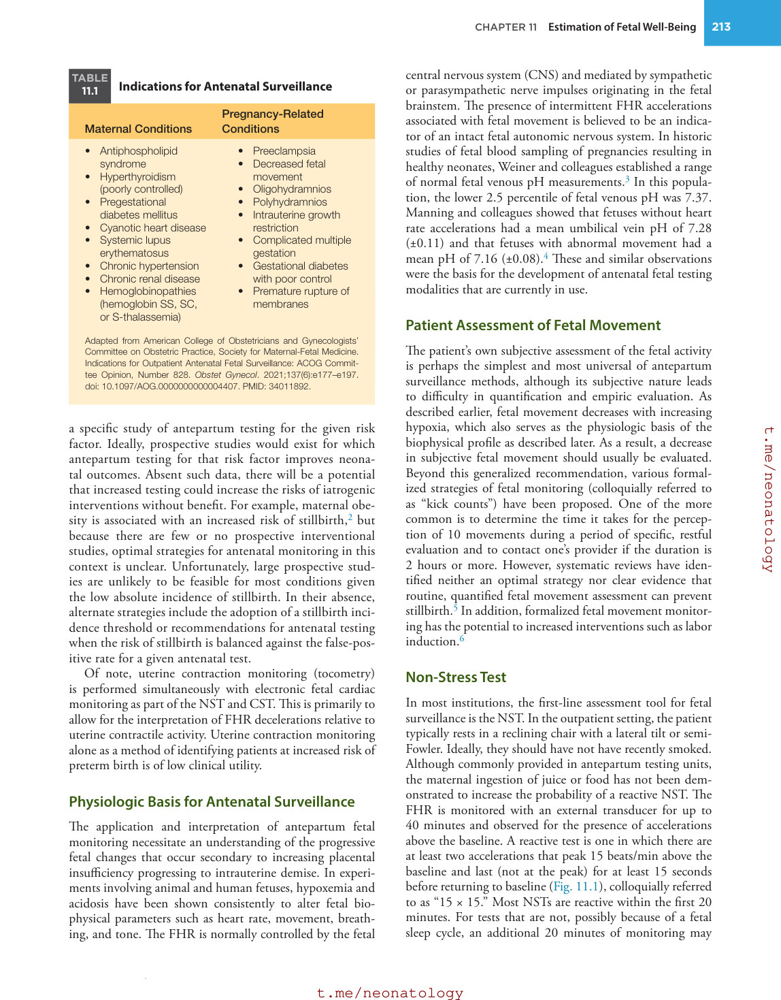

### Original source page 231

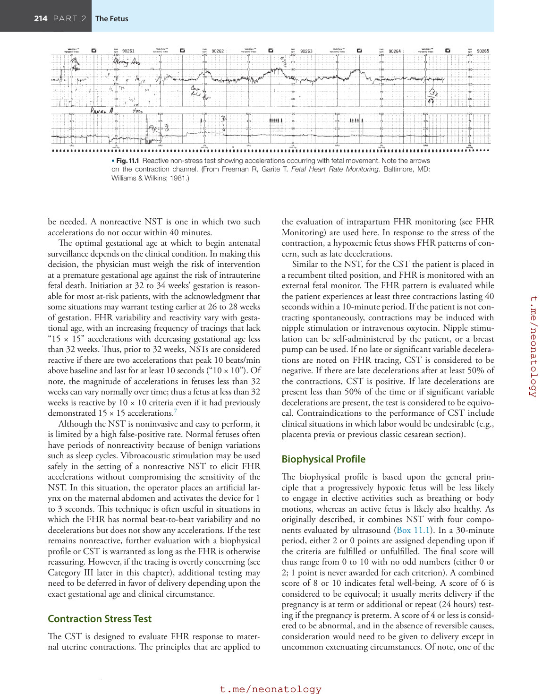

### Original source page 232

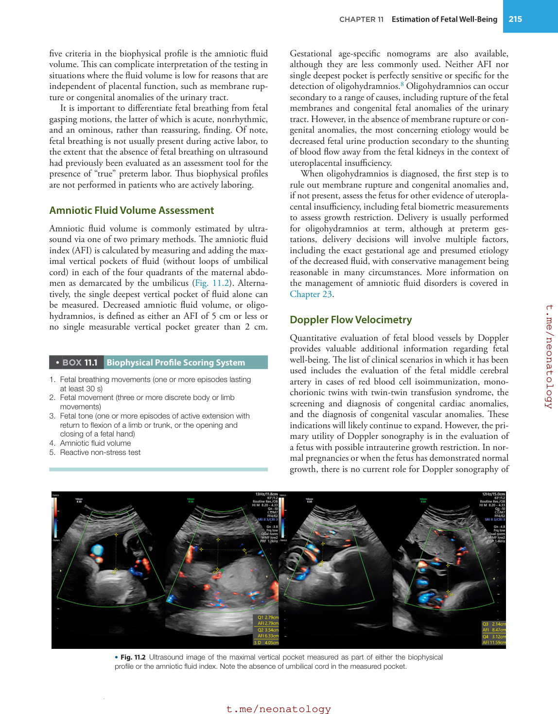

### Original source page 235

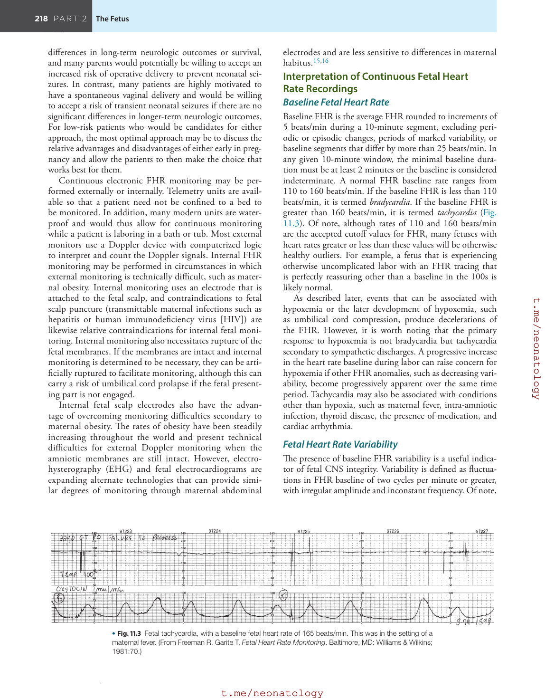

### Original source page 236

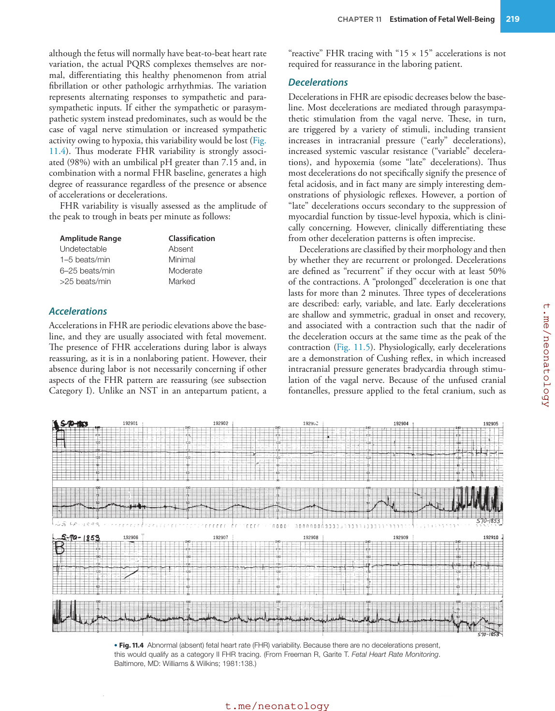

### Original source page 237

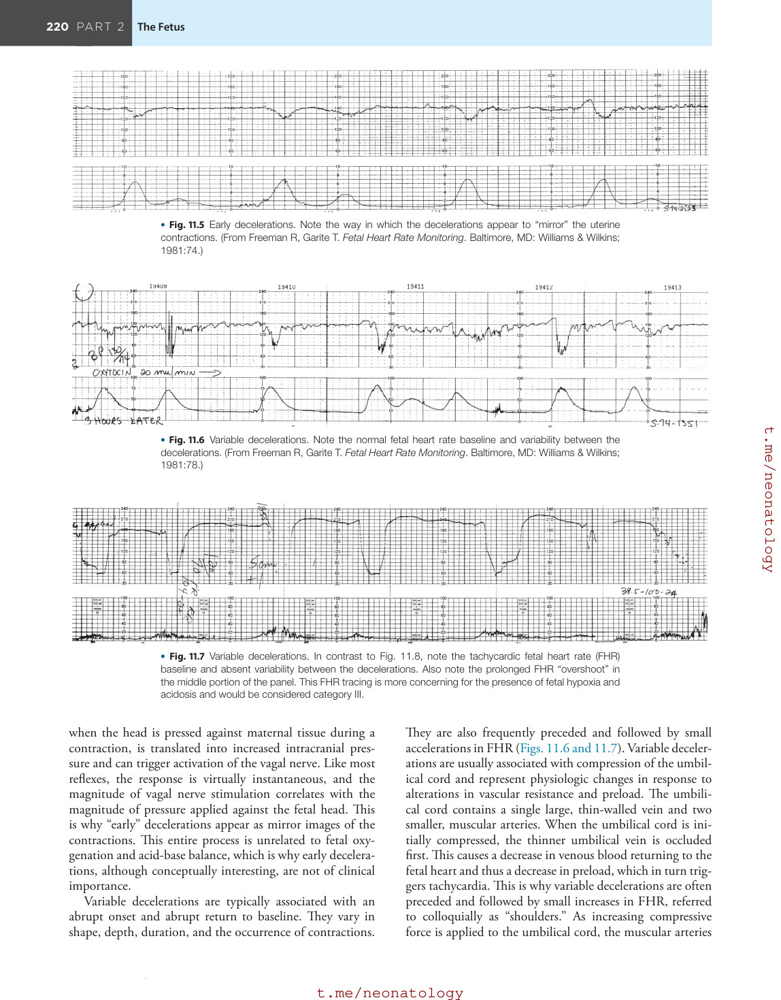

### Original source page 238

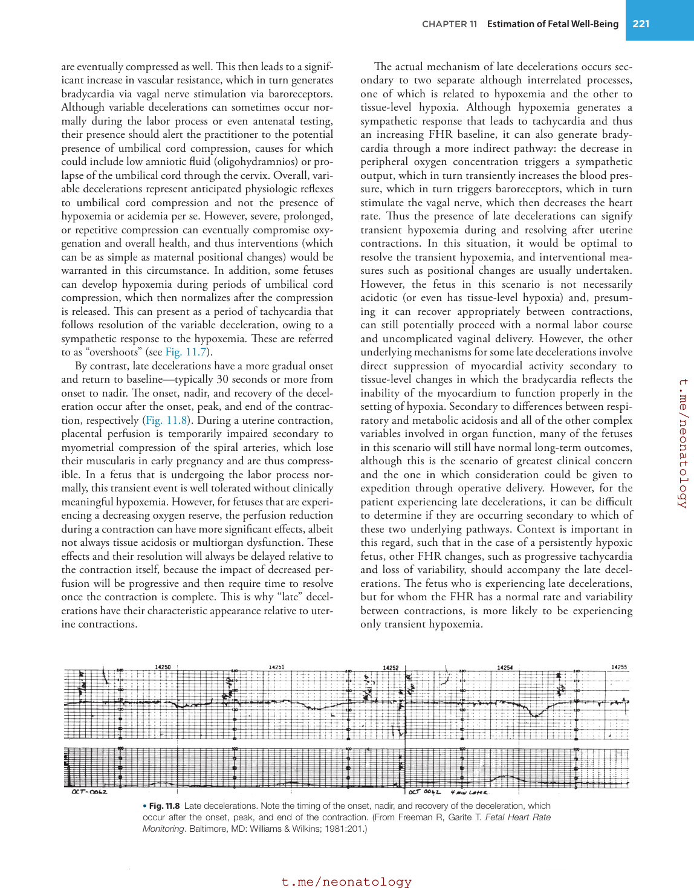

### Original source page 239

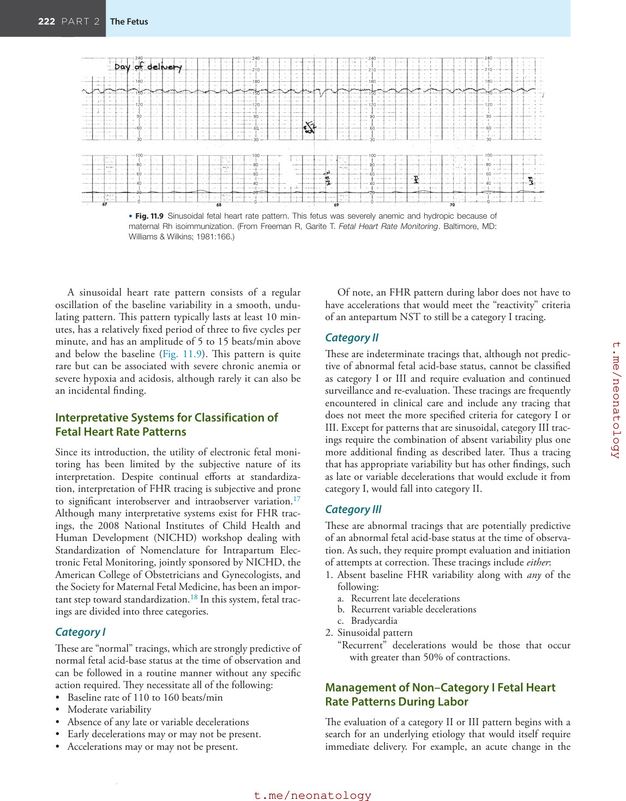

### Original source page 240

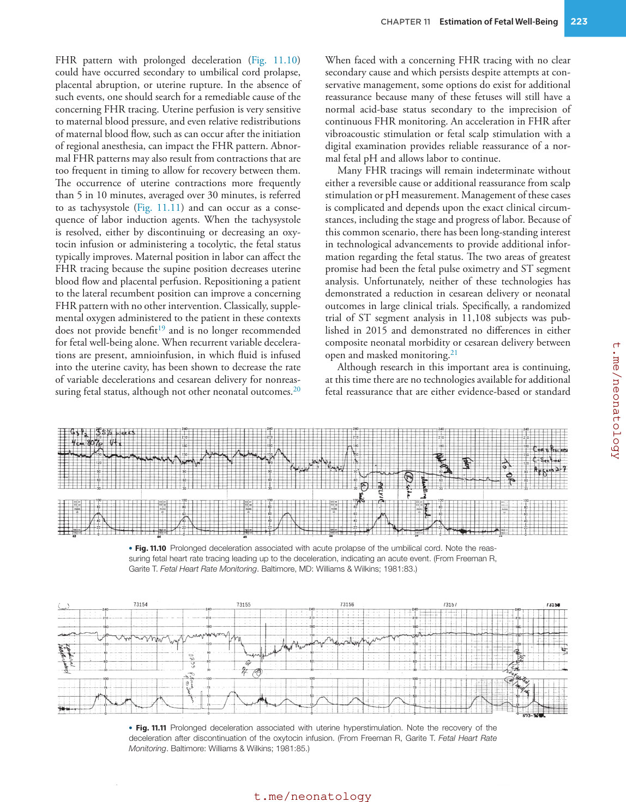
