# 13. Adverse Exposures to the Fetus
> Source attribution: [Source credits](../../SOURCE_CREDITS.md).

## PDF page 257 | printed page 240

13 Adverse Exposures to the Fetus

### MARGARET KUPER-SASSÉ, DINA E. EL-METWALLY, AND CYNTHIA F. BEARER

Exposure to environmental toxicants during pregnancy may have a significant impact on the developing fetus. Fetal adverse exposures are growing in importance as our population expands and the number of women participating in the workforce continues to rise. In 2020, women comprised 48% of the workforce in the United States, and 63.4 million women 16 years of age and over were employed. Approximately 78% worked full time.1 In addition, more pregnant women are staying in the workforce and continuing to work until later into pregnancy. According to the US Census Bureau, 66.4% of women worked during their first pregnancy from 2016 to 2019, and 88% continued into the third trimester.2

Environmental exposures increase as the world’s population and economic needs expand. In 1900, there were 1.25 billion people on Earth. This number doubled by 1950 and doubled again in 1987 to 5 billion. The world population was estimated at 7.7 billion in 2019; it is projected to increase to 9.7 billion by 2050, and 11 billion by 2100.3 Pressures of population growth are reflected in increasing need for land, water, food, and fuel. With population expansion, economic growth, and technologic advances comes increasing interaction with chemicals in our environment that are developed to support our society. The growth of industry, commerce, and agriculture brings overuse of land, changes to the environment such as global warming, and contamination of air, water, food, and soil. It is inevitable that all humans are exposed to environmental toxicants, including the developing fetus.

The Developmental Origins of Health and Disease (DOHaD) is a field of study that explores the relationship between exposure to environmental stressors during critical periods of fetal development and adverse health outcomes that occur across a lifetime (see also Chapter 15). This paradigm suggests that the developing fetus exhibits significant genetic plasticity that may be impacted by the intrauterine environment. Thus genetic “reprogramming” that occurs prenatally can alter phenotypic expression, both following birth and in generations to come. The DOHaD is based on work originally published in 1990 by the British

240

epidemiologist David Barker. The Barker hypothesis (or fetal origins hypothesis) describes fetal nutritional and metabolic programming as the mechanism linking intrauterine growth restriction to the development of coronary artery disease as an adult. Fetal exposure to toxicants is a stressor that has also been implicated in the DOHaD and is the subject of this chapter.4 Toxic environmental exposures may be nonconcurrent or concurrent with pregnancy. This chapter describes the role of epigenetics and developmental plasticity, pathways of fetal exposure to environmental toxicants, unique pharmacokinetics of the fetus, and the spectrum of adverse outcomes associated with fetal exposure to specific environmental toxicants (Fig. 13.1).

### Exposures Not Concurrent With Pregnancy

Environmental exposures that affect the fetus may occur long before conception and possibly in an earlier generation than the parents. Commonly, the exposure impacts the ovum or sperm. In addition, there are chemicals that bioaccumulate prior to pregnancy and impact the fetus by enhanced elimination during pregnancy. Lipid-soluble toxins and heavy metals such as lead are stored in adipose tissue and bone and mobilized during pregnancy. Some chemicals, such as organohalogens, can affect the fetus by both nonconcurrent and concurrent exposure.5

### Preconceptual Effects The Epigenome

Epigenetics is the study of phenotypic changes occurring in the absence of modification of DNA sequence. Environmental epigenetics describes the relationship between endogenous and exogenous factors (such as chemical exposure) and the epigenome. Changes to the epigenome are stable, heritable, and a target for environmental toxicants. The term epimutation refers to a heritable change in gene expression that does not affect DNA base-pair structure.4

The epigenome is susceptible to dysregulation at any time but is highly vulnerable during fetal life when the rate of DNA synthesis is high. Epigenetic mechanisms include

## PDF page 258 | printed page 241

CONCURRENT Water Diet Air Father Occupation Exposure

Absorption

Mother

Distribution

Metabolism Excretion

Placenta

Distribution

Metabolism

Target sites

Adverse effects Fetus

• Fig. 13.1 Maternal concurrent and nonconcurrent exposures and fetal exposure.

alterations in expression patterns of microRNAs, modifications of histone proteins, and DNA methylation.6 Micro RNAs are small segments of noncoding RNA that regulate post-transcriptional expression of mRNA.4,6 Histones are a group of eight nuclear proteins that package and tightly compact DNA chromatin into smaller, coiled segments referred to as nucleosomes, which contain 146 base pairs. Histone modifications such as acetylation and phosphorylation alter the histone protein at the N-terminal tail, changing nucleosome structure and activating or repressing transcription.6 DNA methylation is a well-described epigenetic modification involving the addition of a methyl group to the nucleotide cytosine when it precedes guanine, frequently at the promoter region. Methylated segments of DNA are more tightly coiled, hiding the promoter region and limiting gene expression. In less methylated areas, the promoter is open, allowing for DNA transcription. Although DNA methylation is not entirely static across a lifetime, much of the epigenome is established during fetal development.4,6

One of the best-described epigenetic processes is genomic imprinting. Genomic imprinting occurs during early development and involves silencing of one parental allele leading to monoallelic gene expression. Dysregulation of genomic imprinting, potentially due to aberrant methylation of DNA, leads to disorders such as Angelman syndrome, Prader-Willi syndrome, and Beckwith-Wiedemann syndrome and has been linked to autism and cancer later in life. Imprinted genes are ideal models to study epigenetic modifications. As imprinting occurs early in fetal development, epigenetic adaptations are likely to have a significant effect. For example, adults who were conceived during the Dutch famine of World War II (1944–1945) demonstrate widespread and persistent changes in DNA methylation of imprinted insulin-like growth factor-2 (IGF-2) loci, with diverse biologic functions. These genes are known to be important modulators of growth, and epigenetic modifications are implicated in the development of metabolic and

NONCONCURRENT

Woman

Sperm Exposure

Ova

cardiovascular disease in adults. Offspring conceived during the famine have developed these metabolic and cardiovascular conditions more frequently as adults.6,9

Fig. 13.2 illustrates potential periods of fetal development in which environmental toxins may impact the phenotype of the developing fetus.7 Environmental toxicants have been shown to alter the epigenome during fetal life via modifications in DNA methylation. Maternal exposure to air pollutants (measured as particulate matter <10 μm in diameter in the region of the home) during pregnancy is associated with changed methylations patterns and changes in telomere length found in the DNA of white blood cells from newborn cord blood samples. The highest amount of change was seen when exposure was during the periconceptional period, in the first 2 to 4 weeks of gestation. This is explained by the fact that most parental methylation is lost shortly after conception and large-scale remethylation occurs with implantation, which is at approximately 1 week. This makes the early periconceptional period uniquely vulnerable to epigenetic modification. Changes found include those in regions implicated in pulmonary diseases and cancer risk.8

Prenatal exposure to maternal smoking has been shown to affect DNA methylation in the fetus that persists to adolescence and adulthood. Polycyclic aromatic hydrocarbons (PAHs) are neurotoxic and carcinogenic chemicals found in fumes from vehicle exhaust, coal, charbroiled foods, and cigarette smoke. They are lipophilic and cross the placenta and fetal blood-brain barrier. Byproducts of PAH metabolism have the capacity to bind DNA, forming PAH-DNA adducts. The fetus is highly susceptible to formation of PAH-DNA adducts and associated genetic mutations, a known cancer risk.7 A meta-analysis of prospective cohorts studies of offspring of smoking mothers found 69 separate sites in 36 genomic regions that express variable methylation, consistent with previously described newborn methylation studies.10

## PDF page 259

Demethylation (Paternal: Active TET-mediated) (Maternal: Passive dilution of DNMT1)

High

Sperm

DNA Methylation Level

Oocyte

Zygote Blastocyst

Low

Fertilization Pre-implantation

• Fig. 13.2 Methylation levels during epigenetic reprogramming and development. The initial wave of mammalian methylome reprogramming occurs after fertilization in the pronuclei of the paternal and maternal genomes via distinct demethylation mechanisms. Paternal pronuclei undergo active demethylation mediated via ten-eleven translocation (TET) enzymes, whereas maternal pronuclei are passively demethylated. Global methylation levels remain low in the zygote and blastocyst stage, until widespread re-establishment of methylation by de novo DNA methyltransferase enzymes (DNMTs) 3a and 3b occurs in the embryo after implantation, during the differentiation process. When methylation programs are established in differentiated cells of the developing embryo, cell-type-specific patterns will be maintained in somatic cells during maturation and throughout the lifespan by DNMT1. Methylome reprogramming also occurs in the primordial germline cells of the developing embryo. Unlike the distinct mechanisms experienced by the paternal and maternal pronuclei shortly after fertilization, both active and passive modes of demethylation participate in primordial germ cell reprogramming. (From Tuscher JJ, Day JJ. Multigenerational epigenetic inheritance: one step forward, two generations back. Neurobiol Dis. 2019;132:104591.)

### Maternal Exposures

In early fetal life, oogonia are formed by meiotic division. Before birth, oogonia develop into primary oocytes and complete the prophase stage of the first meiotic division.11 Oocytes remain in this state until puberty. As cells are highly susceptible to environmental toxicants while in active phases of division, fetal life represents a critical period of vulnerability. This hypothesis is supported by the increasing incidence of nondisjunction events with advancing maternal age and prolonged environmental exposures. Exposures impacting regulatory and endocrine functions of the ovum can influence ovarian competence throughout life. Fig. 13.3 shows critical windows of exposures that may impact the male and female reproductive system.11

Active smoking during pregnancy is associated with decreased fertility in female fetuses later in life, likely related to loss of number of ova.12,13 Endocrine-disrupting chemicals (EDCs) are compounds that act as agonists or antagonists to the endocrine system. As of 2020, there are 1482 of these human-made compounds and they are hypothesized to have made a major contribution to the falling human fertility rates in the last 50 years. Bisphenol A (BPA) is an EDC found in plastic products. An inverse relationship has

Maintenance Methylation (DNMT1)

De Novo Methylation (DNMT3a/b)

Differentiation

Somatic Cells (Maintenance Methylation)

Primordial Germ Cells (Active & Passive Demethylation)

Embryo

Post-implantation Birth & Maturation

Gametogenesis

in PGCs

been found between the number of eggs recovered during in vitro fertilization and urinary BPA levels.14

Developmental exposure to environmental toxicants can have an impact on fertility that may be transmitted to future generations. Inheritance of epigenetic information between generations that leads to phenotypic variation in the absence of direct environmental influence is termed epigenetic transgenerational inheritance. Epigenetic transgenerational inheritance requires epimutations to be present in the germline, as only sperm and eggs pass this information to the next generation.7 Epigenetic transgenerational inheritance has been proposed as a mechanism for phenotypic aberrations that have occurred following fetal exposure to the EDC diethylstilbestrol (DES). DES is an estrogenic drug that was prescribed to 5 to 10 million women worldwide from the 1940s to the 1970s to prevent miscarriage. Although vaginal clear cell adenocarcinoma has occurred infrequently in daughters of women exposed to DES, infertility and poor pregnancy outcomes are extremely prevalent. The female grandchildren of the women who were exposed in utero to DES (or the “DES-exposed third generation”) have a statistically higher risk of reproductive abnormalities including irregular menses, amenorrhea, and preterm delivery, indicating that DES altered the gametes of the fetuses who were exposed.15

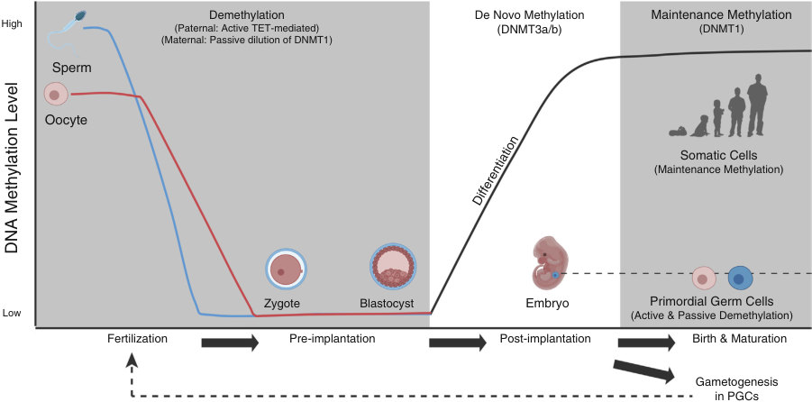

• Fig. 13.2 Methylation levels during epigenetic reprogramming and development. The initial wave of mammalian methylome reprogramming occurs after fertilization in the pronuclei of the paternal and maternal genomes via distinct demethylation mechanisms. Paternal pronuclei undergo active demethylation mediated via ten-eleven translocation (TET) enzymes, whereas maternal pronuclei are passively demethylated. Global methylation levels remain low in the zygote and blastocyst stage, until widespread re-establishment of methylation by de novo DNA methyltransferase enzymes (DNMTs) 3a and 3b occurs in the embryo after implantation, during the differentiation process. When methylation programs are established in differentiated cells of the developing embryo, cell-type-specific patterns will be maintained in somatic cells during maturation and throughout the lifespan by DNMT1. Methylome reprogramming also occurs in the primordial germline cells of the developing embryo. Unlike the distinct mechanisms experienced by the paternal and maternal pronuclei shortly after fertilization, both active and passive modes of demethylation participate in primordial germ cell reprogramming. (From Tuscher JJ, Day JJ. Multigenerational epigenetic inheritance: one step forward, two generations back. Neurobiol Dis. 2019;132:104591.)

## PDF page 260 | printed page 243

Spermatogenesis Germ cell mitosis/meiosis

Müllerian duct regression Wolffian duct differentiation

Organogenesis Fetal differentiation

Fertilization

Genital ridge formation Germ cell migration and mitosis

Germ cell meiosis to diplotene 1 Müllerian duct differentiation Wolffian duct regression

Follicular growth Completion of meiosis Ovulation

Prenatal

Preconceptional

• Fig. 13.3 Critical windows of exposure of the reproductive system to environmental toxicants during preconception, prenatal, and postnatal period. (From Pryor JL, Hughes C, Foster W, et al. Critical windows of exposure for children’s health: the reproductive system in animals and humans. Environ Health Perspect. 2000;108(3):491–503.)

### Paternal Exposures

Similar to women, men also have experienced a decrease in fertility over the last 50 years that is associated with both lower sperm counts and lower quality of sperm. Environmental toxicants that impact spermatogenesis have been identified. Spermatogonia are highly sensitive to apoptosis after exposure to cytotoxic agents. Toxicants may also impact male fertility by limiting sperm production. Unlike the female, cell divisions in the male that produce mature spermatozoa occur after puberty, and mature spermatozoa are incapable of DNA repair, making them susceptible to mutagen exposures that occur throughout life.16

A gradual decline in sperm concentration has been reported in reproductive-age males, and human male infertility is currently approaching 10%. Increased exposure to environmental toxicants has been postulated as a contributing factor. For many of these exposures, findings have been reproduced for several generations, and epigenetic transgenerational inheritance is a proposed mechanism.16 In the rat model, exposure of the pregnant female to two EDCs (vinclozolin, a fungicide used in the wine industry, and the pesticide methoxychlor) led to impaired spermatogenesis and infertility in males in four subsequent generations. Phthalates are plasticizers and known EDCs that are now ubiquitous in our environment. Bis(2-ethylhexyl) phthalate (DEHP) is found in polyvinyl compounds, and dibutyl phthalate (DBP) is used primarily to add flexibility to plastics. Both compounds can adversely affect male reproductive function. In animal studies, prenatal exposure has been linked to spermatogenic cell apoptosis, seminiferous tubule atrophy, and testicular dysfunction. Phenotypic alterations following exposure prenatally include cryptorchidism,

First wave of spermatogenesis Germ cell mitosis/meiosis....

Birth Puberty

Aging

Secondary sex

Oocyte atresia Menopause Depletion of oocytes

Postnatal

hypospadias, ambiguous genitalia, reduced sperm production, and decreased anogenital distance.17

The relationship between paternal occupation and cancer in offspring has been extensively studied. Studies in cohorts in different countries around the world have suggested an increased risk of childhood leukemias and solid tumors related to paternal exposure to toxicants. The international Childhood Cancer Cohort Consortium analyzed pooled data from five birth cohorts and included over 320,000 pregnancies. An increased risk of acute myeloid leukemia was found after paternal occupational exposure to pesticides (hazard ratio [HR] = 2.62; 95% confidence interval [CI], 0.91–7.55), fungicides (HR = 2.59; 95% CI, 0.78–8.56), animals (HR = 3.89; 95% CI, 1.18–12.90), and organic dust (HR = 2.12; 95% CI, 0.88–5.12), but there was not an increased risk of acute lymphoblastic leukemia (ALL) or solid tumors.18

Maternal exposures have long been recognized as having the potential to cause birth defects. The National Birth Defects Prevention Study collected data related to infants born between 1997 and 2004, including infants with birth defects and normal controls. Increased prevalence of birth defects in offspring of fathers employed as janitors, painters, printers, agricultural workers, groundskeepers, welders, electrical industry workers, and firefighters have been reported, suggesting an association with occupational exposures and birth defects.19

Male fertility diminishes and sperm DNA mutations increase with advancing paternal age. Advanced paternal age is associated with pregnancy loss, birth defects, and autosomal dominant genetic disorders such as Marfan syndrome and achondroplasia. Congenital malformations seen more frequently in fetuses of older fathers include cleft lip and palate, hydrocephalus, neural tube defects, limb reduction defects, tracheoesophageal fistula, congenital cataracts,

## PDF page 261

and congenital heart disease (CHD).20 In Prader-Willi syndrome, there is a functional mutation in paternal 15q, resulting in inactivation of the genes in that region of the chromosome. Environmental factors may play a role in uniparental disomy and lead to paternally mediated effects on the fetus. Studies have shown association between paternal exposure to hydrocarbons and Prader-Willi syndrome. Seasonal increases in the incidence of Prader-Willi syndrome also have been observed. This likely is due to seasonal changes in occupational exposures (e.g., farming, painting, landscaping), as significant association with seasonal viruses has not been established.21

### Secondary Fetal Exposure: Maternal Body Burden

The developing fetus may be exposed to xenobiotics (chemicals not naturally produced by the organism) after increased mobilization from maternal storage compartments during pregnancy. Adipose tissue is a storage site for hydrophobic chemicals, and both lead and fluoride are stored in bone.

### Polychlorinated Biphenyls

Polychlorinated biphenyls (PCBs) are EDCs that are mobilized from adipose tissue during pregnancy and readily cross the placenta. They are lipophilic organochlorine chemicals that bioaccumulate in the environment, enter the food chain, and are stored in adipose tissue.22 Exposure occurs primarily through ingestion of dairy, animal fat, and fish. PCBs were used as liquid insulators for transformers and capacitors in the 1970s. Because PCBs remain stable in the environment and are resistant to biologic breakdown, they are classified as persistent organic pollutants (POPs).22 Although the use of PCBs has been banned or limited in many countries, exposure remains a public health concern. The presence of PCBs has been documented in blood samples from pregnant women and in breast milk.22

Prenatal exposure to PCBs has been correlated with neurodevelopmental impairment and autism.22 Maternal occupational exposure is linked to low birth weight and prematurity.23 Human poisonings have occurred through dietary consumption of PCBs. In 1979, an epidemic of PCB poisoning from contaminated rice oil occurred in Taiwan, termed yu-cheng disease. Adults who were exposed developed hyperpigmentation, acne, and peripheral neuropathy. Of the first 39 hyperpigmented children born to poisoned women, 8 died. Children born up to 6 years after the outbreak of yu-cheng disease had ectodermal defects and developmental delay. Children born 6 years after maternal exposure were as developmentally impaired as those born within 1 year of the epidemic, indicating significant maternal body burden.24 Cognitive defects seen in Taiwanese children with yu-cheng disease are comparable to those observed in American children prenatally exposed to PCBs. Studies in Michigan and North Carolina showed neurodevelopmental impairment in children prenatally exposed to

PCBs through maternal body burden. In Michigan, cognitive deficits were seen in children who had elevated cord blood levels of PCBs and whose mothers had regularly consumed contaminated sport fish.23

### Lead

The major repository for lead is bone, and chronic exposure results in significant accumulation of lead in the skeleton. Lead stores are mobilized from bone during pregnancy, potentially exposing the fetus during critical stages of brain development. It is postulated that enhanced calcium turnover during pregnancy increases lead mobilization. Maternal tibial and patellar bone lead levels are correlated with low birth weight and decreased head circumference. One study established maternal trabecular bone lead level as an independent risk factor for cognitive delay at 24 months of age. Lead is readily transported across the placenta and blood-brain barrier. Lead is a potent neurotoxin. Developmental exposure is linked to learning disability, cognitive and language deficits, and attention-deficit/hyperactivity disorder (ADHD). Treatment of pregnant women with calcium supplementation may limit lead mobilization from bone and could decrease circulating maternal lead levels and placental transfer to the fetus.25

### Maternal Exposures Concurrent With Pregnancy

Biomarkers of fetal exposure have been developed using cord blood and meconium.26,27 In 2007, the Environmental Working Group measured cord blood levels of 413 chemicals from 10 US newborns. They found 287 toxicants, with an average of 200 chemicals in cord blood of each infant. Chemicals included pesticides, PCBs, and heavy metals such as mercury.26 Meconium analysis is a sensitive tool utilized to determine antenatal exposure to environmental toxicants. In a study of 426 infants born in the Philippines, the exposure rates were 26.5% for lead, 83.9% for mercury, and 53% for the organophosphate pesticide (OP) malathion.27

### Occupation and Paraoccupation

Specific congenital anomalies have been linked to maternal occupations. For example, cleft lip and palate occur more frequently in offspring of leather workers, hairdressers, housekeepers, and transport and communication workers. Limb anomalies have been reported in children of agricultural workers, and neural tube defects in children of cleaners and health care providers working with anesthesia and radiation.28 In a large population-based case control study that examined the relationship between various maternal occupations and 45 birth defects, jobs with the highest number of associated anomalies were janitors/cleaners, scientists, and electronic equipment operators. Teachers and

## PDF page 262 | printed page 245

health care workers had the lowest risk of delivering a child with congenital anomalies.28

Paraoccupational exposures occur when others living in the home come in contact with an occupationally exposed individual, or occupational chemicals are brought into the home on clothing or other materials. Paraoccupational exposure to pesticides remains an occupational hazard today. An important route of exposure to neurotoxic OPs occurs in families of farm workers. A systematic review of 10 studies assessing prenatal exposure to OPs reported neurocognitive impairment involving working memory and attention in toddlers and children at school age.29

### Climate Change

Although climate change has been widely accepted as the largest public health threat in the modern world, attention to its effects on the fetus and neonate has only recently increased. Climate change has caused increasing frequency and severity of heat waves, wildfires, and extreme weather events, causing flooding, drought, pollution, power outages, and physical displacement. The direct and indirect effects of these exposures are associated with adverse effects on fetal growth and birth weight, preterm birth, spontaneous abortion, and neonatal death. Fig. 13.4 illustrates the impacts of climate change on pregnancy outcomes.30

Climate change

Indirect impacts through the physical environment

Direct impacts

Environment

Heat waves Wildfires Extreme weather events (drought, hurricanes, floods)

Air pollution Food scarcity and water contamination

Shift in vectors, hosts, and pathogen distribution

Biological/physiology changes

Psychological changes

Individual

Oxidative stress

Malnutrition Infection

Stress Mental health

Inflammatory responses

Endocrine disruption

Adverse pregnancy outcomes

Gestational complications Low birth weight Restricted fetal growth Preterm birth Spontaneous abortion Neonatal mortality

• Fig. 13.4 Impacts of climate change on pregnancy outcomes. (From Ha S. The changing climate and pregnancy health. Curr Environ Health Rep. 2022;9:263–275.)

### Air Pollution

Many chemicals found in outdoor air pollution are neurotoxic. Exposure is associated with disruption of the blood-brain barrier, chronic central nervous system (CNS) inflammation, microglia activation, and white matter injury.31 The US Environmental Protection Agency (EPA) established air-quality standards in 1971. Although some progress has been achieved, outdoor air pollution continues to carry significant health risks. Particulate matter, ground-level ozone, sulfur dioxide, nitrogen dioxide, carbon monoxide, and airborne lead are examples of outdoor air pollutants with known adverse health outcomes. These air pollutants are the focus of air quality standards, such as the EPA’s Clean Air Act. The Air Quality Index is an indicator of daily air quality calculated by the EPA for these six major air pollutants that are regulated by the Clean Air Act. Both carbon monoxide and airborne lead are typically meeting safety standards.32

Particulate matter pollution consists of fine inhalable particles comprised of many different chemicals found in outdoor air (PM2.5 and PM10, which are 2.5 μm and 10 μm in diameter, respectively). Particles less than 10 μm are readily inhaled into the lungs, interact with the immune system, and are absorbed systemically. Ground-level ozone (the primary component of smog) is formed in the atmosphere by photochemical reactions between sunlight, nitrogen

Existing influences

Indirect impacts through the social environment

Health system context

Food and water insecurity

Conflicts due to resource scarcity

Social and physical environmental context

Displacement

Individual characteristics (genetics, demographics, behaviors)

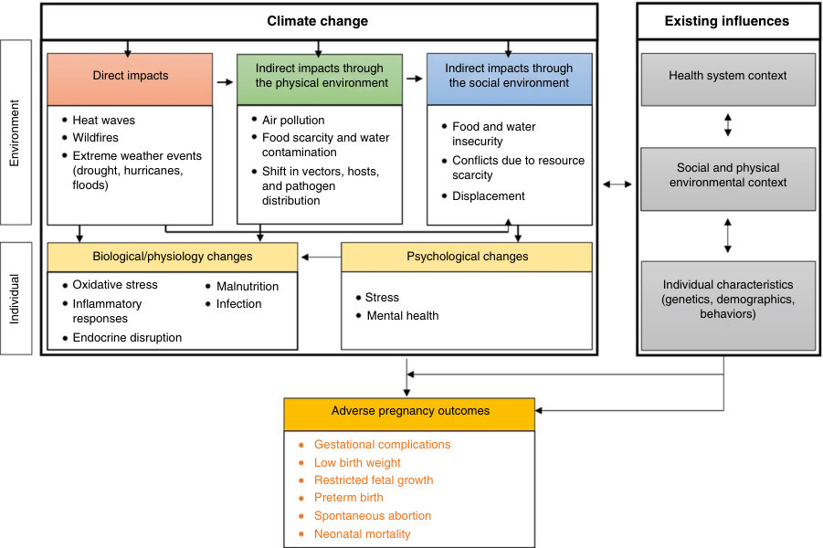

• Fig. 13.4 Impacts of climate change on pregnancy outcomes. (From Ha S. The changing climate and pregnancy health. Curr Environ Health Rep. 2022;9:263–275.)

## PDF page 263

oxide species, and volatile organic compounds, which are photochemically reactive hydrocarbons. Sulfur dioxide and nitrogen dioxide are also components of smog. Emissions from industrial facilities, motor vehicle exhaust, gasoline vapors, and chemical solvents are common sources of these toxicants.32

Exposure to outdoor air pollution is difficult to avoid during pregnancy, especially in highly polluted areas. There is strong evidence relating exposure to air pollution to both increased infant mortality and respiratory morbidities such as asthma in early childhood. In addition, there is evidence from epidemiologic studies linking prenatal exposure to air pollution and prematurity, low birth weight, impaired lung and immune function, autism spectrum disorders, and neuromotor impairment in early childhood.31

### Drinking Water

The drinking water supply is obtained from a variety of sources that include groundwater and surface water from rivers, lakes, reservoirs, and aquifers. Environmental toxicants that contaminate drinking water are associated with adverse health outcomes. Common drinking water contaminants include the heavy metals lead and arsenic, inorganic compounds such as nitrates and nitrites found in fertilizers and livestock manure, pesticides such as atrazine and glyphosate, disinfection byproducts such as chloroform, and organic solvents such as trichloroethylene. Congenital anomalies, specifically cardiac defects, and low birth weight were found in studies evaluating trichloroethylene-contaminated drinking water. The EPA and the US Food and Drug Administration (FDA) monitor the safety of drinking water; the EPA is responsible for drinking water standards for public water systems.33

Arsenic enters the water supply naturally and is also found in agricultural and industrial chemicals. Arsenic readily crosses the placenta; prenatal exposure is associated with fetal growth restriction and increased infant mortality in animal models. Population studies of health outcomes associated with arsenic exposure have been conducted primarily in countries such as Bangladesh, Taiwan, and Chile, where naturally occurring arsenic levels in groundwater are elevated. A systematic review and meta-analysis of these studies noted an association between prenatal arsenic exposure and spontaneous abortion, stillbirth, low birth weight, and neonatal mortality. Although the studies on dose-response were limited, the strongest correlation was between prenatal arsenic exposure and spontaneous abortion.34

### Diet

Maternal diet during pregnancy appears to impact the fetal epigenome. The Dutch famine of 1944–1945 showed a correlation between maternal undernutrition/starvation and low birth weight, cardiovascular disease, and metabolic diseases in the offspring. Similarly, the study of seasonal diets in Gambia, an African country with alternating seasons of

abundance and famine, has shown increased DNA methylation and increased risk of premature death and the development of noncommunicable diseases and cardiovascular disease in offspring who were conceived during the hungry season (time of undernutrition). Several studies have documented the relationship among maternal obesity, gestational diabetes mellitus, and altered epigenome methylation in the placenta and cord blood; findings may potentially correlate with the risk for metabolic conditions in offspring.4

Many animal studies have produced results similar to those observed in humans and provide an avenue for study of the contributing epigenetic mechanisms. Studies in pigs and rats have shown a positive correlation between low protein maternal diet, epigenetic modifications, and increased insulin tolerance and metabolic syndrome in offspring. Studies of high-fat maternal diets in rodents and primates have shown similar results, as well as changes in the rat brain that correlate with depression-like behavior.4

Similarly, vitamin B12 and folate deficiency during pregnancy has been proposed to impact the fetal methionine-homocysteine cycle via epigenetic alterations in DNA methylation. The methionine-homocysteine pathway is an important regulator of methylation and is dependent on vitamin B12 and folate as cofactors. Deficiency in vitamin B12 or folate leads to high levels of homocysteine, a well-established risk factor for adult cardiovascular disease. Pregnant sheep exposed to diets restricted in vitamin B12, folate, and methionine delivered offspring who developed increased body mass, impaired immune function, insulin resistance, and hypertension as adults.35

Inorganic mercury (methylmercury) is an example of a xenobiotic that contaminates our food supply. Methylmercury is a lipid-soluble and potent neurotoxin found in fish and seafood. Methylmercury readily crosses both the placenta and blood-brain barrier.36 The EPA has set an oral reference dose of mercury at 0.1 μg/kg/day. Approximately 8% of women have body burdens exceeding this reference dose. The fetus is very susceptible to the neurotoxic effects of methylmercury. Prenatal exposure has been associated with microcephaly, seizures, and cognitive and sensory impairment.36

### Pathways of Fetal Exposure

### Placenta-Dependent Pathways

Two routes of fetal exposure to environmental toxins are placenta-dependent pathways and placenta-independent pathways. Placenta-dependent pathways require chemicals to enter the mother’s bloodstream by inhalation, ingestion, or transdermal absorption and to cross the placenta in significant amounts. Placental transfer of many environmental chemicals has been studied using perfusion studies of the term placenta. After a term human birth, the placenta is used immediately; the substance of interest is perfused through the maternal side, transfer to the fetal side is measured, and the placenta is histologically examined to characterize the transfer of the chemical.37 Substances can

## PDF page 264 | printed page 247

50

40

Small head size (%)

30

20

10

0 0

1–9 10-19 20–29 30–49 50–149 150+

Radiation dose, rad

• Fig. 13.5 Percentage of Hiroshima children with head circumference 2 or more standard deviations below average, by fetal dose. Exposure occurred before 18 weeks of gestation. (From Blot WJ. Growth and development following prenatal and childhood exposure to atomic radiation. J Radiat Res. 1975;16(suppl):82–88.)

cross the maternal-fetal interface of the placenta by simple diffusion, facilitated diffusion, transport-mediated diffusion, and endocytosis. Most xenobiotics cross the placenta by passive diffusion, making the concentration gradient between maternal and fetal circulation and placental blood flow the primary determinants of fetal exposure.37 Properties enabling chemicals to cross the placenta more readily are low molecular weight, protein binding, lipid solubility, ionization, and resemblance to nutrients with specific transport mechanisms. An example of a low-molecular-weight compound is carbon monoxide, a constituent of environmental tobacco smoke (ETS). Carbon monoxide has a very high affinity for hemoglobin and displaces oxygen. Accumulation of carboxyhemoglobin leads to hypoxia and impaired cellular metabolism.37 Examples of lipid-soluble chemicals that readily cross the placenta are PCBs, ethanol, and polycyclic hydrocarbons such as benzo[a]pyrene, a carcinogen in ETS. Lead is actively transported across the placenta via calcium-specific channels; calcium supplementation may reduce the transfer of lead to the fetus.37

### Placenta-Independent Pathways Radiation

Ionizing radiation is a well-characterized teratogen that is most harmful to the fetus in the first trimester during organogenesis. Prenatal exposure is associated with infertility, microcephaly, and increased incidence of childhood cancer in offspring.38 Children of survivors of the atomic bombs in Hiroshima and Nagasaki exposed in utero at <18 weeks’ gestation developed microcephaly, with the lowest observable effect at a dose of 1 to 9 rad (Fig. 13.5).39 An excess of cancer among Japanese individuals exposed in utero has also been reported (Fig. 13.6).41 Not all forms of radiation are hazardous to the fetus. Ultraviolet light does not penetrate to the fetus and does not constitute a future cancer risk.38 The brain of a neonate undergoing cranial computed tomography (CT) with settings of 400 mA, 125 kV (peak), and a standard slice

0.03

0.0283

cumulative hazard rate

All cancer incidence

0.02

0.30+ Gy

0.0105

0.01

0.01–0.29 Gy

0.0073

0 Gy

0 0 10 20

30 40

Years since the A-bombing

• Fig. 13.6 Cumulative hazard rate for cancer among survivors of intrauterine radiation in Hiroshima and Nagasaki for three exposure groups through 1984. Gy, Gray (a measure of an absorbed dose of ionizing radiation). (From Yoshimoto Y, Kato H, Schull W. Risk of cancer among children exposed in utero to A-bomb radiations, 1950-84. Lancet. 1988;2:665–669.)

thickness of 4 mm receives a dose of 10.5 rad. Therefore it has been recommended that CT be used sparingly for infants, particularly when other imaging techniques are available.40

### Heat

Excessive heat exposure to the fetus can cause birth defects, especially cardiac defects, as well as increasing risk of miscarriage. Animal studies demonstrate that both maternal core temperature 2° C above baseline and duration of hyperthermia are important risk factors and have caused the obstetrical recommendation to avoid excessive heat and humidity and caution against vigorous exercise. Emerging evidence has shown that the increased temperature-regulating mechanisms associated with pregnancy likely are protective against heat injury to the fetus. Heat transfer to the fetus occurs through the placenta and maternal blood flow and thus relies on the mother’s ability to regulate her body temperature. This indicates that the risk to the fetus is likely less than previously thought with maternal environmental exposure or exercise and limited to increases in maternal core temperature, as with fever or heat exhaustion.42

### Noise

Sound exposure is an important form of sensory stimulation in the developing fetus. At 23 to 25 weeks, sound begins to produce physiologic changes in fetal state; by 25 to 29 weeks’ gestation, the auditory system is functional.43 At 27 weeks, the fetus primarily hears low-frequency sounds below 500 Hz; frequencies above 500 Hz are not perceived until closer to 29 weeks due to filtering by the maternal tissues and uterus.43,44 Both low- and high-frequency noise can be detrimental and produce physiologic changes in the fetus. Applying vibroacoustic stimulation directly to the maternal abdomen leads to increases in fetal heart rate and movement.44 Intense and sustained noise exposure during the prenatal period is associated with congenital anomalies, prematurity, and low birth weight.43 In addition, noiseinduced hearing loss may be evident after in utero exposure. The cochlear hair cells are sensitive to low-frequency sound. Animal studies have shown that intense low-frequency

## PDF page 265

sound can damage the cochlear hair cells; effects are determined by gestational age and the intensity and duration of sound exposure.44 The Sound Study Group recommends that pregnant women should avoid extended exposure to low-frequency sound levels (<250 Hz) greater than 65 dB and that sources of sound applied directly to the mother’s abdomen (headphones) should be avoided because of no clear benefit and potential risks to fetal hearing.44

### Fetal Pharmacokinetics

### Absorption and Distribution

Physiologic changes during pregnancy influence maternal absorption and distribution of toxicants to the fetus. Increases in maternal progesterone concentration prolong gastric emptying time and slow intestinal motility, impacting enterohepatic circulation and absorption of xenobiotics. This results in reduced peak maternal levels of xenobiotics but increased overall exposure.45 Distribution of xenobiotics in the maternal compartment is impacted by increases in fat stores, extracellular fluid volume, and plasma volume during pregnancy. In addition, amniotic fluid represents a third potential compartment for the distribution of water-soluble chemicals. This amniotic fluid compartment is characterized by low protein concentration and delayed elimination, resulting in a potential source for prolonged exposure to unbound chemicals that may be harmful to both mother and fetus. As the fetal kidney matures, higher concentrations of xenobiotics may be stored in this compartment.45

During pregnancy, plasma volume increases by 50%. Dilutional hypoalbuminemia is a result of plasma volume expansion that surpasses albumin production. Dilutional hypoalbuminemia alters the ratio of protein-bound chemicals and the volume of distribution in maternal blood, facilitating both clearance of free fractions of xenobiotics in the liver and placental transport to the fetal compartment. The fraction that is protein bound is not active and cannot affect the mother nor be transported across the placenta, but the increasing unbound fraction is biologically active and requires elimination to protect the mother and fetus.46 Changes in maternal plasma volume also impact excretion of toxicants. Increased renal blood flow, glomerular filtration rate, and tubular transport result in maternal excretion of toxicants before reaching the fetus.45

Distribution of xenobiotics in the fetal compartment is also influenced by acid-base status and protein binding. As fetal pH is more acidic than maternal pH, weak bases that are nonionized in the maternal compartment are readily transported across the placenta. In the fetal compartment, weak bases become ionized, resulting in higher concentration and “ion trapping.” Although maternal serum albumin gradually declines during pregnancy relative to plasma volume, fetal albumin concentration progressively increases. Thus unbound xenobiotics that easily cross the placenta become protein-bound in the fetus and accumulate in the fetal compartment.46

2500

24 hours 1 week

2000

Radioactivity (dpm)

1500

1000

* * * * * *

*

500

* * *

0 3 7 10 15 20 55 0

Age (days at time of administration)

• Fig. 13.7 Radioactivity levels (in disintegrations per minute [dpm]) in mouse brain 24 hours and 1 week after oral administration of 1.48 MBq [14C]DDT per kg of body weight. Height of bars represents mean ± standard deviation; statistical difference between 24 hours and 1 week is indicated by P = .01 (*) and P = .001 (**). (From Eriksson P. Age-dependent retention of [14C] DDT in the brain of the postnatal mouse. Toxicol Lett. 1984;22:323–328.)

Although maternal fat stores serve as a reservoir for lipophilic compounds, there is minimal fetal adipose tissue development until after 29 weeks’ gestation. Before that time, lipid-soluble toxicants accumulate in tissues containing adipose, such as the developing brain. An example is shown in Fig. 13.7. The pesticide dichlorodiphenyltrichloroethane (DDT) was administered orally to mice at ages corresponding to the human brain growth spurt. Radioactivity was measured in brain tissue after 24 hours and 7 days. At 24 hours, 20-day-old mice accumulated more DDT in their brains than at other ages. DDT persisted in the brain longest in the animals given DDT at 10 days. Mice treated at 10 days had more behavioral abnormalities than those treated on other days, suggesting that the persistence was more important than initial accumulation. These results reflect the complexities of chemical distribution in the developing fetus.47

### Metabolism

The maternal basal metabolic rate increases during pregnancy, facilitating hepatic metabolism of xenobiotics. The most widely described hepatic metabolizing enzyme systems are phase I (cytochrome P450 enzymatic oxidation, dehydrogenation, reduction, and hydrolysis) and phase II (enzymatic glucuronidation, sulfation, methylation, and glutathione conjugation) processes. Approximately 75% of chemicals are toxic in their original state, and the remaining 25% are metabolized to toxic intermediates in the liver. Certain phase I and phase II enzymatic processes have been shown to be activated as a direct response to pregnancyinduced circulating estrogen levels, impacting metabolism and excretion of xenobiotics. Maternal metabolism and clearance of xenobiotics may additionally be reduced by estrogen-induced cholestasis that occurs physiologically during pregnancy.45,46

## PDF page 266 | printed page 249

Prior to reaching the fetal compartment, some degree of first-pass metabolism by phase I and phase II processes occurs in the placenta. In the fetus, expression of metabolic enzymes in the liver matures with advancing gestational age. Metabolism can lead to detoxification and facilitate excretion or activation of a xenobiotic to a more potent toxin.45,46 The fetus may be protected if the active form of a toxin is its metabolite. An example is acetaminophen, a common drug used in suicide attempts during pregnancy. Acetaminophen is metabolized by phase I enzymes to hepatotoxic and nontoxic intermediates. Expression of the phase I enzymes is developmentally regulated. Because many of these enzymes are poorly expressed in fetal tissues, the fetus may be protected.48

Polymorphisms in human drug-metabolizing enzymes have been described that impact the susceptibility of the fetus to environmental toxicants. For example, risk of fetal alcohol spectrum disorder (FASD) is impacted by genetic polymorphisms in the expression of the enzyme alcohol dehydrogenase (ADH). If the high-activity variant of ADH is inherited, ethanol oxidation and elimination are enhanced, decreasing the teratogenic effects of alcohol on the developing fetus.49 A second example involves deactivation of organophosphate pesticides (OPs) by the antioxidant enzyme paraoxonase 1 (PON1). In the liver, certain organophosphates are converted to a biologically active toxic form by cytochrome P450 enzymes. PON1 is responsible for hydrolyzing this toxic intermediate to an inactive metabolite that can be excreted. Genetic polymorphisms in PON1 have been described that impact both expression and catalytic capability of PON1, thus providing enhanced protection or greater susceptibility to toxic effects of these pesticides. When four birth cohorts were pooled (n = 936), negative associations were found between organophosphate metabolites in maternal urine and the Bayley Mental Developmental Index at 24 months in carriers of a particular PON1 allele.50

### Specific Exposures

### Cigarette Smoke

In utero exposure to cigarette smoke has been shown to cause decreased fertility in female and male fetuses later in life, delayed embryonal and fetal development as early as during the first trimester of pregnancy, congenital anomalies, preterm birth, miscarriage, stillbirth, sudden infant death syndrome (SIDS), growth restriction and low birth weight, and childhood obesity in offspring.12,13,52 The effect of delayed early growth is more pronounced when combined with conception using assisted reproductive technology and when exposure is to ≥10 cigarettes/day.12

Despite the known consequences of smoking, over 2.3 million women worldwide per year smoke during pregnancy.12 Both active maternal smoking during pregnancy and passive exposure to ETS are harmful to the fetus and are associated with lower birth weight.52 ETS consists of

smoke coming from the end of a burning cigarette (sidestream smoke) and from smoker’s exhalation (mainstream smoke); it is also known as secondhand smoke. ETS contains over 250 harmful chemicals, including carbon monoxide, cyanide, benzene, ethylene oxide, nitrogen oxides, arsenic, formaldehyde, vinyl chloride, toluene, and PAHs such as benzo[a]pyrene. At least 69 are known carcinogens; the amount of each chemical varies with each cigarette. Cotinine is a metabolite of nicotine that has a long half-life (∼20 hours) and is the biologic marker used to measure exposure to ETS. There is no safe level of exposure to ETS.51

Vaping products have been used as a nicotine replacement therapy since the early 2010s. They consist of a heating device that aerosolizes a mixture of nicotine, propylene glycol, vegetable oil, and flavorings for inhalation. Although initially intended as a smoking cessation aid, they also have become widely used on their own, in the absence of a prior addiction to nicotine. Although not all potential harm from vaping is currently understood, especially in pregnancy, it is generally accepted as a less harmful mode of nicotine delivery than cigarette smoking. Recent studies have not shown a relationship between vaping during pregnancy and lower birth weight (in contrast to smoking). Further studies will have to be conducted to evaluate whether toxic exposures from additives in the vaping liquid, which may include organic solvents and heavy metals, can be harmful to the fetus.52 Vaping also releases particles when the users exhale and subject those around them to secondhand aerosol exposure, which may contain nicotine, heavy metals, volatile organic compounds, or other harmful substances.51

### Sources of Exposure

Because smoking in public and the workplace has become restricted, the most common source of ETS exposure is at home. Paternal smoking is the most frequently reported source of environmental exposure.51

### Toxic Effects

Active smoking is associated with infertility, reduction in successful in vitro fertilization, and early onset of menopause. Impaired female fertility may be secondary to hormonal imbalance, direct impact on follicular growth and ovulation, or reduced motility in the female reproductive tract. Cotinine and benzo[a]pyrene, a carcinogen and endocrine disruptor, have been found in follicular fluid and ovarian granulosa cells; levels correlate with the degree of active and passive exposure. Active paternal smoking is linked to decreased production, impaired motility, and altered sperm morphology.13 Active smoking also impacts the developing fetus. Nicotine leads to vasoconstriction of the uteroplacental blood vessels, reducing the delivery of oxygen and nutrients. Additionally, carboxyhemoglobin production from carbon monoxide contributes to fetal hypoxia and chronic hypoxic stress.12 Fetal exposure to active maternal smoking is associated with placental dysfunction, spontaneous

## PDF page 267

abortion, intrauterine growth restriction, preterm delivery, and congenital anomalies such as cleft lip and palate. Active maternal smoking during pregnancy is an important risk factor for SIDS.12,13,51,53 A direct dose-response relationship has been noted between maternal smoking and intrauterine growth restriction; one study suggested a 5% reduction in relative fetal weight per pack of cigarettes smoked daily.53 Nicotine is toxic to the developing nervous system, impacting neuronal proliferation and differentiation. Maternal active smoking during pregnancy is associated with impaired cognitive functioning, auditory processing deficits, impulsivity, anxiety, depression, ADHD, obesity, and conduct disorders in offspring.53 Maternal smoking also appears to impact infant stress response via epigenetic mechanisms. DNA hypomethylation of the placental glucocorticoid receptor promotor region was found in one study to correlate with infant salivary cortisol levels over the first month of life.54 Epidemiologic studies show a relationship between prenatal maternal active smoking and both reduced lung function and asthma in offspring.53 At present, there is insufficient evidence to decisively link ETS with infertility, spontaneous abortion, or congenital anomalies; however, prenatal exposure to ETS has been associated with increased incidence of both SIDS and low birth weight.13,53 Evidence is suggestive of a relationship between ETS and preterm delivery. The literature also suggests a relationship between prenatal exposure to both active maternal smoking and ETS and the incidence of childhood cancers; further evidence is necessary to support this relationship.12,51

### Prevention Strategies

Smoking prevention programs should focus on education and treatment of preteens, adolescents, and women of childbearing age. As nicotine is a neurotoxin, nicotine replacement should be avoided as a means to quit smoking during pregnancy. Smoking during pregnancy and common sequelae such as preterm birth and low birth weight have been diminished using behavioral therapy programs. Some programs have shown success in promoting nicotine abstinence during pregnancy but none has been identified to successfully prevent relapse to smoking after delivery.52

### Ethanol

Effects of alcohol on the fetus are extensive, devastating, and often permanent. Approximately 10% of women report drinking alcohol at some time during their pregnancy.55 The incidence of fetal alcohol syndrome (FAS) in the United States is estimated as 0.2 to 1.5 per 1000 live births, and 1% to 5% of school-aged children in the United States and Western Europe may have a fetal alcohol spectrum disorder (FASD), a larger group of disabilities caused by fetal alcohol exposure but not meeting criteria for FAS.56 FAS is estimated to incur a lifetime cost for one person of $2 million, and the cost to the United States is estimated to be over $4 billion per year.56 Because the full spectrum of FASD is

more prevalent, this is bound to be an underestimate of the total cost of FASD.

### Sources of Exposure

Although most ethanol exposure is the result of deliberate ingestion by pregnant mothers, measurable levels of ethanol in the blood after the use of hand sanitizers has been documented, although not in pharmacologically significant amounts. Much higher amounts are found secondary to inhalation after use of hand sanitizer in enclosed spaces. Measurable levels of ethanol in air in neonatal intensive care unit incubators following the use of hand sanitizers has been shown.58 Patients are also exposed to ethanol as an excipient in medications, as well as benzyl alcohol and propylene glycol.59 In a cohort of 106 very low birth weight infants over the period of 1 year, it was found that 98% of the infants were exposed to excipients and 5% to 9% of them received doses higher than acceptable recommended doses for adults.59

### Toxic Effects

FAS was identified more than 50 years ago. It is defined by craniofacial abnormalities (including smooth philtrum, thin upper lip, and short palpebral fissures), growth deficiency (at or below the 10th percentile), and CNS dysfunction (structural, neurologic, and/or functional). FAS is generally considered to be the extreme end of the spectrum of negative outcomes that result from alcohol exposure during pregnancy.56

FASD is an umbrella term that covers all diagnoses that pertain to children who were exposed to alcohol in utero. This includes FAS, as well as partial FAS, alcoholrelated neurodevelopmental disorder, and alcohol-related birth defects. Children exposed to alcohol in utero tend to have poor outcomes. They can have lower IQ scores, poor reasoning skills, hyperactivity, poor memory, learning difficulties, speech and language delay, intellectual disability, and/or problems with attention, sleep, vision, or hearing or with heart, kidney, or bone. Prenatal exposure to ethanol is still the leading known cause of intellectual delay.56 Among the numerous comorbid conditions that have been identified in people with FASD, the top five are abnormal results of function studies of peripheral nervous system and special senses, conduct disorder, receptive language disorder, chronic serous otitis media, and expressive language disorder. People prenatally exposed to alcohol are also at risk for epilepsy; one study showed that 17.7% of a prenatally alcohol-exposed population have at least one documented seizure60 and depression and anxiety disorders.56

Although much of the work examining outcomes after exposure to ethanol is focused on brain development and behavior, other organ systems are also at risk. For example, prenatal alcohol exposure results in smaller, immature lungs, as well as disruption of both innate and adaptive immunity in the lung, which increases risk of infection. There is an increased risk of congenital heart disease (CHD). The growth deficiency is part of the diagnosis of

## PDF page 268 | printed page 251

FAS that points to skeletal abnormalities; this deficiency continues at least through early adolescence and is associated with abnormal bone growth. There are also reports of abnormalities in other systems, including kidney, liver, and gastrointestinal.61

Heavy alcohol consumption increases the risk of miscarriage from ∼15% to 45%55 and increases stillbirths sixfold.62 Typically, FAS and FASD are associated with moderate to high levels of alcohol consumption, but lower levels of exposure are associated with more subtle changes. There even have been associations between one alcoholic drink per day in any trimester and increased risk of behavioral disturbances in young adults. It is widely agreed upon between obstetric and pediatric organizations that there is no safe level of alcohol exposure at any time during pregnancy, and complete abstinence is recommended.63

### Prevention Strategies

Certainly, the cause of FAS and FASD is known and has been for many years; however, the rate of alcohol consumption by pregnant women is remarkably stable over time.55 Other sources of alcohol such as gasoline and hand sanitizer have not been well studied. Although the human literature can be inconsistent regarding outcomes following exposure to alcohol, the best advice remains to abstain from alcohol exposure during pregnancy. Women planning to become pregnant should also consider abstaining, as the effects of preconception exposure are not well understood at this time and critical exposure can occur before the first missed

TABLE

Common Pesticide Classifications and Their Characteristics

13.1

Classification Mechanism of Action Toxicity

Organochlorine GABA antagonist High

Organophosphates Acetylcholinesterase

High

inhibitors

Pyrethrins and

Sodium channel

Low to moderate

pyrethroids

antagonist

Carbamates Acetylcholinesterase

Variable

inhibitors

Neonicotinoids Selective for insect

Lower

acetylcholine receptors

DDT, Dichlorodiphenyltrichloroethane; EPA, US Environmental Protection Agency; GABA, gamma-aminobutyric acid.

period. Treatments for FASD have always focused on treatment of the symptoms and comorbid conditions, but recent animal and human studies have suggested a benefit to choline after prenatal alcohol exposure.63

### Pesticides

Pesticides are applied in agriculture and both in and around homes. More than 2 million metric tons of pesticides are used throughout the world every year. Pesticides are defined as any chemical utilized to eradicate insects (insecticides), plants and weeds (herbicides), microorganisms (disinfectants, bactericides, fungicides, and algaecides), and other pests.64,65,67 Pesticides are classified by the function of their active ingredient and the intended target organism. Some of the more common classifications of pesticides, mechanisms of action, and examples are shown in Table 13.1. In addition to their active ingredient, pesticides contain other chemicals that are not required to be readily available for consumers.64

Organochlorines (DDT, methoxychlor, chlordane, aldrin, dieldrin, and lindane) and organophosphates (chloropyrifos, diazinon, and parathion) are neurotoxic insecticides that were historically applied commercially in agriculture. Both classes of insecticides have been restricted because of toxic effects in animals and humans.50,67 Organochlorines are lipid soluble and bioaccumulate in the environment. Although the organochlorine DDT was banned by the EPA in 1972, use continues in some parts of the world for control of diseases such as malaria and for agriculture.

Use and Characteristics Examples

Insecticides Residential and agriculture Many banned by the EPA

DDT Chlordane Lindane Aldrin

due to health risk and bioaccumulation Lipid soluble Lindane for lice, scabies

Insecticides Used in agriculture; residential

Chlorpyrifos Malathion Parathion Phosmet

use banned Water soluble

Insecticides Residential and agriculture

Permethrin Deltamethrin

Insecticides Agriculture and residential

Aldicarb Carbaryl Primicarb

Flea control for domestic

Imidacloprid

animals Agriculture

## PDF page 269

Organophosphates are water soluble and exert their neurotoxic effects via irreversible inhibition of acetylcholinesterase. Residential application of most organophosphates has been restricted or banned due to toxicities in humans.50,65 Pyrethoids, pyrethrins, and piperonyls are insecticides primarily marketed for residential use. Generally, they are less toxic, but health effects have been reported.66 The Centers for Disease Control and Prevention conducts a biomonitoring program for many common pesticides. In 2005, 29 of 45 pesticides were identified in samples from random subjects; the most prevalent were organochlorine and organophosphate insecticides.67

### Sources of Exposure

Important sources of exposure include direct inhalation after application and ingestion of contaminated food. Organochlorine pesticides have a long half-life and bioaccumulate in our food supply.66 Frequent sources of the organochlorine DDT include meat, dairy products, and fish. DDT and its metabolites have been found in breast milk. The organochlorines aldrin and dieldrin are found in fish, shellfish, root crops, dairy products, and meats. Plants absorb these chemicals directly from the soil; even organic vegetables may contain high levels if grown in contaminated areas.67 The EPA sets acceptable standards for pesticide residue, which are regulated by the FDA. In 2019, human food testing found pesticide residues in 57.6% of 1258 domestic and 50.6% of 3069 imported samples, and violations of EPA standards (residue for which there is no tolerance or residues above the tolerance level) were found in 1.3% of domestic and 10.9% of imported samples. The majority of domestic samples were fruits and vegetables (71.1%), with the highest violation rate found in vegetables at 2.2%. The overall violation rate was greatest for imported grains at 18.9%. Imidacloprid (neonicotinoid insecticide used in agriculture), pyraclostrobin (fungicide used in agriculture), acetamiprid (another neonicotinoid insecticide used in agriculture), and thiabendazole (an antifungal and antiparasitic which also is used medicinally as a chelating agent for metal toxicity) were the most frequently reported pesticide residues.68

Pregnant women may be exposed in the home environment via indoor use of disinfectants, insecticides, and rodenticides and outdoor application of herbicides, insecticides, and fungicides. Certain products such as sprays and foggers may lead to prolonged exposure in the home. Another potential source of exposure in the home is drinking water. Herbicides are a frequent contaminant of drinking water in agricultural areas; in urban areas, both insecticides and herbicides are known contaminants.67 Occupational or paraoccupational exposure to pesticides and living in close proximity to pesticide-treated agricultural areas represent other important sources for pregnant women or women of childbearing age.50,70

Biomarkers have been identified to evaluate fetal pesticide exposure. In 2004, the Environmental Working Group found 21 of 28 organochlorine pesticides in cord blood of

10 babies. Amniotic fluid from amniocentesis samples has been used to characterize early fetal exposure; meconium samples have been utilized to determine exposure during the second and third trimester. Organophosphates have been identified in amniotic fluid, and both organophosphates and pyrethroid pesticides have been found in meconium samples.69

### Toxic Effects

Although most pesticides are neurotoxins, the degree of toxicity varies between classes. Pesticides also can function as endocrine disruptors, immunotoxicants, and carcinogens in animals and humans.50,70 Epidemiologic data suggest a link between parental pesticide exposure and infertility, spontaneous abortion, fetal demise, preterm birth, intrauterine growth restriction, and congenital anomalies.67,70 One study demonstrated a relationship between exposure to chloropyrifos and DDE (a metabolite of DDT) and both low birth weight and microcephaly.69 Additionally, biomarkers for organophosphates found in maternal urine, blood, or umbilical cord samples are associated with low birth weight and preterm birth.70 A relationship between exposure to organochlorines such as DDT and both cryptorchidism and hypospadias has been reported, suggesting endocrine disruption as a mechanism of toxicity.67

Evidence supports a relationship between prenatal exposure to organochlorine and organophosphate pesticides (OPs) and adverse neurodevelopmental and behavioral outcomes that persist into childhood. Findings include increased incidence of cognitive delays and intellectual disability that persist into childhood and increased incidence of both ADHD and autism spectrum disorders.50,67 There is increasing epidemiologic evidence correlating parental pesticide exposure and childhood cancers. Multiple studies report a correlation between maternal pesticide use (both occupational and household) before and during pregnancy and childhood acute lymphoblastic leukemia. There is stronger evidence linking maternal exposure to pesticides and leukemia than paternal exposure. Similarly, more than 25 studies have described a relationship between prenatal pesticide exposure and brain tumors. The most consistent risk factors identified are maternal and paternal prenatal exposures to pesticides at home or at work.67

### Prevention Strategies

Dietary changes may decrease contact, and exposure to pesticide residues may be limited by the ingestion of organic foods. One study showed that urinary excretion of organophosphate metabolites significantly decreased when children were placed on an organic diet for 5 days.5,67 Washing produce may remove pesticide residue, and avoiding animal fat and certain fish can limit exposure to lipid-soluble pesticides such as organochlorines. The EPA recommends integrated pest management as a strategy to avoid environmental exposure to pesticides. Maternal occupational and household exposures should be avoided during pregnancy.5

## PDF page 270 | printed page 253

### Bisphenols A, S, and F

Bisphenol A (BPA) is a chemical plasticizer that is added to plastic resins to enhance rigidity. It has been used since the 1960s in the production of polycarbonate plastic bottles and in epoxy resins utilized as protective coating inside metal food and beverage cans. It is also used in water supply pipes, medical devices, dental sealants and composites, and many other products that are part of our daily lives.5,71,73 BPA is in widespread use worldwide and is pervasive in our environment, with more than 6 billion pounds manufactured annually.71

As concerns for the health effects of BPA have been identified and have become widely recognized by the public, alternative products that are “BPA-free” are being sought by both consumers and industry. Two BPA analogs, bisphenol S (BPS) and bisphenol F (BPF), are utilized as alternatives to BPA with similar physical properties. BPS is used as a coating for thermal paper that allows for inkless printing. Rolled thermal paper with BPS (“BPA-free” paper) is found in cash registers and ATM terminal receipts and paper products such as boarding passes and currency. BPF is used in epoxy resins and coatings of industrial and consumer materials to increase thickness and durability. Use of BPS and BPF is currently not regulated.72

### Sources of Exposure

Human exposure to BPA is significant and nearly ubiquitous in developed countries and has become one of the most extensively studied EDCs. BPA leaches from plastic bottles and the epoxy resin coating metallic cans and other products; contamination of the food supply and routine ingestion by humans is presumed. Leaching also occurs from dental sealants. Heat and both acidic and basic conditions lead to hydrolysis of BPA polymers and leaching into the food supply. It is a widespread environmental contaminant, since it is present in so many products, and was found in 2003 to provide nearly all of the estrogenic effects of landfill leachates71,73 Due to the emerging evidence of harmful effects of BPA and public knowledge of its danger, BPA analogs BPS and BPF are now being used in increasing quantities. Because fewer studies have examined their risk and they are unregulated, products containing BPS or BPF can be advertised as “BPA free” without evidence of decreased risk from exposure.73,75

### Toxic Effects

BPA is a known estrogenic EDC. BPA binds to estrogen receptors and acts as an agonist with estrogenic properties at very low concentrations; it also has been shown to be a thyroid receptor antagonist and to have antiandrogenic properties in vitro.73 BPA is primarily unbound to plasma proteins; in this active form, BPA may exert estrogenic effects during critical stages of fetal development. BPA may significantly impact fetal neurodevelopment, as estrogen plays an important role in the developing brain. Prenatal and neonatal exposure to low doses of BPA may result in

organizational changes in the prostate, breast, testis, mammary glands, body size, brain structure and chemistry, and behavior of laboratory animals, as well as potential disruptions in sexual differentiation of various organs including the brain.71,73,74

Numerous studies have documented adverse effects in vivo, many at doses below acceptable reference levels for human daily intake (50 μg/kg). Animals exposed to BPA during gestation develop a wide range of endocrine pathology. In the rodent, low-dose perinatal effects of BPA include urogenital anomalies, accelerated pubertal development, and predisposition to prostate cancer in the male and breast cancer in the female.71,73,74 Additionally, animal studies have shown that prenatal exposure impacts neurodevelopment and increases behaviors such as aggression and anxiety.73 In the mouse model, perinatal BPA exposure modifies estrogen sensitivity later in life.74

The body of literature documenting BPA exposure in humans is increasing with >100 published epidemiological studies and dozens of prospective studies. Maternal exposure during pregnancy is associated with anxiety, depression, hyperactivity, and aggression in offspring. In women, BPA exposure has been associated with infertility, recurrent miscarriages, preterm delivery, polycystic ovarian syndrome, breast cancer, and chromosomal anomalies in offspring.71,73,74 In men, elevated urinary BPA levels have been correlated with low sperm count, poor motility and quality, and increased sperm DNA breakage.71,75 Decreased anogenital distance has been documented in male infants whose fathers were occupationally exposed to BPA.75

Prenatal and childhood exposure is associated with hypospadias, precocious puberty, neurodevelopmental and behavioral impairment, increased adipokine levels, and obesity. Adipokines are a diverse group of secretory proteins that modulate lipid and glucose metabolism.73,74,75 In one study of 244 mothers and their 3-year-old children, a 10-fold increase in urinary BPA levels during pregnancy was associated with higher scores for anxiety, depression, hyperactivity, and poor emotional regulation in offspring.73

BPS and BPF are also estrogenic endocrine disruptors. Although the literature documenting the estrogenic effects of these BPA analogs in vivo is limited, in vitro studies indicate toxicity and potency similar to those of BPA. In a study in which BPF was administered to pregnant rats via a feeding tube, the active form was found in the placenta, amniotic fluid, and fetal tissue.75

### Prevention Strategies

To avoid exposure to BPA and its structural analogs, pregnant women can refrain from using plastic materials that contain BPA. Reducing contact with thermal paper receipts can also limit exposure to these chemicals. Resin identification codes are identified by symbols appearing on plastic products that identify the plastic resin out of which the product is made. Many products that contain BPA contain the resin identification code 7. As heat may

## PDF page 271

lead to release of BPA, plastic materials containing BPA should not be boiled, washed in the dishwasher, or placed in the microwave.38,73,74

### Phthalates

Phthalates are a class of chemical plasticizers that are present in multiple common products in outdoor and household use. High molecular weight phthalates provide flexibility to plastics such as polyvinyl chloride (PVC), and low molecular weight phthalates are solvents. They can be found in household materials such as hoses, flooring, roofing, shoes, children’s toys, plastic bags, and many more common objects. They also are found in adhesives, lubricants, paint, cosmetics, shampoo, and many other personal care products. Like BPA, phthalates are ubiquitous in our environment and have become significant environmental pollutants.76,77 Certain phthalates are considered toxic chemicals, and their release into the environment is monitored by the EPA’s Toxic Release Inventory database (available at www.epa.gov/tri).

### Sources of Exposure

Like BPA, exposure to phthalates is substantial. Diet is the main source of exposure; phthalates leach from plastic containers and plastic wrap, particularly after heating, and can be ingested. They are found in infant formula, baby food, and plastic dishes and utensils. Transdermal absorption from cosmetics, fragrances, lotions, and insect repellents has been reported. In particular, usage of fragrance, nail polish, and eye shadow has been correlated with concentrations

Plasticizer

O

OR

Pregnant women

OR’

Exposure

O

PVC

Phthalates

Endocrine system

Care products

Thyroid function Sex steroid hormone Gestational diabetes

Pregnancy outcome

Preterm birth Pregnancy loss Gestational duration

Pregnancy-induced hypertensive diseases

• Fig. 13.8 The effects of prenatal phthalate exposure on pregnant women and offspring. PVC, Polyvinyl chloride. (From Qian Y, Shao H, Ying X, et al. The endocrine disruption of prenatal phthalate exposure in mother and offspring. Front Public Health. 2020;8:366.)

of phthalate metabolites in the urine of pregnant women. Dibutyl phthalate (DBP) is commonly used in deodorant, cosmetics, and nail polish. DBP levels are significantly higher in women of reproductive age than in men. Inhalation is another potential route of exposure. Phthalates have been found in ambient air, household dust, and fumes from new paint or vinyl flooring.77,78 There is potential for direct intravascular exposure via intravenous (IV) tubing, blood product or IV bags, and ECMO tubing, with additional exposure occurring through plastic tubing used with ventilators.78 Because phthalate esters are not covalently bound to the products that contain them, they are easily released and transferred and pass freely across the placenta.77

### Toxic Effects

Phthalates are antiandrogenic endocrine disruptors. Phthalate exposure during pregnancy has been associated with pregnancy loss, preterm delivery, and adverse neurodevelopmental outcomes.76 It appears that the most sensitive tissue to phthalates is the male reproductive tract.76,77 Phthalate metabolite concentration in maternal urine is significantly associated with decreased anogenital distance in offspring, which also is significantly correlated with small scrotum, reduced penile length, and testicular maldescent.76,78 Fig. 13.8 outlines the effects of prenatal exposure to phthalates.76

### Prevention Strategies

Food and products made from PVC plastics represent the most common sources of exposure. PVC plastics are labeled with the resin identification code 3.78 Processed foods and

Offspring Delivery

Thyroid function Sex steroid hormone

Reproductive development

Hypospadias Cryptorchidism Anogenital distance

Blood pressure Fetal growth

## PDF page 272 | printed page 255

those individually wrapped in plastic tend to contain the highest concentrations. The FDA recommends careful use of plastic containers, avoidance of reheating plastic containers in the microwave, and using only plastics in the microwave that are labeled for microwave oven use. One-time-use containers (such as carry-out containers) should not be used in microwave ovens. Plastic wrap should not touch foods during microwaving. Avoidance of long-term storage of foods in plastic, heating plastic containers, and consumption of processed foods may decrease exposure.5 Until more information is available, limiting exposure to phthalates during pregnancy is a reasonable approach.

### Organic Solvents

Organic solvents are a large, diverse group of volatile carbon-based chemicals used to dissolve lipids and other high molecular weight compounds in solution. Organic solvents are found in volatile anesthetics, paint and paint thinners, cleaning supplies, dry cleaning solutions, dyes, office supplies such as copier fluid and printer ink, cosmetics, nail polish remover, glues, adhesives, spot removers, and detergents.19 They can be classified into three families of chemicals: oxygenated solvents, petroleum solvents, and chlorinated solvents.79 Organic solvents are well established as neurotoxic to adults based on studies surrounding occupational exposure. They are small, lipophilic molecules and thus pass freely across the placenta to the fetus.79

### Sources of Exposure

Organic solvents are ubiquitous in our environment, and concentrations are much greater indoors than outdoors. Many of these chemicals persist in ambient air long after their use. Organic solvents are commonly found in household products such as cleaning supplies, and occupational exposure is significant.79,80 As many women continue to work throughout pregnancy, exposure to organic solvents poses a risk to the fetus. Because organic solvents are volatile, inhalation represents the most common route of exposure. Recreational inhalation of toluene found in spray paint and glue has resulted in multiple congenital anomalies and neurodevelopmental delay. Oral ingestion and transdermal exposure also occurs.80

### Toxic Effects

Organic solvents cross the placenta and, as with other lipophilic chemicals, concentrate in organs with higher lipid content, such as the brain.79 In animals, organic solvents are teratogenic. Spontaneous abortion, congenital anomalies, and male infertility are seen in animals prenatally exposed.81 Animal studies also have demonstrated neurotoxicity in vivo in offspring following prenatal exposure. A prospective cohort study conducted in France followed mothers with occupational exposure to organic solvents during pregnancy and found a significant association between exposure during pregnancy and behavioral

problems in offspring at 2 years of age. Interestingly, the change did not persist and was less severe at 6 years of age.79 Epidemiologic studies in humans link maternal occupational exposure to organic solvents with risk of spontaneous abortion and congenital anomalies. Congenital malformations include cleft lip and palate, neural tube defects, and congenital heart disease (CHD).80,81 The National Birth Defects Prevention Study 1997–2002 was a case control study that enrolled 2951 control mothers and 2047 mothers of infants with CHD. The study demonstrated an association between occupational organic solvent exposure during the month prior to conception through the first trimester and CHD—specifically, left ventricular and right ventricular outflow tract obstruction, conotruncal defects, and septal defects.80 Toluene (methyl benzene) is an aromatic hydrocarbon utilized in industry in paint, glue, and other organic compounds. Toluene embryopathy has been described after maternal abuse of these organic solvents as inhalants, termed “solvent sniffing.” Findings include intrauterine growth restriction, microcephaly, facial features similar to fetal alcohol syndrome (FAS), and neurodevelopmental impairment.82

### Prevention Strategies

Organic solvents should be used in a well-ventilated area, and partially used containers should be discarded after use. Pregnant women should avoid paint fumes to reduce exposure in both home and occupational settings. Cleaning supplies should be used in well-ventilated areas while wearing protective gloves. There are specific recommendations for nail salon workers and hairdressers that include limiting work hours, wearing gloves and masks when appropriate, ensuring optimal ventilation, covering containers and garbage, and separating areas to handle food and to eat.5

### Conclusion

In 2014, the leading causes of infant death were congenital malformations and chromosomal abnormalities, short gestation and low birth weight, newborns affected by maternal complications of pregnancy, and SIDS.71 All have been associated with environmental exposures discussed in this chapter. This chapter has described the many different sources of exposure and the timing of exposure to occupational and environmental chemicals. The complexity of maternal-fetal pharmacokinetics has been outlined, and many of the various types of outcomes have been discussed. The science of environmental medicine continues to evolve. More recently, literature has begun to focus on the impact of co-exposure to environmental toxicants; a growing body of evidence supports the deleterious effect of simultaneous exposure at concentrations lower than those known to cause toxicity individually.57 Genome-wide association studies and epigenome-wide association studies are novel methodologies being utilized to better understand the molecular basis for exposure risk.55

## PDF page 273

When caring for a patient with a diagnosis that may be secondary to an environmental exposure, it can be difficult to demonstrate a causal relationship. Hotlines for teratology information are part of the Organization of Teratology Information Services and are listed online at

Key Points

• The fetus is highly vulnerable to environmental toxicant

exposures that can alter phenotypic expression, both following birth and in future generations. • Fetal exposure becomes a growing concern as our popu-

lation expands and the number of women participating in the workforce during pregnancy increases. • Epigenetics is the study of phenotypic changes occurring

without modification of the DNA base pair sequence. Epimutations are stable, heritable, and a target for environmental toxicants. Mechanisms include histone modifications, altered DNA methylation, and expression of microRNA. • Epigenetic transgenerational inheritance refers to epimuta-

tions in the germline (egg or sperm) that are passed to future generations and leads to variation in phenotypic expression. • Exposure to environmental toxicants that impact the

developing fetus may be concurrent or nonconcurrent with pregnancy. Certain toxicants, such as lead and polychlorinated biphenyls, are stored in maternal compartments and mobilized during pregnancy. Air pollution and diet (food and water) represent common sources of exposure during pregnancy. • Toxicants reach the fetus via placenta-dependent and

placenta-independent pathways. Certain chemical properties promote transport across the placenta, such as low molecular weight, lipid solubility, protein binding, and ability to utilize nutrient transport mechanisms. Examples of placenta-independent environmental exposures that are potentially hazardous to the fetus include ionizing radiation, heat, and noise.

### References

1. U.S. Department of Labor, Bureau of Labor Statistics. Highlights

of Women’s Earnings. Accessed July 9, 2023. https://www.bls.go v/opub/reports/womens-earnings/2020/home.htm 2. Scherer Z. College-Educated Women and Non-Hispanic White

Women More Likely to Work During First Pregnancy. Washington, DC: U.S. Census Bureau; 2021. Accessed April 9, 2022. https://www.census.gov/library/stories/2021/ 3. United Nations, Department of Economic and Social Affairs,

Population Division. World Population Prospects 2022. Accessed July 9, 2023. https://population.un.org/wpp/ 4. Peral-Sanchez I, Hojeij B, Ojeda DA, et al. Epigenetics in the

uterine environment: how maternal diet and ART may influence the epigenome in the offspring with long-term health consequences. Genes. 2021;13(1):31.

www.otispregnancy.org. Case Studies in Environmental Health can be obtained from the Agency for Toxic Substances and Disease Registry at www.atsdr.cdc.gov/atsdrho me.html.

• Maternal and fetal absorption, distribution, and metabo-

lism of toxicants are influenced by the maternal physiologic environment during pregnancy, ontogeny of fetal phase I and phase II metabolism in the liver, and genetic polymorphisms in drug-metabolizing enzymes. • Active cigarette smoking during pregnancy is associ-

ated with reduced male and female fertility, placental dysfunction, spontaneous abortion, intrauterine growth restriction, preterm delivery, and congenital anomalies. Smoking during pregnancy is a known risk factor for sudden infant death syndrome. • Fetal alcohol spectrum disorder encompasses the entire

range of sequelae of prenatal exposure to alcohol; fetal alcohol syndrome describes the extreme end of the spectrum with characteristic facial features and neurodevelopmental impairment. • Although most pesticides are neurotoxins, some also

exhibit toxic effects as endocrine disruptors, immunotoxicants, and carcinogens. Evidence supports a relationship between prenatal exposure to pesticides and both cognitive impairment and cancer in offspring. • Bisphenol A (BPA) and phthalates are plasticizers that are

ubiquitous in our environment. Both BPA and phthalates leach from plastic containers into our food supply. They are known endocrine-disrupting chemicals (EDCs); BPA is an estrogenic EDC, and phthalates are antiandrogenic. • Organic solvents are a large and diverse group of volatile

lipid-soluble chemicals commonly found in household products such as cleaning supplies. These chemicals, many of which are teratogens, readily cross the placenta and concentrate in organs with high lipid content, such as the brain.

5. American Academy of Pediatrics Council on Environmental

Health. In: Etzel RA, ed. Pediatric Environmental Health. 3rd ed. Elk Grove Village, IL: American Academy of Pediatrics; 2012. 6. Feinberg AP. The key role of epigenetics in human disease pre-

vention and mitigation. N Engl J Med. 2018;378:1323–1334. 7. Tuscher JJ, Day JJ. Multigenerational epigenetic inheri-

tance: one step forward, two generations back. Neurobiol Dis. 2019;132:104591. 8. Isaevska E, Fiano V, Asta F, et al. Prenatal exposure to PM10 and

changes in DNA methylation and telomere length in cord blood. Environ Res. 2022;209:112717. 9. Stevenson K, Lillycrop KA, Silver MJ. Fetal programming and

epigenetics. Curr Opin in Endo and Metab Res. 2020;13:1–6. 10. Wiklund P, Karhunen V, Richmond RC, et al. DNA methyla-

tion links prenatal smoking exposure to later life health outcomes in offspring. Clin Epigenet. 2019;11:97.

## PDF page 274 | printed page 257

11. Pryor JL, Hughes C, Foster W, et al. Critical windows of expo-

sure for children’s health: the reproductive system in animals and humans. Environ Health Perspect. 2000;108(3):491–503. 12. Pietersma CS, Mulders AGMGJ, Sabanovic A, et al. The impact

of maternal smoking on embryonic morphological development: the Rotterdam Periconception Cohort. Hum Reprod. 2022;37(4):696–707. https://doi.org/10.1093/humrep/deac018. PMID: 35193145; PMCID: PMC8971648. 13. De Angelis C, Nardone A, Garifalos F, et al. Smoke, alcohol

and drug addiction and female fertility. Reprod Biol Endocronol. 2020;18:21. 14. Green MP, Harvey AJ, Finger BJ, Tarulli GA. Endocrine disrupt-

ing chemicals: impacts on human fertility and fecundity during the peri-conception period. Environ Res. 2021;194:110694. 15. Titus L, Hatch EE, Drake KM, et al. Reproductive and hormone-

related outcomes in women whose mothers were exposed in utero to diethylstilbestrol (DES): a report from the US National Cancer Institute DES Third Generation Study. Reprod Toxicol. 2019;84:32–38. 16. Krzastek SC, Farhi J, Gray M, Smith RP. Impact of environmen-

tal toxin exposure on male fertility potential. Transl Androl Urol. 2020;9(6):2797–2813. 17. Manikkam M, Tracey R, Guerrero-Bosagna C, Skinner MK. Plas-

tics derived endocrine disruptors (BPA, DEHP and DBP) induce epigenetic transgenerational inheritance of obesity, reproductive disease and sperm epimutations. PLoS One. 2013;8(1):e55387. 18. Patel DM, Jones RR, Booth BJ, et al. Parental occupational expo-

sure to pesticides, animals and organic dust and risk of childhood leukemia and central nervous system tumors: findings from the International Childhood Cancer Cohort Consortium (I4C). Int J Cancer. 2020;146:943–952. 19. Desrosiers TA, Herring AH, Shapira SK, et al. Paternal occupa-

tion and birth defects: findings from the National Birth Defects Prevention Study. Occup Environ Med. 2012;69:534–542. 20. Brandt JS, Ithier MAC, Rosen T, Ashkinadze E. Advanced pater-

nal age, infertility and reproductive risks: a review of the literature. Pren Diagnosis. 2019;39:81–87. 21. Butler MG, Kimonis V, Dykens E, et al. Birth seasonality stud-

ies in a large Prader -Willi syndrome cohort. 2019;179(8):1531– 1534. 22. Lyall K, Croen LA, Sjödin A, et al. Polychlorinated biphenyl

and organochlorine pesticide concentrations in maternal midpregnancy serum samples: association with autism spectrum disorder and intellectual disability. Environ Health Perspect. 2017;125(3):474–480. 23. Crinnion WJ. Polychlorinated biphenyls: persistent pollutants

with immunological, neurological, and endocrinological consequences. Altern Med Rev. 2011;16(1):5–13. 24. Chen YC, Guo YL, Hsu CC, Rogan WJ. Cognitive development

of Yu-Cheng (‘oil disease’) children prenatally exposed to heatdegraded PCBs. JAMA. 1992;268(22):3213–3218. 25. Gomaa A, Hu H, Bellinger D, et al. Maternal bone lead as an

independent risk factor for fetal neurotoxicity: a prospective study. Pediatrics. 2002;110(1):110–118. 26. Crinnion WJ. Maternal levels of xenobiotics that affect fetal devel-

opment and childhood health. Altern Med Rev. 2009;14(3):212– 222. 27. Ostrea EM, Morales V, Ngouomgna E, et al. Prevalence of fetal

exposure to environmental toxins as determined by meconium analysis. Neurotoxicology. 2002;23:329–339. 28. Herdt-Losavio ML, Lin S, Chapman BR, et al. Maternal occu-

pation and the risk of birth defects: an overview from the

National Birth Defects Prevention Study. Occup Environ Med. 2010;67(1):58–66. 29. Muñoz-Quezada MT, Lucero BA, Barr DB, et al. Neurode-

velopmental effects in children associated with exposure to organophosphate pesticides: a systematic review. Neurotoxicology. 2013;39:158–168. 30. Ha S. The changing climate and pregnancy health. Curr Environ

Health Rep. 2022;9(2):263–275. https://doi.org/10.1007/s40572- 022-00345-9. 31. Inoue K, Yan Q, Arah, et al. Air pollution and adverse pregnancy

and birth outcomes: mediation analysis using metabolomic profiles. Curr Environ Health Rep. 2020;7(3):231–242. 32. United States Environmental Protection Agency. Air Pollution:

Current and Future Challenges. Updated June 2017. Accessed July 9, 2023. https://www.epa.gov/clean-air-act-overview/air-pollution-current-and-future-challenges 33. United States Environmental Protection Agency. America’s

Children and the Environment. 3rd ed. Updated August 2019. Accessed July 9, 2023. https://www.epa.gov/sites/default/files- /2019-07/documents/ace3-drinking-water-report-section.pdf 34. Quansah R, Armah FA, Essumang DK, et al. Association of

arsenic with adverse pregnancy outcomes/infant mortality: a systematic review and meta-analysis. Environ Health Perspect. 2015;123(5):412. 35. Langley-Evans SC. Developmental programming of health and

disease. Proc Nutr Soc. 2006;65(1):97–105. 36. Karagas MR, Choi AL, Oken E, et al. Evidence on the human

health effects of low-level methylmercury exposure. Environ Health Perspect. 2012;120(6):799–806. 37. Mathiesen L, Buerki-Thurnherr T, Pastuschek, et al. Fetal expo-

sure to environmental chemicals; insights from placental perfusion studies. Placenta. 2021;106:58–66. 38. American Academy of Pediatrics Council on Environmental

Health. In: Etzel RA, ed. Pediatric Environmental Health. 3rd ed. Elk Grove Village, IL: American Academy of Pediatrics; 2012. 39. Blot WJ. Growth and development following prenatal

and childhood exposure to atomic radiation. J Radiat Res. 1975;16(suppl):82–88. 40. Wilson-Costello D, Rao PS, Morrison S, Hack M. Radiation

exposure from diagnostic radiographs in extremely low birth weight infants. Pediatrics. 1996;97(3):369–374. 41. Yoshimoto Y, Kato H, Schull W. Risk of cancer among chil-

dren exposed in utero to A-bomb radiations, 1950-84. Lancet. 1988;332(8612):665–669. 42. Ravanelli N, Casasola W, English T, et al. Heat stress and fetal

risk. Environmental limits for exercise and passive heat stress during pregnancy: a systematic review with best evidence synthesis. Br J Sports Med. 2019;53:799–805. 43. Graven SN. Sound and the developing infant in the NICU: con-

clusions and recommendations for care. J Perinatol. 2000;20:88– 93. 44. Krueger C, Horesh E, Crossland BA. Safe sound exposure in

the fetus and preterm infant. J Obstet Gynecol Neonatal Nurs. 2012;41(2):166–170. 45. Allegaert K, Van Calsteren K. Maternal, fetal, and neonatal

pharmacokinetics. In: Oxford Textbook of Obstetric Anaesthesia. Oxford, UK: Oxford University Press; 2016:68–72. 46. Pariente G, Leibson T, Carls A, et al. Pregnancy-associated

changes in pharmacokinetics: a systematic review. PLoS Med. 2016;13(11):e1002160. 47. Eriksson P. Age-dependent retention of [14C] DDT in the brain

of the postnatal mouse. Toxicol Lett. 1984;22:323–328.

## PDF page 275

48. Snawder JE, et al. Loss of CYP2e1 and CYP1a2 activity as a func-

tion of acetaminophen dose: relation to toxicity. Biochem Biophys Res Commun. 1995;203:532–539. 49. Pollard I. Neuropharmacology of drugs and alcohol in mother

and fetus. Semin Fetal Neonatal Med. 2007;12:106–113. 50. Engel SM, Bradman A, Wolff MS, et al. Prenatal organophos-

phorus pesticide exposure and child neurodevelopment at 24 months: an analysis of four birth cohorts. Environ Health Perspect. 2016;124(6):822. 51. National Cancer Institute at National Institute of Health. Sec-

ondhand Smoke and Cancer. Updated December 2018. Accessed April 20, 2022. https://www.cancer.gov/about-cancer/causesprevention/risk/tobacco/second-hand-smoke-fact-sheet 52. Calder R, Gant E, Bauld L, et al. Vaping in pregnancy: a system-

atic review. Nicotine and Tobacco Res. 2021:1451–1458. 53. DiFranza JR, Aligne CA, Weitzman M. Prenatal and postnatal

environmental tobacco smoke exposure and children’s health. Pediatrics. 2004;113(4):1007–1015. 54. Green BB, Marsit CJ. Select prenatal environmental exposures

and subsequent alterations of gene-specific and repetitive element DNA methylation in fetal tissues. Curr Environ Health Rep. 2015;2(2):126–136. 55. CDC (Centers for Disease Control and Prevention). Alcohol

use and binge drinking among women of childbearing age— United States, 2011-2013. MMWR Morb Mortal Wkly Rep. 2015;64(37):1042–1046. 56. National Center on Birth Defects and Developmental Disabili-

ties, Centers for Disease Control and Prevention. Updated January 6, 2022. Accessed July 9, 2023. https://www.cdc.gov/ncbddd /fasd/data.html 57. Brewer C, Streel E. Is alcohol in hand sanitizers absorbed through

the skin or lungs? Implications for disulfiram treatment. Alcohol Alcohol. 2020;55(4):354–356. 58. Hsieh S, Sapkota A, Wood R, et al. Neonatal ethanol exposure

from ethanol-based hand sanitisers in isolettes. Arch Dis Child Fetal Neonatal Ed. 2017;0:F1–F4. 59. Akinmboni TO, Davis NL, Falck AJ, et al. Excipient exposure in

very low birth weight preterm neonates. J Perinatol. 2017;00:1– 6. 60. Bell SH, Stade B, Reynolds JN, et al. The remarkably high preva-

lence of epilepsy and seizure history in fetal alcohol spectrum disorders. Alcohol Clin Exp Res. 2010;34:1084–1089. 61. Caputo C, Wood E, Jabbour L. Impact of fetal alcohol exposure

on body systems: a systematic review. Birth Defects Res C Embryo Today. 2016;108(2):174–180. 62. Cornman-Homonoff J, Kuehn D, Aros S, et al. Heavy prena-

tal alcohol exposure and risk of stillbirth and preterm delivery. J Matern Fetal Neonatal Med. 2012;25:860–863. 63. Wozniak JR, Riley EP, Charness ME. Diagnosis, epidemiology,

assessment, pathophysiology, and management of fetal alcohol spectrum disorders. Lancet Neurol. 2019;18(8):760–770. 64. Alavanja MC. Introduction: pesticides use and exposure exten-

sive worldwide. Rev Environ Health. 2009;24(4):303–310. 65. Sharma A, Kumar V, Shahzad B, et al. Worldwide pesticide usage

and its impacts on ecosystem. SN Appl Sci. 2019:1446.

66. CDC (Centers for Disease Control and Prevention). Pesticide

exposures. Updated October 2020. Accessed July 9, 2023. https: //www.cdc.gov/nceh/tracking/topics/PesticideExposure.htm 67. Roberts JR, Karr CJ, AAP Council on Environmental Health.

Pesticide exposure in children. Pediatrics. 2012;130(6):e1765– e1788. 68. U.S. Food and Drug Administration. Pesticide Residue Monitor-

ing Report and Data for FY 2019. Accessed July 9, 2023. https:// www.fda.gov/food/pesticides/pesticide-residue-monitoring-repor t-and-data-fy-2019 69. Crinnion WJ. Maternal levels of xenobiotics that affect fetal devel-

opment and childhood health. Altern Med Rev. 2009;14(3):212– 222. 70. Weselak M, Arbuckle TE, Foster W. Pesticide exposures and

developmental outcomes: the epidemiologic evidence. J Toxicol Environ Health B Crit Rev. 2007;10:41–80. 71. Rubin B. Bisphenol A: an endocrine disruptor with widespread

exposure and multiple effects. J Steroid Biochem Mol Biol. 2011;127:27–34. 72. Rochester JR, Bolden AL. Bisphenol S and F: a systematic review

and comparison of the hormonal activity of bisphenol A substitutes. Environ Health Perspect. 2015;123(7):643. 73. Vom Saal FS, Vandenberg LN. Update on the health effects of

bisphenol A: overwhelming evidence of harm. Endocrinology. 2021;162(3):bqaa171. https://doi.org/10.1210/endocr/bqaa171. 74. Vanderberg LN, Hauser R, Marcus M, et al. Human exposure to

bisphenol A (BPA). Reprod Toxicol. 2007;24:139–177. 75. Eladak S, Grisin T, Moison D, et al. A new chapter in the bisphe-

nol A story: bisphenol S and bisphenol F are not safe alternatives to this compound. Fertil Steril. 2015;103(1):11–21. 76. Qian Y, Shao H, Ying X, et al. The endocrine disruption of prenatal

phthalate exposure in mother and offspring. Front Public Health. 2020;8:366. https://doi.org/10.3389/fpubh.2020.00366. 77. Nidens N, Vogel M, Korner A, Kiess W. Prenatal exposure to

phthalate esters and its impact on child development. Best Pract Res Clin Endocrin Metab. 2021;35(5):101478. 78. U.S. Environmental Protection Agency, Toxicity and Exposure

Assessment for Children’s Health: Phthalates Chemical Summary. Last updated 10/10/2007. Accessed May 2, 2022. https ://archive.epa.gov/ region5/teach/web/pdf/phthalates_summary. pdf 79. Costet N, Beranger R, Garlantezec R, et al. Occupational expo-

sure to organic solvents during pregnancy and child behavior: findings from the PELAGIE birth cohort (France, 2002-2013). Environ Health. 2018;17:63. 80. Gilboa SM, Desrosiers TA, Lawson C, et al. Association between

maternal occupational exposure to organic solvents and congenital heart defects, National Birth Defects Prevention Study, 1997- 2002. Occup Environ Med. 2012;69:628–635. 81. Chevrier C, Dananche AB, Bahuau M, et al. Occupational expo-

sure to organic solvent mixtures during pregnancy and the risk of non-syndromic oral clefts. Occup Environ Med. 2006;63:617–623. 82. Leibson T, Neuman G, Chudley AE, Koren G. The differential

diagnosis of fetal alcohol spectrum disorder. J Popul Ther Clin Pharmacol. 2014;21(1):e1–e30.

<!-- SOURCE_LAYOUT_VIEWS -->

## Original layout views and recovered diagrams

Automatic extraction can flatten tables and superscripts. Check the original layout for numeric data, footnotes and image credits. [Source review notes](../../SOURCE_REVIEW_NOTES.md).

### Original source page 258

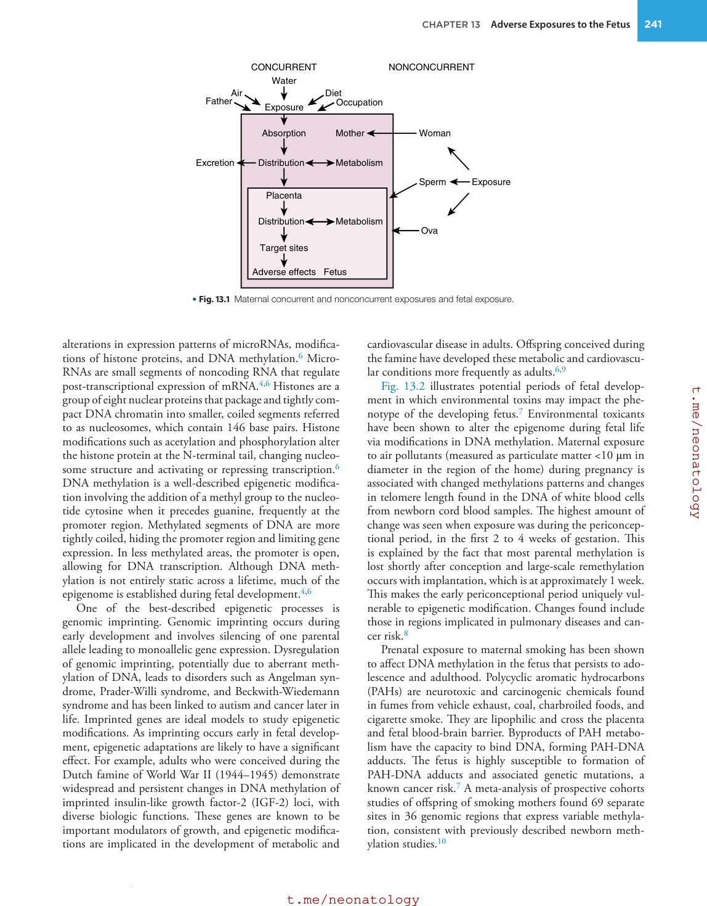

### Original source page 259

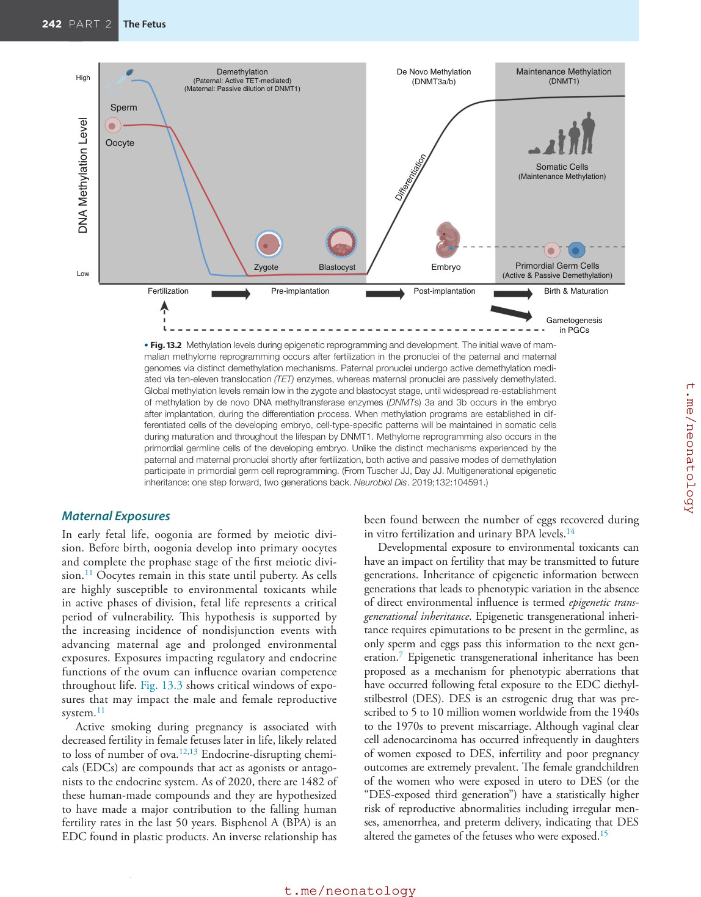

### Original source page 260

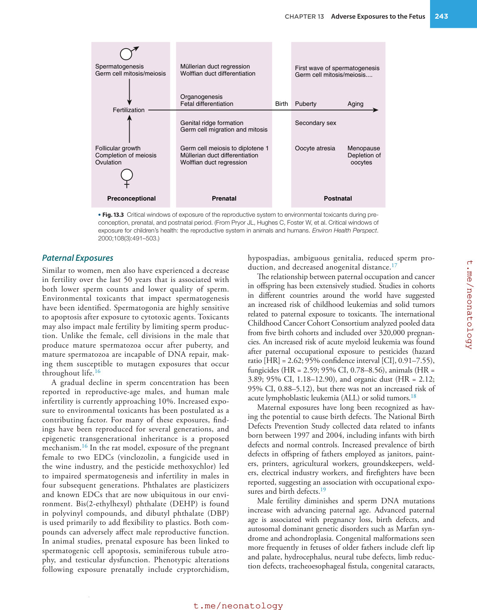

### Original source page 262

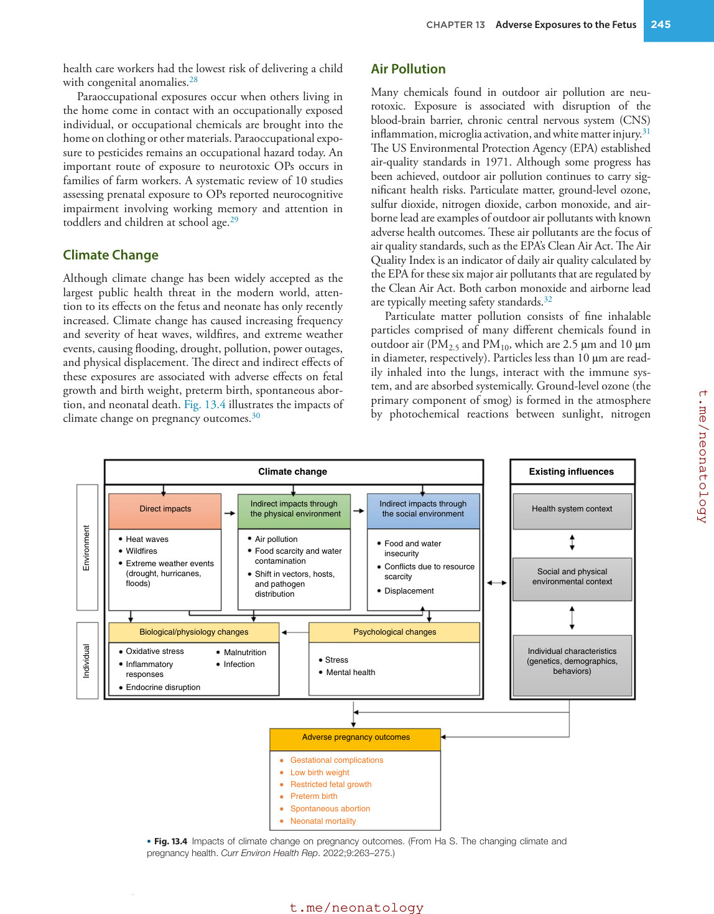

### Original source page 264

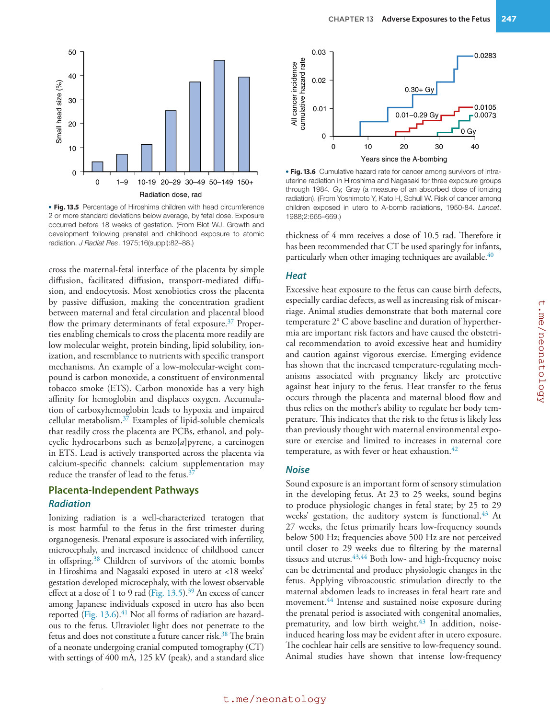

### Original source page 265

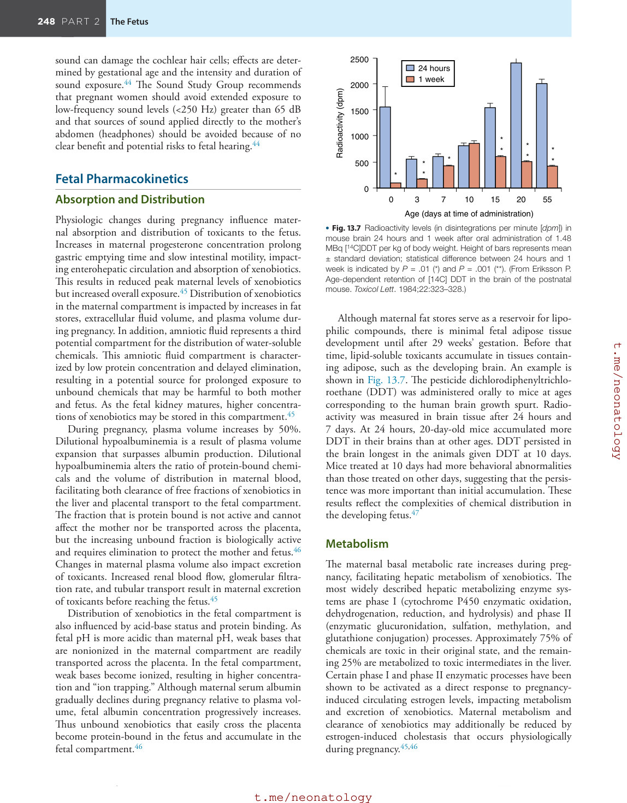

### Original source page 268

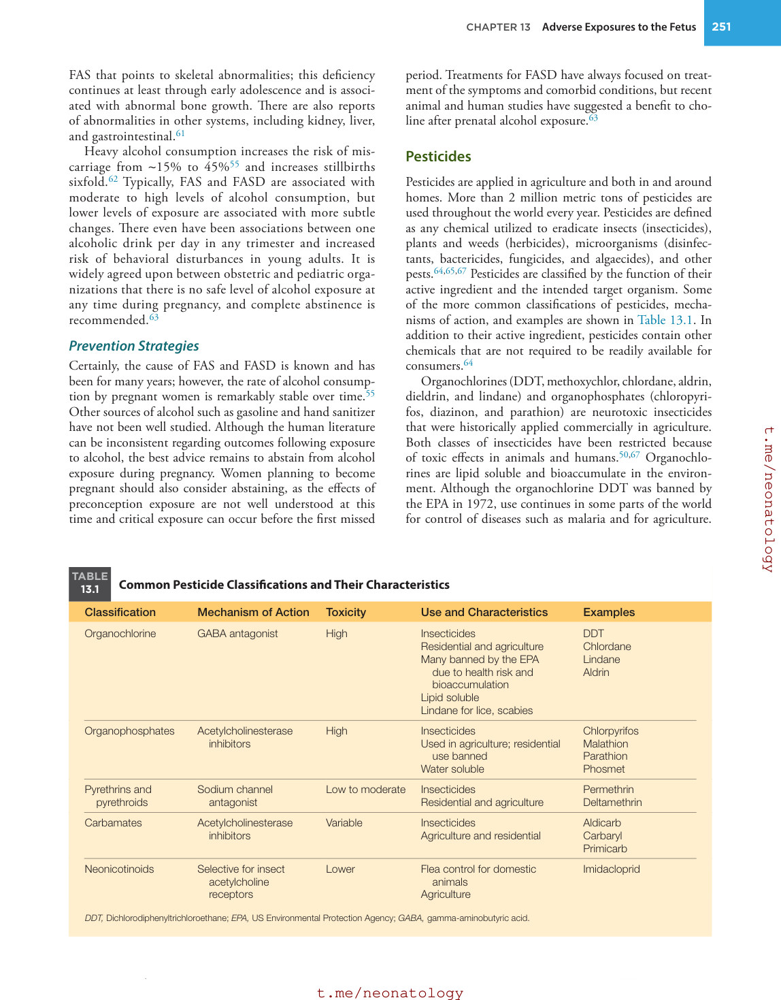

### Original source page 271

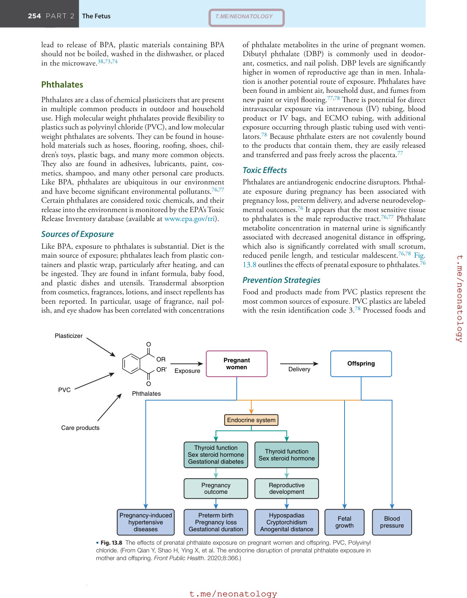

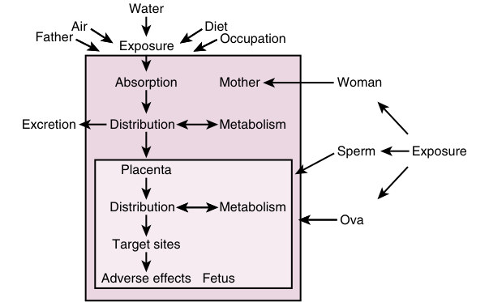

• Fig. 13.1 Maternal concurrent and nonconcurrent exposures and fetal exposure.

PDF p. 258

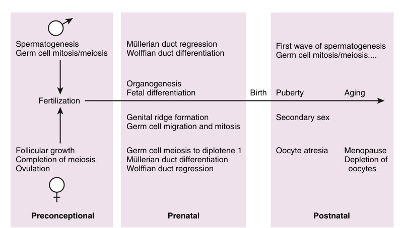

• Fig. 13.3 Critical windows of exposure of the reproductive system to environmental toxicants during preconception, prenatal, and postnatal period. (From Pryor JL, Hughes C, Foster W, et al. Critical windows of exposure for children’s health: the reproductive system in animals and humans. Environ Health Perspect. 2000;108(3):491–503.)

PDF p. 260

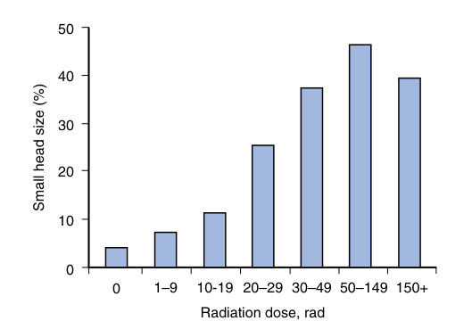

• Fig. 13.5 Percentage of Hiroshima children with head circumference 2 or more standard deviations below average, by fetal dose. Exposure occurred before 18 weeks of gestation. (From Blot WJ. Growth and development following prenatal and childhood exposure to atomic radiation. J Radiat Res. 1975;16(suppl):82–88.)

PDF p. 264

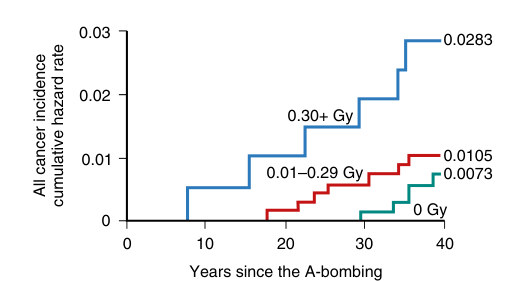

• Fig. 13.6 Cumulative hazard rate for cancer among survivors of intrauterine radiation in Hiroshima and Nagasaki for three exposure groups through 1984. Gy, Gray (a measure of an absorbed dose of ionizing radiation). (From Yoshimoto Y, Kato H, Schull W. Risk of cancer among children exposed in utero to A-bomb radiations, 1950-84. Lancet. 1988;2:665–669.)

PDF p. 264

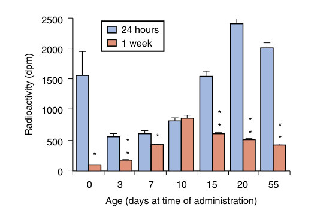

• Fig. 13.7 Radioactivity levels (in disintegrations per minute [dpm]) in mouse brain 24 hours and 1 week after oral administration of 1.48 MBq [14C]DDT per kg of body weight. Height of bars represents mean ± standard deviation; statistical difference between 24 hours and 1 week is indicated by P = .01 (*) and P = .001 (**). (From Eriksson P. Age-dependent retention of [14C] DDT in the brain of the postnatal mouse. Toxicol Lett. 1984;22:323–328.)

PDF p. 265

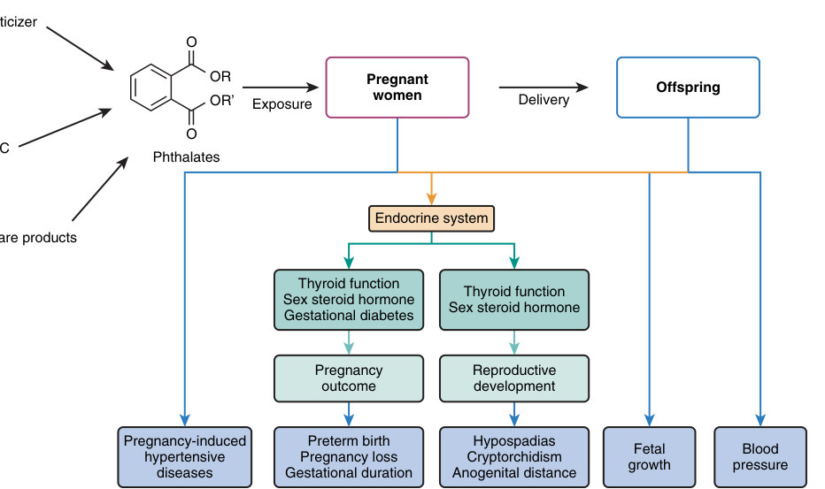

• Fig. 13.8 The effects of prenatal phthalate exposure on pregnant women and offspring. PVC, Polyvinyl chloride. (From Qian Y, Shao H, Ying X, et al. The endocrine disruption of prenatal phthalate exposure in mother and offspring. Front Public Health. 2020;8:366.)

PDF p. 271
