# 14. Fetal Growth Restriction-A Complex Interplay Between the Intrauterine and Maternal Environment
> Source attribution: [Source credits](../../SOURCE_CREDITS.md).

## PDF page 276 | printed page 259

14 Fetal Growth Restriction: A Complex Interplay Between the Intrauterine and Maternal Environment

### SHERIN U. DEVASKAR, CARLA JANZEN, AND KARA L. CALKINS

### Summary

Fetal growth restriction (FGR) refers to a fetus that fails to reach its in utero growth potential due to a pathologic insult. The most common cause of FGR is fetal hypoxia and nutrient deprivation secondary to placental insufficiency. Although the incidence of FGR varies depending on the population and definition, it is estimated that approximately 10% of fetuses are afflicted with FGR.1 FGR is associated with significant perinatal mortality and morbidity and an increased risk for adulthood disorders and diseases.2–4

FGR is a diagnostic dilemma; definitions and terminology lack consensus among practitioners, researchers, and organizations that inform clinical practice.1,5 FGR is a multifactorial condition, and the pathophysiology remains unclear. Given these challenges, diagnostic criteria and prenatal practice guidelines remain controversial. Moreover, no definitive prevention strategy or treatment has been identified, and postnatal management and surveillance guidelines are scant, variable, and ill defined. Multidisciplinary partnerships between researchers, clinicians, and community stakeholders are needed. Research should combine large population data that accounts for population and environmental variability with translational science. Innovative, practical technologies and biomarkers could provide a better understanding of FGR phenotypes. This information will help to establish evidence-based guidelines for the diagnosis and prenatal and postnatal management of FGR and subsequent follow-up of the FGR infant into adulthood.

### Definitions and Terminology

In general, “normal” fetal growth leads to an appropriate for gestational age (AGA) neonate whose birth weight falls between the 10th and 90th percentile. A birth weight less than the 10th percentile is categorized as small for gestational age (SGA). In contrast, large for gestational age (LGA) refers to a neonate with a birth weight greater than the 90th percentile. FGR encompasses all fetuses with in utero growth restriction. The term “restriction” is preferred over the term “retardation.” FGR may give rise to an infant born with a birth weight less or greater than the 10th percentile.5 When SGA is used as a proxy for FGR, there is a high false-positivity rate because most SGA neonates are constitutionally small at birth. Therefore close communication between the obstetric and newborn medical teams is imperative to identify which fetuses exhibited true in utero growth deceleration.

### The Health Burden of Fetal Growth

### Restriction

Given the difficulties and inconsistencies in defining FGR, the true prevalence of FGR is unknown. However, it has been estimated that up to approximately 10% of live-born infants are characterized as FGR.1 This percentage is substantially higher among stillborns.6–8 Globally, FGR is the leading cause of perinatal morbidity and mortality after prematurity.4 The risk of fetal death increases with FGR severity.5 A fetus with a weight less than the 10th percentile for gestational age has a 1.5% risk of fetal death (twice the risk

259

## PDF page 277

of a stillborn with normal in utero growth). The risk for fetal death increases to 2.5% for a fetus with a weight less than the 5th percentile for gestational age.8 In a large meta-analysis of 96 population-based studies, the attributable risk for stillbirth for SGA fetuses was estimated to be approximately 23%.7 Although early detection of FGR may help mitigate the risk of stillbirth, 40% of FGR cases are undetected, and stillbirths still occur even with universal and routine ultrasound screenings.6,9 This highlights the pressing need to modify well-established risk factors and develop new, effective, and safe interventions and treatments for FGR.

Not only does FGR increase overall mortality by increasing the risk of intrauterine demise, stillbirth, and neonatal death, it also carries significant co-morbidities for the surviving neonate.2,3,6,8,9 After birth, FGR neonates are at increased risk for low Apgar scores and admission to the neonatal intensive care unit. FGR neonates frequently require monitoring and treatment for various complications. These conditions are often transient, such as hypoglycemia, hyperbilirubinemia, and hypothermia.10,11 Other conditions that carry a large health burden include common

Symmetric FGR

Early Gestation

Period of Insult

20%–30%

% of Cases

Syndromes, Genetic Disorders, Congenital Infections

Etiology

Proportionately Decreased Head Circumference, Abdomninal Circumference, Biparietal Diameter, and Femur Length

Antenatal Ultrasound

Normal

Cell Size

Decreased Throughout

Cell Number

Reduced Head Circumference, Weight, and Length

Postnatal Anthropometrics

• Fig. 14.1 Symmetric versus asymmetric fetal growth restriction (FGR).

diseases associated with prematurity, such as chronic lung disease (CLD), retinopathy of prematurity (ROP), intracranial hemorrhage (ICH), and necrotizing enterocolitis (NEC).11–15 The FGR infant is also at substantial risk for hypoxic-ischemic encephalopathy (HIE), seizures, and sepsis.11 FGR and FGR-associated co-morbidities are correlated with an increased risk for future neurodevelopmental impairment and various behavioral and psychiatric disorders.2,16 In the long-term, the FGR phenotype sets the stage for later-onset obesity, insulin resistance/type 2 diabetes mellitus, dyslipidemia, cardiovascular disease, hypertension, nonalcoholic fatty liver disease (NAFLD), and renal insufficiency.2,3,17

### Classification of Fetal Growth Restriction

Historically, FGR has been classified into two types: asymmetric versus symmetric (Fig 14.1). In asymmetric FGR, it is believed that decreased fetal growth occurs in response to the suboptimal delivery of oxygen, glucose, and other nutrients. The fetus adapts to this environment by conserving

Assymmetric FGR

Late Gestation

70%–80%

Placental Insufficiency

Decreased Abdominal Circumference

Decreased Throughout

Normal

Reduced Weight

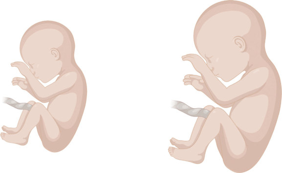

• Fig. 14.1 Symmetric versus asymmetric fetal growth restriction (FGR).

## PDF page 278 | printed page 261

energy and directing oxygen and nutrient delivery to the brain and heart. Typically, the asymmetric FGR fetus has a head circumference percentile that is greater than the weight percentile. Length can be normal to low normal. As a result, these infants have an increased head-to-weight ratio and normal weight-to-length ratio. Prenatally, fetal growth deceleration in asymmetric FGR manifests in the third trimester after 32 weeks’ gestation. Growth scans demonstrate a small abdominal circumference, whereas head circumference, biparietal diameter, and femur length often remain within normal ranges. This growth pattern has been coined “head-sparing” FGR. Asymmetric FGR accounts for 70% to 80% of all FGR fetuses and is caused by maternal and environmental factors that result in placental insufficiency.9 A decrease in fetal cell size hallmarks asymmetric FGR. As a result, cell hypertrophy often leads to catch-up growth during infancy and early childhood.

In contrast, symmetric FGR results in a fetus with a proportionately small head, body weight, and length. This pattern represents 20% to 30% of all FGR cases.9 This type of growth is often detectable early in pregnancy. Symmetric FGR is characterized by a decrease in cell number, not cell size. As a result, these infants suffer from fixed, postnatal growth failure that does not respond to common nutritional interventions. Common etiologies of symmetric FGR are

TABLE

Etiologies of Asymmetric and Symmetric Fetal Growth Restriction

14.1

Asymmetric FGR

Fetal • Genetics

Maternal • Age • Parity • Ethnicity/race • Height • Poor weight gain • Short pregnancy intervals • Medical conditions (pregestational diabetes mellitus,

renal insufficiency, autoimmune disease, cyanotic cardiac disease) • Diseases related to pregnancy (gestational

hypertension, preeclampsia, gestational diabetes) • Thrombophilia (antiphospholipid antibody syndrome)

Placental • Multiple gestation • Placental insufficiency • Placental disorders and umbilical cord abnormalities

Environmental • Teratogen exposure (cyclophosphamide, valproic

acid, antithrombotic drugs) • Substance use (alcohol, tobacco, marijuana, and

illicit drugs) • Altitude • Assisted reproductive technology

FGR, Fetal growth restriction.

genetic or chromosomal disorders such as trisomies and congenital infections such as TORCH infections. At times, severe maternal malnutrition and chronic disorders of pregnancy with or without superimposed pre-existing conditions can result in symmetrical FGR. Despite these wellknown definitions, studies have found that this simplistic classification (symmetric versus asymmetric FGR) to be of limited use. These categories are not independent predictors of adverse pregnancy outcomes. Moreover, postnatal growth and the incidence of developmental delays are similar when symmetric and asymmetric FGR preterm newborns are compared.5

### Etiology of Fetal Growth Restriction

Although there are three distinct etiologies of FGR—maternal, fetal, and placental—FGR is often multifactorial. The complex interaction between genetics and the environment ultimately determines fetal growth (Table 14.1 and Fig. 14.2). Although the underlying pathophysiology may differ among and within these categories, most FGR cases share a common pathway that results in suboptimal nutrient and oxygen provisions to the fetus, most often secondary to poor placental perfusion. The exceptions to this common pathway are “fetal” etiologies, which largely are due to genetic

Symmetric FGR

• Chromosomal disorders (trisomy

13, trisomy 18, trisomy 21) • Structural disorders (congenital

heart disease, gastroschisis)

• Advanced maternal diseases

(severe hypertension, hemoglobinopathies)

• Infectious diseases during

early pregnancy (malaria, cytomegalovirus, rubella, toxoplasmosis, syphilis)

## PDF page 279

Preeclampsia Placental Abruption Umbilical Cord Abnormalities Placental Tumors Circumvallate Placenta Age Parity Race/Ethnicity Under- and Over-Nutrition Chronic Diseases Stress Prior History of FGR Infections Tobacco, Alcohol, Marijuana, and Illicit Drugs Altitude Pollution Uterine Space Restriction

Placental Causes

Maternal Causes

• Fig. 14.2 Etiologies of fetal growth restriction (FGR).

or structural disorders that lead to a decrease in fetal cell number.

### Fetal Etiologies

FGR can be associated with chromosomal abnormalities in the fetus. Classically, trisomies 13, 18, and 21 are among the more common chromosomal disorders seen in FGR and account for up to 20% of FGR cases. Fifty percent of fetuses with trisomy 13 or 18 have evidence of FGR.18 Other chromosomal abnormalities associated with FGR include placental mosaicism.19 Fetuses with congenital birth defects, even in the absence of chromosomal or genetic aberrations, are at increased risk of FGR.20 Examples include congenital heart disease, gastroschisis, and urogenital anomalies.

### Maternal and Environmental Etiologies

The mother’s overall health and reproductive potential are critical in determining fetal health and outcomes. Maternal parity, last pregnancy interval, and age are associated with FGR. Young women and women of advanced maternal age are at increased risk for a pregnancy complicated by FGR. An adolescent mother’s metabolic demands compete with the fetus’ demand for nutrients and oxygen. In contrast, placental dysfunction usually underlies FGR associated with advanced maternal age. Maternal race and ethnicity, which serve as surrogates for discrimination and resource inequality, also play a critical role in fetal growth.21 Improved access

Chromosomal Abnormalities Syndromes Congenital Birth Defects Anemia

Fetal Causes

to high-quality education, health care, and employment opportunities along with better living standards is instrumental in reducing the FGR incidence secondary to social and health disparities.

Maternal health conditions prior to pregnancy are well known to affect the risk for FGR. Examples include diabetes mellitus, hypertension, obesity, pulmonary and renal diseases, autoimmune diseases, sickle cell disease, thrombophilic disorders (specifically antiphospholipid syndrome), and congenital heart and liver disease. In the past, certain health conditions may have precluded a woman’s ability to conceive or to carry a viable pregnancy to term. However, with medical advancements, many of these conditions can be managed to maintain a viable pregnancy.

In addition, the mother’s diet and access to nutrition affect the fetus’ risk for FGR. Low prepregnancy body mass index and poor weight gain during pregnancy are correlated with FGR.22 Historically, large epidemiologic studies have linked low birth weight with maternal malnutrition during periods of famine.2 In these cohorts, low birth weight was specifically linked to poor protein intake in the first two trimesters and severe caloric restriction (<600–900 kcal daily). However, it is important to note that in suspected FGR in the absence of true maternal malnutrition, additional nutritional supplementation does not increase the fetal weight or improve outcomes.5,23 In the current era, maternal malnutrition can still lead to FGR in developed countries. Pregnant women with Crohn disease, ulcerative colitis, hyperemesis, and eating disorders are at high risk for malnutrition and

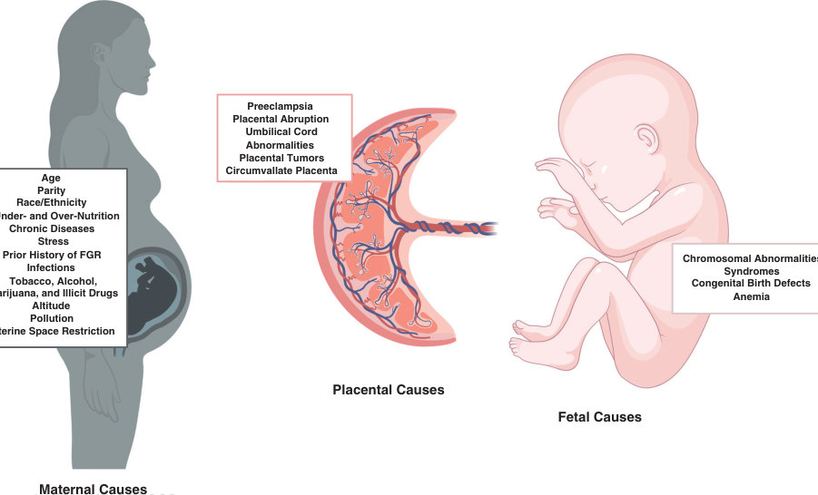

• Fig. 14.2 Etiologies of fetal growth restriction (FGR).

## PDF page 280 | printed page 263

a pregnancy complicated by FGR. Conversely, maternal obesity, a common co-morbidity in women of reproductive age, and specific micronutrient deficiencies, such as a zinc deficiency, can also lead to FGR.23,24

Exposure of the fetus to environmental stressors at various points during gestation may result in FGR. Exposure to infectious agents such as plasmodium (resulting in malaria), rubella, cytomegalovirus, Toxoplasma gondii, human immunodeficiency virus (HIV), and syphilis can occur early in pregnancy and result in congenital syndromes with multiple birth abnormalities complicated by FGR. Malaria is responsible for the largest portion of FGR cases secondary to infectious etiologies.25 In general, infectious etiologies represent approximately 5% to 10% of all FGR cases and directly suppress cell division and cause cell death.26

Exposure to teratogens, maternal medications, or maternal substance abuse can also lead to FGR. The effect of teratogen exposure on fetal growth depends on several factors, such as the inherent teratogenicity of the drug; the timing, duration, and dosage of exposure during gestation; and the mother’s ability to metabolize the drug. Genetics or hepatic or renal disease may alter a mother’s ability to metabolize a drug. Teratogens classically associated with FGR include antiepileptic medications (e.g., valproic acid), antithrombotic agents (e.g., warfarin), and chemotherapeutic and antineoplastic agents (e.g., cyclophosphamide).

Substance abuse can also result in FGR, with alcohol and tobacco use being the most common etiologic agents. It should be noted that tobacco use is associated with a 3.5-fold increased risk of SGA and that the risk of SGA with alcohol use is increased even with a modest intake of 1 to 2 drinks per day. Cocaine, heroin, marijuana, and narcotic use during pregnancy are also associated with FGR.27 Legalization of marijuana has increased marijuana use during pregnancy. When marijuana users were compared with non–marijuana users, marijuana use during pregnancy was associated with a decreased head circumference, abdominal circumference, fetal weight, and abnormal umbilical arterial Doppler studies, a biomarker for increased placental vascular resistance.28,29 These findings remain significant even with exclusion of concomitant tobacco use.29

It can also be argued that where a neonate is born affects their risk for FGR. For example, it is well documented that fetuses gestating at higher altitudes are less likely to reach their growth potential than their counterparts at sea level.30 The resources available to the women in low-income, developing nations and women of under-represented minority groups in developing nations are linked to malnutrition, food deserts, food insecurity, contaminated water supplies, air pollution, infectious agents, and inadequate and limited access to appropriate prenatal health care.21,31 Poorly resourced nations, such as the Indian subcontinent and South Africa, have a six times higher rate of FGR compared with well-resourced nations.32 However, this may underestimate the incidence of FGR because many women do not deliver in hospitals, and accurate data collection is lacking. Non-Hispanic, Black women in the

United States are at increased risk for pregnancies complicated by FGR compared with non-Hispanic, White women.21 This disparity is partially mediated by access to appropriate, timely, and regular prenatal care and is often compounded by chronic maternal stress secondary to social inequalities. Stress alters the maternal and fetal hypothalamic-pituitary-adrenal (HPA) axis, leading to increased maternal and fetal cortisol production, which in turn causes fetal insulin resistance and FGR.33

### Placental Etiologies

Placental insufficiency resulting from abnormal placentation is the most common pathology associated with FGR. However, placental insufficiency has a myriad of causes, and the severity of FGR has a wide spectrum. Pregnancy disorders such as preeclampsia generally exhibit some degree of placental insufficiency or malperfusion. These placentas are often small in size and are histopathologically characterized by hypovascular villi, fibrin deposition, and trophoblast degeneration, which, taken together, lead to poor nutrient and oxygen provision to the fetus. Specific placental disorders such as chronic placental abruption, infarction, circumvallate shape, chorioangioma, and umbilical cord abnormalities such as velamentous or marginal cord insertion are associated with FGR. Placenta accreta and previa have not been consistently associated with FGR, nor is the presence of a single umbilical artery consistently associated with FGR.

Twin or multiple gestations also may result in FGR. Multiple gestations are a common consequence of rapidly advancing and available artificial reproductive technology.34 It is debated whether or not FGR in multiple gestations is a physiologic consequence of pregnancy. In general, growth deceleration is evident and expected in the third trimester in a multiple gestation. The physical and functional capacity of both the uterus and placenta may be exceeded during this period of rapid fetal growth. It should be noted that twin gestation disproportionately accounts for adverse neonatal outcomes. Despite accounting for only 2% to 3% of live births in the United States, multiple gestations are responsible for 10% to 15% of neonatal adverse outcomes. Multiple gestations are associated with both SGA and prematurity. The risk of SGA is as high as 25% in twin pregnancies and up to 60% for triplet and quadruplet pregnancies.35 Moreover, monochorionic twin pregnancies are at higher risk of FGR because of unequal placental sharing and increased risk of twin-to-twin transfusion syndrome. With regards to twin-to-twin transfusion, the donor twin usually has FGR.

### Pathophysiology

The pathophysiology of FGR remains poorly understood. In the case of chromosomal abnormalities, it is surmised that poor fetal growth is due to a decrease in the number of fetal cells and poor cellular growth. Beyond this, few data are available on the pathophysiology of growth restriction in fetal chromosomal disorders.

## PDF page 281

Fetal growth depends on several hormones, including insulin, thyroid hormones, adrenal hormones, and pituitary hormones. Insulin, the principal growth factor that regulates in utero growth, serves several roles. Insulin controls cell number via direct mitogenic effects on cellular development, regulates glucose uptake and consumption in somatic tissues, and regulates other metabolic pathways, such as protein breakdown. FGR is characterized by reduced insulin concentrations causing a reduction in pancreatic beta cells. Fetal hypoxia increases fetal catecholamines that suppress insulin secretion and sensitivity. Hormones such as insulin-like growth factor 1 (IGF-1), IGF-2, insulin-like growth factor binding protein 2 (IGFBP-2), and IGFBP-3 have also been implicated in the pathophysiology of FGR in experimental models.36

The pathophysiology underlying placental insufficiency, the most common cause of FGR, remains unclear. Given the difficulty and risks of obtaining human placental samples during an ongoing pregnancy and that FGR is often detected late, studies investigating the pathophysiology of FGR have been mainly limited to animal models, tissue explants, or cell culture work. Animal models of FGR include various stressors to reduce blood flow or nutrient provision to the developing fetus, such as maternal food restriction, gestational hypoxia, or uterine artery ligation. Each of these models has distinct advantages and disadvantages. The animal under investigation is important in considering the extrapolation of findings to the human condition of FGR. Placentation is a unique biologic process that varies significantly among different species, and in combination with different stressors, the resulting phenotype can significantly differ between models. The limitation of tissue explant and cell culture work is that in a true pregnancy, these tissues and cells do not exist in isolation. Multiple inputs in pregnancy affect cellular biologic behavior and function. For cell culture results, such as trophoblast or human umbilical vein endothelial cell studies, it is important to consider the characteristics of the cell line used. For example, the trimester the cells were obtained and immortalized will alter results and generalizability. Furthermore, work on postparturient placental tissue has been likened to results obtained from autopsy tissue specimens.

Placental insufficiency often results from a disruption in normal early vascularization of the placenta. Specifically, incomplete spiral artery remodeling results in a shallow invasion of the placental vasculature. This poor invasion contributes to the failure of these vessels becoming low-resistance vessels, thus limiting blood flow, nutrients, and oxygen to the fetus and placenta itself. However, during mid to late pregnancy, insults may further affect the vascular surface area of the placenta.

### Antenatal Screening and Prenatal Management

Given the inherent differences and difficulties in how FGR is defined and its poorly understood pathophysiology,

guidelines for FGR screening lack strong supporting evidence. Subsequently, the outcomes in this high-risk population have improved very little despite advances in obstetric and neonatal care. However, the at-risk fetus requires close prenatal surveillance and a heightening awareness of postnatal complications. Based on what is known at this time, the components that should be included in antenatal screening for FGR are (Table 14.2): 1. A detailed maternal and family history: Standard diag-

nostic tools include a thorough maternal and familial history to identify the presence of etiologic risk factors. Accurate gestational dating, either by last menstrual period (LMP) or first-trimester ultrasound results, is an essential component in the detection and prenatal management of FGR. The previous history of an FGR newborn should be sought out. 2. A detailed maternal physical exam, including fundal

height measurements: Maternal physical examination with close attention to maternal nutritional status, prepregnancy body mass index, and fundal height should be performed. Fundal height measured between 24 and 38 weeks of gestation may be a useful screen for fetal growth less than the 10th percentile.37 However, the accuracy of fundal height measurement is limited by factors such as maternal obesity, multiple gestation, and uterine leiomyomas. Once a pregnancy or fetus is identified as at risk for FGR, evaluation should include: 1. Fetal ultrasound: Serial ultrasounds for growth assess-

ment are key in evaluating the growth-restricted fetus. Four biometric measures are commonly used to assess fetal growth: (1) biparietal diameter, (2) head circumference, (3) abdominal circumference, and (4) femur length. In combination, an estimated fetal weight can be calculated from these measurements.5 It should be noted that there is the possibility of a significant error in these measurements. Estimates of fetal weight may deviate from actual weight. However, when used as a serial screening tool, prenatal ultrasound is the most useful screening tool available for identifying fetuses at risk for FGR. It is recommended that, if the estimated fetal weight falls below the 10th percentile for gestational age, a more detailed evaluation, including amniotic fluid measurement and Doppler flow studies, should be performed. In addition, an evaluation of fetal anatomy should be completed, given the high incidence of structural and genetic abnormalities associated with FGR.5 Additional testing for chromosomal disorders or infections can also be performed if clinically indicated, especially in the presence of structural abnormalities or for FGR detected early in gestation. Of the biometric measurements, abdominal circumference appears to have the best “stand-alone” specificity and a negative predictive value of almost 90% for ruling out FGR.5 Decreased abdominal circumference is thought to represent a small liver, which reflects decreased hepatic glycogen stores and subcutaneous fat. The other biometric measurements that can help distinguish

## PDF page 282 | printed page 265

TABLE

Prenatal Management and Testing in Cases of Suspected Fetal Growth Restriction

14.2

Prenatal Test Clinical and Diagnostic Utility

Previous history of SGA or FGR, recurrence risk is ∼20% and

A detailed maternal

∼20%–50% for SGA and FGR, respectively

and family history

Maternal physical

Fundal height measured during the second half of pregnancy

exam

may be a useful screen for fetal weight <10% (specificity ∼92%–93% and negative predictive value ∼92%–98%)37

Fetal ultrasound An estimated fetal weight based upon biparietal diameter, head

circumference, abdominal circumference, and femur length should be obtained, and serial measurements of growth (every 3–4 weeks) are key in the management of FGR.5 If estimated fetal weight is <10%, include amniotic fluid

measurements, full anatomy evaluation, and Doppler studies. Abdominal circumference has the best “stand-alone” specificity

and negative predictive value for diagnosing FGR.

UA Doppler

UA Doppler measurements can be helpful in prognosticating

velocimetry

severity of FGR and in guiding clinical management. Absent or revered end-diastolic flow is associated with

increased perinatal mortality.

Doppler studies of

Doppler studies of fetal circulation, such as the ductus venosus,

fetal circulation

middle cerebral artery, or aortic isthmus may be reasonable predictors of short-term risk including fetal death, neonatal acidosis, and/or neonatal mortality and neurologic morbidity in the setting of FGR.

Genetic testing

Prenatal genetic testing should be offered in the presence of

or infectious disease testing

suspected structural abnormalities seen on fetal ultrasound or for growth restriction detected early in pregnancy.

FGR, Fetal growth restriction; SGA, small for gestational age; UA, umbilical artery.

symmetric from asymmetric FGR and, taken in combination, may improve the sensitivity, specificity, and positive and negative predictive values for FGR. The optimal interval frequency of growth scans (optimal surveillance regimen) in high-risk pregnancies has not been established. The American College of Obstetricians and Gynecologists (ACOG) suggest every 3 to 4 weeks to minimize false-positive rates.5 2. Doppler velocimetry, especially of the umbilical

artery: Doppler velocimetry, especially of the umbilical artery, is a well-studied measurement in the setting of FGR and can be an essential tool in prognosticating FGR severity, which may dictate prenatal management.5 Flow in the umbilical artery is a reflection of maternal circulation. Under normal circumstances, the resistance in the umbilical artery should decrease with increasing gestational age. However, resistance will increase and diastolic flow will decrease with placental insufficiency. Based upon data extrapolated from animal models, absent or reversed end-diastolic flow in the umbilical artery is thought to occur when a significant amount of the placental villous tree is damaged.

Other Recommendations and Specifics

Accurate gestational dating is

essential

Assess maternal nutritional status Assess fundal height

UA Doppler is less sensitive in

mild disease and cannot be used as a screening tool for FGR.

There can be technical

difficulties in obtaining these measurements, and available studies are small, limiting the ability to make conclusive recommendations.

Absent or reversed end-diastolic flow in the umbilical artery is a poor prognostic factor and is associated with increased perinatal mortality.5 When included in prenatal testing in suspected FGR cases, the rate of perinatal death is decreased by almost 30%. However, umbilical artery Doppler is less sensitive in the setting of mild placental disease. Other studies have suggested that measures of fetal circulation such as Doppler of the ductus venosus, middle cerebral artery, and aortic isthmus may be useful predictors for fetal death or increased neonatal mortality and neurologic morbidity with early-onset FGR.5 However, controversy exists regarding the use of these Doppler studies other than the umbilical artery. As a result, Doppler of the ductus venosus, middle cerebral artery, and aortic isthmus are not routinely recommended and should not dictate clinical care. 3. Other standard fetal surveillance: Some studies suggest

that Doppler velocimetry in combination with non-stress tests, biophysical profiles (BPPs), or both may improve outcomes for FGR fetuses.38,39 However, other metaanalyses failed to find sufficient evidence that the BPP

## PDF page 283

is an adequate measure of fetal well-being in high-risk pregnancies. The delivery timing for growth-restricted fetuses remains debated but generally depends on the underlying etiology and severity of FGR and estimated gestational age. Early delivery of an FGR fetus with known aneuploidy or congenital infection is not associated with improved outcomes and may portend worse outcomes. In other instances, such as FGR due to placental insufficiency, multidisciplinary input should be considered, and each case should be considered individually. When an intervention is preferred, antenatal surveillance may help guide the timing of delivery, taking into account various risk/benefit ratios. Decisions about delivery mode should be based upon other factors. FGR itself does not require a cesarean delivery. The overall goal is to balance the delivery of the FGR fetus prior to severe fetal compromise with the consequences of prematurity. Two randomized clinical trials assessed the timing of delivery of the growth-restricted fetus. The studies compared expectant management with the delivery of FGR fetuses less than 34 weeks’ gestation and greater than 36 weeks’ gestation. Both studies suggested that earlier delivery versus expectant management did not improve perinatal survival rates or longterm outcomes.40,41 Between 34 and 36 weeks of gestation, no adequately powered randomized trials exist. Based on these studies, ACOG recommends delivery at 38 0/7 to 39 6/7 weeks in isolated FGR, and delivery at 34 0/7 to 37 0/7 weeks for FGR fetuses with additional risk factors for poor prognosis such as oligohydramnios and abnormal umbilical artery Doppler velocimetry.42 For preterm deliveries, delivery should be coordinated and performed at a center with high-risk maternal-fetal medicine teams and a neonatal intensive care unit. Antenatal corticosteroids should be given, and magnesium sulfate administration should be considered.

### Prevention

There are no to very few preventive strategies for FGR. Counseling regarding modifiable risk factors (e.g., diet and cigarette smoking during pregnancy and malarial prophylaxis in high-risk areas) may be somewhat effective in mitigating FGR. Outside of these interventions, no effective preventive strategy has been identified. Nutritional and dietary supplementation regimens such as increased consumption of specific food groups; a low-salt diet; and iron, zinc, calcium, protein, or vitamin D supplementation have not been effective. Bed rest is not recommended for suspected FGR.5 There is some preliminary evidence that aspirin may prevent severe FGR in the setting of abnormal umbilical artery Doppler studies. Studies have demonstrated that the aspirin-treated group was associated with a greater birth weight, prolonged gestation, and decreased need for admission to the neonatal intensive care unit when compared with the control group. However, aspirin is not routinely indicated at this time for the prevention of FGR and stillbirth given that studies are small and not conclusive.43

Low-dose aspirin is recommended for women at high risk for preeclampsia, a common cause of FGR and stillbirth.

### Postnatal Evaluation of Fetal Growth Restriction

A detailed pregnancy history, anthropometric measurements at birth, and a physical exam are essential components for evaluating an FGR neonate. The prenatal pattern of growth and other findings such as placental and fetal structural abnormalities, abnormal genetic testing, family and previous maternal pregnancy history, and maternal infections should be investigated. Histopathologic evaluation of the placenta, specifically the size, shape, structural abnormalities, and large infarctions, may reveal the underlying cause of placental insufficiency. It is important to remember that FGR is not synonymous with SGA, and growth curves that are used to define SGA are dependent on the population studied. Extrapolation from these growth curves may be limited by the specific characteristics of the population used to construct the growth curves.

Stigmata of malnourished fetuses may include a large and wide anterior fontanelle, absent buccal fat, small and scaphoid abdomen, thin umbilical cord, decreased skeletal muscle mass and subcutaneous fat, disproportionately large hands and feet, and loose and dry skin, especially at the nape of the neck, axilla, and gluteal regions (Fig. 14.3). These physical examination findings may be more consistent with asymmetric FGR. In symmetric FGR, other features may be present, depending upon the underlying etiology. For example, in aneuploidies, dysmorphic facies or other congenital anomalies may be present. In certain congenital infections, classic stigmata include microcephaly, petechiae, a “blueberry muffin” rash, a cardiac murmur secondary to a congenital heart defect, hepatosplenomegaly complicated by hepatitis and cholestasis, abnormal retinal exams, and pancytopenia. Historically, the Ponderal index, mid-arm to head circumference ratio (McLaren index), clinical assessment of nutrition score, and cephalization index were calculated to assist with identifying FGR neonates.

### Postnatal Management

Clinically, the FGR infant is at increased risk of stillbirth, neonatal death, and prematurity. These fetuses are also at increased risk for needing perinatal interventions, such as cesarean delivery, antenatal steroids, and admission to the neonatal intensive care unit. A skilled team that can resuscitate the newborn should be present at delivery, given that FGR newborns often do not tolerate labor well due to the acute stress of laboring superimposed upon chronic poor blood flow and hypoxia. Once delivered, the FGR neonate is at increased risk for a number of neonatal complications (Fig. 14.4), which should be monitored for and managed (Table 14.3).

The problems encountered by the FGR neonate are generally a consequence of a “mismatch.” Often, FGR fetuses adapt

## PDF page 284 | printed page 267

• Fig. 14.3 This is a 36-week male neonate with a birth weight of 1600 g who was born to a mother with severe preeclampsia. This baby was noted to have asymmetric intrauterine growth restriction (fetal growth restriction). Note the loss of fat over the body, visible rib cage, excessive skin folds noted over the whole body, and relatively large head compared with the body. (From Sharma D, Shastri S, Sharma P. Intrauterine growth restriction: antenatal and postnatal aspects. Clin Med Insights Pediatr. 2016;10:67–83.)

to an in utero environment of poor nutrient and oxygen provisions. The fetus responds to chronic hypoglycemia and hypoxemia by increasing circulating catecholamine concentrations, decreasing fetal pancreatic insulin secretion, adjusting glucose transport and insulin receptor expression in specific tissues, and stimulating endogenous hepatic glucose production.36,44,45 The overall metabolic and hormonal adaptations promote fetal survival and brain development at the expense of other somatic tissues. This leads to metabolic derangements, such as hypoglycemia and hypothermia, that are encountered shortly after birth. These postnatal complications result in prolonged hospital stays and increased health care costs.

### Hypoglycemia and Hypothermia

FGR neonates have suboptimal glycogen stores, impaired gluconeogenesis, decreased fat mass, sustained catecholamine concentrations, and increased insulin sensitivity. Moreover, FGR neonates are often unable to produce ketone

bodies from fatty acids, an important alternative fuel for the brain during periods of hypoglycemia. This perturbed metabolic milieu is further exacerbated by prematurity, hypothermia, hypoxemia, polycythemia, and critical illness. For these reasons, FGR neonates are at high risk for postnatal hypoglycemia (defined as <2.6 mmol/L [46 mg/dL]), which can be associated with brain injury and seizures.10 Although the proportion of SGA infants who develop postnatal hypoglycemia varies, some studies estimate that approximately 70% of SGA infants have hypoglycemia. In some cases of FGR, chronic hypoxia results in hyperplasia of pancreatic beta islets and hyperinsulinemia. This hyperinsulinemia persists in the newborn period, causing prolonged hypoglycemia that resolves over days to weeks.

Many FGR infants require formula or oral glucose supplementation, tube feedings, and intravenous dextrose boluses and infusions. In contrast to AGA neonates, who usually require a glucose infusion rate of 4 to 6 mg/kg/ min, FGR neonates often require a higher glucose infusion

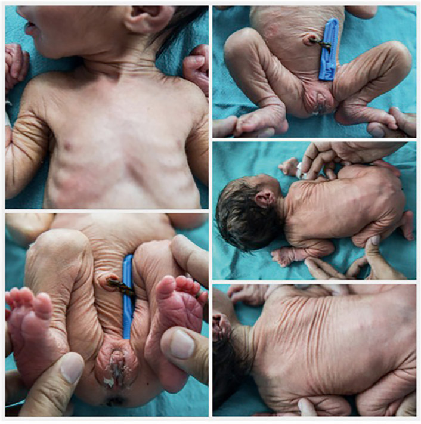

• Fig. 14.3 This is a 36-week male neonate with a birth weight of 1600 g who was born to a mother with severe preeclampsia. This baby was noted to have asymmetric intrauterine growth restriction (fetal growth restriction). Note the loss of fat over the body, visible rib cage, excessive skin folds noted over the whole body, and relatively large head compared with the body. (From Sharma D, Shastri S, Sharma P. Intrauterine growth restriction: antenatal and postnatal aspects. Clin Med Insights Pediatr. 2016;10:67–83.)

## PDF page 285

Retinopathy of Prematurity

Hyperbilirubinemia Polycytnemia Pancytopenia

Parenteral Nutrition Associated Liver Disease

Hypothermia Hypoglycemia/ Hyperglycemia Electrolyte Disturbances

Infections

• Fig. 14.4 Complications of fetal growth restriction. Red labels indicate short-term complications, and blue labels indicate long-term complications.

rate, approximately 6 to 8 mg/kg/min. This higher glucose infusion rate accounts for the FGR neonate’s greater brainto-body weight ratio and increased insulin secretion and insulin sensitivity in comparison with the AGA neonate. Some infants with hyperinsulinemia-induced hypoglycemia may require short-term treatment with diazoxide.

Hypothermia and hypoglycemia in the FGR neonate often coincide. Increased surface area-to-body weight ratio, insufficient subcutaneous fat, decreased brown fat, and increased catecholamine concentrations predispose the FGR neonate to heat loss. Hypothermia may cause or aggravate existing metabolic acidemia. Thermal regulation should be monitored closely soon after delivery of the FGR neonate. Although hypothermia can sometimes be managed in a normal newborn nursery with close monitoring and may self-resolve, some FGR neonates require an exogenous heat source or a double-walled incubator to manage hypothermia, particularly those born premature.

### Respiratory Complications

FGR neonates are at increased risk for respiratory disorders, including respiratory distress syndrome (RDS),

Hypoxic lschemic Encephalopathy lntracranial Hemorrhage Seizues and Epilepsy Neurodevelopmental and Behavioral Disorders Learning Differences Neuropsychiatric Disorders

Respiratory Distress Syndrome Persistent Pulmonary Hypertension Pulmonary Hemorrhage Chronic Lung Disease Asthma/Chronic Obstructive Pulmonary Disease

Necrotizing Enterocolitis

Renal Insufficiency

Cardiovascular Disease Insulin Resistance Obesity Non-Alcoholic Fatty Liver Disease

persistent pulmonary hypertension in the newborn (PPHN), CLD, and long-standing compromised pulmonary function. This inherent risk is further exacerbated by a concomitant risk for prematurity.13,14,46,47 Some believe that FGR may accelerate lung maturity via increased circulating concentrations of glucocorticoids. However, this effect is countered by a reduced lung weight and decreased alveolar number with thickened septa that lead to poor gas exchange and respiratory distress after birth.13,14 FGRassociated PPHN is hallmarked by pulmonary vascular remodeling and pulmonary artery endothelial cell dysfunction. FGR is an independent risk factor for CLD. When SGA infants with a gestational age of 24 to 26 6/7 weeks were compared with AGA infants with similar gestational age, the SGA cohort was twice as likely to develop CLD. Additional studies have confirmed this increased risk and demonstrate that FGR preterm infants, compared with AGA preterm infants, require prolonged oxygen support and are more likely to be discharged from the hospital with supplemental oxygen.14 In later childhood, these infants continue to exhibit lung dysfunction.47 Children with a history of prematurity and FGR have abnormal spirometry values and diffusing capacity, which may, in

• Fig. 14.4 Complications of fetal growth restriction. Red labels indicate short-term complications, and blue labels indicate long-term complications.

## PDF page 286 | printed page 269

TABLE

### Postnatal Issues in Fetal Growth Restriction

14.3

Postnatal Concern Overall Risk and Etiology

Perinatal distress/

FGR infants, compared with AGA, have a 5–30× increase

asphyxia

in morbidity and mortality, even when born at term, and are 2.5× more likely to be born premature. Overall increased risk for stillbirth and prematurity makes

the delivery of an FGR neonate high risk. Increased risk of perinatal distress given the stress of labor

in the setting of chronic poor blood flow and hypoxia.

Hypoglycemia Half of infants with a birth weight <10th percentile have

hypoglycemia, and one-third of infants with a birth weight <10% have severe, recurrent, and/or prolonged hypoglycemia. Hypoglycemia is due to suboptimal glycogen stores,

impaired gluconeogenesis, decreased fat, and increased sensitivity to insulin. May be exacerbated by polycythemia or hypothermia.

Hypothermia Increased heat loss due to increased body surface area,

decreased brown fat deposition in utero. May be exacerbated by hypoglycemia and increased

metabolic demands.

Respiratory

Poor in utero growth and concomitant risk for prematurity

complications

put FGR infants at risk for respiratory distress syndrome in the short term and chronic lung disease in the long term. Some FGR infants exhibit evidence of pulmonary vascular remodeling, which may result in an increased risk of pulmonary hypertension.

Necrotizing

Severe cases of FGR (those with absent or reversed

enterocolitis/ feeding intolerance

end-diastolic flow on UA Dopplers), especially with concomitant prematurity, have an increased susceptibility to NEC and/or feeding intolerance.

Intracranial

Increased risk may be due to cerebral vascular

hemorrhage

remodeling, cerebral autoregulatory mechanisms, and overall hemodynamic instability in FGR.

Electrolyte

Hyperglycemia and hypocalcemia.

abnormalities

Polycythemia/

May occur as a response to long-standing hypoxia in

jaundice

utero.

Abnormal innate

Unclear etiology, although speculated to occur due

and humoral immunity

to bone marrow suppression secondary to chronic hypoxia.

AGA, Appropriate for gestational age; FGR, fetal growth restriction; NEC, necrotizing enterocolitis; UA, umbilical artery.

turn, increase the risk for asthma and chronic obstructive pulmonary disease (COPD).47

CLD is closely linked with ROP because prolonged oxygen exposure plays a vital role in the development and progression of these two diseases. Studies have demonstrated that, although SGA is associated with an increased risk for ROP, FGR is associated with a higher risk and worse staging

Management Recommendations

Attendance at delivery by a skilled

team that can resuscitate a low birth weight or premature infant, ideally at a center with a neonatal intensive care unit.

Serial monitoring for hypoglycemia,

initiated soon after birth. If persistent, prolonged, or severe:

formula supplementation, gavage feeding, and provision of dextrosecontaining intravenous fluids.

Temperature monitoring, initiated soon

after birth. Provision of an exogenous heat source

or incubator may be required.

Supportive care and respiratory

support, as necessary.

Breastmilk provision and avoidance of

formula. Early initiation of trophic or small

volume feeding.

Surveillance with head ultrasound. Avoid fluctuations in cerebral

oxygenation using continuous monitoring such as near infrared spectroscopy.

Monitor for and correct abnormalities.

Check for underlying hematologic

abnormalities, and treat when clinically indicated.

Check for underlying abnormalities

with a complete blood count and differential. Low threshold for infectious work-up

and aggressive management of infections.

of ROP. Poor postnatal weight gain and low IGF-1 concentrations may also play a role in FGR-mediated ROP.12

### Necrotizing Enterocolitis

When matched to controls with a similar gestational age, FGR preterm infants, particularly when exposed to birth

## PDF page 287

asphyxia, are at increased risk for NEC and intestinal perforation.48 This risk persists even after correcting for confounders.49 FGR neonates who have a history of absent or reversed end-diastolic flow on prenatal ultrasound are particularly susceptible to NEC. A meta-analysis revealed that neonates with absent or reversed end-diastolic flow were four times more likely to develop NEC compared with neonates with forward end-diastolic flow.48 Chronic fetal hypoxemia and poor in utero mesenteric perfusion lead to intestinal and mucosal injury prior to birth. After birth, FGR infants with an absent or reversed end-diastolic flow continue to have intestinal hypoperfusion. Studies have demonstrated that superior mesenteric and celiac arterial blood flow velocity does not normalize until about 1 week of life.50 When the metabolic demands of enteral feeding are combined with gut hypoperfusion, dysbiosis, stasis, and bacterial translocation, NEC can occur.

Formula feeding increases the risk for NEC in preterm FGR infants, whereas human milk feeds are associated with a decreased risk of NEC and decreased parenteral nutrition duration.51 The optimal timing to initiate feeds, particularly for neonates with FGR and absent or reversed end-diastolic flow, remains unknown. Most studies have not revealed any harm from early initiation of minimal enteral nutrition with human milk.

FGR infants, even in the absence of NEC, are particularly susceptible to feeding intolerance and parenteral nutrition-associated liver disease (PNALD).52 After controlling for gestational age and parenteral nutrition days, FGR infants are at higher risk for PNALD compared with their AGA counterparts. When PNALD develops, FGR infants develop cholestasis earlier and have a more severe and prolonged liver injury than AGA infants.52 It remains unclear if FGR neonates are more prone to histologic changes such as hepatic fibrosis on liver biopsy. Poor in utero hepatic perfusion, altered hepatic metabolism and function, decreased antioxidant capacity, impaired bile acid transport, and increased sensitivity to the toxicity of parenteral macronutrients and micronutrients may underlie the FGR neonate’s propensity for PNALD. Studies have demonstrated that FGR neonates have a decreased capacity to use parenteral protein in the first week of life and may be more prone to energy and protein overload.53 Growth-restricted rats have altered hepatic fatty acid and glucose metabolism.54 It is well appreciated that FGR sets the stage for later obesity and insulin resistance. It remains unclear if accelerated insulin resistance or early hepatic dysfunction leading to steatosis predisposes their FGR infant to later NAFLD and if PNALD amplifies NAFLD risk.54

### Asphyxia and Intracranial Hemorrhage

FGR neonates, especially those born premature, are at increased risk for HIE, ICH, and periventricular leukomalacia (PVL).9,16,55 When compared with AGA neonates, FGR neonates are more likely to have fetal intolerance to labor and fetal hypoxemia and acidemia secondary to

uteroplacental insufficiency. Consequently, these infants often have low Apgar scores and are at risk for HIE. Placental insufficiency, particularly thrombotic vasculopathies, may play an important role in HIE in the FGR neonate.

Some studies have demonstrated an increased association of ICH in FGR neonates with abnormal cerebral blood flow patterns measured by prenatal middle cerebral artery measurements.38 In contrast, others have failed to demonstrate this association after correcting for gestational age and other confounding factors. The underlying mechanism of ICH in FGR neonates is also debated. There is evidence to suggest that cerebral vascular remodeling, cerebral autoregulatory mechanisms, and overall hemodynamic instability in FGR infants may contribute to a predisposition toward ICH. Given the unknowns, research into the utility of cerebral oxygenation via near-infrared spectroscopy suggests that serial measurements may help to predict neurodevelopmental outcomes. When available, avoiding fluctuations in cerebral oxygenation may help to avoid ICH.56 Continuous monitoring of cerebral oxygenation may be a much better marker than the use of blood pressure values, which do not always extrapolate to adequate tissue perfusion, particularly in the brain.57

### Other

Other reported complications of FGR in the immediate postnatal period include electrolyte abnormalities (e.g., hyperglycemia, hypocalcemia), hematologic issues (e.g., polycythemia, jaundice), feeding intolerance, growth failure, anemia complicated by low ferritin levels, abnormal innate and humoral immunity leading to an immunodeficient state and increased risk for infections, renal insufficiency, and pulmonary hemorrhage.2,3,11

### Long-Term Consequences of Fetal Growth Restriction

For FGR infants, there are long-term neurodevelopmental as well as cardiometabolic consequences of poor in utero growth (see Fig. 14.4). The neurodevelopmental outcomes of FGR offspring are known to be worse than those of their AGA counterparts. FGR neonates are at increased risk for cerebral palsy and lower scores across multiple neurocognitive domains, including cognition, attention, mood, and social skills, even after correcting for confounders such as socioeconomic status, prematurity, and various co-morbidities.16 Placental insufficiency leads to vasoconstriction of the peripheral vascular bed and raised placental vascular resistance in combination with vasodilation of the cerebral arteries. This preferentially shifts cardiac output toward the brain.58 It is important to note that brain-sparing appears to be regional, not global, and that patterns of increasing and decreasing blood flow in specific portions of the brain change during periods of chronic hypoxia. Thus there is a hierarchical order to blood flow even within a single organ.

## PDF page 288 | printed page 271

Studies on human infants born with FGR demonstrate decreased brain volume, gray matter, and hippocampal volumes. These changes persist into childhood and are associated with various neurodevelopmental impairments and behavioral disorders that may impact learning potential and interactions with peers.9,16 It was previously believed that asymmetric FGR neonates were less likely to develop neurodevelopmental impairments compared with symmetric FGR neonates secondary to “brain sparing.” However, studies suggest that neurodevelopmental outcomes are worse in asymmetric FGR subjects. Increased cerebral blood flow may suggest advanced stages of brain injury. Persistently increased cerebral blood flow observed after birth in FGR infants59 may be a maladaptive change resulting from longstanding blood flow changes that alter the structure and function of the cerebral vasculature (e.g., loss of cerebral vasoreactivity), leading to relative hyperoxia and reperfusion injury. At a cellular level, animal studies support an arrest in subventricular neural progenitor cells as a cause of reduced cerebral cortical volumes.60 In addition, the contribution of elevated in utero cortisol exposure in the growth-restricted fetus remains unknown. The link between synthetic steroid exposure and altered brain structure and cognitive function is well established.61

The concern about neurodevelopmental impairment shapes, in large part, the discussion about the benefits and risks of postnatal “catch-up” growth. Although optimized postnatal growth seems to portend better neurocognitive outcomes, rapid weight gain, particularly in the first two years of life, has been associated with increased risk for cardiometabolic syndromes.2 This phenomenon is known as developmental programming or the developmental origins of health and disease (DOHaD).2,3 The original evidence for DOHaD rests on extensive epidemiologic studies that demonstrate the association of maternal gestation during periods of famine with a concomitant FGR offspring that was at increased risk for cardiometabolic disease during adulthood.2,3

Key Points

• Fetal growth restriction (FGR) occurs when fetal growth

is less than its genetic potential. • There are contested definitions of FGR and variable eti-

ologies leading to FGR, which contribute to difficulties in how to diagnose, prevent, and develop therapies for FGR. • The general categories of etiologies causing FGR are

fetal, maternal, and placental.

### References

1. Society for Maternal-Fetal Medicine, Martins JG, Biggio JR,

Abuhamad A. Society for Maternal-Fetal Medicine Consult Series #52: Diagnosis and management of fetal growth restriction: (Replaces Clinical Guideline Number 3, April 2012). Am J Obstet Gynecol. 2020;223(4):B2–B17.

In general, it is believed that fetal adaptations allow the FGR fetus to reallocate energy sources during starvation/ undernourishment in utero. After birth, the offspring is then exposed to an environment of abundance. This mismatch between the in utero and postnatal environment later manifests as a propensity for insulin resistance, obesity, and cardiovascular disease as an adult. It is believed, in part, that these fetal adaptations occur via epigenetic mechanisms that link in utero environmental influences to gene expression resulting in the ultimate phenotype.

There are a number of other long-term sequelae associated with FGR, such as a propensity toward cancer, schizophrenia, depression, anxiety, bipolar disorder, Alzheimer disease, premature pubarche, polycystic ovarian syndrome, a shorter life span, and immune dysfunction.2

### Conclusion

Given the huge burden of disease, both to individuals and society, FGR remains a devastating problem. Multidisciplinary, collaborative research is required to define various FGR phenotypes so that we can develop effective preventive strategies and therapeutics for FGR that target not only specific genes and molecular pathways but also specific communities of individuals. These approaches should be combined with a call for more innovative technology to detect FGR and predict FGR-associated morbidities. Furthermore, it behooves us to closely monitor these infants not just in the neonatal intensive care unit but throughout childhood and adulthood to ensure better societal assimilation and care so that we can prevent noncommunicable chronic disorders. To achieve these goals, close collaboration between obstetricians, pediatricians (neonatologists), and internists is required to ensure that all women have healthy pregnancies to prevent FGR, and health care is available for all FGR neonates that extends throughout their lifetime.

• Prenatal screening for FGR is largely dependent on serial

ultrasound and Doppler velocimetry, although there is still debate on how these indicators should be used to dictate prenatal care and delivery planning. • FGR has significant short- and long-term consequences

for the neonate.

2. Calkins K, Devaskar SU. Fetal origins of adult disease. Curr Probl

Pediatr Adolesc Health Care. 2011;41(6):158–176. 3. Devaskar SU, Chu A. Intrauterine growth restriction: hungry for

an answer. Physiology (Bethesda). 2016;31(2):131–146. 4. Hoyert DL, Xu J. Deaths: preliminary data for 2011. Natl Vital

Stat Rep. 2012;61(6):1–51. 5. Lees CC, Romero R, Stampalija T, et al. Clinical opinion:

the diagnosis and management of suspected fetal growth

## PDF page 289

restriction: an evidence-based approach. Am J Obstet Gynecol. 2022;226(3):366–378. 6. Ego A, Monier I, Skaare K, Zeitlin J. Antenatal detection of fetal

growth restriction and risk of stillbirth: population-based casecontrol study. Ultrasound Obstet Gynecol. 2020;55(5):613–620. 7. Flenady V, Koopmans L, Middleton P, et al. Major risk factors

for stillbirth in high-income countries: a systematic review and meta-analysis. Lancet. 2011;377(9774):1331–1340. 8. Getahun D, Ananth CV, Kinzler WL. Risk factors for antepar-

tum and intrapartum stillbirth: a population-based study. Am J Obstet Gynecol. 2007;196(6):499–507. 9. Malhotra A, Allison BJ, Castillo-Melendez M, et al. Neonatal

morbidities of fetal growth restriction: pathophysiology and impact. Front Endocrinol (Lausanne). 2019;10:55. 10. Harris DL, Weston PJ, Harding JE. Incidence of neona-

tal hypoglycemia in babies identified as at risk. J Pediatr. 2012;161(5):787–791. 11. Kesavan K, Devaskar SU. Intrauterine growth restriction:

postnatal monitoring and outcomes. Pediatr Clin North Am. 2019;66(2):403–423. 12. Chu A, Dhindsa Y, Sim MS, et al. Prenatal intrauterine growth

restriction and risk of retinopathy of prematurity. Sci Rep. 2020;10(1):17591. 13. Rozance PJ, Seedorf GJ, Brown A, et al. Intrauterine growth

restriction decreases pulmonary alveolar and vessel growth and causes pulmonary artery endothelial cell dysfunction in vitro in fetal sheep. Am J Physiol Lung Cell Mol Physiol. 2011;301(6):L860– L871. 14. Sasi A, Abraham V, Davies-Tuck M, et al. Impact of intrauter-

ine growth restriction on preterm lung disease. Acta Paediatr. 2015;104(12):e552–e556. 15. von Beckerath AK, Kollmann M, Rotky-Fast C, et al. Perinatal

complications and long-term neurodevelopmental outcome of infants with intrauterine growth restriction. Am J Obstet Gynecol. 2013;208(2):130.e131–130.e136. 16. Figueras F, Cruz-Martinez R, Sanz-Cortes M, et al. Neurobe-

havioral outcomes in preterm, growth-restricted infants with and without prenatal advanced signs of brain-sparing. Ultrasound Obstet Gynecol. 2011;38(3):288–294. 17. Barker DJ. Fetal programming of coronary heart disease. Trends

Endocrinol Metab. 2002;13(9):364–368. 18. Eydoux P, Choiset A, Le Porrier N, et al. Chromosomal prenatal

diagnosis: study of 936 cases of intrauterine abnormalities after ultrasound assessment. Prenat Diagn. 1989;9(4):255–269. 19. Wilkins-Haug L, Roberts DJ, Morton CC. Confined placental

mosaicism and intrauterine growth retardation: a case-control analysis of placentas at delivery. Am J Obstet Gynecol. 1995;172(1 Pt 1):44–50. 20. Khoury MJ, Erickson JD, Cordero JF, McCarthy BJ. Congenital

malformations and intrauterine growth retardation: a population study. Pediatrics. 1988;82(1):83–90. 21. Nasiri K, Moodie EEM, Abenhaim HA. To what extent is the

association between race/ethnicity and fetal growth restriction explained by adequacy of prenatal care? A mediation analysis of a retrospectively selected cohort. Am J Epidemiol. 2020;189(11):1360–1368. 22. Papathakis PC, Singh LN, Manary MJ. How maternal malnutri-

tion affects linear growth and development in the offspring. Mol Cell Endocrinol. 2016;435:40–47. 23. Yücel Çelik Ö, Akdas S, Yucel A, et al. Maternal and placental

zinc and copper status in intra-uterine growth restriction. Fetal Pediatr Pathol. 2022;41(1):107–115.

24. Tanner LD, Brock C, Chauhan SP. Severity of fetal growth

restriction stratified according to maternal obesity. J Matern Fetal Neonatal Med. 2022;35(10):1886–1890. 25. Schmiegelow C, Minja D, Oesterholt M, et al. Malaria and fetal

growth alterations in the 3(rd) trimester of pregnancy: a longitudinal ultrasound study. PLoS One. 2013;8(1):e53794. 26. Longo S, Borghesi A, Tzialla C, Stronati M. IUGR and infec-

tions. Early Hum Dev. 2014;90(suppl 1):S42–S44. 27. Fulroth R, Phillips B, Durand DJ. Perinatal outcome of infants

exposed to cocaine and/or heroin in utero. Am J Dis Child. 1989;143(8):905–910. 28. Brar BK, Patil PS, Jackson DN, et al. Effect of intrauterine mari-

juana exposure on fetal growth patterns and placental vascular resistance. J Matern Fetal Neonatal Med. 2021;34(20):3330– 3334. 29. Grzeskowiak LE, Grieger JA, Andraweera P, et al. The deleterious

effects of cannabis during pregnancy on neonatal outcomes. Med J Aust. 2020;212(11):519–524. 30. Wehby GL, Castilla EE, Lopez-Camelo J. The impact of alti-

tude on infant health in South America. Econ Hum Biol. 2010;8(2):197–211. 31. Saleem T, Sajjad N, Fatima S, et al. Intrauterine growth retarda-

tion—small events, big consequences. Ital J Pediatr. 2011;37:41. 32. Imdad A, Bhutta ZA. Nutritional management of the low birth

weight/preterm infant in community settings: a perspective from the developing world. J Pediatr. 2013;162(3 suppl):S107–S114. 33. Valsamakis G, Papatheodorou D, Chalarakis N, et al. Maternal

chronic stress correlates with serum levels of cortisol, glucose and C-peptide in the fetus, and maternal non chronic stress with fetal growth. Psychoneuroendocrinology. 2020;114:104591. 34. Davies MJ, Haan EA. Reproductive technologies: the alchemy of

life. Med J Aust. 2012;197(5):259–260. 35. Papageorghiou AT, Bakoulas V, Sebire NJ, Nicolaides KH. Intra-

uterine growth in multiple pregnancies in relation to fetal number, chorionicity and gestational age. Ultrasound Obstet Gynecol. 2008;32(7):890–893. 36. Limesand SW, Rozance PJ. Fetal adaptations in insulin secretion

result from high catecholamines during placental insufficiency. J Physiol. 2017;595(15):5103–5113. 37. Sparks TN, Cheng YW, McLaughlin B, et al. Fundal height: a

useful screening tool for fetal growth? J Matern Fetal Neonatal Med. 2011;24(5):708–712. 38. Alfirevic Z, Stampalija T, Gyte GM. Fetal and umbilical Doppler

ultrasound in high-risk pregnancies. Cochrane Database Syst Rev. 2010;1:CD007529. 39. Alfirevic Z, Stampalija T, Gyte GM. Fetal and umbilical Dop-

pler ultrasound in normal pregnancy. Cochrane Database Syst Rev. 2010;8:CD001450. 40. Boers KE, Vijgen SM, Bijlenga D, et al. Induction versus expect-

ant monitoring for intrauterine growth restriction at term: randomised equivalence trial (DIGITAT). BMJ. 2010;341:c7087. 41. Walker DM, Marlow N, Upstone L, et al. The Growth Restric-

tion Intervention Trial: long-term outcomes in a randomized trial of timing of delivery in fetal growth restriction. Am J Obstet Gynecol. 2011;204(1):34.e31–34.e39. 42. Spong CY, Mercer BM, D’Alton M, et al. Timing of indicated

late-preterm and early-term birth. Obstet Gynecol. 2011;118(2 Pt 1):323–333. 43. Bujold E, Roberge S, Lacasse Y, et al. Prevention of preeclamp-

sia and intrauterine growth restriction with aspirin started in early pregnancy: a meta-analysis. Obstet Gynecol. 2010;116(2 Pt 1):402–414.

## PDF page 290 | printed page 273

44. Thorn SR, Rozance PJ, Brown LD, Hay WW. The intrauterine

growth restriction phenotype: fetal adaptations and potential implications for later life insulin resistance and diabetes. Semin Reprod Med. 2011;29(3):225–236. 45. Yates DT, Macko AR, Nearing M, et al. Developmental pro-

gramming in response to intrauterine growth restriction impairs myoblast function and skeletal muscle metabolism. J Pregnancy. 2012;2012:631038. 46. Morsing E, Gustafsson P, Brodszki J. Lung function in children

born after foetal growth restriction and very preterm birth. Acta Paediatr. 2012;101(1):48–54. 47. Ronkainen E, Dunder T, Kaukola T, et al. Intrauterine growth

restriction predicts lower lung function at school age in children born very preterm. Arch Dis Child Fetal Neonatal Ed. 2016;101(5):F412–F417. 48. Dorling J, Kempley S, Leaf A. Feeding growth restricted preterm

infants with abnormal antenatal Doppler results. Arch Dis Child Fetal Neonatal Ed. 2005;90(5):F359–F363. 49. Bernstein IM, Horbar JD, Badger GJ, et al. Morbidity and mor-

tality among very-low-birth-weight neonates with intrauterine growth restriction. The Vermont Oxford Network. Am J Obstet Gynecol. 2000;182(1 Pt 1):198–206. 50. Maruyama K, Koizumi T. Superior mesenteric artery blood

flow velocity in small for gestational age infants of very low birth weight during the early neonatal period. J Perinat Med. 2001;29(1):64–70. 51. Leaf A, Dorling J, Kempley S, et al. Early or delayed enteral feed-

ing for preterm growth-restricted infants: a randomized trial. Pediatrics. 2012;129(5):e1260–e1268. 52. Robinson DT, Ehrenkranz RA. Parenteral nutrition-associ-

ated cholestasis in small for gestational age infants. J Pediatr. 2008;152(1):59–62.

53. Boehm G, Senger H, Müller D, et al. Metabolic differences between

AGA- and SGA-infants of very low birthweight. II. Relationship to protein intake. Acta Paediatr Scand. 1988;77(5):642–646. 54. Spradley FT, Smith JA, Alexander BT, Anderson CD. Develop-

mental origins of nonalcoholic fatty liver disease as a risk factor for exaggerated metabolic and cardiovascular-renal disease. Am J Physiol Endocrinol Metab. 2018;315(5):E795–E814. 55. Hernandez-Andrade E, Figueroa-Diesel H, Jansson T, et al.

Changes in regional fetal cerebral blood flow perfusion in relation to hemodynamic deterioration in severely growth-restricted fetuses. Ultrasound Obstet Gynecol. 2008;32(1):71–76. 56. Noori S, McCoy M, Anderson MP, et al. Changes in cardiac

function and cerebral blood flow in relation to peri/intraventricular hemorrhage in extremely preterm infants. J Pediatr. 2014;164(2):264–270. e261-263. 57. Alderliesten T, Lemmers PM, van Haastert IC, et al. Hypoten-

sion in preterm neonates: low blood pressure alone does not affect neurodevelopmental outcome. J Pediatr. 2014;164(5):986–991. 58. Spinillo A, Gardella B, Bariselli S, et al. Cerebroplacental Dop-

pler ratio and placental histopathological features in pregnancies complicated by fetal growth restriction. J Perinat Med. 2014;42(3):321–328. 59. Ishii H, Takami T, Fujioka T, et al. Comparison of changes in

cerebral and systemic perfusion between appropriate- and smallfor-gestational-age infants during the first three days after birth. Brain Dev. 2014;36(5):380–387. 60. Baldauf C, Sondhi M, Shin BC, et al. Murine maternal dietary

restriction affects neural Humanin expression and cellular profile. J Neurosci Res. 2020;98(5):902–920. 61. Tam EW, Chau V, Ferriero DM, et al. Preterm cerebellar growth

impairment after postnatal exposure to glucocorticoids. Sci Transl Med. 2011;3(105). 105ra105.

<!-- SOURCE_LAYOUT_VIEWS -->

## Original layout views and recovered diagrams

Automatic extraction can flatten tables and superscripts. Check the original layout for numeric data, footnotes and image credits. [Source review notes](../../SOURCE_REVIEW_NOTES.md).

### Original source page 277

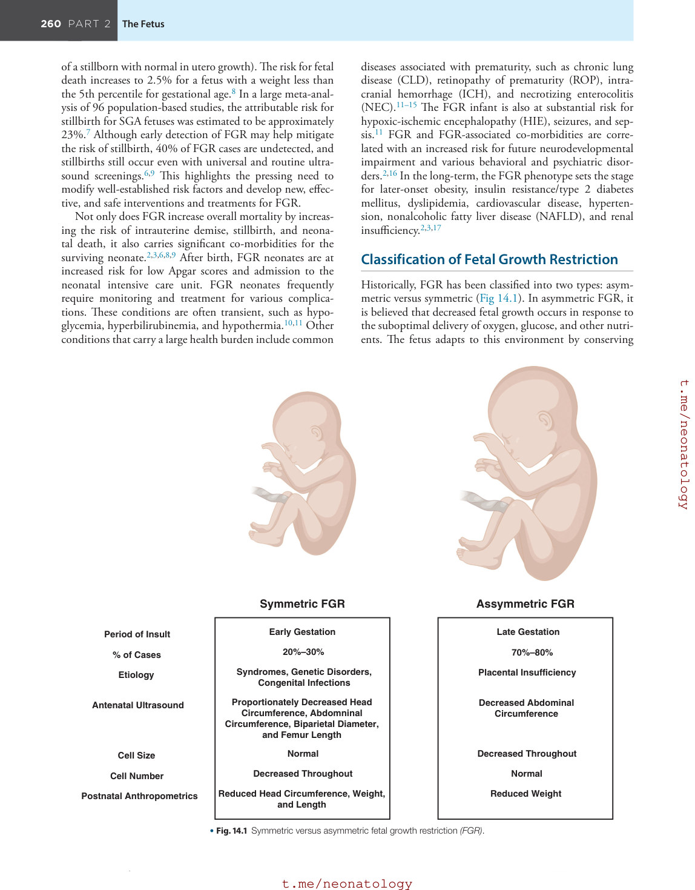

### Original source page 278

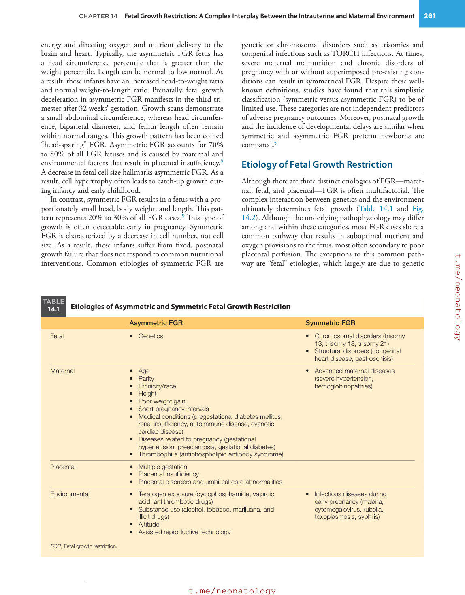

### Original source page 279

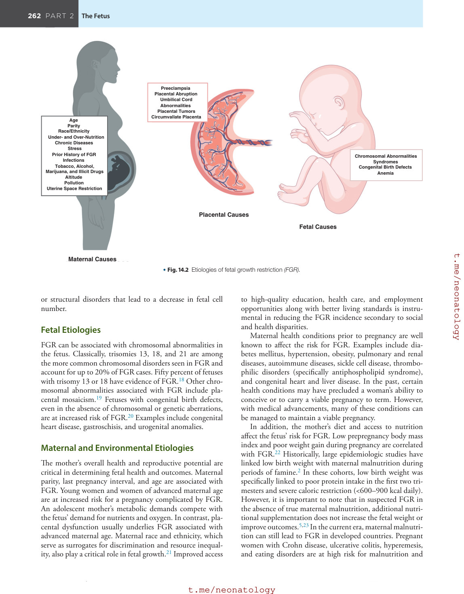

### Original source page 281

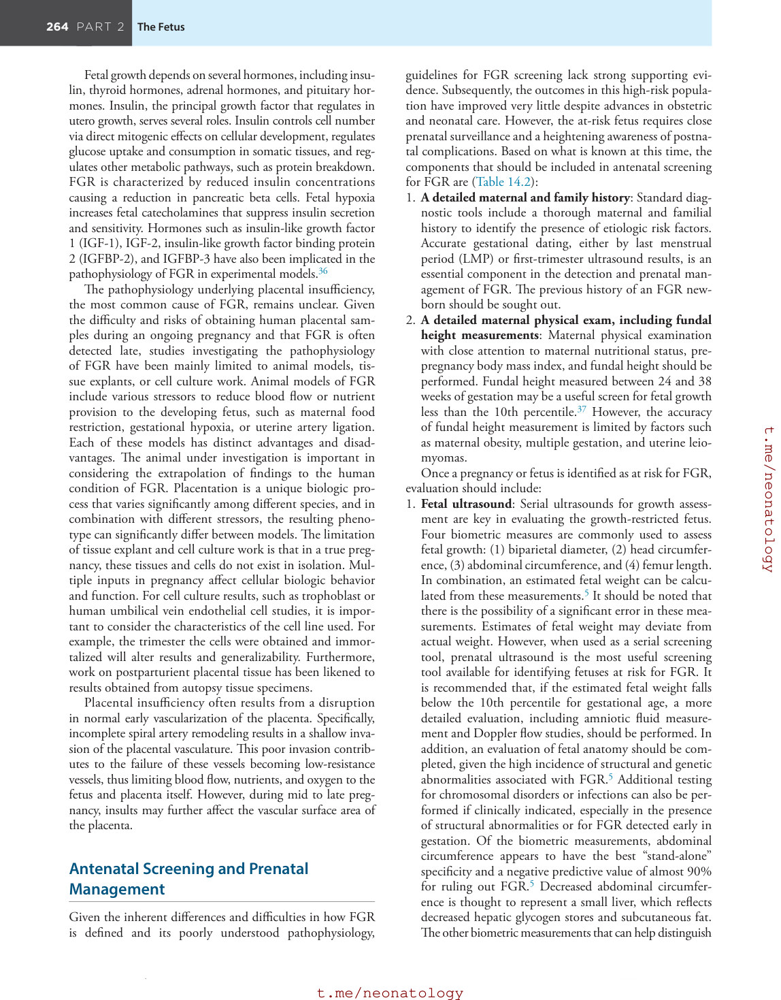

### Original source page 282

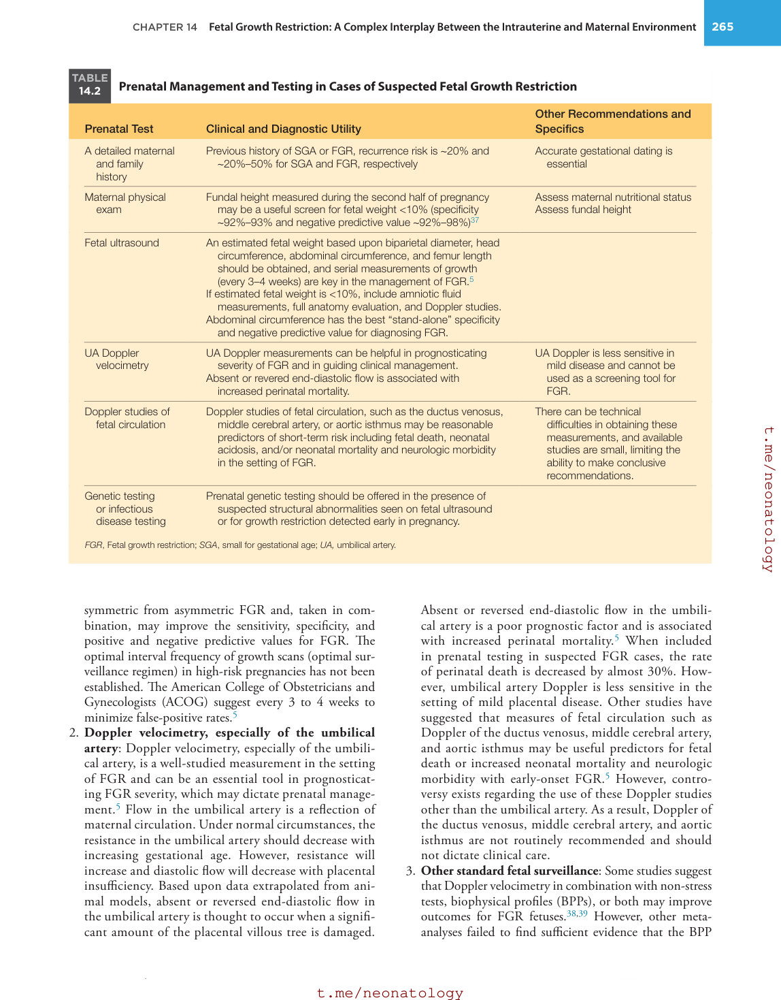

### Original source page 283

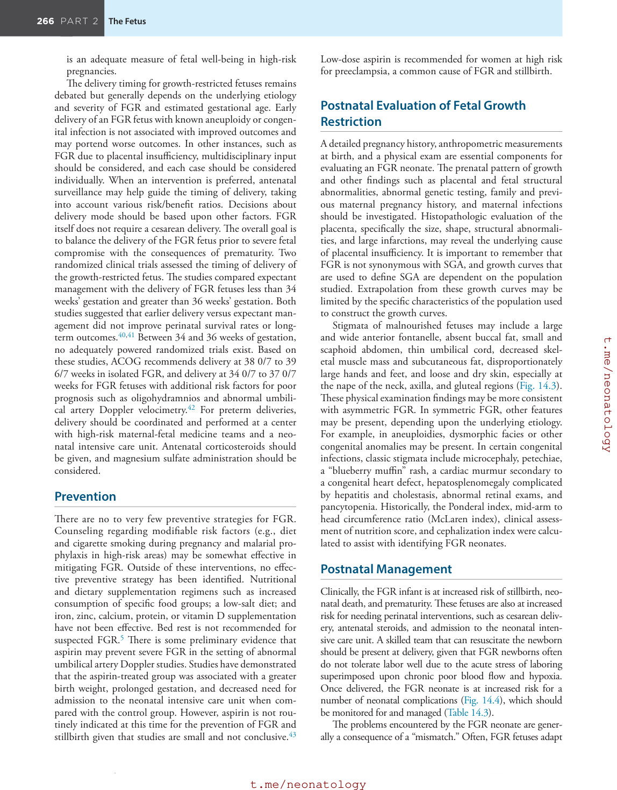

### Original source page 284

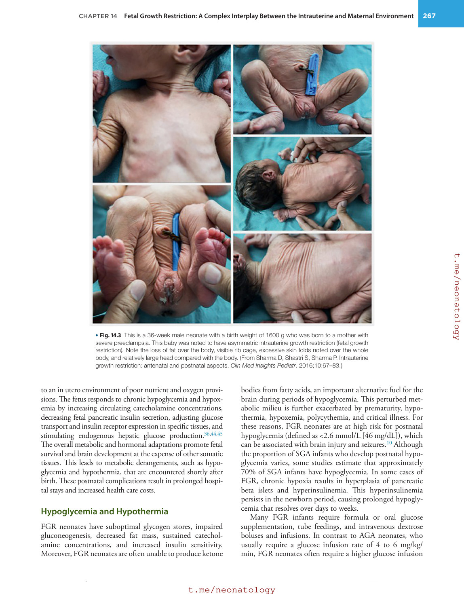

### Original source page 285

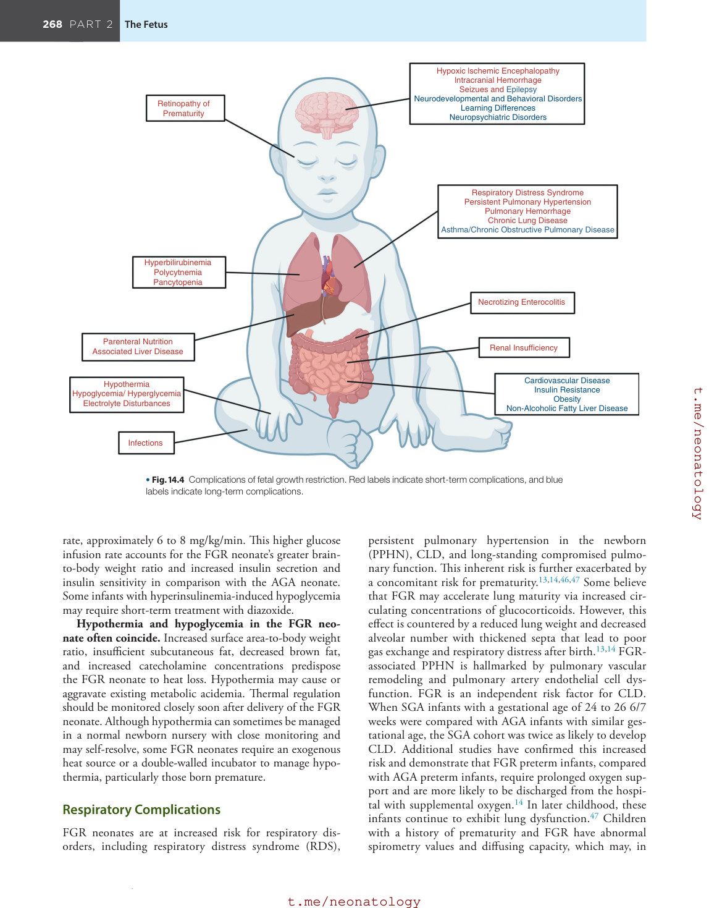

### Original source page 286

