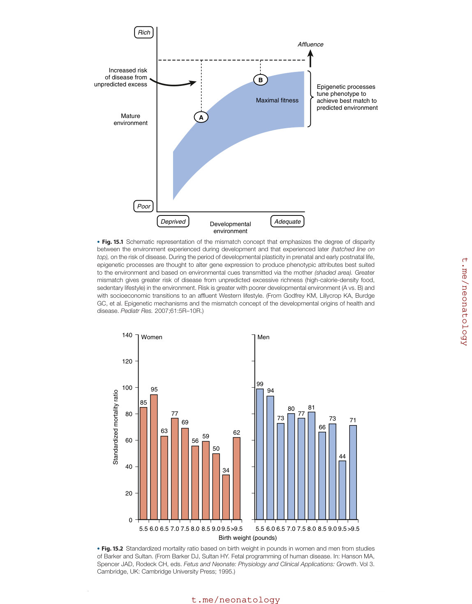
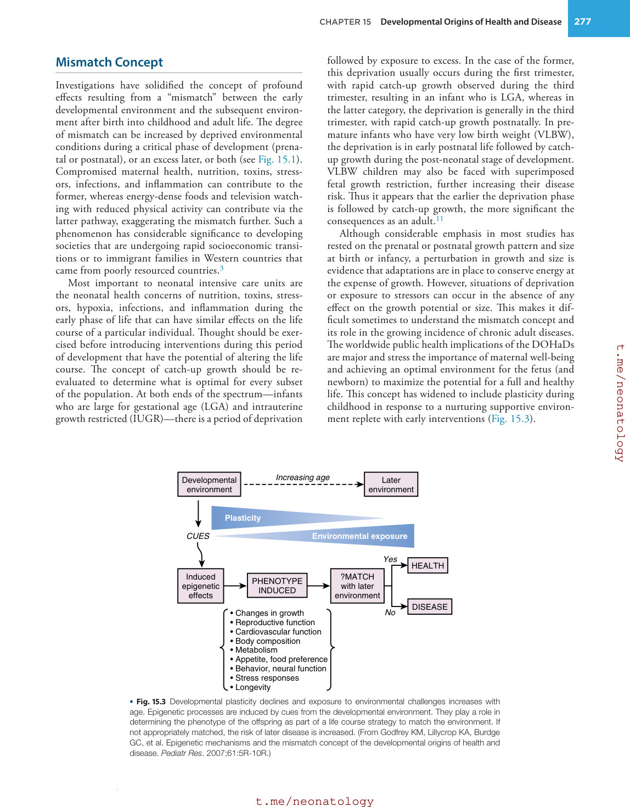
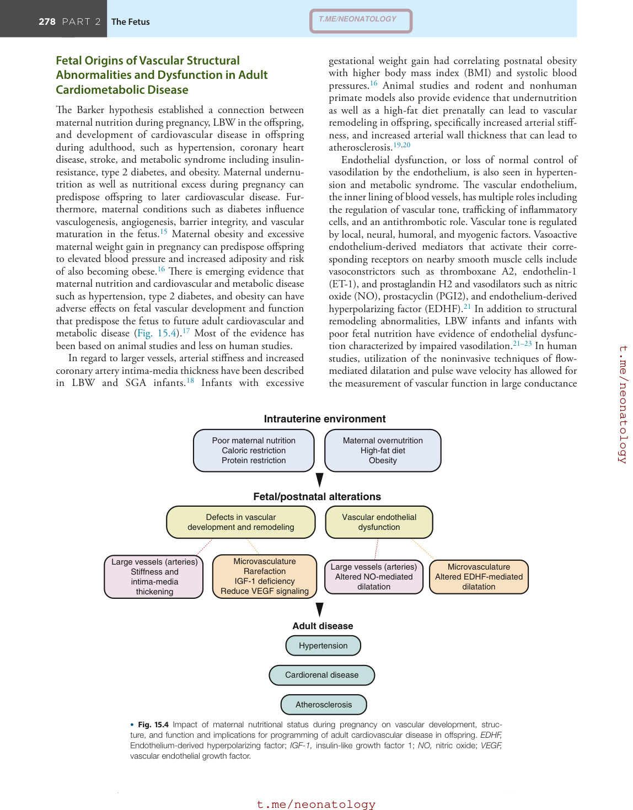
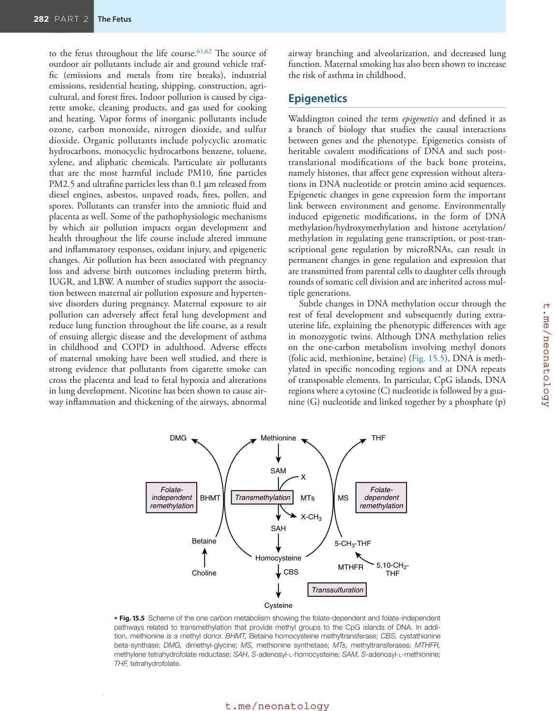
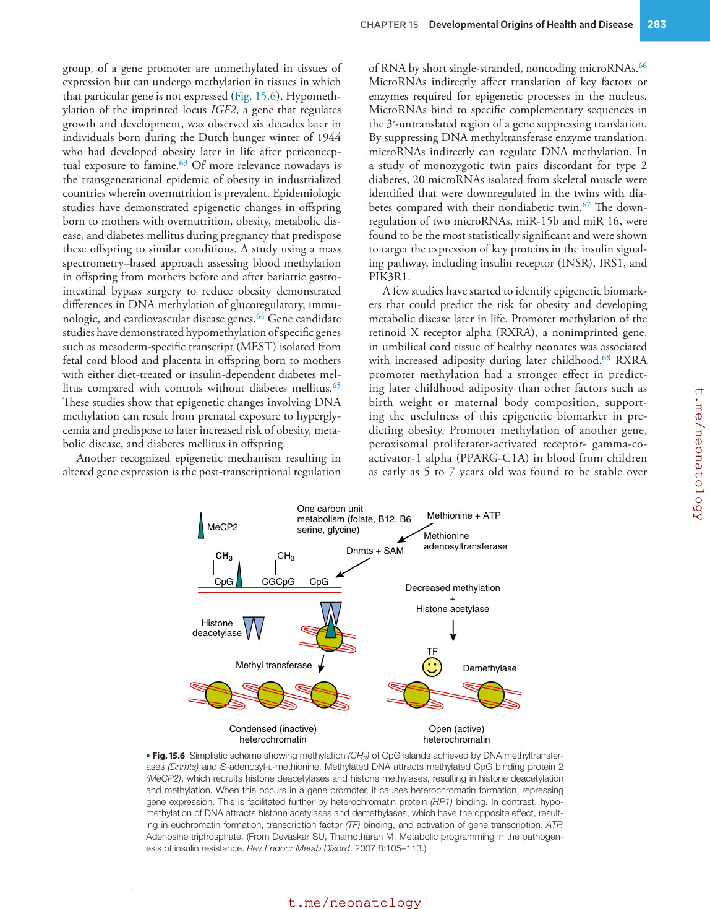
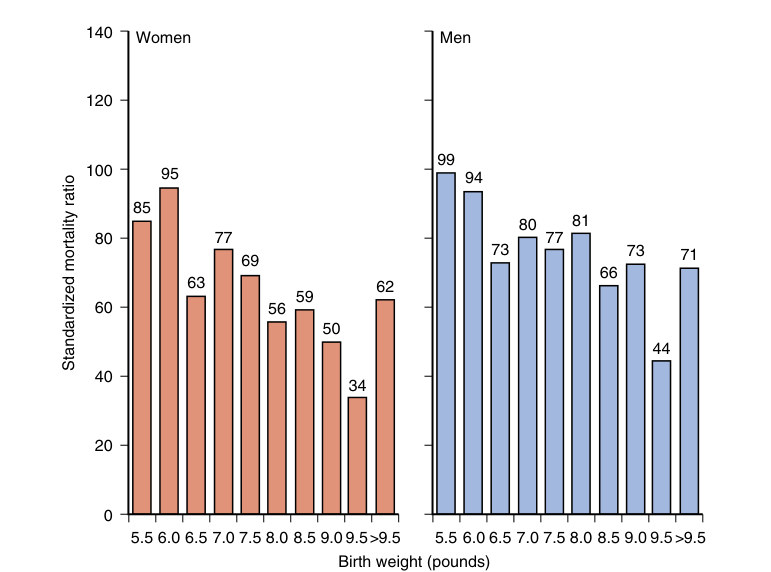
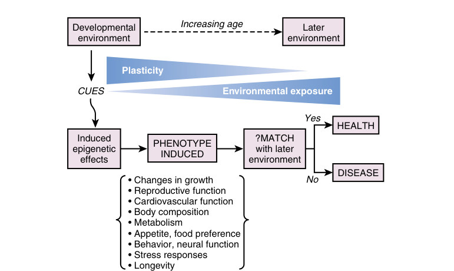
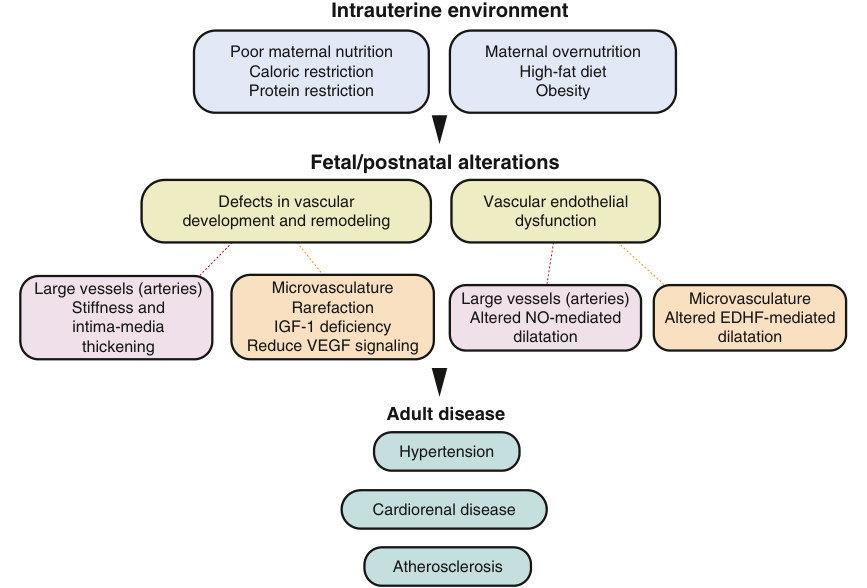
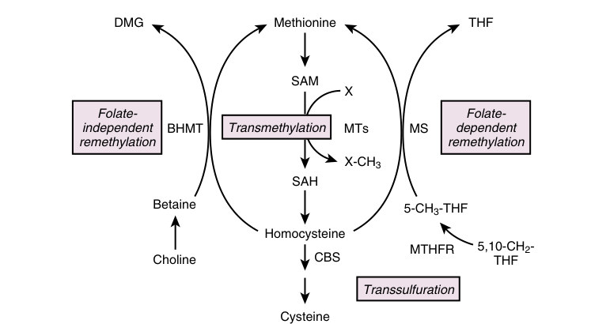
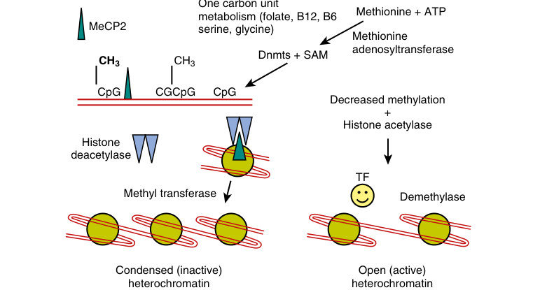

# 15. Developmental Origins of Health and Disease
> Source attribution: [Source credits](../../SOURCE_CREDITS.md).

## PDF page 291 | printed page 274

15 Developmental Origins of Health and Disease

### JOSEPHINE M. ENCISO AND SHERIN U. DEVASKAR

### Fetal Origins of Adult Disease Concept

The concept of fetal origins of adult disease popularized by Barker arose from a robust association between small size at birth and the risk of chronic adult diseases, such as coronary artery disease, hypertension, stroke, type 2 diabetes mellitus, and osteoporosis.1,2 These original epidemiologic observations have been extensively replicated by multiple groups in varying populations of different ethnicities, using birth weight as a surrogate for the intrauterine state.2,3 During the 1944 to 1945 Dutch famine, women who were previously adequately nourished were subjected to low caloric intake and the associated environmental stressors. The offspring that were conceived or were gestating in their mothers’ wombs during the famine, as adult survivors at age 50 to 60 years, showed a higher incidence of hypertension, cardiovascular-related mortality and morbidity, and glucose intolerance/insulin resistance. The culmination of all these epidemiologic associations is referred to as the “Barker hypothesis” or “developmental origins of health and disease (DOHaD).”1,2

Although fetal growth and birth weight have served as surrogate markers of fetal nutrition and health, it is clear that fetuses subjected to nutritional perturbations with no resultant change in size or growth also develop adult chronic diseases.2 Moreover, although in utero calorie restriction serves as a classic example of the far-reaching implications of the Barker hypothesis, other triggers, including a deficiency or excess of specific nutrients, stress, inflammation, toxins, and drugs, can perturb the fetal hormonal-metabolic milieu and set the stage for the subsequent onset of chronic diseases.2–4 These observations support that adaptations in an adverse in utero environment occur to ensure immediate survival, which may or may not interfere with fetal growth depending on the type, timing, and severity of adversity. Although nutritional deficiency is considered to exist only in poorly resourced countries, differential socioeconomic status with varying access to health care and sociocultural and socioethnic differences with exposure to varying stressors, referred to as “weathering,” resulting in disparities are

274

rampant in the Western world, including the United States. These situations can lead to malnutrition, overnutrition, and other forms of maternal-fetal stress, which translate into an altered phenotype and propensity for certain chronic diseases in this subpopulation.

As more investigations in human and animal models are accumulating, various mechanisms responsible for this fetal-adult association are being unraveled.2 These adaptive mechanisms, or “thrifty phenotype,” combat an adverse nutritional and/or metabolic intrauterine environment by developing safeguards for the energy supply, sometimes at the expense of growth, ensuring a reduced fetal demand. After birth, these same adaptive systems can remain masked, without much contribution to short-term health or disease. Over time, with or without additional nutritional or metabolic stressors, the finely crafted phenotype may tip toward a disease state. The conventional belief is that these phenotypic features are expressed mainly in aging adults. However, given lifestyle changes toward an increased caloric intake and relative inactivity, some of these features are seen much earlier, as early as in childhood or during late teenage years (Box 15.1).

### Influences on the Early Embryo

The use of artificial reproductive technology continues to increase worldwide; 1% to 3% of live births are secondary to artificial technology.5 Different culture media and techniques used in artificial reproductive technology can alter the environment of the developing embryo and subsequent phenotype of the offspring.4–6 Even after accounting for confounding factors such as infertility and advanced maternal or paternal age, there is evidence that artificial reproductive technology is linked to an increased incidence of prematurity, growth restriction, congenital malformations, and imprinting disorders.4–6 Imprinting refers to the differential expression of specific genes according to parental origin. Genes are “silenced” by epigenetic modifications. In pregnancy, imprinted genes play a critical role in determining placental size and fetal growth. Most paternally

## PDF page 292 | printed page 275

• BOX 15.1 Chronic Diseases Attributed to

Developmental Origins

• Diabetes mellitus • Obesity • Dyslipidemia • Hypertension • Coronary artery disease • Stroke • Kidney disease • Liver disease • Lung abnormalities: Asthma and chronic obstructive

pulmonary disease (COPD) • Immune dysfunction • Polycystic ovarian syndrome, premature pubarche • Osteoporosis • Alzheimer disease • Depression, anxiety, attention-deficit/hyperactivity disorder

(ADHD), autism, schizophrenia • Cancer • Social problems • Poor cognitive performance • Shortened life span

expressed genes enhance placental and fetal growth, whereas most maternally expressed genes reduce placental and fetal size. Imprinting disorders, such as Beckwith-Wiedemann, Angelman, Prader-Willi, and hypomethylation syndromes, appear to be increased in children who are a product of artificial reproductive technology.6 The incidence of Angelman syndrome is estimated to increase from 1 in 400,000 births to 1 in 20,000 births with artificial reproductive technology.6 Moreover, artificial reproductive technology may alter the growth patterns of children. Children conceived by in vitro fertilization also have decreased growth early in infancy and then experience “catch-up growth” after about 6 months of age, resulting in higher blood pressures and altered body composition.7 These alterations in growth patterns and risk for disease illustrate that reprogramming at an early stage can increase the risk for adult disease later on.

### Postnatal Growth and Nutrition

The first indication that postnatal stages of development can influence the long-term outcome related to perturbed fetal nutrition came from observations during the Leningrad siege.2 Exposure in utero and postnatally to nutritional deprivation failed to produce signs of chronic diseases in adults. These findings suggested that postnatal manipulation of nutrition may have a protective effect on the trajectory of fetal origins of adult disease. Investigations have revealed that in girls and boys, low birth weight (LBW) with a slow growth pattern followed by exponential growth during childhood increases the risk for metabolic syndrome, which is characterized by obesity, insulin resistance, hypertension, and dyslipidemia.8–10 These studies established that postnatal growth patterns were important in modulating the fetal trajectory toward predetermining the adult

phenotype. These findings are of particular interest to neonatology, where there continues to be an ongoing dilemma as to what is ideal postnatal growth and whether this growth rate should be the same for infants of varying birth weights, gestations, sexes, ethnicities, and races.

The phenomenon of postnatal catch-up growth seems to reflect intrauterine or early postnatal nutritional deprivation. It is a normal tendency by the body to compensate after a nutritionally restricted period, showing rapid growth. This rapid growth targets short-term benefits, which include survival and protecting the reproductive capacity.11 However, it is evident that catch-up growth tends to favor nutrient deposition in white adipose tissue, resulting in adiposity, particularly visceral adiposity; a rearrangement of skeletal muscle mitochondria; and increased oxidative injury.11 These changes set the stage for metabolic syndrome, diabetes mellitus, and coronary artery disease as the child matures into an adult.9 This catch-up growth results in a shortened life span with changes in the telomeric length.12 For “shortterm gain,” catch-up growth results in “long-term pain” (Fig. 15.1).

The question arises, should postnatal catch-up growth not be fostered? If postnatal nutrition matches intrauterine nutrition, can adult chronic diseases be curbed and result in longevity? Although animal and human studies lend credence to this concept, the absence of catch-up growth, although resulting in glucose tolerance, lean body composition, and reduced coronary artery disease with longevity, may negatively affect cognition and reproductive capacity. Rapid postnatal growth, whether superimposed on LBW or normal birth weight, seems to have a similar effect in producing adult chronic diseases.1,2,11 Avoidance of rapid postnatal catch-up growth within a short period may be beneficial if replaced with moderate long-term growth and may be influenced not only by the amount of calories ingested but also by the quality and composition of the nutrition. In a study of small for gestational age (SGA) infants exposed to either maternal breast milk or formula, babies who received breast milk exhibited decreased adiposity and normal serum adiponectin concentrations, whereas those who received either standard or protein-enriched formula had increased fat mass and lower adiponectin concentrations.13 Other studies have revealed an association between fortified formulas and elevated blood pressures and insulin resistance during the childhood years.14

At the other end of the spectrum, infants born with a heavier birth weight, resulting from either maternal diabetes or obesity, are also prone to adult chronic diseases. These infants are obese during childhood and develop insulin resistance with the associated phenotypic presentations.10 One can speculate that these infants experience catch-up growth during fetal life after experiencing slow growth during the early embryonic phase. Further postnatal escalated growth leads to earlier acquisition of adult chronic diseases and the associated complications. The weight status in the first 6 months of life predicts obesity at 3 years of age and future mortality (Fig. 15.2).10

## PDF page 293

Increased risk of disease from unpredicted excess

Mature environment

### A

Poor

Deprived

Developmental

environment

### • Fig. 15.1 Schematic representation of the mismatch concept that emphasizes the degree of disparity

between the environment experienced during development and that experienced later (hatched line on top), on the risk of disease. During the period of developmental plasticity in prenatal and early postnatal life, epigenetic processes are thought to alter gene expression to produce phenotypic attributes best suited to the environment and based on environmental cues transmitted via the mother (shaded area). Greater mismatch gives greater risk of disease from unpredicted excessive richness (high-calorie-density food, sedentary lifestyle) in the environment. Risk is greater with poorer developmental environment (A vs. B) and with socioeconomic transitions to an affluent Western lifestyle. (From Godfrey KM, Lillycrop KA, Burdge GC, et al. Epigenetic mechanisms and the mismatch concept of the developmental origins of health and disease. Pediatr Res. 2007;61:5R–10R.)

140

Women

120

100

95

Standardized mortality ratio

85

77 69

80

63

62

56 59

60

50

40

34

20

0

5.5 6.0 6.5 7.0 7.5

Birth weight (pounds) 8.0 8.5 9.0 9.5>9.5

### • Fig. 15.2 Standardized mortality ratio based on birth weight in pounds in women and men from studies

of Barker and Sultan. (From Barker DJ, Sultan HY. Fetal programming of human disease. In: Hanson MA, Spencer JAD, Rodeck CH, eds. Fetus and Neonate: Physiology and Clinical Applications: Growth. Vol 3. Cambridge, UK: Cambridge University Press; 1995.)

Affluence

### B

Epigenetic processes tune phenotype to achieve best match to predicted environment

Maximal fitness

Adequate

Men

99 94

80 77 81

73

66 73

71

44

5.5 6.0 6.5 7.0 7.5 8.0 8.5 9.0 9.5>9.5

## PDF page 294 | printed page 277

### Mismatch Concept

Investigations have solidified the concept of profound effects resulting from a “mismatch” between the early developmental environment and the subsequent environment after birth into childhood and adult life. The degree of mismatch can be increased by deprived environmental conditions during a critical phase of development (prenatal or postnatal), or an excess later, or both (see Fig. 15.1). Compromised maternal health, nutrition, toxins, stressors, infections, and inflammation can contribute to the former, whereas energy-dense foods and television watching with reduced physical activity can contribute via the latter pathway, exaggerating the mismatch further. Such a phenomenon has considerable significance to developing societies that are undergoing rapid socioeconomic transitions or to immigrant families in Western countries that came from poorly resourced countries.3

Most important to neonatal intensive care units are the neonatal health concerns of nutrition, toxins, stressors, hypoxia, infections, and inflammation during the early phase of life that can have similar effects on the life course of a particular individual. Thought should be exercised before introducing interventions during this period of development that have the potential of altering the life course. The concept of catch-up growth should be reevaluated to determine what is optimal for every subset of the population. At both ends of the spectrum—infants who are large for gestational age (LGA) and intrauterine growth restricted (IUGR)—there is a period of deprivation

Increasing age

Developmental environment

Plasticity

Environmental exposure

CUES

Induced epigenetic effects

PHENOTYPE INDUCED

• Changes in growth • Reproductive function • Cardiovascular function • Body composition • Metabolism • Appetite, food preference • Behavior, neural function • Stress responses • Longevity

• Fig. 15.3 Developmental plasticity declines and exposure to environmental challenges increases with age. Epigenetic processes are induced by cues from the developmental environment. They play a role in determining the phenotype of the offspring as part of a life course strategy to match the environment. If not appropriately matched, the risk of later disease is increased. (From Godfrey KM, Lillycrop KA, Burdge GC, et al. Epigenetic mechanisms and the mismatch concept of the developmental origins of health and disease. Pediatr Res. 2007;61:5R-10R.)

followed by exposure to excess. In the case of the former, this deprivation usually occurs during the first trimester, with rapid catch-up growth observed during the third trimester, resulting in an infant who is LGA, whereas in the latter category, the deprivation is generally in the third trimester, with rapid catch-up growth postnatally. In premature infants who have very low birth weight (VLBW), the deprivation is in early postnatal life followed by catchup growth during the post-neonatal stage of development. VLBW children may also be faced with superimposed fetal growth restriction, further increasing their disease risk. Thus it appears that the earlier the deprivation phase is followed by catch-up growth, the more significant the consequences as an adult.11

Although considerable emphasis in most studies has rested on the prenatal or postnatal growth pattern and size at birth or infancy, a perturbation in growth and size is evidence that adaptations are in place to conserve energy at the expense of growth. However, situations of deprivation or exposure to stressors can occur in the absence of any effect on the growth potential or size. This makes it difficult sometimes to understand the mismatch concept and its role in the growing incidence of chronic adult diseases. The worldwide public health implications of the DOHaDs are major and stress the importance of maternal well-being and achieving an optimal environment for the fetus (and newborn) to maximize the potential for a full and healthy life. This concept has widened to include plasticity during childhood in response to a nurturing supportive environment replete with early interventions (Fig. 15.3).

Later environment

HEALTH Yes

?MATCH with later environment

No DISEASE

## PDF page 295

### Fetal Origins of Vascular Structural Abnormalities and Dysfunction in Adult Cardiometabolic Disease

The Barker hypothesis established a connection between maternal nutrition during pregnancy, LBW in the offspring, and development of cardiovascular disease in offspring during adulthood, such as hypertension, coronary heart disease, stroke, and metabolic syndrome including insulinresistance, type 2 diabetes, and obesity. Maternal undernutrition as well as nutritional excess during pregnancy can predispose offspring to later cardiovascular disease. Furthermore, maternal conditions such as diabetes influence vasculogenesis, angiogenesis, barrier integrity, and vascular maturation in the fetus.15 Maternal obesity and excessive maternal weight gain in pregnancy can predispose offspring to elevated blood pressure and increased adiposity and risk of also becoming obese.16 There is emerging evidence that maternal nutrition and cardiovascular and metabolic disease such as hypertension, type 2 diabetes, and obesity can have adverse effects on fetal vascular development and function that predispose the fetus to future adult cardiovascular and metabolic disease (Fig. 15.4).17 Most of the evidence has been based on animal studies and less on human studies.

In regard to larger vessels, arterial stiffness and increased coronary artery intima-media thickness have been described in LBW and SGA infants.18 Infants with excessive

Intrauterine environment

Poor maternal nutrition Caloric restriction Protein restriction

Fetal/postnatal alterations

Defects in vascular development and remodeling

Microvasculature Rarefaction IGF-1 deficiency Reduce VEGF signaling

Large vessels (arteries) Stiffness and intima-media thickening

Adult disease

Hypertension

Cardiorenal disease

Atherosclerosis

• Fig. 15.4 Impact of maternal nutritional status during pregnancy on vascular development, structure, and function and implications for programming of adult cardiovascular disease in offspring. EDHF, Endothelium-derived hyperpolarizing factor; IGF-1, insulin-like growth factor 1; NO, nitric oxide; VEGF, vascular endothelial growth factor.

gestational weight gain had correlating postnatal obesity with higher body mass index (BMI) and systolic blood pressures.16 Animal studies and rodent and nonhuman primate models also provide evidence that undernutrition as well as a high-fat diet prenatally can lead to vascular remodeling in offspring, specifically increased arterial stiffness, and increased arterial wall thickness that can lead to atherosclerosis.19,20

Endothelial dysfunction, or loss of normal control of vasodilation by the endothelium, is also seen in hypertension and metabolic syndrome. The vascular endothelium, the inner lining of blood vessels, has multiple roles including the regulation of vascular tone, trafficking of inflammatory cells, and an antithrombotic role. Vascular tone is regulated by local, neural, humoral, and myogenic factors. Vasoactive endothelium-derived mediators that activate their corresponding receptors on nearby smooth muscle cells include vasoconstrictors such as thromboxane A2, endothelin-1 (ET-1), and prostaglandin H2 and vasodilators such as nitric oxide (NO), prostacyclin (PGI2), and endothelium-derived hyperpolarizing factor (EDHF).21 In addition to structural remodeling abnormalities, LBW infants and infants with poor fetal nutrition have evidence of endothelial dysfunction characterized by impaired vasodilation.21–23 In human studies, utilization of the noninvasive techniques of flowmediated dilatation and pulse wave velocity has allowed for the measurement of vascular function in large conductance

Maternal overnutrition High-fat diet Obesity

Vascular endothelial dysfunction

Microvasculature Altered EDHF-mediated dilatation

Large vessels (arteries) Altered NO-mediated dilatation

## PDF page 296 | printed page 279

and resistance arteries.24 A cohort study showed that abnormal flow-mediated dilatation and findings of early atherosclerosis mediated by elevated blood pressure, triglyceride levels, and inflammation were associated with impaired fetal growth.23 Endothelial dysfunction in animal models has been studied by measuring endothelium-dependent acetylcholine-induced relaxation of vascular smooth muscle cells by wire myography or measurement of shear-mediated dilatation using pressure myography.21 Multiple animal studies have shown that maternal diet can lead to abnormal acetylcholine-mediated arterial dilatation in adult offspring.20,25,26 IUGR induced early in pregnancy resulted in adult offspring with abnormal endothelium-dependent and endothelium-independent dilatation and hypertension. NO has a central role in mediating vascular dilatation and is dependent on NO bioavailability. Increased oxidative stress and the presence of reactive oxygen species (ROS) reduce NO bioavailability.27 Increased oxidative stress, increased ROS, low levels of antioxidant enzymes, and resulting endothelial dysfunction are associated with SGA and LGA infants, as well as with obesity and type 2 diabetes.28,29 Maternal overnutrition has been demonstrated to result in increased placental expression of ROS30 and can be linked with neonatal insulin resistance and obesity.

The microvasculature, or small-resistance arteries, arterioles, capillaries, and venules with diameter less than 150 to 200 μm located within tissue parenchyma, has a primary role in regulating tissue perfusion and optimal exchange of gases, nutrients, water, and solutes between the blood and surrounding tissues. The microvasculature has an important regulatory role in maintaining adequate tissue perfusion and controlling blood pressure.31 Microvascular rarefaction or decreased vascular density, and dysfunction leading to the development of cardiovascular and metabolic disease in adulthood, may be primed by the maternal environment, thus stressing the importance of the prenatal and perinatal environment in the development of vascular disease such as hypertension, coronary heart disease, and stroke. Rarefaction has been observed in obesity and hypertension and is thought to contribute to insulin resistance. Rarefaction results in restricted tissue perfusion and longer capillary diffusion distances for metabolic exchange. However, studying microvascular structure and function in humans is challenging and limited to accessible vascular beds, including skin and retinal microvasculature. LBW has been shown to be associated with rarefaction and impaired endotheliumdependent vasodilatation of skin microvasculature. SGA babies have evidence of decreased retinal vascularization that is known to be mediated by downregulation of vascular endothelial growth factor (VEGF) and associated with insulin-like growth factor 1 (IGF-1) deficiency in preterm and IUGR infants.32 Although the findings of rarefaction in the skin and retinal vasculature of LBW and SGA infants may not be reflective of the microvascular environment in major organs such as the kidney, heart, and skeletal muscle, the data suggest that impaired vasculogenesis and angiogenesis also occur at these sites and may contribute to the microvascular

dysfunction and the development of cardiometabolic disease in this risk group. The effect of maternal or intrapartum factors, including high-fat diet, calorie restriction, hypertension, and fetal oxygen stress on microvascular structure in animal studies, has been demonstrated.33,34 Reduced microvascular development and function, specifically in the renal and intestinal microvasculature, in the offspring of mothers with these conditions during pregnancy has been associated with the development of hypertension and cardiometabolic disease in these offspring.17,35 It has been demonstrated that a maternal diet that is low in protein can adversely affect organ and vascular development in offspring that can be associated with elevated blood pressure and chronic renal disease later in life.17,36 The reduction in VEGF and VEGF receptor expression has been demonstrated in some of these studies, indicating that the absence of angiogenic signaling from the VEGF pathway may be the mechanism inhibiting microvascular development.

Endothelial dysfunction in the microvasculature can alter normal vasoconstrictor and dilator responses and adversely affect blood flow, perfusion, and glucose uptake and oxygenation. Overall, few studies, particularly human studies, have demonstrated the effects of maternal nutritional status on endothelial function specifically in the microvasculature. In animal models, a reduction in acetylcholine-induced vasodilation in cremaster arterioles has been observed in offspring of mothers fed a high-fat diet.37 Furthermore, endothelium-derived hyperpolarization (EDH)-mediated vasodilation in the microvasculature can be impaired in the setting of fetal growth restriction and in offspring exposed to both excessive and restrictive calories in utero.26,38 Data are yet lacking on the effects of excessive nutrition during pregnancy on the microvascular function of the offspring exposed to an adverse in utero environment.39

### Placental Abnormalities and Association With Adult Disease

The placenta has an essential role in promoting normal fetal development and maintaining pregnancy. Its major functions include providing oxygen and gas exchange; transfer of macronutrients and micronutrients, vitamins, hormones, and antibodies; elimination of waste products; metabolism of glycogen, cholesterol, and fatty acids; and endocrine secretion of hormones that sustain pregnancy. Fetal growth and infant birth weight depend not only on maternal nutrition but also on placental function and transport of nutrients from the mother to the fetus.40 Nutrient transfer by the placenta is reflected in the weight, size, and shape of the placenta, and these placental characteristics have been found to be a marker for later disease in adulthood, including hypertension and coronary heart disease.41,42 Epidemiologic studies have demonstrated associations between placental size and shape and adult chronic disease.43 The Helsinki Birth Cohort of 13,345 men and women born between 1943 and 1944 showed the association between low placental weight

## PDF page 297

and surface area with hypertension in adulthood.41 In this same birth cohort, small placentas, small placental surface area, and placental inefficiency were powerful predictors of coronary heart disease in the men followed in this study. There are also data to suggest that a large placenta with increased surface area and increased number of lobes can also result in elevated blood pressure. Children in a study from Bristol, United Kingdom (ALSPAC study) had higher birth weights and were found to have elevated blood pressure at age 9.44 In all, these studies demonstrated that both large and small placentas can limit the flow of nutrients to the fetus and ultimately have long-term effects on cardiovascular health into adulthood.

### Gestational Diabetes and Long-Term Metabolic Effects on Offspring

Gestational diabetes is increasingly prevalent in industrialized countries wherein overnutrition leading to obesity and type 2 diabetes is a health concern. Studies have also uncovered an association of type 2 diabetic risk alleles in infants born with a reduced size, linking the genetics of type 2 diabetes with LBW.45,46 There is evidence from epidemiologic studies that intrauterine exposure to maternal diabetes can lead to adverse metabolic outcomes in offspring, including obesity, insulin resistance, and type 2 diabetes.8,47 Data from a population of Pima Native Americans in Arizona with high rates of obesity and type 2 diabetes revealed that offspring of women who had gestational diabetes were obese and had a higher prevalence of type 2 diabetes.48 To address the confounding factor that genetics contributes to the development of type 2 diabetes in offspring of diabetic mothers in the same population of Pima Native Americans, a sibship study was done to compare BMI and the prevalence of type 2 diabetes in siblings born before and after their mother was diagnosed with type 2 diabetes. Among a population of mothers genetically predisposed to type 2 diabetes, it was demonstrated that offspring born to mothers after they had developed diabetes had a significantly higher risk of type 2 diabetes and a higher BMI than their siblings born prior to development of diabetes in the mother.49 Other studies have provided evidence that intrauterine exposure to hyperglycemia can result in offspring with type 2 diabetes, obesity, and metabolic syndrome.47

### Maternal Microbiome Transfer and Early Life Programming

Microbial colonization occurs at birth and is established in the first 3 years of life and remains constant into adulthood.50 The maternal microbiome is handed off to the infant at birth, and therefore the health of the mother is important in the establishment of an infant’s microbiome. The early gut microbiome has an important modulatory role in the infant’s immune system development, inflammatory responses, gastrointestinal integrity, metabolism, and

neurodevelopment. Influential factors in the establishment of the infant’s microbiome include mode of delivery and initial infant feeding. Vaginal delivery allows the transfer of maternal vaginal and gastrointestinal bacteria to the infant, which is not the case with delivery by c-section. Breastmilk feeding, in contrast to formula feeding, promotes microbiome stability and confers immune protection from gastrointestinal infections and allergies. Studies have demonstrated that the maternal microbiome changes because of obesity. Mothers with increased BMI can put offspring at increased risk for obesity and diabetes later in life. It has been shown that obese mothers have higher stool levels of Bacteroides, Clostridium, and Staphylococcus and decreased Bifidobacterium. Other factors, such as maternal diet and antibiotic treatment during pregnancy, also have an effect on the microbiome composition of the mother during pregnancy and her infant and can affect the infant’s immune system development.50 The composition of the gut microbiome has a role in susceptibility of an infant to the development of diseases later in childhood and adulthood which have underlying etiologies related to dysregulated immune responses and inflammation. These diseases include obesity, diabetes, cardiovascular disease, allergic diseases such as asthma and atopic dermatitis, inflammatory bowel disease, and neuropsychiatric disorders (via the gut-brain axis). Nondiversity of the vaginal microbiome during pregnancy with dominance of Lactobacillus has also been shown to be important in preventing preterm birth and premature rupture of membranes.51

### Developmental Origins of Neuropsychiatric Disorders

A number of recent animal and human epidemiologic studies demonstrate that perinatal stress and infection can lead to neuropsychiatric disorders in offspring.52 A recent study using a large Swedish database following subjects from birth to age 41 found that fetal exposure to maternal infection had an increased risk of autism or depression.53 There is growing literature that similarly maternal overnutrition with a high-fat diet leading to obesity can also lead to adverse neuropsychiatric outcomes.52 There are a number of mechanisms to explain the effects on the developing brain. Maternal overnutrition can result in metabolic changes involving insulin and leptin signaling that can affect the neurodevelopment in exposed offspring and adversely affect cognitive function. Obesity is known to be a proinflammatory condition. Maternal overnutrition has been shown to result in the production of proinflammatory cytokines due to upregulation of Toll-like receptor 4 (TLR4) activity and can adversely affect the process of neurogenesis, neuronal migration, axon guidance, and synapse formation in the brain during development. It has been shown that increased proinflammatory cytokine levels in fetuses exposed to maternal overnutrition are associated with impaired cognition, increased anxiety-like behavior, and decreased social behavior. Similar to responses caused by perinatal stress

## PDF page 298 | printed page 281

and inflammation, the hypothalamic-pituitary-adrenal (HPA) axis activity in offspring can also be affected by maternal overnutrition contributing to altered brain signaling. The placenta is the primary source of the important neurotrophic neurotransmitter serotonin (5-HT), which is synthesized from maternal l-tryptophan. Maternal overnutrition and maternal high-fat diet have also been associated with an impairment in brain serotonin signaling pathways, leading to neuropsychiatric diseases in offspring including autism spectrum disorder (ASD), attention-deficit/hyperactivity disorder (ADHD), anxiety, and mood disorders. Brain-derived neurotrophic factor (BDNF) is an important factor in neuronal survival, synaptic transmission, plasticity, growth, and repair. Perinatal stress, inflammation, and maternal overnutrition have all been shown to cause decreases in BDNF in the brains of offspring that can result in cognitive deficits. Maternal factors of psychosocial stress, inflammation, and overnutrition can lead to overlapping adverse neuropsychiatric outcomes including cognitive impairment, anxiety, depression, schizophrenia, and ASDs in offspring. These neuropsychiatric disorders have common pathophysiological pathways involving both maternal regulatory systems and the placenta. Emerging data demonstrate the roles of a number of mechanisms mediating the effects on the developing fetal brain that involve inflammatory pathways and cytokines, neurotrophic factors, metabolic signaling, the microbiome, and epigenetic changes.54

### Developmental Origins of Cancer

Although most cancers are diagnosed later in life, the pathogenesis of cancer is multifactorial, and prenatal events may bear some contribution to the disease. The development of cancers has been shown to follow a multi-hit model in which multiple events occur that lead to the disease. Work has been done that demonstrates that the initial genetic “hit” for childhood leukemias has been shown to arise from a prenatal cell of fetal origin in acute B-cell lymphocytic leukemia (B-ALL), acute myelocytic leukemia, transient myeloproliferative disease (TMD), and acute megakaryoblastic leukemia (AMKL) in patients with Down syndrome.55 Specific gene mutations include ETV-6-RUNX1 or MLL-AF4 in acute lymphocytic leukemia (ALL), GATA 1 in transient myeloproliferative disorder (TMD) and acute megakaryoblastic leukemia (AMKL), and AML1- ETO and histone methyl-transferase mixed-lineage leukemia (MLL) in acute myelogenous leukemia (AML). As with leukemias, solid tumors such as malignant rhabdoid tumors and gliomas have prenatal origins that result from cell-specific gene mutations that occur during timelimited windows in embryonic development.55 Deletion of tumor suppressor gene SNF5 in neural crest cells during an early time window in embryonic development has been shown to result in malignant rhabdoid tumors. Although much remains unknown about the precise molecular and cellular mechanisms that lead to gliomas, childhood and adult tumors differ from one another in their cell origins

and molecular characteristics. Both, however, seem to arise due to cell-specific mutations during a precise developmental time window that are distinct from the cancer cell of origin. High-grade gliomas seen in younger children versus adolescents and young adults have different mutations in the same histone H3 gene. High-grade gliomas in childhood are thought to arise from precursor cells in the oligodendroglial lineage. Adult glioblastoma (GBM) has been shown to arise from other precursors including neural stem cells and oligodendrocyte precursor cells, and the molecular signature and phenotype of the tumor can differ depending on the more restricted precursor cell of origin.55 Birth weight has been speculated to be associated with the development of breast, ovarian, colon, lung, and some blood cancers.2,56,57 Although numerous oncogenes have been identified, genetics and environmental triggers cannot completely explain the pathogenesis of many cancers.

### Developmental Impact of Toxins, Endocrine Disrupters, and Air Pollution (See Also Chapter 13)

The window of time in early pregnancy wherein organogenesis is occurring is a vulnerable period. Maternal exposure to environmental hazards including toxins, endocrine disrupters, and air pollution early in pregnancy can have adverse consequences on the fetus that can lead to future adverse health outcomes. Certain endocrine disrupters, such as pesticides, estrogens, antiandrogenic compounds (bisphenol A and phthalates), can affect endocrine function and have far-reaching effects on the phenotype of animals but more importantly in children.58–60 These changes, which are considered epigenetic in nature, persist into future generations when a pregnant animal is exposed to an endocrine disruptor. The fetus (second generation) and the gametes of the fetus (which give rise to the third generation) face the same exposure. Increases in pubertal abnormalities, ovarian and testis disease, and obesity have been observed.58 The classic example of how an endocrine disruptor can be responsible for tissue and hormonal reprogramming is diethylstilbestrol (DES), a synthetic estrogen. In animal studies, offspring of mothers exposed to low-dose DES exhibit LBWs, catch-up growth, adult-onset obesity, decreased activity, and abnormal glucose metabolism.60 Bisphenol A, a chemical used in plastics and an environmental estrogen, is also linked to obesity and insulin resistance.60 These changes may be sex specific depending on the time of exposure. In this case, science influenced advocacy, resulting in a push to eliminate plasticizers from various containers that hold edible food and drinks including infant feeding bottles.

Moreover, airborne toxins can also have a long-term effect on the adult offspring. Air pollution exposure during pregnancy can adversely affect the fetus and can lead to a number of morbidities, including adverse birth, respiratory, and neurodevelopmental outcomes, that have consequences

## PDF page 299

to the fetus throughout the life course.61,62 The source of outdoor air pollutants include air and ground vehicle traffic (emissions and metals from tire breaks), industrial emissions, residential heating, shipping, construction, agricultural, and forest fires. Indoor pollution is caused by cigarette smoke, cleaning products, and gas used for cooking and heating. Vapor forms of inorganic pollutants include ozone, carbon monoxide, nitrogen dioxide, and sulfur dioxide. Organic pollutants include polycyclic aromatic hydrocarbons, monocyclic hydrocarbons benzene, toluene, xylene, and aliphatic chemicals. Particulate air pollutants that are the most harmful include PM10, fine particles PM2.5 and ultrafine particles less than 0.1 μm released from diesel engines, asbestos, unpaved roads, fires, pollen, and spores. Pollutants can transfer into the amniotic fluid and placenta as well. Some of the pathophysiologic mechanisms by which air pollution impacts organ development and health throughout the life course include altered immune and inflammatory responses, oxidant injury, and epigenetic changes. Air pollution has been associated with pregnancy loss and adverse birth outcomes including preterm birth, IUGR, and LBW. A number of studies support the association between maternal air pollution exposure and hypertensive disorders during pregnancy. Maternal exposure to air pollution can adversely affect fetal lung development and reduce lung function throughout the life course, as a result of ensuing allergic disease and the development of asthma in childhood and COPD in adulthood. Adverse effects of maternal smoking have been well studied, and there is strong evidence that pollutants from cigarette smoke can cross the placenta and lead to fetal hypoxia and alterations in lung development. Nicotine has been shown to cause airway inflammation and thickening of the airways, abnormal

DMG

Methionine

SAM

Folateindependent remethylation

Transmethylation

BHMT

SAH

Betaine

Homocysteine

CBS

Choline

Cysteine

• Fig. 15.5 Scheme of the one carbon metabolism showing the folate-dependent and folate-independent pathways related to transmethylation that provide methyl groups to the CpG islands of DNA. In addition, methionine is a methyl donor. BHMT, Betaine homocysteine methyltransferase; CBS, cystathionine beta-synthase; DMG, dimethyl-glycine; MS, methionine synthetase; MTs, methyltransferases; MTHFR, methylene tetrahydrofolate reductase; SAH, S-adenosyl-l-homocysteine; SAM, S-adenosyl-l-methionine; THF, tetrahydrofolate.

airway branching and alveolarization, and decreased lung function. Maternal smoking has also been shown to increase the risk of asthma in childhood.

### Epigenetics

Waddington coined the term epigenetics and defined it as a branch of biology that studies the causal interactions between genes and the phenotype. Epigenetics consists of heritable covalent modifications of DNA and such posttranslational modifications of the back bone proteins, namely histones, that affect gene expression without alterations in DNA nucleotide or protein amino acid sequences. Epigenetic changes in gene expression form the important link between environment and genome. Environmentally induced epigenetic modifications, in the form of DNA methylation/hydroxymethylation and histone acetylation/ methylation in regulating gene transcription, or post-transcriptional gene regulation by microRNAs, can result in permanent changes in gene regulation and expression that are transmitted from parental cells to daughter cells through rounds of somatic cell division and are inherited across multiple generations.

Subtle changes in DNA methylation occur through the rest of fetal development and subsequently during extrauterine life, explaining the phenotypic differences with age in monozygotic twins. Although DNA methylation relies on the one-carbon metabolism involving methyl donors (folic acid, methionine, betaine) (Fig. 15.5), DNA is methylated in specific noncoding regions and at DNA repeats of transposable elements. In particular, CpG islands, DNA regions where a cytosine (C) nucleotide is followed by a guanine (G) nucleotide and linked together by a phosphate (p)

THF

X

Folatedependent remethylation

MTs MS

X-CH3

5-CH3-THF

5,10-CH2-

MTHFR

THF

Transsulfuration

## PDF page 300 | printed page 283

group, of a gene promoter are unmethylated in tissues of expression but can undergo methylation in tissues in which that particular gene is not expressed (Fig. 15.6). Hypomethylation of the imprinted locus IGF2, a gene that regulates growth and development, was observed six decades later in individuals born during the Dutch hunger winter of 1944 who had developed obesity later in life after periconceptual exposure to famine.63 Of more relevance nowadays is the transgenerational epidemic of obesity in industrialized countries wherein overnutrition is prevalent. Epidemiologic studies have demonstrated epigenetic changes in offspring born to mothers with overnutrition, obesity, metabolic disease, and diabetes mellitus during pregnancy that predispose these offspring to similar conditions. A study using a mass spectrometry–based approach assessing blood methylation in offspring from mothers before and after bariatric gastrointestinal bypass surgery to reduce obesity demonstrated differences in DNA methylation of glucoregulatory, immunologic, and cardiovascular disease genes.64 Gene candidate studies have demonstrated hypomethylation of specific genes such as mesoderm-specific transcript (MEST) isolated from fetal cord blood and placenta in offspring born to mothers with either diet-treated or insulin-dependent diabetes mellitus compared with controls without diabetes mellitus.65 These studies show that epigenetic changes involving DNA methylation can result from prenatal exposure to hyperglycemia and predispose to later increased risk of obesity, metabolic disease, and diabetes mellitus in offspring.

Another recognized epigenetic mechanism resulting in altered gene expression is the post-transcriptional regulation

One carbon unit metabolism (folate, B12, B6 serine, glycine)

MeCP2

Dnmts + SAM

### CH3

CH3

CpG CpG CGCpG

Histone deacetylase

Methyl transferase

Condensed (inactive)

heterochromatin

• Fig. 15.6 Simplistic scheme showing methylation (CH3) of CpG islands achieved by DNA methyltransferases (Dnmts) and S-adenosyl-l-methionine. Methylated DNA attracts methylated CpG binding protein 2 (MeCP2), which recruits histone deacetylases and histone methylases, resulting in histone deacetylation and methylation. When this occurs in a gene promoter, it causes heterochromatin formation, repressing gene expression. This is facilitated further by heterochromatin protein (HP1) binding. In contrast, hypomethylation of DNA attracts histone acetylases and demethylases, which have the opposite effect, resulting in euchromatin formation, transcription factor (TF) binding, and activation of gene transcription. ATP, Adenosine triphosphate. (From Devaskar SU, Thamotharan M. Metabolic programming in the pathogenesis of insulin resistance. Rev Endocr Metab Disord. 2007;8:105–113.)

of RNA by short single-stranded, noncoding microRNAs.66 MicroRNAs indirectly affect translation of key factors or enzymes required for epigenetic processes in the nucleus. MicroRNAs bind to specific complementary sequences in the 3′-untranslated region of a gene suppressing translation. By suppressing DNA methyltransferase enzyme translation, microRNAs indirectly can regulate DNA methylation. In a study of monozygotic twin pairs discordant for type 2 diabetes, 20 microRNAs isolated from skeletal muscle were identified that were downregulated in the twins with diabetes compared with their nondiabetic twin.67 The downregulation of two microRNAs, miR-15b and miR 16, were found to be the most statistically significant and were shown to target the expression of key proteins in the insulin signaling pathway, including insulin receptor (INSR), IRS1, and PIK3R1.

A few studies have started to identify epigenetic biomarkers that could predict the risk for obesity and developing metabolic disease later in life. Promoter methylation of the retinoid X receptor alpha (RXRA), a nonimprinted gene, in umbilical cord tissue of healthy neonates was associated with increased adiposity during later childhood.68 RXRA promoter methylation had a stronger effect in predicting later childhood adiposity than other factors such as birth weight or maternal body composition, supporting the usefulness of this epigenetic biomarker in predicting obesity. Promoter methylation of another gene, peroxisomal proliferator-activated receptor- gamma-coactivator-1 alpha (PPARG-C1A) in blood from children as early as 5 to 7 years old was found to be stable over

Methionine + ATP

Methionine adenosyltransferase

+ Decreased methylation

Histone acetylase

TF

Demethylase

Open (active) heterochromatin

## PDF page 301

time from childhood to puberty and, when detected, was able to predict risk for increased adiposity several years later up to age 14.69 These are just a few examples in the burgeoning panoply of such genes, supporting the role of gene networks working in cohesion toward forming the ultimate phenotype.

Overall, an aberrant environment during a critical phase of development imposes permanent adaptive changes as a mode of survival. These adaptations are mediated by epigenetic alterations of the genome, which change gene expression. Changes in gene expression affect the cell cycle and phenotype and are carried transgenerationally. This phenomenon underlies the concept of DOHaD.

### Translation to Neonatology

How do these epidemiologic associations in humans and mechanistic paradigms discovered in animal models affect neonatology? Epidemiologic associations and human and animal studies continue to demonstrate that a reduction or an increase in birth weight is associated with an array of adult-onset chronic diseases.

In practice, changes of 1 kg in birth weight can be seen in infants with growth restriction and LGA compared with appropriate for gestational age neonates. However, although weight serves as an overall indicator for a fetus’s and child’s well-being, in utero and extrauterine stressors can trigger later disease without any change in growth. It has become apparent that intrauterine and postnatal nutrition and growth trajectories have far-reaching implications for an individual. Further postnatal interventions (nutritional or otherwise) can cause lifelong perturbations requiring close long-term follow-up. Particularly, postnatal nutrition walks a fine line between guarding against “nutritional excess” while ensuring adequate energy for the developing brain.

The recognition of variability in a given population based on social disparities, ethnic and cultural practices, prenatal nutrition, stressors, maternal disease, placental health, infections, and toxin exposures is important. An example is growth rate and nutritional practices that vary based on what was considered ethnicity and the country/ region of origin but turn out to be more and more reliant on nutritional availability and practices along with environmental stressors. An ideal growth pattern for the West may not be reflected or achieved in certain South Asian countries, based on such contributory factors rather than the country of origin. Although infants may be smaller in size, their body composition may be entirely different.

Key Points

• The Barker hypothesis identified a link between cardio-

vascular disease and birth weight. • Maternal nutrition, diabetes mellitus, obesity, and exposure to

stress and environmental toxins and pollutants during pregnancy can affect fetal growth, organ and vascular development,

More evidence is emerging that BMI measurements may not reflect the whole picture. Fat distribution plays a major role in whether an infant is prone to developing obesity and insulin resistance with time. Individuals who have subcutaneous fat accumulation may be relatively more protected than individuals with visceral adiposity. Further signs of lipotoxicity seen with fat redistribution and accumulation in tissues such as the liver, beta islet cells of the pancreas, skeletal muscle, and bone marrow are detrimental to metabolic homeostasis. Various biomarkers, such as circulating insulin (C-peptide), leptin, adiponectin, and cytokine concentrations, are considered to preempt childhood and adolescent disorders secondary to insulin resistance.

Similar approaches are emerging with respect to the development of other chronic disorders, such as hypertension and neuropsychoses. Although the search for an ideal battery of biomarkers that can predict the adult phenotype of an infant is ongoing, the prenatal and postnatal periods of life form the critical window of developmental plasticity that contributes to the entire life cycle of the individual, including the phenotype of future generations. More recent investigations are focused on pregnant women to decipher noninvasive biomarkers that predict aberrant placental and fetal health. The continued emergence of evidence supporting the DOHaD concept gives insight into the need to focus on early but safe interventions to prevent disease throughout the life course into adulthood and specifically highlights the importance of optimizing early prenatal and perinatal care to improve maternal and fetal health to prevent future diseases in childhood, adolescence, and adulthood. In addition, targeted interventions are needed to reduce psychosocial and environmental stressors as these factors can have direct implications on the health of the developing fetus that continue throughout the life course. Transitions of care from childhood, adolescence, and into adulthood require the knowledge and recognition of prenatal and early life events that have implications for adult health and disease. Careful screening for maternal and fetal health conditions during pregnancy and neonatal risk factors such as prematurity and IUGR are needed to assess for future disease risks including obesity, diabetes, and cardiovascular, renal, metabolic, immune, endocrine, and neuropsychiatric disorders. From the perspective of the neonatal intensive care units, it is always wise to be thoughtful prior to introducing drugs or other interventions that have not been adequately tested, keeping in mind that such alterations during this period of plasticity can also alter the life course of the infants we are all so very privileged to care for.

and the maternal and infant microbiome and can predispose the fetus to cardiovascular and metabolic disease, neuropsychiatric disorders, and cancer during the life course. • Epigenetic mechanisms drive fetal programming of adult

disease and can have generational effects.

## PDF page 302 | printed page 285

### References

1. Barker DJ, Osmond C, Kajantie E, Eriksson JG. Growth

and chronic disease: findings in the Helsinki birth cohort. Ann Hum Biol. 2009;36(5):445–458. https://doi. org/10.1080/03014460902980295. 2. Calkins K, Devaskar SU. Fetal origins of adult disease. Curr Probl

Pediatr Adolesc Health Care. 2011;41(6):158–176. https://doi. org/10.1016/j.cppeds.2011.01.001. 3. Krishnaveni GV, Veena SR, Dhube A, et al. Size at birth, morn-

ing cortisol and cardiometabolic risk markers in healthy Indian children. Clin Endocrinol (Oxf). 2014;80(1):73–79. https://doi. org/10.1111/cen.12143. 4. El Hajj N, Haaf T. Epigenetic disturbances in in vitro cul-

tured gametes and embryos: implications for human assisted reproduction. Fertil Steril. 2013;99(3):632–641. https://doi. org/10.1016/j.fertnstert.2012.12.044. 5. Davies MJ, Moore VM, Willson KJ, et al. Reproductive technolo-

gies and the risk of birth defects. N Engl J Med. 2012;366(19):1803– 1813. https://doi.org/10.1056/NEJMoa1008095. 6. Marchesi DE, Qiao J, Feng HL. Embryo manipulation and

imprinting. Semin Reprod Med. 2012;30(4):323–334. https:// doi.org/10.1055/s-0032-1320013. 7. Ceelen M, van Weissenbruch MM, Prein J, et al. Growth dur-

ing infancy and early childhood in relation to blood pressure and body fat measures at age 8-18 years of IVF children and spontaneously conceived controls born to subfertile parents. Hum Reprod. 2009;24(11):2788–2795. https://doi.org/10.1093/humrep/dep273. 8. Barker DJ, Gelow J, Thornburg K, et al. The early origins of

chronic heart failure: impaired placental growth and initiation of insulin resistance in childhood. Eur J Heart Fail. 2010;12(8):819– 825. https://doi.org/10.1093/eurjhf/hfq069. 9. Reinehr T, Kleber M, Toschke AM. Small for gestational age

status is associated with metabolic syndrome in overweight children. Eur J Endocrinol. 2009;160(4):579–584. https://doi. org/10.1530/eje-08-0914. 10. Taveras EM, Rifas-Shiman SL, Belfort MB, et al. Weight status in

the first 6 months of life and obesity at 3 years of age. Pediatrics. 2009;123(4):1177–1183. https://doi.org/10.1542/peds.2008- 1149. 11. Beukers F, Cranendonk A, de Vries JI, et al. Catch-up growth in

children born growth restricted to mothers with hypertensive disorders of pregnancy. Arch Dis Child. 2013;98(1):30–35. https:// doi.org/10.1136/archdischild-2012-302510. 12. Davy P, Nagata M, Bullard P, et al. Fetal growth restriction is

associated with accelerated telomere shortening and increased expression of cell senescence markers in the placenta. Placenta. 2009;30(6):539–542. https://doi.org/10.1016/j.placenta.2009.03.005. 13. de Zegher F, Sebastiani G, Diaz M, et al. Breast-feeding vs

formula-feeding for infants born small-for-gestational-age: divergent effects on fat mass and on circulating IGF-I and highmolecular-weight adiponectin in late infancy. J Clin Endocrinol Metab. 2013;98(3):1242–1247. https://doi.org/10.1210/ jc.2012-3480. 14. Singhal A, Kennedy K, Lanigan J, et al. Nutrition in infancy

and long-term risk of obesity: evidence from 2 randomized controlled trials. Am J Clin Nutr. 2010;92(5):1133–1144. https:// doi.org/10.3945/ajcn.2010.29302. 15. Leach L. Placental vascular dysfunction in diabetic pregnan-

cies: intimations of fetal cardiovascular disease? Microcirculation

(New York, NY : 1994). 2011;18(4):263–269. https://doi.org/ 10.1111/j.1549-8719.2011.00091.x. 16. Mamun AA, O’Callaghan M, Callaway L, et al. Associations of

gestational weight gain with offspring body mass index and blood pressure at 21 years of age: evidence from a birth cohort study. Circulation. 2009;119(13):1720–1727. https://doi.org/10.1161/ circulationaha.108.813436. 17. Clough GF. Developmental conditioning of the vasculature.

Compr Physiol. 2015;5(1):397–438. https://doi.org/10.1002/ cphy.c140037. 18. Norman M. Preterm birth—an emerging risk factor for adult

hypertension? Semin Perinatol. 2010;34(3):183–187. https://doi. org/10.1053/j.semperi.2010.02.009. 19. Durrant LM, Khorram O, Buchholz JN, Pearce WJ. Maternal

food restriction modulates cerebrovascular structure and contractility in adult rat offspring: effects of metyrapone. Am J Physiol Regul Integr Comp Physiol. 2014;306(6):R401–R410. https://doi. org/10.1152/ajpregu.00436.2013. 20. Fan L, Lindsley SR, Comstock SM, et al. Maternal high-fat diet

impacts endothelial function in nonhuman primate offspring. Int J Obes (Lond). 2013;37(2):254–262. https://doi.org/10.1038/ ijo.2012.42. 21. Visentin S, Grumolato F, Nardelli GB, et al. Early origins of

adult disease: low birth weight and vascular remodeling. Atherosclerosis. 2014;237(2):391–399. https://doi.org/10.1016/j.atherosclerosis.2014.09.027. 22. Edwards MO, Watkins WJ, Kotecha SJ, et al. Higher systolic

blood pressure with normal vascular function measurements in preterm-born children. Acta paediatrica (Oslo, Norway : 1992). 103(9):904–912. https://doi.org/10.1111/apa.12699. 23. Skilton MR, Viikari JS, Juonala M, et al. Fetal growth and

preterm birth influence cardiovascular risk factors and arterial health in young adults: the Cardiovascular Risk in Young Finns Study. 31(12):2975–2981. https://doi.org/10.1161/ atvbaha.111.234757. 24. Rossi P, Tauzin L, Marchand E, et al. Respective roles of

preterm birth and fetal growth restriction in blood pressure and arterial stiffness in adolescence. J Adolesc Health. 2011;48(5):520–522. https://doi.org/10.1016/j.jadohealth.2010. 08.004. 25. Shukla P, Ghatta S, Dubey N, et al. Maternal nutrient restriction

during pregnancy impairs an endothelium-derived hyperpolarizing factor-like pathway in sheep fetal coronary arteries. Am J Physiol Heart Circ Physiol. 2014;307(2):H134–H142. https:// doi.org/10.1152/ajpheart.00595.2013. 26. Torrens C, Ethirajan P, Bruce KD, et al. Interaction between mater-

nal and offspring diet to impair vascular function and oxidative balance in high fat fed male mice. PLoS One. 2012;7(12):e50671. https://doi.org/10.1371/journal.pone.0050671. 27. Jayet PY, Rimoldi SF, Stuber T, et al. Pulmonary and systemic

vascular dysfunction in young offspring of mothers with preeclampsia. Circulation. 2010;122(5):488–494. https://doi. org/10.1161/circulationaha.110.941203. 28. Trott DW, Seawright JW, Luttrell MJ, Woodman CR.

NAD(P)H oxidase-derived reactive oxygen species contribute to age-related impairments of endothelium-dependent dilation in rat soleus feed arteries. J Appl Physiol (Bethesda, Md : 1985). 2011;110(5):1171–1180. https://doi.org/10.1152/ japplphysiol.01037.2010. 29. Brandes RP. Vascular functions of NADPH oxidases. Hyper-

tension (Dallas, Tex : 1979). 2010;56(1):17–21. https://doi. org/10.1161/hypertensionaha.108.120295.

## PDF page 303

30. Hoch D, Gauster M, Hauguel-de Mouzon S, Desoye G. Diabe-

sity-associated oxidative and inflammatory stress signalling in the early human placenta. Mol Aspects Med. 2019;66:21–30. https:// doi.org/10.1016/j.mam.2018.11.002. 31. Wong A, Chen SQ, Halvorson BD, Frisbee JC. Microvessel

density: integrating sex-based differences and elevated cardiovascular risks in metabolic syndrome. J Vasc Res. 2022;59(1):1–15. https://doi.org/10.1159/000518787. 32. Hellström A, Engström E, Hård AL, et al. Postnatal serum insu-

lin-like growth factor I deficiency is associated with retinopathy of prematurity and other complications of premature birth. Pediatrics. 2003;112(5):1016–1020. https://doi.org/10.1542/ peds.112.5.1016. 33. McArdle A, Maduwegedera D, Moritz K, et al. Chronic mater-

nal hypertension affects placental gene expression and differentiation in rabbits. J Hypertens. 2010;28(5):959–968. https://doi. org/10.1097/hjh.0b013e3283369f1e. 34. Nascimento AR, Machado M, de Jesus N, et al. Structural and

functional microvascular alterations in a rat model of metabolic syndrome induced by a high-fat diet. Obesity (Silver Spring, Md). 2013;21(10):2046–2054. https://doi.org/10.1002/oby.20358. 35. Plummer MD, Andraweera PH, Garrett A, et al. Hypertensive

disorders of pregnancy and later cardiovascular disease risk in mothers and children. J Dev Orig Health Dis. 2021;12(4):555– 560. https://doi.org/10.1017/s2040174420000896. 36. Lloyd LJ, Foster T, Rhodes P, et al. Protein-energy malnutri-

tion during early gestation in sheep blunts fetal renal vascular and nephron development and compromises adult renal function. J Physiol. 2012;590(2):377–393. https://doi.org/10.1113/ jphysiol.2011.220186. 37. Musa MG, Torrens C, Clough GF. The microvasculature: a target

for nutritional programming and later risk of cardio-metabolic disease. Acta Physiologica (Oxford, England). 2014;210(1):31–45. https://doi.org/10.1111/apha.12131. 38. Morton JS, Rueda-Clausen CF, Davidge ST. Mechanisms of

endothelium-dependent vasodilation in male and female, young and aged offspring born growth restricted. Am J Physiol Regul Integr Comp Physiol. 2010;298(4):R930–R938. https://doi. org/10.1152/ajpregu.00641.2009. 39. Poston L, Harthoorn LF, Van Der Beek EM. Obesity in preg-

nancy: implications for the mother and lifelong health of the child. A consensus statement. Pediatr Res. 2011;69(2):175–180. https://doi.org/10.1203/PDR.0b013e3182055ede. 40. Burton GJ, Fowden AL, Thornburg KL. Placental origins of

chronic disease. Physiol Rev. 2016;96(4):1509–1565. https://doi. org/10.1152/physrev.00029.2015. 41. Barker DJ, Thornburg KL, Osmond C, et al. The surface area

of the placenta and hypertension in the offspring in later life. International J Dev Biol. 2010;54(2–3):525–530. https://doi. org/10.1387/ijdb.082760db. 42. Eriksson JG, Kajantie E, Thornburg KL, et al. Mother’s body

size and placental size predict coronary heart disease in men. Eur Heart J. 2011;32(18):2297–2303. https://doi.org/10.1093/eurheartj/ehr147. 43. Roseboom TJ, Painter RC, de Rooij SR, et al. Effects of famine

on placental size and efficiency. Placenta. 2011;32(5):395–399. https://doi.org/10.1016/j.placenta.2011.03.001. 44. Barker D, Osmond C, Grant S, et al. Maternal cotyledons at birth

predict blood pressure in childhood. Placenta. 2013;34(8):672– 675. https://doi.org/10.1016/j.placenta.2013.04.019. 45. Jornayvaz FR, Vollenweider P, Bochud M, et al. Low birth weight

leads to obesity, diabetes and increased leptin levels in adults:

the CoLaus study. Cardiovasc Diabetol. 2016;15:73. https://doi. org/10.1186/s12933-016-0389-2. 46. Paulina C, Donnelly LA, Pearson ER. The impact of birthweight

on subsequent phenotype of type 2 diabetes in later life. Diabet Med. 2022:e14792. https://doi.org/10.1111/dme.14792. 47. Vlachová Z, Bytoft B, Knorr S, et al. Increased metabolic risk in

adolescent offspring of mothers with type 1 diabetes: the EPI- COM study. Diabetologia. 2015;58(7):1454–1463. https://doi. org/10.1007/s00125-015-3589-5. 48. Dabelea D, Knowler WC, Pettitt DJ. Effect of diabetes in preg-

nancy on offspring: follow-up research in the Pima Indians. J Matern Fetal Med. 2000;9(1):83–88. https://doi.org/10.1002/ (sici)1520-6661(200001/02)9:1<83::aid-mfm17>3.0.co;2-o. 49. Dabelea D, Hanson RL, Lindsay RS, et al. Intrauterine expo-

sure to diabetes conveys risks for type 2 diabetes and obesity: a study of discordant sibships. Diabetes. 2000;49(12):2208–2211. https://doi.org/10.2337/diabetes.49.12.2208. 50. Sarkar A, Yoo JY, Valeria Ozorio Dutra S, et al. The associa-

tion between early-life gut microbiota and long-term health and diseases. J Clin Med. 2021;(3):10. https://doi.org/10.3390/ jcm10030459. 51. Jašarević E, Bale TL. Prenatal and postnatal contributions of

the maternal microbiome on offspring programming. Front Neuroendocrinol. 2019;55:100797. https://doi.org/10.1016/j. yfrne.2019.100797. 52. Khambadkone SG, Cordner ZA, Tamashiro KLK. Mater-

nal stressors and the developmental origins of neuropsychiatric risk. Front Neuroendocrinol. 2020;57:100834. https://doi. org/10.1016/j.yfrne.2020.100834. 53. Al-Haddad BJS, Jacobsson B, Chabra S, et al. Long-term risk

of neuropsychiatric disease after exposure to infection in utero. JAMA Psychiatr. 2019;76(6):594–602. https://doi.org/10.1001/ jamapsychiatry.2019.0029. 54. Jašarević E, Rodgers AB, Bale TL. A novel role for maternal

stress and microbial transmission in early life programming and neurodevelopment. Neurobiol Stress. 2015;1:81–88. https://doi. org/10.1016/j.ynstr.2014.10.005. 55. Filbin M, Monje M. Developmental origins and emerg-

ing therapeutic opportunities for childhood cancer. Nat Med. 2019;25(3):367–376. https://doi.org/10.1038/s41591-019- 0383-9. 56. Eriksson JG, Thornburg KL, Osmond C, et al. The prenatal ori-

gins of lung cancer. I. The fetus. Am J Human Biol: The Official Journal of the Human Biology Council. 2010;22(4):508–511. https://doi.org/10.1002/ajhb.21040. 57. Roman E, Lightfoot T, Smith AG, et al. Childhood acute lym-

phoblastic leukaemia and birthweight: insights from a pooled analysis of case-control data from Germany, the United Kingdom and the United States. Eur J Cancer. 2013;49(6):1437–1447. https://doi.org/10.1016/j.ejca.2012.11.017. 58. Manikkam M, Tracey R, Guerrero-Bosagna C, Skinner MK. Plas-

tics derived endocrine disruptors (BPA, DEHP and DBP) induce epigenetic transgenerational inheritance of obesity, reproductive disease and sperm epimutations. PLoS One. 2013;8(1):e55387. https://doi.org/10.1371/journal.pone.0055387. 59. Meeker JD. Exposure to environmental endocrine disruptors and

child development. Arch Pediatr Adolesc Med. 2012;166(10):952– 958. 60. Newbold RR. Developmental exposure to endocrine-disrupting

chemicals programs for reproductive tract alterations and obesity later in life. Am J Clin Nutr. 2011;94(6 Suppl):1939s–1942s. https://doi.org/10.3945/ajcn.110.001057.

## PDF page 304 | printed page 287

61. Brumberg HL, Karr CJ. Ambient air pollution: health hazards

to children. Pediatrics. 2021;147(6). https://doi.org/10.1542/ peds.2021-051484. 62. Kim D, Chen Z, Zhou LF, Huang SX. Air pollutants and

early origins of respiratory diseases. Chronic Dis Transl Med. 2018;4(2):75–94. https://doi.org/10.1016/j.cdtm.2018.03.003. 63. Vaiserman A, Lushchak O. Prenatal famine exposure and

adult health outcomes: an epigenetic link. Environ Epigenet. 2021;7(1):dvab013. https://doi.org/10.1093/eep/dvab013. 64. Guénard F, Deshaies Y, Cianflone K, et al. Differential methyla-

tion in glucoregulatory genes of offspring born before vs. after maternal gastrointestinal bypass surgery. Proc Natl Acad Sci U S A. 2013;110(28):11439–11444. https://doi.org/10.1073/ pnas.1216959110. 65. El Hajj N, Pliushch G, Schneider E, et al. Metabolic program-

ming of MEST DNA methylation by intrauterine exposure to gestational diabetes mellitus. Diabetes. 2013;62(4):1320–1328. https://doi.org/10.2337/db12-0289.

66. Fernandez-Twinn DS, Constância M, Ozanne SE. Intergenera-

tional epigenetic inheritance in models of developmental programming of adult disease. Semin Cell Dev Biol. 2015;43:85–95. https://doi.org/10.1016/j.semcdb.2015.06.006. 67. Bork-Jensen J, Scheele C, Christophersen DV, et al. Glucose tol-

erance is associated with differential expression of microRNAs in skeletal muscle: results from studies of twins with and without type 2 diabetes. Diabetologia. 2015;58(2):363–373. https://doi. org/10.1007/s00125-014-3434-2. 68. Godfrey KM, Sheppard A, Gluckman PD, et al. Epigenetic

gene promoter methylation at birth is associated with child’s later adiposity. Diabetes. 2011;60(5):1528–1534. https://doi. org/10.2337/db10-0979. 69. Clarke-Harris R, Wilkin TJ, Hosking J, et al. PGC1α promoter

methylation in blood at 5-7 years predicts adiposity from 9 to 14 years (EarlyBird 50). Diabetes. 2014;63(7):2528–2537. https:// doi.org/10.2337/db13-0671.

<!-- SOURCE_LAYOUT_VIEWS -->

## Original layout views and recovered diagrams

Automatic extraction can flatten tables and superscripts. Check the original layout for numeric data, footnotes and image credits. [Source review notes](../../SOURCE_REVIEW_NOTES.md).

### Original source page 293

### Original source page 294

### Original source page 295

### Original source page 299

### Original source page 300

• Fig. 15.2 Standardized mortality ratio based on birth weight in pounds in women and men from studies of Barker and Sultan. (From Barker DJ, Sultan HY. Fetal programming of human disease. In: Hanson MA, Spencer JAD, Rodeck CH, eds. Fetus and Neonate: Physiology and Clinical Applications: Growth. Vol 3. Cambridge, UK: Cambridge University Press; 1995.)

PDF p. 293

• Fig. 15.3 Developmental plasticity declines and exposure to environmental challenges increases with age. Epigenetic processes are induced by cues from the developmental environment. They play a role in determining the phenotype of the offspring as part of a life course strategy to match the environment. If not appropriately matched, the risk of later disease is increased. (From Godfrey KM, Lillycrop KA, Burdge GC, et al. Epigenetic mechanisms and the mismatch concept of the developmental origins of health and disease. Pediatr Res. 2007;61:5R-10R.)

PDF p. 294

• Fig. 15.4 Impact of maternal nutritional status during pregnancy on vascular development, structure, and function and implications for programming of adult cardiovascular disease in offspring. EDHF, Endothelium-derived hyperpolarizing factor; IGF-1, insulin-like growth factor 1; NO, nitric oxide; VEGF, vascular endothelial growth factor.

PDF p. 295

• Fig. 15.5 Scheme of the one carbon metabolism showing the folate-dependent and folate-independent pathways related to transmethylation that provide methyl groups to the CpG islands of DNA. In addition, methionine is a methyl donor. BHMT, Betaine homocysteine methyltransferase; CBS, cystathionine beta-synthase; DMG, dimethyl-glycine; MS, methionine synthetase; MTs, methyltransferases; MTHFR, methylene tetrahydrofolate reductase; SAH, S-adenosyl-l-homocysteine; SAM, S-adenosyl-l-methionine; THF, tetrahydrofolate.

PDF p. 299

• Fig. 15.6 Simplistic scheme showing methylation (CH3) of CpG islands achieved by DNA methyltransferases (Dnmts) and S-adenosyl-l-methionine. Methylated DNA attracts methylated CpG binding protein 2 (MeCP2), which recruits histone deacetylases and histone methylases, resulting in histone deacetylation and methylation. When this occurs in a gene promoter, it causes heterochromatin formation, repressing gene expression. This is facilitated further by heterochromatin protein (HP1) binding. In contrast, hypomethylation of DNA attracts histone acetylases and demethylases, which have the opposite effect, resulting in euchromatin formation, transcription factor (TF) binding, and activation of gene transcription. ATP, Adenosine triphosphate. (From Devaskar SU, Thamotharan M. Metabolic programming in the pathogenesis of insulin resistance. Rev Endocr Metab Disord. 2007;8:105–113.)

PDF p. 300
