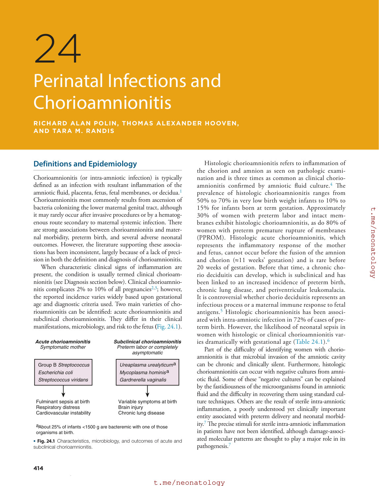
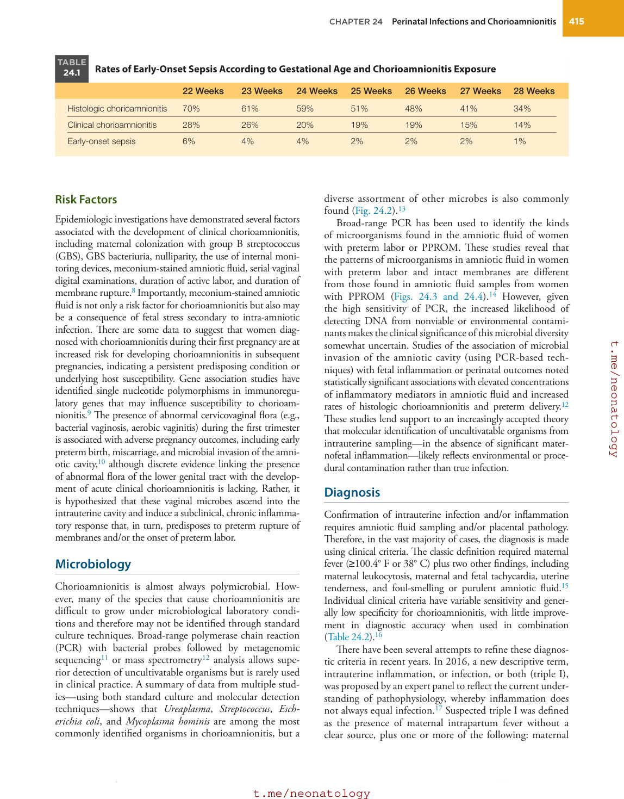
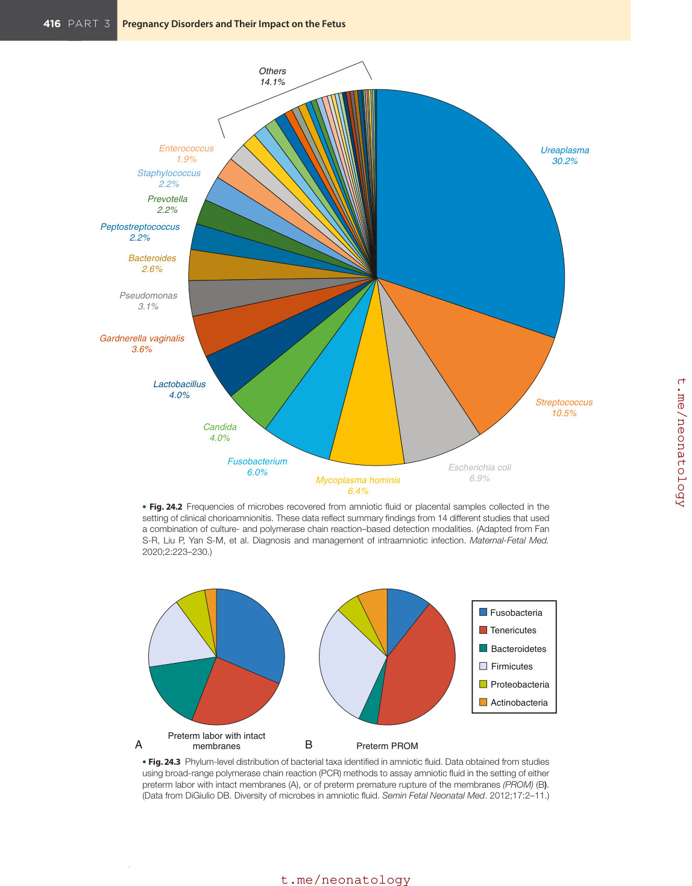
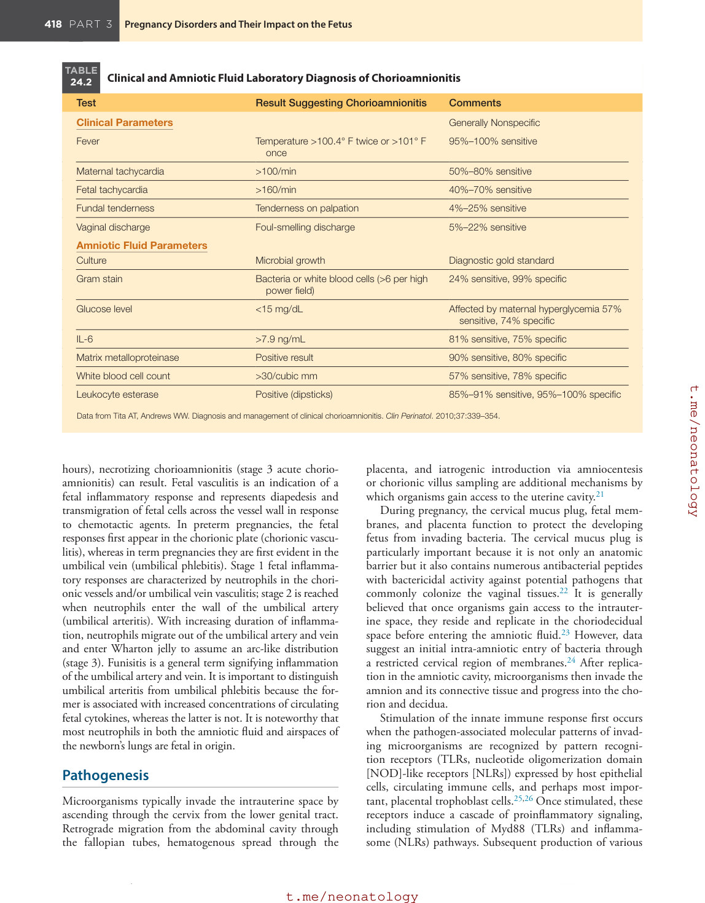
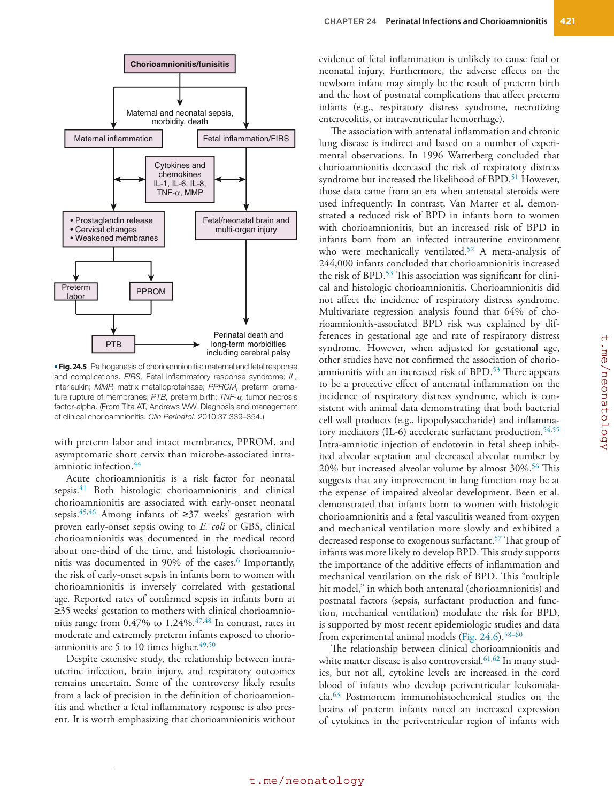
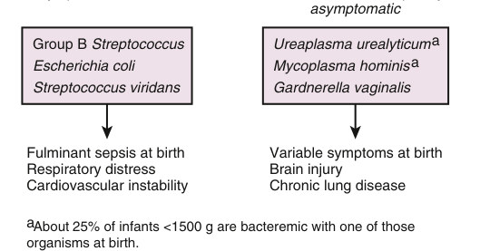
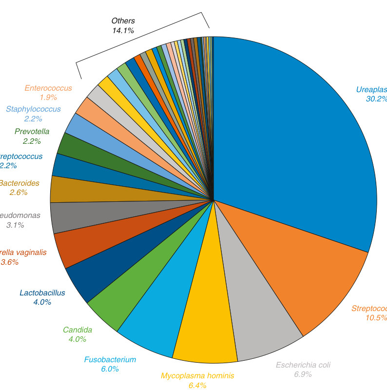
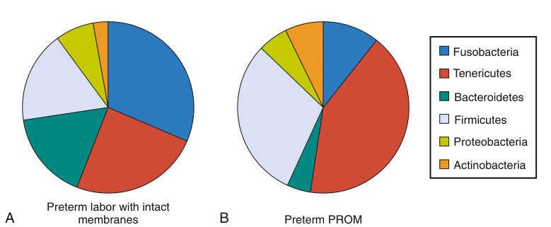
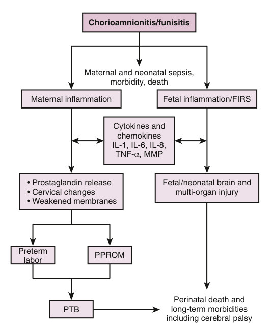

# 24. Perinatal Infections and Chorioamnionitis
> Source attribution: [Source credits](../../SOURCE_CREDITS.md).

## PDF page 429 | printed page 414

24 Perinatal Infections and Chorioamnionitis

### RICHARD ALAN POLIN, THOMAS ALEXANDER HOOVEN, AND TARA M. RANDIS

### Definitions and Epidemiology

Chorioamnionitis (or intra-amniotic infection) is typically defined as an infection with resultant inflammation of the amniotic fluid, placenta, fetus, fetal membranes, or decidua.1 Chorioamnionitis most commonly results from ascension of bacteria colonizing the lower maternal genital tract, although it may rarely occur after invasive procedures or by a hematogenous route secondary to maternal systemic infection. There are strong associations between chorioamnionitis and maternal morbidity, preterm birth, and several adverse neonatal outcomes. However, the literature supporting these associations has been inconsistent, largely because of a lack of precision in both the definition and diagnosis of chorioamnionitis.

When characteristic clinical signs of inflammation are present, the condition is usually termed clinical chorioamnionitis (see Diagnosis section below). Clinical chorioamnionitis complicates 2% to 10% of all pregnancies2,3; however, the reported incidence varies widely based upon gestational age and diagnostic criteria used. Two main varieties of chorioamnionitis can be identified: acute chorioamnionitis and subclinical chorioamnionitis. They differ in their clinical manifestations, microbiology, and risk to the fetus (Fig. 24.1).

Acute chorioamnionitis

Subclinical chorioamnionitis

Symptomatic mother

Preterm labor or completely asymptomatic

Ureaplasma urealyticuma

Group B Streptococcus Escherichia coli

Mycoplasma hominisa

Streptococcus viridans

Gardnerella vaginalis

Fulminant sepsis at birth Respiratory distress Cardiovascular instability

Variable symptoms at birth Brain injury Chronic lung disease

aAbout 25% of infants <1500 g are bacteremic with one of those organisms at birth.

• Fig. 24.1 Characteristics, microbiology, and outcomes of acute and subclinical chorioamnionitis.

414

Histologic chorioamnionitis refers to inflammation of the chorion and amnion as seen on pathologic examination and is three times as common as clinical chorioamnionitis confirmed by amniotic fluid culture.4 The prevalence of histologic chorioamnionitis ranges from 50% to 70% in very low birth weight infants to 10% to 15% for infants born at term gestation. Approximately 30% of women with preterm labor and intact membranes exhibit histologic chorioamnionitis, as do 80% of women with preterm premature rupture of membranes (PPROM). Histologic acute chorioamnionitis, which represents the inflammatory response of the mother and fetus, cannot occur before the fusion of the amnion and chorion (≈11 weeks’ gestation) and is rare before 20 weeks of gestation. Before that time, a chronic chorio deciduitis can develop, which is subclinical and has been linked to an increased incidence of preterm birth, chronic lung disease, and periventricular leukomalacia. It is controversial whether chorio deciduitis represents an infectious process or a maternal immune response to fetal antigens.5 Histologic chorioamnionitis has been associated with intra-amniotic infection in 72% of cases of preterm birth. However, the likelihood of neonatal sepsis in women with histologic or clinical chorioamnionitis varies dramatically with gestational age (Table 24.1).6

Part of the difficulty of identifying women with chorioamnionitis is that microbial invasion of the amniotic cavity can be chronic and clinically silent. Furthermore, histologic chorioamnionitis can occur with negative cultures from amniotic fluid. Some of these “negative cultures” can be explained by the fastidiousness of the microorganisms found in amniotic fluid and the difficulty in recovering them using standard culture techniques. Others are the result of sterile intra-amniotic inflammation, a poorly understood yet clinically important entity associated with preterm delivery and neonatal morbidity.7 The precise stimuli for sterile intra-amniotic inflammation in patients have not been identified, although damage-associated molecular patterns are thought to play a major role in its pathogenesis.7

### Automatic table extraction — verify rendered original

|Group B Streptococcus Escherichia coli Streptococcus viridans|Col2|
|---|---|
|||

[Original table](../../tables/ch024_p0429_1.jpg)

### Automatic table extraction — verify rendered original

|Ureaplasma urealyticuma Mycoplasma hominisa Gardnerella vaginalis|Col2|
|---|---|
|||

[Original table](../../tables/ch024_p0429_2.jpg)

## PDF page 430 | printed page 415

TABLE

Rates of Early-Onset Sepsis According to Gestational Age and Chorioamnionitis Exposure

24.1

22 Weeks 23 Weeks 24 Weeks

Histologic chorioamnionitis 70% 61% 59%

Clinical chorioamnionitis 28% 26% 20%

Early-onset sepsis 6% 4% 4%

### Risk Factors

Epidemiologic investigations have demonstrated several factors associated with the development of clinical chorioamnionitis, including maternal colonization with group B streptococcus (GBS), GBS bacteriuria, nulliparity, the use of internal monitoring devices, meconium-stained amniotic fluid, serial vaginal digital examinations, duration of active labor, and duration of membrane rupture.8 Importantly, meconium-stained amniotic fluid is not only a risk factor for chorioamnionitis but also may be a consequence of fetal stress secondary to intra-amniotic infection. There are some data to suggest that women diagnosed with chorioamnionitis during their first pregnancy are at increased risk for developing chorioamnionitis in subsequent pregnancies, indicating a persistent predisposing condition or underlying host susceptibility. Gene association studies have identified single nucleotide polymorphisms in immunoregulatory genes that may influence susceptibility to chorioamnionitis.9 The presence of abnormal cervicovaginal flora (e.g., bacterial vaginosis, aerobic vaginitis) during the first trimester is associated with adverse pregnancy outcomes, including early preterm birth, miscarriage, and microbial invasion of the amniotic cavity,10 although discrete evidence linking the presence of abnormal flora of the lower genital tract with the development of acute clinical chorioamnionitis is lacking. Rather, it is hypothesized that these vaginal microbes ascend into the intrauterine cavity and induce a subclinical, chronic inflammatory response that, in turn, predisposes to preterm rupture of membranes and/or the onset of preterm labor.

### Microbiology

Chorioamnionitis is almost always polymicrobial. However, many of the species that cause chorioamnionitis are difficult to grow under microbiological laboratory conditions and therefore may not be identified through standard culture techniques. Broad-range polymerase chain reaction (PCR) with bacterial probes followed by metagenomic sequencing11 or mass spectrometry12 analysis allows superior detection of uncultivatable organisms but is rarely used in clinical practice. A summary of data from multiple studies—using both standard culture and molecular detection techniques—shows that Ureaplasma, Streptococcus, Escherichia coli, and Mycoplasma hominis are among the most commonly identified organisms in chorioamnionitis, but a

25 Weeks 26 Weeks 27 Weeks 28 Weeks

51% 48% 41% 34%

19% 19% 15% 14%

2% 2% 2% 1%

diverse assortment of other microbes is also commonly found (Fig. 24.2).13

Broad-range PCR has been used to identify the kinds of microorganisms found in the amniotic fluid of women with preterm labor or PPROM. These studies reveal that the patterns of microorganisms in amniotic fluid in women with preterm labor and intact membranes are different from those found in amniotic fluid samples from women with PPROM (Figs. 24.3 and 24.4).14 However, given the high sensitivity of PCR, the increased likelihood of detecting DNA from nonviable or environmental contaminants makes the clinical significance of this microbial diversity somewhat uncertain. Studies of the association of microbial invasion of the amniotic cavity (using PCR-based techniques) with fetal inflammation or perinatal outcomes noted statistically significant associations with elevated concentrations of inflammatory mediators in amniotic fluid and increased rates of histologic chorioamnionitis and preterm delivery.12 These studies lend support to an increasingly accepted theory that molecular identification of uncultivatable organisms from intrauterine sampling—in the absence of significant maternofetal inflammation—likely reflects environmental or procedural contamination rather than true infection.

### Diagnosis

Confirmation of intrauterine infection and/or inflammation requires amniotic fluid sampling and/or placental pathology. Therefore, in the vast majority of cases, the diagnosis is made using clinical criteria. The classic definition required maternal fever (≥100.4° F or 38° C) plus two other findings, including maternal leukocytosis, maternal and fetal tachycardia, uterine tenderness, and foul-smelling or purulent amniotic fluid.15 Individual clinical criteria have variable sensitivity and generally low specificity for chorioamnionitis, with little improvement in diagnostic accuracy when used in combination (Table 24.2).16

There have been several attempts to refine these diagnostic criteria in recent years. In 2016, a new descriptive term, intrauterine inflammation, or infection, or both (triple I), was proposed by an expert panel to reflect the current understanding of pathophysiology, whereby inflammation does not always equal infection.17 Suspected triple I was defined as the presence of maternal intrapartum fever without a clear source, plus one or more of the following: maternal

## PDF page 431

Others 14.1%

Enterococcus 1.9%

Staphylococcus 2.2%

Prevotella 2.2%

Peptostreptococcus 2.2%

Bacteroides 2.6%

Pseudomonas 3.1%

Gardnerella vaginalis

3.6%

Lactobacillus 4.0%

Candida 4.0%

Fusobacterium 6.0%

Mycoplasma hominis

6.4%

### • Fig. 24.2 Frequencies of microbes recovered from amniotic fluid or placental samples collected in the

setting of clinical chorioamnionitis. These data reflect summary findings from 14 different studies that used a combination of culture- and polymerase chain reaction–based detection modalities. (Adapted from Fan S-R, Liu P, Yan S-M, et al. Diagnosis and management of intraamniotic infection. Maternal-Fetal Med. 2020;2:223–230.)

Preterm labor with intact

membranes A B

### • Fig. 24.3 Phylum-level distribution of bacterial taxa identified in amniotic fluid. Data obtained from studies

using broad-range polymerase chain reaction (PCR) methods to assay amniotic fluid in the setting of either preterm labor with intact membranes (A), or of preterm premature rupture of the membranes (PROM) (B). (Data from DiGiulio DB. Diversity of microbes in amniotic fluid. Semin Fetal Neonatal Med. 2012;17:2–11.)

Ureaplasma 30.2%

Streptococcus

10.5%

Escherichia coli 6.9%

Fusobacteria

Tenericutes

Bacteroidetes

Firmicutes

Proteobacteria

Actinobacteria

Preterm PROM

## PDF page 432 | printed page 417

12

Number of subjects

8

4

0

Fusobacterium Ureaplasma Mycoplasma Sneathia Bacteroides Prevotella Streptococcus Leptotrichia Peptostreptococcus Escherichiaa

Gardnerella

A

Bacterial genus

80

Number of subjects

60

40

20

0

Staphylococcus

Sneathia Haemophilus

Bacteroides

Streptococcus

Ureaplasma

Fusobacterium

Mycoplasma

Leptotrichia

Prevotella

B • Fig. 24.4 Genus-level rank abundance of bacteria in amniotic fluid as determined by polymerase chain reaction (PCR). (A) All 21 taxa reported in studies of women in preterm labor with intact membranes. (B) The 18 taxa that were detected in two or more subjects in studies of women with preterm premature rupture of membranes. aTwo subjects with Escherichia spp. were positive by both PCR and culture; in both cases Escherichia assignment is based on culture findings because the 16s ribosomal DNA gene is unreliable for differentiating between the genera Escherichia and Shigella. bDenotes the taxa that could not be classified to genus-level resolution because of current limitations of reference sequence databases. (Data from DiGiulio DB. Diversity of microbes in amniotic fluid. Semin Fetal Neonatal Med. 2012;17:2-11.)

Bacterial genus

leukocytosis, purulent cervical drainage, or fetal tachycardia. The most recent recommendation from the American College of Obstetricians and Gynecologists defines suspected intra-amniotic infection as a maternal temperature ≥39.0° C or when the maternal temperature is 38.0° to 38.9° C and one additional clinical criterion is present.

It is noteworthy that both of the above definitions recognize isolated maternal fever as a distinct entity. Maternal fever may be caused by intrauterine or extrauterine etiologies. For example, epidural anesthesia is associated with an increased risk of fever during labor and, in most instances, it is thought to be noninfectious in origin. However, fever may be more likely to occur when placental inflammation is present. Fever can occur within 1 hour of epidural placement, but it almost always occurs within 4 to 6 hours.

Laboratory testing may be helpful in confirming or excluding the diagnosis of chorioamnionitis, particularly when the diagnosis is uncertain. Leukocytosis has been described in the majority of patients with clinical chorioamnionitis. However, in the absence of other signs and symptoms, isolated leukocytosis is of limited value. A number of amniotic fluid markers have been studied for the diagnosis of chorioamnionitis.

unc. Fusobacteriab

Bacillus Bergeyella Citrobacter Deftia Lactobacillus Neisseria Staphylococcus Clostridialesb

unc. Bacteroidetesb

Lactobacillus

Gardnerella Peptoniphilus Bifidobacterium

Enterococcus

Listeria

Peptostreptococcus Propionibacterium

These include culture, Gram stain, glucose levels, white blood cell counts, leukocyte esterase, damage-associated molecular patterns, soluble Toll-like receptors (TLRs), matrix metalloproteinase, cytokines (e.g., TNF-alpha, interleukins-6 and -8, matrix metalloproteinase-8), and qualitative assessment of amniotic proteins (proteomics). Proteomic analysis of amniotic fluid has led to the discovery of several novel biomarkers associated with the degree of intra-amniotic inflammation and time to delivery.18 The development of rapid, noninvasive assays to measure biomarkers associated with microbial invasion of the amniotic cavity in cervicovaginal fluid specimens holds promise for future diagnostics.19

The histopathologic findings of chorioamnionitis are well characterized and involve both maternal and fetal immune systems.20 The initial inflammatory response occurs within 6 to 12 hours, is maternal in origin, and is manifested by an infiltration of neutrophils on the undersurface of the chorionic plate (acute subchorionitis). The next site of involvement occurs at the trophoblast layer of the membranous chorion (acute chorionitis). Over the next 12 to 36 hours, the infection spreads to the adjacent chorion and amnion (chorioamnionitis). If the infectious process is prolonged (36–48

## PDF page 433

TABLE

Clinical and Amniotic Fluid Laboratory Diagnosis of Chorioamnionitis

24.2

Test Result Suggesting Chorioamnionitis

Clinical Parameters

Fever Temperature >100.4° F twice or >101° F

once

Maternal tachycardia >100/min

Fetal tachycardia >160/min

Fundal tenderness Tenderness on palpation

Vaginal discharge Foul-smelling discharge

Amniotic Fluid Parameters

Culture Microbial growth

Gram stain Bacteria or white blood cells (>6 per high

power field)

Glucose level <15 mg/dL

IL-6 >7.9 ng/mL

Matrix metalloproteinase Positive result

White blood cell count >30/cubic mm

Leukocyte esterase Positive (dipsticks)

Data from Tita AT, Andrews WW. Diagnosis and management of clinical chorioamnionitis. Clin Perinatol. 2010;37:339–354.

hours), necrotizing chorioamnionitis (stage 3 acute chorioamnionitis) can result. Fetal vasculitis is an indication of a fetal inflammatory response and represents diapedesis and transmigration of fetal cells across the vessel wall in response to chemotactic agents. In preterm pregnancies, the fetal responses first appear in the chorionic plate (chorionic vasculitis), whereas in term pregnancies they are first evident in the umbilical vein (umbilical phlebitis). Stage 1 fetal inflammatory responses are characterized by neutrophils in the chorionic vessels and/or umbilical vein vasculitis; stage 2 is reached when neutrophils enter the wall of the umbilical artery (umbilical arteritis). With increasing duration of inflammation, neutrophils migrate out of the umbilical artery and vein and enter Wharton jelly to assume an arc-like distribution (stage 3). Funisitis is a general term signifying inflammation of the umbilical artery and vein. It is important to distinguish umbilical arteritis from umbilical phlebitis because the former is associated with increased concentrations of circulating fetal cytokines, whereas the latter is not. It is noteworthy that most neutrophils in both the amniotic fluid and airspaces of the newborn’s lungs are fetal in origin.

### Pathogenesis

Microorganisms typically invade the intrauterine space by ascending through the cervix from the lower genital tract. Retrograde migration from the abdominal cavity through the fallopian tubes, hematogenous spread through the

Comments

Generally Nonspecific

95%–100% sensitive

50%–80% sensitive

40%–70% sensitive

4%–25% sensitive

5%–22% sensitive

Diagnostic gold standard

24% sensitive, 99% specific

Affected by maternal hyperglycemia 57%

sensitive, 74% specific

81% sensitive, 75% specific

90% sensitive, 80% specific

57% sensitive, 78% specific

85%–91% sensitive, 95%–100% specific

placenta, and iatrogenic introduction via amniocentesis or chorionic villus sampling are additional mechanisms by which organisms gain access to the uterine cavity.21

During pregnancy, the cervical mucus plug, fetal membranes, and placenta function to protect the developing fetus from invading bacteria. The cervical mucus plug is particularly important because it is not only an anatomic barrier but it also contains numerous antibacterial peptides with bactericidal activity against potential pathogens that commonly colonize the vaginal tissues.22 It is generally believed that once organisms gain access to the intrauterine space, they reside and replicate in the choriodecidual space before entering the amniotic fluid.23 However, data suggest an initial intra-amniotic entry of bacteria through a restricted cervical region of membranes.24 After replication in the amniotic cavity, microorganisms then invade the amnion and its connective tissue and progress into the chorion and decidua.

Stimulation of the innate immune response first occurs when the pathogen-associated molecular patterns of invading microorganisms are recognized by pattern recognition receptors (TLRs, nucleotide oligomerization domain [NOD]-like receptors [NLRs]) expressed by host epithelial cells, circulating immune cells, and perhaps most important, placental trophoblast cells.25,26 Once stimulated, these receptors induce a cascade of proinflammatory signaling, including stimulation of Myd88 (TLRs) and inflammasome (NLRs) pathways. Subsequent production of various

## PDF page 434 | printed page 419

cytokines, chemokines, matrix-degrading enzymes, prostaglandins, and other mediators leads to an inflammatory cell infiltrate, membrane rupture, cervical ripening, and in some cases, the onset of labor. Experimental evidence from animal models of intrauterine infection suggests that the specific inflammatory pathway leading to the induction of preterm labor is dependent on the particular TLR activated (determined by the nature of infecting agent) as well as the route of infection (ascending versus systemic). Recent investigations using human placental explant models have identified the NLRP3 inflammasome as a central mediator of proinflammatory interleukin-1β elaboration, which, in turn, promotes neutrophil infiltration of pregnancy tissues and initiation of labor.27

As mentioned, bacterial invasion of the amniotic cavity may be chronic, existing for several weeks without clinical symptoms. This is particularly true in infections with Ureaplasma spp.28 Several investigators have found amniotic fluid cultures positive for Ureaplasma in asymptomatic women undergoing genetic amniocenteses at 16 to 20 weeks’ gestation.29 Despite a lack of overt symptomatology, a significant portion of these women exhibited a robust inflammatory response as measured by expression of inflammatory cytokines in the amniotic fluid and subsequently went on to experience adverse pregnancy outcomes (fetal loss, preterm birth) compared with those women with sterile cultures. In fact, there is ample evidence to suggest that Ureaplasma spp., traditionally considered to be of relatively low virulence, may evoke a more intense host inflammatory response as compared with other pathogens associated with chorioamnionitis.

### Treatment

### Obstetric Management

Recent practice guidelines from the American College of Obstetricians and Gynecologists emphasize the distinction between isolated intrapartum maternal fever and clinically diagnosed chorioamnionitis. Although obstetricians often administer antibiotics in the setting of isolated maternal fever, this practice is of uncertain benefit, and additional research is needed to understand both the mechanism and appropriate management of isolated maternal fever. Whether or not antibiotics are administered for isolated intrapartum maternal fever, the diagnosis and rationale behind its obstetric management should be conveyed to the neonatology team for consideration in planning care of the newborn.

In the setting of true clinical chorioamnionitis, administration of broad-spectrum antibiotics and prompt delivery of the fetus reduce both fetal and maternal morbidity. Chorioamnionitis alone is not a sufficient indication for cesarean delivery because there is no evidence it improves neonatal outcomes and may increase maternal complications such as wound infection.30 However, findings consistent with fetal

or maternal instability in the setting of chorioamnionitis can be indications for cesarean delivery.

Ampicillin and gentamicin are the most commonly prescribed antimicrobials for intra-amniotic infection, although there are no randomized trials comparing the efficacy of various antibiotic regimens. It is worth noting that standard antibiotic regimens used to treat chorioamnionitis do not provide coverage against Mycoplasma and Ureaplasma spp., two of the most common organisms associated with intra-amniotic infection. Several authors and expert panels have proposed alternative antibiotic protocols to cover these organisms, but these proposals have not been subjected to clinical trials.31 If cesarean delivery is performed, clindamycin (or metronidazole) is often added for anaerobic coverage.

The administration of antenatal corticosteroids to enhance fetal lung maturity in the setting of chorioamnionitis is controversial because it is believed that the immunosuppressive effects of steroids may exacerbate maternal or neonatal infectious complications. Although randomized clinical trials addressing this issue are lacking, there are observational data to suggest that antenatal steroids may actually reduce neonatal morbidity, including severe intraventricular hemorrhage and periventricular leukomalacia in the presence of chorioamnionitis.32,33

PPROM is associated with intra-amniotic infection, and evidence supports routine administration of antibiotics to women presenting with PPROM with the intention of reducing progression to chorioamnionitis, prolonging pregnancy, and decreasing neonatal morbidities (early-onset sepsis, need for supplemental oxygen, brain injury).34 In a 2020 update to practice guidelines, the American College of Obstetricians and Gynecologists recommended 48 hours of intravenous ampicillin and erythromycin, followed by oral amoxicillin and erythromycin, to complete a 7-day course in uncomplicated PPROM.35

Despite the benefits listed above, there is not strong evidence to show that antibiotic administration for PPROM reduces infant mortality. Furthermore, the use of antenatal antibiotics in particular circumstances may be harmful. The administration of co-amoxiclav (ampicillin/clavulanic acid) in women with PPROM or preterm labor with intact membranes was associated with an increased risk for necrotizing enterocolitis in neonates. In addition, the use of both erythromycin and co-amoxiclav antibiotics for women with preterm labor and intact membranes was associated with an unexpected increase in the incidence of cerebral palsy at a 7-year follow-up evaluation.36

### Management of the Exposed Infant

Guidelines for the management of infants with suspected or proven sepsis from the Committee on the Fetus and Newborn of the American Academy of Pediatrics were revised in 2018.37,38 The two clinical reports were divided into

## PDF page 435

recommendations for infants ≥350/7 weeks’ gestation38 and infants ≤346/7 weeks’ gestation.37 Although chorioamnionitis is still considered a risk factor for early-onset sepsis in infants ≥350/7 weeks’ gestation, the specificity of this diagnosis is poor, and relatively few infants born to women with chorioamnionitis in that gestational age strata develop earlyonset sepsis. Additionally, the diagnosis of clinical chorioamnionitis is often made when fever is the sole manifestation of an intrauterine infection. Therefore many infants may be unnecessarily exposed to broad-spectrum antibiotic therapy. Complicating this issue is the increased incidence of fever in women receiving epidural anesthesia. Therefore, if fever is the sole manifestation of suspected chorioamnionitis, consultation with the obstetric provider is recommended to determine the level of clinical suspicion before routinely treating asymptomatic infants.

The Committee on the Fetus and Newborn recommends selecting from three different approaches for infants ≥350/7 weeks’ gestation with a history of chorioamnionitis. The first, termed the categorical risk factor assessment, recommends laboratory testing and empirical antibiotics for all infants born to women with chorioamnionitis and any infant who is ill appearing. This strategy will likely lead to considerable overtreatment of uninfected infants. The second approach, termed multivariate risk assessment, uses established risk factors and the infant’s clinical condition in the first 6 to 12 hours of life to estimate the risk of sepsis. These variables can be entered into a web-based early-onset sepsis calculator (https://neonatalsepsiscalculator.kaiserpermanente.org). (See also Chapter 50.) Blood culture and enhanced clinical observations are recommended for an estimated risk of early-onset sepsis ≥1 per 1000 live births, and empirical antibiotics are recommended for an estimated risk of sepsis ≥3 per 1000 live births. The third strategy relies on identification of clinical signs of illness regardless of any estimation of neonatal or maternal risk factors. Infants who develop signs of illness in the first 48 hours of life are either empirically treated with antibiotics or further evaluated with laboratory testing. Both the multivariate risk approach and serial examination strategy have reduced the number of sepsis evaluations, but the use of either approach will still lead to overtreatment of a substantial number of infants who are uninfected. There is growing evidence to suggest that close observation, rather than empiric antibiotic therapy, is the preferred strategy for the management of asymptomatic full-term infants exposed to chorioamnionitis.39,40 The risk of sepsis in this population is exceedingly low given that the incidence of early-onset sepsis has declined dramatically over the past two decades (because of widespread implementation of intrapartum prophylaxis for mothers colonized with GBS and the treatment of women with chorioamnionitis with antibiotics during labor). This substantially increases the number of healthy term newborns who would require antibiotics to prevent a single case of sepsis.41 Because the risk of early-onset sepsis in infants born to women with chorioamnionitis is strongly dependent on gestational age,

it remains prudent to empirically treat chorioamnionitisexposed preterm infants ≤346/7 weeks’ gestation.

### Outcomes

Chorioamnionitis can adversely affect the mother and her unborn infant. The associations between chorioamnionitis and adverse outcomes are not straightforward given the multiple causes of maternal fever and a lack of concordance between maternal intra-amniotic infection, histologic chorioamnionitis, and clinical chorioamnionitis. In pregnant women, chorioamnionitis is associated with a two-fold increase in abnormal progression of labor, an increased risk of cesarean section,30 postpartum hemorrhage, poor cervical dilation, placental abruption, and intensive care admission.42 Surgical complications after cesarean section, such as endometritis, pelvic abscess, wound infection, thromboembolism, and bacteremia, are also more common in women with chorioamnionitis. The effects of intrauterine infection on the fetus depend on the duration and timing of the inflammatory process. Acute chorioamnionitis is an important risk factor for early-onset neonatal sepsis. Chronic infections, however, are often subclinical and have been associated with a wide variety of organ injury, including the brain (periventricular leukomalacia), lung (bronchopulmonary dysplasia [BPD]), eye (retinopathy of prematurity), intestine (necrotizing enterocolitis), and thymus (involution and a change in cellular composition).43 Chorioamnionitis, especially with a fetal inflammatory component, has also been associated with hemodynamic instability in the preterm newborn infant.

Chorioamnionitis is thought to initiate 40% to 70% of preterm births; the incidence may even be higher at lower gestational ages. The evidence linking infection and preterm labor is as follows: (1) intrauterine infection (or exposure to microbial products) in experimental animals results in preterm delivery; (2) extrauterine maternal infections (e.g., pyelonephritis) are associated with preterm labor; (3) subclinical intrauterine infections are associated with preterm labor and birth; (4) patients with evidence of intrauterine inflammation (e.g., increased amniotic fluid cytokines or matrix metalloproteinases) in the mid-third trimester are at increased risk for preterm delivery; (5) in experimental animal models, antibiotic treatment of intrauterine infections can prevent prematurity; (6) treatment of asymptomatic bacteriuria prevents prematurity; (7) administration of antibiotics to women with PPROM prolongs gestation; (8) microorganisms can be cultured from the placenta in a high percentage of women presenting with preterm labor; and (9) polymorphonuclear infiltrations in the placenta are associated with spontaneous preterm birth. A possible mechanism for infection-associated preterm birth is shown in Fig. 24.5.16 It is important to note that although microorganisms are associated with preterm birth, sterile inflammation is more frequently associated

## PDF page 436 | printed page 421

Chorioamnionitis/funisitis

Maternal and neonatal sepsis, morbidity, death

Maternal inflammation Fetal inflammation/FIRS

Cytokines and chemokines IL-1, IL-6, IL-8, TNF-α, MMP

• Prostaglandin release • Cervical changes • Weakened membranes

Fetal/neonatal brain and multi-organ injury

Preterm labor PPROM

Perinatal death and long-term morbidities including cerebral palsy

PTB

• Fig. 24.5 Pathogenesis of chorioamnionitis: maternal and fetal response and complications. FIRS, Fetal inflammatory response syndrome; IL, interleukin; MMP, matrix metalloproteinase; PPROM, preterm premature rupture of membranes; PTB, preterm birth; TNF-α, tumor necrosis factor-alpha. (From Tita AT, Andrews WW. Diagnosis and management of clinical chorioamnionitis. Clin Perinatol. 2010;37:339–354.)

with preterm labor and intact membranes, PPROM, and asymptomatic short cervix than microbe-associated intraamniotic infection.44

Acute chorioamnionitis is a risk factor for neonatal sepsis.41 Both histologic chorioamnionitis and clinical chorioamnionitis are associated with early-onset neonatal sepsis.45,46 Among infants of ≥37 weeks’ gestation with proven early-onset sepsis owing to E. coli or GBS, clinical chorioamnionitis was documented in the medical record about one-third of the time, and histologic chorioamnionitis was documented in 90% of the cases.6 Importantly, the risk of early-onset sepsis in infants born to women with chorioamnionitis is inversely correlated with gestational age. Reported rates of confirmed sepsis in infants born at ≥35 weeks’ gestation to mothers with clinical chorioamnionitis range from 0.47% to 1.24%.47,48 In contrast, rates in moderate and extremely preterm infants exposed to chorioamnionitis are 5 to 10 times higher.49,50

Despite extensive study, the relationship between intrauterine infection, brain injury, and respiratory outcomes remains uncertain. Some of the controversy likely results from a lack of precision in the definition of chorioamnionitis and whether a fetal inflammatory response is also present. It is worth emphasizing that chorioamnionitis without

evidence of fetal inflammation is unlikely to cause fetal or neonatal injury. Furthermore, the adverse effects on the newborn infant may simply be the result of preterm birth and the host of postnatal complications that affect preterm infants (e.g., respiratory distress syndrome, necrotizing enterocolitis, or intraventricular hemorrhage).

The association with antenatal inflammation and chronic lung disease is indirect and based on a number of experimental observations. In 1996 Watterberg concluded that chorioamnionitis decreased the risk of respiratory distress syndrome but increased the likelihood of BPD.51 However, those data came from an era when antenatal steroids were used infrequently. In contrast, Van Marter et al. demonstrated a reduced risk of BPD in infants born to women with chorioamnionitis, but an increased risk of BPD in infants born from an infected intrauterine environment who were mechanically ventilated.52 A meta-analysis of 244,000 infants concluded that chorioamnionitis increased the risk of BPD.53 This association was significant for clinical and histologic chorioamnionitis. Chorioamnionitis did not affect the incidence of respiratory distress syndrome. Multivariate regression analysis found that 64% of chorioamnionitis-associated BPD risk was explained by differences in gestational age and rate of respiratory distress syndrome. However, when adjusted for gestational age, other studies have not confirmed the association of chorioamnionitis with an increased risk of BPD.53 There appears to be a protective effect of antenatal inflammation on the incidence of respiratory distress syndrome, which is consistent with animal data demonstrating that both bacterial cell wall products (e.g., lipopolysaccharide) and inflammatory mediators (IL-6) accelerate surfactant production.54,55 Intra-amniotic injection of endotoxin in fetal sheep inhibited alveolar septation and decreased alveolar number by 20% but increased alveolar volume by almost 30%.56 This suggests that any improvement in lung function may be at the expense of impaired alveolar development. Been et al. demonstrated that infants born to women with histologic chorioamnionitis and a fetal vasculitis weaned from oxygen and mechanical ventilation more slowly and exhibited a decreased response to exogenous surfactant.57 That group of infants was more likely to develop BPD. This study supports the importance of the additive effects of inflammation and mechanical ventilation on the risk of BPD. This “multiple hit model,” in which both antenatal (chorioamnionitis) and postnatal factors (sepsis, surfactant production and function, mechanical ventilation) modulate the risk for BPD, is supported by most recent epidemiologic studies and data from experimental animal models (Fig. 24.6).58–60

The relationship between clinical chorioamnionitis and white matter disease is also controversial.61,62 In many studies, but not all, cytokine levels are increased in the cord blood of infants who develop periventricular leukomalacia.63 Postmortem immunohistochemical studies on the brains of preterm infants noted an increased expression of cytokines in the periventricular region of infants with

## PDF page 437

Inflammation during resuscitation

Antenatal inflammation

Immaturity Immaturity

Steroids

Chorioamnionitis

Resuscitation

First hit Second hit • Fig. 24.6 The role of chorioamnionitis in the development of bronchopulmonary dysplasia (BPD). A model for the interplay of fetal exposure on early postnatal events that may contribute to altered lung development and injury. (From Kallapur SG, Jobe AH. Antenatal factors that influence postnatal lung development and injury. In: Polin RA, Abman SH, Rowitch D, et al., eds. Fetal and Neonatal Physiology. 6th ed. Vol. 2. Elsevier; 2021:748–756.)

periventricular leukomalacia compared with those without evidence of brain injury. More recent meta-analyses’ data have noted significant associations between histologic and clinical chorioamnionitis with the risk of cerebral palsy.64 However, individual studies have not been consistent in those findings.65,66 Data most supportive of that relationship have come from the Extremely Low Gestational Age Newborns (ELGAN) study, in which nearly 900 placentas were cultured and biopsied following the delivery of extremely low–birth weight infants.67 Histologic chorioamnionitis was associated with ventriculomegaly and diparetic cerebral palsy. The recovery of any aerobic or anaerobic organism from the placenta significantly increased the odds ratios for both these outcomes, as well as the presence of echolucent lesions on head ultrasound. Furthermore, the investigators were able to demonstrate a dose-response relationship between the number of species recovered and the risk of these morbidities.

### Areas for Future Investigation

Despite improved understanding of the pathogenic mechanism by which intrauterine infection leads to adverse

Key Points

• Intra-amniotic infection most frequently results from ascen-

sion of pathogens from the lower genital tract, eliciting variable inflammatory responses in both the mother and fetus. • Exposure to intrauterine inflammation increases the risk

of preterm birth and increases the risk of long-term morbidities, including cerebral palsy, bronchopulmonary dysplasia, and retinopathy of prematurity.

Postnatal inflammation BPD

O2

Immaturity

Infections

Mechanical ventilation

Third hit

pregnancy outcomes, research efforts over the past few decades have yielded little in the way of effective clinical strategies for the prevention and management of intrauterine infection. The development of more rigorous diagnostic criteria may better identify those women and fetuses most likely to benefit from antimicrobial treatment and reduce unnecessary, potentially harmful antibiotic exposure. The development of sepsis calculators that combine a rigorous assessment of intrapartum risk factors together with clinical presentation, like the one introduced by Puopolo and Escobar, may better identify neonates most at risk for early-onset sepsis and reduce the number of healthy infants exposed to unnecessary antimicrobial therapy.68 Continued exploration of the protective role of a healthy vaginal microbiome, mechanisms of abnormal colonization of the lower genital tract, and characterization of maternal/fetal immune responses to specific pathogens may help to identify those women most at risk for infectious complications of pregnancy and open the door for novel preventive strategies. Finally, exploration of potential anti-inflammatory therapies to reduce infection-related morbidities in both the mother and infant is warranted.

• Administration of intrapartum antibiotics to mothers

with chorioamnionitis decreases the risk of neonatal sepsis and postpartum maternal infections. However, novel interventions to disrupt inflammatory signaling cascades in utero are greatly needed.

## PDF page 438 | printed page 423

### References

1. Committee Opinion No. 712: Intrapartum Management of

Intraamniotic Infection. Obstet Gynecol. 2017;130(2):e95–e101. 2. Racusin DA, Chen HY, Bhalwal A, et al. Chorioamnionitis and

adverse outcomes in low-risk pregnancies: a population-based study. J Matern Fetal Neonatal Med. 2021:1–9. 3. Randis TM, Rice MM, Myatt L, et al. Incidence of early-onset

sepsis in infants born to women with clinical chorioamnionitis. J Perinat Med. 2018;46(8):926–933. 4. Curtin WM, Katzman PJ, Florescue H, Metlay LA. Accuracy

of signs of clinical chorioamnionitis in the term parturient. J Perinatol. 2012. 5. Kim CJ, Romero R, Chaemsaithong P, Kim JS. Chronic inflam-

mation of the placenta: definition, classification, pathogenesis, and clinical significance. Am J Obstet Gynecol. 2015;213(suppl 4): S53–S69. 6. Stoll BJ, Hansen NI, Bell EF, et al. Neonatal outcomes of

extremely preterm infants from the NICHD Neonatal Research Network. Pediatrics. 2010;126(3):443–456. 7. Romero R, Miranda J, Chaiworapongsa T, et al. Prevalence and

clinical significance of sterile intra-amniotic inflammation in patients with preterm labor and intact membranes. Am J Reprod Immunol. 2014;72(5):458–474. 8. Seaward PG, Hannah ME, Myhr TL, et al. International Multi-

centre Term Prelabor Rupture of Membranes Study: evaluation of predictors of clinical chorioamnionitis and postpartum fever in patients with prelabor rupture of membranes at term. Am J Obstet Gynecol. 1997;177(5):1024–1029. 9. Karody V, Reese S, Kumar N, et al. A toll-like receptor 9 (rs352140)

variant is associated with placental inflammation in newborn infants. J Matern Fetal Neonatal Med. 2016;29(13):2210–2216. 10. Elovitz MA, Gajer P, Riis V, et al. Cervicovaginal microbiota and

local immune response modulate the risk of spontaneous preterm delivery. Nat Commun. 2019;10(1):1305. 11. Romero R, Gomez-Lopez N, Winters AD, et al. Evidence that

intra-amniotic infections are often the result of an ascending invasion - a molecular microbiological study. J Perinat Med. 2019;47(9):915–931. 12. Romero R, Miranda J, Kusanovic JP, et al. Clinical chorio-

amnionitis at term I: microbiology of the amniotic cavity using cultivation and molecular techniques. J Perinat Med. 2015;43(1):19–36. 13. Fan S-R, Liu P, Yan S-M, et al. Diagnosis and manage-

ment of intraamniotic infection. Maternal-fetal Medicine. 2020;2:223–230. 14. DiGiulio DB. Diversity of microbes in amniotic fluid. Semin

Fetal Neonatal Med. 2012;17(1):2–11. 15. Gibbs RS. Diagnosis of intra-amniotic infection. Semin Perinatol.

1977;1(1):71–77. 16. Tita AT, Andrews WW. Diagnosis and management of clinical

chorioamnionitis. Clin Perinatol. 2010;37(2):339–354. 17. Higgins RD, Saade G, Polin RA, et al. Evaluation and man-

agement of women and newborns with a maternal diagnosis of chorioamnionitis: summary of a workshop. Obstet Gynecol. 2016;127(3):426–436. 18. Hong S, Lee JE, Kim YM, et al. Identifying potential biomarkers

related to pre-term delivery by proteomic analysis of amniotic fluid. Sci Rep. 2020;10(1):19648. 19. Combs CA, Garite TJ, Lapidus JA, et al. Detection of micro-

bial invasion of the amniotic cavity by analysis of cervicovaginal

proteins in women with preterm labor and intact membranes. Am J Obstet Gynecol. 2015;212(4):482.e1–e482.e12. 20. Redline RW. Classification of placental lesions. Am J Obstet

Gynecol. 2015;213(4 Suppl):S21–S28. 21. Goldenberg RL, Culhane JF, Iams JD, Romero R. Epidemiology

and causes of preterm birth. Lancet. 2008;371(9606):75–84. 22. Hein M, Valore EV, Helmig RB, Uldbjerg N, Ganz T. Antimi-

crobial factors in the cervical mucus plug. Am J Obstet Gynecol. 2002;187(1):137–144. 23. Romero R, Mazor M. Infection and preterm labor. Clin Obstet

Gynecol. 1988;31(3):553–584. 24. Kim MJ, Romero R, Gervasi MT, et al. Widespread micro-

bial invasion of the chorioamniotic membranes is a consequence and not a cause of intra-amniotic infection. Lab Invest. 2009;89(8):924–936. 25. Abrahams VM. The role of the Nod-like receptor family in

trophoblast innate immune responses. J Reprod Immunol. 2011;88(2):112–117. 26. Holmlund U, Cebers G, Dahlfors AR, et al. Expression and reg-

ulation of the pattern recognition receptors Toll-like receptor-2 and Toll-like receptor-4 in the human placenta. Immunology. 2002;107(1):145–151. 27. Miller AS, Hidalgo TN, Abrahams VM. Human fetal mem-

brane IL-1beta production in response to bacterial components is mediated by uric-acid induced NLRP3 inflammasome activation. J Reprod Immunol. 2022;149:103457. 28. Romero R, Espinoza J, Kusanovic JP, et al. The preterm parturi-

tion syndrome. BJOG. 2006;113(suppl 3):17–42. 29. Sweeney EL, Dando SJ, Kallapur SG, Knox CL. The human

ureaplasma species as causative agents of chorioamnionitis. Clin Microbiol Rev. 2017;30(1):349–379. 30. Venkatesh KK, Glover AV, Vladutiu CJ, Stamilio DM. Association

of chorioamnionitis and its duration with adverse maternal outcomes by mode of delivery: a cohort study. BJOG. 2019;126(6):719–727. 31. Conde-Agudelo A, Romero R, Jung EJ, Garcia Sanchez AJ.

Management of clinical chorioamnionitis: an evidence-based approach. Am J Obstet Gynecol. 2020;223(6):848–869. 32. Been JV, Degraeuwe PL, Kramer BW, Zimmermann LJ. Antena-

tal steroids and neonatal outcome after chorioamnionitis: a metaanalysis. BJOG. 2011;118(2):113–122. 33. Lee HS, Kim SY. Histological chorioamnionitis, antenatal ste-

roids, and neonatal outcomes in very low birth weight infants: a nationwide study. PLoS One. 2019;14(10):e0224450. 34. Kenyon S, Boulvain M, Neilson JP. Antibiotics for preterm rupture

of membranes. Cochrane Database Syst Rev. 2013;(12):CD001058. 35. Prelabor Rupture of Membranes: ACOG Practice Bulletin,

Number 217. Obstet Gynecol. 2020;135(3):e80–e97. 36. Kenyon SL, Taylor DJ, Tarnow-Mordi W, ORACLE Collab-

orative Group. Broad-spectrum antibiotics for spontaneous preterm labour: the ORACLE II randomised trial. Lancet. 2001;357(9261):989–994. 37. Puopolo KM, Benitz WE, Zaoutis TE; Committee on Fetus and

Newborn; Committee on Infectious Diseases. Management of neonates born at ≤34 6/7 weeks’ gestation with suspected or proven early-onset bacterial sepsis. Pediatrics. 2018;142(6): e20182896. 38. Puopolo KM, Benitz WE, Zaoutis TE; Committee on Fetus

and Newborn; Committee on Infectious Diseases. Management of neonates born at ≥35 0/7 weeks’ gestation with suspected or proven early-onset bacterial sepsis. Pediatrics. 2018;142(6):e20182894.

## PDF page 439

39. Berardi A, Buffagni AM, Rossi C, et al. Serial physical examina-

tions, a simple and reliable tool for managing neonates at risk for early-onset sepsis. World J Clin Pediatr. 2016;5(4):358–364. 40. Jan AI, Ramanathan R, Cayabyab RG. Chorioamnionitis and

management of asymptomatic infants ≥35 weeks without empiric antibiotics. Pediatrics. 2017;140(1). 41. Wortham JM, Hansen NI, Schrag SJ, et al. Chorioamnionitis

and culture-confirmed, early-onset neonatal infections. Pediatrics. 2016;137(1):e20162744. 42. Perry AK, Rossi RM, DeFranco EA. Severe adverse maternal

outcomes associated with chorioamnionitis. Am J Obstet Gynecol MFM. 2019;1(3):100027. 43. Gantert M, Been JV, Gavilanes AW, et al. Chorioam-

nionitis: a multiorgan disease of the fetus? J Perinatol. 2010;30(Suppl):S21–S30. 44. Romero R, Miranda J, Chaemsaithong P, et al. Sterile and

microbial-associated intra-amniotic inflammation in preterm prelabor rupture of membranes. J Matern Fetal Neonatal Med. 2015;28(12):1394–1409. 45. Beck C, Gallagher K, Taylor LA, et al. Chorioamnionitis and risk

for maternal and neonatal sepsis: a systematic review and metaanalysis. Obstet Gynecol. 2021;137(6):1007–1022. 46. Villamor-Martinez E, Lubach GA, Rahim OM, et al. Association

of histological and clinical chorioamnionitis with neonatal sepsis among preterm infants: a systematic review, meta-analysis, and meta-regression. Front Immunol. 2020;11:972. 47. Benitz WE, Wynn JL, Polin RA. Reappraisal of guidelines for

management of neonates with suspected early-onset sepsis. J Pediatr. 2015;166(4):1070–1074. 48. Jackson GL, Rawiki P, Sendelbach D, et al. Hospital course and

short-term outcomes of term and late preterm neonates following exposure to prolonged rupture of membranes and/or chorioamnionitis. Pediatr Infect Dis J. 2012;31(1):89–90. 49. Garcia-Munoz Rodrigo F, Galan Henriquez G, Figueras Aloy J,

Garcia-Alix Perez A. Outcomes of very-low-birth-weight infants exposed to maternal clinical chorioamnionitis: a multicentre study. Neonatology. 2014;106(3):229–234. 50. Pappas A, Kendrick DE, Shankaran S, et al. Chorioamnionitis and

early childhood outcomes among extremely low-gestational-age neonates. JAMA Pediatr. 2014;168(2):137–147. 51. Watterberg KL, Demers LM, Scott SM, Murphy S. Chorioamni-

onitis and early lung inflammation in infants in whom bronchopulmonary dysplasia develops. Pediatrics. 1996;97(2):210–215. 52. Van Marter LJ, Dammann O, Allred EN, et al. Chorioam-

nionitis, mechanical ventilation, and postnatal sepsis as modulators of chronic lung disease in preterm infants. J Pediatr. 2002;140(2):171–176. 53. Villamor-Martinez E, Alvarez-Fuente M, Ghazi AMT, et al.

Association of chorioamnionitis with bronchopulmonary dysplasia among preterm infants: a systematic review, meta-analysis, and metaregression. JAMA Netw Open. 2019;2(11):e1914611.

54. Bry K, Lappalainen U, Hallman M. Intraamniotic interleu-

kin-1 accelerates surfactant protein synthesis in fetal rabbits and improves lung stability after premature birth. J Clin Invest. 1997;99(12):2992–2999. 55. Thomas W, Speer CP. Chorioamnionitis: important risk fac-

tor or innocent bystander for neonatal outcome? Neonatology. 2011;99(3):177–187. 56. Willet KE, Jobe AH, Ikegami M, et al. Antenatal endotoxin and

glucocorticoid effects on lung morphometry in preterm lambs. Pediatr Res. 2000;48(6):782–788. 57. Been JV, Rours IG, Kornelisse RF, et al. Chorioamnionitis

alters the response to surfactant in preterm infants. J Pediatr. 2010;156(1):10–15.e1. 58. Ballard AR, Mallett LH, Pruszynski JE, Cantey JB. Chorio-

amnionitis and subsequent bronchopulmonary dysplasia in very-low-birth weight infants: a 25-year cohort. J Perinatol. 2016;36(12):1045–1048. 59. Kallapur SG, Kramer BW, Jobe AH. Ureaplasma and BPD.

Semin Perinatol. 2013;37(2):94–101. 60. Thomas W, Speer CP. Chorioamnionitis is essential in the evolu-

tion of bronchopulmonary dysplasia--the case in favour. Paediatr Respir Rev. 2014;15(1):49–52. 61. Abiramalatha T, Bandyopadhyay T, Ramaswamy VV, et al. Risk

factors for periventricular leukomalacia in preterm infants: a systematic review, meta-analysis, and GRADE-based assessment of certainty of evidence. Pediatr Neurol. 2021;124:51–71. 62. Bierstone D, Wagenaar N, Gano DL, et al. Association of his-

tologic chorioamnionitis with perinatal brain injury and early childhood neurodevelopmental outcomes among preterm neonates. JAMA Pediatr. 2018;172(6):534–541. 63. Yoon BH, Romero R, Yang SH, et al. Interleukin-6 concentra-

tions in umbilical cord plasma are elevated in neonates with white matter lesions associated with periventricular leukomalacia. Am J Obstet Gynecol. 1996;174(5):1433–1440. 64. Ayubi E, Sarhadi S, Mansori K. Maternal infection during preg-

nancy and risk of cerebral palsy in children: a systematic review and meta-analysis. J Child Neurol. 2021;36(5):385–402. 65. Maisonneuve E, Ancel PY, Foix-L’Helias L, et al. Impact of clini-

cal and/or histological chorioamnionitis on neurodevelopmental outcomes in preterm infants: a literature review. J Gynecol Obstet Hum Reprod. 2017;46(4):307–316. 66. Shi Z, Ma L, Luo K, et al. Chorioamnionitis in the development

of cerebral palsy: a meta-analysis and systematic review. Pediatrics. 2017;139(6). 67. Leviton A, Allred EN, Kuban KC, et al. Microbiologic and his-

tologic characteristics of the extremely preterm infant’s placenta predict white matter damage and later cerebral palsy. the ELGAN study. Pediatr Res. 2010;67(1):95–101. 68. Escobar GJ, Puopolo KM, Wi S, et al. Stratification of risk of

early-onset sepsis in newborns ≥34 weeks’ gestation. Pediatrics. 2014;133(1):30–36.

<!-- SOURCE_LAYOUT_VIEWS -->

## Original layout views and recovered diagrams

Automatic extraction can flatten tables and superscripts. Check the original layout for numeric data, footnotes and image credits. [Source review notes](../../SOURCE_REVIEW_NOTES.md).

### Original source page 429

### Original source page 430

### Original source page 431

### Original source page 433

### Original source page 436

• Fig. 24.1 Characteristics, microbiology, and outcomes of acute and subclinical chorioamnionitis.

PDF p. 429

• Fig. 24.2 Frequencies of microbes recovered from amniotic fluid or placental samples collected in the setting of clinical chorioamnionitis. These data reflect summary findings from 14 different studies that used a combination of culture- and polymerase chain reaction–based detection modalities. (Adapted from Fan S-R, Liu P, Yan S-M, et al. Diagnosis and management of intraamniotic infection. Maternal-Fetal Med. 2020;2:223–230.)

PDF p. 431

• Fig. 24.3 Phylum-level distribution of bacterial taxa identified in amniotic fluid. Data obtained from studies using broad-range polymerase chain reaction (PCR) methods to assay amniotic fluid in the setting of either preterm labor with intact membranes (A), or of preterm premature rupture of the membranes (PROM) (B). (Data from DiGiulio DB. Diversity of microbes in amniotic fluid. Semin Fetal Neonatal Med. 2012;17:2–11.)

PDF p. 431

• Fig. 24.5 Pathogenesis of chorioamnionitis: maternal and fetal response and complications. FIRS, Fetal inflammatory response syndrome; IL, interleukin; MMP, matrix metalloproteinase; PPROM, preterm premature rupture of membranes; PTB, preterm birth; TNF-α, tumor necrosis factor-alpha. (From Tita AT, Andrews WW. Diagnosis and management of clinical chorioamnionitis. Clin Perinatol. 2010;37:339–354.)

PDF p. 436
