# 27. Physical Examination of the Healthy Newborn
> Source attribution: [Source credits](../../SOURCE_CREDITS.md).

## PDF page 467 | printed page 453

27 Physical Examination of the Healthy Newborn

### KATHERINE GRISWOLD AND GANGA L. SRINIVAS

Immediately after a baby is born, all parents want to know, “Is my baby all right?” A quick initial physical examination of all newborns should be performed in the delivery room to ensure that there are no major anomalies or birth injuries, that the newborn’s lips and body appear pink, and that breathing is normal. This primary survey must include a brief look at the entire body. This usually allows the clinician (who may be the obstetrician or delivery room nurse) to reassure the parents that their infant looks well and appears normal.

Many serious congenital anomalies are identified prenatally on obstetric ultrasound, their presence anticipated, and a management plan made before delivery. If the newborn is sufficiently preterm or small for gestational age, has a significant problem diagnosed prenatally or at birth, or is unwell (e.g., respiratory distress), the newborn may need to be admitted to an intermediate or neonatal intensive care unit (NICU).

If not already informed prenatally, the parents will be eager to hear if they have a boy or girl. Rarely, there may be uncertainty about the infant’s anatomic sex, in which case it is important not to guess but to inform the parents that further evaluation is required before the sex can be determined.

During the first few hours after birth, healthy newborns are usually alert and reactive. If placed skin-to-skin and left undisturbed, newborns exhibit several behaviors that seek the breast, leading to a successful latch and feed (Fig. 27.1).1 This behavior also provides an initial opportunity for the mother to form a close bond with her infant and to establish breastfeeding. In addition, skin-to-skin care improves cardiorespiratory stability during transition and is associated with more stable blood glucose.2 Medical interference, including unnecessary suctioning,3 during this time should be kept to a minimum to avoid disruption of the delicate but critical processes of bonding and breastfeeding.

### Routine Examination

Every infant should undergo a “routine examination of the newborn,” a detailed physical examination performed by

a trained health care provider, within 24 hours of birth.4 This second examination should be deferred to allow uninterrupted skin-to-skin contact for at least the first hour of life and the first breastfeed.5 In general, a nursing dyad should not be disturbed. The objectives of the examination are listed in Box 27.1. The prevalence of the most common significant congenital abnormalities is shown in Table 27.1. Despite access to high-quality prenatal ultrasound diagnosis, many deviations from the normal are first noted in the delivery room or during the routine examination of the newborn. They are described briefly in this chapter; detailed descriptions are found elsewhere in the book.

### Preparation

Prior to the initial comprehensive physical exam, a thorough review should be conducted of the mother’s chart for details of prenatal and other histories and any initial newborn records documenting the newborn’s appearance, vital signs, and interventions. Relevant items are listed in Box 27.2.

### Introduction to the Parents

The health care provider should introduce him/herself to the mother, ascertain the identity of any other persons in the room, and explain the purpose of the examination. Before proceeding with exchange of medical information, it is advisable to confirm that all discussions can occur in the presence of others in the room, or in the case of medically or socially sensitive information, request that they step out for the mother’s privacy. It is usually best to start by asking if there are any concerns about the infant and any progress with feeding. Confirm the maternal obstetric, past medical, and social histories in an open-ended manner, and obtain elements of family history of particular interest to the pediatrician that may not have been addressed during the prenatal course, such as paternal family history or phototherapy or hip dysplasia in first-degree relatives. Before starting the examination, the health care professional must

453

## PDF page 468

A

B

### • Fig. 27.1 Newborn behaviors immediately after delivery when placed

skin-to-skin on mother. (A) Baby looks at the breast at 15 minutes of life. (B) As part of the alert phase, the baby looks up at the mother at 21 minutes of life. (From Widström AM, Lilja G, Aaltomaa-Michalias P, et al. Newborn behaviour to locate the breast when skin-to-skin: a possible method for enabling early self-regulation. Acta Paediatr. 2011;100[1]:79–85.)

### • BOX 27.1 Objectives of Routine Examination of

### the Newborn

• Assess transition to extrauterine life • Check for potential problems arising from maternal

disease, familial disorders, or problems during pregnancy • Detect congenital abnormalities • Determine whether any of the wide range of nonacute

neonatal problems is present, and initiate their management or reassure the parents • Provide an opportunity for the parents to discuss any

questions about their infant • Initiate health promotion for the newborn (e.g.,

breastfeeding, screening for disease, immunizations, prevention of sudden infant death syndrome [SIDS], safe transport in cars) • Ensure that an appropriate plan is in place for outpatient

pediatric care, including proactive trained breastfeeding support • Ensure that an infant is safe to discharge with adequate

social and mental health support for caregivers, especially in the presence of social adversity, mental health concerns, substance use disorders, severe learning difficulties, or child protection issues

### Prevalence of Significant Congenital

TABLE

27.1

### Anomalies

Prevalence per 1000 Live Births

Anomaly

Congenital heart disease 6–8 (0.8 identified in

the first day of life)

Hypospadias 4

Down syndrome 1.3

Talipes equinovarus 1.1

0.7–1.1 (∼7/1000 will

Developmental dysplasia of the

hip

have an abnormal initial examination)

Cleft lip and palate 0.8

Spina bifida/anencephaly 0.5

Anomalies Found on Fetal Ultrasound

Hydronephrosis or urinary tract

200–250

abnormalities

Central nervous system

1–2

abnormalities (e.g., corpus callosum or septum pellucidum structure, cavum septum interpositum cyst, cerebellar abnormalities, ventriculomegaly)

conduct hand hygiene and ensure that the newborn can be examined in a warm, private area with good lighting. In the overarching imperative of keeping the infant with the mother, examination should be conducted at the mother’s bedside; some elements can even be performed skin to skin.

### Order of the Examination

The exact sequence in which the newborn is examined is flexible so long as the entire body is examined at some stage. If the newborn is quiet, take the opportunity to listen to the heart, examine the eyes, check the femoral pulses, and perform a gentle hip exam. It is often convenient to start by making general observations of the newborn’s appearance, posture, movements, and behavior while undressing him or her. Next, while conducting the comprehensive examination, make sure to remove the diaper to examine the genital region in detail. Finally, pick up the infant and turn him or her over to examine the back and spine and assess tone in the prone position (Fig. 27.2).

### Measurements

Growth parameters should be interpreted in the context of gestational age. The birth weight percentile should be ascertained from gestation-specific growth charts, such as the Olsen birth weight charts or the Fenton growth charts. Parameters for newborns in the growth charts from the World Health Organization (WHO) or Centers for

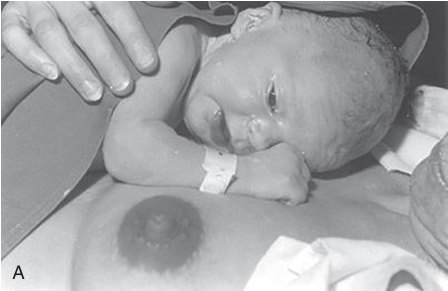

• Fig. 27.1 Newborn behaviors immediately after delivery when placed skin-to-skin on mother. (A) Baby looks at the breast at 15 minutes of life. (B) As part of the alert phase, the baby looks up at the mother at 21 minutes of life. (From Widström AM, Lilja G, Aaltomaa-Michalias P, et al. Newborn behaviour to locate the breast when skin-to-skin: a possible method for enabling early self-regulation. Acta Paediatr. 2011;100[1]:79–85.)

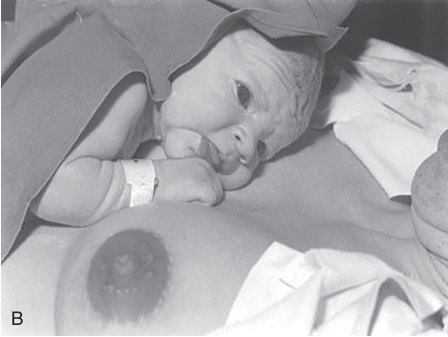

• Fig. 27.1 Newborn behaviors immediately after delivery when placed skin-to-skin on mother. (A) Baby looks at the breast at 15 minutes of life. (B) As part of the alert phase, the baby looks up at the mother at 21 minutes of life. (From Widström AM, Lilja G, Aaltomaa-Michalias P, et al. Newborn behaviour to locate the breast when skin-to-skin: a possible method for enabling early self-regulation. Acta Paediatr. 2011;100[1]:79–85.)

## PDF page 469 | printed page 455

• BOX 27.2 Information to Be Collected From

the Mother’s and Infant’s Medical Records. Elements Should Be Confirmed in Person

Maternal Information

• Pregnancy History: conditions and management • Mother’s age and duration of gestation • Prenatal screening tests—blood type Rh and direct

antibody test, human immunodeficiency virus (HIV), hepatitis B, syphilis, gonorrhea, chlamydia, rubella, group B streptococcus • Pregnancy-related conditions—diabetes, hypertension,

and hypothyroidism • Results of prenatal ultrasounds, and evolution of early

abnormalities detected • Special diagnostic tests (e.g., noninvasive prenatal

testing, amniocentesis, chorionic villus sampling) • Labor and Delivery • Maternal fever or other evidence of infection, duration of

rupture of membranes • Quality of amniotic fluid • Operative delivery or instrumentation • Complications during delivery such as shoulder

dystocia or umbilical cord findings • History of Previous Pregnancies, including breastfeeding

experience and barriers, and current plans • Mother’s Past, Family, and Social Histories • Long-standing medical, surgical or psychiatric

conditions, including substance use disorder, with attention to plans for postpartum management, especially if breastfeeding • Conditions affecting first-degree relatives as well as

any family member (e.g., neonatal jaundice requiring phototherapy, sudden infant death syndrome [SIDS], hip dysplasia) • Occupation and return to work plans, housing and food

security, amenities to care for infant • Maternal tobacco, alcohol, or other drug use • Violence in intimate relationships, or child protection

issues • Other challenges to safe care of the infant (e.g., severe

cognitive impairment, untreated severe mental health disorders)

Infant Information From Chart Review

• Sex • Resuscitation provided and Apgar scores • Birth weight, length, and head circumference • Physiologic stability (vital signs, oxygenation, feeding,

glucose measurement if indicated) • Any discrepancy noted from stated gestational age • Any concerns noted by nursing or other staff

Disease Control and Prevention (CDC) correspond to 40 weeks’ gestational age and therefore misidentify growth percentiles for infants who are late-preterm (34–36 completed weeks) or postmature (>41 weeks). The WHO and CDC charts should be reserved for use after discharge. The 10th to 90th percentile for weight at 40 weeks’ gestation for a female is 2.85 to 4.07 kg (mean, 3.45 kg) and male is 2.9 to 4.23 kg (mean, 3.58 kg). If the infant’s gestational age is uncertain, it can be determined (±2 weeks’

gestational age) using a standardized scoring scheme such as the Ballard6 score (Fig. 27.3). Infants often lose weight over the first few days of life, with a median loss of 7% by 48 hours of life.7 A loss of greater than 10% of birth weight or continued substantial weight loss after the fourth or fifth day of life is a cause for concern. The Newborn Weight Loss Tool (www.NEWT.org), organized by mode of delivery, provides the percentile of weight loss up to 30 days of life and is a useful adjunct in assessment of adequacy of breastfeeding.

The head circumference should be measured with a disposable tape measure at its maximal occipital frontal circumference (inion to nasion) and should also be plotted on a gestation-specific growth chart to identify microcephaly or macrocephaly and to serve as a reference for future measurements. However, the measurement can change markedly in the first few days because of molding of the head during delivery. The 10th to 90th percentile is 32.6 to 36.2 cm for females and 32.8 to 36.8 cm for males at 40 weeks’ gestation.

The infant’s length is also recorded, but because the hips and lower legs need to be held extended, unless a length board is used, the length is rarely measured accurately enough to identify short stature or serve as a reliable reference value when measured routinely. Although short limbs relative to the trunk because of skeletal dysplasias can be difficult to appreciate in the immediate newborn period, an upper segment:lower segment measurement may be helpful, and a ratio of 1.7 is considered normal.

### General Observation of Appearance, Posture, and Movements

Much valuable information can be gleaned by simply observing the newborn. Newborn posture, tone, and color speak to the infant’s adjustment to postnatal life and general well-being. Normal infant posture is marked by increasing flexion of the extremities from late preterm to term, and infants may be observed to breathe at 40 to 60 breaths per minute with gentle abdominal excursions, with pink face, body, and extremities, and a flexion response to stimulation. Flaccid or rigid limbs, rapid breathing especially if irregular or accompanied by evidence of increased respiratory effort, and pale or dusky color (especially centrally) all require attention.

### Syndromes

The appearance of the face is central to many syndromes, and if the face appears abnormal, the first question to arise is whether the newborn has a syndrome. Down syndrome is by far the most common. The characteristic facies may be difficult to recognize in the immediate neonatal period, especially in preterm infants, but other abnormalities, such as pronounced hypotonia, flat occiput, short neck, bilateral single transverse palmar creases, and a pronounced sandal gap (an abnormal spacing between the first two toes), can

## PDF page 470

General Observations Weight, length, head circumference Gestation Overall observation Movements and tone

Chest Respiratory rate Chest retractions Heart sounds and murmur

Head and Face Fontanelle Facial appearance

for dysmorphic features

Eyes Cataract (red reflex)

Mouth Cleft lip and palate Central cyanosis

Abdomen Abdominal distention Enlarged liver, spleen, kidneys, or a mass

Hips Developmental dysplasia of the hips Upper limbs Digits Palmar creases

• Fig. 27.2 Main features of routine examination of the newborn.

be appreciated at birth. In some cases, the parents will need to be informed of the concern before the results of the chromosome analysis are available.

When the diagnosis is uncertain, for the many hundreds of syndromes described, a book or computer database should be consulted and advice sought from a clinical geneticist (see Chapter 29).

### Skin

Inspect the skin for color, rashes, texture, and birthmarks. Although acrocyanosis is commonly seen in the first day of life, central cyanosis, best observed on the tongue, requires urgent investigation. If there is any doubt, the newborn’s oxygen saturation should be checked with a pulse oximeter. A blue discoloration of the skin, often with petechiae, can affect the presenting part in a face or breech presentation or the head and neck if the umbilical cord was wrapped around the infant’s neck. This can be distinguished from central cyanosis because the tongue remains pink. The infant may be plethoric from polycythemia or unduly pale from anemia or shock. Polycythemic infants (central hematocrit >65%) sometimes appear cyanotic because of the high concentration of reduced hemoglobin in their blood, even though they are adequately oxygenated. If there is a concern for polycythemia or anemia,

Skin Pallor Jaundice Plethora

Pulses Femoral pulses

Genitalia and anus Hypospadias Undescended testes Ambiguous genitalia Anus–position and appearance Back Midline defects

Lower limbs Talipes–positional/

equinovarus

the hemoglobin concentration or hematocrit should be measured. Harlequin color change is a rare but dramatic manifestation of infant vasomotor instability, presenting with a longitudinal sharply demarcated reddening down one half of the body and a blanching down the other side. This lasts for a few minutes but can be understandably disturbing to parents and staff. Jaundice within the first 24 hours of birth, unless mild, is most likely to be hemolytic and requires urgent investigation and treatment. It may also be a feature of congenital infection. Manage according to guidelines.

The following newborn skin conditions are benign and self-limited and do not need any treatment. Cracked, peeling skin is common, especially in post-term infants, and does not need investigation or interventions unless platelike or deep, suggesting ichthyosis. Congenital dermal melanocytoses (also termed cerulean spots) are blue-black macular discolorations at the base of the spine or on the buttocks and are present at birth. They occasionally also occur on the legs or other parts of the body. They are most common in Black or Asian infants and fade slowly over the first few years of life. They are of no clinical significance but are occasionally misdiagnosed as bruises: therefore their presence and distribution at birth should be recorded. Neonatal urticaria (erythema toxicum neonatorum) is a common rash that usually starts on the second or third day of life. It consists of small whitish papules

## PDF page 471 | printed page 457

### NEUROMUSCULAR MATURITY

1

0 1 2

Posture

Square window (wrist)

90°

90°

60°

Arm recoil

180°

140°–180° 110°–140°

Popliteal angle

140° 160°

180°

Scarf sign

Heel to ear

### PHYSICAL MATURITY

Superficial peeling and/or rash, few veins

Sticky, friable, transparent

Gelatinous red, translucent

Smooth pink, visible veins

Skin

Lanugo

None Sparse Abundant Thinning

Heel–toe

50 mm no crease

Anterior transverse crease only

Plantar surface

Faint red marks

40–50 mm: 1 40 mm: 2

Stippled areola 1–2 mm bud

Barely perceptible Flat areola, no bud

Breast

Imperceptible

Well-curved pinna; soft but ready recoil

Lids fused

Lids open; pinna flat, stays folded

Sl. curved pinna; soft; slow recoil

Eye/ear

loosely: 1 tightly: 2

Scrotum flat, smooth

Scrotum empty; faint rugae

Testes in upper canal; rare rugae

Testes descending; few rugae

Genitals, male

Prominent clitoris, small labia minora

Prominent clitoris, enlarging minora

Majora and minora equally prominent

Clitoris prominent, labia flat

Genitals, female

### • Fig. 27.3 Assessment of gestational age using the revised Ballard method. (From Ballard JL, Khoury

JC, Wedig K, et al. New Ballard Score, expanded to include extremely premature infants. J Pediatr. 1991;119:417.)

3 4 5

45° 30°

0°

90°

90°–110°

90°

90° 100° 120°

Maturity Rating

Parchment, deep cracking, no vessels –10

Score Weeks

Cracking pale areas, rare veins

Leathery, cracked, wrinkled

20

–5

22

Bald areas Mostly bald

0

24

5

26

Creases over entire sole

Creases ant. 2/3

10

28

15

30

Raised areola 3–4 mm bud

Full areola 5–10 mm bud

20

32

Formed and firm instant recoil

25

34

Thick cartilage, ear stiff

30

36

Testes down; good rugae

35

38

Testes pendulous; deep rugae

40

40

Majora large, minora small

Majora cover clitoris and minora

45

42

50

44

## PDF page 472

at the center of an erythematous base. Eosinophils are present on microscopy. The lesions resolve over 1 to 3 days with fresh crops appearing for a few days, and all lesions resolve around the fifth day. Neonatal pustular melanosis begins at 37 to 38 weeks of gestation and therefore may evolve in utero. It is more common in Black infants. If pustules are present at birth, there is minimal to no surrounding erythema, and the top of the tiny pustule is readily removed by wiping to reveal a melanotic freckle which takes several months to fade. The pus contains neutrophils, which may lead to a concern for bacterial infection, from which it is distinguished by absence of erythema around the lesions. Milia are benign white cysts on the nose and cheeks from retention of keratin and sebaceous material in the pilaceous follicles.

Café au lait spots are common, but more than three lesions or one large lesion may indicate an underlying disorder such as neurofibromatosis type 1 or McCune- Albright syndrome. A family history which includes learning disabilities, attention-deficit disorder, and seizures may be helpful in further diagnosis. If several café au lait macules are present, examine the infant’s axillae and inguinal regions for freckling, suggestive of neurofibromatosis 1.

Several vascular anomalies can be present at birth, some of which may be of long-term significance. The classification system has changed recently to more accurately reflect two distinct pathologic groups: malformations (errors in vasculogenesis), which may be associated with other anomalies (e.g., Sturge-Weber and Klippel-Trénaunay syndromes), and tumors (proliferating endothelium).8

Vascular malformations are present at birth. The macular stain of infancy or nevus simplex, previously called “capillary hemangiomas” or “stork bites,” are pink macules caused by distention of dermal capillaries and are seen on the upper eyelids, the midforehead, or the nape of the neck. They occur in 40% to 60% of infants and gradually fade during the first year, although those on the neck may persist but become covered with hair.

Port-wine stains, or “nevus flammeus,” are caused by a vascular malformation of capillaries in the dermis. They may be anywhere on the body, are usually unilateral or segmental, and do not cross the midline. The face is a common site, along the distribution of the branches of the trigeminal nerve. They do not fade but grow with the child and become darker. When these lesions are disfiguring, their appearance can be improved using laser therapy. If the port-wine stain affects the central and lateral forehead, the likelihood increases for ocular complications, including glaucoma, and also the intracranial lesions, seizures, and abnormal neurodevelopment characteristic of Sturge-Weber syndrome.9 Involvement of more than one branch of the trigeminal nerve should prompt early investigation.

Klippel-Trénaunay syndrome is uncommon and consists of a vascular malformation typically causing overgrowth of the lower extremities. Larger and more complex lesions can involve the capillaries, veins, arteries, or lymphatics and may

require referral to an interdisciplinary vascular anomalies center.10

The most common benign tumors of infancy are infantile hemangiomas (strawberry nevus). They are not usually apparent at birth, but they become visible from proliferation of blood vessels in the first few weeks of life, gradually increase in size until 3 to 15 months of age, and then slowly regress as they involute. Lesions around the nares and beard distribution may indicate airway involvement, and lesions near the tragus may raise concerns for involvement of the deeper structures of the ear. In addition, lesions on the midline spine should be investigated for involvement of the spinal canal. When present at areas prone to mechanical irritation, painful breakdown may occur. If the concern is cosmetic, topical propranolol may be given to hasten their regression.11 If they cause airway compromise or gastrointestinal bleeding, they may require treatment with oral propranolol, and/or laser therapy. Diffuse liver hemangiomas can cause profound hypothyroidism, and therefore thyroid function should be followed.

### Face and Head

Assess the face for asymmetry, particularly when crying, to distinguish facial palsy from asymmetric crying facies. Infants with peripheral facial nerve palsy are unable to wrinkle their forehead or close their eye completely. Most are traumatic and resolve within a few weeks. Asymmetric crying facies is usually caused by congenital absence of the depressor anguli oris muscle on one side of the mouth. These infants can wrinkle their foreheads and close their eyes; there is an association with congenital heart disease.

The shape of the head is often asymmetric from the infant’s intrauterine position or molded from squeezing through the birth canal. Newborns who have been in the breech position in utero often have a prominent occipital shelf. After cesarean birth without labor, the infant’s head shape is round and symmetric.

The fontanelles and sutures should be palpated. The size of the anterior fontanelle varies by sex and ethnicity and should be a consideration when examining an infant with a large anterior fontanelle (Table 27.2).12 Fontanelles much larger than this should raise the question of other syndromic features, most commonly Down syndrome, congenital hypothyroidism, and chondrodysplasias. If the fontanelle is tense when the newborn is not crying, this may be an indication of elevated intracranial pressure or meningitis. Depending on the clinical scenario, cranial ultrasound and/or lumbar puncture should be considered. After delivery, the sagittal suture is often separated and the coronal sutures are overriding. The posterior fontanelle is often open but small. Bruising and abrasions after vacuum or forceps deliveries, from scalp electrodes, or from fetal blood sampling are relatively common (see Chapter 28 on Birth Injuries).

## PDF page 473 | printed page 459

The Mean Size of Anterior Fontanelle by

TABLE

27.2

Region

Mean Size of Anterior Fontanel in cm (95% CI)

S. No Regions

1 Africa 3.15 (2.58, 3.71)

2 America 2.35 (1.85, 2.84)

3 Asia 2.49 (2.09, 2.89)

4 Europe 2.01 (0.60, 3.42)

Total Pooled 2.58 (2.31, 2.85)

CI, Confidence interval. Data from Oumer M, Tazebew A, Alemayehu M. Anterior fontanel size among term newborns: a systematic review and meta-analysis. Public Health Rev. 2021;42:1604044. Published 2021 May 10. doi:10.3389/ phrs.2021.1604044

Vaginal birth is associated with trauma to the head that sometimes needs monitoring or urgent action. A caput succedaneum is bruising and edema of the dermal layers of the scalp overlying the presenting part of the head. It therefore often extends beyond the margins of the skull bones and is a pitting edema. The edema is reabsorbed rapidly and typically resolves within the first week of life along with relaxation of molding. A cephalhematoma is caused by bleeding between the periosteum and the skull plate and is thus confined within the margins of the skull sutures, usually overlying the parietal bone, and does not cross the midline. They are round, well circumscribed, and fluctuant. Cephalhematomas may be resorbed quickly and contribute to early jaundice or may take 2 to 3 weeks to resolve. Occasionally, calcification occurs, leading to a bony protuberance which eventually remodels over several months of life with no intervention. A large caput may obscure the finding of a cephalhematoma until the second or third day of life.

In the presence of a large caput, the examiner should also be vigilant for a subgaleal hemorrhage, which is bleeding between the galea aponeurosis and periosteum. Vacuum extraction and coagulopathy are risk factors for what is essentially a scalping injury. The head may have a boggy appearance and a “wave sign” if fluid is pushed from one side of the head over to the other, and there may be anterior displacement of the ears. Early recognition and treatment are paramount because of the potential for a large volume of blood loss into the subaponeurotic space, causing hypovolemic shock.

Craniosynostosis, premature fusion of one or more of the cranial sutures, usually results in a markedly asymmetric skull with a palpable ridge along the suture line (unlike molding, in which one plate overrides the other). It may be isolated, but if more than one suture is involved, it is often part of a syndrome (e.g.,

Crouzon or Apert syndrome). Because it can restrict brain growth, surgery may be required nonurgently to avoid neurologic impairment and to improve cosmetic outcome.

### Eyes

Examine the eyes both externally and with an ophthalmoscope. The size, slant, and position of the eyes are abnormal in many syndromes. A coloboma is a defect in the tissue that can involve the lid, cornea, iris, retina, or optic disc. Defects internal to the pupil can be diagnosed only by ophthalmologic examination. It may be an isolated abnormality or part of the CHARGE syndrome (coloboma, heart disease, atresia choanae, restriction of growth or development, genitourinary tract abnormality, ear anomalies). The visible defect in complete colobomas is always along the inferior aspect of the lid, cornea, or iris. Defects in the retina or optic disc detected by the ophthalmologist should prompt brain imaging. Partial coloboma of the iris may be seen as a small irregularity anywhere along the circumference of the iris and is a benign condition.

The fundal light reflex (also termed the red reflex) should be elicited using an ophthalmoscope held about 8 inches from the infant’s eyes and focused on the pupil. Ideally, both reflexes should be elicited together to allow comparison, which is only possible if the infant spontaneously opens eyes wide. This can be achieved when the infant is awake by darkening the room, or raising the infant’s head to about 45 degrees, or if the infant is held upright by the parent with the head well above the parent’s shoulder. If the infant is asleep, the eyelids can be opened with gentle pressure on the lids, although this is often made more difficult by the application of ophthalmic antibiotic ointment and/or swelling of the eyelids, which is common in newborns. If the fundal light reflex is unable to be performed during the first full examination, a note must be made to complete the exam prior to discharge. The fundal light reflex can be seen if the lens is clear but not if it is opaque from a congenital cataract or enlarged and hazy from congenital glaucoma or corneal dystrophy. In darkskinned infants, the reflex has a more yellow tint than red, but vessels can be glimpsed. A white pupillary reflex (leukocoria) is an important presentation of retinoblastoma. If the fundal light reflex is abnormal, an ophthalmologist should be consulted directly. Congenital cataract is the most common form of preventable childhood blindness. The American Academy of Pediatrics (AAP) recommends referral to an ophthalmologist for all infants with a family history of significant eye disease regardless of examination findings.

Subconjunctival hemorrhages are common. They occur during delivery because of pressure on the head and resolve in 1 to 2 weeks. A mucoid discharge from the eyes may

## PDF page 474

begin after the first day of life as tear production increases, and usually resolves spontaneously. If more prolonged, it is often from a blocked or incompletely canalized nasolacrimal duct. The eyelids can be cleansed with clean water. This condition must be contrasted with the erythematous, swollen eyelids with purulent eye discharge seen in bacterial conjunctivitis. Although other bacteria may be more common, gonococcal infection should be suspected, especially in regions where ocular prophylaxis is not routinely administered; because gonococcal ophthalmia neonatorum can proceed rapidly to corneal ulceration and perforation, this constitutes an ocular emergency. In the United States and many other countries, all infants are given eye prophylaxis against gonococcal conjunctivitis. Conjunctivitis may also be caused by Chlamydia trachomatis, which is not prevented by topical antibiotic applications. This is rare on the first few days and usually presents on days 5 to 14 of life.

### Ears

As with the eyes, observation for abnormality of the shape, size, and position of the ears is important. Normally placed ears are positioned so that the top third of the ear is level with a line drawn from the inner to the outer canthus of the eye, and the axis of the ear is within 30 degrees of the vertical when the infant is held upright. Low-set, rotated, or abnormal ears are characteristic of a number of syndromes. Malformations of the pinna, especially of the cartilaginous portion, may be associated with hearing loss. Preauricular tags are usually isolated and benign, but they warrant arranging for a hearing screen13 if practicing in a setting where universal newborn hearing screens are not performed. Preauricular tags are sometimes associated with other dysmorphic features, renal anomalies, a family history of deafness, or a maternal history of gestational diabetes. When a preauricular tag is associated with other abnormalities or risk factors, a renal ultrasound is recommended.14,15 In contrast, a renal ultrasound examination for an isolated preauricular tag or other minor ear anomaly is no longer recommended.16 However, microtia may be associated with renal anomalies, sometimes severe enough to progress to chronic kidney disease and failure.17 Skin tags anterior to the ear (preauricular tags) and accessory auricles should be removed by a plastic surgeon. Preauricular sinuses or cysts are remnants of the branchial cleft system and usually do not require attention unless there is infection at a later date.

Positional ear deformities, in which there is normal development of the ear cartilage but abnormal architecture, may resolve spontaneously, but splinting of the ears beginning inpatient in the early neonatal period has been recommended to avoid the need for surgery to improve cosmetic appearance.18 In some of these patients, surgery is eventually performed.

### Mouth and Palate

The mouth is observed for size, position, and symmetry. To exclude a cleft palate, the whole of the palate, including the uvula, needs to be visualized, which may require a flashlight and depression of the tongue. The hard palate must also be palpated along its length to detect a submucous cleft, and this exam can be combined with evaluation of suck strength and coordination. If cleft lip and/ or palate are recognized prenatally, the parents will have been forewarned and counseled about the likely appearance and management. When diagnosed at birth, in addition to reassurance about the good cosmetic results after surgical repair, early involvement of occupational therapy to establish feeding, including breastfeeding, is important. Before-and-after photographs of other children are often helpful. The infant will need to be referred to a multidisciplinary craniofacial service.

Micrognathia describes a small mandible and may be associated with glossoptosis and a U-shaped, posterior cleft palate (Robin sequence), which may cause upper airway obstruction and feeding difficulties. It can be syndromic or nonsyndromic.

An upper lip frenum is a strip of tissue in the upper gingival sulcus that connects the lip to the upper gums. This is a common finding, usually recedes as the infant grows older, and almost never impedes the lip function needed to maintain the seal for a good latch. In contrast, the presence of a lingual frenulum should prompt a careful evaluation of latch, milk transfer, and maternal pain/ trauma with breastfeeding before a diagnosis of ankyloglossia is made.19

Small, white pearls may be visible along the midline of the palate (Epstein pearls). Cysts of the gums (epulis) and on the floor of the mouth (ranula) are mucus-retention cysts. Occasionally, natal teeth may be present. They are often poorly attached to the gum and may be attached by a pedicle, which may prompt removal to allay parental anxiety. They do not affect later dentition.

### Neck

Redundant skin over the posterior neck together with a flat occiput is a feature of Down syndrome. A webbed neck is a feature of Turner syndrome, which may also be associated with lymphedema of the feet. A short, webbed neck may indicate abnormalities of the cervical spine (Klippel-Feil syndrome). Cystic hygromas are soft, fluctuant swellings usually in the posterior triangle that transilluminate. Gently lift the newborn’s chin to examine the neck for branchial cleft cysts or skin tags laterally, and central pits or cysts that might indicate aberrant thyroid formation. Feel along the clavicles for crepitus or step-offs, particularly if there is a history of shoulder dystocia or a difficult delivery.

## PDF page 475 | printed page 461

### Breathing and Chest

Observation of breathing and chest wall movement should be ongoing throughout the course of the examination. A respiratory rate greater than 60 breaths per minute, retractions of accessory respiratory musculature, flaring of the alae nasi, or grunting are considered signs of respiratory distress. If the infant has any sign of respiratory distress, pulse oximetry is a useful tool early in monitoring, and further evaluation with chest radiography is required with progression or persistence. Normal term infants may have periodic breathing with pauses of up to 10 seconds between periods of regular breathing.

Breast enlargement can occur in newborns of either sex. A small amount of milk (“witch’s milk”) may be discharged. The chest wall may have deformities such as pectus excavatum (depression of the sternum) or carinatum (central ridge of protuberance), which may require attention later in a child’s life. A prominent xiphoid process is a benign finding, which only requires parental reassurance.

### Heart

The normal heart rate is 120 to 160 beats per minute in term infants but can drop to as low as 85 beats per minute during sleep. The heart sounds should be loudest on the left side of the chest. Heart murmurs can be heard in about 2% of newborns during routine examination.20 Most are innocent and originate from a patent ductus arteriosus or tricuspid regurgitation or turbulence generated by the acute angle at the pulmonary artery bifurcation. It can be challenging to differentiate innocent murmurs from those caused by significant heart lesions. Features of innocent and significant murmurs are listed in Box 27.3.

• BOX 27.3 Features of a Neonatal Heart Murmur

Features of an Innocent Murmur

• Soft (grade 1/6 or 2/6) murmur at left sternal edge • No audible clicks • No parasternal heave or pulsations • Normal pulses • Otherwise normal vital signs and clinical examination

Features Suggesting a Murmur Is Hemodynamically Significant

• Pansystolic • Loud (≥ grade 3/6) • Harsh quality • Best heard in the upper left sternal edge • Abnormal second heart sound • Femoral pulses difficult to feel • Other abnormality of vital signs or clinical examination

For recordings of innocent and significant murmurs, see Geggel R, Fulton D, Lorin M, et al. Approach to the infant or child with a cardiac murmur. Up To Date. 2018.

About 6 to 8 infants per 1000 live births have congenital heart disease, and about 1 per 1000 infants have critical congenital heart disease.21 There are multiple limitations of the routine examination in identifying significant structural heart disease. The first is that the newborn examination may be normal when the infant has a significant or even lethal structural heart lesion. At the time of the newborn examination, the pressure in the right side of the heart is still relatively high and the ductus arteriosus may still be patent. Infants with a ventricular septal defect (the most common congenital heart lesion) or other heart lesions might not have a heart murmur at the routine examination, because the pressure difference between the left and right sides of the heart is insufficient to generate turbulent flow at this stage. A second reason is that infants with duct-dependent lesions will not present clinically with heart failure, shock, cyanosis, or death until the ductus arteriosus closes days to weeks after birth. Femoral pulses may be palpable at the initial examination because of blood flow through the ductus arteriosus.

If a heart murmur is thought to be significant or cannot confidently be diagnosed as innocent (Box 27.3), the infant should be referred directly for cardiology consultation or echocardiography. The management of infants with an innocent murmur depends on the availability of echocardiography. If echocardiography is readily available, it provides parents with a definitive diagnosis without delay. If echocardiography is not readily available, electrocardiograms and chest radiographs may be valuable adjuncts to the clinical exam.22 In addition, a follow-up medical examination should be arranged soon after discharge and the parents warned to seek medical assistance if their infant becomes symptomatic with poor feeding, labored breathing, cyanosis, or lethargy. The United States and some other countries have instituted universal oxygen saturation–based screening for critical congenital heart disease.23,24

Most innocent murmurs disappear in the first year of life, usually in the first 3 months. However, any mention of a heart murmur can create considerable parental anxiety, which sometimes continues for years. This can be minimized by the manner in which the murmur is described to parents.

Femoral pulses are best palpated when the infant is quiet. Pulses feel diminished if there is coarctation of the aorta. Of note, if the ductus arteriosus is still patent, femoral pulses may feel normal even in the setting of a coarctation. If coarctation is suspected clinically, further evidence may be obtained by comparing the systolic blood pressure in the upper and lower extremities. A systolic pressure difference of more than 20 mm Hg between the upper and lower limbs is significant. Postductal oxygen saturation may be low. If a duct-dependent cardiac lesion is suspected, urgent cardiac consultation is indicated.

### Abdomen

Observe for abdominal distention, asymmetry, and signs of umbilical inflammation. The abdomen is palpated to

## PDF page 476

identify any masses. To aid deep palpation, the infant must be relaxed. Gently holding the legs flexed can help to relax the abdominal muscles and also soothe the infant. The liver is normally palpable as a firm, smooth mass with a border 1 to 2 cm below the right costal margin. The spleen tip is sometimes palpable; assess for enlargement. If the kidneys are easily palpated or an enlarged bladder is felt in a male infant, ultrasonography is required urgently to identify urinary outflow obstruction. Most cases of urinary outflow obstruction are now detected on prenatal ultrasound screening, as are other major abnormalities of the kidneys and urinary tract. Although familial patterns of involvement are apparent in multiple studies, the difficulty and discomfort of testing asymptomatic siblings outweighs any benefits; instead teaching parents to recognize signs of urinary tract infections is clinically more appropriate.25

Divarication of the rectus abdominis muscles is common, especially in infants with African ancestry, and is visible as a central supraumbilical bulge when crying. Umbilical hernias are common, especially in Black infants. No treatment is indicated because they usually resolve within the first few years of life. Observe for a hernia in the inguinal canal. The incidence of inguinal hernias is approximately 4% in term infants and occurs in about 13% of infants born at less than 33 weeks’ gestational age. Optimal timing for repair of inguinal hernias in infants remains controversial because definitive data are lacking.26

Single umbilical artery occurs in about 0.3% of newborns.27 It may be identified on prenatal ultrasound scanning. It is associated with an increased risk of adverse perinatal morbidity and mortality, chromosomal abnormalities, and congenital malformations, particularly of the genitourinary and cardiovascular system.28 A single umbilical artery has been associated with asymptomatic renal anomalies in 2% to 10%, but the yield is low from ultrasound screening of the kidneys and urinary tract when this is an isolated finding,29 and most renal abnormalities identified are transient or mild. The yield is further reduced by routine prenatal ultrasound screening for congenital anomalies of the kidneys and urinary tract. Postnatal renal ultrasound is probably best reserved for those who also have other anomalies on physical examination.

### Genitalia (see also Chapter 93)

In boys, the penis is checked for length and the position of the urethral orifice. The penis may appear to be short if buried in suprapubic fat or if it is webbed because of reflection of scrotal skin to the base of the glans instead of the root of the penis. A stretched penile length of less than 2 cm, measured from the pubic ramus to the tip of the penis, is a micropenis suggesting congenital hypopituitarism. In hypospadias, the urethral meatus is in an abnormal position on the ventral aspect of the penis, usually on the glans or coronal sulcus, but it may be on the penile shaft or perineum. Ventral curvature of the shaft of the penis (chordee) may be concurrently present. If a hypospadias is present, the

foreskin is often hooded because of ventral foreskin deficiency; a hooded prepuce may also occur in isolation. Glanular hypospadias without ventral curvature may not require treatment, but more severe forms require corrective surgery. A specialist opinion should be sought before circumcision because the foreskin may be required for corrective surgery of the hypospadias or the chordee. Epispadias is usually a complex abnormality with varying degrees of bladder extrophy that usually requires NICU care.

The testes should be individually palpated to determine that both are present, that they have fully descended into the scrotum, and that the spermatic cord is normal. Gentle traction will bring a retractile testis to the base of the scrotum, unlike undescended testes that will not change position. A testis is described as undescended if it has failed to descend from its embryologic position from the urogenital ridge on the posterior abdominal wall through the inguinal canal and into the scrotum. Undescended testes may lie anywhere along the normal line of descent but have not reached the scrotum, or they may be ectopic, having deviated from the line of descent. Undescended testes are expected in preterm infants. About 4% of full-term male infants have an undescended testis at birth; by 3 months, about 1% are still undescended, with little change thereafter. If still undescended, the infant should be referred to a pediatric surgeon or urologist by 6 months so that orchiopexy is completed by 6 to 12 months of age to retain testicular function and reduce the risk of testicular cancer.30 If both testes are undescended, the infant should be assessed for the possibility that the infant is a virilized female with congenital adrenal hyperplasia or other disorders of sex development.

Testes may feel enlarged and fluctuant on palpation: this is usually from a hydrocele, which can be confirmed on transillumination with a bright light. Hydroceles are relatively common in boys and usually resolve spontaneously. A tense or hard texture to the testis should raise concern for neonatal testicular torsion. Prenatal torsion that has occurred sometime before delivery may lead to a hard, black, and nontender mass that may have already undergone infarction. A pediatric surgeon should be consulted urgently to decide if the torsion occurred recently enough that the testis may be salvaged. Many pediatric urologists will perform surgical fixation of the contralateral testis.

In girls, the clitoris and labia minora are prominent if the infant is preterm but are covered by the labia majora at full term. An exposed clitoris in an infant who is more than 39 weeks’ gestation should raise concern for virilization or intersex. A few small studies have been used to establish the limits of clitoris size, and the clitoris is considered enlarged if the width is greater than 5 mm, the length greater than 6 mm, and the hood greater than 12 mm.31 Inspect the vaginal opening for imperforate hymen, which will appear as a bulging membrane centrally, and for cysts of the accessory glands in the labial tissues. It is very common to see a ring of vaginal mucosa caused by hymenal hypertrophy that will regress as maternal hormones levels decrease in the newborn. There may be a white vaginal discharge on the first 1

## PDF page 477 | printed page 463

to 3 days of life, which may progress to a small amount of bleeding on the third to fifth day of life from withdrawal of maternal hormones from the infant’s system.

The distance from the vaginal opening or scrotum to the anus should be noted. A distance less than 1 cm, especially in conjunction with delayed passage of meconium or absent stools, should be concerning for an anteriorly placed anus. The anus is also inspected to check that its appearance and tone are normal and that it is patent. Passage of urine and meconium should be monitored and recorded; both occur within 24 hours of birth in most term newborns.

### Limbs and Hands and Feet

The limbs, hands, and feet are examined for general appearance, symmetry, and posture. Observe for spontaneous and equal movement of all four limbs. Observe for limb reduction defects.

Examination of the hands and feet will identify extra digits (polydactyly), fused digits (syndactyly), or bent digits (clinodactyly). Extra digits on the ulnar aspect are usually connected by a thin pedicle but can be completely attached and contain bone. They are usually familial and isolated anomalies. Even though connected by a thin pedicle, removal by ligation of ulnar extra digits may lead to a stump or painful neuromas, and therefore surgical removal may be the better option.32

Radial polydactyly is typically characterized by a welldeveloped digit, and any attempt at removal must wait on hand use to determine which digit may be safely removed without compromise of hand function. Radial polydactyly, absent digits or rays, and abnormalities of the forearm bones detected by limited range of movements should prompt an evaluation for syndromes. About 45% of infants with trisomy 21 have single palmar transverse creases. Unilateral single palmar transverse creases are also observed in about 4% of normal infants, but bilateral single palmar creases occur in less than 1% of chromosomally normal infants.

Brachial plexus lesions cause lack of active movement of the affected limb; passive movement is not painful or restricted. The most common is Erb palsy from an upper root involvement (C5, C6, and sometimes C7), with the most common reason being stretch during delivery with shoulder dystocia. The arm is held adducted and internally rotated and pronated with flexion of the wrist, in the “waiter’s tip” position. Palmar grasp may be weak. Rarely, respiratory symptoms may be seen secondary to damage to phrenic nerve roots. Severe injury is rare, with complete absence or minimal movement raising concern for nerve transection rather than merely a stretch injury and should prompt a neurosurgical consultation for surgical repair. The usual course with the more common mild injuries is daily improvement in strength and function, and they can be managed by physical therapy referral to begin stretching exercises and close outpatient follow-up. If full recovery has not occurred by 1 month, the infant should be referred to a surgical center for evaluation.33 Injury to the lower brachial plexus roots

(C8 and T1) is much less common, results in weakness of the hand flexors of the wrist and fingers described as a “claw hand,” (Klumpke palsy), and is managed in the same way.

Clavicle fractures most often occur during difficult delivery of the shoulders. In the newborn period the infant may present with decreased movement of the arm on the affected side and appears to be uncomfortable with movement and startle responses or may present only with crepitus felt over the affected clavicle. After several weeks, it may be diagnosed when a lump is seen or palpated on the clavicle, resulting from callus around the fracture. Clavicular fractures require only supportive care such as mild pain control and immobilizing the flexed arm under a T-shirt that is a size or two smaller. Parents should be taught to keep that arm swaddled or immobilized in the T-shirt when handling the baby until a mature callus is formed by 10 to 14 days. The fracture heals without treatment. Fracture of the humerus is a less common complication of shoulder dystocia and presents with more obvious deformity, pain, and persistent lack of movement of that limb. In addition to pain control and limb immobilization as immediate measures, orthopedic consultation and follow-up are needed.

Apparent deformities of the foot because of in utero restriction of movement can be distinguished from abnormal development of the foot by the ability to passively correct well past the midline. In positional talipes equinovarus, the feet are turned inward from intrauterine compression, commonly associated with oligohydramnios. The foot is of normal size and can be fully abducted and dorsiflexed to the neutral position, and the dorsal surface of the foot can be brought into contact with the anterior lower leg by passive manipulation. If this maneuver can be performed, the parents can be shown passive exercises by a physical therapist and no further treatment is required. Feet in the calcaneus valgus position are usually caused by positional deformation in utero. It should be possible to dorsiflex the foot to bring its dorsal surface into contact with the anterior lower leg and to achieve normal plantar flexion. If this can be achieved, spontaneous resolution can be expected.

True talipes equinovarus involves both restricted movement and anatomic changes. The foot is plantar flexed, inverted, and supinated and the forefoot adducted. These positions do not correct past midline and in severe cases may be fixed. Anatomically, the foot may be shorter, the calcaneum may be smaller, and gastrocnemius and soleus muscles may have less bulk than the normal side. Bilateral clubfeet are more likely to be a feature of a syndrome or other malformation such as spina bifida. Infants with clubfeet are also more likely to have developmental dysplasia of the hip (DDH). Early referral to a pediatric orthopedic surgeon is important, and treatment may include serial plaster casting, manipulation, or surgery.34

### Hips

Examination to detect DDH requires practice. Because true DDH occurs in 1 in 1000 infants, many physicians

## PDF page 478

experience the distinctive clunk of a positive Ortolani exam only after they have completed training. To successfully perform the examinations, the infant must lie supine on a flat, firm surface and be relaxed, because crying or kicking results in tightening of the muscles around the hip and a false-negative may result. For this reason, it is important to be gentle in performing the maneuvers to prevent crying. In addition, a forceful Barlow maneuver has the potential to damage the posterior lip of the acetabulum.35

On clinical examination, the hip may be: • dislocated (subluxated) but reducible, when the pos-

teriorly dislocated (subluxated) femoral head can be returned to the acetabulum, as identified in the Ortolani maneuver. • dislocatable, when the femoral head is in the acetabulum

at rest but is dislocatable posteriorly out of the acetabulum, as identified in the Barlow maneuver. First, the Ortolani maneuver is performed (Fig. 27.4). The hips and knees are flexed to 90 degrees, and the pelvis is stabilized with one hand. With the other hand, the examiner’s index and middle fingers are placed over the greater trochanter and the thumb placed along the middle thigh. The hip is abducted whilst applying gentle upward leverage by lifting the trochanter anteriorly. A dislocated hip will return with a clunk into the acetabulum. This is best felt but can sometimes also be observed. Then the Barlow maneuver is performed (see Fig. 27.4). Using the same hand position,

Ortolani maneuver

(a)

(b)

Dislocated femoral head relocated back into acetabulum

• Fig. 27.4 Checking for developmental dysplasia of the hip. In the Ortolani maneuver, on abduction of the hip, the dislocated femoral head is relocated into the acetabulum. In the Barlow maneuver, on adduction of the hip, the femoral head is gently dislocated posteriorly out of the acetabulum.

the hip is gently adducted while pressure is gently applied posteriorly. If the hip is dislocatable, the femoral head will be palpated to slide out of the acetabulum.

The Ortolani maneuver is considered diagnostic. In contrast, abnormalities on the Barlow maneuver may resolve over time. Both should prompt referral to orthopedics for close follow-up and investigation. Other signs of DDH that may be present at birth include asymmetric gluteal creases and limited abduction of the hip (Fig. 27.5). Limb

• Fig. 27.5 Limited abduction of the right hip in a baby with developmental dysplasia of the hip. (From Yang S, Zusman N, Lieberman E, et al. Developmental dysplasia of the hip. Pediatrics. 2019;143[1]:e20181147. doi:10.1542/peds.2018-1147)

Barlow maneuver

(a)

(b)

Femoral head dislocated posteriorly out of acetabulum

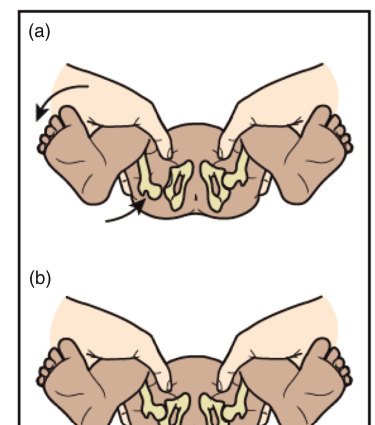

• Fig. 27.4 Checking for developmental dysplasia of the hip. In the Ortolani maneuver, on abduction of the hip, the dislocated femoral head is relocated into the acetabulum. In the Barlow maneuver, on adduction of the hip, the femoral head is gently dislocated posteriorly out of the acetabulum.

• Fig. 27.4 Checking for developmental dysplasia of the hip. In the Ortolani maneuver, on abduction of the hip, the dislocated femoral head is relocated into the acetabulum. In the Barlow maneuver, on adduction of the hip, the femoral head is gently dislocated posteriorly out of the acetabulum.

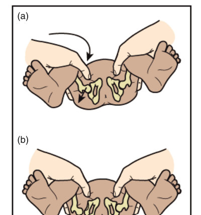

Unmatched source image; PDF page 478. Consult the original caption.

Unmatched source image; PDF page 478. Consult the original caption.

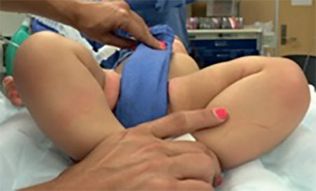

• Fig. 27.5 Limited abduction of the right hip in a baby with developmental dysplasia of the hip. (From Yang S, Zusman N, Lieberman E, et al. Developmental dysplasia of the hip. Pediatrics. 2019;143[1]:e20181147. doi:10.1542/peds.2018-1147)

## PDF page 479 | printed page 465

length discrepancy may only be evident beyond the neonatal period. These other signs, especially limited abduction, become more important because the Ortolani and Barlow exams become difficult to perform and interpret after 3 to 4 months of age as the infant gains strength to resist passive movement. These other methods to assess hip development should continue to be part of the health monitoring exams until the infant begins to walk.

The hips of most infants with an abnormal neonatal hip examination at birth or 2 weeks of age resolve without intervention by 4 weeks of age. The risk for DDH is increased in female infants, in those with a positive family history, and in those with a breech presentation in the third trimester. Female infants in the breech position have an incidence of 10% to 13%. Consideration must be given to a screening ultrasound at 6 weeks for infants with risk factors.35,36 The risk is also increased in infants with a neuromuscular disorder and in infants with other orthopedic deformations caused by restriction of in utero position such as metatarsus adductus.

### Back and Spine

Placing the infant prone helps to expose the entire back and spine. Inspect for fixed curvature of the spine that may be visible as elevation of a section of ribs, in addition to visible midline defects or dimples, and neurocutaneous markers. A nevus, swelling, hemangioma, or tuft of hair along the spine or middle of the skull requires further evaluation because it might indicate an underlying abnormality of the vertebrae, spinal cord, or brain. Ultrasound or magnetic resonance imaging delineates the anatomy. Small, blind-ending sacrococcygeal dimples that are within 2 cm of the posterior anal verge are common and harmless. Unusually large dimples, those without a visible base or positioned above the clefts of the buttocks, should be investigated because they might extend into the intraspinal space and place the infant at increased risk for meningitis. Spina bifida is often diagnosed prenatally. Affected infants must be referred to a neurosurgical service.

### Posture and Muscle Tone

Observe the newborn’s posture and tone. Is the infant moving all four limbs fully, and are they held in a normal, flexed position? Do the limbs feel normal on passive movements? Infants who were in an extended breech position in utero sometimes maintain this posture for some days after birth. Observe the newborn for symmetry of the startle response as the infant awakens as they are undressed.

Limb and central tone can be assessed in one of several ways, and all of them do not need to be performed unless there are concerning features in initial observations. Assessment of tone is discussed more fully in the neurologic exam. In a normal infant, tone should be assessed in both the prone and supine positions. The term prone infant will lift the chest a small distance and briefly lift the head and turn

to the side. The legs will be partially flexed. Demonstrate to parents the motor abilities of the infant, and discuss the benefit of tummy-time, as well as how to calm an infant by holding him or her prone over an adult forearm.

A detailed neurologic examination is required only if an abnormality has been detected. Some pediatricians routinely elicit a Moro reflex, during which sudden head extension causes symmetric extension followed by flexion of all limbs. However, if normal movement of all four limbs has been observed, no further information will be gained from this procedure. Because infants appear to find it unpleasant and parents are often alarmed and upset by it, many pediatricians omit the Moro reflex test from the routine examination. Alerting the parents before the maneuver can reassure them that the infant is not being mishandled.

### Concluding the Exam

Most newborns are found to at most have minor consequences from delivery or normal variants on examination. The parents should be reassured about features that do not fit the idealized image of a newborn and counseled on the expected course of those findings, as well as other common physical changes to expect during the first weeks of life. Any concerns they have about their newborn should be addressed fully. Parents should be informed of any abnormalities detected on examination immediately. This may be upsetting and should be handled with sensitivity by giving a full explanation and allowing time for discussion. Delay in imparting evolving information often results in mistrust.

### Detailed Neurologic Assessment

If a neurologic concern is raised based on the history, prenatal imaging, physical exam, or postnatal course, a more detailed neurologic assessment should be performed, directed toward the area of concern. The infant’s neurologic evaluation combines elements of the standard neurologic examination and a developmental assessment of gestational age (Box 27.4). It also highlights the marked effect of gestational age on neurologic development. With experience, the examiner can accomplish a standard neurologic evaluation

• BOX 27.4 Neurologic Evaluation

• General appearance • Level of consciousness • Head, spine, extremities • Cranial nerves • Motor: strength, tone, movements • Deep tendon reflexes • Primitive reflexes: Moro, suck, root, palmar grasp, tonic

neck reflex, Galant, plantar grasp • Autonomic: heart rate pattern, respiratory pattern, bladder

function, bowel function

## PDF page 480

with minimal or no discomfort to the infant—an important skill, especially in fragile premature infants.

### Level of Alertness

Healthy term newborns cycle between states of alertness: deep sleep, active or light sleep, drowsy, quiet alert, active alert (moving and may be fussy), and crying.37 In the preterm, there are cycles of activity and sleep, of regular and irregular respiration, and of the absence or presence of eye movements, but they tend to occur independently rather than in distinct states of alertness. For optimal neurologic examination, a term infant should be alert and not crying. Abnormal levels of consciousness, lethargy, stupor or coma, and hyperalert states can be associated with hypoxic-ischemic encephalopathy and many other congenital or acquired disorders affecting the brain. A hyperalert state can also be because of drug withdrawal. The cry also may be abnormal (e.g., high-pitched from cerebral irritation, excessive from drug withdrawal).

### Inspection

The physical component of the neurologic examination includes visual inspection and palpation of the head, spine, and extremities. The head is palpated to ascertain the presence of deformities, the position of the skull sutures, and the size and shape of the fontanelles.

The size and shape of the head provide important information regarding the occurrence of an insult to the fetal brain. When fetal brain growth has been compromised, head size is decreased relative to body weight and length. A large head at birth could be because of a wide range of etiologies. Widely spaced sutures may indicate increased intracranial pressure (e.g., from obstructive hydrocephalus). Postnatally, a rapidly expanding head with widely separated sutures indicates elevated intracranial pressure from cerebral edema; epidural or subdural hemorrhage; or acquired, progressive hydrocephalus, which may follow intraventricular hemorrhage in a premature infant.

### Cranial Nerves

Despite the inability of the examiner to communicate verbally with the infant, the functions of most of the 12 cranial nerves can still be determined in the newborn infant. Indeed, cranial nerve evaluations can be conducted even in extremely premature infants. Specific elements of the exam are detailed in Table 27.3.

Cranial nerve I (olfactory) is typically not examined given its rare involvement in a disease process.

Vision (cranial nerve II [optic]) is assessed both subjectively and objectively. Healthy full-term and older premature infants fixate on and track objects presented about 25 cm from the infant’s face. The pupillary light reflex is a subcortical function that requires afferent optic nerve function and as well as the autonomic component of cranial nerve III (oculomotor)as the efferent limb.

Extraocular movements are controlled by cranial nerves III, IV, and VI (oculomotor, trochlear, and abducens, respectively). Horizontal eye movements are more easily elicited than are vertical eye movements. Eye movements in all directions occur spontaneously or can be induced with oculocephalic maneuvers (doll’s eye reflex). The doll’s eye reflex is elicited with the infant in the supine position by simply turning the head from one side to the other, whereupon the eyes will deviate in the opposite direction. Vertical eye movements can be ascertained by flexing or extending the head. Alternatively, the infant can be held vertically and rotated clockwise or counterclockwise. The eyes will deviate in the direction opposite the spin. Rotation in the axial plane induces vertical eye movements. Late preterm and term infants are capable of conjugate gaze at birth but may have a brief delay as they attempt to fix their gaze, resulting in apparent brief strabismus. If not resolved by 6 months of age, refer the infant for ophthalmology evaluation. Horizontal nystagmus likewise may be present in normal infants and should fade over the first few months of life. Vertical or rotational nystagmus at rest is considered abnormal.

Unilateral or bilateral ptosis occurs as a consequence of dysfunction either of cranial nerve III, which innervates the palpebral muscle (upper eyelid only), or of ascending sympathetic nerves, which course through the neck to innervate the tarsal plates (both eyelids). Oculomotor nerve dysfunction producing ptosis is often associated with ipsilateral pupil dilation, whereas sympathetic nerve dysfunction producing ptosis is associated with ipsilateral pupil constriction (Horner syndrome).

Cranial nerve V (trigeminal) has both sensory and motor functions. Sensation is tested with the corneal reflex and by nasal stimulation. The motor component of cranial nerve V subserves jaw (mandibular) opening and closure.

Cranial nerve VII (facial) also has both sensory and motor functions: it is necessary for taste and controls all superficial facial movements, including eyelid closure. It provides the motor component of response to corneal and nasal stimulation.

Cranial nerve VIII subserves both hearing (auditory) and vestibular functions (see Chapter 61, Hearing Loss in the Newborn Infant). Hearing is tested either subjectively or objectively, the latter by the evoked otoacoustic emissions or automated auditory brainstem response as used in newborn hearing screening. Subjective testing at cribside can be accomplished with the use of voice, ideally the mother’s, or a bell or rattle, observing for a change in heart rate or respirations, and possibly an orienting response. Initially, the sound should be of low intensity, increasing in loudness until a response is obtained. The vestibular component of cranial nerve VIII is not specifically tested other than through its interaction with brainstem pathways that subserve reflex eye movements, although intact vestibular nuclei are necessary for the Moro response.

The functions of cranial nerves IX and X (glossopharyngeal and vagus, respectively) are combined to control swallowing function and vocalization. Voluntary motor functions are tested by observing the infant’s sucking and swallowing abilities. In addition, the position and movement of the soft

## PDF page 481 | printed page 467

TABLE

### Cranial Nerve Examination

27.3

Nerve Name Function

I Olfactory (and tract) Smell

II Optic (and retina) Visual acuity and fields

III Oculomotor Extraocular movements

Pupillary reflex

IV Trochlear Extraocular movements

V Trigeminal Sensory: facial sensation

Motor: Mastication

VI Abducens Extraocular movements

VII Facial Sensory: Taste

Motor: Facial expression

VIII Auditory Hearing Spatial orientation

IX Glossopharyngeal Swallowing Vocalization

X Vagus Swallowing Vocalization

XI Spinal accessory Head and shoulder

movement

XII Hypoglossal Tongue movement

palate are observed with a flashlight. Decreased movement of the soft palate or absent gag reflex suggests dysfunction of cranial nerves IX or X. During the oral evaluation, cranial nerve XII (hypoglossal) function is tested by examining the tongue and noting its position, movement, and bulk. Atrophy of the tongue is observed as scalloping of its margins. Tongue fasciculations may be noted as random, wormlike movements best appreciated along the lateral tongue margins and which may indicate spinal muscular atrophy. Tongue fasciculations must be distinguished from tremors, the latter consisting of normal rhythmic movements of the structure accentuated by its protrusion during crying.

Evaluation Method

Not examined

Fix on face or object (red woolen ball, black and white

concentric circles)

Lid elevation Tracking face or objects (as above) Doll’s eye reflex

Pupillary reflex

Tracking face or objects (as above) Doll’s eye reflex

Corneal sensation: wisp of cottonwool touched to the edge of

the cornea elicits blink Facial sensation: wisp of cottonwool in nares elicits grimace Finger on lips and mouth elicits suck reflex

Jaw movements with yawn and cry Suck reflex

Observation of tracking Doll’s eye reflex

Not tested

Flattened nasolabial fold Poor seal of lips during suck Corneal reflex—motor component of blink Motor component of grimace when stimulating facial sensation

in nares with cottonwool

Response to sounds without visual stimulation—mother’s

voice preferred, or bell or rattle (increase in intensity until response is obtained) Change in heart rate or respirations, or an orienting response Hearing test (optoacoustic emissions or automated brainstem

evoked response)

Sucking and swallowing reflex; gag reflex Quality of cry

Sucking and swallowing reflex; gag reflex Quality of cry

Observe symmetric movements

Atrophy Fasciculations at rest

Cranial nerve XI (spinal accessory) innervates the sternocleidomastoid muscle of the neck to produce either lateral or anterior flexion of the head, depending on contraction of one or both muscles. The nerve also innervates the trapezius muscle of the shoulder to produce shoulder elevation. These functions typically are tested by simple observation of head and shoulder movements.

### Motor Function

The motor system examination includes tests of skeletal muscle posture, tone, and movement. During the initial

## PDF page 482

period of general observation, the position of the extremities is noted for flexion, extension, or neutral postures. Healthy, full-term infants typically exhibit flexion of the arms at the elbows and of the legs at the knees. Fisting of the hands, including adduction and infolding of the thumbs, is usual, but the normal infant also demonstrates varied movement of the fingers, including moving the thumb away from the palm. A persistently adducted thumb (cortical thumb) in a tightly fisted hand, with few finger movements, may be seen in infants with cerebral injury, genetic disorders, or some severe malformations.

Limb position and posturing are relatively symmetric, although the infant manifests spontaneous movements that are often asymmetric and jerky. Limb posture (flexion or extension) is also influenced by the position of the head. If the head is turned to one side, there is often extension of the ipsilateral arm and leg and flexion of the contralateral extremities (asymmetric tonic neck reflex, or fencing reflex). While prone, the full-term infant maintains a flexed posture of the arms and legs, with resultant elevation of the pelvis as well as hip and knee flexion. The infant should briefly raise their head and turn to one side or other. A hungry infant may be able to sustain a raised head and may demonstrate a pecking movement with an open mouth as he or she seeks to latch.

The assessment of muscle tone includes observation of the infant’s posture and movement as well as the production of an active or passive range of motion. Limb and central tone can be assessed in one of several ways, and all of them do not need to be performed unless there are concerning features in initial observations.

Pull to sit: this should be done gently and will demonstrate

both strength of hand grasp, arm tone (some resistance and then extension), head lag (some delay through the arc of the pull), and truncal tone. It is important to explain the purpose of the exam ahead of time because the visible head lag caused by lack of support can be very alarming to parents. Axillary suspension: The newborn is picked up with the ex-

aminer’s hands under the arms, with the examiner’s fingers supporting the base of the head. The term newborn should flex and then extend the legs and will feel secure in the hold. A hypotonic newborn will feel as if slipping through one’s hands (axillary slippage), and the legs may not flex at all. In this position, the infant will support some of their weight if the feet are gently placed on a firm surface. Prone: The prone term newborn lies with arms flexed and

legs partially flexed, slightly lifting the chest and hips. The infant will briefly lift the head and turn to the side. Demonstrate to parents the motor abilities of the infant and the benefit of tummy-time. Ventral suspension: hold the infant prone, aloft over the

exam table or bassinet, with the examiner’s hand holding the chest. An infant with normal tone will curve strongly around the holding hand, and be able to lift the head

to the same plane as the back, and the legs will flex and extend again. A hypotonic infant will feel like a rag doll, and lower spine and legs will drape down from the examiner’s hand.

Increased resistance to passive movement indicates hypertonicity (rigidity, spasticity), whereas reduced resistance and unrestricted movement indicate hypotonicity. In this regard, the neurologic component of the Dubowitz38 and Ballard scoring systems for determining gestational age largely reflects the maturation of muscle tone in premature infants, from the weak, low tone, and extended posture of very premature infants to the active, flexor tone, and posture of the term infant. Infants who are hypertonic often exhibit an opisthotonic posture related to obligate extension of the back and neck when suspended in either the vertical or horizontal plane because of high tone in axial extensors compared with flexors. Scissoring of the legs might be evident from hypertonia in the hip adductors, and the plantar grasp may be absent.

Hypotonia should not be equated with weakness, which is a reduction in muscle strength or power, whether it is partial (paresis) or complete (paraplegia) paralysis. Muscle weakness is ascertained through observation of spontaneous or sensation-induced movements of the extremities. Although muscle hypotonia and weakness often occur together, hypotonia can be seen in the absence of weakness (e.g., cerebellar dysfunction), and weakness can occur when muscle tone is normal or even increased (e.g., spastic paralysis).

### Spinal Reflexes

Deep tendon reflexes are elicited as they are for older children and adults. The limb should be positioned in partial flexion and the appropriate tendon tapped with an infant reflex hammer. The head should be maintained in the neutral position to prevent inducing an asymmetric tonic neck response, which produces asymmetric reflex activity. Typically, upper extremity deep tendon reflexes are more difficult to elicit than lower extremity reflexes. In newborn infants, the Achilles tendon is not tapped directly: the reflex is elicited by tapping a thumb positioned on the plantar surface of the partially dorsiflexed foot. Interpretation of the results of testing deep tendon reflexes is more problematic in neonates than older children but may help to confirm an asymmetric lesion. A few beats of ankle clonus are common and usually normal in the neonatal period if not sustained.

Eliciting the plantar reflex has to be done with care because of competing primitive reflexes in the foot (plantar grasp, stepping, and placing) that may make interpretation problematic. In addition, it is important to remember that about 10% of newborns may have a downgoing plantar response.39 The expected normal finding of stroking along the lateral aspect of the foot and then across just below the fourth and fifth toes (if done correctly) is an upward-going plantar response. Symmetry of the response is the expected

## PDF page 483 | printed page 469

finding, and an asymmetric plantar response should prompt a thorough neurologic examination.

### Primitive Reflexes

The most frequently elicited primitive or developmental reflexes include the rooting, sucking, palmar grasp, plantar grasp, and Moro responses (Table 27.4). These reflexes are fully developed and strong in the healthy, full-term newborn and typically disappear in the months to follow. They are involuntary motor responses that originate from the brainstem and promote survival. Their persistence beyond the anticipated age of disappearance is an indicator of underlying central nervous system dysfunction.

The rooting reflex is elicited by stroking the corner of an infant’s mouth, to which the infant should respond with an open mouth and head turn toward that side. This helps the newborn to find the breast or bottle nipple and start feeding. Then, when the roof of the baby’s mouth is touched, it will begin to suck, allowing the baby to feed. The rooting reflex can also be elicited by stroking down from the philtrum to the lower lip: performed this way with the mother’s nipple ensures a wide gape of mouth and a flattened cupped tongue to assist in a deep latch. These reflexes are important in coordination of infant latch, feeding, and breathing.

The Moro response is a protective response to a disruption of balance and can be observed when an infant experiences the sensation of falling. Vestibular stimulation (either

TABLE

Description of Commonly Performed Primitive Reflexes

27.4

Examination Technique (Quiet Alert State)

Reflex

Glabellar tap Repeated gentle tap on glabella

Root Stroke the cheek from the angle of the mouth, or firmly

downward from philtrum to lower lip

Suck Stroke upper gums and/or palate

Tonic neck reflex Gently turn the neck

Crossed

Mildly painful stimulation of one limb

extension

Palmar grasp Press firmly into the palm

Plantar grasp Press firmly in the middle of the foot just below the toes

Moro Move head from 30 to 45 degrees incline to horizontal

(head only, torso and head, or lift by arms and gently drop)

Galant Draw a firm line lateral to spine of prone infant

Stepping and

Pick up infant under the axillae, place sole of foot onto

placing

the exam table or shin against edge of table/bassinet

by quickly lowering the head from an inclined position to the horizontal, or moving the entire baby) causes the baby to extend the arms and legs, cry, and then flex the limbs. Lifting the newborn gently off the bed and then releasing the arms elicits a similar response but must be done gently to avoid distress to the parent. A similar response, the startle reflex, may be observed when an infant is startled by a loud noise or jostling but does not necessarily involve the vestibular or cerebellar areas.

The tonic neck reflex, or fencer position, is elicited by turning the baby’s head to one side to observe extension of the ipsilateral arm and flexion of the opposite arm. Extinction of this reflex is necessary to allow an infant to roll from supine to prone position.

The grasp reflex occurs in both the hands and feet and is elicited by stroking the palm of the hand or sole of the foot, resulting in a grasp by the stimulated hand or foot. Absent or weak palmar grasp may be a sign of peripheral nerve injury related to shoulder dystocia or other birth injury.

The glabellar tap, elicited by tapping the forehead gently between the eyebrows, causes the newborn to blink with each tap. In the normal child and adult, the individual stops blinking after a few taps while the newborn blinks each time.

The Galant or truncal incurvation reflex is elicited by firm linear pressure along the paraspinal muscles and causes the newborn to flex their spine toward the side of the stimulation.

Other primitive reflexes include the crossed extension (where a limb withdraws by contracting the flexor muscles

Infant Response

Blink with each tap, with no extinction of response

Turns head toward the cheek, mouth opens

toward cheek or jaw drops, and tongue cups and extends over lower lip

Infant draws finger into mouth, sucks with

wavelike tongue undulation

Arm extends in the direction and the opposite arm

flexes

Limb withdraws and contralateral limb extends

Fingers flex and grip

All toes will curl down and in

Arms including wrists and fingers symmetrically

extend, then arms and hands flex and infant lets out a sharp cry

Back curves to the side of the stroke

Stepping: Leg flexes up and then infant places

foot back on table; Placing: Hip and knee flex, and the foot lifts to be placed on the bed

## PDF page 484

and relaxation of the extensors and the opposite occurs in the other limb), the placing reflex (when there is flexion followed by extension when the infant is held upright and the dorsum of a foot is moved along the under edge of a table), and stepping reactions (when the soles of the feet of an infant held upright touch a flat surface, she will take steps by placing one foot in front of the other), which make their appearance by 36 to 38 weeks’ postmenstrual age.

### Behavioral Evaluation

Behavioral assessment tools, such as the Neonatal Behavioral Assessment Scale (NBAS), the Assessment of Preterm Infants’ Behavior (APIB), and the NICU Network Neurobehavioral Scale (NNNS), are formalized screening measures designed to determine neurobehavioral disturbances, identify individual behavioral differentiation and regulation patterns in newborns, or identify differences among groups of newborns. They are also used to guide referrals for further specialty assessment, care, and interventions and to support families and caregivers in their understanding of their newborn’s individuality. Performing any of the currently used assessments requires some degree of training and, in several cases, formal certification. Assessments commonly evaluate movement and postural patterns; muscle tone and strength; activity levels; simple and complex reflex behaviors; sensory functions; social attention and interaction; attention to objects; thresholds to behavioral disorganization; irritability; consolability; state range; and stability, including sleep, quality of cry, and habituation or response decrement to repeated stimuli. As an example, for the assessment of consolability, the upset infant’s response to different modalities of calming is assessed. It takes longer to console an infant with brain injury than a healthy infant. Visual and auditory response decrements are elicited with different stimuli, such as a bright light, and a rattle or bell, respectively. Response decrement is an indicator of cortical inhibitory function. It demonstrates the brain’s ability to learn to diminish behavioral responses to repetitive stimuli. Failure to respond initially to the sensory stimulation or a lack of habituation may suggest cortical and/or sensory dysfunction or sedation. A highly reactive, dysregulated neurobehavioral profile may be an indicator of increased risk for neurologic and/or physiologic issues. A milder form of dysregulation may indicate temperament differences. Newborn group studies have also identified ethnocultural background differences in regulation. The timing of assessments depends on infants’ medical complexity; ill or infants born preterm require serial assessments to track progress and recovery. The examinations should be performed in the presence of the parents and key caregivers to maximize appreciation of the infant’s current strengths and vulnerabilities. In the hands of well-trained specialists, these assessments can be used to guide clinical care decisions and advocate for appropriate

outpatient developmental services, as well as to optimize parents’ understanding of their infant.40,41

### Assessment of Gestational Age

Formal assessment of gestational age is unnecessary for the routine newborn examination. The best guide to an infant’s gestational age is an early antenatal ultrasound evaluation combined with information about the mother’s last menstrual period. An evaluation of the clinical methods of assessing gestational age showed that clinical methods had 95% confidence intervals of 2 to 3 weeks, with a tendency to underestimate growth-restricted infants.42 Clinical assessment is most important for infants whose gestational age is unknown or discrepant with their growth.

Gestational age can be assessed using physical and neurologic criteria because they progress in an orderly fashion with increasing gestation. Although physical criteria allow distinction of infants with gestational ages older than 34 weeks, neurologic assessments are required to differentiate infants at earlier gestations. A combined scoring system for assessing gestational age was developed by Dubowitz and Dubowitz. Its disadvantage is that it involves assessing 11 physical criteria and 10 neurologic findings. Ballard and colleagues abbreviated it to include six neurologic and six physical criteria to shorten the time taken. The revised Ballard examination (see Fig. 27.3) includes assessment for extremely premature infants and is the most widely used. Regardless of the method used, the assessment of gestational age using physical and neurologic criteria is accurate only to ±2 weeks, with a tendency toward overestimation in extremely premature infants. Table 27.5 provides an overview of neurologic maturation of the fetus and newborn.

### Interpretation of the Neurologic Examination

Interpreting the findings from a neurologic examination of a newborn infant is difficult because the interpretation is markedly affected by the infant’s postmenstrual and chronologic age as well as the infant’s level of alertness. The neurologic examination has been widely studied as a predictor of subsequent neurodevelopmental problems, but it is limited because many abnormal neurologic signs may be transient and significant neurologic abnormalities may take weeks or months to become manifest. Serial examinations are more informative than a single examination.

However, in spite of its limitations in specificity and in predicting prognosis, the neurologic examination is useful when considered in conjunction with a history, with or without neuroimaging, suggestive of a neurologic problem. Neurologic abnormalities that are persistent, severe, or asymmetric place the infant at increased risk of neurodevelopmental problems. The neurologic examination may be helpful in delineating the extent of neurologic deficits (e.g., after hypoxic-ischemic encephalopathy), which also informs management planning.

## PDF page 485 | printed page 471

TABLE

Neurologic Maturation of the Fetus and Newborn

27.5

Function 26 Weeks 30 Weeks

Resting posture Extension of arms Flexion or extension

Extension of arms Flexion or extension of

of legs

legs

Arousal Unable to maintain Remain briefly

Rooting Absent Long latency

Sucking Absent Long latency

Pupillary reflex Absent Variable/developing

Traction No response No response

Moro No response Absent or incomplete

Withdrawal Absent Withdrawal only

Adapted from Fenichel GM. Neonatal Neurology. 4th ed. New York: Churchill Livingstone; 2007.

Multiple neurologic abnormalities are more likely to be more significant than isolated abnormalities. Preterm infants who have significant abnormalities on neurologic examination at term are at higher risk of neurodevelopmental problems than those with a normal examination.

### Limitations of the Routine Examination

Examination of a newborn in the delivery room and at a routine examination will identify a number of problems, many of which are transient. However, some significant abnormalities may not be identified because they will not be evident during the routine physical examination, such as ductaldependent cardiac lesions without a murmur. Although this may sometimes reflect the examiner’s limited experience with the condition or in performing examinations on an unsettled infant, conditions in newborns do evolve over time, and a later finding may not have been present during the hospital stay. Prime examples are DDH, which was renamed “developmental dysplasia” to indicate just such a phenomenon, and ventricular septal defects, which may not have an audible murmur until several weeks of life. Parents might become upset or angry when it becomes evident at a later stage that their child has a significant problem. Emphasizing continuity and ongoing care is central to health promotion while informing the parents that not all abnormalities can be detected at the initial examination. This situation also stresses the importance of clear documentation of the routine examination for future reference.

### Health Promotion, Screening, and Prevention

The routine examination is an opportunity to promote preventive care.43 Pointing out relevant exam findings can lead

34 Weeks 38 Weeks

Flexion or extension of arms Flexion of legs, not

Flexion of all limbs, legs

adducted

adducted

Remain awake Maintain awake

Present Present

Variable Vigorous

Present Present

Head lag Mild head lag

Flexion or extension of legs Complete

Crossed extension Crossed extension

to a discussion with the parent on key health promotion and prevention messages. The neurologic exam is an opportunity for parents to understand their infant’s motor and sensory abilities and to show them how to engage with their infant in a developmentally appropriate manner.

### Promotion of Breastfeeding

Mothers should be encouraged in, and assisted with, breastfeeding. Encouraging skin-to-skin care well after the immediate delivery period is important, as is a thorough evaluation of the infant’s oral anatomy and function, including root and suck, to anticipate problems that may interfere with optimal breastfeeding. Expert assistance from lactation consultants as well as ongoing support from nursing staff is necessary for mother-infant dyads to have a successful beginning, especially in cases of prematurity or multiple births, mother or infant illness, or other conditions that make breastfeeding initiation difficult.

### Screening

Many screening tests are based on local, national, and hospital standards of care, and it is important that these are offered uniformly to all patients. Tight quality control of correct performance, processes for confirmatory testing, follow-up and specialty referral and care are key to successful programs.

Blood spot screening for a variety of rare metabolic, endocrine, and genetic conditions that benefit from early intervention has the longest track record in early detection and prevention of harm in newborns. Because several conditions can present with devastating consequences within the first week of life, close follow-up is critical.

Universal hearing screening prior to discharge has become the standard of care in the United States and many

## PDF page 486

countries. In countries where newborn hearing screening is not universal, infants who are at increased risk for deafness (e.g., family history, malformations of the ear including skin tags and pits) should be closely monitored so that early diagnosis and treatment can occur at an age when the condition is remediable.

Screening for critical congenital heart disease using pulse oximetry assists the detection of ductal-dependent lesions.24 Prenatal diagnosis of some severe heart lesions and the increasing availability of echocardiography should reduce, but will not eliminate, failure to identify structural heart lesions before discharge from the hospital. The AAP in 2012 recommended universal screening with further work-up if any of the following criteria are met: any oxygen saturation (SpO2) less than 90%; oxygen saturation less than 95% in both extremities on three measures, each separated by 1 hour; or if there is a greater than 3% absolute difference in oxygen saturation between the right hand and either foot on three measures, each separated by 1 hour.44 Modifications to this recommendation were made in 2020 to remove situations where an infant could pass the screen despite saturations less than 95% and changed target saturations.23 The current recommendation reduces repeat testing to once and recommends further work-up if the oxygen saturation is less than 94% in either extremity, or a difference greater than 4% is found.

Whether the Car Seat Tolerance Screening (CSTS) should be routinely performed for all preterm infants has recently been debated.45,46 The purpose is to detect if the premature or small for gestational age infant is able to maintain oxygenation in the semi-upright car seat for more than an hour, and a considerable proportion of infants who fail the CSTS are asymptomatic but demonstrate instability on repeat testing.46 Whether or not the test is performed, it is important that parents understand that no newborn should be placed semi-upright for extended periods of time. This includes infants who pass the car seat challenge test. Resources should be available for infants to go home safely in the event that they fail the car seat challenge test.

### Prevention

In cases where the parents had reservations about preventive administration of vitamin K to avoid vitamin K deficiency bleeding or ocular prophylaxis, the first physical examination is an opportunity to answer questions and provide

Key Points

A routine physical exam: • should be performed on every newborn by a pediatric

health care provider within 24 hours of birth, • should include examination of all parts of the body and

measurement of growth parameters, • should allow minor and major abnormalities to be iden-

tified and addressed whether prenatally or postnatally diagnosed,

clarifying information. This would also be the time to discuss immunization in countries where hepatitis B vaccination is provided at birth.

Safe sleep to prevent sudden infant death syndrome (SIDS) and suffocation risk should be discussed during the first examination and continue to be modeled by staff and physicians throughout the hospital stay. Advise parents that infants should sleep on their backs. In addition, lack of breastfeeding, overheating, parental smoking, bed sharing, and co-sleeping are risk factors for sleep-related death. Attention to preventive measures has markedly reduced the incidence of sudden unexpected infant deaths in many countries.

### Discharge

The discharge physical examination is an opportunity not only to recheck that the infant is well and that any previously identified or ongoing medical issues have been resolved but also to ensure that the mother and infant are ready for discharge. The AAP has published details of the criteria that should be met before discharge.47 These include checking that the infant’s vital signs are normal and have been stable for at least 12 hours. During this time period, the infant should complete several successful consecutive feeds. The infant must urinate and pass stool prior to discharge. All newborns should be screened and/or monitored for sepsis based on maternal risk factors, and maternal blood test results (hepatitis B surface antigen, human immunodeficiency virus [HIV], syphilis) should be checked. The importance of immunizations can be emphasized, specifically the hepatitis B vaccine, which is generally given prior to discharge home. Hearing, blood spot screening, and pulse oximetry screening for critical congenital heart disease should have been performed, or arrangements should be in place. A suitable car seat should be available. It is important to counsel that infants that have passed the car seat challenge could still have desaturations in the car seat at another time. By the same token, car seats and swings should not be used for extended periods of time for infant sleep or play. The clinician must also ensure that the parents are able to care adequately for their infant and that the infant is going to a suitable environment. Relevant follow-up care for the infant should also be in place. If a term baby is discharged early (<48 hours), a follow-up visit with a health care professional within 48 hours should be in place.

• will not identify all abnormalities, but identification is

maximized by specific training of health providers, • is a time for thoughtful discussion with parents

about their concerns because the birth of a baby is an emotionally charged and vulnerable time for many parents, • is an opportunity for health promotion and to check that

appropriate discharge planning is in place.

## PDF page 487 | printed page 473

### References

1. Widström A-M, Lilja G, Aaltomaa-Michalias P, Dahllöf A,

Lintula M, Nissen E. Newborn behaviour to locate the breast when skin-to-skin: a possible method for enabling early self-regulation. Acta Pædiatrica. 2011;100:79–85. 2. Moore ER, Bergman N, Anderson GC, Medley N. Early skin‐to‐

skin contact for mothers and their healthy newborn infants. Cochrane Database Syst Rev. 2016;(11):Art. No.: CD003519. DOI: 10.1002/14651858.CD003519.pub4. Accessed 25 March 2022. 3. Widström AM, Ransjö-Arvidson AB, Christensson K, Matthie-

sen AS, Winberg J, Uvnäs-Moberg K. Gastric suction in healthy newborn infants. Effects on circulation and developing feeding behaviour. Acta Paediatr Scand. 1987;76(4):566–572. https://doi. org/10.1111/j.1651-2227.1987.tb10522.x. PMID: 3630673. 4. American Academy of Pediatrics, American College of Obstetri-

cians and Gynecologists. Guidelines for Perinatal Care. 8th ed. Elk Grove Village, IL: American Academy of Pediatrics; 2017. 5. World Health Organization. Nutrition and Food Safety. Accessed

April 1, 2022. https://www.who.int/teams/nutrition-and-foodsafety/food-and-nutrition-actions-in-health-systems/ten-steps-- to-successful-breastfeeding 6. Ballard JL, et al. A simplified score for assessment of fetal matura-

tion of newly born infants. J Pediatr. 1979;95:769. 7. Flaherman VJ, Schaefer EW, Kuzniewicz MW, et al. Early weight

loss nomograms for exclusively breastfed newborns. Pediatrics. 2015;135:e16–e23. 8. Wassef M, et al. Vascular anomalies classification: recommen-

dations from the International Society for the study of vascular anomalies. Pediatrics. 2015;136(1):196. 9. Waelchli R, Aylett SE, Robinson K, Chong WK, Martinez AE,

Kinsler VA. New vascular classification of port-wine stains: improving prediction of Sturge-Weber risk. Br J Dermatol. 2014;171(4):861–867. https://doi.org/10.1111/bjd.13203. 10. Hassanein A, Mulliken JB, Fishman SJ, Green AK. Evaluation

of terminology for vascular anomalies in current literature. Plast Reconstr Surg. 2011;127:347–351. 11. Kunzi-Rapp K. Topical propranolol therapy for infantile hem-

angiomas. Pediatr Dermatol. 2012;29(2):154–159. https://doi. org/10.1111/j.1525-1470.2011.01615.x. Epub 2011 Dec 6. PMID: 22141326. 12. Oumer M, Tazebew A, Alemayehu M. Anterior fontanel size

among term newborns: a systematic review and meta-analysis. Public Health Rev. 2021;42:1604044. https://doi.org/10.3389/ phrs.2021.1604044. Published 2021 May 10. 13. Roth DA, Hildesheimer M, Bardenstein S, et al. Preauricular skin

tags and ear pits are associated with permanent hearing impairment in newborns. Pediatrics. 2008;122(4):884–890. 14. Wang RL, et al. Syndromic ear anomalies and renal ultrasounds.

Pediatrics. 2001;108:e32. 15. Rashad M, El-Fiky AM. Prevalence of renal anomalies in children

with auricular malformations among attendance of genetics clinic in Ain Shams University Egypt. J Hum Genet. 2007;8(2):191– 197. 16. Desphande SA, Watson H. Renal ultrasonography not required

in babies with isolated minor ear anomalies. Arch Dis Child Fetal Neonatal Ed. 2006;91:F29–F30. 17. Kini S, Barton GW, Carol Liu YC. Renal anomalies and microtia:

determining the clinical utility of screening affected children. Int J Pediatr Otorhinolaryngol. 2020;133:109957. https://doi.org/10.1016/j. ijporl.2020.109957. Epub 2020 Feb 15. PMID: 32109674.

18. van Wijk MP, et al. Non-surgical correction of congenital defor-

mities of the auricle: a systematic review of the literature. J Plast Reconstr Aesthet Surg. 2009;62:727. 19. LeFort Y, Evans A, Livingstone V, et al. Academy of breastfeed-

ing medicine position statement on ankyloglossia in breastfeeding dyads. Breastfeed Med. 2021;16(4):278–281. https://doi. org/10.1089/bfm.2021.29179.ylf. PMID: 33852342. 20. Fenster ME, Hokanson JS. Heart murmurs and echocardiogra-

phy findings in the normal newborn nursery. Congenit Heart Dis. 2018;13(5):771–775. https://doi.org/10.1111/chd.12651. Epub 2018 Jul 24. PMID: 30039518. 21. Oster ME, Lee KA, Honein MA, Riehle-Colarusso T, Shin M,

Correa A. Temporal trends in survival among infants with critical congenital heart defects. Pediatrics. 2013;131(5):e1502–e1508. https://doi.org/10.1542/peds.2012-3435. Epub 2013 Apr 22. PMID: 23610203. PMCID: PMC4471949. 22. Shenvi A, Kapur J, Rasiah SV. Management of asymptom-

atic cardiac murmurs in term neonates. Pediatr Cardiol. 2013;34(6):1438–1446. 23. Martin GR, Ewer AK, Gaviglio A, et al. Updated strategies for

pulse oximetry screening for critical congenital heart disease. Pediatrics. 2020;146(1):e20191650. 24. Granelli AW, et al. Impact of pulse oximetry screening on the detec-

tion of duct dependent congenital heart disease: a Swedish prospective screening study of 39,821 newborns. BMJ. 2009;338:a3037. 25. Williams G, Fletcher JT, Alexander SI, Craig JC. Vesicoure-

teral reflux. J Am Soc Nephrol. 2008;19(5):847–862. https://doi. org/10.1681/ASN.2007020245. 26. Sulkowski JP, Cooper JN, Duggan EM, et al. Does timing of

neonatal inguinal hernia repair affect outcomes? J Pediatr Surg. 2015;50(1):171–176. 27. Sun L, Wang Y. Demographic and perinatal outcome data of

fetuses with SUA/PRUV. J Matern Fetal Neonatal Med. 2017:1–6. 28. Xu Y, Ren L, Zhai S, et al. Association between isolated single

umbilical artery and perinatal outcomes: a meta-analysis. Med Sci Monit. 2016;22:1451–1459. 29. De Boom ML, Kist-van Holthe JE, Sramek A, et al. Is screen-

ing for renal anomalies warranted in neonates with isolated single umbilical artery? Neonatology. 2010;97(3):225–227. 30. Chan E, Wayne C, Nasr A; FRCSC for Canadian Association

of Pediatric Surgeon Evidence-Based Resource. Ideal timing of orchiopexy: a systematic review. Pediatr Surg Int. 2014;30(1):87– 97. https://doi.org/10.1007/s00383-013-3429-y. PMID: 24232174. 31. Iezzi ML, Lasorella S, Varriale G, Zagaroli L, Ambrosi M, Ver-

rotti A. Clitoromegaly in childhood and adolescence: behind one clinical sign, a clinical sea. Sex Dev. 2018;12:163–174. https:// doi.org/10.1159/000489385. 32. Goebel GJ, Dawson S, Loewenstein SN, Adkinson JM. Long-

term outcomes after treatment for type B ulnar polydactyly. J Pediatr Orthop. 2022;42(5):e466–e469. https://doi.org/10.1097/ BPO.0000000000002106. Epub ahead of print. PMID: 35220338. 33. Smith BW, Daunter AK, Yang LJ, Wilson TJ. An update on

the management of neonatal brachial plexus palsy—replacing old paradigms: a review. JAMA Pediatr. 2018;172(6):585–591. https://doi.org/10.1001/jamapediatrics.2018.0124. PMID: 29710183. 34. Elbaum R, Noel B, Degueldre V, et al. 20 years of functional treat-

ment for clubfoot: advantages and limitations compared with the Ponseti method. J Pediatr Orthop B. 2022;31(4):382–390. https:// doi.org/10.1097/BPB.0000000000000862. Epub ahead of print. PMID: 33741833.

## PDF page 488

35. Shaw BA, Segal LS, AAP Section on Orthopaedics. Evaluation

and referral for developmental dysplasia of the hip in infants. Pediatrics. 2016;138(6):e20163107. 36. Mulpuri K, Song KM, Gross RH, et al. The American Academy

of Orthopaedic Surgeons evidence-based guideline on detection and nonoperative management of pediatric development dysplasia of the hip in infants up to six months of age. J Bone Joint Surg Am. 2015;97(20):1717–1718. 37. Prechtl H, Beintema DJ. The neurological examination of the full

term newborn infant. A manual for clinical use. Little Club Clinics. In: Prechtl H, Beintema DJ, eds. Developmental Medicine,no. 12. London: Heinemann; 1964:36–37. 38. Dubowitz L, Dubowitz V. The Neurological Assessment of the

Preterm and Full-Term Newborn Infant. 2nd ed. London: WH Heinemann; 1999. 39. Gupta A, Gupta P. Neonatal plantar response revisited. J Paediatr

Child Health. 2003;39(5):349–351. 40. Brazelton TB, Nugent JK. The Neonatal Behavioral Assessment

Scale. Cambridge: Mac Keith Press; 2011. 41. Warren JB, Phillipi CA. Care of the well newborn. Pediatr Rev.

2012;33(1):4–18. https://doi.org/10.1542/pir.33.1.4.

42. Lee ACC, Panchal P, Folger L, et al. Diagnostic accuracy of

neonatal assessment for gestational age determination: a systematic review. Pediatrics. 2017;140(6):e20171423. https://doi. org/10.1542/peds.2017-1423. 43. Mercier CE, Barry SE, Paul K, et al. Improving newborn

preventive services at the birth hospitalization: a collaborative, hospital-based quality-improvement project. Pediatrics. 2007;120(3):481–488. https://doi.org/10.1542/peds.2007- 0233. PMID: 17766519. 44. Kemper AR, Mahle WT, Martin GR, et al. Strategies for imple-

menting screening for critical congenital heart disease. Pediatrics. 2011;128(5):e1259–e1267. https://doi.org/10.1542/peds.2011- 1317. Epub 2011 Oct 10. PMID: 21987707. 45. Narvey MR, Canadian Paediatric Society, Fetus and Newborn

Committee. Assessment of cardiorespiratory stability using the infant car seat challenge before discharge in preterm infants (<37 weeks’ gestational age). Paediatr Child Health. 2016;21(3):155–158. 46. Magnarelli A, Shah Solanki N, Davis NL. Car seat tolerance screen-

ing for late-preterm infants. Pediatrics. 2020;145(1):e20191703. 47. Benitz W, Committee on Fetus and Newborn. Policy statement: hos-

pital stay for healthy term newborns. Pediatrics. 2015;135(5):948–953.

<!-- SOURCE_LAYOUT_VIEWS -->

## Original layout views and recovered diagrams

Automatic extraction can flatten tables and superscripts. Check the original layout for numeric data, footnotes and image credits. [Source review notes](../../SOURCE_REVIEW_NOTES.md).

### Original source page 467

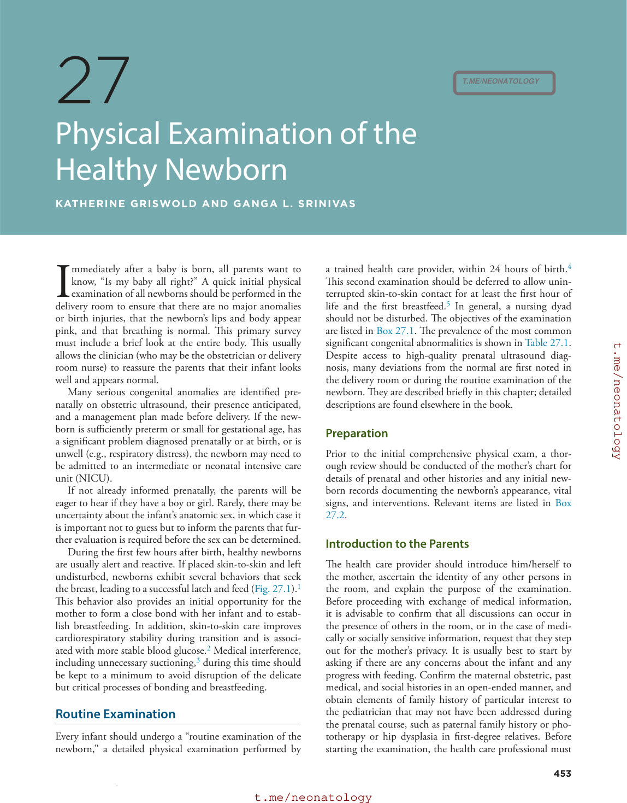

### Original source page 468

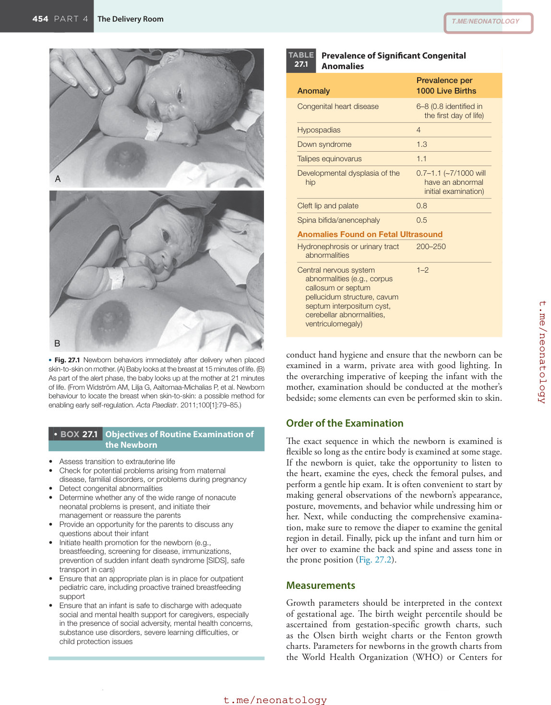

### Original source page 471

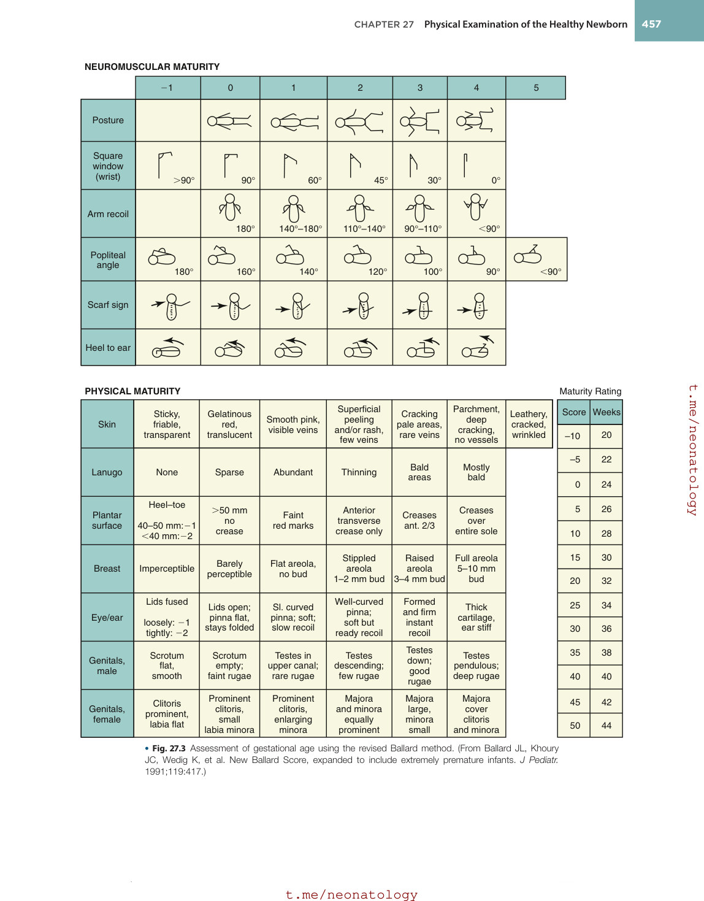

### Original source page 472

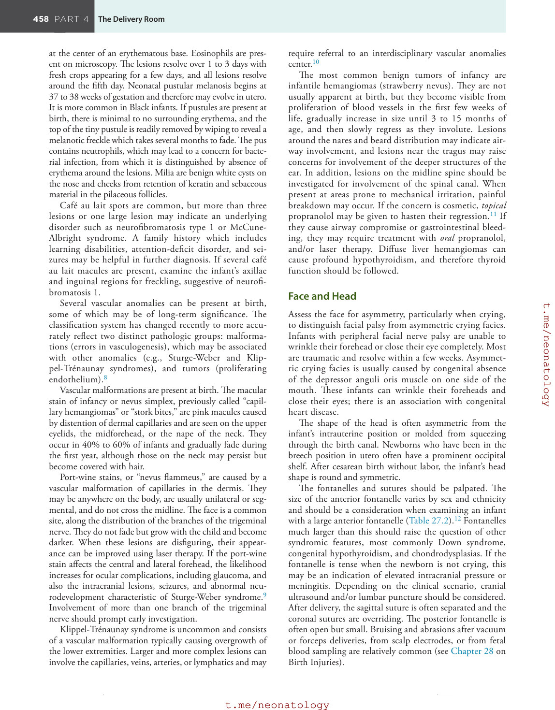

### Original source page 473

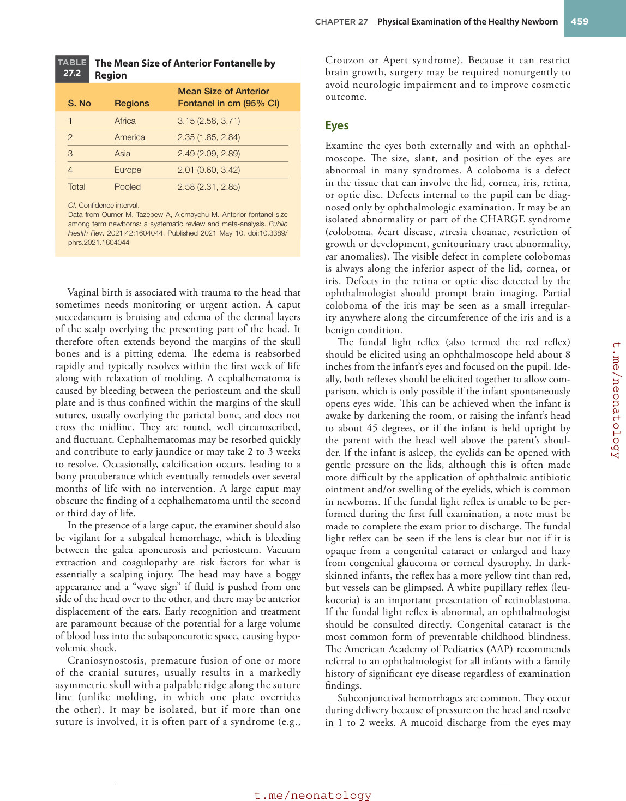

### Original source page 478

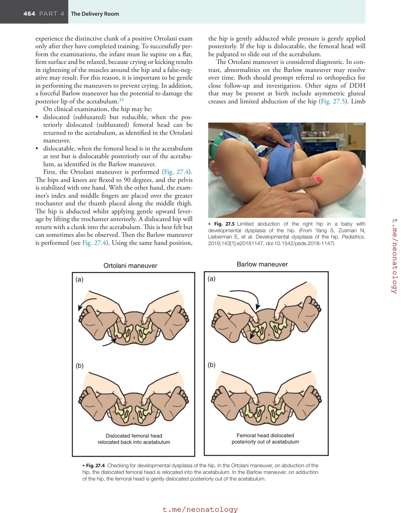

### Original source page 480

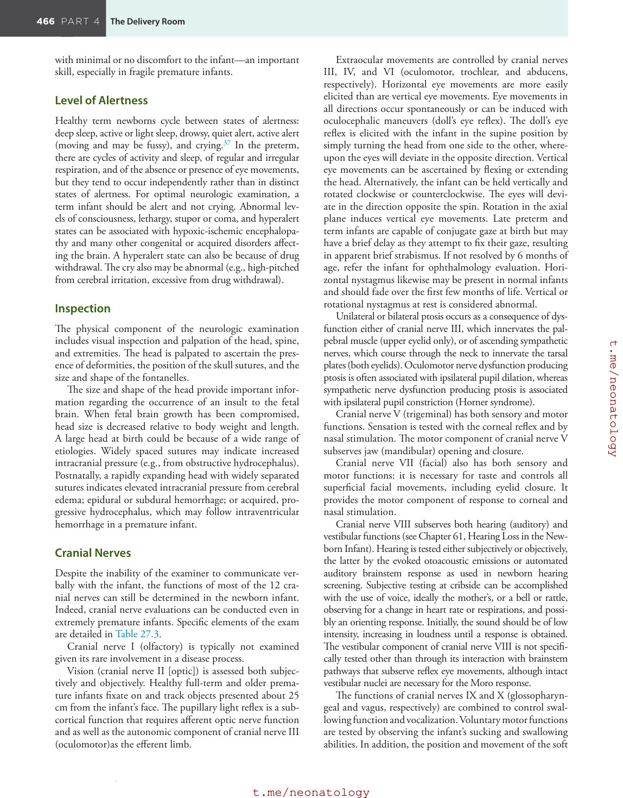

### Original source page 481

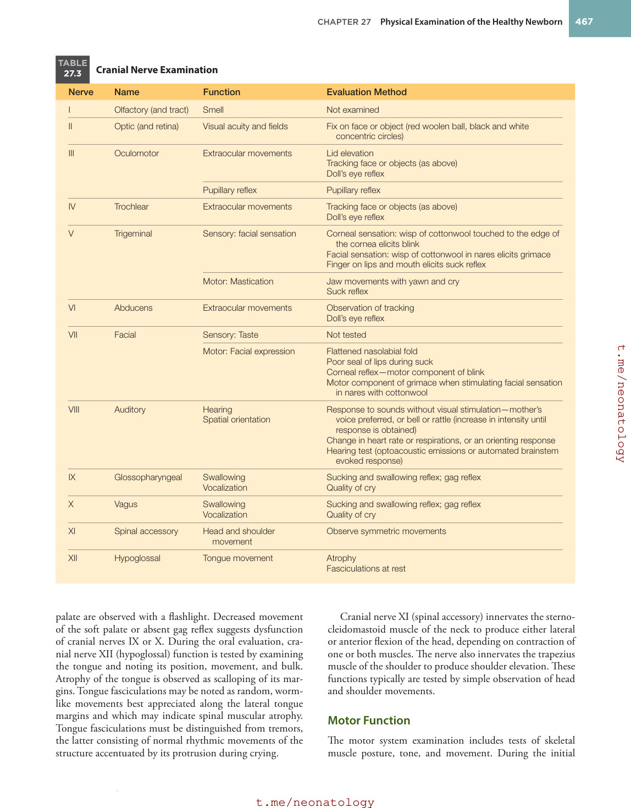

### Original source page 483

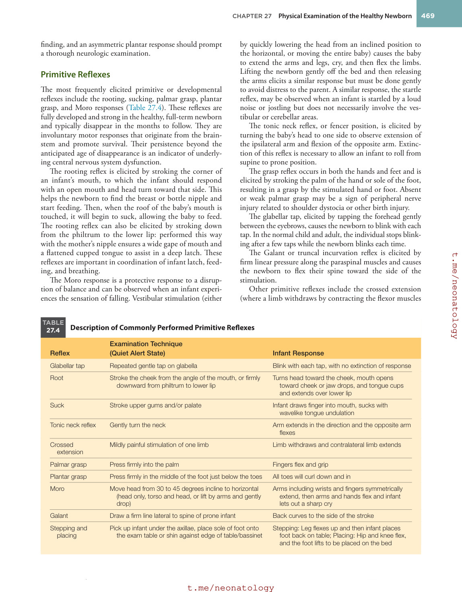

### Original source page 484

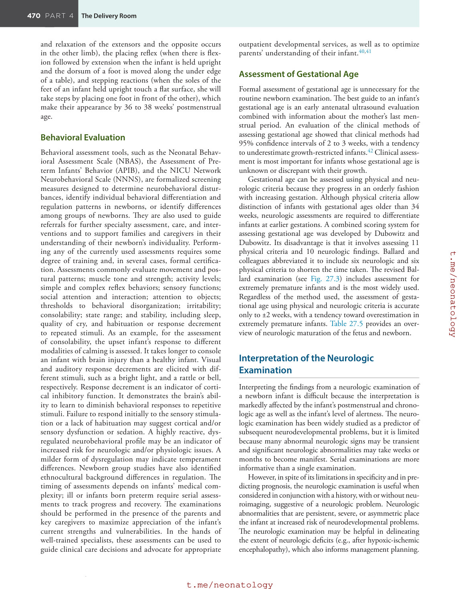

### Original source page 485

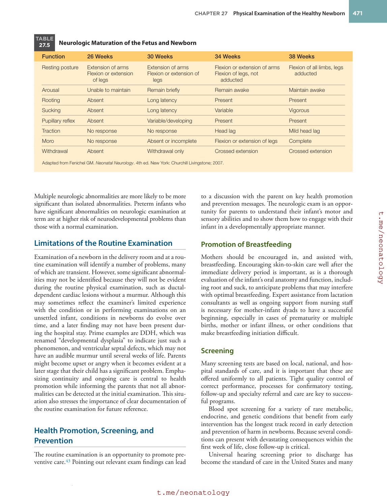

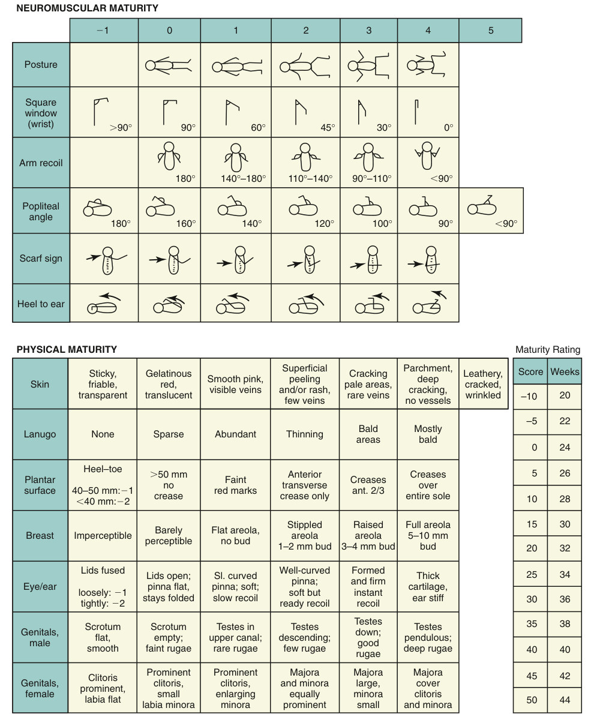

• Fig. 27.3 Assessment of gestational age using the revised Ballard method. (From Ballard JL, Khoury JC, Wedig K, et al. New Ballard Score, expanded to include extremely premature infants. J Pediatr. 1991;119:417.)

PDF p. 471
