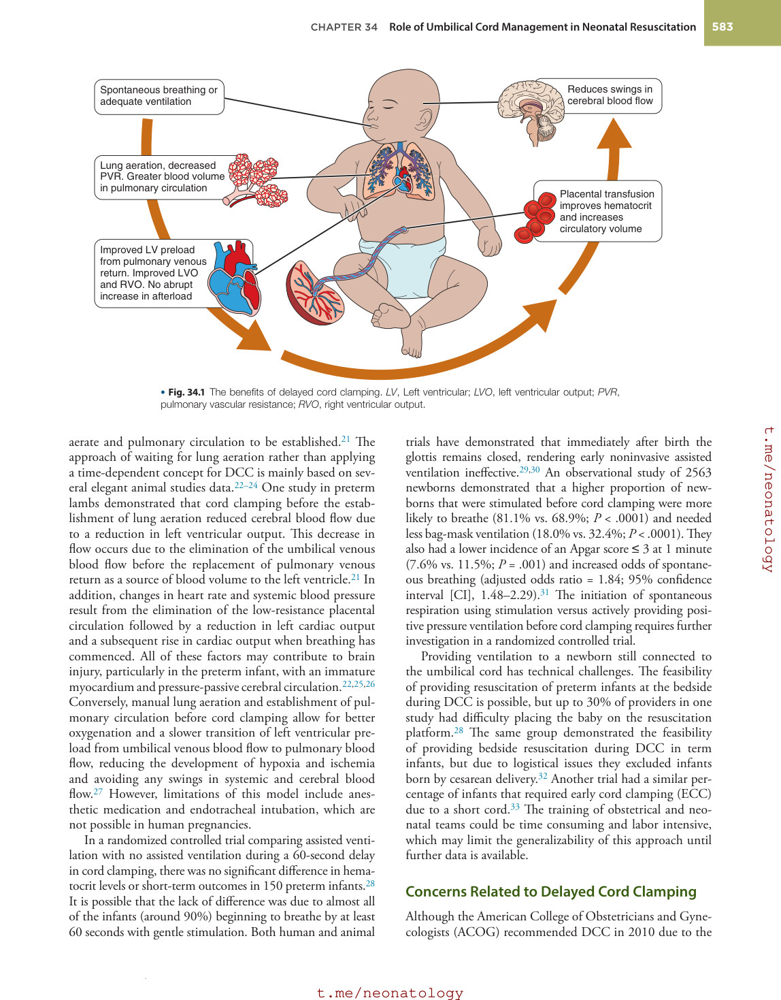
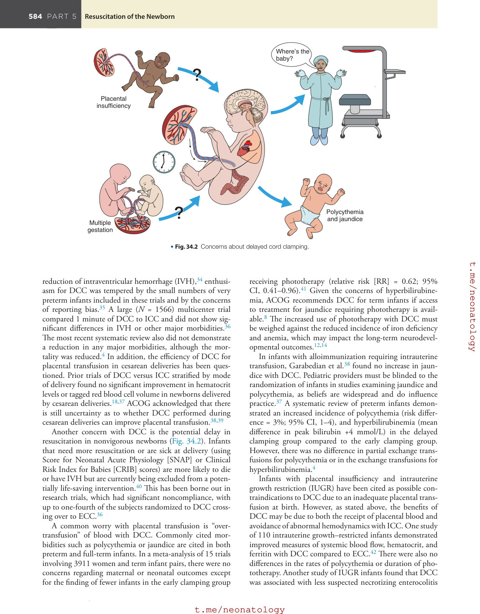
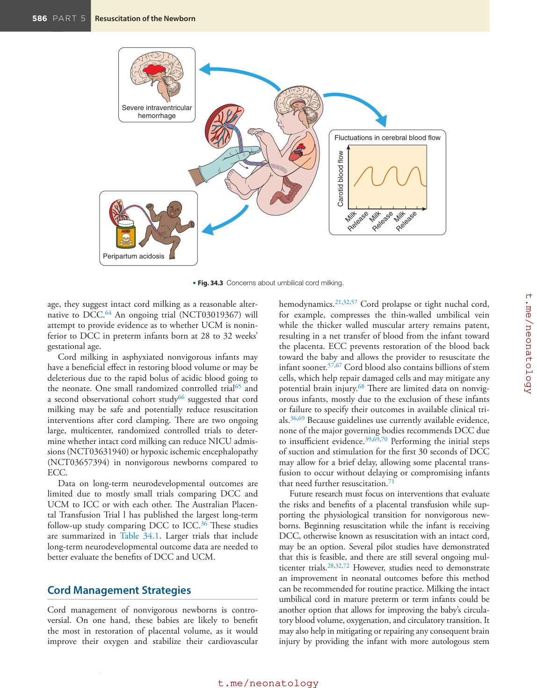
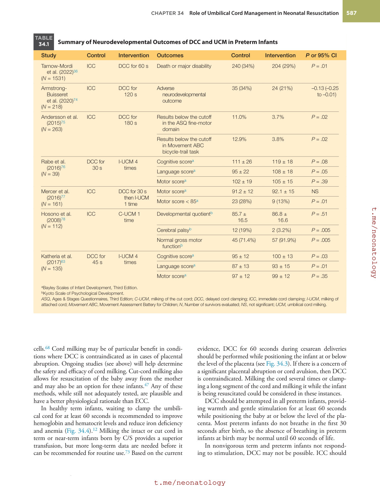
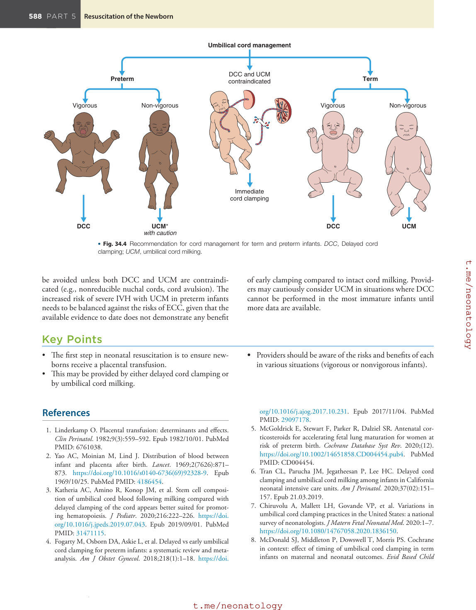
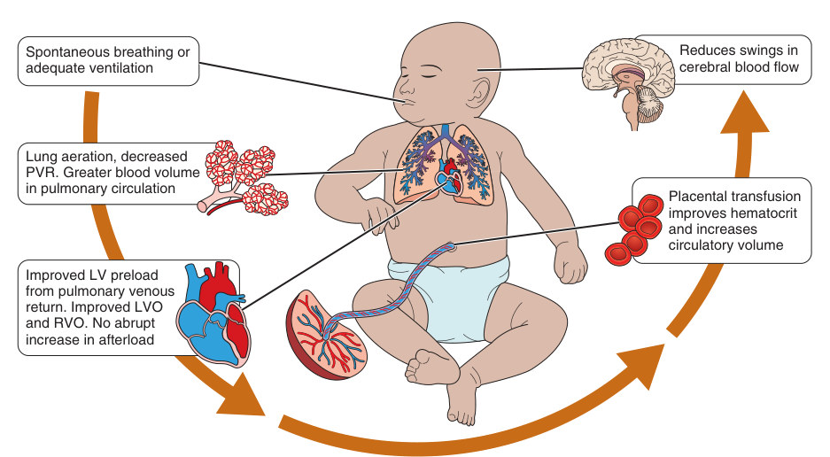
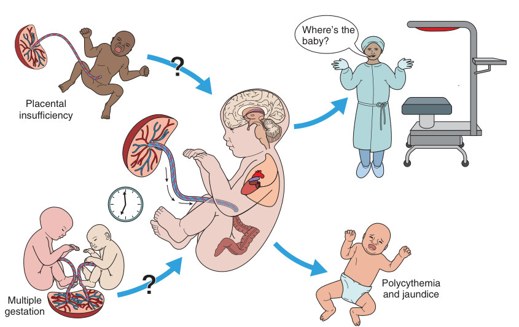
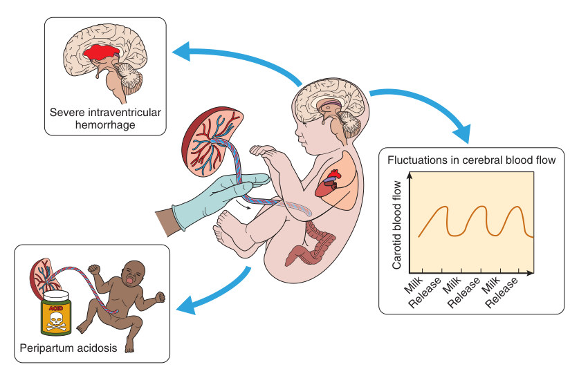
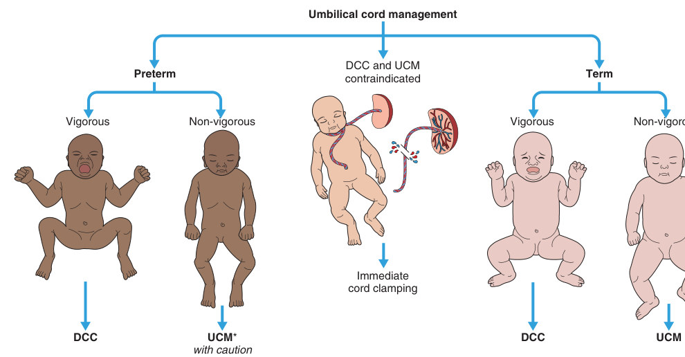

# 34. Role of Umbilical Cord Management in Neonatal Resuscitation
> Source attribution: [Source credits](../../SOURCE_CREDITS.md).

## PDF page 595 | printed page 582

34 Role of Umbilical Cord Management in Neonatal Resuscitation

### ANUP C. KATHERIA

### Introduction

At birth, one must decide when to clamp and cut the umbilical cord. This decision may have both short- and long-term effects on the newborn. In the first few minutes after birth, a delay in clamping the umbilical cord or milking the cord can result in a significant return of blood volume from the placenta to the infant. For preterm newborns, blood is equally distributed between the fetus and placenta.1 At term gestation, about one-third of the blood remains in the placenta. Delayed clamping of the umbilical cord reduces the amount of remaining blood in the placenta to about 20% by 1 minute and about 13% by 3 to 5 minutes.2 Placental blood is rich in stem cells (improve iron stores), immunoglobulins (improve immunity against infections), and hematopoietic stem cells (may help organ repair).3

### Delayed Cord Clamping

### Preterm Infants

There is strong evidence for the benefit of delayed cord clamping (DCC) in preterm newborns in several randomized controlled trials, cohort studies, and meta-analyses. A systematic review of 18 randomized controlled trials compared DCC (for ≥30 seconds) with early clamping (<30 seconds) in 2834 preterm infants.4 DCC reduced hospital mortality (the number of newborns needed to reduce a preterm death with DCC was 33). The number needed to reduce one premature death with antenatal steroids was 44 in the same population.5 Considering the widespread use of antenatal steroids, it is surprising that the rate of DCC has remained low.6,7 Additional benefits of DCC include increased serum hematocrit and reduced number of blood transfusions.4 Adverse effects included increases in the rates of polycythemia and hyperbilirubinemia, but these were not associated with an increase in the rate of exchange transfusions.4

582

### Term Infants

In term infants, a Cochrane review of 15 trials involving 3911 women and infants pairs demonstrated that DCC improved neonatal hemoglobin and hematocrit levels and reduced iron deficiency anemia at 3 to 6 months of age.8 Iron deficiency anemia is common during early infancy in developing nations.9 Twenty percent of neonates admitted to the neonatal intensive care unit (NICU) have a low mean corpuscular volume suggestive of iron deficiency,10 and half of the infants born to mothers with iron deficiency are iron deficient at birth.11 Although early iron deficiency is a short-term outcome, anemia during early childhood can have a significant impact on a child’s health and long-term neurodevelopment.12 DCC increased myelination at 12 months of age in brain regions associated with motor, sensory, and visual processing and function compared to immediate cord clamping (ICC) in term infants.13 Increased myelination may be related to the increased availability of iron for early myelinogenesis with DCC. Andersson et al.14 demonstrated improved fine motor and social development in 4-year-old children randomized to DCC compared to those who received ICC at birth.

The interaction of several components during delivery is complex and determines the net amount of placental transfusion and its resultant benefits from DCC. Although a longer duration of DCC increases blood transfer to the infant,2,15,16 the optimal duration is unknown. Factors including uterine contractions, type of delivery, gravity, and the infant’s breathing may play a determinant role.17-19 Although DCC for at least 1 to 3 minutes in spontaneously breathing infants positioned on the mother’s chest or abdomen after vaginal delivery is recommended, more evidence is needed for those born by cesarean delivery and those who are not vigorous at birth.20

The benefits of DCC extend beyond the addition of blood volume (Fig. 34.1) and support a stable transition from the fetal to newborn circulation, allowing the lung to

## PDF page 596 | printed page 583

Spontaneous breathing or adequate ventilation

Lung aeration, decreased PVR. Greater blood volume in pulmonary circulation

Improved LV preload from pulmonary venous return. Improved LVO and RVO. No abrupt increase in afterload

• Fig. 34.1 The benefits of delayed cord clamping. LV, Left ventricular; LVO, left ventricular output; PVR, pulmonary vascular resistance; RVO, right ventricular output.

aerate and pulmonary circulation to be established.21 The approach of waiting for lung aeration rather than applying a time-dependent concept for DCC is mainly based on several elegant animal studies data.22–24 One study in preterm lambs demonstrated that cord clamping before the establishment of lung aeration reduced cerebral blood flow due to a reduction in left ventricular output. This decrease in flow occurs due to the elimination of the umbilical venous blood flow before the replacement of pulmonary venous return as a source of blood volume to the left ventricle.21 In addition, changes in heart rate and systemic blood pressure result from the elimination of the low-resistance placental circulation followed by a reduction in left cardiac output and a subsequent rise in cardiac output when breathing has commenced. All of these factors may contribute to brain injury, particularly in the preterm infant, with an immature myocardium and pressure-passive cerebral circulation.22,25,26 Conversely, manual lung aeration and establishment of pulmonary circulation before cord clamping allow for better oxygenation and a slower transition of left ventricular preload from umbilical venous blood flow to pulmonary blood flow, reducing the development of hypoxia and ischemia and avoiding any swings in systemic and cerebral blood flow.27 However, limitations of this model include anesthetic medication and endotracheal intubation, which are not possible in human pregnancies.

In a randomized controlled trial comparing assisted ventilation with no assisted ventilation during a 60-second delay in cord clamping, there was no significant difference in hematocrit levels or short-term outcomes in 150 preterm infants.28 It is possible that the lack of difference was due to almost all of the infants (around 90%) beginning to breathe by at least 60 seconds with gentle stimulation. Both human and animal

Reduces swings in cerebral blood flow

Placental transfusion improves hematocrit and increases circulatory volume

trials have demonstrated that immediately after birth the glottis remains closed, rendering early noninvasive assisted ventilation ineffective.29,30 An observational study of 2563 newborns demonstrated that a higher proportion of newborns that were stimulated before cord clamping were more likely to breathe (81.1% vs. 68.9%; P < .0001) and needed less bag-mask ventilation (18.0% vs. 32.4%; P < .0001). They also had a lower incidence of an Apgar score ≤ 3 at 1 minute (7.6% vs. 11.5%; P = .001) and increased odds of spontaneous breathing (adjusted odds ratio = 1.84; 95% confidence interval [CI], 1.48–2.29).31 The initiation of spontaneous respiration using stimulation versus actively providing positive pressure ventilation before cord clamping requires further investigation in a randomized controlled trial.

Providing ventilation to a newborn still connected to the umbilical cord has technical challenges. The feasibility of providing resuscitation of preterm infants at the bedside during DCC is possible, but up to 30% of providers in one study had difficulty placing the baby on the resuscitation platform.28 The same group demonstrated the feasibility of providing bedside resuscitation during DCC in term infants, but due to logistical issues they excluded infants born by cesarean delivery.32 Another trial had a similar percentage of infants that required early cord clamping (ECC) due to a short cord.33 The training of obstetrical and neonatal teams could be time consuming and labor intensive, which may limit the generalizability of this approach until further data is available.

### Concerns Related to Delayed Cord Clamping

Although the American College of Obstetricians and Gynecologists (ACOG) recommended DCC in 2010 due to the

## PDF page 597

Placental insufficiency

Multiple gestation

• Fig. 34.2 Concerns about delayed cord clamping.

reduction of intraventricular hemorrhage (IVH),34 enthusiasm for DCC was tempered by the small numbers of very preterm infants included in these trials and by the concerns of reporting bias.35 A large (N = 1566) multicenter trial compared 1 minute of DCC to ICC and did not show significant differences in IVH or other major morbidities.36 The most recent systematic review also did not demonstrate a reduction in any major morbidities, although the mortality was reduced.4 In addition, the efficiency of DCC for placental transfusion in cesarean deliveries has been questioned. Prior trials of DCC versus ICC stratified by mode of delivery found no significant improvement in hematocrit levels or tagged red blood cell volume in newborns delivered by cesarean deliveries.18,37 ACOG acknowledged that there is still uncertainty as to whether DCC performed during cesarean deliveries can improve placental transfusion.38,39

Another concern with DCC is the potential delay in resuscitation in nonvigorous newborns (Fig. 34.2). Infants that need more resuscitation or are sick at delivery (using Score for Neonatal Acute Physiology [SNAP] or Clinical Risk Index for Babies [CRIB] scores) are more likely to die or have IVH but are currently being excluded from a potentially life-saving intervention.40 This has been borne out in research trials, which had significant noncompliance, with up to one-fourth of the subjects randomized to DCC crossing over to ECC.36

A common worry with placental transfusion is “overtransfusion” of blood with DCC. Commonly cited morbidities such as polycythemia or jaundice are cited in both preterm and full-term infants. In a meta-analysis of 15 trials involving 3911 women and term infant pairs, there were no concerns regarding maternal or neonatal outcomes except for the finding of fewer infants in the early clamping group

Where’s the baby?

Polycythemia and jaundice

receiving phototherapy (relative risk [RR] = 0.62; 95% CI, 0.41–0.96).41 Given the concerns of hyperbilirubinemia, ACOG recommends DCC for term infants if access to treatment for jaundice requiring phototherapy is available.8 The increased use of phototherapy with DCC must be weighed against the reduced incidence of iron deficiency and anemia, which may impact the long-term neurodevelopmental outcomes.12,14

In infants with alloimmunization requiring intrauterine transfusion, Garabedian et al.38 found no increase in jaundice with DCC. Pediatric providers must be blinded to the randomization of infants in studies examining jaundice and polycythemia, as beliefs are widespread and do influence practice.37 A systematic review of preterm infants demonstrated an increased incidence of polycythemia (risk difference = 3%; 95% CI, 1–4), and hyperbilirubinemia (mean difference in peak bilirubin +4 mmol/L) in the delayed clamping group compared to the early clamping group. However, there was no difference in partial exchange transfusions for polycythemia or in the exchange transfusions for hyperbilirubinemia.4

Infants with placental insufficiency and intrauterine growth restriction (IUGR) have been cited as possible contraindications to DCC due to an inadequate placental transfusion at birth. However, as stated above, the benefits of DCC may be due to both the receipt of placental blood and avoidance of abnormal hemodynamics with ICC. One study of 110 intrauterine growth–restricted infants demonstrated improved measures of systemic blood flow, hematocrit, and ferritin with DCC compared to ECC.42 There were also no differences in the rates of polycythemia or duration of phototherapy. Another study of IUGR infants found that DCC was associated with less suspected necrotizing enterocolitis

## PDF page 598 | printed page 585

without any evidence of harm.43 It would seem reasonable to attempt to delay clamping of the cord in this high-risk population.

There have been concerns about DCC in multiple pregnancies. The theoretical concern about placental connections between fetuses is monochorionic placentation, whereby during delivery of the first twin there is an acute blood loss from an anterior-venous anastomosis from the delivered twin with a resultant increase in blood volume in the in utero twin. Other concerns include difficulty extracting the second fetus during cesarean section due to the uterus clamping down during the delivery of the first twin and increased maternal bleeding leading to postpartum hemorrhage. Second-born twins also have lower Apgar scores and increased birth asphyxia, and they require more resuscitation than their first-born twins.44 A recent preterm cohort study demonstrated that neonatal outcomes were comparable between singletons and multiples, first- and second-order multiples, and monochorionic and dichorionic/trichorionic multiples.45

### Umbilical Cord Milking

### Intact Versus Cut Cord Milking

Milking of the attached cord (or intact cord milking) refers to the gentle grasping of the uncut umbilical cord and squeezing it toward the infant, usually three or four times. The cord refills quickly (in about 2 seconds) and can be milked again. After the umbilical cord has been milked three or four times, an infant receives about 17 mL/kg.46 Cut-cord milking involves clamping and cutting of a long segment of the umbilical cord attached to the baby at birth before passing the baby with the long cord segment to the pediatric provider, who then untwists the cord and milks the entire contents into the baby.47,48 Umbilical cord milking (UCM) provides a blood volume similar to that of a 2-minute delay in cord clamping in term infants as measured by residual placental blood volume.49 To date, no prospective trials are comparing the two methods of cord milking. A retrospective review of the need for blood transfusions in preterm infants with intact versus cut-cord milking demonstrated no difference.47 A study of blood volumes in term infants demonstrated higher blood volumes transfused with repeated cord milking compared to one-time cut-cord milking.50

### Late Preterm/Term Infants

In late preterm/term infants, UCM resulted in higher ferritin levels at 6 weeks of age.51 There have been seven randomized controlled trials (N = 1455 total infants) of milking the intact or cut cord in term infants.52 None of the studies demonstrated harm from cord milking in these vulnerable infants. Cord milking accelerates placental transfusion at the time of birth, resulting in benefits that may be similar to DCC and superior to ICC.

### Preterm Infants

Many premature infants require delivery by cesarean section (C/S). During C/S, when the uterus is cut open, placental transfusion may be diminished. DCC at C/S may not provide a sufficient placental transfusion compared to vaginal delivery. UCM at C/S improved blood flow and organ perfusion by providing a greater placental transfusion, as measured by improved superior vena cava flow (by echocardiography) and higher admission hemoglobin compared to DCC.53 However, recent data may limit the instances when cord milking should be performed, particularly in extremely preterm infants (see below).

### Concerns Related to Umbilical Cord Milking

Until recently, clinical data on humans comparing UCM to ICC or DCC reported no adverse effects.54–57 However, these trials were limited by the small sample size, especially of extremely preterm infants, and the lack of sufficient data on long-term neurodevelopmental outcomes. A large multicenter randomized controlled trial and large cohort study demonstrated that infants at 23 to 27 weeks’ gestation receiving UCM are at a greater risk of severe IVH (Fig. 34.3). A meta-analysis of 19 studies concluded that UCM significantly increases the risk of severe IVH compared to DCC and warns against this practice in extremely preterm infants.58 UCM in nonbreathing preterm lamb models demonstrated swings in heart rate, cardiac output, and carotid artery blood flow.59 This finding suggests that UCM may have a negative impact, particularly in extremely preterm infants who may be prone to IVH as a result. However, extrapolating these findings to human neonates may not be appropriate, as the studied preterm lambs were all delivered without administration of antenatal steroids. In addition, the animals were anesthetized and instrumented before delivery.

Before removing intact cord milking as part of cord management for preterm infants, it is important to understand that milking may be inferior to DCC, but not ECC. The most recent meta-analysis of 889 preterm infants found no difference between performing UCM or ECC in the outcome of severe IVH (RR = 0.72; 95% CI, 0.44–1.19). In two national cohorts (United States and Canada), UCM was not associated with an increase in severe IVH compared to ECC.60

Given the increase of severe IVH in extremely preterm infants, concern remains as to the safety of cord milking in premature infants above 27 weeks. Several studies with mature infants (mean gestational age 26–33 weeks) have not shown increases in severe IVH with UCM.53,61,62 Neurodevelopmental outcomes with cord milking were either similar or improved with milking.61,63

In 2021, the International Liaison Committee on Resuscitation updated their recommendations suggesting against intact cord milking for infants born less than 28 + 0 weeks’ gestational age, but, in infants 28 to 33 + 6 weeks’ gestational

## PDF page 599

Severe intraventricular hemorrhage

Peripartum acidosis

• Fig. 34.3 Concerns about umbilical cord milking.

age, they suggest intact cord milking as a reasonable alternative to DCC.64 An ongoing trial (NCT03019367) will attempt to provide evidence as to whether UCM is noninferior to DCC in preterm infants born at 28 to 32 weeks’ gestational age.

Cord milking in asphyxiated nonvigorous infants may have a beneficial effect in restoring blood volume or may be deleterious due to the rapid bolus of acidic blood going to the neonate. One small randomized controlled trial65 and a second observational cohort study66 suggested that cord milking may be safe and potentially reduce resuscitation interventions after cord clamping. There are two ongoing large, multicenter, randomized controlled trials to determine whether intact cord milking can reduce NICU admissions (NCT03631940) or hypoxic ischemic encephalopathy (NCT03657394) in nonvigorous newborns compared to ECC.

Data on long-term neurodevelopmental outcomes are limited due to mostly small trials comparing DCC and UCM to ICC or with each other. The Australian Placental Transfusion Trial l has published the largest long-term follow-up study comparing DCC to ICC.36 These studies are summarized in Table 34.1. Larger trials that include long-term neurodevelopmental outcome data are needed to better evaluate the benefits of DCC and UCM.

### Cord Management Strategies

Cord management of nonvigorous newborns is controversial. On one hand, these babies are likely to benefit the most in restoration of placental volume, as it would improve their oxygen and stabilize their cardiovascular

Fluctuations in cerebral blood flow

Carotid blood flow

Milk Release Milk Release Milk Release

hemodynamics.21,32,57 Cord prolapse or tight nuchal cord, for example, compresses the thin-walled umbilical vein while the thicker walled muscular artery remains patent, resulting in a net transfer of blood from the infant toward the placenta. ECC prevents restoration of the blood back toward the baby and allows the provider to resuscitate the infant sooner.57,67 Cord blood also contains billions of stem cells, which help repair damaged cells and may mitigate any potential brain injury.68 There are limited data on nonvigorous infants, mostly due to the exclusion of these infants or failure to specify their outcomes in available clinical trials.36,69 Because guidelines use currently available evidence, none of the major governing bodies recommends DCC due to insufficient evidence.39,69,70 Performing the initial steps of suction and stimulation for the first 30 seconds of DCC may allow for a brief delay, allowing some placental transfusion to occur without delaying or compromising infants that need further resuscitation.71

Future research must focus on interventions that evaluate the risks and benefits of a placental transfusion while supporting the physiological transition for nonvigorous newborns. Beginning resuscitation while the infant is receiving DCC, otherwise known as resuscitation with an intact cord, may be an option. Several pilot studies have demonstrated that this is feasible, and there are still several ongoing multicenter trials.28,32,72 However, studies need to demonstrate an improvement in neonatal outcomes before this method can be recommended for routine practice. Milking the intact umbilical cord in mature preterm or term infants could be another option that allows for improving the baby’s circulatory blood volume, oxygenation, and circulatory transition. It may also help in mitigating or repairing any consequent brain injury by providing the infant with more autologous stem

## PDF page 600 | printed page 587

TABLE

Summary of Neurodevelopmental Outcomes of DCC and UCM in Preterm Infants

34.1

Study Control Intervention Outcomes

Tarnow-Mordi

ICC DCC for 60 s Death or major disability

et al. (2022)36 (N = 1531)

Armstrong-

ICC DCC for

Adverse

Buisseret et al. (2020)74 (N = 218)

120 s

neurodevelopmental outcome

Andersson et al.

ICC DCC for

Results below the cutoff

(2015)75 (N = 263)

180 s

in the ASQ fine-motor domain

Results below the cutoff

in Movement ABC bicycle-trail task

Cognitive scorea

Rabe et al.

DCC for

I-UCM 4

(2016)76 (N = 39)

30 s

times

Language scorea

Motor scorea

Motor scorea

Mercer et al.

ICC DCC for 30 s

(2016)77 (N = 161)

then I-UCM 1 time

Motor score < 85a

Developmental quotientb

Hosono et al.

ICC C-UCM 1

(2008)78 (N = 112)

time

Cerebral palsyb

Normal gross motor

functionb

Cognitive scorea

Katheria et al.

DCC for

I-UCM 4

(2017)63 (N = 135)

45 s

times

Language scorea

Motor scorea

aBayley Scales of Infant Development, Third Edition. bKyoto Scale of Psychological Development. ASQ, Ages & Stages Questionnaires, Third Edition; C-UCM, milking of the cut cord; DCC, delayed cord clamping; ICC, immediate cord clamping; I-UCM, milking of attached cord; Movement ABC, Movement Assessment Battery for Children; N, Number of survivors evaluated; NS, not significant; UCM, umbilical cord milking.

cells.68 Cord milking may be of particular benefit in conditions where DCC is contraindicated as in cases of placental abruption. Ongoing studies (see above) will help determine the safety and efficacy of cord milking. Cut-cord milking also allows for resuscitation of the baby away from the mother and may also be an option for these infants.47 Any of these methods, while still not adequately tested, are plausible and have a better physiological rationale than ECC.

In healthy term infants, waiting to clamp the umbilical cord for at least 60 seconds is recommended to improve hemoglobin and hematocrit levels and reduce iron deficiency and anemia (Fig. 34.4).12 Milking the intact or cut cord in term or near-term infants born by C/S provides a superior transfusion, but more long-term data are needed before it can be recommended for routine use.73 Based on the current

Control Intervention P or 95% CI

240 (34%) 204 (29%) P = .01

35 (34%) 24 (21%) –0.13 (–0.25

to –0.01)

11.0% 3.7% P = .02

12.9% 3.8% P = .02

111 ± 26 119 ± 18 P = .08

95 ± 22 108 ± 18 P = .05

102 ± 19 105 ± 15 P = .39

91.2 ± 12 92.1 ± 15 NS

23 (28%) 9 (13%) P = .01

85.7 ±

86.8 ±

P = .51

16.5

16.6

12 (19%) 2 (3.2%) P = .005

45 (71.4%) 57 (91.9%) P = .005

95 ± 12 100 ± 13 P = .03

87 ± 13 93 ± 15 P = .01

97 ± 12 99 ± 12 P = .35

evidence, DCC for 60 seconds during cesarean deliveries should be performed while positioning the infant at or below the level of the placenta (see Fig. 34.3). If there is a concern of a significant placental abruption or cord avulsion, then DCC is contraindicated. Milking the cord several times or clamping a long segment of the cord and milking it while the infant is being resuscitated could be considered in these instances.

DCC should be attempted in all preterm infants, providing warmth and gentle stimulation for at least 60 seconds while positioning the baby at or below the level of the placenta. Most preterm infants do not breathe in the first 30 seconds after birth, so the absence of breathing in preterm infants at birth may be normal until 60 seconds of life.

In nonvigorous term and preterm infants not responding to stimulation, DCC may not be possible. ICC should

## PDF page 601

Umbilical cord management

DCC and UCM contraindicated

Preterm

Vigorous Non-vigorous

Immediate cord clamping

### DCC

### UCM*

with caution

### • Fig. 34.4 Recommendation for cord management for term and preterm infants. DCC, Delayed cord

clamping; UCM, umbilical cord milking.

be avoided unless both DCC and UCM are contraindicated (e.g., nonreducible nuchal cords, cord avulsion). The increased risk of severe IVH with UCM in preterm infants needs to be balanced against the risks of ECC, given that the available evidence to date does not demonstrate any benefit

Key Points

• The first step in neonatal resuscitation is to ensure new-

borns receive a placental transfusion. • This may be provided by either delayed cord clamping or

by umbilical cord milking.

### References

1. Linderkamp O. Placental transfusion: determinants and effects.

Clin Perinatol. 1982;9(3):559–592. Epub 1982/10/01. PubMed PMID: 6761038. 2. Yao AC, Moinian M, Lind J. Distribution of blood between

infant and placenta after birth. Lancet. 1969;2(7626):871– 873. https://doi.org/10.1016/s0140-6736(69)92328-9. Epub 1969/10/25. PubMed PMID: 4186454. 3. Katheria AC, Amino R, Konop JM, et al. Stem cell composi-

tion of umbilical cord blood following milking compared with delayed clamping of the cord appears better suited for promoting hematopoiesis. J Pediatr. 2020;216:222–226. https://doi. org/10.1016/j.jpeds.2019.07.043. Epub 2019/09/01. PubMed PMID: 31471115. 4. Fogarty M, Osborn DA, Askie L, et al. Delayed vs early umbilical

cord clamping for preterm infants: a systematic review and metaanalysis. Am J Obstet Gynecol. 2018;218(1):1–18. https://doi.

Term

Vigorous Non-vigorous

### DCC UCM

of early clamping compared to intact cord milking. Providers may cautiously consider UCM in situations where DCC cannot be performed in the most immature infants until more data are available.

### • Providers should be aware of the risks and benefits of each

in various situations (vigorous or nonvigorous infants).

org/10.1016/j.ajog.2017.10.231. Epub 2017/11/04. PubMed PMID: 29097178. 5. McGoldrick E, Stewart F, Parker R, Dalziel SR. Antenatal cor-

ticosteroids for accelerating fetal lung maturation for women at risk of preterm birth. Cochrane Database Syst Rev. 2020;(12). https://doi.org/10.1002/14651858.CD004454.pub4. PubMed PMID: CD004454. 6. Tran CL, Parucha JM, Jegatheesan P, Lee HC. Delayed cord

clamping and umbilical cord milking among infants in California neonatal intensive care units. Am J Perinatol. 2020;37(02):151– 157. Epub 21.03.2019. 7. Chiruvolu A, Mallett LH, Govande VP, et al. Variations in

umbilical cord clamping practices in the United States: a national survey of neonatologists. J Matern Fetal Neonatal Med. 2020:1–7. https://doi.org/10.1080/14767058.2020.1836150. 8. McDonald SJ, Middleton P, Dowswell T, Morris PS. Cochrane

in context: effect of timing of umbilical cord clamping in term infants on maternal and neonatal outcomes. Evid Based Child

## PDF page 602 | printed page 589

Health. 2014;9(2):398–400. https://doi.org/10.1002/ebch.1965. Epub 2014/11/19. PubMed PMID: 25404606. 9. Subramaniam G, Girish M. Iron deficiency anemia in children. Indian

J Pediatr. 2015;82(6):558–564. https://doi.org/10.1007/s12098-014- 1643-9. Epub 2015/02/01. PubMed PMID: 25636824. 10. Guo R, Neumann D, Lafferty M, et al. Prevalence and utility of

low mean corpuscular volume in infants admitted to the neonatal intensive care unit. J Pediatr. 2020;227:108–113.e2. https://doi. org/10.1016/j.jpeds.2020.07.056. Epub 2020/07/24. PubMed PMID: 32702426. 11. Zhao G, Xu G, Zhou M, et al. Prenatal iron supplementa-

tion reduces maternal anemia, iron deficiency, and iron deficiency anemia in a randomized clinical trial in rural China, but iron deficiency remains widespread in mothers and neonates. J Nutr. 2015;145(8):1916–1923. https://doi.org/10.3945/ jn.114.208678. Epub 2015/06/13. PubMed PMID: 26063068. PMCID: PMC4516762. 12. Andersson O, Hellstrom-Westas L, Andersson D, Domellof M.

Effect of delayed versus early umbilical cord clamping on neonatal outcomes and iron status at 4 months: a randomised controlled trial. BMJ. 2011;343:d7157. https://doi.org/10.1136/ bmj.d7157. Epub 2011/11/18. PubMed PMID: 22089242. PMCID: Pmc3217058. 13. Mercer JS, Erickson-Owens DA, Deoni SCL, et al. Effects of

delayed cord clamping on 4-month ferritin levels, brain myelin content, and neurodevelopment: a randomized controlled trial. J Pediatr. 2018;203:266–272.e2. https://doi.org/10.1016/j. jpeds.2018.06.006. Epub 2018/11/27. PubMed PMID: 30473033. PMCID: PMC6259583. 14. Andersson O, Lindquist B, Lindgren M, et al. Effect of delayed

cord clamping on neurodevelopment at 4 years of age: a randomized clinical trial. JAMA Pediatr. 2015;169(7):631–638. https:// doi.org/10.1001/jamapediatrics.2015.0358. Epub 2015/05/27. PubMed PMID: 26010418. 15. Yao AC, Hirvensalo M, Lind J. Placental transfusion-rate and

uterine contraction. Lancet. 1968;1(7539):380–383. Epub 1968/02/24. PubMed PMID: 4169972. 16. Farrar D, Airey R, Law GR, et al. Measuring placental trans-

fusion for term births: weighing babies with cord intact. BJOG. 2011;118(1):70–75. https://doi.org/10.1111/j.1471- 0528.2010.02781.x. PubMed PMID: 21083868. 17. Philip AG, Teng SS. Role of respiration in effecting transfusion

at cesarean section. Biol Neonate. 1977;31(3–4):219–224. Epub 1977/01/01. PubMed PMID: 861319. 18. Aladangady N, McHugh S, Aitchison TC, et al. Infants’ blood

volume in a controlled trial of placental transfusion at preterm delivery. Pediatrics. 2006;117(1):93–98. https://doi.org/10.1542/ peds.2004-1773. PubMed PMID: 16396865. 19. Boere I, Roest AA, Wallace E, et al. Umbilical blood flow pat-

terns directly after birth before delayed cord clamping. Arch Dis Child Fetal Neonatal Ed. 2015;100(2):F121–F125. https://doi. org/10.1136/archdischild-2014-307144. Epub 2014/11/13. PubMed PMID: 25389141. 20. Vain NE, Satragno DS, Gorenstein AN, et al. Effect of gravity

on volume of placental transfusion: a multicentre, randomised, non-inferiority trial. Lancet. 2014;384(9939):235–240. https:// doi.org/10.1016/s0140-6736(14)60197-5. Epub 2014/04/22. PubMed PMID: 24746755. 21. Bhatt S, Alison BJ, Wallace EM, et al. Delaying cord clamping

until ventilation onset improves cardiovascular function at birth in preterm lambs. J Physiol. 2013;591(8):2113–2126. https://

doi.org/10.1113/jphysiol.2012.250084. Epub 2013/02/13. PubMed PMID: 23401615. PMCID: Pmc3634523. 22. Hooper SB, Te Pas AB, Lang J, et al. Cardiovascular transition

at birth: a physiological sequence. Pediatr Res. 2015;77(5):608– 614. https://doi.org/10.1038/pr.2015.21. Epub 2015/02/12. PubMed PMID: 25671807. 23. Polglase GR, Blank DA, Barton SK, et al. Physiologically based

cord clamping stabilises cardiac output and reduces cerebrovascular injury in asphyxiated near-term lambs. Arch Dis Child Fetal Neonatal Ed. 2018;103(6):F530–F538. https://doi.org/10.1136/archdischild-2017-313657. Epub 2017/12/02. PubMed PMID: 29191812. 24. Polglase GR, Dawson JA, Kluckow M, et al. Ventilation onset

prior to umbilical cord clamping (physiological-based cord clamping) improves systemic and cerebral oxygenation in preterm lambs. PLoS One. 2015;10(2):e0117504. https:// doi.org/10.1371/journal.pone.0117504. Epub 2015/02/18. PubMed PMID: 25689406. PMCID: Pmc4331493. 25. Kluckow M, Hooper SB. Using physiology to guide time to

cord clamping. Semin Fetal Neonatal Med. 2015;20(4):225–231. https://doi.org/10.1016/j.siny.2015.03.002. Epub 2015/03/31. PubMed PMID: 25818878. 26. Niermeyer S, Velaphi S. Promoting physiologic transition at

birth: re-examining resuscitation and the timing of cord clamping. Semin Fetal Neonatal Med. 2013;18(6):385–392. https://doi. org/10.1016/j.siny.2013.08.008. Epub 2013/09/24. PubMed PMID: 24055300. 27. Bhatt S, Polglase GR, Wallace EM, et al. Ventilation before

umbilical cord clamping improves the physiological transition at birth. Front Pediatr. 2014;2:113. https://doi.org/10.3389/ fped.2014.00113. Epub 2014/11/05. PubMed PMID: 25368858. PMCID: Pmc4203108. 28. Katheria A, Poeltler D, Durham J, et al. Neonatal resus-

citation with an intact cord: a randomized clinical trial. J Pediatr. 2016;178:75–80.e3. https://doi.org/10.1016/j. jpeds.2016.07.053. Epub 2016/10/30. PubMed PMID: 27574999. PMCID: Pmc5527831. 29. van Vonderen JJ, Hooper SB, Hummler HD, et al. Effects

of a sustained inflation in preterm infants at birth. J Pediatr. 2014;165(5):903–908.e1. https://doi.org/10.1016/j. jpeds.2014.06.007. Epub 2014/07/21. PubMed PMID: 25039041. 30. Crawshaw JR, Kitchen MJ, Binder-Heschl C, et al. Laryngeal

closure impedes non-invasive ventilation at birth. Arch Dis Child Fetal Neonatal Ed. 2018;103(2):F112–F119. https://doi. org/10.1136/archdischild-2017-312681. Epub 2017/10/22. PubMed PMID: 29054974. 31. KC A, Budhathoki SS, Thapa J, et al. Impact of stimulation

among non-crying neonates with intact cord versus clamped cord on birth outcomes: observation study. BMJ Paediatrics Open. 2022;5(1):e001207. https://doi.org/10.1136/bmjpo-2021-001207. 32. Katheria AC, Brown MK, Faksh A, et al. Delayed cord clamp-

ing in newborns born at term at risk for resuscitation: a feasibility randomized clinical trial. J Pediatr. 2017;187:313–317.e1. https://doi.org/10.1016/j.jpeds.2017.04.033. Epub 2017/05/21. PubMed PMID: 28526223. 33. Duley L, Dorling J, Pushpa-Rajah A, et al. Randomised trial

of cord clamping and initial stabilisation at very preterm birth. Arch Dis Child Fetal Neonatal. 2018;103(1):F6–F14. https://doi. org/10.1136/archdischild-2016-312567. 34. Grazziotin AL, Koonin EV, Kristensen DM. Prokaryotic Virus

Orthologous Groups (pVOGs): a resource for comparative

## PDF page 603

genomics and protein family annotation. Nucleic Acids Res. 2017;45(D1):D491–D498. https://doi.org/10.1093/nar/gkw975. 35. Rabe H, Diaz-Rossello JL, Duley L, Dowswell T. Effect of timing

of umbilical cord clamping and other strategies to influence placental transfusion at preterm birth on maternal and infant outcomes. Cochrane Database Syst Rev. 2012;8:CD003248. https:// doi.org/10.1002/14651858.CD003248.pub3. PubMed PMID: 22895933. 36. Tarnow-Mordi W, Morris J, Kirby A, et al. Delayed versus

immediate cord clamping in preterm infants. N Engl J Med. 2017;377(25):2445–2455. https://doi.org/10.1056/NEJ- Moa1711281. Epub 2017/10/31. PubMed PMID: 29081267. 37. Strauss RG, Mock DM, Johnson KJ, et al. A randomized clini-

cal trial comparing immediate versus delayed clamping of the umbilical cord in preterm infants: short-term clinical and laboratory endpoints. Transfusion. 2008;48(4):658–665. https://doi. org/10.1111/j.1537-2995.2007.01589.x. Epub 2008/01/16. PubMed PMID: 18194383. PMCID: Pmc2883857. 38. Garabedian C, Rakza T, Drumez E, et al. Benefits of delayed

cord clamping in red blood cell alloimmunization. Pediatrics. 2016;137(3):1–6. https://doi.org/10.1542/peds.2015-3236. Epub 2016/02/26. PubMed PMID: 26908660. 39. Committee Opinion No. 684: delayed umbilical cord clamp-

ing after birth. Obstet Gynecol. 2017;129(1):e5–e10. https:// doi.org/10.1097/aog.0000000000001860. Epub 2016/12/22. PubMed PMID: 28002310. 40. Dorling JS, Field DJ, Manktelow B. Neonatal disease severity scor-

ing systems. Arch Dis Child Fetal Neonatal Ed. 2005;90(1):F11– F16. 41. McDonald SJ, Middleton P, Dowswell T, Morris PS.

Effect of timing of umbilical cord clamping of term infants on maternal and neonatal outcomes. Cochrane Database Syst Rev. 2013;2013(7):Cd004074. https://doi. org/10.1002/14651858.CD004074.pub3. Epub 2013/07/12. PubMed PMID: 23843134. PMCID: PMC6544813 The other review authors assessed this trial for potential inclusion and data extraction. 42. Digal KC, Singh P, Srivastava Y, et al. Effects of delayed cord

clamping in intrauterine growth-restricted neonates: a randomized controlled trial. Eur J Pediatr. 2021;180(6):1701– 1710. https://doi.org/10.1007/s00431-021-03959-7. Epub 2021/01/23. PubMed PMID: 33479800. 43. Wang M, Mercer JS, Padbury JF. Delayed cord clamping in

infants with suspected intrauterine growth restriction. J Pediatr. 2018;201:264–268. 44. Armson BA, O’Connell C, Persad V, et al. Determinants of

perinatal mortality and serious neonatal morbidity in the second twin. Obstet Gynecol. 2006;108(3 Part 1):556–564. https://doi. org/10.1097/01.AOG.0000227747.37184.0a. PubMed PMID: 00006250-200609000-00014. 45. Jegatheesan P, Belogolovsky E, Nudelman M, et al. Neonatal

outcomes in preterm multiples receiving delayed cord clamping. Arch Dis Child Fetal Neonatal Ed. 2019;104(6):F575–F581. https://doi.org/10.1136/archdischild-2018-316479. 46. McAdams R. Volumes of Cord Blood with Cord Milking. San Fran-

cisco: Pediatrics Academic Society; 2017. 47. Hosono S, Mugishima H, Takahashi S, et al. One-time umbilical

cord milking after cord cutting has same effectiveness as multiple-time umbilical cord milking in infants born at <29 weeks of gestation: a retrospective study. J Perinatol. 2015;35(8):590–594. https://doi.org/10.1038/jp.2015.15. Epub 2015/03/13. PubMed PMID: 25764329.

48. Upadhyay A, Gothwal S, Parihar R, et al. Effect of umbilical

cord milking in term and near term infants: randomized control trial. Am J Obstet Gynecol. 2013;208(2):120.e1-6. https://doi. org/10.1016/j.ajog.2012.10.884. Epub 2012/11/06. PubMed PMID: 23123382. 49. Mercer JS, Erickson-Owens DA. Rethinking placental trans-

fusion and cord clamping issues. J Perinat Neonatal Nurs. 2012;26(3):202–217; quiz 18-9. https://doi.org/10.1097/ JPN.0b013e31825d2d9a. Epub 2012/07/31. PubMed PMID: 22843002. 50. McAdams RM, Fay E, Delaney S. Whole blood volumes associ-

ated with milking intact and cut umbilical cords in term newborns. J Perinatol. 2018;38(3):245–250. https://doi.org/10.1038/ s41372-017-0002-x. 51. Kumar B, Upadhyay A, Gothwal S, et al. Umbilical cord milk-

ing and hematological parameters in moderate to late preterm neonates: a randomized controlled trial. Indian Pediatr. 2015;52(9):753–757. Epub 2015/11/01. PubMed PMID: 26519708. 52. Basile S, Pinelli S, Micelli E, et al. Milking of the umbili-

cal cord in term and late preterm infants. BioMed Res Int. 2019;2019:9185059. https://doi.org/10.1155/2019/9185059. 53. Katheria AC, Truong G, Cousins L, et al. Umbilical cord milk-

ing versus delayed cord clamping in preterm infants. Pediatrics. 2015;136(1):61–69. https://doi.org/10.1542/peds.2015-0368. PubMed PMID: 26122803. PMCID: 4485011. 54. Ghavam S, Batra D, Mercer J, et al. Effects of placental transfu-

sion in extremely low birthweight infants: meta-analysis of longand short-term outcomes. Transfusion. 2014;54(4):1192–1198. Epub 2014/05/21. PubMed PMID: 24843886. 55. Al-Wassia H, Shah PS. Efficacy and safety of umbilical cord

milking at birth: a systematic review and meta-analysis. JAMA Pediatr. 2015;169(1):18–25. https://doi.org/10.1001/jamapediatrics.2014.1906. Epub 2014/11/05. PubMed PMID: 25365246. 56. Backes CH, Rivera BK, Haque U, et al. Placental transfusion

strategies in very preterm neonates: a systematic review and meta-analysis. Obstet Gynecol. 2014;124(1):47–56. https:// doi.org/10.1111/ped.12464. Epub 2014/08/06/2014/06/06. PubMed PMID: 24901269. 57. Rabe H, Diaz-Rossello JL, Duley L, Dowswell T. Effect of tim-

ing of umbilical cord clamping and other strategies to influence placental transfusion at preterm birth on maternal and infant outcomes. Cochrane Database Syst Rev. 2012;(8):Cd003248. https://doi.org/10.1002/14651858.CD003248.pub3. Epub 2012/08/17. PubMed PMID: 22895933. 58. Balasubramanian H, Ananthan A, Jain V, et al. Umbilical cord

milking in preterm infants: a systematic review and meta-analysis. Arch Dis Child Fetal Neonatal Ed. 2020;105(6):572–580. https://doi.org/10.1136/archdischild-2019-318627. 59. Blank DA, Polglase GR, Kluckow M, et al. Haemodynamic effects

of umbilical cord milking in premature sheep during the neonatal transition. Arch Dis Child Fetal Neonatal Ed. 2018;103(6):F539– F546. https://doi.org/10.1136/archdischild-2017-314005. Epub 2017/12/05. PubMed PMID: 29208663. 60. El-Naggar W, Afifi J, Dorling J, et al. A comparison of strategies

for managing the umbilical cord at birth in preterm infants. J Pediatr. 225:58-64.e4. https://doi.org/10.1016/j.jpeds.2020.05.018. Epub 2020 May 20.2020. 61. Josephsen JB, Potter S, Armbrecht ES, Al-Hosni M. Umbili-

cal cord milking in extremely preterm infants: a randomized controlled trial comparing cord milking with immediate cord

## PDF page 604 | printed page 591

clamping. Am J Perinatol. 2022;39(4):436–443. https://doi.org /10.1055/s-0040-1716484. Epub 2020/09/08. PubMed PMID: 32894871. 62. Shirk SK, Manolis SA, Lambers DS, Smith KL. Delayed clamp-

ing vs milking of umbilical cord in preterm infants: a randomized controlled trial. Am J Obstet Gynecol. 2019;220(5):482.e1–e8. https://doi.org/10.1016/j.ajog.2019.01.234. Epub 2019/02/21. PubMed PMID: 30786254. 63. Katheria A, Garey D, Truong G, et al. A randomized clinical trial

of umbilical cord milking vs delayed cord clamping in preterm infants: neurodevelopmental outcomes at 22-26 months of corrected age. J Pediatr. 2018;194:76–80. https://doi.org/10.1016/j. jpeds.2017.10.037. Epub 2017/12/17. PubMed PMID: 29246467. 64. Perlman JM, Wyllie J, Kattwinkel J, et al. Part 7: Neonatal Resus-

citation: 2015 International Consensus on Cardiopulmonary Resuscitation and Emergency Cardiovascular Care Science With Treatment Recommendations (Reprint). Pediatrics. 2015;136(suppl 2):S120–S166. https://doi.org/10.1542/peds.2015-3373D. Epub 2015/10/17. PubMed PMID: 26471381. 65. Girish M, Jain V, Dhokane R, et al. Umbilical cord milking for neo-

nates who are depressed at birth: a randomized trial of feasibility. J Perinatol. 2018;38(9):1190–1196. https://doi.org/10.1038/s41372- 018-0161-4. Epub 2018/07/06. PubMed PMID: 29973664. 66. Katheria A, Mercer J, Brown M, et al. Umbilical cord milking at

birth for term newborns with acidosis: neonatal outcomes. J Perinatol. 2018;38(3):240–244. https://doi.org/10.1038/s41372- 017-0011-9. Epub 2017/12/14. PubMed PMID: 29234144. 67. McDonald SJ, Middleton P, Dowswell T, Morris PS. Effect of

timing of umbilical cord clamping of term infants on maternal and neonatal outcomes. Evid Based Child Health. 2014;9(2):303– 397. https://doi.org/10.1002/ebch.1971. Epub 2014/11/19. PubMed PMID: 25404605. 68. Sanberg PR, Park DH, Borlongan CV. Stem cell transplants

at childbirth. Stem Cell Rev Rep. 2010;6(1):27–30. https://doi. org/10.1007/s12015-009-9108-7. Epub 2009/12/19. PubMed PMID: 20020331. 69. Perlman JM, Wyllie J, Kattwinkel J, et al. Neonatal Resuscita-

tion Chapter Collaborators. Part 7: Neonatal Resuscitation: 2015 International Consensus on Cardiopulmonary Resuscitation and Emergency Cardiovascular Care Science With Treatment Recommendations. Circulation. 2015;132(16 suppl 1):S204–S241. https://doi.org/10.1161/cir.0000000000000276.

70. World Health Organization. Guidelines on Basic Newborn Resusu-

citation. Geneva: World Health Organization; 2012. 71. Weiner GM, Zaichkin J, eds. Textbook of Neonatal Resuscita-

tion (NRP). 7th ed. American Academy of Pediatrics; 2016: 326. 72. Winter J, Kattwinkel J, Chisholm C, et al. Ventilation of preterm

infants during delayed cord clamping (ventfirst): a pilot study of feasibility and safety. Am J Perinatol. 2017;34(2):111–116. https://doi.org/10.1055/s-0036-1584521. Epub 2016/06/16. PubMed PMID: 27305177. 73. Erickson-Owens DA, Mercer JS, Oh W. Umbilical cord milk-

ing in term infants delivered by cesarean section: a randomized controlled trial. J Perinatol. 2012;32(8):580–584. https://doi. org/10.1038/jp.2011.159. Epub 2011/11/19. PubMed PMID: 22094494. 74. Armstrong-Buisseret L, Powers K, Dorling J, et al. Randomised

trial of cord clamping at very preterm birth: outcomes at 2 years. Arch Dis Child Fetal Neonatal Ed. 2020;105(3):292–298. https:// doi.org/10.1136/archdischild-2019-316912. 75. Andersson O, Lindquist B, Lindgren M, et al. Effect of delayed

cord clamping on neurodevelopment at 4 years of age: a randomized clinical trial. JAMA Pediatr. 2015;169(7):631–638. https:// doi.org/10.1001/jamapediatrics.2015.0358. Epub 2015/05/27. PubMed PMID: 26010418. 76. Rabe H, Sawyer A, Amess P, Ayers S. Neurodevelopmental out-

comes at 2 and 3.5 years for very preterm babies enrolled in a randomized trial of milking the umbilical cord versus delayed cord clamping. Neonatology. 2016;109(2):113–119. https://doi. org/10.1159/000441891. Epub 2015/12/10. PubMed PMID: 26650133. 77. Mercer JS, Erickson-Owens DA, Vohr BR, et al. Effects of placen-

tal transfusion on neonatal and 18 month outcomes in preterm infants: a randomized controlled trial. J Pediatr. 2016;168:50– 55.e1. https://doi.org/10.1016/j.jpeds.2015.09.068. Epub 2015/11/09. PubMed PMID: 26547399. PMCID: Pmc4698069. 78. Hosono S, Mugishima H, Fujita H, et al. Umbilical cord milking

reduces the need for red cell transfusions and improves neonatal adaptation in infants born at less than 29 weeks’ gestation: a randomised controlled trial. Arch Dis Child Fetal Neonatal Ed. 2008;93(1):F14– F19. https://doi.org/10.1136/adc.2006.108902. Epub 2007/01/20. PubMed PMID: 17234653.

<!-- SOURCE_LAYOUT_VIEWS -->

## Original layout views and recovered diagrams

Automatic extraction can flatten tables and superscripts. Check the original layout for numeric data, footnotes and image credits. [Source review notes](../../SOURCE_REVIEW_NOTES.md).

### Original source page 596

### Original source page 597

### Original source page 599

### Original source page 600

### Original source page 601

• Fig. 34.1 The benefits of delayed cord clamping. LV, Left ventricular; LVO, left ventricular output; PVR, pulmonary vascular resistance; RVO, right ventricular output.

PDF p. 596

• Fig. 34.2 Concerns about delayed cord clamping.

PDF p. 597

• Fig. 34.3 Concerns about umbilical cord milking.

PDF p. 599

• Fig. 34.4 Recommendation for cord management for term and preterm infants. DCC, Delayed cord clamping; UCM, umbilical cord milking.

PDF p. 601
