# 35. Thermal Environment of the Intensive Care Nursery
> Source attribution: [Source credits](../../SOURCE_CREDITS.md).

## PDF page 605 | printed page 594

35 Thermal Environment of

the Intensive Care Nursery

### JOHAN ÅGREN

Thermal management of the newborn infant is a cornerstone of neonatal care. The field accommodates important advances in care provision, from pioneering studies on chronic cold stress1 and neonatal incubation to kangaroo mother care,2 prevention of low admission temperatures,3 and therapeutic hypothermia. Globally, cold stress remains a contributor to neonatal mortality and morbidity, and the potential impact of optimal thermal care provision on infant health is huge.4 A basic understanding of the physics and physiology of heat exchange enables the undertaking of adequate measures to reduce heat loss and monitor body temperature, measures that are often simple and easy to apply. Without thermal care, a term 5-kg newborn may quickly and easily become hypothermic, increasing its need for endogenous heat production and posing a risk for cardiorespiratory instability and failure to feed properly, states that may be detrimental to an otherwise healthy or only slightly depressed infant. On the other hand, with adequate preparation, equipment, and training, the body temperature of a 500-g extremely preterm infant can be kept within the normal range, aiding a smooth transition to extrauterine life. In general, adequate thermal management depends at least as much on sound knowledge as on the use of high-tech devices such as incubators and radiant warmers.

### Heat Exchange Physics

### The Four Modes of Heat Exchange

Direct heat exchange between the infant and its environment occurs through the skin and the respiratory tract. With the use of different techniques, this heat exchange has been estimated with reasonable accuracy.5,6 The four modes of heat exchange—convection, radiation, evaporation, and conduction (Box 35.1)—all influence thermal balance, and the relative contribution of each mode changes with maturity, postnatal age, disease state, and care environment. Analysis of the contribution from the different modes of heat exchange makes it straightforward to reduce heat loss

594

in any given situation, minimizing the need for delivery of heat through another route. Together with proper temperature monitoring, such an approach simplifies thermal management and renders individual estimates of heat loss unnecessary in clinical practice.

### Heat Exchange at Term Birth

The wet newborn infant will be exposed to moving air and surfaces that have a much lower temperature than that in utero. Unless the infant is wiped dry and covered by a blanket, heat loss through evaporation and radiation to surrounding surfaces of the delivery room will be high and lead to rapid cooling. Heat loss through convection is also significant unless airflow velocity is reduced (e.g., by covering or clothing). As soon as the term or moderately preterm infant is dry, radiant heat loss will dominate.

### Evaporative Heat Loss Is Related to Infant Maturity and Ambient Humidity

As loss of fluid also implies loss of heat, evaporative fluid loss is an important component of heat exchange, particularly in extremely preterm infants. A functionally competent skin barrier develops gradually during fetal life.7 Consequently, the magnitude of water loss through the skin is related to maturity at birth,8 and the tiniest infants may have evaporative heat losses that are many times higher than those of a term infant under similar environmental conditions (Fig. 35.1).9,10 In the preterm infant, relatively rapid postnatal skin maturation occurs, leading to decreased evaporative loss over the first postnatal days and weeks (Fig. 35.2).11 This maturation explains the gradual reduction in the environmental temperature needed to obtain thermal balance, even though evaporative heat loss still exceeds radiant heat loss for about a week in the most immature infants (see Fig. 35.2).

Evaporative heat losses are inversely related to ambient humidity12 and measures to increase the vapor pressure close to the skin thus simplify fluid and thermal management in the most immature infants.10 Note that the impact

## PDF page 606 | printed page 595

### • BOX 35.1 The Modes of Heat Exchange

Convection

• Air movement causes warm air close to the skin to move

away, resulting in heat loss. • The relative magnitude of heat loss through convection is

similar in term and preterm infants. • Convective heat loss is much increased when air velocity is

high (forced convection). • Convective heating is the mode by which modern intensive

care incubators operate. • Convective heat exchange is reduced by any measure that

will minimize air movement close to the skin (e.g., limiting incubator porthole opening to one side at a time, providing clothing and/or blankets).

Radiation

• Radiant heat transfer occurs from the infant to surrounding

cooler surfaces and to the infant from radiant heaters and warm-light phototherapy devices. • The magnitude of heat exchange depends on the

temperatures of the surfaces facing the infant and on the body surface area exposed. • Heat radiation is reduced by clothes, blankets, double

incubator walls, heat shields, flexible plastic wrap, and bags.

Evaporation

• Evaporation of fluid from the skin surface implies loss of

heat (approximately 2.4 kJ/g of water). • Evaporation is the dominant route for heat loss from

the wet neonate in the delivery room but is substantially reduced by immediately wiping the infant dry at birth. • Very immature infants have poor skin barrier function,

leading to large ongoing losses of water and heat for several days to weeks after birth. • Evaporation is reduced in a high-vapor-pressure

environment.

Conduction

• Inadvertent conductive heat loss is negligible in most care

situations because mattresses used in incubators and cots are made of insulating material. • Care must be taken when using equipment with an active

warming function. If switched off, a gel mattress such as those used in some radiant warmer beds and/or an unheated water-filled mattress will be a very effective conductive cooler for any size neonate. • Conductive cooling is the method by which all systems for

hypothermia treatment operate. • Conductive heat delivery (e.g., heated mattress or skin-to-

skin care) is a simple and effective way to rewarm infants and stabilize body temperature.

of postnatal age and ambient humidity on evaporative loss is less clinically important in newborn infants with a gestational age of more than 28 to 30 weeks and in extremely preterm infants beyond the first postnatal week.

### Respiratory Loss of Heat

Respiratory water and heat exchange take place through the combined processes of evaporation and convection. These

50

Evaporative heat exchange (W/m2)

40

30

20

10

0

–10

25

30 35

Gestational age (weeks)

### • Fig. 35.1 Heat exchange through evaporation in relation to gesta-

tional age. Measurements from the first day of life during incubator care at an ambient humidity of 50%. (Data from Hammarlund K, Sedin G. Transepidermal water loss in newborn infants. VI. Heat exchange with the environment in relation to gestational age. Acta Paediatr Scand. 1982;71[2]:191–196.)

processes occur because the temperature and vapor pressure of the inspired air rapidly equilibrate in the airway. Consequently, the losses are related to air temperature and humidity and directly proportional to the rate of breathing. The provision of a warm and humid environment (e.g., humidified incubator) and/or assisted ventilation with the use of adequately warmed and humidified (saturated at ≥37.0° C) gas will reduce respiratory loss of water and heat to a minimum and aid temperature stability.6 Only in situations in which cold (pressurized) gas is delivered will the heat loss through the airway be of clinical significance.

### Thermal Physiology

### The Fetal Thermal Equilibrium

The fetus generates heat in the processes of tissue proliferation, metabolism, maintenance of physiologic functions, and muscular movement. From experimental studies, fetal (and neonatal) heat production per unit weight has been demonstrated to be considerably higher than in the adult. Together with heat generated by the uterus and placenta, this results in a temperature gradient between the fetus and the mother of about 0.5° C, with the heat being dissipated mainly via the placental circulation.13

### Neonatal Thermoregulation

The exposure to cold, the clamping of the umbilical cord, and the general “stress of being born” induce a thermal response. This response is part of a homeostatic system with

## PDF page 607

25–27 weeks 28–30 weeks

60

Heat exchange (W/m2)

40

20

0

–10

0 10 20 30 0 10 20 30

Postnatal age (days)

• Fig. 35.2 Heat exchange in relation to postnatal age in different gestational age groups. (Data from Hammarlund K, Sedin G. Heat loss from the skin of preterm and full-term newborn infants during the first weeks after birth. Biol Neonate. 1986;50[1]:1–10.)

input (detectors) and output (effectors) that is aimed at preserving body temperature. The main components are schematically depicted in Fig. 35.3.

In the neonate, shivering thermogenesis is nonoperative in the normal to near-normal body temperature range, and a cold-exposed infant thus depends primarily on chemical thermogenesis to avoid hypothermia. Exposure to cold induces a sympathetic surge that acts on receptors in brown fat stores, stimulating lipolysis. The presence of the protein thermogenin in brown fat uncouples beta-oxidation, resulting in metabolic production of heat instead of adenosine triphosphate. The metabolic rate of a newborn has been observed to increase up to threefold when maximally stimulated by cold,14 but preterm infants have a limited thermogenic capacity caused by scarce fat stores and, at times, suboptimal nutritional provision.

The cost of heat production implies that even a slight long-term exposure to cold will increase thermogenesis, consume oxygen and substrate stores, and impact negatively on growth.

### Thermoneutrality

The concept of an optimum thermal environment for newborn infants evolved during the 1960s.15 This “thermoneutral zone” (Fig. 35.4) is defined as the range of temperature within which the infant can maintain a normal body temperature at a minimal metabolic rate with the use of nonevaporative processes (vasoconstriction, vasodilation, and/ or changes in posture) only. Body size has a large impact on the range in which infants can maintain body temperature. Compared with an adult, the newborn infant has both a several times higher body surface per mass ratio and a poorly insulated body shell. Several factors related to the care environment will, to a varying extent, influence the boundaries of the thermoneutral zone (Table 35.1). Outside this range,

31–36 weeks 37–42 weeks

HRad

HConv

HEvap

0 10 20 30 0 10 20 30 days

Integrative Control • Hypothalamus “set-point”

Input - Detectors • Thermoreceptors (core/cutaneous)

Body temperature

Output - Effectors • Thermogenesis (chemical/shivering) • Vasomotor response • Evaporation/sweating • Behavioral response

• Fig. 35.3 The main components of the homeostatic thermoregulatory system.

body temperature might still be maintained at the cost of an increased metabolism, but if the temperature deviates further, inevitable cooling (or warming) will take place. The temperature ranges for each care modality and individual infant may be crudely estimated, and together with proper infant monitoring, such estimates will suffice as a starting point for routine care.

### Overwarming Versus Fever

Overheating activates heat-losing mechanisms such as skin vasodilation (redness/flushing/peripheral warmth) and behavioral changes (the infant assumes spread-eagle

### Automatic table extraction — verify rendered original

|Col1|Col2|Col3|
|---|---|---|
||||
||||

[Original table](../../tables/ch035_p0607_1.jpg)

## PDF page 608 | printed page 597

Operative environmental temperature (° C)

36

36

32

32

28

28

24

24

20

20

Birth weight 1 kg

Birth weight 2 kg

16 0 10 20 30

16 0 10 20

Age (days)

• Fig. 35.4 The ranges of environmental temperatures needed to provide warmth for infants weighing 1 to 3 kg at birth in draft-free, uniform-temperature surroundings at 50% relative humidity. Upper curves represent naked infants, and lower curves represent swaddled, “cot-nursed” babies. Thick lines represent “thermoneutral” temperature, and shaded areas represent the range within which the infant can maintain normal temperature without increasing heat production or evaporative heat loss by more than 25%. (From Hey EN. The care of babies in incubators. In: Gairdner D, et al, eds. Recent Advances in Paediatrics. 4th ed. London: Churchill Livingstone; 1971.)

Infant and Environmental Factors and Their

TABLE

35.1

Impact on the Heat and/or Temperature Setting Needed to Obtain Thermoneutrality

Heat/Temperature Setting to Maintain Thermoneutrality

Infant Factor

Smaller/more immature Increase

Postnatal age Decrease

SGAa Decrease, but to a lesser

degree

Environmental Factor Radiant Warmer

with plastic shield Decrease, but to a lesser

degree

with plastic wrap Decrease

with “warm”

Decrease, but to a lesser

phototherapy

degree

Incubator

with single wall Increase

with humidification Decrease

with “warm”

Decrease, but to a lesser

phototherapy

degree

frequent interventions Increase

Clothes/blanket Decrease

“Cold” phototherapy —

aEffect versus non-SGA infant of same weight. SGA, Small for gestational age.

Operative environmental temperature (° F)

100

36

95

Naked

90

32

85

28

Cot nursed

80

24

75

70

20

65

Birth weight 3 kg

16 0 10 20 30

60

30

posture). Evaporative heat loss increases, and overt sweating can be noted in a term infant. The gradient between central and peripheral temperature decreases. With severe heat stress, the infant may become hyperactive and irritable.

In contrast, an infant with fever because of an increase in endogenous heat production presents differently. The febrile infant, at least during the phase of rising temperature, is vasoconstricted as displayed by an increased central-toperipheral temperature gradient and pale-blue–appearing extremities.

### Hypothermia

Different thresholds of the effector response for nonshivering and shivering thermogenesis explain the differences observed between hypothermic adults and neonates. In the range of normal to near-normal body temperature (≥36° C), shivering thermogenesis will be nonoperative in the neonate, and chemical thermogenesis will dominate. However, as the core temperature is further lowered, shivering may occur. Thus shivering is exclusively (and not always) seen in the severely cold-stressed (e.g., hypothermia-treated) infant. Therapeutic hypothermia treatment for neuroprotection in neonatal encephalopathy is discussed elsewhere (see Chapter 56), but the methods used are based on conductive heat loss from either the head (cooling cap) or the whole body (cooling mattress). During therapeutic hypothermia, core temperature has to be monitored because surface temperatures will not adequately reflect core temperature. During cooling, significant set point displacement may occur, explaining why some infants are difficult to warm with the risk of temperature overshoot during rewarming. Therefore the infant’s body temperature needs to be carefully

### Automatic table extraction — verify rendered original

|Col1|36 32 28 24 20 Birth weight 1 kg 16|Col3|Col4|36 32 28 24 20 Birth weight 2 kg 16|Col6|Col7|Naked Cot nursed Birth weight 3 kg|Col9|Col10|Col11|
|---|---|---|---|---|---|---|---|---|---|---|
||Birth weight 1 kg 28 32 36 24 20 16|Birth weight 1 kg 28 32 36 24 20 16|Birth weight 1 kg 28 32 36 24 20 16|Birth weight 2 kg 28 32 36 24 20 16|Birth weight 2 kg 28 32 36 24 20 16|Birth weight 2 kg 28 32 36 24 20 16|Birth weight 3 kg Naked Cot nursed|Birth weight 3 kg Naked Cot nursed|Birth weight 3 kg Naked Cot nursed||
||||||||||||
||||||||||||
||||||||||||
||||||||||||
||||||||||||
||||||||||||
||||||||||||
||||||||||||
||||||||||||
||||||||||||
||||||||||||
||||||||||||

[Original table](../../tables/ch035_p0608_1.jpg)

## PDF page 609

monitored and controlled for several days after discontinuation of the hypothermia treatment. Data obtained from the cooling trials support the notion that it is better to slowly (maximal rate of 0.5° C/h) increase the core temperature in a hypothermic infant. It seems reasonable to apply similar caution also when rewarming infants who have become hypothermic from other causes, although the optimal speed of rewarming has not been identified.

### Temperature Monitoring

Temperature measurements as such do not provide much information on whether the infant is in thermal balance, and there are no methods suitable for routine bedside monitoring of metabolic rate. Therefore thermal management needs to be based on several sources of information. They include (but are not limited to) trends of continuous or intermittent measurements of central and peripheral body temperature, ambient temperature, and humidity, as well as the general appearance and behavioral state of the infant.

### Central (“Core”) Body Temperature

Several measurement sites serve as estimates of core body temperature. Direct temperature measurements make use of a probe inserted into a body cavity (e.g., rectum, esophagus) that is central enough to measure a zero temperature gradient versus the body core. Esophageal temperature measurements are technically feasible, represent true core temperature,16 and are well tolerated by the infant. Esophageal temperature monitoring is recommended when very strict thermal monitoring is needed and body surface measurements are unreliable (i.e., during therapeutic hypothermia). A thermistor integrated in the feeding tube would be a near-ideal way to monitor temperature in preterm infants. Rectal temperature measurements do not reliably reflect core temperature and pose unnecessary risks of repeated trauma to the rectal mucosa, so their use should be limited.

Core temperature can also be estimated from indirect temperature measurements at the body surface by artificial creation of zero temperature gradient, or “zero-heat-flux.” By insulation of the measurement probe from the environment, zero-heat-flux will be created between the body core and the probe. Trunk skin temperature measurements (back to mattress, abdomen to mattress, abdomen to insulated pad) rely on this principle and give readings that are very similar to core temperature. Axillary temperature also makes use of zero-heat-flux (insulated by the arm and shoulder) and can be used as a proxy for core temperature when intermittent measurement is deemed sufficient, but it may be associated with infant discomfort and occasionally differ from esophageal temperature.

### What Temperature Should Be Aimed For?

The concept of an easily defined hypothalamic set point for core temperature is relative. Because not only core but

also peripheral sensory input influences the action of thermoregulation, the optimal core body temperature may indeed vary with maturity/age, care environment, and disease state. Deflections in the set point occur with pyrogen exposure but may also result from exposure to a cold and/ or warm environment, even for a relatively limited time. Normal human central body temperature is considered to be 37.0 ± 0.5° C, and this is probably also true for the newborn infant.17 However, it is evident that seemingly well babies with central temperature kept within this range may still be subjected to cold stress (i.e., display increased metabolic rate because of thermogenesis). Thus aiming for such a “normal” body temperature might at times be suboptimal in neonatal care. In parallel with the fetal thermal equilibrium and to minimize the risk of cold stress when caring for infants with limited thermoregulatory capacity, it might indeed be adequate to aim for slightly higher core temperatures.18

### Peripheral Temperature and Central- Peripheral Temperature Difference

Although not considered integral to routine thermal care, peripheral temperature measurements from the sole of the foot might provide additional and valuable information about the thermal state of the infant, particularly if graphed together with core temperature. Cold exposure induces vasoconstriction and a decrease in skin temperature, resulting in an increased central-to-peripheral temperature difference (ΔT), well before a drop in central temperature occurs. Likewise, other causes of vasoconstriction (hypovolemia, sepsis, catecholamine administration) and low cardiac output (hypovolemia, large ductal shunting, and some congenital heart defects) increase ΔT, which could potentially be of value as an early warning sign.19 However, the optimal ΔT depends on infant maturity, postnatal age, and care environment and is therefore not easily defined. Recommended ΔT for very low birth weight and extremely low birth weight infants nursed in incubators are available (Table 35.2).20

### Thermal Aspects of the Care Environment

### Convective Thermal Support—Incubator Care

In a modern convectively heated incubator, the warm air is directed so that the walls of the incubator are also kept warm. With a low airflow velocity (<0.1 m/s), the convective heat transfer will depend on the gradient between the skin and the air temperature, and the vapor pressure gradient close to the skin will be maintained, avoiding an increased evaporative heat loss. The feature of a double-wall design reduces the radiant heat loss to the inner walls of the incubator. In a single-wall incubator, the “working” temperature in the incubator will be lower than the set air temperature because of the higher radiant loss of heat and thus will require a higher temperature setting, depending on the room temperature. The incubator is controlled thermostatically by air

## PDF page 610 | printed page 599

Thermoneutral Central-to-Peripheral

TABLE

35.2

Temperature Differences (ΔT) in Low Birth Weight Infants in Relation to Postnatal Age

Infant Group (g) Postnatal Age (Days) ΔT (° C)

<750 0–5 <0.5a

6–14 <1a

>14 1–2a

750–1000 0–2 <0.5

3–5 <1

>6 1–2

1000–1500 0–2 0–1

>3 1–2

aEstimated values.

or infant temperature, two modes with distinct advantages and disadvantages.21

Infant skin temperature servo control has the advantage of providing a more stable body temperature under changing care conditions. However, if the probe becomes detached, this may lead to overwarming, although usually this is not severe. Also, when using skin servo control, the use of body temperature as a possible signal of disease (hypovolemia, sepsis) has to be replaced by monitoring incubator temperature, which might not be as intuitive. An anterior abdominal skin temperature of 36.5° C has been widely used for servo control of incubator air temperature but may be too low to ensure thermoneutrality in the tiniest and most immature infants.20 An abdominal skin (or back to mattress) temperature setting of 37.0° C may then be preferable.

Air temperature servo control does not require a probe to be attached but makes it necessary to frequently determine infant temperature, thus adding further to the load of procedures disturbing the infants. For both modes, it is essential that procedures such as intravenous line insertion and/ or intubation are performed through the portholes and not through the large front access panel.

### Incubator Humidification

Because evaporative loss is related to ambient relative humidity, adding humidification will decrease heat loss— the higher the humidity, the lower the evaporation. However, in most situations, a higher evaporative loss can be compensated for by a higher air temperature (convective gain), and a “too low” incubator humidity will only increase metabolic demand if the infant is nursed below thermoneutral temperature. Thus a high incubator ambient humidity (70% to 90%) is only vital in situations wherein high insensible water loss per se complicates fluid management (i.e., in extremely preterm infants during the first postnatal week).10,22 In this situation, a high ambient humidity

is often needed to maintain normal body temperature even at maximal incubator temperature. An increased risk of pseudomonas infections has been demonstrated with the use of incubator humidification23 when condensation of vapor on the inner incubator walls occurs, which therefore should be avoided. Also, experimental studies demonstrate that transepidermal water transport is an important signal for stratum corneum formation,24 and results obtained in extremely preterm infants nursed in incubators at two levels of ambient humidity after the first postnatal week indicate a more rapid barrier formation in infants nursed at a lower relative humidity.25 However, running incubators entirely without humidification will often result in very low humidity (<15% to 20%), promoting large insensible water losses. Although high ambient humidification (70% to 90%) is reserved for the first postnatal week in the extremely preterm (<28 weeks) infant, a medium level of 40% to 50% can be recommended for general incubator care.

### Radiant Thermal Support—Radiant Warmers

Radiant warmers provide excellent accessibility for the care of the newborn infant and have therefore become widely used in neonatal intensive care. The high-power output of the device explains the effectiveness and speed with which a hypothermic infant can be warmed. However, harmful overheating can rapidly occur unless careful monitoring (preferably continuous) of infant temperature is instituted. Because ambient humidity is low and air velocity at times relatively high, heat loss through evaporation and convection may be extensive but can be compensated for by radiant heat gain. An anterior abdominal temperature of 37.0° C is generally recommended for servo control of radiant heat output, at least as a starting point. Unless the warmer is equipped with a warming mattress, the back-to-mattress (zero-heat-flux) temperature can also be used for servo control.

A transparent heat shield positioned over the infant may influence the heat exchange (occurring through convection, evaporation, and radiation) and result in reduced losses of heat. However, such a shield will also disrupt the servocontrol mechanism and thus may intervene with thermal control. An alternative is the placement of flexible plastic wrap as a blanket loosely over the infant. This method has proved to result in a more homogeneous environment and to reduce insensible water loss and metabolic rate, and it is used in many institutions. Incubators that can interchangeably be used as both radiant warmers and incubators might at times add flexibility of use and improve thermal management of very preterm infants.26,27

### Conductive Thermal Support—Skin-to-Skin Care

Skin-to-skin care (SSC) has been practiced for as long as humanity, long before the concept of kangaroo mother care for preterm infants was introduced. Studies mainly performed in countries with limited resources demonstrate important benefits. In the moderately preterm and low

## PDF page 611

birth weight infant, SSC has proven to enhance physiologic stability2 and is recommended.28 Limited guidelines are also available for use in a high-tech setting.29,30 In SSC, the kangaroo position is optimal to enable conductive heat gain through skin-to-skin contact between infant and parent (see also Chapter 36).

Studies in more immature infants have shown that SSC can be safely applied, and without an increase in metabolic rate, as early as during the first week after birth in stable 28- to 30-week infants and from the second week in infants born at a gestational age of 25 to 27 weeks.31–33

In another report,34 mechanically ventilated extremely preterm (<26 weeks) infants were studied during early SSC (first week of life), demonstrating that ambient air temperature and humidity are lower during SSC compared with incubator care, thus increasing heat loss through convection, radiation, and evaporation. Transfer from the incubator to SSC results in a drop in temperature, but the conductive heat gain during SSC is sufficient to result in a gradual recovery of the infant’s temperature (Fig. 35.5).

### Heated Mattresses and Cot Nursing

Conductive thermal support may also be provided by the use of a heated mattress. It has been demonstrated that infants as small as 1 kg can be rewarmed and kept warm by placing them on a heated (water-filled) mattress.35 Heated mattresses are most often used in cots for stable, growing preterm infants and are convenient to use interchangeably with SSC. A heated pad can also be used inside incubators or with radiant warmers. Such a mattress should always be prewarmed, and the temperature should never be set lower than the desired body surface temperature; otherwise, this will lead to significant conductive heat loss and may impact negatively on weight gain.

### Clothing

After the immediate postpartum thermal adaptation (30 to 60 minutes), a room temperature of ≥24° C provides a neutral

37

Tskin (° C)

36

35 Pre 0 min 15 min 30 min

SSC

• Fig. 35.5 Skin temperatures (Tskin) in a group of extremely (22- to 26-week) preterm infants during early (first week) skin-to-skin care (SSC). Tskin was measured in the incubator before SSC (pre), during SSC, and after return to the incubator (post). (Data from Karlsson V, Heinemann AB, Sjörs G, et al. Early skin-to-skin care in extremely preterm infants: thermal balance and care environment. J Pediatr. 2012;161[3]:422–426.)

thermal environment for a dressed (clothes, cap, and blanket) term neonate. Indeed, clothing can be expected to reduce all modes of heat exchange, and in the relatively stable preterm infant, the use of clothes or a blanket will improve thermal stability during both incubator and radiant warmer care.

### Phototherapy

Open phototherapy increases insensible water loss from the skin of the newborn infant.36 This is mostly an effect of a decrease in relative humidity caused by the increase in ambient temperature, but minute effects have also been demonstrated with cold-light phototherapy.37 Accordingly, the effect is not observed if the infant is treated in an incubator with a controlled environment, and neither fluid nor thermal management should be significantly impacted. In the past decades, flexible and portable “phototherapy blankets” have been made available. Such devices work well with most modes of neonatal care, including incubators, radiant warmers, cot nursing, and SSC.

### Recommendations for Practice

Thermal care benefits from a protocol-driven approach based on guidelines that minimize variation in practice. Such guidelines should specify ranges for normal body and skin temperatures and thermal environment recommendations. They should specify in which situations incubators, radiant warmers, heated mattresses, and SSC are applicable and when to use continuous temperature measurement and infant servo or air control.21 As incubator settings and operation will differ between types of incubators, it is beneficial if the most vulnerable population can be cared for under uniform environmental conditions (same room and incubator type, for instance) within each neonatal unit, and extra caution should be applied when switching to a different mode of care (e.g., from incubator to SSC). The different modes of care each have their advantages and disadvantages, and a combination of incubation, radiant warmer, and SSC is needed to ensure physiologic stability, allow monitoring, and

60 min End Post

## PDF page 612 | printed page 601

promote parental involvement. It is not a matter of highversus low-tech care delivery but rather of finding the best compromise and getting the most out of each mode of care.

### Before Birth

The space used for resuscitation should always be ready for instant use. With a prewarmed radiant warmer (and mattress), adequate thermal management of an ill moderately preterm or term neonate is uncomplicated. When needed, the radiant heat output can be instantaneously increased. When available, the heated mattress should be set at 37.0° C. When an extremely preterm infant is awaited, further measures must be undertaken (see Very [28–31 weeks] and Extremely [<28 weeks] Preterm Infants). It is, for many reasons, valuable to meet the parents before delivery, time permitting. Specifically, information about thermal care is relatively easy to grasp even in a stressful situation and can, as such, contribute to a sense of recognition, involvement, and meaningfulness for the parents.

### Term and Moderate to Late Preterm (>32 Weeks) Infants

The vigorous term and near-term infants should be carefully wiped, placed on the mother’s chest, and covered by a cap and blanket. As long as the delivery room temperature is ≥24° C, these measures will usually suffice to provide thermoneutrality. The term infant may then be continuously cared for skin-to-skin and when not, dressed and placed in a cot. If the infant is low birth weight and/or in the lower range of gestational age, uninterrupted conductive heat support, preferably through SSC, is required to maintain thermal balance. If SSC cannot be arranged, the low-birthweight infant must be dressed and placed on a heated mattress or in an incubator. If resuscitation is required, it should be performed under a radiant warmer, and the infant should be placed skin-to-skin with the mother after stabilization.

Globally, most infants will be born in low-resource settings without access to neonatal care facilities (see Chapter 7). Specifically, thermal care will often have to be provided without high-tech equipment and/or electricity. The principle of wiping the infant dry and establishing continuous skin-to-skin contact with the mother (or other family member) is solid and could, if uniformly applied, be expected to reduce infant mortality.4 If resuscitation is needed, this might be performed without interrupting the skin-to-skin contact or at least by rapidly returning the infant to its natural conductive heat source (i.e., mother) after stabilization.

### Very (28–31 Weeks) and Extremely (<28 Weeks) Preterm Infants

At birth, very preterm infants must be cared for under a radiant warmer, preferably equipped with a heated mattress, to ensure adequate thermal balance. The infant should be wiped and placed on dry linen under the radiant warmer

for resuscitation and stabilization. In the extremely preterm infant, transepidermal water loss will keep the skin constantly wet. As a consequence, it is not meaningful to dry the infant. This situation is better handled by placing the infant in a transparent plastic bag. This will effectively limit convective heat loss and create a high humidity microclimate close to the skin that will reduce evaporative heat loss.3 Radiant heat will still be transferred from the warmer to the infant’s skin through the plastic bag. This measure has proved to improve thermal care during resuscitation and result in higher NICU admission temperatures. In this vulnerable population, ventilator support should always be provided using humidified gas saturated at body temperature.6 If stabilization takes more than approximately 10 minutes, it is advisable to monitor infant temperature to avoid overwarming. After stabilization, the preterm infant may either be nursed in an incubator or under a radiant warmer. For extremely preterm infants, measures to reduce insensible water and heat loss through the skin are recommended throughout the first week of life. In the incubator, this is accomplished by adding humidification, and under the radiant warmer, by use of a plastic wrap.10 SSC can provide even the tiniest infant with an excellent care environment but needs to be carefully conducted and should be postponed until the end of the first week in the smallest infants.30 For these infants, the room temperature needs to be elevated, preferably to ≥26° C during SSC. The parent should wear an open-front shirt, and the infant should wear a diaper and a cap and be wrapped during the transfer. The infant is placed skin-to-skin in the kangaroo position on the parent’s chest, monitoring is attached (including thermistor for back skin temperature), and the infant is covered by blankets. To minimize cold stress, the sessions of SSC should be at least several hours long to allow the attainment of a stable microenvironment around the infant and stabilize body temperature. As monitoring of back skin temperature under a blanket will not render zero-heat-flux, a back skin temperature of ≥36.5° C during SSC may be considered thermally neutral (author’s unpublished observations). Suggested modes of care and their timing are given in Table 35.3.

During the first 12 to 24 hours after birth, perturbation of the care environment occurs very frequently. Careful planning and prioritizing among procedures such as weighing, umbilical line insertion, intubation, obtaining chest radiographs, manipulating intravenous lines, repositioning, and suctioning is often helpful, and precautions should be undertaken to prevent heat loss during these procedures.

With increasing postnatal age and body weight, the temperature requirements of the care environment decrease, and as infant stability improves, there is less need for constant monitoring of the infant. The infant may eventually be dressed and/or covered and transferred from the incubator (or radiant warmer) to a cot with a heated mattress.38 Weaning from the mattress is usually possible at a body weight of approximately 1600 g.38 Thermal stability is an important criterion for discharge, and parents should be advised on how to proceed with thermal care at home.

## PDF page 613

TABLE

### Suggested Modes of Care in Infants of Different Gestational and Postnatal Ages

35.3

Infant Group At Birth Week 1

<28 weeks Radiant warmer Incubator with ≥70% RH

Plastic bag Warm/humid respiratory gas

Radiant warmer with plastic wrap SSC (end of first week)

28–31 weeks Radiant warmer Radiant warmer

Incubator

SSC

32–35 weeks SSC SSC

Radiant warmer Heated mattress

≥36 weeks SSC SSC

Radiant warmer Cot

RH, Relative humidity; SSC, skin-to-skin care.

Key Points

### • Cold stress and/or hypothermia negatively impact vital

neonatal outcomes such as survival and growth.

### • Heat exchange between the infant and the care environ-

ment occurs through convection, radiation, evaporation, and conduction. Their relative contributions and the direction of heat transfer depend on infant maturity, postnatal age, and mode of care.

### • Thermal (and fluid) management of the extremely

preterm infant is simplified by use of a high humidity micro-environment during the first week(s) of life. This

### References

1. Silverman WA, Fertig JW, Berger AP. The influence of the ther-

mal environment upon the survival of newly born premature infants. Pediatrics. 1958;22(5):876–886. 2. Moore ER, Bergman N, Anderson GC, Medley N. Early skin-

to-skin contact for mothers and their healthy newborn infants. Cochrane Database Syst Rev. 2016;11:CD003519. https://doi. org/10.1002/14651858.CD003519.pub4. 3. McCall EM, Alderdice F, Halliday HL, et al. Interventions to

prevent hypothermia at birth in preterm and/or low birth weight infants. Cochrane Database Syst Rev. 2018;2:CD004210. https:// doi.org/10.1002/14651858.CD004210.pub5. 4. Lunze K, Bloom DE, Jamison DT, Hamer DH. The global bur-

den of neonatal hypothermia: systematic review of a major challenge for newborn survival. BMC Med. 2013;11:24. https://doi. org/10.1186/1741-7015-11-24. 5. Hey EN, Katz G. Evaporative water loss in the new-born baby.

J Physiol. 1969;200(3):605–619. https://doi.org/10.1113/ jphysiol.1969.sp008711. 6. te Pas AB, Lopriore E, Dito I, Morley CJ, Walther FJ. Humidi-

fied and heated air during stabilization at birth improves temperature in preterm infants. Pediatrics. 2010;125(6):e1427–e1432. https://doi.org/10.1542/peds.2009-2656.

Weeks 2–4

Incubator with 50% RH

Radiant warmer SSC

Radiant warmer

SSC

Heated mattress

SSC

Cot

can be accomplished in a highly humidified incubator, by use of plastic dressings under a radiant warmer, or by appropriately conducted SSC.

### • Thermal care benefits from a protocol-driven approach

using guidelines that minimize variation in practice. They should specify in which situations incubators, radiant warmers, heated mattresses, and SSCs should be used, and how to monitor body temperature and what temperature to aim for.

7. Reed RC, Johnson DE, Nie AM. Preterm infant skin structure

is qualitatively and quantitatively different from that of term newborns. Pediatr Dev Pathol. 2021;24(2):96–102. https://doi. org/10.1177/1093526620976831. 8. Hammarlund K, Sedin G. Transepidermal water loss in new-

born infants. III. Relation to gestational age. Acta Paediatr Scand. 1979;68(6):795–801. https://doi.org/10.1111/j.1651-2227. 1979.tb08214.x. 9. Agren J, Sjors G, Sedin G. Transepidermal water loss in infants born

at 24 and 25 weeks of gestation. Acta Paediatr. 1998;87(11):1185– 1190. https://doi.org/10.1080/080352598750031194. 10. Agren J, Segar JL, Soderstrom F, Bell EF. Fluid management

considerations in extremely preterm infants born at 22-24 weeks of gestation. Semin Perinatol. 2022;46(1):151541. https://doi. org/10.1016/j.semperi.2021.151541. 11. Hammarlund K, Stromberg B, Sedin G. Heat loss from the

skin of preterm and fullterm newborn infants during the first weeks after birth. Biol Neonate. 1986;50(1):1–10. https://doi. org/10.1159/000242554. 12. Sedin G, Hammarlund K, Stromberg B. Transepidermal water loss in

full-term and pre-term infants. Acta Paediatr Scand Suppl. 1983; 305:27–31. https://doi.org/10.1111/j.1651-2227.1983.tb09855.x. 13. Power GG. Biology of temperature: the mammalian fetus. J Dev

Physiol. 1989;12(6):295–304.

## PDF page 614 | printed page 603

14. Hey EN. The relation between environmental temperature

and oxygen consumption in the new-born baby. J Physiol. 1969;200(3):589–603. https://doi.org/10.1113/jphysiol.1969. sp008710. 15. Hey EN, Katz G. The optimum thermal environment for naked

babies. Arch Dis Child. 1970;45(241):328–334. https://doi. org/10.1136/adc.45.241.328. 16. Ko HK, Flemmer A, Haberl C, Simbruner G. Methodologi-

cal investigation of measuring nasopharyngeal temperature as noninvasive brain temperature analogue in the neonate. Intensive Care Med. 2001;27(4):736–742. https://doi.org/10.1007/ s001340000829. 17. Morley CJ, Hewson PH, Thornton AJ, Cole TJ. Axillary and

rectal temperature measurements in infants. Arch Dis Child. 1992;67(1):122–125. https://doi.org/10.1136/adc.67.1.122. 18. Baumgart S, Costarino AT. Water and electrolyte metabolism of

the micropremie. Clin Perinatol. 2000;27(1):131–146. https:// doi.org/10.1016/s0095-5108(05)70010-5. vi-vii. 19. Ussat M, Vogtmann C, Gebauer C, et al. The role of elevated

central-peripheral temperature difference in early detection of late-onset sepsis in preterm infants. Early Hum Dev. 2015;91(12):677–681. https://doi.org/10.1016/j.earlhumdev.2015.09.007. 20. Lyon AJ, Pikaar ME, Badger P, McIntosh N. Temperature con-

trol in very low birthweight infants during first five days of life. Arch Dis Child Fetal Neonatal Ed. 1997;76(1):F47–F50. https:// doi.org/10.1136/fn.76.1.f47. 21. Thomas KA, Burr R. Preterm infant thermal care: differing

thermal environments produced by air versus skin servo-control incubators. J Perinatol. 1999;19(4):264–270. https://doi. org/10.1038/sj.jp.7200183. 22. Erbani R, Degrugilliers L, Lahana A, et al. Failing to meet rela-

tive humidity targets for incubated neonates causes higher heat loss and metabolic costs in the first week of life. Acta Paediatr. 2018;107(7):1177–1183. https://doi.org/10.1111/apa.14063. 23. Sherman TI, Greenspan JS, St Clair N, et al. Optimizing the

neonatal thermal environment. Neonatal Netw. 2006;25(4):251– 260. https://doi.org/10.1891/0730-0832.25.4.251. 24. Hanley K, Jiang Y, Elias PM, et al. Acceleration of barrier ontogen-

esis in vitro through air exposure. Pediatr Res. 1997;41(2):293– 299. https://doi.org/10.1203/00006450-199702000-00022. 25. Agren J, Sjors G, Sedin G. Ambient humidity influences the

rate of skin barrier maturation in extremely preterm infants. J Pediatr. 2006;148(5):613–617. https://doi.org/10.1016/j. jpeds.2005.11.027. 26. Flenady VJ, Woodgate PG. Radiant warmers versus incuba-

tors for regulating body temperature in newborn infants. Cochrane Database Syst Rev. 2003;4:CD000435. https://doi. org/10.1002/14651858.CD000435.

27. Kim SM, Lee EY, Chen J, Ringer SA. Improved care and growth

outcomes by using hybrid humidified incubators in very preterm infants. Pediatrics. 2010;125(1):e137–e145. https://doi. org/10.1542/peds.2008-2997. 28. Conde-Agudelo A, Diaz-Rossello JL. Kangaroo mother care

to reduce morbidity and mortality in low birthweight infants. Cochrane Database Syst Rev. Aug 23 2016;(8):CD002771. https://doi.org/10.1002/14651858.CD002771.pub4. 29. Nyqvist KH, Anderson GC, Bergman N, et al. State of the art

and recommendations. Kangaroo mother care: application in a high-tech environment. Acta Paediatr. 2010;99(6):812–819. https://doi.org/10.1111/j.1651-2227.2010.01794.x. 30. Thernstrom Blomqvist Y, Agren J, Karlsson V. The Swedish

approach to nurturing extremely preterm infants and their families: a nursing perspective. Semin Perinatol. 2022;46(1):151542. https://doi.org/10.1016/j.semperi.2021.151542. 31. Bauer K, Pyper A, Sperling P, et al. Effects of gestational and post-

natal age on body temperature, oxygen consumption, and activity during early skin-to-skin contact between preterm infants of 25-30week gestation and their mothers. Pediatr Res. 1998;44(2):247– 251. https://doi.org/10.1203/00006450-199808000-00018. 32. Bauer K, Uhrig C, Sperling P, et al. Body temperatures and

oxygen consumption during skin-to-skin (kangaroo) care in stable preterm infants weighing less than 1500 grams. J Pediatr. 1997;130(2):240–244. https://doi.org/10.1016/s0022- 3476(97)70349-4. 33. Maastrup R, Greisen G. Extremely preterm infants tolerate

skin-to-skin contact during the first weeks of life. Acta Paediatr. 2010;99(8):1145–1149. https://doi.org/10.1111/j.1651- 2227.2010.01806.x. 34. Karlsson V, Heinemann AB, Sjors G, et al. Early skin-to-skin

care in extremely preterm infants: thermal balance and care environment. J Pediatr. 2012;161(3):422–426. https://doi. org/10.1016/j.jpeds.2012.02.034. 35. Gray PH, Flenady V. Cot-nursing versus incubator care for pre-

term infants. Cochrane Database Syst Rev. 2011;8:CD003062. https://doi.org/10.1002/14651858.CD003062.pub2. 36. Maayan-Metzger A, Yosipovitch G, Hadad E, Sirota L. Transepi-

dermal water loss and skin hydration in preterm infants during phototherapy. Am J Perinatol. 2001;18(7):393–396. https://doi. org/10.1055/s-2001-18698. 37. Pezzati M, Fusi F, Dani C, et al. Changes in skin temperature of

hyperbilirubinemic newborns under phototherapy: conventional versus fiberoptic device. Am J Perinatol. 2002;19(8):439–444. https://doi.org/10.1055/s-2002-36839. 38. New K, Flenady V, Davies MW. Transfer of preterm infants

from incubator to open cot at lower versus higher body weight. Cochrane Database Syst Rev. 2011;9:CD004214. https://doi. org/10.1002/14651858.CD004214.pub4.

<!-- SOURCE_LAYOUT_VIEWS -->

## Original layout views and recovered diagrams

Automatic extraction can flatten tables and superscripts. Check the original layout for numeric data, footnotes and image credits. [Source review notes](../../SOURCE_REVIEW_NOTES.md).

### Original source page 606

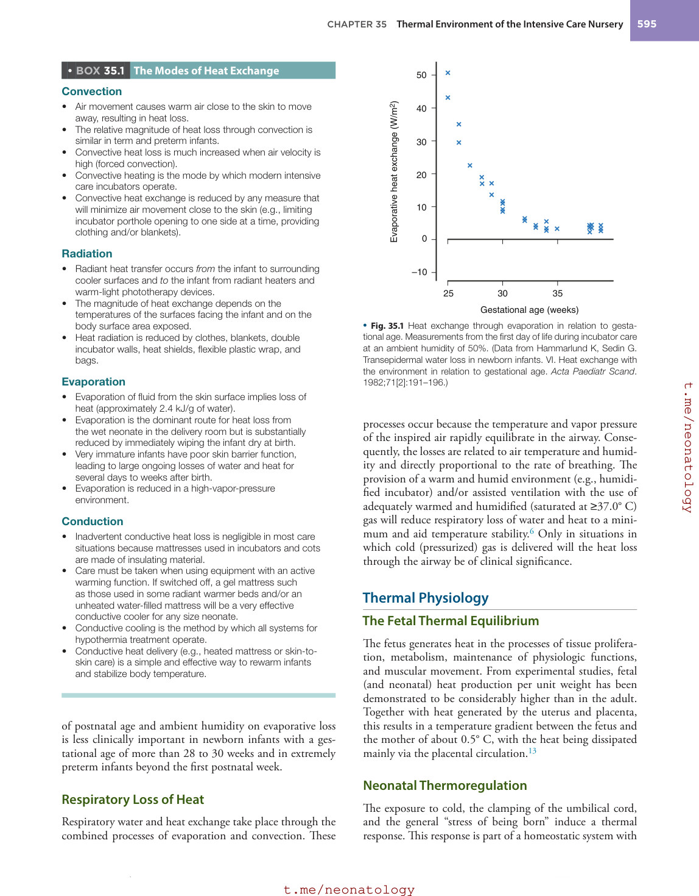

### Original source page 607

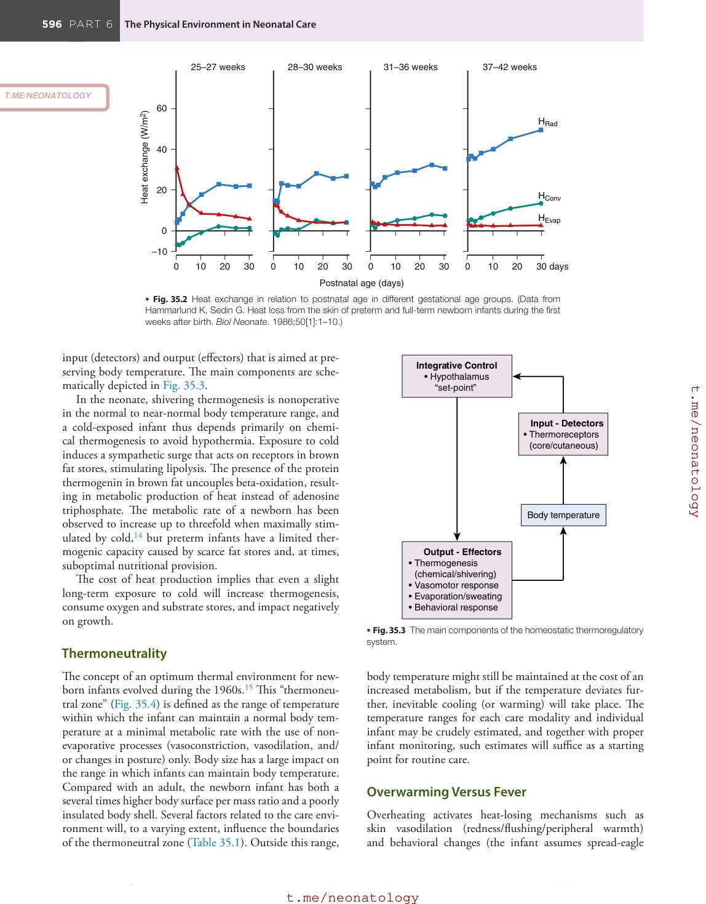

### Original source page 608

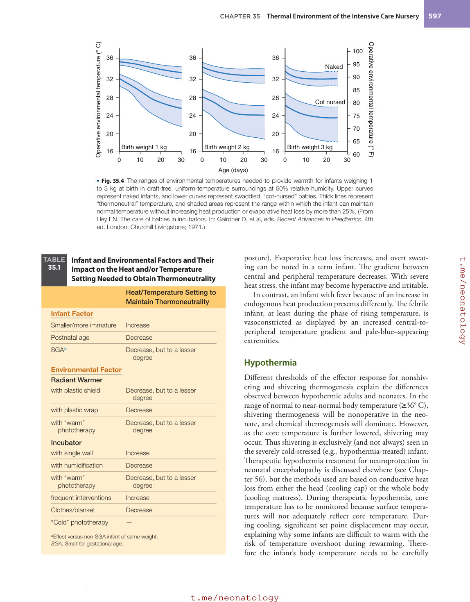

### Original source page 609

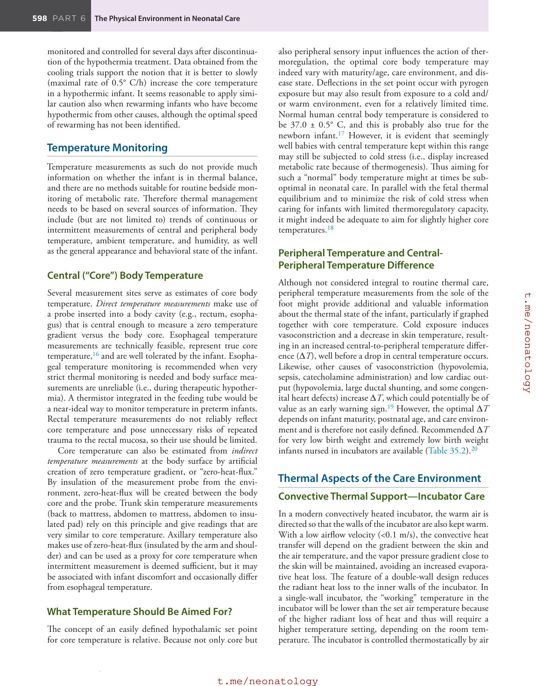

### Original source page 610

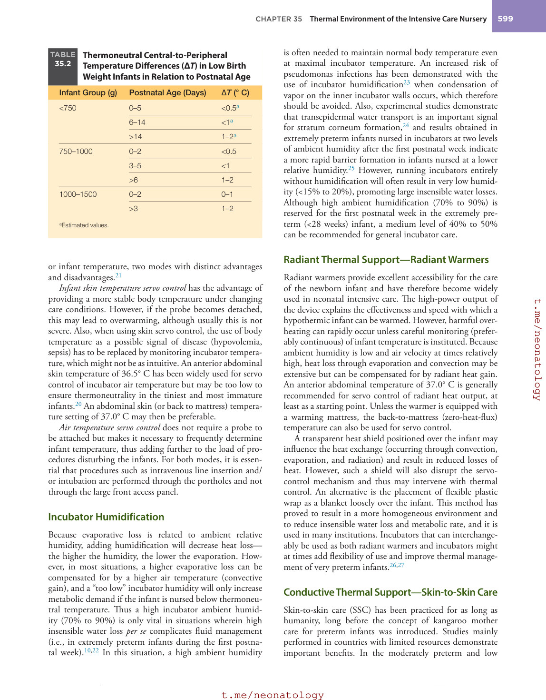

### Original source page 611

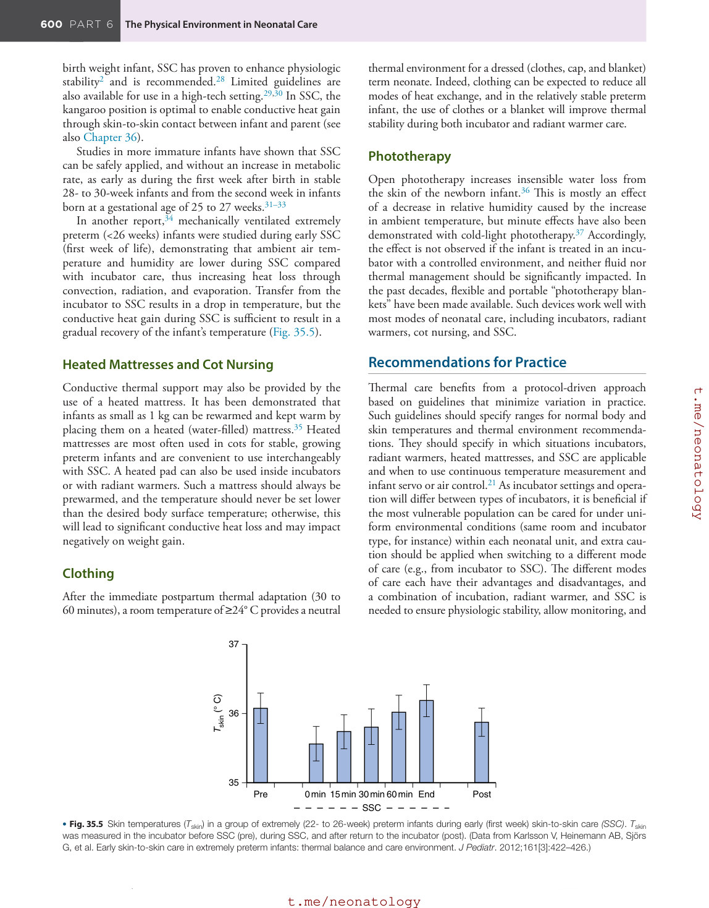

### Original source page 612

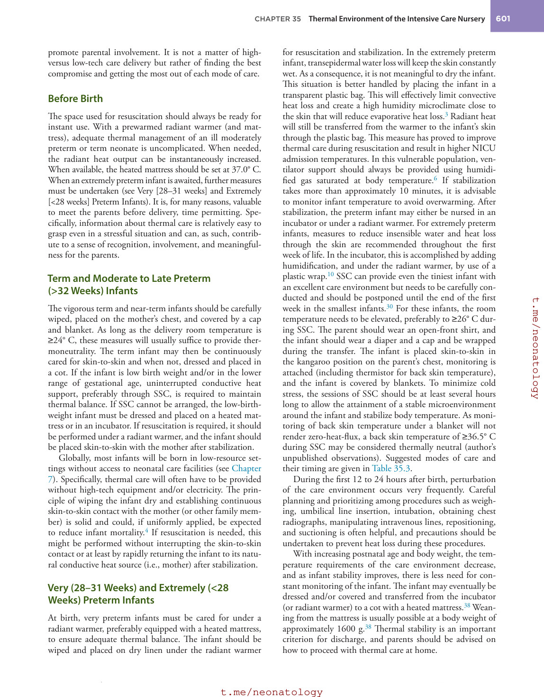

### Original source page 613

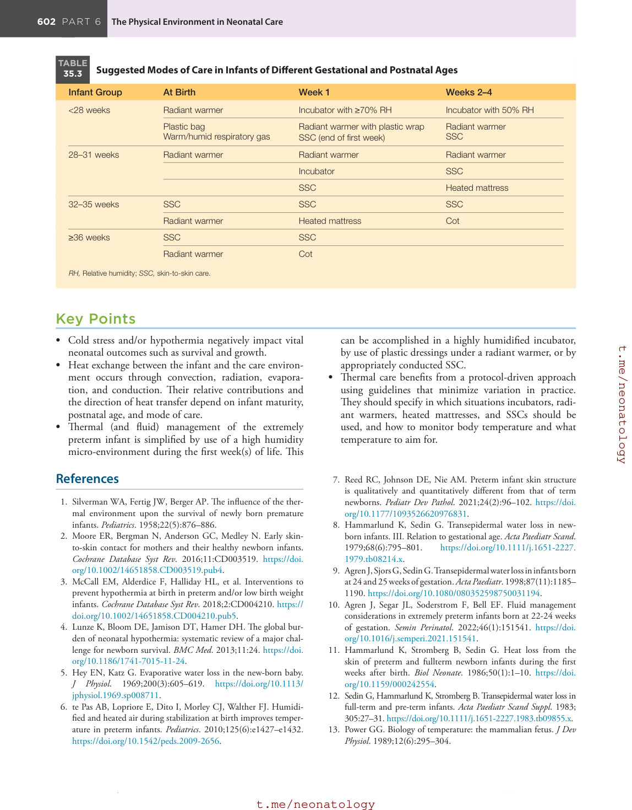

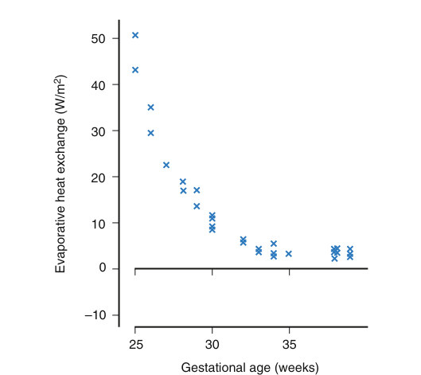

• Fig. 35.1 Heat exchange through evaporation in relation to gestational age. Measurements from the first day of life during incubator care at an ambient humidity of 50%. (Data from Hammarlund K, Sedin G. Transepidermal water loss in newborn infants. VI. Heat exchange with the environment in relation to gestational age. Acta Paediatr Scand. 1982;71[2]:191–196.)

PDF p. 606

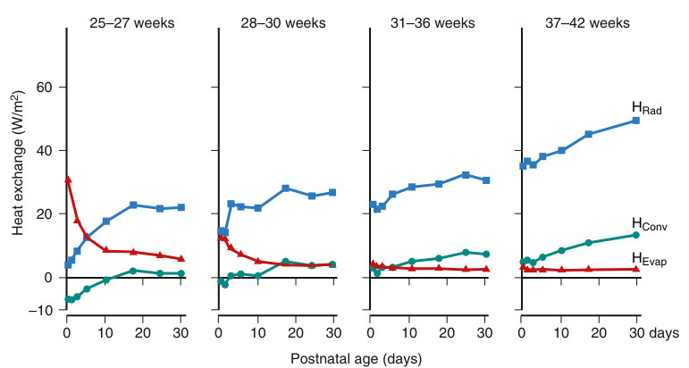

• Fig. 35.2 Heat exchange in relation to postnatal age in different gestational age groups. (Data from Hammarlund K, Sedin G. Heat loss from the skin of preterm and full-term newborn infants during the first weeks after birth. Biol Neonate. 1986;50[1]:1–10.)

PDF p. 607

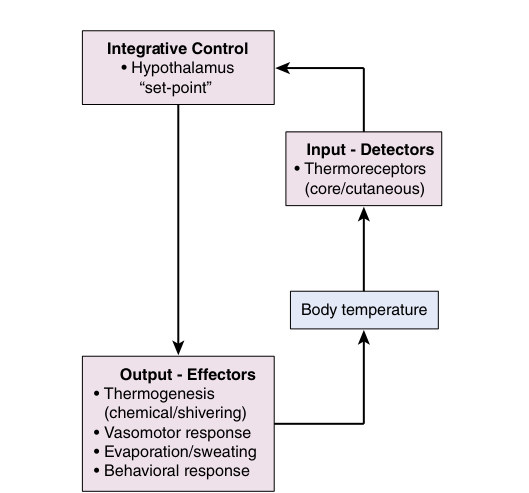

• Fig. 35.3 The main components of the homeostatic thermoregulatory system.

PDF p. 607

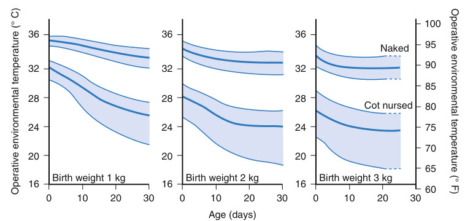

• Fig. 35.4 The ranges of environmental temperatures needed to provide warmth for infants weighing 1 to 3 kg at birth in draft-free, uniform-temperature surroundings at 50% relative humidity. Upper curves represent naked infants, and lower curves represent swaddled, “cot-nursed” babies. Thick lines represent “thermoneutral” temperature, and shaded areas represent the range within which the infant can maintain normal temperature without increasing heat production or evaporative heat loss by more than 25%. (From Hey EN. The care of babies in incubators. In: Gairdner D, et al, eds. Recent Advances in Paediatrics. 4th ed. London: Churchill Livingstone; 1971.)

PDF p. 608

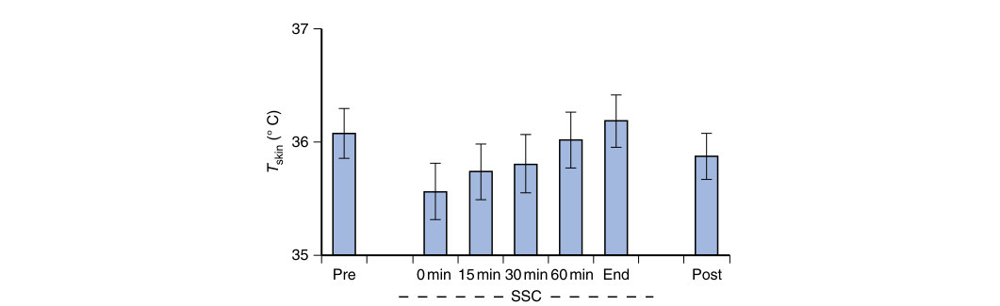

• Fig. 35.5 Skin temperatures (Tskin) in a group of extremely (22- to 26-week) preterm infants during early (first week) skin-to-skin care (SSC). Tskin was measured in the incubator before SSC (pre), during SSC, and after return to the incubator (post). (Data from Karlsson V, Heinemann AB, Sjörs G, et al. Early skin-to-skin care in extremely preterm infants: thermal balance and care environment. J Pediatr. 2012;161[3]:422–426.)

PDF p. 611
