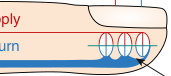
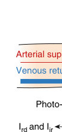
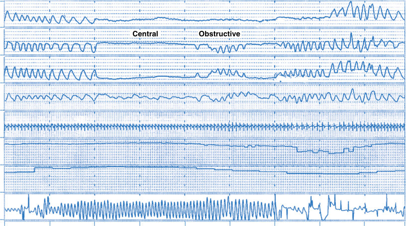
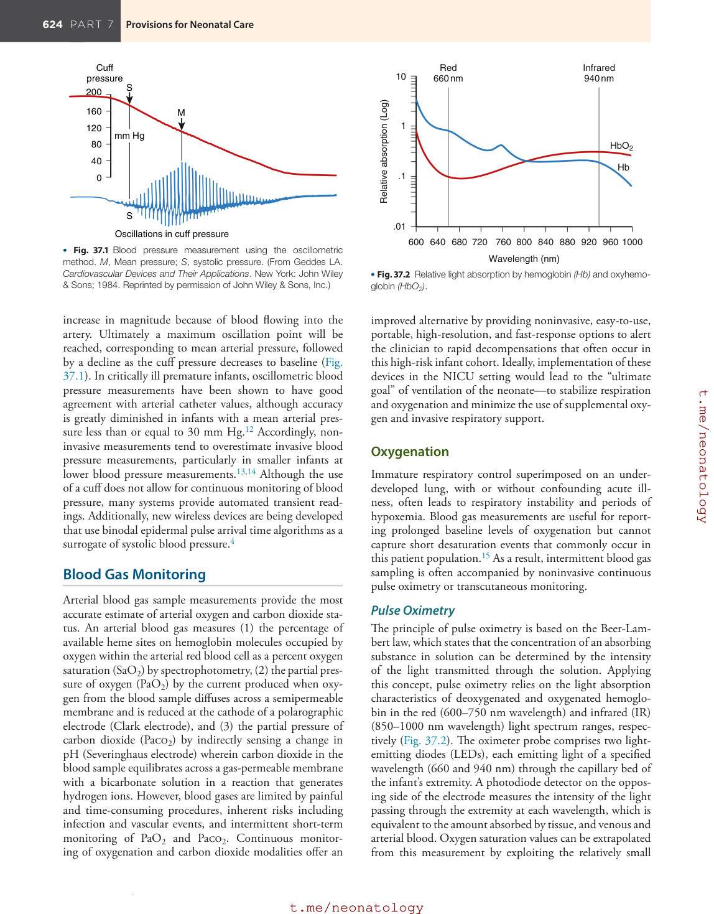
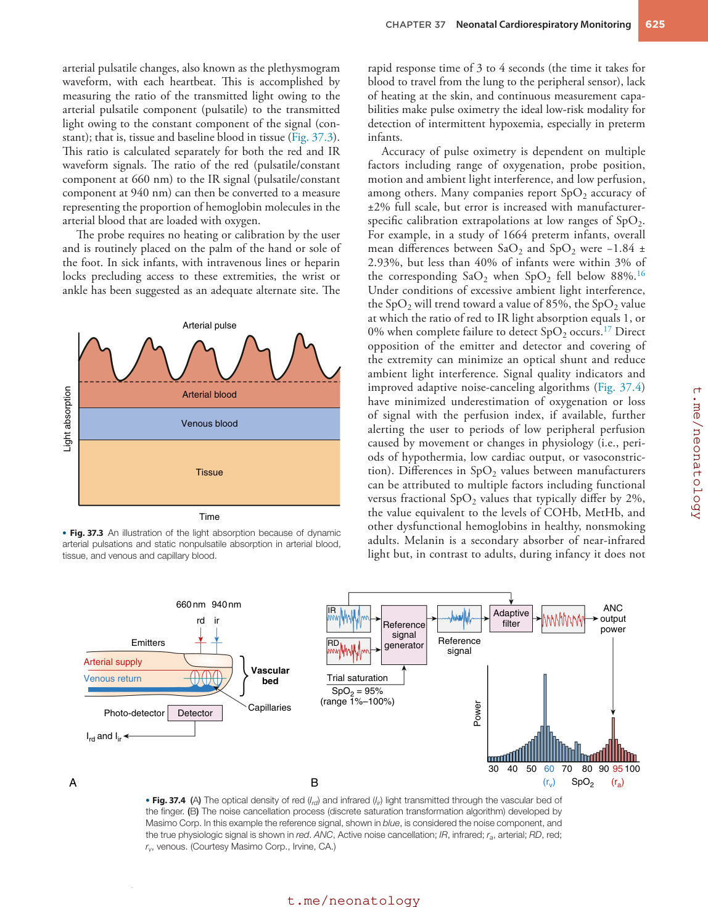
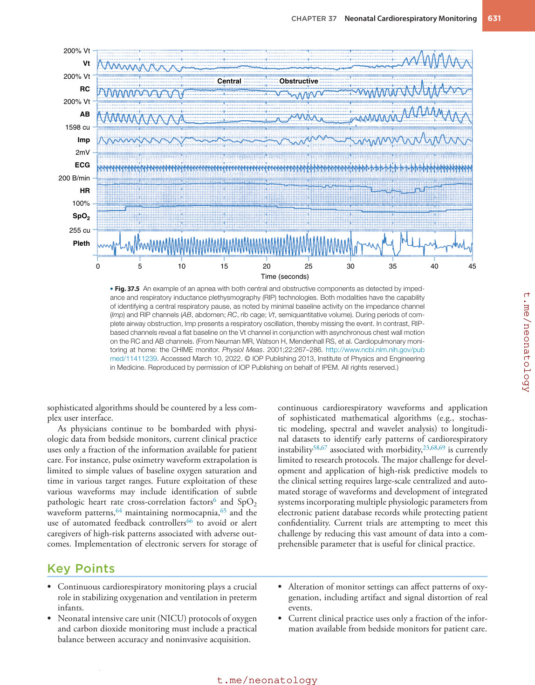
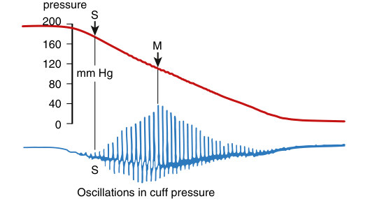
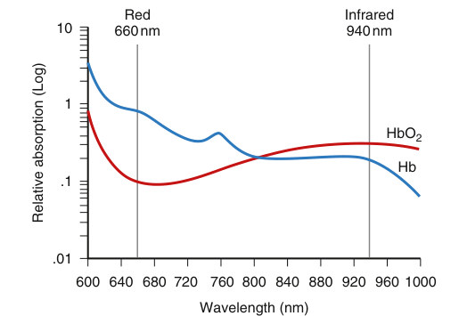
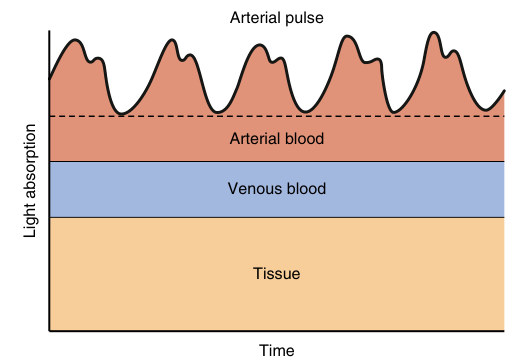

# 37. Neonatal Cardiorespiratory Monitoring
> Source attribution: [Source credits](../../SOURCE_CREDITS.md).

## PDF page 631 | printed page 622

37 Neonatal Cardiorespiratory Monitoring

### JULIANN M. DI FIORE AND THOMAS M. RAFFAY

### Summary

Maintaining stable respiration and adequate oxygenation is a fundamental aspect of newborn care. This can be challenging in premature infants, as preterm birth is marked by immature respiratory control regions of the brain superimposed on an underdeveloped lung. As a result, preterm infants exhibit a high incidence of apnea, bradycardia, and intermittent hypoxemia events during early postnatal life.1,2 Pharmacotherapy and respiratory support (e.g., supplemental oxygen, continuous positive airway pressure [CPAP], and mechanical ventilation) are used to stabilize respiration and maintain adequate oxygenation, with a goal of decreasing duration and level of support to minimize the incidence of chronic lung disease and associated adverse respiratory and neurodevelopmental outcomes. These treatment decisions are most often based on medical chart documentation of apnea, heart rate, and desaturation alarms, making bedside cardiorespiratory monitoring an integral part of clinical care in the neonatal intensive care unit (NICU).

The challenges of cardiorespiratory monitoring in the NICU include continuous, accurate, artifact-free recordings obtained in a safe and noninvasive manner accounting for the small stature and fragile skin of the extremely low birth weight (ELBW) infant. Monitors and accompanying sensors are often developed for adult patients or older children, followed by application in newborns with minimal data demonstrating accuracy and safety. Nevertheless, even a well-designed monitor is only as good as the end user. Therefore a thorough understanding of individual monitor functionality is also needed to reduce both nuisance alarms and signal distortion of real events. This chapter includes a description of the principles of operation of cardiorespiratory monitoring modalities, including current and future directions of hemodynamic, blood gas, and respiratory waveform acquisition in the NICU setting.

### Hemodynamic Monitoring

### Electrocardiogram

During each heartbeat, an electrical impulse originates in the sinoatrial node and is propagated among the muscles

622

of the atrium, through the atrioventricular node, followed by dispersion throughout the ventricles. The small alterations in voltage generated by the heart can be measured at the body surface with electrocardiogram (ECG) electrodes placed on the chest, the most common types being the silver-silver chloride, foil-based, recessed, or floating electrode. Each electrode contains a highly conductive electrolyte gel with a composition that varies by manufacturer. Electrode location is important in acquiring a signal of adequate resolution, especially in neonates with a limited surface area. Multiple probe applications should be avoided to optimize adhesiveness of the electrodes and ECG signal integrity and decrease the chance of skin damage, including high trans epidermal water losses,3 in extremely preterm infants with fragile skin. Under investigation are next-generation ultrathin epidermal electronic systems that provide wireless ECG measurements that only require water to adhere to the skin.4

The ability of traditional electrodes to detect small electrical changes with each heartbeat requires the application of a current to the chest wall. The recommendations of acceptable current limits by the American Heart Association (AHA) cover two aspects of electrical safety. The first entails the amount of current allowable in a patient-connected lead that can flow through the myocardium without inducing ventricular fibrillation. The second aspect pertains to the allowable chassis leakage current that flows through the patient to ground. The AHA recommends that currents be limited to 10 μA through patient leads and less than 100 μA, with an optimal level of 10 μA, for chassis leakage current.

The initial goal of simple heart rate measurements has expanded to include identification of specific arrhythmias and more complex algorithms of heart rate variability. Longitudinal regression-based models of abnormal heart rate characteristics associated with systemic infection and inflammation have been shown to reduce infant mortality in very low birth weight (VLBW) infants,5 leading to the development of the commercially available HeRO System, providing early warning of patient distress days before patient deterioration. Additional sophisticated mathematical analyses such as cross-correlation of heart rate and other vital signs,6 currently

## PDF page 632 | printed page 623

limited to the research arena, may expand the ability to detect subtle high-risk alterations in heart rate variability, assisting in early interventions and improved patient outcomes such as late-onset sepsis and necrotizing enterocolitis.

### Cardiac Output

Application of the Fick principle is considered the gold standard of cardiac output monitoring in a research setting. This method states

CO = VO2/ (Ca −Cv)

where VO2 = oxygen consumption, Ca = oxygen concentration of arterial blood, and Cv = oxygen concentration of mixed venous blood. Although the Fick principle may be accurate, especially in low flow states, precision may be limited by air leakage, cardiopulmonary disease, and enhanced pulmonary oxygen consumption.7

Noninvasive methods that are validated in neonates include transcutaneous Doppler, transthoracic echocardiography (TTE), and thoracic electrical impedance. Doppler ultrasound uses an ultrasound beam to measure blood flow velocity. A velocity-time waveform is then produced from spectral analysis of Doppler shifts, caused by moving erythrocytes. The stroke distance can be calculated by the area under the velocity-time waveform. If the cross-sectional area of the vessel is known, cardiac output can be calculated by:

Cardiac output

= stroke distance × cross-sectional area of the vessel

× heart rate

Doppler-based cardiac output measurements can vary widely and should be limited to trend monitoring.7

During TTE, measures of left ventricular output, right ventricular output, or superior vena cava (SVC) flow can be obtained. Validation data with TTE have been limited to transthoracic left ventricular output measures, which have been shown to be comparable with pulmonary artery thermodilution and O2-Fick methods.7 A variation of thoracic electrical impedance, electrical velocimetry, includes surface ECG electrodes placed on the forehead, left side of the neck, left mid-axillary line at the level of xiphoid process, and left thigh. During application of a small alternating electrical current through the thorax, changes in voltage are measured during periods of systole and diastole. Stroke volume (SV) is then determined using the following equation:

SV = Vept × νLVET × LVET

where Vept (mL) = volume of electrically participating tissue derived from body mass and height, νLVET (s−1) I = ohmic equivalent of mean aortic blood velocity during left ventricular ejection, and LVET (s) = left ventricular ejection time. Data have shown electrical velocimetry as a comparable mode of measuring left ventricular output in neonates when compared with echocardiography,8 although variation among individuals was seen using both techniques.

Additional bedside TTE techniques have been reported in emerging literature on bedside evaluation of neonatal shock, including SVC flow and descending aortic flow.7 Doppler flow and SVC diameter measured at the entrance of the SVC into the right atrium reflects the blood returning from the brain and upper body, which may be a surrogate measure for cerebral blood flow.9 Various modifications of TTE calculations of SVC flow have been investigated, with high error percentage and considerable variation in reference ranges potentially limiting its clinical application.10 Doppler flow and diameter of the descending aorta when measured below the level of the ductus arteriosus would correspond with the systemic blood flow to the lower body, including the abdomen.9 Absence of end-diastolic flow or flow reversal may indicate a hemodynamically significant left-to-right shunt from a patent ductus arteriosus.11

### Blood Pressure

Direct continuous readings from an indwelling arterial line are considered the gold standard for blood pressure monitoring in the neonate. Arterial and potentially venous pressures are accessed by a catheter placed in the umbilical vessels and attached to a domed transducer. The transducer works on the principle that fluid exerts a force on the diaphragm. This force can be converted to a change in voltage and calibrated to a given pressure. The dome must be flushed, making sure there are no bubbles in the circuit; the transducer must be placed at the level of the distal tip of the catheter; and a zero pressure should be established before patient data are acquired. If the transducer is higher than the heart, readings will be erroneously low.

Indirect blood pressure readings can be acquired through a cuff or inflatable bladder placed around the upper arm, preferably the right upper arm, or calf. The cuff is inflated to a pressure adequate to cause occlusion of the arterial flow. During deflation of the cuff, measurements of diastolic and systolic blood pressure can be obtained. Mean blood pressure is then defined as the integrated area under the arterial pressure waveform.

The size and placement of the cuff can affect accurate measurements of blood pressure. A cuff that is too narrow or applied loosely may result in falsely high readings. The AHA recommends a cuff width of approximately 40% of the limb circumference. The two modes of indirect blood pressure monitoring include the auscultatory and oscillometry methods. The auscultatory method entails rapid inflation of the cuff, followed by slow deflation while listening for distal Korotkoff sounds with a stethoscope. This method, commonly used in adults, is limited by the inaudible frequency range of arterial sounds in neonates, intra-observer variability, and disturbance to the patient. The oscillometry method is more often used in NICUs. In this method, cuff pressure is rapidly inflated to above systolic pressure. As the pressure is slowly released, small pulsations can be detected as the cuff approaches systolic pressure. When the cuff pressure decreases to below systolic pressure the oscillations

## PDF page 633

Cuff pressure S

200

160

M

120

mm Hg

80

40

0

S

Oscillations in cuff pressure

• Fig. 37.1 Blood pressure measurement using the oscillometric method. M, Mean pressure; S, systolic pressure. (From Geddes LA. Cardiovascular Devices and Their Applications. New York: John Wiley & Sons; 1984. Reprinted by permission of John Wiley & Sons, Inc.)

increase in magnitude because of blood flowing into the artery. Ultimately a maximum oscillation point will be reached, corresponding to mean arterial pressure, followed by a decline as the cuff pressure decreases to baseline (Fig. 37.1). In critically ill premature infants, oscillometric blood pressure measurements have been shown to have good agreement with arterial catheter values, although accuracy is greatly diminished in infants with a mean arterial pressure less than or equal to 30 mm Hg.12 Accordingly, noninvasive measurements tend to overestimate invasive blood pressure measurements, particularly in smaller infants at lower blood pressure measurements.13,14 Although the use of a cuff does not allow for continuous monitoring of blood pressure, many systems provide automated transient readings. Additionally, new wireless devices are being developed that use binodal epidermal pulse arrival time algorithms as a surrogate of systolic blood pressure.4

### Blood Gas Monitoring

Arterial blood gas sample measurements provide the most accurate estimate of arterial oxygen and carbon dioxide status. An arterial blood gas measures (1) the percentage of available heme sites on hemoglobin molecules occupied by oxygen within the arterial red blood cell as a percent oxygen saturation (SaO2) by spectrophotometry, (2) the partial pressure of oxygen (PaO2) by the current produced when oxygen from the blood sample diffuses across a semipermeable membrane and is reduced at the cathode of a polarographic electrode (Clark electrode), and (3) the partial pressure of carbon dioxide (Paco2) by indirectly sensing a change in pH (Severinghaus electrode) wherein carbon dioxide in the blood sample equilibrates across a gas-permeable membrane with a bicarbonate solution in a reaction that generates hydrogen ions. However, blood gases are limited by painful and time-consuming procedures, inherent risks including infection and vascular events, and intermittent short-term monitoring of PaO2 and Paco2. Continuous monitoring of oxygenation and carbon dioxide modalities offer an

Red 660 nm

Infrared

10

940 nm

Relative absorption (Log)

1

HbO2

Hb

.1

.01

600 640 680

720 760 800 840 880

920 960 1000

Wavelength (nm)

• Fig. 37.2 Relative light absorption by hemoglobin (Hb) and oxyhemoglobin (HbO2).

improved alternative by providing noninvasive, easy-to-use, portable, high-resolution, and fast-response options to alert the clinician to rapid decompensations that often occur in this high-risk infant cohort. Ideally, implementation of these devices in the NICU setting would lead to the “ultimate goal” of ventilation of the neonate—to stabilize respiration and oxygenation and minimize the use of supplemental oxygen and invasive respiratory support.

### Oxygenation

Immature respiratory control superimposed on an underdeveloped lung, with or without confounding acute illness, often leads to respiratory instability and periods of hypoxemia. Blood gas measurements are useful for reporting prolonged baseline levels of oxygenation but cannot capture short desaturation events that commonly occur in this patient population.15 As a result, intermittent blood gas sampling is often accompanied by noninvasive continuous pulse oximetry or transcutaneous monitoring.

### Pulse Oximetry

The principle of pulse oximetry is based on the Beer-Lambert law, which states that the concentration of an absorbing substance in solution can be determined by the intensity of the light transmitted through the solution. Applying this concept, pulse oximetry relies on the light absorption characteristics of deoxygenated and oxygenated hemoglobin in the red (600–750 nm wavelength) and infrared (IR) (850–1000 nm wavelength) light spectrum ranges, respectively (Fig. 37.2). The oximeter probe comprises two lightemitting diodes (LEDs), each emitting light of a specified wavelength (660 and 940 nm) through the capillary bed of the infant’s extremity. A photodiode detector on the opposing side of the electrode measures the intensity of the light passing through the extremity at each wavelength, which is equivalent to the amount absorbed by tissue, and venous and arterial blood. Oxygen saturation values can be extrapolated from this measurement by exploiting the relatively small

## PDF page 634 | printed page 625

arterial pulsatile changes, also known as the plethysmogram waveform, with each heartbeat. This is accomplished by measuring the ratio of the transmitted light owing to the arterial pulsatile component (pulsatile) to the transmitted light owing to the constant component of the signal (constant); that is, tissue and baseline blood in tissue (Fig. 37.3). This ratio is calculated separately for both the red and IR waveform signals. The ratio of the red (pulsatile/constant component at 660 nm) to the IR signal (pulsatile/constant component at 940 nm) can then be converted to a measure representing the proportion of hemoglobin molecules in the arterial blood that are loaded with oxygen.

The probe requires no heating or calibration by the user and is routinely placed on the palm of the hand or sole of the foot. In sick infants, with intravenous lines or heparin locks precluding access to these extremities, the wrist or ankle has been suggested as an adequate alternate site. The

Arterial pulse

Light absorption

Arterial blood

Venous blood

Tissue

Time

• Fig. 37.3 An illustration of the light absorption because of dynamic arterial pulsations and static nonpulsatile absorption in arterial blood, tissue, and venous and capillary blood.

660 nm 940 nm

rd ir IR

RD Emitters

Arterial supply

Vascular bed

Trial saturation SpO2 = 95% (range 1%–100%)

Venous return

Photo-detector Detector Capillaries

Ird and Iir

A

B

• Fig. 37.4 (A) The optical density of red (Ird) and infrared (Iir) light transmitted through the vascular bed of the finger. (B) The noise cancellation process (discrete saturation transformation algorithm) developed by Masimo Corp. In this example the reference signal, shown in blue, is considered the noise component, and the true physiologic signal is shown in red. ANC, Active noise cancellation; IR, infrared; ra, arterial; RD, red; rv, venous. (Courtesy Masimo Corp., Irvine, CA.)

rapid response time of 3 to 4 seconds (the time it takes for blood to travel from the lung to the peripheral sensor), lack of heating at the skin, and continuous measurement capabilities make pulse oximetry the ideal low-risk modality for detection of intermittent hypoxemia, especially in preterm infants.

Accuracy of pulse oximetry is dependent on multiple factors including range of oxygenation, probe position, motion and ambient light interference, and low perfusion, among others. Many companies report SpO2 accuracy of ±2% full scale, but error is increased with manufacturerspecific calibration extrapolations at low ranges of SpO2. For example, in a study of 1664 preterm infants, overall mean differences between SaO2 and SpO2 were −1.84 ± 2.93%, but less than 40% of infants were within 3% of the corresponding SaO2 when SpO2 fell below 88%.16 Under conditions of excessive ambient light interference, the SpO2 will trend toward a value of 85%, the SpO2 value at which the ratio of red to IR light absorption equals 1, or 0% when complete failure to detect SpO2 occurs.17 Direct opposition of the emitter and detector and covering of the extremity can minimize an optical shunt and reduce ambient light interference. Signal quality indicators and improved adaptive noise-canceling algorithms (Fig. 37.4) have minimized underestimation of oxygenation or loss of signal with the perfusion index, if available, further alerting the user to periods of low peripheral perfusion caused by movement or changes in physiology (i.e., periods of hypothermia, low cardiac output, or vasoconstriction). Differences in SpO2 values between manufacturers can be attributed to multiple factors including functional versus fractional SpO2 values that typically differ by 2%, the value equivalent to the levels of COHb, MetHb, and other dysfunctional hemoglobins in healthy, nonsmoking adults. Melanin is a secondary absorber of near-infrared light but, in contrast to adults, during infancy it does not

ANC output power

Adaptive filter

Reference signal generator

Reference signal

Power

30 40 50 SpO2

70 80 90 100

60 (rv) (ra) 95

• Fig. 37.4 (A) The optical density of red (Ird) and infrared (Iir) light transmitted through the vascular bed of the finger. (B) The noise cancellation process (discrete saturation transformation algorithm) developed by Masimo Corp. In this example the reference signal, shown in blue, is considered the noise component, and the true physiologic signal is shown in red. ANC, Active noise cancellation; IR, infrared; ra, arterial; RD, red; rv, venous. (Courtesy Masimo Corp., Irvine, CA.)

• Fig. 37.4 (A) The optical density of red (Ird) and infrared (Iir) light transmitted through the vascular bed of the finger. (B) The noise cancellation process (discrete saturation transformation algorithm) developed by Masimo Corp. In this example the reference signal, shown in blue, is considered the noise component, and the true physiologic signal is shown in red. ANC, Active noise cancellation; IR, infrared; ra, arterial; RD, red; rv, venous. (Courtesy Masimo Corp., Irvine, CA.)

## PDF page 635

play a strong role in SpO2 accuracy with either no difference18 or a modest bias towards SpO2 overestimation in Black infants.19 Lastly, fetal hemoglobin can contribute to deviations in both the displayed value of SpO2 and the clinical interpretation of oxygen content delivery. In the presence of fetal hemoglobin, a normally clinically acceptable level of SpO2 may not translate to adequate oxygen delivery to the tissue because of its high affinity to oxygen. This effect is noted by a left shift in the oxygen dissociation curve. Blood transfusions during the first week of life will reduce the proportion of fetal hemoglobin and should be taken into consideration when oxygen therapy is being regulated.

It is important to note that clinical interpretation and intervention based on SpO2 values can be significantly altered by the oximeter software and settings. Users of early generation oximeters relied on visual documentation of a stable plethysmographic waveform to identify periods of motion associated with artificial falls in SpO2 that immediately returned to baseline indicating lapses in signal integrity. More recent new generation oximeters have implemented noise reduction filters with vast improvements in signal quality but potentially at the expense of missed hypoxemia and bradycardia, with the number of missed events dependent on the individual manufacturer. Alarm settings can vary by NICU, but a high oximeter alarm of 95% to 96% is commonly used for infants receiving supplemental oxygen to comply with the American Academy of Pediatrics (AAP) recommended oxygen saturation target of 90% to 95%20 and avoid excessive oxygen exposure. Low alarm thresholds of 87% to 89%, combined with a plan to increase FiO2 in small increments, can be used to reduce periods of hypoxemia while avoiding periods of “hyperoxia overshoot.” Alarm delays range from 0 to 15 seconds depending on the manufacturer and individual NICU guidelines to reduce nuisance alarms and allow for spontaneous recovery (thereby preventing unnecessary supplemental oxygen exposure) with the cost of increasing response time. The longest delay of 15 seconds has been shown to reduce the number of alarms by as much as 67%.21 In contrast, increasing the averaging time from 2 to 16 seconds decreased the number of alarms by ∼50% but also doubled the alarm duration with overall no effect on the proportion of time in alarm conditions.

Averaging time is probably the most misunderstood parameter on the pulse oximeter display. Conceptually, a longer averaging time will minimize oscillations in the SpO2 waveform and reduce nuisance alarms by averaging the current data point with previous values within a specified window (2–16 seconds). However, prolonged averaging times (>10 seconds) can distort the SpO2 waveform by eliminating true short events, reducing actual event severity (nadir), and merging closely occurring events into fewer events but of longer duration,22 which is concerning as longer events are more likely to be treated with supplemental oxygen. Although there is no official standard, the commonly used averaging time of 8 seconds has been shown to reduce alarms due to short (<20 seconds) self-resolving hypoxemia events while minimizing the creation of falsely prolonged events.22

SpO2 values are displayed on the monitor and updated approximately every second. Many oximeters also provide histogram distributions of the percent time the infant spent in user-defined oxygen saturation ranges. This can provide the clinician with the overall time spent in hyper/ hypoxia but cannot distinguish multiple prolonged events from one prolonged event. Recent improvements in commercial software (Trace, Masimo) can inform the clinician with the number, duration, and time of each hypoxemic event. Future research expanding on models encompassing the entire oxygen saturation waveform, as opposed to falls below an arbitrarily chosen threshold, is sorely needed to identify subtle, high-risk patterns of oxygenation linked to poor outcomes. For example, preliminary data using wavelet models have revealed that lower frequency spectral components by 3 weeks of life were associated with the future progression of severe retinopathy of prematurity.23 These types of time series models can inform the next generation of pulse oximetry by providing an early warning of patients that can most benefit from interventional therapeutics.

Lastly, smartphone vital sign monitoring has become prevalent and pulse oximetry has been no exception. Pulse oximetry-based home baby monitors are popular among parents but are not regulated by the US Food and Drug Administration. Concerning findings have revealed large inconsistencies in hypoxemia and bradycardia detection on smartphone-based oximeters when compared to standard hospital bedside monitors (Masimo, Radical 7).24 In fact, this study reported that two marketed home monitors had sensitivities of 0% to 88.8% and 0% for hypoxemia and bradycardia, respectively; caution should be exercised when discussing these home monitors with patient families.

### Transcutaneous Monitoring of Oxygen

Transcutaneous oxygen tension (PtcO2) provides an estimate of the concentration of oxygen dissolved in the plasma and is based on the principle of oxygen diffusion through the skin. The electrode consists of a platinum cathode and silver reference anode encased in an electrolyte solution that is then separated from the skin by a membrane permeable to oxygen. The electrode is heated, which arterializes the blood in the capillaries underneath the skin and breaks down the stratum corneum barrier, allowing diffusion across the skin surface. The oxygen from the skin sensor reacts with the platinumsilver chloride sensor to create an electrical current, which is converted to partial pressure measurements of oxygen.

Agreement between PtcO2 measured at the skin surface and arterial PaO2 is influenced by multiple factors, including decreased solubility of oxygen in blood owing to heating of the skin, oxygen consumption in the heated skin and inside the electrode, air bubbles under the sensor, insecure seal with the skin, and excessive contact gel. The sensor must be placed in a well-perfused area and properly heated before reliable values can be attained, which may take as long as 15 minutes. A goal temperature of 44.0° C has been suggested, as lower temperatures will underestimate arterial values,25 and the sensor location should be altered every 2 to 4 hours to correct for transient electrode drift and avoid heat-related

## PDF page 636 | printed page 627

skin complications. However, even shorter durations of 2 hours have been associated with hyperpigmented macules and prolonged erythema in preterm infants with fragile skin. Multiple studies have shown a linear relationship between PtcO2 and PaO2, but accuracy may differ at low and high levels of PaO2, with about 15% of hypoxemic and hyperoxemic events missed by PtcO2 monitors25 and overall sensitivity ranging from 68% to 100% for hypoxemia (<50 mm Hg) and 71% to 92% for hyperoxemia (>80 mm Hg).25 Given this wide variability in sensitivity, PtcO2 should be used in conjunction with intermittent blood gas sampling to confirm levels of oxygenation and minimize unnecessary supplemental oxygen exposure.

Although PtcO2 monitoring offers the advantages of continuous oxygenation monitoring and increased stability during motion, it is limited by a slow response time and a reduced period in which reliable data can be acquired.25 In contrast to pulse oximetry, which can detect immediate arterial changes at the sensor site of the percentage of oxygen-bound heme, PtcO2 monitoring must account for a 16- to 30-second time delay, the time needed for oxygen to diffuse through the capillaries and across the sensor membrane. During SpO2 probe placement, oxygen saturation measurements can be immediately acquired after detection of an adequate plethysmograph waveform with no need for relocation of the probe. In contrast, a delay of approximately 15 minutes needed to heat the transcutaneous probe compounded with multiple site locations to reduce the risk of burns can lead to a large percentage of the monitoring period without measurements of oxygenation. Given these limitations, pulse oximetry is considered the most widely accepted modality for continuous measures of oxygenation in the neonatal intensive care setting.

### Near-Infrared Spectroscopy

In contrast to pulse oximetry, which measures arterial oxygenation, near-infrared spectroscopy (NIRS) measures oxygen uptake in the tissue. This technology has been used in a variety of organ systems, with a particular interest in cerebral oxygenation in the preterm infant population. NIRS relies on the presence of chromophores, compounds whose absorption of NIR light is dependent on oxygen status, in the tissue. These chromophores include cytochrome aa3, myoglobin, and the most often studied, hemoglobin. Using light absorption properties of oxyhemoglobin (HbO2) and deoxyhemoglobin (HHb) in the IR range (700–1300 nm), NIRS measures the difference between the oxygen delivered and the oxygen extracted by the tissue. This measurement is also known as regional oxygen saturation (rSO2), where

rSO2 = HbO2/ (HbO2 + HHb)

Cerebral NIRS entails a probe placed on one temple of the infant’s head with a laser or LED probe as a source of NIR wavelength transmission. The lasers/LEDs are pulsed in sequential order where multiple photodetectors, attached to the opposite temple, collect the transmitted light photons

that are not absorbed in the tissue. An additional reference signal is used to correct for light reflected from the skin, laser drift, and skin coloration. By measuring the difference between the amount of light transmitted through the deep tissue and the surface path, NIRS values can estimate the amount of spectral absorption that occurs in the tissue bed. Spatial resolution is currently limited to approximately 1 cm2 with several layers of tissue, including skin, skull surface vasculature, and gray matter in one two-dimensional sample. The current primary target area is restricted to the surface of the cortex, because access to deeper brain structures would require lasers of increased intensity and risk of damage to brain tissue. Near-infrared spectroscopy (NIRS) values have been shown to correlate with cerebral venous saturation with improved precision with increased tissue homogeneity.26 However, overall comparability and reproducibility of different NIRS devices remain poor. This may be because of manufacturer-specific variations in design that include the source of monochromatic light, the number and specific wavelengths used, the frequency of light cycling, and the frequency at which the signals are updated for digital display. Modifications in sensor geometry27 and adjustments for the variability in arterial blood pressure28 may have promise in improving precision.

An international standard has been recently issued by the International Organization for Standardization (ISO) that should improve differences between manufacturers.29 Nevertheless, interpretation of absolute measurements of rSO2 is still the subject of ongoing research. Average cerebral oxygen saturation values of 77.9% ± 8.5% have been recorded in healthy term newborns30 with a normative range of 55% to 85% in extremely preterm infants,31 but rSO2 can be influenced by gestational age,32 body position,33 and age at the time of study.32,34 There has been some suggestion that alterations in neonatal cerebral oxygenation may be associated with clinical outcomes such as intraventricular hemorrhage, cognitive impairment, and mortality, whereas others have shown no relationship with any clinical characteristics.32 This is further complicated by improvements in oxygen saturation stability and time in target not always translating into improved cerebral oxygen tissue saturation.35 Given these findings, the role of NIRS in identifying etiologies of brain injury has yet to be determined, and more extensive research is needed before NIRS can be routinely used in the clinical neonatal setting. In extremely preterm infants, treatment guided by cerebral oximetry monitoring for the first 72 hours after birth was not associated with a lower incidence of death or severe brain injury at 36 weeks’ postmenstrual age than usual care.

### Carbon Dioxide

The presence of hypocarbia, hypercarbia, and fluctuations between states has been implicated with a wide range of neonatal morbidities, including chronic lung disease, intraventricular hemorrhage, and neurodevelopmental impairment,36,37 although optimal ranges require further investigation.38 For this reason, maintenance of normocarbia and avoidance

## PDF page 637

of extreme levels of arterial CO2 are imperative in preterm infants. As discussed, an arterial blood gas is the gold standard for assessing gas exchange, but it is intermittent, invasive, and may cause complications. During periods of respiratory instability in which oscillations in Paco2 are known to occur,39 arterial sampling or indwelling catheters may not be adequate. Under these conditions, continuous measurements of end-tidal or transcutaneous CO2 monitoring have become increasingly popular in the intensive care unit.

### End-Tidal Carbon Dioxide Monitoring

End-tidal CO2 monitoring originally used mass spectroscopy to estimate CO2 from samples of exhaled gas. Because of improvements in technology allowing for portable devices, IR spectroscopy is now the method of choice. IR spectroscopy is based on the principle that CO2 molecules absorb light in the IR wavelength of 4.26 μm. Light is transmitted through the sample using an IR emitter with light absorption measured with photodetectors. The amount of light absorbed in the given IR spectrum is then proportional to the concentration of CO2.

Capnography sensor designs fall into two categories: sidestream and mainstream. Sidestream systems require constant aspiration of expired gas, which may result in underestimation of CO2 readings in preterm infants with low tidal volumes. This incidence may be reduced with the development of microstream technology, which uses a refined spectrum of discrete wavelengths, allowing for extremely small sample volumes (15 μL) and a correspondingly lower sample rate of 50 mL/min.40 The advantage of the sidestream system is that it can be used on both spontaneously breathing and intubated patients. During intubation, sampling of gas at the distal end of the endotracheal tube is recommended to improve accuracy, although both proximal and distal measurements of the end-tidal pressure of carbon dioxide (Petco2) have been shown to provide acceptable estimates of Paco2 in relatively healthy infants with diminished performance in infants with more severe respiratory disease.41 Accuracy may be affected by water vapor or secretions occluding the adapter or condensation on the photo detector. This is eliminated by vertical positioning or the use of Nafion tubing, a semipermeable polymer that allows water to pass through and evaporate. Mainstream systems rely on gas passing through a wide chamber, or cuvette, placed in line with the patient circuit. As opposed to a remote device with sidestream systems, a miniature IR optical system is placed directly over the chamber. This allows for nearinstantaneous measurements in less than 500 ms. However, it is limited to intubated patients or patients with a closed circuit, that is, a sealed nasal/oral mask. Erroneous values caused by water condensation are reduced by slight heating of the cuvette. Additional factors that can contribute to measurement error for both sidestream and mainstream systems include temperature dependence, miscalibration, drift, noise, and pressure effects from the sampling system.

In addition to instrumental design, the accuracy of end-tidal CO2 monitoring is dependent on patient

characteristics. Petco2 has been shown to accurately estimate alveolar CO2 in healthy newborns,42 but the agreement is poor and negatively influenced by the presence and severity of pulmonary disease43 and inadequate gas exchange caused by atelectasis, V/Q mismatch, and chronic lung disease in bronchopulmonary dysplasia.44 Neonates have small tidal volumes and high respiratory rates, which often result in wide variations in end-tidal CO2 values and underestimation of true alveolar gas, also making it a prohibitive modality for estimating CO2 during high-frequency oscillatory ventilation (HFOV). Microstream capnography through a double-lumen endotracheal tube with specially designed software for HFOV has been introduced.45 Despite its limitations, the ability to detect extreme low and high CO2 levels may be of use for trending or screening patients for abnormal arterial CO2 values. End-tidal CO2 monitoring may also be used to guide respiratory support in the delivery room.46

Disposable colorimetric end-tidal CO2 detectors are an efficient method of verifying correct endotracheal tube placement in the newborn.47 When placed between the ventilator and endotracheal tube, the pH-sensitive chemical indicator (metacresol purple) changes from purple to yellow when exposed to expired CO2. The minimum and maximum CO2 concentrations needed to establish a color change are 0.54% (0.5 kPa) and 2% to 5% (2–5 kPa), respectively. Because neonatal extubation failure can have devastating consequences, calorimetric detectors can play a significant role in the intensive care unit. However, this device cannot detect hypocarbia, hypercarbia, right mainstem bronchus intubation, or oropharyngeal placement in spontaneous breathing patients.

### Transcutaneous Monitoring of Carbon Dioxide

Transcutaneous carbon dioxide tension measurements are based on the principle of CO2 diffusion through the skin. The sensor consists of a pH-sensitive glass electrode with an adjacent silver chloride reference anode covered by a hydrophobic membrane permeable to carbon dioxide and separated by a sodium bicarbonate electrolyte solution. Changes in pH are measured as carbon dioxide from the skin diffuses through the electrode membrane. These changes are then converted to corresponding Paco2 values.

Data assessing the relationship between Paco2 and transcutaneously measured partial pressure of CO2 (Ptcco2) in preterm infants have shown a wide variation in both slope and intercept values.48,49 Additional data by Martin et al. demonstrated a progressive increase in the difference between tcPco2 and Paco2 as Paco2 increased (tcPco2 − Paco2, 5 ± 4 mm Hg and 9 ± 6 mm Hg in normocapnia and hypercapnia, respectively).50 These data suggest that as Paco2 increases, there may be an imbalance between CO2 production and removal. This can be attributed to multiple factors, including metabolic events in the skin, circulatory disturbances that permit gas to accumulate in the tissues, the anaerobic heating coefficient of blood, and increased CO2 tension with higher electrode temperature.

## PDF page 638 | printed page 629

The determination of Ptcco2 or end-tidal CO2 monitoring should include considerations of the risk/benefit ratio for each patient. The use of heated Ptcco2 electrodes entails a risk of skin damage caused by burns that require repeated repositioning of the sensor. This can be a serious limitation when considering low birth weight infants with fragile skin, although newer devices that have used lower local temperatures show only modest discrepancies in performance.51,52 Additionally, transcutaneous CO2 detectors have been shown to be accurate during HFOV51,53 and useful during neonatal transport.54 This alternative mode of noninvasive CO2 monitoring may be a reasonable screening tool for preterm infants with small tidal volumes and during periods of rapid breathing where end-tidal CO2 may underestimate Paco2. Regardless of the modality chosen, clinical care should include comparisons with blood gas values, especially during periods of relative hypercapnia.

### Respiratory Monitoring

Respiratory instability in the preterm infant can be attributed to immaturity of the central nervous system and a highly compliant chest wall, resulting in both central and obstructive apnea. During normal respiration, the diaphragm contracts, expanding the thorax in conjunction with activation of accessory muscles that stabilize the rib cage and maintain upper airway patency. Because of the highly compliant chest wall of the preterm infant, any loss of accessory muscle tone, including intercostals stabilizing the rib cage or hypoglossus maintaining upper airway patency, may result in instability and retraction of the rib cage in response to negative pressure generated by the diaphragm during inspiration. As a result, asynchronous or paradoxical chest wall movements will occur with partial airway obstruction, which is a common respiratory pattern in the preterm infant, particularly during rapid eye movement sleep. During extreme occasions, total airway obstruction may occur, presenting as asynchronous chest wall and abdominal efforts and no corresponding airflow. Respiratory pauses may also arise because of decreased central respiratory drive, as can occur during periods of periodic breathing and spontaneous central apnea. Therefore ideal respiratory monitoring should have the ability to detect both central and obstructive apnea.

### Flow Sensors

The pneumotachometer is considered the gold standard for measuring flow and volume and is most often used during mechanical ventilation and calculations of respiratory mechanics. There are two types of pneumotachometers: fixed orifice and laminar flow. The fixed orifice design consists of a fixed orifice placed within the tubular attachment placed in the airway. The differential pressure is measured across the fixed orifice, which is proportional to the square of the flow rate. This mathematical relationship can then be used to calculate a given flow. The laminar flow design consists of a simple compartment containing a resistive element, usually

consisting of a mesh screen or capillary network. The pressure drop across the resistive element is linearly related to the flow passing through the compartment and can be calibrated accordingly. The range in which there is a linear relationship between pressure and flow will be dependent on the design of the device, including the length, width, and type of resistive element used. To maintain precision, all flow must pass through the device, which may be problematic during mechanical ventilation in preterm infants with a high occurrence of endotracheal tube leaks. During spontaneous respiration, the pneumotachometer must be incorporated into a nasal/oral mask. To minimize the effect of the mask on the respiratory pattern, the mask design should include minimal dead space, the ability to flush the mask to reduce CO2 retention, and low resistance to minimize work of breathing.

Pneumotachometer use in the clinical setting has been limited to pulmonary function measurements in spontaneously breathing patients, incorporated into a sealed nasal/ oral mask, or tidal volume measurements when attached to the endotracheal tube in mechanically ventilated patients. During these periods, the device may add a significant resistive load, especially in severely ill ELBW infants. As a result, many companies have replaced the pneumotachometer with the hot-wire anemometer for volume measurements during mechanical ventilation. The hot-wire anemometer includes a heated element placed in the airway circuit. As flow passes, the sensor is cooled. The system delivers an electrical current to maintain the default sensor temperature. The amount of current needed to maintain the sensor temperature can be calibrated to a given flow. If bidirectional flow is desired, a second wire can be placed in the system. Accurate measurements of flow may be compromised if secretions accumulate on the heated element. However, because of its high-frequency response, proven accuracy, and minimal resistive load, the hot-wire anemometer is a promising modality for measurements of respiration in the preterm infant, including periods of high-frequency oscillatory ventilation (HFOV).55

Although the pneumotachometer and hot-wire anemometer give quantifiable measurements of flow and volume, additional devices, such as thermistor/thermocouple sensors and end-tidal CO2, can display qualitative estimates. The relationship between peak-to-peak amplitude of the thermistor signal and actual measures of flow has been shown to be nonlinear and frequency dependent.56 There is also minimal correlation between Petco2 and actual measures of volume. Therefore the implementation of thermistor or Petco2 monitoring is limited to the sleep lab, where, used in conjunction with chest wall motion sensors, it can be used to identify the presence or absence of flow associated with central and obstructive apnea.

### Other Respiratory Monitoring Devices

Despite concerns regarding the accuracy of impedance-based apnea monitoring,57 impedance technology continues to be the most widely used modality for measuring respiration in

## PDF page 639

the hospital setting. With two electrodes placed on either side of the chest above and below the insertion of the diaphragm, impedance monitoring measures changes in electrical impedance across the thorax during a breath. Specific placement of electrodes for optimal signal quality can vary between infants. This modality is based on the principle that air has a much higher level of impedance than tissue. During inspiration, there is a decrease in conductivity (and corresponding increase in impedance), owing to both an increase in gas volume of the chest in relation to the fluid volume and increased length of the conductance path with chest wall expansion. Using a high-frequency current of greater than 25 kHz, the same electrodes used for measuring ECG can be used for detection of respiratory efforts. The ECG waveform is filtered out by manufacturer-based signal processing algorithms, thus eliminating this potential source of noise artifact. However, changes in thoracic blood volume may be falsely identified as a breath. In addition, proprietary algorithms cannot distinguish obstructive efforts from normal respiration with no monitor alarm during obstructive apnea as air moves from one compartment to the other.

Impedance-based apnea detection is both poorly sensitive and predictive in preterm infants,57 but there are advancements in machine learning methods and application of impedance technology. For example, recent developments using hidden Markov-based models have identified robust algorithms that can identify or predict apnea with accompanying bradycardia and/or hypoxemia58,59 and may be a first step toward personalized risk assessment for severe clinical events during hospitalization and after NICU discharge. Ongoing advances in impedance technology, notably electrical impedance tomography (EIT), also show great promise in identifying continuous high-resolution images of gas distribution throughout the lung. Small alternating currents applied sequentially through 8 to 32 electrodes placed circumferentially around the thorax are reconstructed into one image. Sequential images are compared to a baseline, and variations over a given time interval represent alterations in ventilation distribution across the region. EIT is currently used as a noninvasive and radiation-free imaging tool providing data on lung collapse, overdistension, and air distribution in mechanically ventilated patients60 but may have a future role in bedside impedance monitoring by identifying obstructive apnea in spontaneously breathing infants.

Respiratory inductance plethysmography (RIP) has been used extensively in both clinical research and pulmonary function lab settings. It is currently not used at the bedside but could be a promising alternative for respiratory monitoring. As with impedance, it is a noninvasive method of measuring respiration with two bands wrapped around the chest and abdomen, respectively. Each band contains a sinusoidal inductance coil with a small AC current that travels through the coil, as opposed to through the chest wall, as occurs with impedance. RIP relies on the principle that a current applied through a loop of wire generates a magnetic field (Faraday’s law) and that a change in the area enclosed by the loop generates an opposing current directly proportional to the change in area (Lenz’s

law). Thus, as the chest wall expands, the coil in the band elongates, altering the magnetic properties, or inductance, of the band. The strength of this modality is the representation of respiration as a two-dimensional model. Thus obstructive apnea will present as asynchronous, 180-degree out-of-phase movements between the rib cage and abdomen as air flows from one compartment to the other. With the addition of a software algorithm to calibrate the rib cage and abdominal waveforms, a semiquantitative volume waveform can be acquired, giving RIP the ability to identify obstructive apnea without the need for an oral/nasal flow sensor (Fig. 37.5).

A small cohort study of moderately preterm infants has shown that transcutaneous diaphragm electromyogram (dEMG) activity is feasible in the delivery room as a useful indicator of respiratory rate, heart rate, and diaphragm activity. Heart rate (dEMG) measures showed high to moderate agreement with ECG and pulse oximeter values, respectively, with modest agreement between respiratory rate (dEMG) and direct measures of airflow.61 Neural measures of electrical diaphragmatic activity (Edi) using an orogastric catheter provide another EMG-based alternative to respiratory monitoring and are part of the standard procedure during noninvasive ventilation with neurally adjusted ventilatory assist support (NIV-NAVA).62 Further investigations of the addition of respiratory efforts, as denoted by EMG amplitude, could lead to a better understanding of respiratory physiology and optimization of respiratory support.

Overall, the current technology for respiratory monitoring contains many obstacles for newborn infants, including cumbersome sensors and wiring that compromise clinical care, skin integrity, and overall infant comfort. Ongoing developments in wireless and inexpensive polyvinylidenefluoride sensors with complementary metal-oxide semiconductors integrated circuitry use both pyroelectric and piezoelectric properties and are small enough to be incorporated into a nasal cannula or patient mattress.63 Acoustic sensors placed on the neck region, carotid vessel complex, and nasal region and contactless ultrawideband pulse radar sensors are also being investigated as alternative modes for measuring respiration. Preliminary data suggest that these prototypes can detect respiration in an ideal, experimental environment, but many challenges need to be overcome before they can be implemented in the NICU setting.

### Future Directions

The need for advanced diagnostic systems, including cardiorespiratory monitors, in neonatal care continues to expand. This growth should incorporate the development of safe and effective devices for use in the NICU and a collaborative research and testing effort among the biomedical engineering disciplines. Areas in which improvements are needed include the development of “smart alarms” for cardiorespiratory monitoring, education of personnel pertaining to the use of equipment, automated signal quality assessment, wireless technology, and electronic storage of longitudinal waveforms. The implementation of more

## PDF page 640 | printed page 631

200% Vt

Vt

200% Vt

### RC

Central

200% Vt

### AB

1598 cu

Imp

2mV

### ECG

200 B/min

### HR

100%

SpO2

255 cu

Pleth

0 5 10 15 20

Time (seconds)

• Fig. 37.5 An example of an apnea with both central and obstructive components as detected by impedance and respiratory inductance plethysmography (RIP) technologies. Both modalities have the capability of identifying a central respiratory pause, as noted by minimal baseline activity on the impedance channel (Imp) and RIP channels (AB, abdomen; RC, rib cage; Vt, semiquantitative volume). During periods of complete airway obstruction, Imp presents a respiratory oscillation, thereby missing the event. In contrast, RIPbased channels reveal a flat baseline on the Vt channel in conjunction with asynchronous chest wall motion on the RC and AB channels. (From Neuman MR, Watson H, Mendenhall RS, et al. Cardiopulmonary monitoring at home: the CHIME monitor. Physiol Meas. 2001;22:267–286. http://www.ncbi.nlm.nih.gov/pub med/11411239. Accessed March 10, 2022. © IOP Publishing 2013, Institute of Physics and Engineering in Medicine. Reproduced by permission of IOP Publishing on behalf of IPEM. All rights reserved.)

sophisticated algorithms should be countered by a less complex user interface.

As physicians continue to be bombarded with physiologic data from bedside monitors, current clinical practice uses only a fraction of the information available for patient care. For instance, pulse oximetry waveform extrapolation is limited to simple values of baseline oxygen saturation and time in various target ranges. Future exploitation of these various waveforms may include identification of subtle pathologic heart rate cross-correlation factors6 and SpO2 waveform patterns,64 maintaining normocapnia,65 and the use of automated feedback controllers66 to avoid or alert caregivers of high-risk patterns associated with adverse outcomes. Implementation of electronic servers for storage of

Key Points

• Continuous cardiorespiratory monitoring plays a crucial

role in stabilizing oxygenation and ventilation in preterm infants. • Neonatal intensive care unit (NICU) protocols of oxygen

and carbon dioxide monitoring must include a practical balance between accuracy and noninvasive acquisition.

Obstructive

25 30 35 40 45

continuous cardiorespiratory waveforms and application of sophisticated mathematical algorithms (e.g., stochastic modeling, spectral and wavelet analysis) to longitudinal datasets to identify early patterns of cardiorespiratory instability58,67 associated with morbidity,23,68,69 is currently limited to research protocols. The major challenge for development and application of high-risk predictive models to the clinical setting requires large-scale centralized and automated storage of waveforms and development of integrated systems incorporating multiple physiologic parameters from electronic patient database records while protecting patient confidentiality. Current trials are attempting to meet this challenge by reducing this vast amount of data into a comprehensible parameter that is useful for clinical practice.

• Alteration of monitor settings can affect patterns of oxy-

genation, including artifact and signal distortion of real events. • Current clinical practice uses only a fraction of the infor-

mation available from bedside monitors for patient care.

• Fig. 37.5 An example of an apnea with both central and obstructive components as detected by impedance and respiratory inductance plethysmography (RIP) technologies. Both modalities have the capability of identifying a central respiratory pause, as noted by minimal baseline activity on the impedance channel (Imp) and RIP channels (AB, abdomen; RC, rib cage; Vt, semiquantitative volume). During periods of complete airway obstruction, Imp presents a respiratory oscillation, thereby missing the event. In contrast, RIPbased channels reveal a flat baseline on the Vt channel in conjunction with asynchronous chest wall motion on the RC and AB channels. (From Neuman MR, Watson H, Mendenhall RS, et al. Cardiopulmonary monitoring at home: the CHIME monitor. Physiol Meas. 2001;22:267–286. http://www.ncbi.nlm.nih.gov/pub med/11411239. Accessed March 10, 2022. © IOP Publishing 2013, Institute of Physics and Engineering in Medicine. Reproduced by permission of IOP Publishing on behalf of IPEM. All rights reserved.)

## PDF page 641

### References

1. Di Fiore JM, Bloom JN, Orge F, et al. A higher incidence of

intermittent hypoxemic episodes is associated with severe retinopathy of prematurity. J Pediatr. 2010;157(1):69–73. 2. Erickson G, Dobson NR, Hunt CE. Immature control of breath-

ing and apnea of prematurity: the known and unknown. J Perinatol. 2021;41(9):2111–2123. 3. Lund C. Medical adhesives in the NICU. Newborn Infant Nurs

Rev. 2014;14:160–165. 4. Chung HU, Kim BH, Lee JY, et al. Binodal, wireless epidermal

electronic systems with in-sensor analytics for neonatal intensive care. Science. 2019;363(6430):eaau0780. 5. Moorman JR, Carlo WA, Kattwinkel J, et al. Mortality reduction

by heart rate characteristics monitoring in very low birth weight neonates: a randomized study. J Pediatr. 2011;159:900–906. 6. Fairchild KD, Lake DE, Kattwinkel J, et al. Vital signs and their

cross-correlation in sepsis and NEC: a study of 1,065 very-lowbirth-weight infants in two NICUs. Pediatr Res. 2017;81(2):315– 321. 7. de Boode WP, van der Lee R, Horsberg Eriksen B, et al. The role

of neonatologist performed echocardiography in the assessment and management of neonatal shock. Pediatr Res. 2018;84(suppl 1):57–67. 8. Noori S, Drabu B, Soleymani S, et al. Continuous non-invasive

cardiac output measurements in the neonate by electrical velocimetry: a comparison with echocardiography. Arch Dis Child Fetal Neonatal Ed. 2012;97(5):F340–F343. 9. Groves AM, Kuschel CA, Knight DB, Skinner JR. Echocardio-

graphic assessment of blood flow volume in the superior vena cava and descending aorta in the newborn infant. Arch Dis Child Fetal Neonatal Ed. 2008;93(1):F24–F28. 10. Ficial B, Finnemore AE, Cox DJ, et al. Validation study of

the accuracy of echocardiographic measurements of systemic blood flow volume in newborn infants. J Am Soc Echocardiogr. 2013;26(12):1365–1371. 11. Arlettaz R. Echocardiographic evaluation of patent ductus arte-

riosus in preterm infants. Front Pediatr. 2017;5:147. 12. Tacki S, Yigit S, Korkmaz A, et al. Comparison between oscil-

lometric and invasive blood pressure measurements in critically ill premature infants. Acta Paediatr. 2011;101:132–135. 13. Dasnadi S, Aliaga S, Laughon M, Warner DD, Price WA. Factors

influencing the accuracy of noninvasive blood pressure measurements in NICU infants. Am J Perinatol. 2015;32(7):639–644. 14. Umapathi KK, Mhanna MJ. Correlation between invasive and

noninvasive blood pressure measurements in extremely low gestational age newborns. Am J Perinatol. 2020;37(5):548–552. 15. Di Fiore JM, Shah V, Patwardhan A, et al. Prematurity and post-

natal alterations in intermittent hypoxaemia. Arch Dis Child Fetal Neonatal Ed. 2021;106(5):557–559. 16. Rosychuk RJ, Hudson-Mason A, Eklund D, Lacaze-Masmonteil

T. Discrepancies between arterial oxygen saturation and functional oxygen saturation measured with pulse oximetry in very preterm infants. Neonatology. 2012;101:14–19. 17. Trivedi NS, Ghouri AF, Shah NK, et al. Effects of motion, ambi-

ent light, and hypoperfusion on pulse oximeter function. J Clin Anesth. 1997;9(3):179–183. 18. Foglia EE, Whyte RK, Chaudhary A, et al. The effect of skin

pigmentation on the accuracy of pulse oximetry in infants with hypoxemia. J Pediatr. 2017;182:375–377.e372.

19. Vesoulis Z, Tims A, Lodhi H, Lalos N, Whitehead H. Racial dis-

crepancy in pulse oximeter accuracy in preterm infants. J Perinatol. 2022;42(1):79–85. 20. Cummings JJ, Polin RA; Committee on Fetus and Newborn.

Oxygen targeting in extremely low birth weight infants. Pediatrics. 2016;138(2):e20161576. 21. Poets CF. Reducing alarms in the NICU. Arch Dis Child Fetal

Neonatal Ed. 2018;103(4):F297–F298. 22. Vagedes J, Poets CF, Dietz K. Averaging time, desaturation

level, duration and extent. Arch Dis Child Fetal Neonatal Ed. 2013;98(3):F265–266. 23. Di Fiore JM, Kaffashi F, Loparo K, et al. The relationship between

patterns of intermittent hypoxia and retinopathy of prematurity in preterm infants. Pediatr Res. 2012;72(6):606–612. 24. Bonafide CP, Localio AR, Ferro DF, et al. Accuracy of pulse

oximetry-based home baby monitors. JAMA. 2018;320(7):717– 719. 25. Poets CF. Noninvasive monitoring and assessment of oxygen-

ation in infants. Clin Perinatol. 2019;46(3):417–433. 26. Arri SJ, Muehlemann T, Biallas M, et al. Precision of cerebral

oxygenation and hemoglobin concentration measurements in neonates measured by near-infrared spectroscopy. J Biomed Opt. 2011;16(4):047005. 27. Jenny C, Biallas M, Trajkovic I, et al. Reproducibility of cerebral

tissue oxygen saturation measurements by near-infrared spectroscopy in newborn infants. J Biomed Opt. 2011;16(9):097004. 28. Hahn GH, Christensen KB, Leung TS, et al. Precision of

coherence analysis to detect cerebral autoregulation by nearinfrared spectroscopy in preterm infants. J Biomed Opt. 2010;15(3):037002-1–037002-10. 29. Greisen G, Hansen ML, Rasmussen MIS, et al. Cerebral oxim-

etry in preterm infants—to use or not to use, that is the question. Front Pediatr. 2021;9:747660. 30. Bernal NP, Hoffman GM, Ghanayem NS, et al. Cerebral and

somatic near-infrared spectroscopy in normal newborns. J Pediatr Surg. 2010;45(6):1306–1310. 31. Hyttel-Sorensen S, Greisen G, Als-Nielsen B, Gluud C. Cere-

bral near-infrared spectroscopy monitoring for prevention of brain injury in very preterm infants. Cochrane Database Syst Rev. 2017;9(9):CD011506. 32. Kooi EMW, Verhagen EA, Elting JWJ, et al. Measuring cere-

brovascular autoregulation in preterm infants using near-infrared spectroscopy: an overview of the literature. Expert Rev Neurother. 2017;17(8):801–818. 33. Tran NN, Tran M, Elgabalawy E, et al. The use of near-infrared

spectroscopy (NIRS) to measure cerebral oxygen saturation during body position changes on infants less than one year old. J Pediatr Nurs. 2020;55:155–164. 34. Bruckner M, Wolfsberger CH, Dempsey EM, et al. Normal

regional tissue oxygen saturation in neonates: a systematic qualitative review. Pediatr Res. 2021 Oct 20. https://doi.10.1038/ s41390-021-01786-y. Online ahead of print. 35. Gajdos M, Waitz M, Mendler MR, et al. Effects of a new device

for automated closed loop control of inspired oxygen concentration on fluctuations of arterial and different regional organ tissue oxygen saturations in preterm infants. Arch Dis Child Fetal Neonatal Ed. 2019;104(4):F360–F365. 35a. Hansen ML, Pellicer A, Hyttel-Sørensen S, et al. Cerebral oxim-

etry monitoring in extremely preterm infants. N Engl J Med. 2023;388:1501–1511.

## PDF page 642 | printed page 633

36. Ambalavanan N, Carlo WA, Wrage LA, et al. PaCO2 in surfactant,

positive pressure, and oxygenation randomised trial (SUPPORT). Arch Dis Child Fetal Neonatal Ed. 2015;100(2):F145–F149. 37. Thome UH, Dreyhaupt J, Genzel-Boroviczeny O, et al. Influ-

ence of PCO2 control on clinical and neurodevelopmental outcomes of extremely low birth weight infants. Neonatology. 2018;113(3):221–230. 38. Wong SK, Chim M, Allen J, et al. Carbon dioxide levels in neo-

nates: what are safe parameters? Pediatr Res. 2022;91(5):1049– 1056. 39. van Kaam AH, De Jaegere AP, Rimensberger PC; Neovent Study

Group. Incidence of hypo- and hyper-capnia in a cross-sectional European cohort of ventilated newborn infants. Arch Dis Child Fetal Neonatal Ed. 2013;98(4):F323–F326. 40. Duyu M, Bektas AD, Karakaya Z, et al. Comparing the novel

microstream and the traditional mainstream method of end-tidal CO2 monitoring with respect to PaCO2 as gold standard in intubated critically ill children. Sci Rep. 2020;10(1):22042. 41. Williams E, Dassios T, Greenough A. Assessment of sidestream

end-tidal capnography in ventilated infants on the neonatal unit. Pediatr Pulmonol. 2020;55(6):1468–1473. 42. Hagerty JJ, Kleinman ME, Zurakowski D, et al. Accuracy of a

new low-flow sidestream capnography technology in newborns: a pilot study. J Perinatol. 2002;22(3):219–225. 43. Trevisanuto D, Giuliotto S, Cavallin F, et al. End-tidal carbon

dioxide monitoring in very low birth weight infants: correlation and agreement with arterial carbon dioxide. Pediatr Pulmonol. 2012;47(4):367–372. 44. Fouzas S, Hacki C, Latzin P, et al. Volumetric capnography in

infants with bronchopulmonary dysplasia. J Pediatr. 2014;164(2): 283-288.e281-283. 45. Kugelman A, Bromiker R, Riskin A, et al. Diagnostic accuracy

of capnography during high-frequency ventilation in neonatal intensive care units. Pediatr Pulmonol. 2016;51(5):510–516. 46. van Os S, Cheung PY, Pichler G, et al. Exhaled carbon dioxide

can be used to guide respiratory support in the delivery room. Acta Paediatr. 2014;103(8):796–806. 47. Wyckoff MH, Wyllie J, Aziz K, et al. Neonatal Life Support: 2020

International Consensus on Cardiopulmonary Resuscitation and Emergency Cardiovascular Care Science with Treatment Recommendations. Circulation. 2020;142(16_suppl_1):S185–S221. 48. Aliwalas LL, Noble L, Nesbitt K, et al. Agreement of carbon

dioxide levels measured by arterial, transcutaneous and end tidal methods in preterm infants < or = 28 weeks gestation. J Perinatol. 2005;25(1):26–29. 49. Janaillac M, Labarinas S, Pfister RE, Karam O. Accuracy of trans-

cutaneous carbon dioxide measurement in premature infants. Crit Care Res Pract. 2016;2016:8041967. 50. Martin RJ, Beoglos A, Miller MJ, et al. Current correction fac-

tors inadequately predict the relationship between transcutaneous (tc) and arterial PCO2 in sick neonates. Adv Exp Med Biol. 1987;220:51–53. 51. Aly S, El-Dib M, Mohamed M, Aly H. Transcutaneous carbon

dioxide monitoring with reduced-temperature probes in very low birth weight infants. Am J Perinatol. 2017;34(5):480–485. 52. Jakubowicz JF, Bai S, Matlock DN, et al. Effect of transcutane-

ous electrode temperature on accuracy and precision of carbon

dioxide and oxygen measurements in the preterm infants. Respir Care. 2018;63(7):900–906. 53. Berkenbosch JW, Tobias JD. Transcutaneous carbon dioxide

monitoring during high-frequency oscillatory ventilation in infants and children. Crit Care Med. 2002;30(5):1024–1027. 54. Tingay DG, Stewart MJ, Morley CJ. Monitoring of end tidal carbon

dioxide and transcutaneous carbon dioxide during neonatal transport. Arch Dis Child Fetal Neonatal Ed. 2005;90(6):F523–F526. 55. Scalfaro P, Pillow JJ, Sly PD, et al. Reliable tidal volume esti-

mates at the airway opening with an infant monitor during high-frequency oscillatory ventilation. Crit Care Med. 2001;29(10):1925–1930. 56. Farre R, Montserrat JM, Rotger M, et al. Accuracy of thermis-

tors and thermocouples as flow-measuring devices for detecting hypopneas. Eur Respir J. 1998;11(1):179–182. 57. Lim K, Eastwood-Sutherland C, Marshall AP, et al. Limitations

of thoracic impedance monitoring for central apnoea detection in preterm infants. Acta Paediatr. 2021;110(9):2550–2552. 58. Clark MT, Delos JB, Lake DE, Lee H, Fairchild KD, Kattwinkel

J, et al. Stochastic modeling of central apnea events in preterm infants. Physiol Meas. 2016;37(4):463–484. 59. Montazeri Ghahjaverestan N, Shamsollahi MB, Ge D, et al.

Apnea bradycardia detection based on new coupled hidden semi Markov model. Med Biol Eng Comput. 2021;59(1):1–11. 60. Bhatia R, Carlisle HR, Armstrong RK, et al. Extubation gener-

ates lung volume inhomogeneity in preterm infants. Arch Dis Child Fetal Neonatal Ed. 2022;107(1):82–86. 61. van Leuteren RW, Kho E, de Waal CG, et al. Cardiorespiratory

monitoring in the delivery room using transcutaneous electromyography. Arch Dis Child Fetal Neonatal Ed. 2021;106(4):352–356. 62. García-Muñoz Rodrigo F, Urquía Martí L, Galán Henríquez G,

et al. Neural breathing patterns in preterm newborns supported with non-invasive neurally adjusted ventilatory assist. J Perinatol. 2018;38(9):1235–1241. 63. Pullano SA, Mahbub I, Bianco MG, et al. Medical devices for

pediatric apnea monitoring and therapy: past and new trends. IEEE Rev Biomed Eng. 2017;10:199–212. 64. Di Fiore JM, Martin RJ, Li H, et al. Patterns of oxygenation,

mortality, and growth status in the surfactant positive pressure and oxygen trial cohort. J Pediatr. 2017;186:49–56. 65. Kugelman A, Golan A, Riskin A, et al. Impact of continuous

capnography in ventilated neonates: a randomized, multicenter study. J Pediatr. 2016;168:56–61.e52. 66. Dargaville PA, Marshall AP, McLeod L, et al. Automation of

oxygen titration in preterm infants: Current evidence and future challenges. Early Hum Dev. 2021;162:105462. 67. Patel M, Mohr M, Lake D, et al. Clinical associations with imma-

ture breathing in preterm infants: part 2-periodic breathing. Pediatr Res. 2016;80(1):28–34. 68. Clark MT, Vergales BD, Paget-Brown AO, et al. Predictive

monitoring for respiratory decompensation leading to urgent unplanned intubation in the neonatal intensive care unit. Pediatr Res. 2013;73(1):104–110. 69. Moorman JR, Delos JB, Flower AA, et al. Cardiovascular oscil-

lations at the bedside: early diagnosis of neonatal sepsis using heart rate characteristics monitoring. Physiol Meas. 2011;32(11): 1821–1832.

<!-- SOURCE_LAYOUT_VIEWS -->

## Original layout views and recovered diagrams

Automatic extraction can flatten tables and superscripts. Check the original layout for numeric data, footnotes and image credits. [Source review notes](../../SOURCE_REVIEW_NOTES.md).

### Original source page 633

### Original source page 634

### Original source page 640

• Fig. 37.1 Blood pressure measurement using the oscillometric method. M, Mean pressure; S, systolic pressure. (From Geddes LA. Cardiovascular Devices and Their Applications. New York: John Wiley & Sons; 1984. Reprinted by permission of John Wiley & Sons, Inc.)

PDF p. 633

• Fig. 37.2 Relative light absorption by hemoglobin (Hb) and oxyhemoglobin (HbO2).

PDF p. 633

• Fig. 37.3 An illustration of the light absorption because of dynamic arterial pulsations and static nonpulsatile absorption in arterial blood, tissue, and venous and capillary blood.

PDF p. 634
