# 41. The Late Preterm Infant
> Source attribution: [Source credits](../../SOURCE_CREDITS.md).

## PDF page 713 | printed page 704

41 The Late Preterm Infant

### HOPE ELIZABETH ARNOLD, KIMBERLY V. PARSONS, AND LUCKY JAIN

Births between 34 and 36 6/7 weeks’ gestation (referred to herein as late preterm births) account for a significant proportion of preterm births in North America and elsewhere. These infants are larger than usual premature infants, and they are generally passed off as mature infants, but they often manifest signs of physiologic immaturity or delayed transition in the neonatal period. Several studies have documented the high incidence of neonatal complications leading to neonatal intensive care unit (NICU) admissions in these infants. They have a higher incidence of transient tachypnea of the newborn (TTN), respiratory distress syndrome (RDS),1 persistent pulmonary hypertension of the newborn (PPHN), respiratory failure,2 jaundice, temperature regulation problems, hypoglycemia,3 and feeding difficulties than term infants.4

Concern about higher morbidity in late preterm infants has led to numerous publications with largely the same conclusions: late preterm infants are more prone to problems related to delayed transition and overall immaturity, and they should be treated differently from their more mature term counterparts.5–7 These observations have led to greater attention being paid to tracking short-term morbidity, health care costs, hospital stays, and issues such as rehospitalization. Nearly three out of four preterm births occur at late preterm gestational ages.6 The significant contribution of late preterm births is a worldwide phenomenon, although reported rates seem to be quite variable. An international review article published in 2019 on late preterm birth prevalence in 29 high-income countries including several European countries, the United States, Canada, and Japan, ranged from 3% to 6% in 2010.8 In Brazil, a country known to have one of the highest preterm birth rates in the world, the first national birth survey estimated the late preterm birth rate to be 8.5% in 2011.9

### Definition

Preterm infants have been aptly and clearly classified for many decades. The World Health Assembly in 1948 described preterm infants as those weighing less than 2500

704

g or being less than 37 weeks’ gestation. In 1950, the World Health Organization revised this definition, identifying all infants born before 37 completed weeks’ gestation (259th day), counting from the first day of the last menstrual period, as preterm infants.10 The American Academy of Pediatrics (APP) and the American College of Obstetricians and Gynecologists (ACOG) agree with this definition.11

Preterm, term, and post-term have been clearly defined according to the week and day of gestation by the World Health Organization, the American Academy of Pediatrics, and the American College of Obstetrics and Gynecology, with further delineation of late preterm and early term infants.

To clarify and to place a greater emphasis on the fact that these slightly premature infants have a greater risk of morbidity and mortality than term infants, an expert panel at a workshop convened by the National Institute of Child Health and Human Development of the National Institutes of Health in July 2005 recommended that births between 34 completed weeks (34 weeks or day 239) and less than 37 completed weeks (36 6/7 weeks or day 259) of gestation be referred to as late preterm infants (Fig. 41.1).12 Several factors led to this definition; 34 weeks is considered a maturational milestone in obstetric practice, after which surfactant is usually present in the lungs, and historically has been used as a cutoff for giving antenatal steroids.

### Epidemiology and Trends

In the United States there were 3,613,647 live births in 2020, of which 10.09%, or approximately 365,000, were preterm.6 Late preterm infants, at 6.3%, constituted 73% of all preterm births (Fig. 41.2). Preterm births had been steadily declining since 2007, reaching a nadir of 9.57% in 2014, but the rate increased between 2014 and 2019 (up to 10.23%). Increased awareness of the contribution of late preterm births to the total preterm birth rate and the increased risk to the infant previously lead to a significant reduction in such deliveries (Fig. 41.3).13 The decrease seen between 2007 and 2014 may be attributed to national

## PDF page 714 | printed page 705

Late preterm

First day of last menstrual period

259 260

239

Day #

1

Week #

34 0/7 0/7

36 6/7 37 0/7 38 6/7 39 0/7

Preterm

### • Fig. 41.1 Definition of late preterm and early term. (Modified from Engle WA, Kominiarek MA. Late preterm

infants, early term infants, and timing of elective deliveries. Clin Perinatol. 2008;35:325.)

37–38 weeks

24.99% 40 weeks

58.47%

<37 weeks 9.63%

42 or more weeks 0.4%

41 weeks

6.51%

### • Fig. 41.2 Birth rate by gestational age as a percentage of all live births in the United States (2007–2015).

(Data from Martin JA, Hamilton BE, Osterman MJK, et al. Births: Final Data for 2015. National vital statistics report; vol 66, no 1. Hyattsville, MD: National Center for Health Statistics; 2017.)

60

50

Percentage of singleton births

40

30

20

10

0

28–31 32–33 34–36 Gestational age in weeks

<28

1990 2000 2005

### • Fig. 41.3 Shifting distribution of gestational age among singleton live births in the United States (1990,

2000, 2005, 2010, 2015, and 2019). (Based on data from the National Vital Statistics Reports; vol 70, no 2; vol 67, no 8; vol 64, no 1. Centers for Disease Control and Prevention, National Center for Health Statistics.)

Early term

Full term Late term

Post term

274 294

41 0/7 41 6/7 40 6/7

Post term Term

32–33 weeks 12.1%

28–31 weeks

9.45%

<28 weeks 7%

34–36 weeks 71.4%

Preterm birth rate as a percentage of all preterm births

37–38 39–40 41 >42

2010 2015 2019

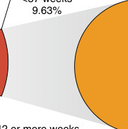

Unmatched source image; PDF page 714. Consult the original caption.

## PDF page 715

efforts to decrease elective or nonmedically indicated deliveries before 39 weeks’ gestation,14 but the recent increase in the preterm birth rate is a growing concern.7

Non-Hispanic Black infants have nearly 1.4 times the late preterm birth rate than non-Hispanic White infants. The late preterm birth rate was 9.54% for non-Hispanic Black infants, 7.32% for Hispanic infants, and 6.9% for non-Hispanic White infants, showing a slow increase in all races between 2014 and 2019 with a small decrease from 2019 to 2020 (Fig. 41.4).

Evidence shows that late preterm infants have significantly higher mortality compared with term infants, with a rate of nearly 12 per 1000 live births at 34 weeks and just over 2 per 1000 live births at 39 weeks (Fig. 41.5).7

### Etiology

The etiology of prematurity is complex and multifactorial, and although known clinical entities such as preeclampsia and premature rupture of membranes (PROM) are significant contributors to preterm births, several other causes have been implicated in the increase in the late preterm birth rate (Box 41.1).

### Medical Interventions and Iatrogenic Causes

Cesarean section rates have dramatically increased in the United States and worldwide, increasing from a low of 5% in 1970 to a high of 32.9% in 2009, then decreasing slightly to 31.8% in 2020.6 Among the many reasons cited for this increase are increased fetal surveillance and interventions, increased age of women giving birth, increased number of multiple births resulting from fertility treatments, obesity, and heightened concerns of physicians and mothers about the risks of vaginal birth. Although spontaneous births and births from PROM declined during this period, births from

16

14.1

14

12.9

12

10

9.6

10

9.1

8.9

9.2

Percent

8.3

8

7.3

6.8

6

6.8

6.5

4

4.9

4.6

2

2.8

2.7

2.4

2.3

0

Non-Hispanic Black

All births

Non-Hispanic White

2014 early preterm 2014 late preterm • Fig. 41.4 Preterm birth rates: United States, overall and by race and ethnicity, 2014 and 2018. (Source: National Center for Health Statistics, National Vital Statistics System–Natality.)

medical interventions increased, with cesarean sections accounting for most of the medical intervention group. In 2006, a national consensus conference coined a new term for cesarean deliveries for which no medical indication could be found and where maternal choice was the leading factor—cesarean delivery on maternal request.15 Although the exact number of such deliveries is hard to track, it is believed that 2.5% of cesarean sections may be performed at maternal request.15

Although elective cesarean sections are discouraged before 39 weeks’ gestation, a study by Tita and associates

Neonatal and infant mortality by gestational age 14

12

Mortality per 1000 live births

10

8

6

4

2

0 34 35 36 37 38 39 40 41

Gestational age (weeks)

Infant mortality Neonatal mortality • Fig. 41.5 Neonatal and infant mortality by gestational age. (Stewart Adapted from Reddy UM, Ko CW, Raju TN, et al. Delivery indications at late-preterm gestations and infant mortality rates in the United States. Pediatrics. 2009;124[1]:234–240. Reprinted with permission from Kardatzke MA, Rose RS, Engle WA. Late preterm and early term birth: at-risk populations and targets for reducing such early births. NeoReviews. 2017;18[5]:e265–e276.)

11.6

10.2

9.8

9.5

8.5

8.5

8.4

7.5

7.2

6.8

6.3

6.4

3.2

2.7

2.7

2.6

2.2

2.1

Asian/ Pacific Islander

American Indian/ Alaska Native

Hispanic

2018 early preterm 2018 late preterm

## PDF page 716 | printed page 707

• BOX 41.1 Etiology of Late Preterm Births

Medically Indicated

• Preterm labor • PROM • Preeclampsia

Medical Interventions and Iatrogenic

• Increased medical surveillance and interventions • Cesarean or planned induction of labor. Medical

indications: • Abnormal presentation, abnormal placentation,

maternal or fetal conditions (e.g., PROM without labor, fetal hydrocephalus) • Repeat cesarean section • Cesarean or planned induction of labor. No medical

indication: • Induction of labor or cesarean section on maternal

request • Fear of fetal and neonatal risks with vaginal delivery • Increased rate of stillbirths beginning at 39 weeks’

gestation • Hypoxic-ischemic encephalopathy, brachial plexus, and

other birth traumas • Fear of maternal risks with vaginal delivery • Risk for genital tract, anus, and perineal injury and

sexual dysfunction

PROM, Premature rupture of membranes. Modified from Engle WA, Kominiarek MA. Late preterm infants, early term infants, and timing of elective deliveries. Clin Perinatol. 2008;35:325.

found that nearly 36% of elective repeat cesarean sections were performed before 39 weeks’ gestation.16 Among these elective cesarean births, infants born at 37 and 38 weeks had greater than 1.5 times the odds of death or complications, including respiratory compromise, hypoglycemia, sepsis, and admission to the NICU (Table 41.1).16 Induction rates have also increased along with cesarean section rates, and there has been a shift toward earlier gestations in both groups.17 Historically, however, the induction rates for late preterm births have increased by 130% since 1990. In 2012, 23.3% of all singleton live births were induced, with the rate of induction increasing 4% for late preterm births since 2006.18 Although medically indicated interventions have led to a decrease in the number of stillbirths, we do not know how much this has contributed to the increase in the preterm birth rate or whether the gains realized in preventing stillbirths are offset by increased NICU admissions and complications associated with prematurity. Many states have implemented quality improvement programs to decrease elective deliveries before 39 weeks’ gestation. In one multistate collaborative undertaken over 12 months, elective scheduled early-term deliveries decreased from 27.8% in the first month to 4.8% in the 12th month; in addition, rates of elective scheduled singleton early-term inductions and cesarean deliveries decreased significantly.19

• Perception that cesarean delivery is “easier” and “less

stressful” than vaginal delivery • Fear of the second stage and having to “push the baby out” • Maternal willingness to accept risk on behalf of the infant • Convenience for mother and family

Gestational Age Assessment and Obstetric Practice Guidelines

• Inaccurate gestational age assessment during elective

deliveries • Maternal obesity • Presumption of fetal maturity at 34 weeks’ gestation • Decreasing gestational age criteria for inductions and

increased rate of stillbirths beginning at 39 weeks’ gestation

Advanced Maternal Age, Assisted Reproductive Technologies, and Multiple Births

• Increase in multifetal pregnancies • Delayed childbearing and increased risk for prematurity • Use of assisted reproductive technologies (multifetal

pregnancies) and increased risk for complications associated with premature delivery (e.g., preeclampsia, diabetes)

Physician Practice Patterns and Risk/Benefit Determination

• Concern for risk of adverse outcomes • Convenience • Liability

Some studies claim that the increasing cesarean section rates stem from the changing practice standards of medical professionals and their willingness to perform cesarean sections because of the perceived safety and protection from malpractice litigation.20 Further prospective studies are required to quantify how much of the increase in late preterm births is owing to necessary medical interventions and how much can be attributed to cesarean sections performed by physician or maternal request.

### Gestational Age Assessment and Obstetric Practice Guidelines

Gestational age measurement is an inexact science; the methods currently used, such as the Naegele rule (which assesses gestational age from the first day of the last menstrual period) and ultrasound at 20 weeks’ gestation, are accurate only to ±1 to 2 weeks’ gestational age. Combined with the fact that developmental variability exists during fetal maturation and conditions such as maternal obesity and PROM can cause an overestimation or underestimation of gestational age, the task of accurate gestational age prediction is even more challenging. The American College of Obstetricians and Gynecologists issued guidelines that a cesarean delivery or induction on maternal request should not be performed before 39 weeks’ gestation or without

## PDF page 717

TABLE

Odds Ratiosa for Adverse Neonatal Outcomes According to Completed Week of Gestation at Delivery

41.1

Outcomeb 37 Weeks 38 Weeks

Any adverse outcome or death 2.1 (1.7–2.5) 1.5 (1.3–1.7)

Adverse respiratory outcome

RDS 4.2 (2.7–6.6) 2.1 (1.5–2.9)

TTN 1.8 (1.2–2.5) 1.5 (1.2–1.9)

RDS or TTN 2.5 (1.9–3.3) 1.7 (1.4–2.1)

Admission to NICU 2.3 (1.9–3.0) 1.5 (1.3–1.7)

Newborn sepsisc 2.9 (2.1–4.0) 1.7 (1.4–2.2)

Treated hypoglycemia 3.3 (1.9–5.7) 1.3 (0.8–2.0)

Hospitalization ≥5 days 2.7 (2.0–3.5) 1.8 (1.5–2.2)

aOdds ratio (95% confidence interval). bAll outcomes are adjusted for maternal age (as a continuous variable), race or ethnic group, number of previous cesarean deliveries, marital status, payor, smoking status, and presence or absence of diet-controlled gestational diabetes mellitus. cNewborn sepsis included suspected infections (with clinical findings suggesting infection) and proven infections. NICU, Neonatal intensive care unit; RDS, respiratory distress syndrome; TTN, transient tachypnea of the newborn. Modified from Tita ATN, Landon MB, Spong CY, et al. Timing of elective repeat cesarean delivery at term and neonatal outcomes. N Engl J Med. 2009;360:111.

evidence of lung maturity.15 This gradual shift toward lower gestational age, along with the inaccuracies of gestational age measurement, might have led to the increasing proportions of late preterm births.

Tocolysis and antenatal steroids were routinely recommended only for women at less than 34 weeks’ gestation because infants born at 34 weeks’ gestation and beyond were believed to have mortality rates similar to those of term infants. Studies have shown, however, that infants born at 34 weeks’ gestation are at 50% increased risk for requiring intensive care,21–23 and late preterm infants have increased morbidity such as respiratory distress syndrome, intraventricular hemorrhage (IVH), and death,24 as well as long-term morbidities such as behavioral and developmental delay.7,25,26 The antenatal late preterm steroids (ALPS) study published in 2016 showed significant decreases in respiratory complications in late preterm infants born to mothers who received antenatal betamethasone at 34 to 37 weeks.27 This has changed obstetric clinical practice, and a single course of betamethasone is recommended for women between 34 0/7 and 36 6/7 weeks’ gestation at risk of preterm delivery.28

Use of intrapartum fetal monitoring and prenatal ultrasound has been increasing over the years.23 Prenatal ultrasound can lead to an overestimation of gestational age in maternal conditions associated with fetal macrosomia, such as obesity and gestational diabetes, both of which have increased rapidly in the past decade. There is the possibility of earlier intervention (induction or elective cesarean section) when ultrasound estimates are used to guide the management plan.10 Although fetal surveillance is designed to reduce adverse neonatal outcome, when coupled with

39 Weeks 40 Weeks

Reference 0.9 (0.7–1.1)

Reference 1.1 (0.6–2.0)

Reference 0.9 (0.6–1.3)

Reference 0.9 (0.6–1.2)

Reference 0.8 (0.6–1.0)

Reference 1.0 (0.7–1.5)

Reference 1.2 (0.6–2.4)

Reference 1.0 (0.8–1.4)

antenatal tests with poor positive predictive value (biophysical profile, non-stress test), it may inadvertently increase medical interventions, with a resultant increase in late preterm and early term birth rates.14

### Advanced Maternal Age, Assisted Reproductive Technologies, and Multiple Gestations

More women are now choosing to have children at a later age; it is well known that preterm birth is more prevalent among women with advanced maternal age. Women older than 35 years old also have nearly twice the rate of cesarean sections compared with women 20 to 24 years old. Increasing numbers of women are also seeking assisted reproductive technologies (ART); 57,323 women delivered infants through ART in 2014, and more than 60% of these women were older than 35 years.29 Of infants born by ART, 32% were of multiple gestations, with 57% of twins and 98.7% of triplets or more being born prematurely.29 Singleton births from ART are also more likely to be preterm.29

### Pathophysiology

It is surprising to some that late preterm infants, who are large and do not look anything like their tiny preterm counterparts, are at increased risk of medical complications related to prematurity. As their name implies, these infants are not term, however, and are prone to a host of clinical problems, including RDS, temperature instability, feeding difficulties, hypoglycemia, hyperbilirubinemia,

## PDF page 718 | printed page 709

apnea, late neonatal sepsis, prolonged hospital stay, and readmission.1,12,21,24

### Thermoregulation

Thermoregulation in a newborn depends on the amount of brown adipose tissue, white adipose tissue, and body surface area (see Chapter 35). Nonshivering thermogenesis is controlled by the hypothalamic ventral medial nucleus through the sympathetic nervous system, which releases the neurotransmitter norepinephrine; this acts on the brown adipose tissue to liberate free fatty acids, which are eventually oxidized, producing heat. Late preterm infants have decreased stores of brown adipose tissue and the hormones responsible for brown fat metabolism, such as prolactin, norepinephrine, triiodothyronine, and cortisol, which peak at term gestation. They are more likely to lose heat because of a decreased amount of white adipose tissue and less insulation. Also, their smaller size leads to an increased ratio of surface area to body weight, losing heat readily to the environment.21,30

### Feeding

Late preterm infants have poor coordination of sucking and swallowing because of neuronal immaturity and have decreased oromotor tone, generating lower intraoral pressures during sucking.12,21,30,31 Their deglutition, sphincter control, and peristaltic functions are less likely to be as mature as in term infants. Poor caloric intake and dehydration result in the exacerbation of physiologic jaundice, leading to readmission to the hospital for dehydration and jaundice. These infants also have decreased activity of hepatic uridine diphosphate glucuronyl transferase enzyme and increased enterohepatic circulation because of immature gastrointestinal function and motility. This decreased ability for hepatic uptake and conjugation puts late preterm infants at increased risk of elevated serum bilirubin levels, and jaundice is more prolonged, prevalent, and severe in these infants.32 One study showed that infants born at 36 weeks’ gestation have an eight times greater risk of developing a total serum bilirubin concentration greater than 20 mg/dL (>343 mmol/L) compared with infants born at 41 weeks or later.13

### Glucose Homeostasis

The fetus gets a steady supply of glucose primarily by maternal transfer through the placenta. Immediately after birth, this constant supply of glucose is cut off, and the infant has to produce glucose primarily by hepatic glycogenolysis and gluconeogenesis.33 The postnatal surge in catecholamines, glucagon, and corticosteroids plays an important role in maintaining euglycemic control. This increase in plasma concentrations of catecholamines causes a decline in circulating insulin concentrations and a subsequent surge in glucagon concentrations. Glucose-regulated

insulin secretion by the pancreatic beta cells is also immature, resulting in unregulated insulin production during hypoglycemia.34 Late preterm infants are challenged to maintain euglycemia control secondary to developmentally immature hepatic enzyme systems for gluconeogenesis and glycogenolysis, hormonal dysregulation with inadequate adipose tissue lipolysis, and decreased hepatic glycogen stores that are depleted quickly after birth.12,21,34 In addition to these physiologic reasons, delayed initiation of feeds or low volume intake in the late preterm population increases the risk of hypoglycemia.4

### Neurologic Immaturity

At 34 weeks’ gestation, brain weight is only 65% of a 40-week term infant, and cerebral volume is 53% of a 40-week infant (Fig. 41.6).35,36 The brain of a late preterm infant is still immature and continues to grow until 2 years of age, when it reaches 80% of adult brain volume. The cerebral cortex is still smooth compared with that of a term infant because the gyri and sulci are not fully formed on the cerebral cortex, and myelination and interneuronal connectivity are still incomplete in these infants. There is evidence that multiple insults during this critical phase of neuronal and glial maturation in these infants cause white and gray matter injuries, particularly in the thalamic region and the periventricular white matter. All of this underscores the potential vulnerability of the late preterm infant to neuronal brain injury and poor developmental and long-term outcome.31

20 weeks 35 weeks 40 weeks

Near-term

• Fig. 41.6 Development of the human cerebral cortex. The immaturity of the laminar position and dendritic arborization of neurons, as shown by Golgi drawings, in the cerebral cortex in a late preterm infant at 35 gestational weeks is striking compared with neurons at midgestation (20 weeks) and at term (40 weeks). (Modified from Kinney HC. Perinatal neuropathology. In: Graham DI, Lantos PE, eds. Greenfield’s Neuropathology. 7th ed. London: Arnold; 2002:557–559.)

• Fig. 41.6 Development of the human cerebral cortex. The immaturity of the laminar position and dendritic arborization of neurons, as shown by Golgi drawings, in the cerebral cortex in a late preterm infant at 35 gestational weeks is striking compared with neurons at midgestation (20 weeks) and at term (40 weeks). (Modified from Kinney HC. Perinatal neuropathology. In: Graham DI, Lantos PE, eds. Greenfield’s Neuropathology. 7th ed. London: Arnold; 2002:557–559.)

• Fig. 41.6 Development of the human cerebral cortex. The immaturity of the laminar position and dendritic arborization of neurons, as shown by Golgi drawings, in the cerebral cortex in a late preterm infant at 35 gestational weeks is striking compared with neurons at midgestation (20 weeks) and at term (40 weeks). (Modified from Kinney HC. Perinatal neuropathology. In: Graham DI, Lantos PE, eds. Greenfield’s Neuropathology. 7th ed. London: Arnold; 2002:557–559.)

Unmatched source image; PDF page 718. Consult the original caption.

## PDF page 719

### Respiratory

Several studies have consistently shown that late preterm infants have higher respiratory morbidity and mortality than term infants, with increased risk of transient tachypnea of the newborn, RDS, persistent pulmonary hypertension of the newborn, and respiratory failure.1,16,37 A review from the Extracorporeal Life Support Organization (ELSO) Neonatal Registry of nearly 14,500 infants between 1986 and 2006 with severe hypoxic respiratory failure requiring extracorporeal membrane oxygenation (ECMO) found that 14.7% were late preterm. Although meconium aspiration was one of the primary reasons for respiratory failure among term infants, late preterm infants had a higher incidence of PPHN and RDS as the primary causes. They also had higher mortality (late preterm, OR 2.73) and complications on ECMO when compared with term infants.38 Late preterm infants born by cesarean section before the onset of labor have respiratory distress despite having mature surfactant profiles. To understand this vulnerability for respiratory problems, one needs to understand the pathophysiology of fetal lung fluid secretion and clearance because it may play an important role in the development of RDS or PPHN along with surfactant maturation.

### Role of Fetal Lung Fluid Clearance in Neonatal Transition

Throughout much of gestation, fetal lungs actively secrete fluid into alveolar spaces via a chloride secretory mechanism that can be blocked by inhibitors of Na-K-2Cl co-transport. This body of fluid plays a crucial role in lung development, providing a structural template that prevents collapse of the developing lung and promotes its growth. The fetus is presented with a challenge at birth. Often at short notice, and sometimes with no notice at all, the fetus is asked to clear the airspaces rapidly of the fluid that it has been secreting through much of the pregnancy. The lung epithelium is a key participant in this process, engineering the switch from placental to pulmonary gas exchange.39

For effective gas exchange to occur, alveolar spaces must be cleared of excess fluid and pulmonary blood flow must be increased to match ventilation with perfusion. Failure of either of these events can jeopardize neonatal transition and cause the infant to develop RDS. Clinicians are still far from completely understanding the mechanisms by which fetal lungs are able to clear excessive fluid at birth. It is clear, however, that traditional explanations that relied on “Starling forces” and “vaginal squeeze” can account for only a fraction of the fluid absorbed.39 Amiloride-sensitive sodium transport by lung epithelia through epithelial sodium channels (ENaC) has emerged as a key event in the transepithelial movement of alveolar fluid.39,40 Disruption of this process has been implicated in several disease states, including TTN and respiratory distress syndrome.

Developmental changes in transepithelial ion and fluid movement in the lung can be viewed as occurring in three distinct stages. In the first (fetal) stage, the lung epithelium

remains in a secretory mode, relying on active chloride secretion via Cl− channels and relatively low reabsorption activity of Na+ channels. The second (transitional) stage involves a reversal in the direction of ion and water movement. A multitude of factors may be involved in this transition, including exposure of epithelial cells to an air interface and to high concentrations of steroids and cyclic nucleotides. This stage involves not only increased expression of Na+ channels in the lung epithelia but also possibly a switch from nonselective cation channels to highly selective Na+ channels. The net increase in Na+ movement into the cell can also cause a change in resting membrane potential leading to a slowing, and eventually a reversal, of the direction of Cl− movement through Cl− channels. The third and final (adult) stage represents lung epithelia with predominantly Na+ reabsorption through Na+ channels and possibly Cl− reabsorption through Cl− channels, with a fine balance between the activity of ion channels and tight junctions. Such an arrangement can help ensure adequate humidification of alveolar surface while preventing excessive buildup of fluid.

After birth, the remaining lung fluid is rapidly cleared by a two-step process (Fig. 41.7). The first step is passive movement of Na+ from the lumen across the apical membrane into the cell through Na+-permeable ion channels; the second step involves active extrusion of Na+ from the cell across the basolateral membrane into the serosal space.41 Epithelial Na+ channels, which regulate the first step, are rate-limiting in this process. Studies in human neonates have shown that immaturity of Na+ transport mechanisms contributes to the development of TTN and RDS.42

Epithelial Na+ channel expression is developmentally regulated with peak expression in the alveolar epithelium achieved only at term gestation;43 late preterm infants are born with lower expression of ENaC, which reduces their ability to clear fetal lung fluid after birth. High doses of glucocorticoids have been shown to stimulate transcription of epithelial Na+ channels in several sodium-transporting epithelia and the lung. In the alveolar epithelia, glucocorticoids were found to induce lung sodium reabsorption in the late gestation fetal lung. In addition to increasing transcription of sodium channel subunits, steroids increase the number of available channels by decreasing the rate at which membrane-associated channels are degraded, and they increase the activity of existing channels.

### Clinical Outcomes

Morbidity in late preterm infants increases with decreasing gestational age.7 Because of their physiologic immaturity, nearly every organ system is affected in late preterm infants (Fig. 41.8). Data from the British Columbia Perinatal Database Registry show that late preterm infants had 4.4 times the respiratory morbidity and 5.2 times the neonatal infection rate than term infants. They also had increased length of hospital stay compared with term infants (142 vs. 57 hours).36 A meta-analysis of 22 studies comparing late

## PDF page 720 | printed page 711

Alveolus Amiloride

Paracellular Na+, K+, Cl–

ENaC HSC ENaC NSC

CNGC Na+, K+

H2O

H2O

Na+

Na+, K+

AQP5

T1 cell

Na+

K+

Na, K-ATPase

Interstitium

Pulmonary capillary

• Fig. 41.7 Epithelial sodium (Na) absorption in the fetal lung near birth. Na enters the cell through the apical surface of alveolar type I and type II cells via amiloride-sensitive epithelial Na channels (ENaC), both highly selective channels (HSC) and nonselective channels (NSC), and via cyclic nucleotide gated channels (seen only in angiotensin I cells). Electroneutrality is conserved with chloride movement through cystic fibrosis transmembrane conductance regulator (CFTR) or chloride channels (CLC) in angiotensin I and II cells or paracellularly through tight junctions. The increase in cell Na stimulates Na, K-ATPase activity on the basolateral aspect of the cell membrane, which drives out three Na+ ions in exchange for two K+ ions, a process that can be blocked by the cardiac glycoside ouabain. If the net ion movement is from the apical surface to the interstitium, an osmotic gradient would be created, which would direct water transport in the same direction, either through aquaporins or by diffusion. CNGC, Cyclic nucleotide-gated cation channel. (Modified from Jain L. Respiratory morbidity in late-preterm infants: prevention is better than cure! Am J Perinatol. 2008;25:75–78.)

CLINICAL OUTCOMES

Temperature instability

Full term Near term

Hypoglycemia

Intravenous infusion

Respiratory distress

Clinical jaundice

0 10 20 30 40 60 50

(%)

• Fig. 41.8 Graph of clinical outcomes in near-term (35–36 6/7weeks) and full-term infants as percentage of patients studied. (From Wang ML, Dorer DJ, Fleming MP, et al. Clinical outcomes of near-term infants. Pediatrics. 2004;114:372.)

preterm and term infants showed higher risk of respiratory distress syndrome (relative risk [RR], 17.3), intraventricular hemorrhage (RR 4.9), death less than 28 days (RR 5.9), and cerebral palsy (RR 3.1).24 In infants with critical congenital heart disease (CCHD), being born at 34 to 36 weeks

Cl–

Cl–

Na+

–

ENaC HSC

Na+, K+

CFTR

Paracellular

Na+, K+, Cl–

CLC

–

ENaC NSC

AQP5

T2 cell

Cl–

Na+

K+

Na, K-ATPase

CLC

–

OUABAIN

was associated with a higher risk of death or morbidity than being born at 37 to 38 weeks (adjusted absolute risk reduction [ARD] 9.1%, 95% CI 5.5% to 12.7%).44 Mortality and morbidity are described in further detail in each physiologic system in this section.

### Mortality

A systematic review of severe morbidity and mortality in late preterm infants was performed by Teune et al., compiling data from 2000 to 2010.24 Late preterm infants were four times more likely to die in the first year than term infants. Using US period-linked birth/infant death files in 2019, infant mortality rates were five times higher for late preterm infants than infants born between 39 and 40 weeks (8.2 vs. 1.5 deaths per 1000 live births).45

Young and associates, in a large cohort from Utah, showed increasing mortality and relative risk of death for every decreasing week in gestational age less than 40 weeks (Table 41.2).46 The increased risk of morbidity and mortality is not limited to the immediate neonatal period. A study looking at nearly 675,000 singleton births in Sweden (between 1973 and 1979) found that infants born at late preterm gestation had an increased risk of mortality at 18 to 36 years of age (adjusted hazard ratios of 1.53 and 1.31 at early childhood and young adulthood, respectively).47 This tells us that the effects of late preterm birth

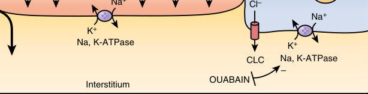

• Fig. 41.7 Epithelial sodium (Na) absorption in the fetal lung near birth. Na enters the cell through the apical surface of alveolar type I and type II cells via amiloride-sensitive epithelial Na channels (ENaC), both highly selective channels (HSC) and nonselective channels (NSC), and via cyclic nucleotide gated channels (seen only in angiotensin I cells). Electroneutrality is conserved with chloride movement through cystic fibrosis transmembrane conductance regulator (CFTR) or chloride channels (CLC) in angiotensin I and II cells or paracellularly through tight junctions. The increase in cell Na stimulates Na, K-ATPase activity on the basolateral aspect of the cell membrane, which drives out three Na+ ions in exchange for two K+ ions, a process that can be blocked by the cardiac glycoside ouabain. If the net ion movement is from the apical surface to the interstitium, an osmotic gradient would be created, which would direct water transport in the same direction, either through aquaporins or by diffusion. CNGC, Cyclic nucleotide-gated cation channel. (Modified from Jain L. Respiratory morbidity in late-preterm infants: prevention is better than cure! Am J Perinatol. 2008;25:75–78.)

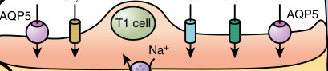

• Fig. 41.7 Epithelial sodium (Na) absorption in the fetal lung near birth. Na enters the cell through the apical surface of alveolar type I and type II cells via amiloride-sensitive epithelial Na channels (ENaC), both highly selective channels (HSC) and nonselective channels (NSC), and via cyclic nucleotide gated channels (seen only in angiotensin I cells). Electroneutrality is conserved with chloride movement through cystic fibrosis transmembrane conductance regulator (CFTR) or chloride channels (CLC) in angiotensin I and II cells or paracellularly through tight junctions. The increase in cell Na stimulates Na, K-ATPase activity on the basolateral aspect of the cell membrane, which drives out three Na+ ions in exchange for two K+ ions, a process that can be blocked by the cardiac glycoside ouabain. If the net ion movement is from the apical surface to the interstitium, an osmotic gradient would be created, which would direct water transport in the same direction, either through aquaporins or by diffusion. CNGC, Cyclic nucleotide-gated cation channel. (Modified from Jain L. Respiratory morbidity in late-preterm infants: prevention is better than cure! Am J Perinatol. 2008;25:75–78.)

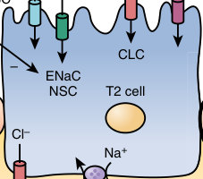

Unmatched source image; PDF page 720. Consult the original caption.

### Automatic table extraction — verify rendered original

|Col1|Full term Near term|Col3|Col4|Col5|Col6|Col7|
|---|---|---|---|---|---|---|
||||||||
||||||||
||||||||
||||||||
||||||||
||||||||

[Original table](../../tables/ch041_p0720_1.jpg)

## PDF page 721

TABLE

Mortality Rates and Risk Ratios for Death According to Gestational Age

41.2

Early Neonatal Mortality Rate (1–7 Days)

Gestational Age (Weeks)

Mortality Ratea Risk Ratio

34 7.2 25.5b

35 4.5 16.1b

36 2.8 9.8b

37 0.8 2.7b

38 0.5 1.7

39 0.2 0.8

40 0.3 Reference

aMortality rates are per 1000 live births. bRisk ratios are significantly different from 40 weeks. Modified from Young PC, Glasgow TS, Li X, et al. Mortality of late-preterm (near-term) newborns in Utah. Pediatrics. 2007;119:e659.

are not limited to the neonatal period alone but also carry into adulthood.

### Respiratory

Several studies have shown that late preterm infants have a higher incidence of RDS than term infants.23,48,49 Wang and colleagues found that late preterm infants, despite their larger size and Apgar scores similar to term infants, had increased RDS (28.9% vs. 4.2%; odds ratio 9.14, P < .00001) and apnea (4.4% vs. 0%; P = .05) (see Fig. 41.8).50 Estimates of the incidence of RDS range from 7.4% to 13.7% at 34 weeks, 4.5% to 6.4% at 35 weeks, and 2.3% to 3.6% at 36 weeks.38,50,51 Data collected from 2002 to 2008 by the Consortium on Safe Labor reported that the odds of respiratory distress syndrome decreased with each advancing week until 38 weeks. The incidence of RDS was 10.5% at 34 weeks compared with 0.3% at 38 weeks.1

Along with the increasing incidence of respiratory distress among late preterm infants, these infants have also been shown to have an increased need for respiratory support. A study from St. Louis found the need for some kind of respiratory support at 30%, 33%, and 23% of the time at 34 weeks, 35 weeks, and 36 weeks.52 Other studies have shown the need for mechanical ventilation at 3.3% to 6.3% at 34 weeks, 1.7% to 3.6% at 35 weeks, and 0.8% to 2.3% at 36 weeks.53 In a study of 1011 ventilated infants of 34 weeks’ or greater gestation, Clark found that RDS (43%) was the most common cause of pulmonary illness, followed by meconium aspiration syndrome (9.7%), pneumonia/ sepsis (8.3%), TTN (3.9%), idiopathic PPHN (3.2%), aspiration of blood or amniotic fluid (2.3%), and lung hypoplasia (1.4%).37

Why is this slightly increased risk of RDS and TTN of concern? Most of these late preterm infants do well and are weaned off respiratory support quickly, but as shown from

Infant Mortality Rate (1–365 Days)

Mortality Ratea Risk Ratio

12.5b 10.5

8.7b 7.2

6.3b 5.3

3.4b 2.8

2.4b 2.0

1.2 1.2

1.4 Reference

the mentioned studies, a few of them are at increased risk of PPHN, severe hypoxic respiratory failure, and need for extracorporeal membrane oxygenation, putting them at risk of severe morbidity and mortality. Clark showed that nearly 11% of late preterm infants developed chronic lung disease.37 Data also show that they are prone to develop long-term respiratory complications such as asthma and decreased lung function later in life.41,54

### Temperature Instability and Hypoglycemia

Cold stress manifests as tachypnea, poor color secondary to peripheral vasoconstriction, altered pulmonary vascular tone, and metabolic acidosis. In a late preterm infant, this condition can worsen respiratory transition and exacerbate hypoglycemia, and these signs can be misinterpreted as something more ominous, such as sepsis, prompting unnecessary interventions and work-ups. Very few studies have looked at temperature instability in late preterm infants, but from experience, preterm infants are more likely to have hypothermia and cold stress. A survey of rectal temperatures among 196 term infants in a Dallas hospital found that nearly 28% were less than 36.5° C.55 Similarly, admission temperatures at a Rhode Island hospital NICU in infants weighing more than 2 kg and of greater than 32 weeks’ gestation were reported to be between 34.5° C and 36.5° C.5 Wang and colleagues50 found that late preterm infants were more likely to present with temperature instability (10% vs. 0%; P < .0012), and another study found that among late preterm infants admitted to the NICU, hypothermia was listed as the primary reason for admission in almost 5.2% of this group.52

Hypoglycemia is another component that can affect transition. The incidence of hypoglycemia in late preterm infants is three to four times greater than in term newborns, especially within the first 12 hours of life.3 Severe

## PDF page 722 | printed page 713

hypoglycemia is a well-known risk factor for neuronal cell death and adverse neurodevelopmental outcomes. In one study, neonatal hypoglycemia was associated with an increased risk of poor executive function and visual motor function at 4.5 years of age.56 In 2011, the AAP Committee on Fetus and Newborn provided guidelines for screening and management of postnatal glucose homeostasis in late preterm infants, recognizing that they are an at-risk population along with term small-for-gestational-age (SGA) and infants of diabetic mothers (IDM)/large-for-gestationalage (LGA) infants (Fig. 41.9). These infants should receive their initial feed within the first hour of life and have a screening glucose test 30 minutes after the first feed. The threshold for low blood glucose is less than 25 mg/dL in the first 4 hours of life, less than 35 mg/dL from 4 to 24 hours of life, and less than 40 mg/dL when the infant is symptomatic (irritability, tremors, jitteriness, exaggerated Moro reflex, high-pitched cry, seizures, lethargy, floppiness, cyanosis, apnea, poor feeding). The algorithm then provides guidelines for treatment of hypoglycemia. The Pediatric

### Screening and Management of Postnatal Glucose Homeostasis in Late Preterm

### and Term SGA, IDM/LGA Infants

[(LPT) Infants 34–366/7 weeks and SGA (screen 0–24 hrs); IDM and LGA 34 weeks (screen 0–12 hrs)]

Symptomatic and <40 mg/dL

ASYMPTOMATIC

Birth to 4 hours of age

INITIAL FEED WITHIN 1 hour Screen glucose 30 minutes after 1st feed

Initial screen <25 mg/dL

Feed and check in 1 hour

<25 mg/dL 25–40 mg/dL

IV glucose* Refeed/IV glucose* as needed

Target glucose screen 45 mg/dL prior to routine feeds

* Glucose dose = 200 mg/kg (dextrose 10% at 2 mL/kg) and/or IV infusion at 5–8 mg/kg per min (80–100 mL/kg per d). Achieve plasma glucose level of 40–50 mg/dL.

Symptoms of hypoglycemia include: Irritability, tremors, jitteriness, exaggerated Moro reflex, high-pitched cry, seizures, lethargy, floppiness, cyanosis, apnea, poor feeding.

• Fig. 41.9 Screening and management of postnatal glucose homeostasis during the immediate postnatal period in late preterm (LPT) and term small-for-gestational-age (SGA) infants, infants of diabetic mothers (IDM)/large-for-gestational-age (LGA) infants. (Reproduced with permission from Adamkin DH. Postnatal glucose homeostasis in late-preterm and term infants clinical report—postnatal glucose homeostasis in late-preterm and term infants. Pediatrics. 2013;127[3]:575–579. Copyright © 2013 by the AAP. https:// doi.org/10.1542/peds.2010-3851.)

Endocrine Society recommends that high-risk infants without a suspected congenital disorder (which would include late preterm infants) should maintain a goal plasma glucose concentration greater than 50 mg/dL less than 48 hours and greater than 60 mg/dL greater than 48 hours to minimize any long-term effects.57

One treatment identified for neonatal hypoglycemia is dextrose gel. This is a 40% dextrose gel that is massaged into the infant’s buccal mucosa, usually followed by oral breast milk or formula feeding. The Sugar Babies Study, a randomized, double-blind, placebo-controlled trial, showed that treatment with dextrose gel is inexpensive and easy to administer in the newborn nursery and suggested that it should be considered first-line treatment for late preterm and term hypoglycemic infants in the first 24 hours after birth.58 Subsequent studies have supported its use, showing the decreased need for intravenous fluids and decreased admissions to the NICU.59 Buccal administration of dextrose gel is not included in the current AAP hypoglycemia guideline; however, with more recent studies supporting its use, many

IV glucose

4 to 24 hours of age

Continue feeds q 2–3 hours Screen glucose prior to each feed

Screen <35 mg/dL

Feed and check in 1 hour

<35 mg/dL 35–45 mg/dL

IV glucose* Refeed/IV glucose* as needed

## PDF page 723

hospitals are establishing their own algorithms for the use of dextrose gel in the setting of neonatal hypoglycemia.

### Feeding

Late preterm infants adapt well to enteral feeds but have poor oromotor tone and difficulty with sucking and swallowing coordination. The majority (3/4) of late preterm infants require feeding support, which accounts for the primary reason for a prolonged hospital stay.50,52 One study found that approximately 27% of late preterm infants required intravenous fluids compared with only 5% of term infants (odds ratio 6.48, 95% CI 2.27–22.91, P = .0007), and among infants requiring prolonged hospital stay, poor feeding was cited as the primary reason in 76% of the late preterm infants.50 Another study from St. Louis found that among late preterm infants admitted to the NICU, nearly 7.3% of infants of 35 weeks’ gestation were admitted for feeding difficulties.52 Despite recommendations and guidelines that support breastfeeding in the late preterm population, late preterm infants are less likely to receive any breast milk during hospitalization compared with term and preterm infants. They are also less likely to be breastfed, and they are less likely to breastfeed for a long duration.4 In a recent secondary analysis of a multicenter randomized trial of antenatal corticosteroids for women at risk for late preterm birth, they found that 3 out of 10 late preterm infants were formula fed.60

In a study of rehospitalizations after birth hospitalization, Escobar and associates found that 26% of the infants were readmitted for feeding difficulties, and late preterm infants were more likely to require rehospitalization (4.4% vs. 2% in term infants).61 Dehydration also exacerbates physiologic jaundice in these infants, predisposing them to rehospitalization and other medical interventions.

### Hyperbilirubinemia

Late preterm infants are 2.4 times more likely to develop significant hyperbilirubinemia than term infants.62 Bhutani and associates, looking at the National Kernicterus Registry, showed that late preterm infants are at increased risk of kernicterus at bilirubin levels equal to or less than those of term infants.32 They are also more likely to present with high total serum bilirubin levels (≥25 mg/dL) and are less likely to recover without sequelae than term infants. Nearly all the late preterm infants in this group were breastfeeding without adequate lactation support and with poor milk intake, and they were scheduled for follow-up appointments in 2 weeks.

Neonatal hyperbilirubinemia in late preterm newborns is more prevalent, more pronounced, and more protracted in nature than in their term counterparts. Jaundice was the most common cause of rehospitalization, and late preterm infants were more likely to be rehospitalized for jaundice than term infants (4.5% vs. 1.2% in term infants).61 Hyperbilirubinemia is a significant problem in these infants, as shown by their overrepresentation in the kernicterus registry. The large size of

late preterm infants may fool practitioners into complacency by treating them as term infants; however, close follow-up and monitoring for feeding difficulties should be mandated to prevent kernicterus in this vulnerable group.

### Immunity and Infection

It has been shown that late preterm infants undergo workups for sepsis more often than term infants (36.7% vs. 12.6%; odds ratio 3.97, P = .00015) and receive antibiotics more often and for a longer duration (7-day course in 30% vs. 17% of term infants).52 Another study found that the likelihood of having a work-up for sepsis increased with decreasing gestational age; 33% had work-ups for sepsis at 34 weeks compared with 12% at 39 weeks of gestational age (P ≤ .01), of which only 0.4% of these infants had culture-proven sepsis.53 Late preterm infants undergo workups more often for sepsis either as a part of a protocol after admission to the NICU or because of clinical manifestations of RDS, cold stress, and hypoglycemia, which may appear to be signs of sepsis to the physician.

### Hospitalizations and Rehospitalizations After Discharge

Late preterm infants are more likely to require intensive care and are admitted to the NICU more often than term infants. Admission rates vary based on the policies of individual institutions and hospitals; some routinely admit all infants less than 35 weeks of gestation to the NICU, and others do so only if there is a need. One large population-based study found that 97%, 53%, and 32% of infants of 34, 35, and 36 weeks of gestation required NICU admissions.52 Duration of hospital stay is also inversely proportional to gestational age, with late preterm infants requiring much longer hospital stays (6–11 days, 4–6 days, and 3–4 days in 34-, 35-, and 36-week infants, respectively).36,52 The most common reasons for admission include jaundice, RDS, dehydration and poor feeding, hypoglycemia, and temperature instability.50,52

Aside from the greater need for specialized care and the prolonged initial hospital stay, late preterm infants are also at risk for rehospitalization after discharge from the hospital.63 Looking at a large population-based cohort in a managed care organization, Escobar and colleagues found that late preterm infants (4.4%) had a higher rate of rehospitalization than term infants (2%), and the rate was higher than for infants less than 34 weeks’ gestational age (3%).61 They also found that infants between 34 and 36 weeks of gestation who were never admitted to the NICU and infants with NICU stays less than 24 hours had nearly three times and 1.3 times the risk of readmission than term infants, which indicates that clinicians may be treating these immature infants based on their weight and failing to identify all of the risk factors. Additionally, a large population-based cohort study of 1.3 million Canadian children between 2002 and 2012 found that late preterm infants compared

## PDF page 724 | printed page 715

with term infants had higher rates of admissions and emergency room visits in the first 5 years of life, although rate differences decreased as the children became older.64

The most common reasons cited for readmission include hyperbilirubinemia (63%–71%), feeding difficulties (16%), and suspected sepsis (6%–20%).63,65 The infants requiring rehospitalization were more likely to be firstborn, be breastfed at discharge, have labor and delivery complications, be a recipient of public insurance at delivery, or be of Asian/ Pacific Islander descent.63 Given that late preterm infants are at a much higher risk for rehospitalization, protocols need to be designed for closer monitoring of breastfed infants of new first-time mothers and infants at risk for jaundice, especially those of Asian descent, avoiding early discharge until proper feeding has been established, and ensuring early follow-up after hospital discharge.

### Economic Impact

In one of the most comprehensive studies to date, The Institute of Medicine estimated that every preterm birth cost $51,600, with a total impact of $26 billion in 2005.66 Late preterm infants are responsible for a significant share of this burden, constituting two-thirds of all preterm births. It is estimated that the relative increase in direct costs for late preterm infants is 2.9 times that of a term infant.50 Although extremely preterm infants are very expensive to treat, the overall cost of treating the cohort of late preterm infants is similar because of the large number of infants treated.

The costs are not just higher in the immediate neonatal period but also higher in early childhood. A Canadian study comparing late preterm to term infants found that late preterm infants are at greater risk for morbidities such as bronchiolitis and pneumonia during the first 3 years of life and that the hospitalization costs were nearly twice that of term infants in the first 2 years and nearly 46% greater in the third year.67

### Long-Term Neurodevelopmental Outcomes

Although it is well known that very preterm infants are at a higher risk of psychomotor, behavioral, cognitive, and other developmental disabilities, late preterm infants also have more subtle findings of language delay, attention deficits, lower intelligence, behavioral problems, and academic achievement. There have been several large retrospective studies of long-term neurodevelopmental outcomes in late preterm infants. Woythaler and colleagues, using the Early Childhood Longitudinal Study-Birth Cohort (ECLS-B), found that late preterm infants had increased odds of lower mental index scores (MDI <70; OR 1.51 [95% CI:1.26– 1.82]) and lower psychomotor index scores (PDI <70; OR 1.56 [95% CI:1.29–1.88]) at 24 months of age.26 Using the same cohort, these children still were delayed compared with their full-term counterparts in kindergarten based on having a worse Total School Readiness Score (TSRS).68

Chyi and colleagues, using the Early Childhood Longitudinal Study-Kindergarten Cohort (ECLS-K), compared learning difficulties among late preterm and full-term infants using direct child assessment tests and teacher academic rating scale scores. They found that late preterm infants scored lower than term infants on both direct child assessment tests and teacher academic rating scale scores. Late preterm infants also showed an increased need for individualized educational programs and special education.47

Similarly, Talge and colleagues compared 336 pairs of late preterm and term infants and found that the late preterm infants at 6 years of age had an increased risk of lower IQ scores and a higher incidence of teacher-reported behavioral problem.69 The Millennium Cohort Study, a longitudinal study of approximately 18,800 infants from the United Kingdom, found an association between late preterm birth and poor educational achievement at 5 years of age, including lower overall achievement, personal/social/emotional development, communication/language, and literacy and mathematical development.25 Another study by Williams et al. evaluated the role of prematurity and maternal factors in first-grade academic failure. After adjusting for maternal and child characteristics, there were increased odds of failure of each component of the first-grade Criterion-Referenced Competency Test (CRCT) for children born late preterm versus term.70 In a recent study of 73,000 children in an urban school district in California during the 2015 to 2016 academic year, moderate and late preterm (32 0/7 weeks to 36 6/7 weeks) infants compared with term infants had an increased risk of low performance in math, English, chronic absenteeism, and suspension that were prevalent in grades K-5. Additionally, an increased risk of suspension remained throughout the cohort (up to grade 12).71

In addition to early school outcomes as delineated above, a Swedish study by Lindstrom and colleagues estimated that among a cohort of approximately 500,000 adults in their twenties, late preterm infants received increased disability assistance and were less likely to attain university or postsecondary education.72

These studies show us that late preterm birth has a significant impact on the immature preterm brain. These retrospective reports in no way confirm causality. It is unclear if the neurologic injury resulted from or predated the event that caused the late preterm birth.

### Management

Late preterm infants are a special population that needs closer monitoring and care. A comprehensive guide for management of late preterm infants was published and is summarized in Box 41.2.21

### Admission

It is recommended that infants of less than 35 weeks of gestation or weighing less than 2300 g should be admitted to an area where they can be monitored closely for stability.

## PDF page 725

• BOX 41.2 Admission and Discharge Criteria

Management of Late Preterm Infants

Admission Criteria

• Admit infants less than 35 weeks’ gestational age or less

than 2300 g birth weight • If well late preterm infants are in their mothers’ rooms in the

first 24 hours, close monitoring is needed

Hospital Management

• Physical examination on admission and discharge • Determination of accurate gestational age on admission

examination • Vital signs and pulse oximeter check on admission,

followed by vital signs every 3–4 hours in the first 24 hours and every shift thereafter • Caution against use of oxyhoods with high Fio2; consider

transfer to NICU if Fio2 exceeds 0.4 • Feeding plan should be developed; formal evaluation

of breastfeeding and documentation in the record by caregivers trained in breastfeeding at least twice daily after birth • Serum glucose screening per existing protocols for infants

at high risk of hypoglycemia

Discharge Criteria

• Vital signs normal for 12 hours before discharge • Passage of one stool spontaneously • Adequate urine output • Successful feeding for 24 hours: ability to coordinate

sucking, swallowing, and breathing while feeding • If weight loss greater than 7% in 48 hours, consider further

assessment before discharge • Risk assessment plan for jaundice for infants discharged

within 72 hours of birth • No evidence of active bleeding at circumcision site for at

least 2 hours • Initial hepatitis B vaccine has been given or an appointment

scheduled for its administration • Metabolic and genetic screening tests performed in

accordance with local or hospital requirements • Passed CCHD screen • Passed car-seat safety test • Hearing assessment has been performed and results

documented in the medical record; follow-up if necessary has been arranged • Family, environmental, and social risk factors have been

assessed; when risk factors are present, discharge should be delayed until a plan for future care has been generated • Identification of a physician with a follow-up visit arranged

for 24–48 hours • Mother and caregivers demonstrate competency in care of

the infant

CCHD, Critical congenital heart disease; NICU, neonatal intensive care unit. Modified from Engle WA, Tomashek KM, Wallman C. “Late-preterm” infants: a population at risk. Pediatrics. 2007;120:1390–1401.

Transfer to the mother’s room or regular “term” nursery environment should be considered only when they show stability of temperature, vital signs, blood glucose, and oral feeding. These infants should have a physical examination on admission and discharge, with determination of accurate gestational age on admission examination.

The obstetric estimate of gestational age is recommended if it is based on a first-trimester ultrasound. If there is a discrepancy (e.g., >2 weeks) between the gestational ages based on the obstetric estimate and the newborn examination, the use of gestational age based on the newborn examination is preferred. Vital signs and oxygen saturation should be performed on admission and monitored with appropriate frequency thereafter. Transfer to a NICU or tertiary care center should be considered if the fraction of inspired oxygen (Fio2) exceeds 0.4. A feeding plan should be developed, and formal evaluation of breastfeeding should be done at least twice daily after birth with documentation in the record by caregivers trained in breastfeeding. Serum glucose screening should be performed per existing protocols for infants at high risk of hypoglycemia—infants who are small for gestational age, large for gestational age, and infants of diabetic mothers.73

### Feeding

In 2019, the European Society of Pediatric Gastroenterology and Nutrition (ESPGHAN) Committee on Nutrition published recommendations that breastfeeding should be strongly encouraged in late preterm infants and that health care providers should develop individualized feeding plans to promote mother-infant bonding and target immature feeding skills. Caloric supplementation can be considered for some infants, depending on gestational age, birth weight, and significant comorbidities. They also recommend iron supplementation of 1 to 2 mg/kg/day for infants weighing less than 2500 g at birth for at least 6 months and vitamin D supplementation of 400 IU/day throughout early childhood.4

### Discharge Criteria

Discharge should not be considered before 48 hours after birth. Vital signs should be normal for 12 hours preceding discharge: respiratory rate, less than 60 breaths/min; heart rate, 100 to 160 beats/min; and axillary temperature, 36.5° C to 37.4° C in an open crib with appropriate clothing. There should be documentation of passage of at least one stool spontaneously, with adequate urine output, and 24 hours of successful feeding; adequate oral feeding should be present with confirmation of coordination of sucking, swallowing, and breathing while feeding. If weight loss is greater than 7% in 48 hours, further assessment should be considered before discharge.

There should be a risk assessment plan for jaundice in infants discharged within 72 hours of birth; predischarge bilirubin check (serum or transcutaneous) should be done before discharge. A transcutaneous bilirubin of greater than 12 mg should be confirmed with a serum bilirubin, and bilirubin nomograms should be used to determine the risk and need for follow-up or treatment. There should be no evidence of active bleeding at the circumcision site for at least 2 hours. The initial hepatitis B vaccine should have

## PDF page 726 | printed page 717

been given or an appointment scheduled for its administration, and the metabolic and genetic screening tests should have been performed in accordance with local or hospital requirements. A critical congenital heart disease screening should be performed. A car seat safety test and a hearing assessment should be performed, and results should be documented in the medical record.

When social risk factors are present, discharge should be delayed until a plan for future care has been generated. A

Key Points

### • Nearly three out of four preterm births occur at late pre-

term gestational ages (34–36 6/7 weeks’ gestation).

### • Late preterm infants are at risk for complications asso-

ciated with prematurity. Because of their more mature appearance, there has historically been a lapse in the early recognition and management of these issues.

### • Late preterm infants have higher morbidity and mortal-

ity compared with full-term infants.

### • Antenatal steroids, previously only given before 34 weeks’

gestation, have now been shown to reduce respiratory

### References

1. Consortium on Safe Labor; Hibbard JU, Wilkins I, Sun L,

et al. Respiratory morbidity in late preterm births. JAMA. 2010; 304(4):419–425. 2. Dudell GG, Jain L. Hypoxic respiratory failure in the late pre-

term infant. Clin Perinatol. 2006;33:803–830,viii–ix [abstract]. 3. Hosagasi NH, Aydin M, Zenciroglu A, et al. Incidence of hypo-

glycemia in newborns at risk and an audit of the 2011 American Academy of Pediatrics guideline for hypoglycemia. Pediatri Neonatolo. 2017;59:368–374. 4. Lapillone A, Bronsky J, Campoy C, et al. Feeding the late and mod-

erately preterm infant: a position paper of the European Society for Paediatric Gastroenterology, Hepatology and Nutrition Committee on Nutrition. J Pediatr Gastroenterol Nutr. 2019;69:259–270. 5. Jain L. Respiratory morbidity in late-preterm infants: prevention

is better than cure. Am J Perinatol. 2008;25:75–78. 6. Osterman MJK, Hamilton BE, Martin JA, et al. Births: final data

for 2020. Natl Vital Stat Rep. 2022;70(17):1–50. 7. Stewart D, Barfield W. “Updates on an at-risk population: late-pre-

term and early-term infants”. Pediatrics. 2019;144(5):e20192760. 8. Delnord M, Zeitlin J. Epidemiology of late preterm and early

term births – an international perspective. Semin Fetal Neonatal Med. 2019;24:3–10. 9. Leal MD, Esteves-Pereira AP, Nakamura-Pereira M, et al. Preva-

lence and risk factors related to preterm birth in Brazil. Reprod Health. 2016;13(S3):127. 10. Raju TN. Epidemiology of late preterm (near-term) births. Clin

Perinatol. 2006;33:751–763,vii [abstract]. 11. American Academy of Pediatrics and the American College of

Obstetricians and Gynecologists. Guidelines for Perinatal Care. 5th ed. Elk Grove Village, IL: American Academy of Pediatrics; 2017. 12. Raju TN, Higgins RD, Stark AR, et al. Optimizing care and

outcome for late-preterm (near-term) infants: a summary of the workshop sponsored by the National Institute of Child Health and Human Development. Pediatrics. 2006;118:1207–1214.

follow-up visit with a physician should be arranged for 24 to 48 hours after discharge. The mother and caregivers should have received training and demonstrated competency in the following activities: knowledge of urine/stool frequency, umbilical cord and skin care, identification of common signs and symptoms of illness, specific instructions concerning jaundice, specific instructions regarding sleeping patterns and positions, instructions on thermometer use, and instructions regarding responses to an emergency.

complications in infants when given at 34 to 37 weeks’ gestation.74

### • Late preterm infants require close monitoring for feeding

issues, hypoglycemia, hyperbilirubinemia, infection, and thermoregulation in the postnatal period, both during and after their hospital stay.

### • Late preterm infants have worse neurodevelopmental

outcomes than their term counterparts, including lower intelligence, behavioral problems, attention deficits, and decreased academic achievement.

13. Newman TB, Escobar GJ, Gonzales VM, et al. Frequency of neo-

natal bilirubin testing and hyperbilirubinemia in a large health maintenance organization. Pediatrics. 1999;104(5 Pt 2):1198– 1203. 14. Oshiro BT, Henry E, Wilson J, et al. Decreasing elective deliv-

eries before 39 weeks of gestation in an integrated health care system. Obstet Gynecol. 2009;113:804–811. 15. ACOG Committee Opinion No 559. Cesarean delivery on

maternal request. Obstet Gynecol. 2013;121(4):904–907. 16. Tita ATN, Landon MB, Spong CY, et al. Timing of elective

repeat cesarean delivery at term and neonatal outcomes. N Engl J Med. 2009;360:111–120. 17. Davidoff MJ, Dias T, Damus K, et al. Changes in the gestational

age distribution among U.S. singleton births: impact on rates of late preterm birth, 1992 to 2002. Semin Perinatol. 2006;30:8. 18. Osterman MJK, Martin JA. Recent declines in induction of labor

by gestational age. NCHS Data Brief. 2014;155:1–8. 19. Oshiro BT, Kowalewski L, Sappenfield W, et al. A multistate

quality improvement program to decrease elective deliveries before 39 weeks of gestation. Obstet Gynecol. 2013;121:1025– 1031. 20. McCourt C, Weaver J, Statham H, et al. Elective cesarean sec-

tion and decision making: a critical review of the literature. Birth. 2007;34:65–79. 21. Engle WA, Tomashek KM, Wallman C. Late-preterm infants: a

population at risk. Pediatrics. 2007;120:1390–1401. 22. Jain L. Morbidity and mortality in late-preterm infants: more

than just transient tachypnea. J Pediatr. 2007;151:445–446. 23. Medoff Cooper B, Holditch-Davis D, Verklan MT, et al. New-

born clinical outcomes of the AWHONN late preterm infant research-based practice project. J Obstet Gynecol Neonatal Nurs. 2012;41:774–785. 24. Teune MJ, Bakhuizen S, Gyamfi Bannerman C, et al. A system-

atic review of severe morbidity in infants born late preterm. Am J Obstet Gynecol. 2011;205:374.e1–374.e9. 25. Quigley MA, Poulsen G, Boyle E, et al. Early term and late

preterm birth are associated with poorer school performance at

## PDF page 727

age 5 years: a cohort study. Arch Dis Child Fetal Neonatal Ed. 2012;97:F167–F173. 26. Woythaler MA, McCormick MC, Smith VC. Late preterm

infants have worse 24-month neurodevelopmental outcomes than term infants. Pediatrics. 2011;127:e622–e629. 27. GyamfiBannerman C, et al. Antenatal betamethasone for women

at risk for late preterm delivery. N Engl J Med. 2016;374(14):1311– 1320. 28. ACOG Committee Opinion No. 713. Antenatal corticosteroid

therapy for fetal maturation. Obstet Gyencol. 2017;130(2):e102– e109. 29. American Society for Reproductive Medicine Centers for Dis-

ease Control and Prevention, Society for Assisted Reproductive Technology. 2014 Assisted Reproductive Technology Success Rates: National Summary and Fertility Clinic Reports. Atlanta, GA: Centers for Disease Control and Prevention; 2016. 30. Polin RA, Fox WW, Abman SH. Fetal and Neonatal Physiology.

5th ed. Philadelphia: Saunders; 2017. 31. Kinney HC. The near-term (late preterm) human brain and

risk for periventricular leukomalacia: a review. Semin Perinatol. 2006;30:81–88. 32. Bhutani VK, Johnson L. Kernicterus in late preterm infants cared

for as term healthy infants. Semin Perinatol. 2006;30:89–97. 33. Halamek LP, Benaron DA, Stevenson DK. Neonatal hypogly-

cemia, part I: background and definition. Clin Pediatr (Phila). 1997;36:675–680. 34. Garg M, Devaskar SU. Glucose metabolism in the late preterm

infant. Clin Perinatol. 2006;33:853–870, ix–x [abstract]. 35. Billiards SS, Pierson CR, Haynes RL, et al. Is the late preterm

infant more vulnerable to gray matter injury than the term infant? Clin Perinatol. 2006;33:915–933, x -xi [abstract]. 36. Khashu M, Narayanan M, Bhargava S, et al. Perinatal outcomes

associated with preterm birth at 33 to 36 weeks’ gestation: a population-based cohort study. Pediatrics. 2009;123:109–113. 37. Clark RH. The epidemiology of respiratory failure in neonates

born at an estimated gestational age of 34 weeks or more. J Perinatol. 2005;25:251–257. 38. Ramachandrappa A, Rosenberg ES, Wagoner S, et al. Morbidity

and mortality in late preterm infants with severe hypoxic respiratory failure on extra-corporeal membrane oxygenation. J Pediatr. 2011;159:192–198.e3. 39. Bland RD. Loss of liquid from the lung lumen in labor: more

than a simple “squeeze.” Am J Physiol Lung Cell Mol Physiol. 2001;280:L602–L605. 40. Jain L, Chen XJ, Ramosevac S, et al. Expression of highly selective

sodium channels in alveolar type II cells is determined by culture conditions. Am J Physiol Lung Cell Mol Physiol. 2001;280:L646– L658. 41. Goyal NK, Fiks AG, Lorch SA. Association of late-preterm birth

with asthma in young children: practice-based study. Pediatrics. 2011;128:e830–e838. 42. Jain L, Eaton DC. Physiology of fetal lung fluid clearance and the

effect of labor. Semin Perinatol. 2006;30:34–43. 43. Smith DE, Otulakowski G, Yeger H, et al. Epithelial Na(+)

channel (ENac) expression in the developing normal and abnormal human perinatal lung. Am J Respir Crit Care Med. 2000;161:1322–1331. 44. Steurer MA, Baer RJ, Keller RL, et al. Gestational age and

outcomes in critical congenital heart disease. Pediatrics. 2017;140:e20170999.

45. Ely DM, Driscoll AK. Infant mortality in the United States,

2019: data from the period linked birth/infant death file. Natl Vital Stat Rep. 2021;70(14):1–18. 46. Young PC, Glasgow TS, Li X, et al. Mortality of late-preterm

(near-term) newborns in Utah. Pediatrics. 2007;119:e659–e665. 47. Chyi LJ, Lee HC, Hintz SR, et al. School outcomes of late pre-

term infants: special needs and challenges for infants born at 32 to 36 weeks gestation. J Pediatr. 2008;153:25–31. 48. Colin AA, McEvoy C, Castile RG. Respiratory morbidity and

lung function in preterm infants of 32 to 36 weeks’ gestational age. Pediatrics. 2010;126:115–128. 49. Mitha A, Chen R, Altman M, et al. Neonatal morbidities in

infants born late preterm at 35-36 weeks gestation: a Swedish nationwide population-based study. J Pediatr. 2021;233:43–50. e5. 50. Wang ML, Dorer DJ, Fleming MP, et al. Clinical outcomes of

near-term infants. Pediatrics. 2004;114:372–376. 51. Crump C, Sundquist K, Sundquist J, et al. Gestational age at

birth and mortality in young adulthood. JAMA. 2011;306:1233– 1240. 52. Vachharajani AJ, Dawson JG. Short-term Outcomes of Late Pre-

terms: An Institutional Experience. Philadelphia: Clinical Pediatrics; 2008. 53. McIntire DD, Leveno KJ. Neonatal mortality and morbidity

rates in late preterm births compared with births at term. Obstet Gynecol. 2008;111:35–41. 54. Kotecha SJ, Dunstan FD, Kotecha S. Long term respiratory out-

comes of late preterm-born infants. Semin Fetal Neonatal Med. 2012;17:77–81. 55. Laptook A, Jackson GL. Cold stress and hypoglycemia in the late

preterm (“near-term”) infant: impact on nursery of admission. Semin Perinatol. 2006;30:24–27. 56. McKinlay CJD, Alsweiler JM, Anstice NS, et al. Association of

neonatal glycemia with neurodevelopmental outcomes at 4.5 years. JAMA Pediatr. 2017;171(10):972–983. 57. Thornton PS, Stanley CA, De Leon DD, et al. Recommenda-

tions from the Pediatric Endocrine Society for evaluation and management of persistent hypoglycemia in neonates, infants, and children. J Pediatr. 2015;167(2):238–245. 58. Harris DL, et al. Dextrose gel for neonatal hypoglycaemia (the

Sugar Babies Study): a randomized, double blind, placebocontrolled trial. Lancet. 2013;382:2077–2083. 59. Gregory K, et al. Incorporating dextrose gel and feeding in the

treatment of neonatal hypoglycaemia. Arch Dis Child Fetal Neonatal Ed. 2020;105:F45–F49. 60. Fishel Bartal M, Chen HY, Blackwell SC, et al. Factors associated

with formula feeding among late preterm neonates. Am J Perinatol. 2020;37(14):1393–1399. 61. Escobar GJ, Greene JD, Hulac P, et al. France, rehospitalisation

after birth hospitalisation: patterns among infants of all gestations. Arch Dis Child. 2005;90:125–131. 62. Sarici SU, Serdar MA, Korkmaz A, et al. Incidence, course, and

prediction of hyperbilirubinemia in near-term and term newborns. Pediatrics. 2004;113:775–780. 63. Shapiro-Mendoza CK, Tomashek KM, Kotelchuck M, et al. Risk

factors for neonatal morbidity and mortality among “healthy,” late preterm newborns. Sem Perinatol. 2006;30:54–60. 64. Isayama T, O’Reilly D, Beyene J, et al. Admissions and emergency

visits by late preterm singletons and twins in the first 5 years: a population-based cohort study. Am J Perinatol. 2021;38:796–803.

## PDF page 728 | printed page 719

65. Tomashek KM, Shapiro-Mendoza CK, Weiss J, et al. Early dis-

charge among late preterm and term newborns and risk of neonatal morbidity. Semin Perinatol. 2006;30:61–68. 66. Behrman RE, Stith Butler A, et al. Preterm Birth: Causes, Con-

sequences, and Prevention. 1st ed. Washington, DC: Institute of Medicine Committee on Understanding Premature Birth and Assuring Healthy Outcomes, National Academies Press; 2007. 67. Berard A, Le Tiec M, De Vera MA. Study of the costs and mor-

bidities of late-preterm birth. Arch Dis Child Fetal Neonatal Ed. 2012;97(5):F329–F334. 68. Woythaler M, McCormick MC, Mao W-Y, Smith VC. Late pre-

term infants and neurodevelopmental outcomes at kindergarten. Pediatrics. 2015;136(3):424–431. 69. Talge NM, Holzman C, Wang J, et al. Late-preterm birth and

its association with cognitive and socioemotional outcomes at 6 years of age. Pediatrics. 2010;126:1124–1131.

70. Williams BL, Dunlop AL, Kramer M, et al. Perinatal origins of

first-grade academic failure: role of prematurity and maternal factors. Pediatrics. 2013;131:693–700. 71. Townley Flores C, Gerstein A, Phibbs CS, et al. Short-term and

long-term educational outcomes of infants born moderately and late preterm. J Pediatr. 2021;232:31–37.e2. 72. Lindstrom K, Winbladh B, Haglund B, et al. Preterm infants

as young adults: a Swedish national cohort study. Pediatrics. 2007;120:70–77. 73. Whyte R. Safe discharge of the late preterm infant. Paediatr Child

Health. 2010;15:655–666. 74. Ninan K, Liyanage SK, Murphy KE, Asztalos EV, McDonald

SD. Evaluation of long-term outcomes associated with preterm exposure to antenatal corticosteroids: a systematic review and meta-analysis. JAMA Pediatr. 2022:e220483.

<!-- SOURCE_LAYOUT_VIEWS -->

## Original layout views and recovered diagrams

Automatic extraction can flatten tables and superscripts. Check the original layout for numeric data, footnotes and image credits. [Source review notes](../../SOURCE_REVIEW_NOTES.md).

### Original source page 714

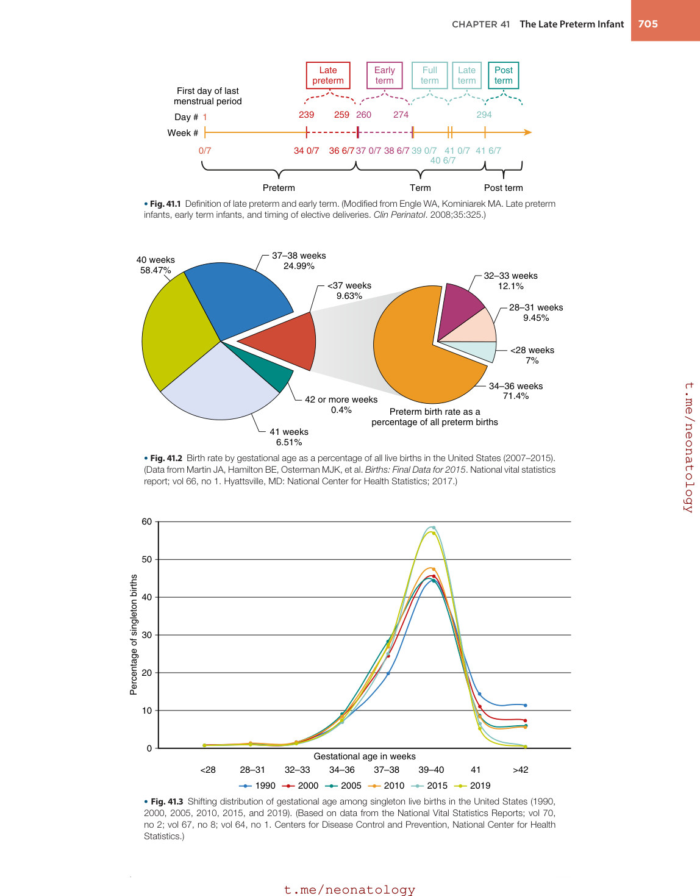

### Original source page 716

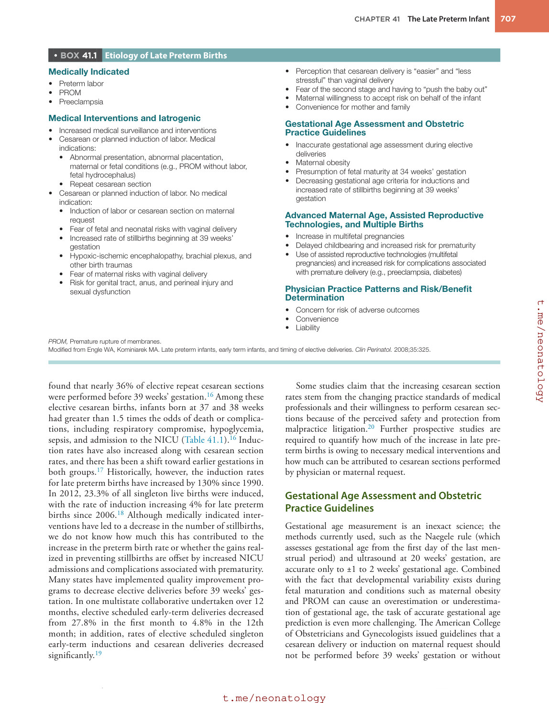

### Original source page 717

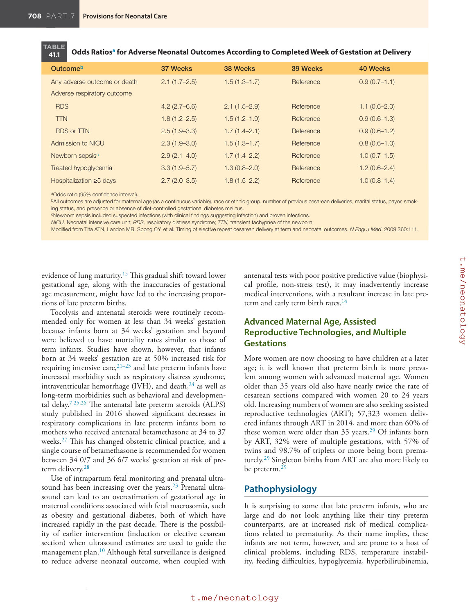

### Original source page 718

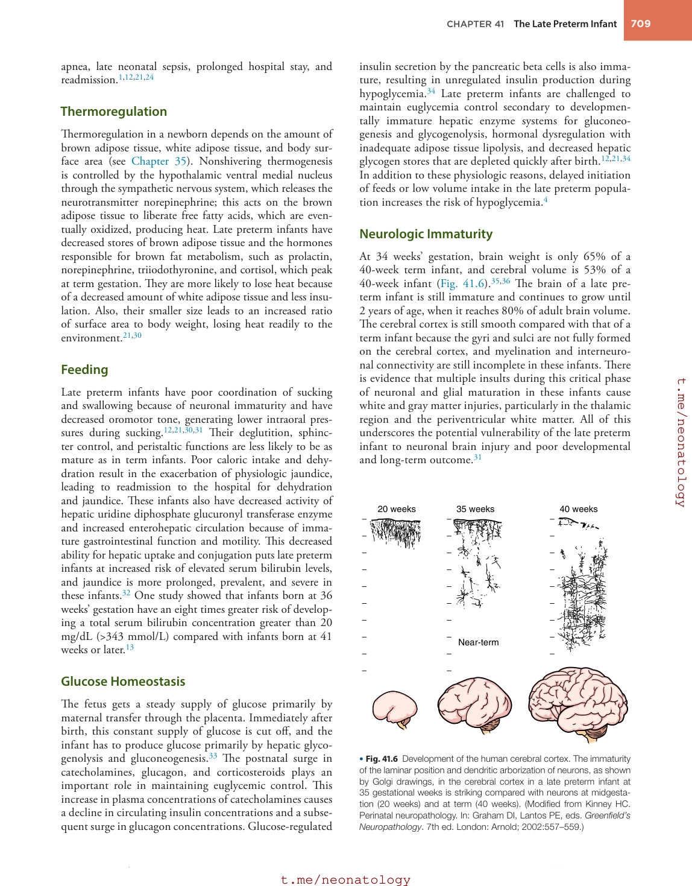

### Original source page 720

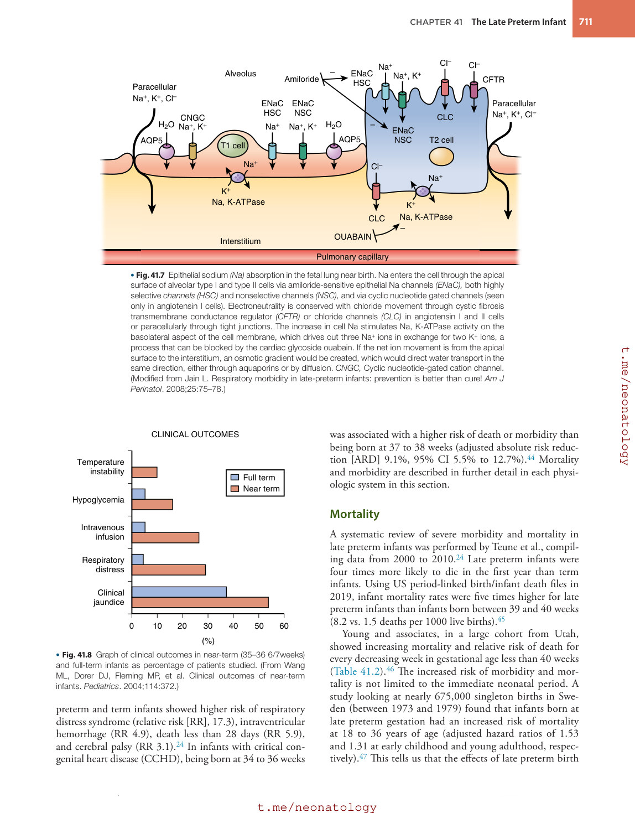

### Original source page 721

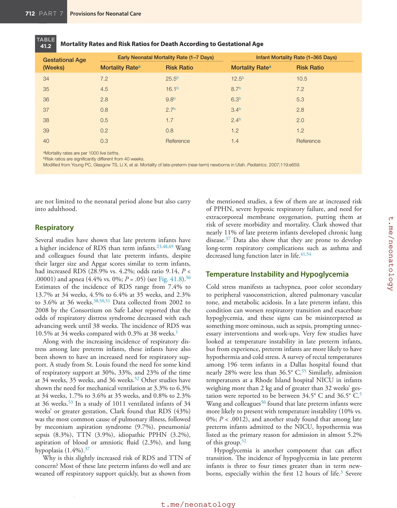

### Original source page 722

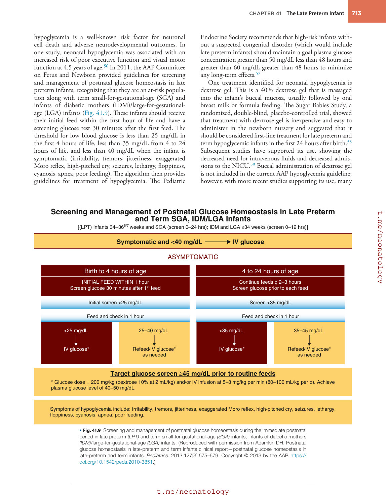

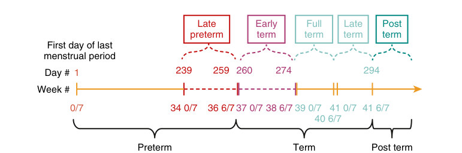

• Fig. 41.1 Definition of late preterm and early term. (Modified from Engle WA, Kominiarek MA. Late preterm infants, early term infants, and timing of elective deliveries. Clin Perinatol. 2008;35:325.)

PDF p. 714

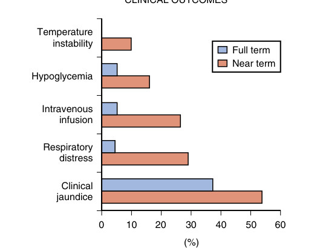

• Fig. 41.8 Graph of clinical outcomes in near-term (35–36 6/7weeks) and full-term infants as percentage of patients studied. (From Wang ML, Dorer DJ, Fleming MP, et al. Clinical outcomes of near-term infants. Pediatrics. 2004;114:372.)

PDF p. 720

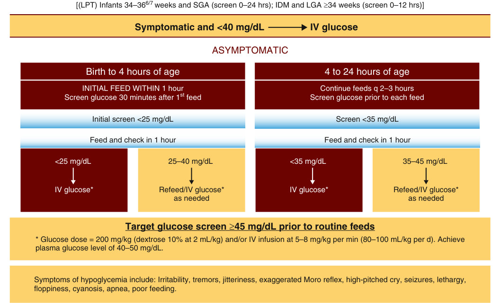

• Fig. 41.9 Screening and management of postnatal glucose homeostasis during the immediate postnatal period in late preterm (LPT) and term small-for-gestational-age (SGA) infants, infants of diabetic mothers (IDM)/large-for-gestational-age (LGA) infants. (Reproduced with permission from Adamkin DH. Postnatal glucose homeostasis in late-preterm and term infants clinical report—postnatal glucose homeostasis in late-preterm and term infants. Pediatrics. 2013;127[3]:575–579. Copyright © 2013 by the AAP. https:// doi.org/10.1542/peds.2010-3851.)

PDF p. 722
