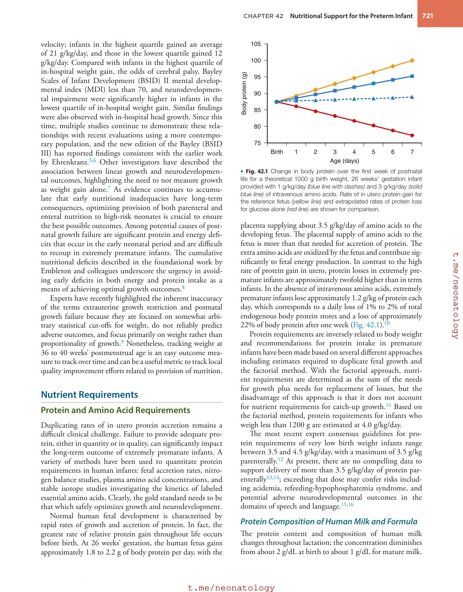
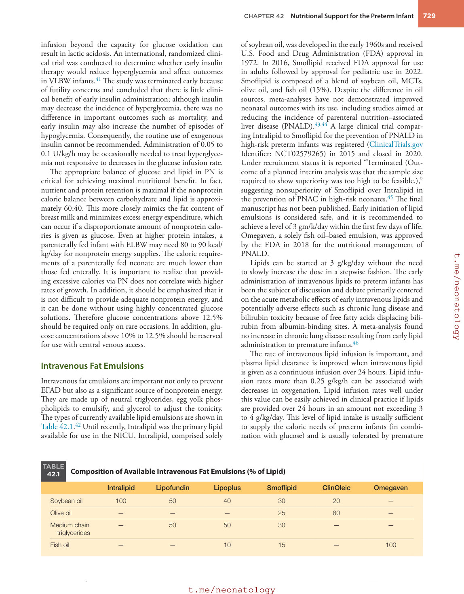
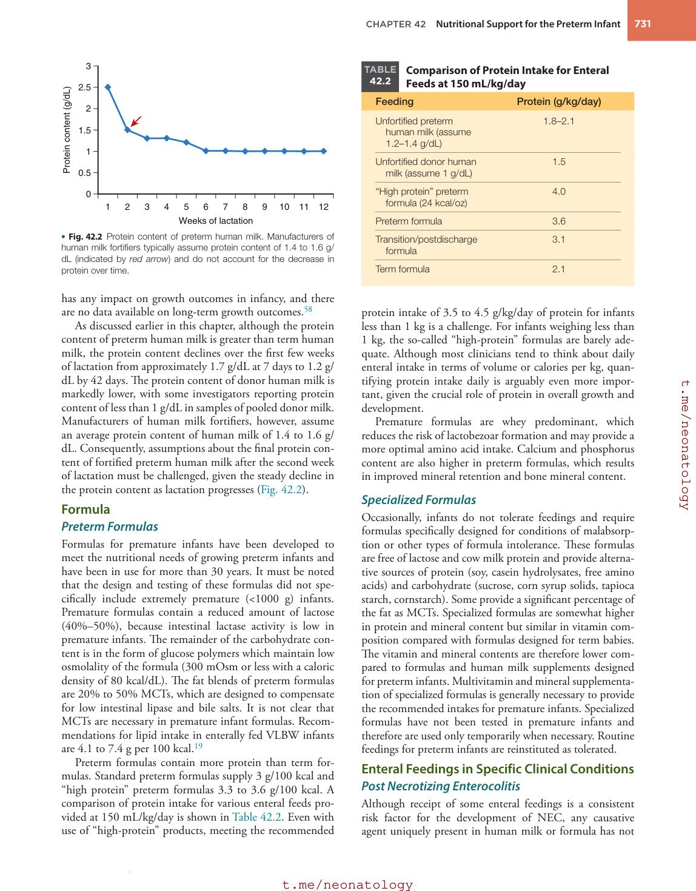
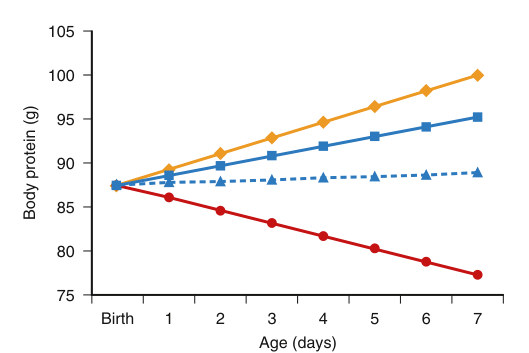
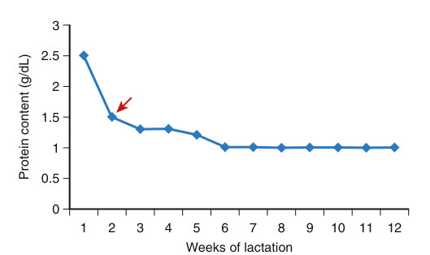

# 42. Nutritional Support for the Preterm Infant
> Source attribution: [Source credits](../../SOURCE_CREDITS.md).

## PDF page 729 | printed page 720

42

Nutritional Support for the Preterm Infant

### BRENDA B. POINDEXTER AND CAMILIA R. MARTIN

Current recommendations for the provision of parenteral and enteral nutrition to the infant born prematurely are based on the goal of approximating the rate and composition of weight gain of a normal fetus at the same postmenstrual age. For several reasons this goal is seldom achieved or may not be appropriate for all preterm infants (such as those with intrauterine growth restriction), and postnatal growth failure remains a significant complication of extreme prematurity. Infants who experience one or more major morbidities, such as bronchopulmonary dysplasia, necrotizing enterocolitis (NEC), or late-onset sepsis in the neonatal period, demonstrate slower growth than their counterparts who do not experience these conditions. Of particular concern is the significant association between suboptimal postnatal growth and short-term morbidities as well as adverse long-term neurodevelopmental outcomes. This relationship persists even after adjustments for severity of illness, including the perception of illness, which may alter nutritional delivery in high-risk infants.1 These findings reinforce the principle that nutritional delivery is critical in modifying disease risk in preterm infants. To emphasize the importance of a combined approach to optimize outcomes in the preterm infant, this chapter will first describe overall nutrient requirements and then provision of intense nutritional support with both early parenteral and enteral nutrition.

### Growth in the Neonatal Intensive Care Unit

In the neonatal intensive care unit, birth-weight-derived intrauterine growth curves (such as the Fenton or Olsen) are typically employed to monitor postnatal growth. It is important to recognize the inherent limitation of such curves, namely that these curves were generated by measuring infants following premature birth, which is likely not the same physiologic state for the mother and/or fetus as if the infant had remained in utero until term. The revised Fenton growth curves include an international cohort of approximately 4 million infants from six population-based studies and are available online

720

(http://www.biomedcentral.com/1471-2431/13/59) and have been incorporated into many electronic medical record platforms. The Olsen curves include more than 250,000 infants born in the United States between 22 and 41 weeks’ gestation and, when combined with the World Health Organization (WHO)–Centers for Disease Control and Prevention (CDC) growth charts, can be used to monitor postnatal growth through 50 weeks’ corrected age (http://www.pediatrix.com/workfiles/NIC UGrowthCurves7.30.pdf). The number of infants born at 22 to 24 weeks’ gestation is very low (<1% of the total cohort) in both growth charts, limiting their generalizability in this gestational age range. The Vermont Oxford Network (VON) database published growth curves derived from birth measurements in a cohort of 156,000 infants from 852 centers in the United States. The VON curves do include more infants born in the periviable period than previously published growth curves (2000 infants born at 22 weeks’ gestation and 9000 infants born at 23 weeks’ gestation).2 Growth curves based on serial intrauterine measurements, such as those generated by INTERGROWTH-21st, the International Fetal and Newborn Growth Consortium for the 21st Century (intergrowth21.tghn.org), could rise above some of the inherent limitations of the traditional curves. When used to evaluate the association between postnatal growth and neurodevelopmental outcomes, Salas and colleagues did not find current definitions of growth failure to be associated with cognitive impairment (Bayley-III cognitive score <85), suggesting that different definitions of postnatal growth failure are needed to predict adverse neurodevelopmental outcomes.3

### Growth and Neurodevelopmental Outcomes

The association between weight gain in the neonatal intensive care unit and neurodevelopmental outcomes was established in the sentinel study by Ehrenkranz with a cohort of 600 extremely low birth weight (ELBW) infants.4 Infants were divided into quartiles based on in-hospital growth

## PDF page 730 | printed page 721

velocity; infants in the highest quartile gained an average of 21 g/kg/day, and those in the lowest quartile gained 12 g/kg/day. Compared with infants in the highest quartile of in-hospital weight gain, the odds of cerebral palsy, Bayley Scales of Infant Development (BSID) II mental developmental index (MDI) less than 70, and neurodevelopmental impairment were significantly higher in infants in the lowest quartile of in-hospital weight gain. Similar findings were also observed with in-hospital head growth. Since this time, multiple studies continue to demonstrate these relationships with recent evaluations using a more contemporary population, and the new edition of the Bayley (BSID III) has reported findings consistent with the earlier work by Ehrenkranz.5,6 Other investigators have described the association between linear growth and neurodevelopmental outcomes, highlighting the need to not measure growth as weight gain alone.7 As evidence continues to accumulate that early nutritional inadequacies have long-term consequences, optimizing provision of both parenteral and enteral nutrition to high-risk neonates is crucial to ensure the best possible outcomes. Among potential causes of postnatal growth failure are significant protein and energy deficits that occur in the early neonatal period and are difficult to recoup in extremely premature infants. The cumulative nutritional deficits described in the foundational work by Embleton and colleagues underscore the urgency in avoiding early deficits in both energy and protein intake as a means of achieving optimal growth outcomes.8

Experts have recently highlighted the inherent inaccuracy of the terms extrauterine growth restriction and postnatal growth failure because they are focused on somewhat arbitrary statistical cut-offs for weight, do not reliably predict adverse outcomes, and focus primarily on weight rather than proportionality of growth.9 Nonetheless, tracking weight at 36 to 40 weeks’ postmenstrual age is an easy outcome measure to track over time and can be a useful metric to track local quality improvement efforts related to provision of nutrition.

### Nutrient Requirements

### Protein and Amino Acid Requirements

Duplicating rates of in utero protein accretion remains a difficult clinical challenge. Failure to provide adequate protein, either in quantity or in quality, can significantly impact the long-term outcome of extremely premature infants. A variety of methods have been used to quantitate protein requirements in human infants: fetal accretion rates, nitrogen balance studies, plasma amino acid concentrations, and stable isotope studies investigating the kinetics of labeled essential amino acids. Clearly, the gold standard needs to be that which safely optimizes growth and neurodevelopment.

Normal human fetal development is characterized by rapid rates of growth and accretion of protein. In fact, the greatest rate of relative protein gain throughout life occurs before birth. At 26 weeks’ gestation, the human fetus gains approximately 1.8 to 2.2 g of body protein per day, with the

105

100

Body protein (g)

95

90

85

80

4 5 6 7 75

Birth 1 2 3

Age (days)

• Fig. 42.1 Change in body protein over the first week of postnatal life for a theoretical 1000 g birth weight, 26 weeks’ gestation infant provided with 1 g/kg/day (blue line with dashes) and 3 g/kg/day (solid blue line) of intravenous amino acids. Rate of in utero protein gain for the reference fetus (yellow line) and extrapolated rates of protein loss for glucose alone (red line) are shown for comparison.

placenta supplying about 3.5 g/kg/day of amino acids to the developing fetus. The placental supply of amino acids to the fetus is more than that needed for accretion of protein. The extra amino acids are oxidized by the fetus and contribute significantly to fetal energy production. In contrast to the high rate of protein gain in utero, protein losses in extremely premature infants are approximately twofold higher than in term infants. In the absence of intravenous amino acids, extremely premature infants lose approximately 1.2 g/kg of protein each day, which corresponds to a daily loss of 1% to 2% of total endogenous body protein stores and a loss of approximately 22% of body protein after one week (Fig. 42.1).10

Protein requirements are inversely related to body weight and recommendations for protein intake in premature infants have been made based on several different approaches including estimates required to duplicate fetal growth and the factorial method. With the factorial approach, nutrient requirements are determined as the sum of the needs for growth plus needs for replacement of losses, but the disadvantage of this approach is that it does not account for nutrient requirements for catch-up growth.11 Based on the factorial method, protein requirements for infants who weigh less than 1200 g are estimated at 4.0 g/kg/day.

The most recent expert consensus guidelines for protein requirements of very low birth weight infants range between 3.5 and 4.5 g/kg/day, with a maximum of 3.5 g/kg parenterally.12 At present, there are no compelling data to support delivery of more than 3.5 g/kg/day of protein parenterally13,14; exceeding that dose may confer risks including acidemia, refeeding-hypophosphatemia syndrome, and potential adverse neurodevelopmental outcomes in the domains of speech and language.15,16

### Protein Composition of Human Milk and Formula

The protein content and composition of human milk changes throughout lactation; the concentration diminishes from about 2 g/dL at birth to about 1 g/dL for mature milk.

## PDF page 731

Qualitative changes also occur during lactation, resulting in a whey-casein ratio of 80:20 at the beginning of lactation, changing to 55:45 in mature milk. Although the levels of casein, α-lactalbumin, albumin, and lysozyme remain constant, the levels of secretory immunoglobulin A and lactoferrin decrease. Because these different protein fractions have different amino acid profiles, the content of the individual amino acids is also affected.

Casein-predominant cow milk formulas have the same whey-casein ratio as cow milk—that is, 18:82. Adding bovine whey makes whey-predominant formulas, such that the whey-casein ratio becomes like that of human milk (60:40). Nevertheless, the protein and amino acid profile remains very different from that of human milk. Compared with human milk, whey-predominant formulas have higher levels of methionine, threonine, lysine, and branched amino acids. These differences in amino acids have not resulted in any apparent clinical consequences in either term or preterm infants. Currently, most commercially available preterm formulas are whey predominant.

### Energy and Carbohydrate Requirements Fetal Glucose Metabolism

Because the supply of glucose to the fetus depends solely on maternal glucose, cord clamping at the time of birth requires that several events occur to maintain glucose homeostasis in the newborn. Fetal glucose use in utero matches umbilical glucose uptake, implying that glycogenolysis and gluconeogenesis are minimal in the fetus. Several factors promote glycogen deposition in utero: blunted pancreatic β-cell regulation of insulin secretion, high insulin receptor density, and relative glucagon resistance. In late gestation, the fetus begins to prepare for the transition to postnatal life by increasing hepatic glycogen stores and brown fat deposits. Hepatic glycogen synthesis increases in response to increases in adrenal corticosteroid production, also characteristic of late gestation. At the time of delivery, glucagon levels rise, and insulin levels fall. Higher levels of plasma catecholamines, both epinephrine and norepinephrine, directly stimulate increases in hepatic glucose output. The increased levels of epinephrine and glucagon stimulate lipolysis and the activity of phosphorylase, a key enzyme in glycolysis. The increased level of glucagon also results in increased activity of phosphoenolpyruvate carboxykinase, a rate-limiting enzyme in gluconeogenesis. The newborn must be able to initiate gluconeogenesis because glycogen stores can sustain glucose production only for several hours after birth. All these changes act together to preserve glucose homeostasis after the infant’s maternal source of glucose is removed with cord clamping.

### Neonatal Glucose Homeostasis

Because neural tissue makes up a greater proportion of body weight, newborns have higher rates of glucose oxidation than adults, with glucose being the primary energy substrate for the brain. The rate of glucose production in term newborns is approximately 3 to 5 mg/kg/min, whereas extremely

premature infants have an even higher rate of glucose production of approximately 8 to 9 mg/kg/min. Historically, glucose intolerance in infants with ELBWs was attributed to persistent endogenous hepatic glucose production in the face of increased exogenous supply, insufficient insulin production, or tissue insensitivity to insulin. However, ELBW infants can suppress endogenous glucose production when given parenteral glucose.

Knowledge of typical rates of endogenous glucose production at different gestational ages is important in clinical practice because the exogenous glucose infusion rate is ordered to avoid iatrogenic hyper- or hypoglycemia. For preterm infants weighing 500 to 1000 g, a starting glucose infusion rate of 3 to 6 mg/kg/min is recommended and may be increased to 7 to 10 mg/kg/min once on full parenteral nutrition (PN) as tolerated to maintain normoglycemia.17

### Energy Expenditure

Preterm infants have very low energy reserves owing to limited body fat and glycogen stores in the liver. Maintaining these limited energy stores requires an energy intake that approximates energy expenditure. Energy expenditure in premature infants is thought to be in the 50 to 60 kcal/ kg/day range, but it must be noted that data for ventilated infants and infants with ELBWs are limited. Thermal stress can substantially increase energy expenditure. Conversely, activity contributes relatively little to energy expenditure in premature infants. The energy cost of growth in these infants has been estimated at about 5 kcal/g. To achieve the equivalent of the estimated third trimester in utero weight gain of 14 to 18 g/kg/day, theoretically, an additional energy intake of about 70 kcal/kg/day is necessary.

Energy balance is a delicate equilibrium between energy intake and energy loss plus storage. Positive energy balance is achieved when exogenous metabolizable energy intake is greater than energy expenditure. Growth is then possible with the excess energy stored as new tissue, usually fat. If exogenous energy intake is less than expenditure, energy balance is negative, and body energy stores must be mobilized to meet ongoing needs. During the acute phase of disease, the primary goal is avoidance of catabolism. This is difficult for infants with very low birth weights, owing to their higher maintenance energy requirements, lower energy stores, and often reduced intake.

Energy is lost either by excretion or by expenditure. Energy excreted is lost primarily as fecal fat. In preterm infants receiving full enteral feeding, approximately 90% of energy intake is absorbed. Usual measurements of total energy expenditure include the energy used to maintain basal metabolic rate (BMR), as well as the postprandial increase in energy expenditure (diet-induced thermogenesis), physical activity, and energy for the synthesis of new tissue. The BMR is the largest component of energy expenditure and includes energy requirements for basic cellular and tissue processes. In a critically ill patient, it also includes a “disease factor.” Little is known about this component in neonates, but it may contribute significantly to neonates with

## PDF page 732 | printed page 723

fever, sepsis, and chronic hypoxia. Because the BMR can be measured only after overnight fasting, the resting metabolic rate (RMR) has been accepted as an alternative. The RMR of preterm infants on a per kilogram basis is higher than that of term infants, and the nutritional requirements on a per kilogram basis are correspondingly greater. The energy required for thermoregulation can be minimized by keeping the infant in a thermoneutral environment and limiting stimulation. For example, energy requirements for thermoregulation are negligible under thermoneutral conditions, but routine nursing procedures can increase oxygen consumption or energy expenditure by as much as 10% in stable preterm infants. Both components may be of considerable magnitude in a critically ill infant.

The level of energy intake and diet composition determine the magnitude of diet-induced thermogenesis, which represents the energy required for transport, metabolism, and conversion of nutrients into stored energy. Estimates of diet-induced thermogenesis in enterally fed preterm infants vary considerably, but this component of expenditure is probably small.

Total energy expenditure is affected by several factors, assuming a thermoneutral environment and minimal interference from nursing procedures. Increases in metabolic rate with postnatal age are influenced primarily by energy intake and weight gain. Energy expenditure increases with increases in metabolizable energy intake, indicating increased substrate oxidation or tissue synthesis. If the preterm infant is growing at the same rate as the fetus during the third trimester—that is, gaining approximately 15 g/kg/ day—then about 15% of the total energy intake is used for synthesis of new tissue.

Energy storage is a linear function of metabolizable intake, and the accretion rate for energy is related more to the level of metabolizable energy intake than to diet composition. Energy requirements for energy storage are difficult to predict. The increase in tissue mass during growth includes the energy stored as protein, carbohydrate (usually <1% of body weight), and fat. Therefore the energy stored can be assumed to equal the sum of the cost of protein plus fat gain. The energy storage component of the energy balance equation is a function of the composition of weight gain, which in turn is a function of protein and energy intake and is likely to be quite variable. Therefore the energy intake required to produce a specific rate of weight gain cannot be predicted without specifying the composition of that weight gain. From the point of view of energy storage, protein is a poor material, because a small quantity of energy is stored per gram of weight gain. Approximately the same amount of energy is deposited in 1 g of fat tissue as in about 8 g of lean tissue.

In infants with BPD, resting energy expenditure may be higher at the time of weaning of ventilatory support with a decrease as they approach term corrected age.18

### Carbohydrates

Lactose is the predominant carbohydrate in human milk (6.2 to 7.2 g/dL) and supplies 40% to 50% of the caloric content. Lactose is hydrolyzed to glucose and galactose in

the small intestine by β-galactosidase (lactase). Despite low lactase activities in premature infants, lactose is well tolerated by premature infants, and stable isotope data suggest efficient lactose digestion. However, most premature infant formulas include glucose polymers as a significant source of carbohydrate; these glucose polymers are digested by α-glucosidases, which achieve 70% of adult activity between 26 and 34 weeks’ gestation. In addition, salivary and mammary amylases may contribute to glucose polymer digestion. Glucose polymers have the advantage of increased caloric density without a rise in osmolality, and they may also enhance gastric emptying.

### Recommended Energy Intake

Overall, the current recommendation for energy intake for an enterally fed VLBW infant is 110 to 130 kcal/kg/ day.19 It is important to recognize that this recommendation assumes that the infant is also receiving adequate protein intake. Infants who are small for gestational age or infants with diseases that increase energy requirements may need higher intakes to achieve the same growth rates. Infants with growth restriction often require an increased caloric intake for growth because of both higher maintenance energy needs and higher energy costs of new tissue synthesis.

### Lipid Requirements

Fats or lipids provide the major source of energy and fatty acids for preterm infants. In humans, linoleic and linolenic acids cannot be endogenously synthesized and are therefore essential fatty acids that must be provided in the diet. Biochemical evidence of essential fatty acid deficiency (EFAD) can develop in preterm infants within 72 hours. To meet energy requirements and prevent EFAD, additional intravenous lipid is required in early postnatal life in parallel with the initiation of enteral feedings.

At birth, the digestive function of premature infants is not fully developed; preterm infants have decreased gut absorption of lipids because of low endogenous production and levels of pancreatic lipase, bile acids, and lingual lipase. The fact that term and preterm infants absorb fat reasonably well is due to the development of alternative mechanisms for the digestion of dietary fat. One important mechanism is intragastric lipolysis, in which lingual and gastric lipases compensate for the low pancreatic lipase concentration. By 25 weeks’ gestation, lingual lipase is secreted by the serous glands of the tongue, and gastric lipase is secreted from gastric glands. The fatty acids and monoglycerides resulting from intragastric lipolysis compensate for low bile acid concentration by emulsifying lipid mixtures. Lingual lipase can also penetrate the core of the human milk lipid globule and hydrolyze the triglyceride core without disrupting the globule membrane. Unpasteurized human milk provides lipoprotein lipase, bile salt stimulated esterase, and nonactivated lipase to further aid lipolysis.

Lipid digestion and absorption are also affected by dietary fat composition. Fatty acid absorption increases

## PDF page 733

with decreasing chain length and with the degree of unsaturation, such that medium-chain triglycerides (MCTs) with chain lengths of 6 to 12 carbons are hydrolyzed more readily than long-chain triglycerides (LCTs), and fatty acids with more double bonds are absorbed more efficiently than fatty acids with a few or none (saturated). To increase the fat absorption of premature infants, the fat in commercial formulas contains relatively high levels of MCTs that can be absorbed without the need for lipase or bile salts. Standard commercial formulas for healthy term infants do not contain MCTs, and human milk typically contains 8% to 12% of fat as MCTs. Unlike LCTs, MCTs are readily hydrolyzed in the gut, and the released fatty acids are transported across the gut barrier without the need for bile acids. Then, MCTs are transported directly to the liver via the portal vein as nonesterified fatty acids. In addition, MCTs can enter mitochondria and be oxidized without the need for carnitinemediated transport through mitochondrial membranes. However, inclusion of MCTs in infant formula remains controversial and the available data do not support the assertion of improved fat absorption or improved growth in preterm infants.

In human milk, fat is transported in globules consisting of a membrane composed of a polar mixture of proteins, phospholipids, triglycerides, cholesterol, glycoproteins, and enzymes surrounding a triglyceride core containing 98% of the fat in milk. The milk fat globules are among the largest structural components of milk, having a diameter of 4 mm in mature milk. The size of the globules increases with both length of lactation and length of gestation, with colostrum having smaller globules (especially in milk of women who deliver prematurely) than mature milk. After birth, as the total fat content of human milk increases, the percentage of cholesterol and phospholipids, both of which reside primarily in the milk fat globule membrane, decreases. In addition, the total phospholipid content decreases as lactation progresses. During the first weeks of lactation, preterm milk is also richer in membranous material compared with term or mature milk, resulting in a higher content of cholesterol, phospholipids, and very-long-chain polyunsaturated fatty acids (PUFAs) with chain lengths of 20 to 22 carbons (C20–C22). Because these membranes act as emulsifiers that allow fat dispersion in an aqueous phase and limit lipolysis and oxidation, heat treatment or addition of fortifiers and supplements might disrupt this emulsion.

Because the fat content and nutritional value of human milk vary with time, it does not always provide a complete source of nutrients for infants with very low birth weights. Its composition and energy content may vary throughout a pumping session and during subsequent changes throughout lactation. The total fat content of human milk at 3 days’ lactation is approximately 2 g/dL; the fat content of mature milk is approximately 4 to 5 g/dL, with large individual variation possible. The triglyceride content of human milk is its most variable component, changing with gestational and postnatal age, time of day, duration of individual feeds, and maternal diet. Shifts in the dietary practices of a population

result in changes in the fatty acid composition of human milk, because the type and amount of fat in the maternal diet affect the composition of milk fat. Maternal diets low in fat and high in carbohydrates lead to de novo synthesis of fatty acids within the mammary gland, which results in high concentrations of fatty acids of less than 16 carbons. Therefore, although the total amount of fat present in the milk remains in the normal range, the fats are more saturated.

Fatty acids represent about 85% of the triglycerides and therefore are the principal component of human milk lipids. Fatty acids in human milk are derived from the maternal diet, de novo synthesis by the mammary gland, and mobilization from fat stores. The fatty acid composition of human milk fat reflects the fatty acid composition of the maternal diet. The long-chain polyunsaturated fatty acid (LCP- UFA) composition of the milk of women in the United States, Europe, and Africa is quite similar, except for higher amounts of n−3 LCPUFA in the milk of women whose diets contain a large quantity of fish. Medium-chain fatty acids (C8–C10) do not normally account for more than 2% of the fats, even in milk from women who have delivered preterm. Arachidonic acid (ARA; C20:4n−6) is the main LCP- UFA, and eicosapentaenoic acid (EPA; C20:5n−3) is found in small quantities in human milk. Docosahexaenoic acid (DHA; C22:6n−3) is the main LCPUFA of the n−3 series.

Fatty acid composition changes with progressing lactation and with gestational age. Most striking is the higher content of C8 to C14 fatty acids and of LCPUFAs in preterm milk as compared with term milk; the content of LCP- UFA decreases with increasing postnatal age. This may be an advantage for preterm infants because shorter fatty acids are easier to digest, and LCPUFAs are essential for brain and retinal development.

The LCPUFAs play an important role in the development of the infant’s brain during the last trimester of pregnancy and during the first months of life. The precursor C18 fatty acids for the n−6 and n−3 LCPUFA series are linoleic acid (LA; C18:2n−6) and α-linolenic acid (C18:3n−3). These are further elongated and desaturated to form other fatty acids, of which ARA and DHA are essential for normal growth and development. Although the capacity for endogenous synthesis of LCPUFA from precursor fatty acids exists in both preterm and term infants, it remains unclear whether DHA and ARA can be biosynthesized in quantities sufficient to meet the needs of these infants.

In utero, LCPUFAs are supplied to the fetus across the placenta. After birth and within the first postnatal week, preterm infants develop a deficit of DHA and ARA compared to their birth levels, while almost tripling their LA levels.20 These acute changes are likely due to the lack of adipose reserves as well as early nutritional strategies that fail to effectively meet the fatty acid requirements in the preterm infant. Although Smoflipid contains DHA and ARA, the use of Smoflipid fails to correct these postnatal fatty acid deficits, inducing a minimal change in DHA and a further decline in ARA, and introduces a substantial increase in EPA due to its fish oil component. Although the importance of

## PDF page 734 | printed page 725

DHA in brain and eye development has been established, accruing evidence suggests that a decline in ARA is also of concern, with increasing risks of late-onset sepsis and retinopathy of prematurity with lower ARA levels.21

Although naturally contained in human milk, DHA and ARA concentrations are highly variable across individuals and in donor versus unpasteurized human milk. DHA and ARA have been added to most infant formulas for term and preterm infants; however, the clinical benefit in adding to formula has been mixed and not sustained. Added DHA and ARA have generally resulted in positive or neutral changes in growth, although there are some reports of a negative effect. Findings of improved visual acuity have been inconsistent. Formula supplemented with DHA and ARA has produced positive changes in neurodevelopment measured in infancy in some, but not all, studies. The current recommendation in VLBW infants is that DHA intake represent 0.5% to 1% of total fatty acids, which is approximately 30 to 65 mg/k/day. ARA should be given concurrently at a ratio to total DHA (DHA:ARA) of 0.5 to 1.22 Clinical and animal data support a ratio closer to 0.5 (two times ARA to DHA).23,24

Cholesterol is a major component of cell membranes and a precursor in the synthesis of bile acids and some hormones. It is present in human milk in concentrations ranging from 10 to 15 mg/dL, although commercial formulas contain only trace amounts of cholesterol (approximately 1–2 mg/dL). The high cholesterol content of breast milk relative to formula is maintained at this level regardless of maternal diet. The groups that assessed the nutrient requirements for term and preterm infant formulas did not recommend addition of cholesterol to infant formulas, because there was no convincing evidence of a beneficial short- or long-term effect of such an addition. Furthermore, there is no evidence that added cholesterol would be equivalent to the cholesterol in a human milk globule.

Carnitine mediates the transport of long-chain fatty acids into mitochondria for oxidation and the removal of short-chain fatty acids that accumulate in mitochondria. Preterm infants may be at risk for carnitine deficiency because they are heavily dependent on lipids as an energy source and because the plasma carnitine concentration of preterm infants is low, owing to limited endogenous synthetic ability. In preterm infants not receiving supplemental carnitine, plasma and tissue carnitine levels fall even in the presence of adequate precursor amino acid concentrations. Carnitine is found in human milk and is currently added to standard term and preterm formulas in amounts somewhat higher than in human milk.

### Provision of Nutritional Support

The extremely premature neonate is born with glucose stores of only 200 kcal and loses 1% of body protein per day if provided with intravenous glucose alone, further supporting the need to provide a balanced source of macronutrients soon after birth. Consequently, extreme prematurity should

be viewed as a nutritional emergency. A few observational studies have described the influence of nutritional practices on growth and have found that differences in caloric and protein intake in the first weeks account for the largest difference in growth among premature infants. This section reviews the basis of recommendations for nutritional support of premature infants. Practice decisions related to provision of early nutritional support provided to ELBW infants seem to be related to the perceived severity of illness of the infant by clinicians limiting nutritional delivery, especially decisions related to enteral feedings. The use of standardized protocols for feeding (both parenteral and enteral) extremely premature infants can lessen variation in practice and improve outcomes such as NEC and days on PN.

### Goals of Early Nutritional Support

The goals of early nutritional support for the extremely premature infant include the following: to promote growth and nutrient accretion comparable to that of the fetus at the same gestational age, to avoid postnatal growth failure, to minimize the risk of NEC, and to optimize neurodevelopment and long-term health outcomes. Achieving full and consistent enteral nutrition in infants with ELBWs is particularly challenging, given the inherent problems of immature gut motility and function, as well as the fear of NEC. Clearly, the relative risks must be carefully weighed against benefit. When sufficient data are not available to address the relative risk versus the benefit, clinical judgment must be used.

Intravenous amino acids should be given immediately after birth to provide 2.5 to 3.0 g/kg/day of amino acids. Many institutions use a neonatal “stock” or “starter” amino acid solution to ensure rapid availability. To minimize deficits in energy intake, intravenous lipids may be started at 3 g/kg/day with the first day of full PN. In addition, enteral feedings should be initiated with expressed human milk as soon as possible after birth. Strategies related to the advancement of enteral feeds and weaning of PN will be discussed subsequently.

### Initiation and Advancement of Enteral Feeds

The diversity of approaches to feeding preterm infants underlines the need for studies to dispel myths and find reasonable solutions to define the optimal feeding route. When neonatal amino acid solutions became available, many physicians chose to use PN exclusively in sick preterm infants because of concerns about NEC. Parenteral nutrition was thought to be a logical continuation of the transplacental nutrition the infants would have received in utero. However, this view discounts any role that swallowed amniotic fluid may play in nutrition and in the development of the gastrointestinal tract. In fact, by the end of the third trimester, amniotic fluid provides the fetus with the same enteral volume intake and approximately 25% of the enteral protein intake of a term breastfed infant.

## PDF page 735

### Trophic or Minimal Enteral Feeding

The benefits of early trophic or minimal enteral feedings (typically ≤25 mL/kg/day) are well established and include maturation of the preterm intestine (both structurally and functionally), reduced liver dysfunction, improved feeding tolerance, and reduced risk of onset of NEC and its progression to surgical NEC.25

Animal studies have demonstrated a decrease in gut weight, mucosal weight, mucosal protein, DNA, disaccharide activity, and mucosal height when enteral nutrition is withheld. In a neonatal piglet model, at least 40% of total nutrient intake supplied enterally is needed to sustain normal gastrointestinal growth. In preterm infants, the lack of any enteral feeding leads to villous atrophy.

A systematic review evaluated the effects of early (introduced before 96 hours of age) trophic feeding versus a comparable period of enteral fasting in VLBW infants and found no difference in feeding tolerance, growth, or NEC.26 The duration of trophic feeding varies at different institutions but is typically 1 to 4 days. Some studies have shown that a shorter duration of trophic feedings (early progressive feeding) increases the number of days on full enteral feedings and reduces the number of days on PN,27 while a recent trial found that a longer duration of trophic feedings for 5 days was not associated with a delay in time to achieve full enteral feedings.28

Initiation of enteral nutrition is often delayed in premature infants with intrauterine growth restriction because of the concern that these infants are at an increased risk of NEC. However, a randomized trial that evaluated early versus delayed initiation of enteral feeding for preterm growthrestricted infants found no evidence of a difference in the incidence of NEC between groups. Consequently, the authors concluded that there was no evidence of benefit in delaying the introduction of minimal enteral feeds in preterm infants with intrauterine growth restriction beyond 24 to 48 hours of age.29

### Rate of Advancement of Enteral Feeds

The rate at which enteral feedings should be advanced in preterm infants has also been the subject of much debate and is another source of variability in practice at different institutions. As retrospective studies have reported an association between rapid advancement of enteral feeds and NEC, the rate of advancement of enteral feedings is commonly viewed as a potentially modifiable risk factor for NEC. However, the large multicenter SIFT (Speed of Increasing Milk Feedings) randomized clinical trial in the United Kingdom found no increase in the incidence of NEC in infants randomized to faster (30 mL/kg/day) advancement of enteral feedings and no difference in survival without moderate or severe neurodevelopmental disability.30

Based on the available evidence, a reasonable approach is to advance enteral feeds by 20 to 30 mL/kg/day in VLBW infants and by 15 to 25 mL/kg/day in ELBW infants. Future studies are needed to further define the optimal rate of advancement, especially in ELBW infants.

### Gastric Residuals

Measurement of gastric residuals is a common practice in many neonatal intensive care units to evaluate tolerance of enteral feeds despite a paucity of evidence to support the utility of gastric residuals in the diagnosis of feeding intolerance or NEC. In the absence of other symptoms, there is no evidence to support the discontinuation of enteral feeds based only on gastric residuals. The decision to not routinely measure gastric residuals is an element of practice that can be incorporated into unit-based standardized feeding protocols.31

### When to Hold Enteral Feedings

Although evidence is lacking, many clinicians hold strong opinions related to relative contraindications to enteral feedings and have historically included the presence of umbilical arterial catheters, inotropic support, during packed red blood cell transfusions, and with a hemodynamically significant patent ductus arteriosus (PDA). A recent evidencebased review by Martini highlighted that the presence of a PDA is a risk factor for adverse gastrointestinal complications, there is not good evidence for or against feeding with a PDA, and that further studies are needed.32 Arriving at consensus for these controversial scenarios is important to ensure compliance with standardized feeding protocols.

### Standardized Feeding Guidelines

Enteral feeding practices vary considerably among different centers. The use of evidence-based standardized feeding guidelines has been shown to improve nutritional outcomes (such as time to reach full enteral feeds), to reduce the number of days on PN, and promote growth. In addition, standardized feeding guidelines, regardless of the content of the guideline, have been shown to significantly reduce the incidence of NEC with a risk ratio of 0.22.33

### Evidence Supporting Early Parenteral Amino Acids

Numerous randomized clinical trials of amino acid dose and advancement strategy to evaluate short-term tolerance, protein balance, and safety have been conducted in premature infants. Despite differences in study populations and composition of amino acid solutions, all studies demonstrated positive nitrogen balance in response to parenteral amino acids and improved protein balance with higher amino acid intake. It is also important to point out that positive nitrogen balance was found despite low total caloric intake (approximately 50 kcal/kg/day). Consequently, the initial goal of limiting catabolism and preserving endogenous protein stores in premature infants can be accomplished with provision of as little as 1.0 to 1.5 g/kg/day of intravenous amino acids, whereas delivery of 3 g/kg/day of amino acids will result in net protein gain that approximates that of the reference fetus.34

Other investigators have assessed the safety and efficacy of different doses of amino acids. Thureen and colleagues conducted a randomized trial of low (1 g/kg/day) versus high (3 g/kg/day) amino acid intake in infants with

## PDF page 736 | printed page 727

ELBWs immediately after birth.35 The higher amino acid intake produced significantly greater protein accretion. In an open-label trial, te Braake and colleagues randomized VLBW infants to two different parenteral amino acid regimens.36 Infants in the intervention group received 2.4 g/kg/ day of amino acids starting immediately after birth. Infants in the control group received glucose alone on the first day of life, with a stepwise increase in amino acid intake thereafter (1.2 g/kg on day 2 and 2.4 g/kg on days 3 and 4). Infants who received amino acids on the first day of life were found to have positive nitrogen balance without any major adverse effects, whereas infants in the control group were in negative nitrogen balance on day 2. Ibrahim and colleagues evaluated an even higher initial dose of intravenous amino acids, randomizing VLBW premature infants to either 2 g/kg or 3.5 g/kg/day of intravenous amino acids on the first day of life. Like the studies discussed previously, the higher amino acid dose resulted in greater improvement in nitrogen balance without evidence of adverse effects.37

The safety of administration of early intravenous amino acids, particularly for premature infants, has been established in a variety of studies. Normal plasma amino acid concentrations have been reported using TrophAmine. Although most studies have not demonstrated any relationship between amino acid intake and blood urea nitrogen (BUN) in the first days of life, two studies reported increased BUN levels in infants receiving higher amino acid intakes at 7 days of age.38,39

As mentioned earlier, a significant proportion of the amino acids supplied to the developing fetus are oxidized and serve as a significant energy source for the fetus. Urea production is a byproduct of amino acid oxidation. In premature infants, rates of urea production are higher than in term neonates and adults, consistent with high rates of protein turnover and oxidation. Some investigators have even suggested that azotemia might be evidence of the effective utilization of amino acids as an energy supply rather than of protein intolerance, but this contention remains unproven. There are no data to support the need to advance amino acid intake slowly.

Although the initial goal of providing intravenous amino acids to premature infants to limit catabolism and preserve endogenous protein stores can be accomplished even if total caloric intake is low, ultimately both protein and energy must be supplied in quantities sufficient to support optimal growth. Protein quantity is the primary determinant of protein accretion. This is true regardless of whether PN is used exclusively or as a bridge to full enteral feedings. At constant nitrogen intake, increasing nonprotein energy intake from 50 to 80 kcal/kg/day resulted in increased nitrogen retention and weight gain. However, at low energy intake (∼50 kcal/kg/day), increasing nitrogen intake from 494 to 655 mg/kg/day (3 to 4 g/kg of amino acids per day) had no effect on nitrogen retention or weight gain. However, at higher energy intakes (∼80 kcal/kg/day), the same increase in nitrogen intake resulted in a significant increase in the rate of both nitrogen retention and weight gain.

Many conditions and interventions commonly encountered in extremely premature infants are known to increase protein requirements. Underlying disease states such as sepsis or surgical stress increase catabolism and can negatively impact protein accretion. In addition, medications such as systemic steroids, fentanyl, and insulin can also impact protein accretion. Dexamethasone has been shown to increase protein catabolism by increasing protein oxidation and proteolysis, resulting in decreased accretion of protein.

### Intravenous Amino Acid Mixtures

The first parenteral amino acid solutions used in neonates were hydrolysates of fibrin or casein. Concerns about these first-generation solutions included high concentrations of glycine, glutamate, and aspartate; the presence of unwanted peptides; and high acidity. Reports of hyperammonemia and acidosis in the early 1970s were associated with the use of these first-generation solutions in neonates. Although amino acid solutions have been significantly modified, the perceived risks associated with the protein hydrolysates linger, contributing to the hesitancy by some clinicians to administer early parenteral amino acids.

The second generation of amino acid solutions consisted of crystalline amino acid mixtures (FreAmine III, Travasol, Aminosyn). The amino acid pattern of these mixtures reflects that of high-quality dietary proteins with large amounts of glycine and alanine, absence of glutamate and aspartate, and absence or poor solubility of tyrosine and cysteine.

The currently available solutions include modifications of crystalline amino acids for use in pediatric and neonatal patients. TrophAmine was originally formulated to match plasma amino acid concentrations of healthy term, breastfed infants; Premasol is identical in composition to TrophAmine. The composition of Primene, available outside the United States, was derived from fetal and neonatal cord blood concentrations. Both TrophAmine and Premasol supply a mixture of L-tyrosine and N-acetyltyrosine. The bioavailability of N-acetyltyrosine, however, has been questioned. Neither Aminosyn-PF nor Primene supplies a substantial amount of tyrosine. Cysteine is not supplied by most amino acid solutions, because it is not stable for long periods of time in solution. However, cysteine hydrochloride can be added during the compounding process just before delivery of the solution.

It is no surprise that the ideal composition of intravenous amino acid mixtures is unknown. Although these solutions are widely used in the neonatal intensive care unit, normative data on plasma amino acid concentrations, particularly in ELBW infants, have not been established. Whether the goal should be to match amino acid concentrations of term, breastfed infants or some other standard is not known. Clearly, the goal is to achieve plasma amino acid concentrations in response to provision of PN that optimize both growth and neurodevelopment without toxicity. To optimize nutrition and growth, particularly in a premature

## PDF page 737

infant, the requirements for specific amino acids need to be more precisely defined.

Several amino acids may be “conditionally essential” in premature infants. That is, the infant’s ability to synthesize these amino acids de novo may be less than needed for functional metabolic demands. Cysteine, tyrosine, and arginine are often considered conditionally essential amino acids for premature infants.

Tyrosine is not present in appreciable amounts in currently available amino acid solutions because of its low solubility. Lower rates of weight gain, nitrogen retention, and plasma concentrations of tyrosine have been described in premature infants given a tyrosine-deficient diet. Tyrosine is synthesized endogenously from phenylalanine by phenylalanine hydroxylase. The activity of this enzyme in premature infants was thought to be inadequate for growth and nitrogen retention without tyrosine supplements, and it remains unclear whether enough tyrosine can be endogenously produced from phenylalanine in premature infants to support normal rates of protein accretion. N-acetyl tyrosine, although currently added to TrophAmine, is not highly bioavailable. In addition, it is unclear whether premature infants can adequately catabolize tyrosine via oxidation by the enzymes tyrosine aminotransferase and 4-hydroxyphenylpyruvate dioxygenase. Inability to catabolize tyrosine can lead to transient neonatal tyrosinemia. Further studies are needed to better define premature infants’ ability to catabolize tyrosine and to determine whether an alternative source of tyrosine is needed in parenteral amino acid solutions.

Cysteine may be a conditionally essential amino acid for premature infants but is not contained in currently available amino acid solutions. Some studies have shown that the fetal liver lacks the enzyme system to convert methionine into cysteine and that infants on a cysteine-free diet demonstrate impaired growth and low plasma cysteine levels. Other studies have demonstrated that there is enough cystathionase in extrahepatic tissues of the fetus and premature infant to synthesize cysteine when an adequate amount of methionine is provided. There is evidence to support that when cysteine hydrochloride supplements are added to PN, nitrogen retention is improved in premature infants. Further, the addition of cysteine hydrochloride improves the solubility of calcium and phosphorus in PN solutions. However, it is important to note that cysteine hydrochloride supplements can produce metabolic acidosis unless appropriately buffered with acetate.

Glutamine is one of the most abundant amino acids in both plasma and human milk, yet it is not supplied by currently available amino acid solutions because glutamine is unstable in aqueous solution. Glutamine is a major energy substrate for small intestinal mucosa, as proved by a high glutamine uptake from the lumen and from arterial blood during the newborn period in rats. Adding glutamine to the PN solutions of animals prevents atrophy of small intestinal mucosa and smooth muscle, improves the gut immune function, and reduces the incidence of fatty infiltration of the liver. Several studies suggest that parenteral glutamine

supplementation is of benefit in selected populations of critically ill adults. However, a large, multicenter, randomized clinical trial of parenteral glutamine supplementation found that parenteral glutamine supplementation did not decrease mortality or the incidence of late-onset sepsis in ELBW infants.

Finally, taurine is synthesized endogenously from cysteine and is not part of structural protein. It is present in large concentrations in the retina and brain of the fetus, reaching a peak concentration at birth. When newborn nonhuman primates are fed taurine-deficient formula, growth is depressed, but this does not occur in human preterm infants, despite declining plasma and urine taurine levels. Nevertheless, there is some limited evidence that taurine supplementation might influence auditory brainstem-evoked responses. Several pediatric intravenous amino acid solutions (TrophAmine, Primene, Aminosyn-PF) contain one to three times the amount of taurine found in breast milk.

It is important to note that currently available amino acid solutions have not been modified for more than 25 years and that none were designed specifically to meet the needs of extremely premature infants. Future research efforts should be directed at designing a fourth generation of amino acid solutions to optimize amino acid nutrition provided to the most vulnerable infants.

### Glucose

Glucose should be provided in the PN solution to maintain normal plasma glucose concentrations and to meet the demand for glucose use. From a practical standpoint, understanding rates of endogenous glucose production is important to avoid iatrogenic hyperglycemia. As discussed earlier in this chapter, rates of glucose production and utilization in term infants are approximately 3 to 5 mg/kg/ min, whereas an extremely premature infant has a much greater need, 8 to 9 mg/kg/min. Infants who weigh 1000 g or more usually tolerate a 10% glucose solution initially, whereas infants weighing less than 1000 g probably need to be started on a 5% glucose solution, given their higher total fluid requirements and predisposition toward hyperglycemia. In ELBW infants, a reasonable approach is to start the glucose infusion rate at 6 mg/kg/min, gradually advancing to 10 to 12 mg/kg/min if hyperglycemia does not develop.

The definition of hyperglycemia also varies but is generally set at a plasma level above 150 mg/dL (8.3 mmol/L). Hyperglycemia is detected early through frequent glucose monitoring. Plasma glucose levels below 200 mg/dL usually do not require intervention. Reducing the fluid needs and insensible water loss can reduce the glucose intake. Alternatively, a lower concentration of dextrose solution can be used, although solutions less than 2.5% should be avoided.

Although some have advocated the use of insulin to “promote growth,” using insulin to facilitate tolerance of added parenteral calories, other investigators found no net effect on protein anabolism in response to euglycemic hyperinsulinemia in ELBW infants.40 In addition, increasing glucose

## PDF page 738 | printed page 729

infusion beyond the capacity for glucose oxidation can result in lactic acidosis. An international, randomized clinical trial was conducted to determine whether early insulin therapy would reduce hyperglycemia and affect outcomes in VLBW infants.41 The study was terminated early because of futility concerns and concluded that there is little clinical benefit of early insulin administration; although insulin may decrease the incidence of hyperglycemia, there was no difference in important outcomes such as mortality, and early insulin may also increase the number of episodes of hypoglycemia. Consequently, the routine use of exogenous insulin cannot be recommended. Administration of 0.05 to 0.1 U/kg/h may be occasionally needed to treat hyperglycemia not responsive to decreases in the glucose infusion rate.

The appropriate balance of glucose and lipid in PN is critical for achieving maximal nutritional benefit. In fact, nutrient and protein retention is maximal if the nonprotein caloric balance between carbohydrate and lipid is approximately 60:40. This more closely mimics the fat content of breast milk and minimizes excess energy expenditure, which can occur if a disproportionate amount of nonprotein calories is given as glucose. Even at higher protein intakes, a parenterally fed infant with ELBW may need 80 to 90 kcal/ kg/day for nonprotein energy supplies. The caloric requirements of a parenterally fed neonate are much lower than those fed enterally. It is important to realize that providing excessive calories via PN does not correlate with higher rates of growth. In addition, it should be emphasized that it is not difficult to provide adequate nonprotein energy, and it can be done without using highly concentrated glucose solutions. Therefore glucose concentrations above 12.5% should be required only on rare occasions. In addition, glucose concentrations above 10% to 12.5% should be reserved for use with central venous access.

### Intravenous Fat Emulsions

Intravenous fat emulsions are important not only to prevent EFAD but also as a significant source of nonprotein energy. They are made up of neutral triglycerides, egg yolk phospholipids to emulsify, and glycerol to adjust the tonicity. The types of currently available lipid emulsions are shown in Table 42.1.42 Until recently, Intralipid was the primary lipid available for use in the NICU. Intralipid, comprised solely

TABLE

Composition of Available Intravenous Fat Emulsions (% of Lipid)

42.1

Intralipid Lipofundin Lipoplus

Soybean oil 100 50 40

Olive oil — — —

Medium chain

— 50 50

triglycerides

Fish oil — — 10

of soybean oil, was developed in the early 1960s and received U.S. Food and Drug Administration (FDA) approval in 1972. In 2016, Smoflipid received FDA approval for use in adults followed by approval for pediatric use in 2022. Smoflipid is composed of a blend of soybean oil, MCTs, olive oil, and fish oil (15%). Despite the difference in oil sources, meta-analyses have not demonstrated improved neonatal outcomes with its use, including studies aimed at reducing the incidence of parenteral nutrition–associated liver disease (PNALD).43,44 A large clinical trial comparing Intralipid to Smoflipid for the prevention of PNALD in high-risk preterm infants was registered (ClinicalTrials.gov Identifier: NCT02579265) in 2015 and closed in 2020. Under recruitment status it is reported “Terminated (Outcome of a planned interim analysis was that the sample size required to show superiority was too high to be feasible.),” suggesting nonsuperiority of Smoflipid over Intralipid in the prevention of PNAC in high-risk neonates.45 The final manuscript has not been published. Early initiation of lipid emulsions is considered safe, and it is recommended to achieve a level of 3 gm/k/day within the first few days of life. Omegaven, a solely fish oil–based emulsion, was approved by the FDA in 2018 for the nutritional management of PNALD.

Lipids can be started at 3 g/kg/day without the need to slowly increase the dose in a stepwise fashion. The early administration of intravenous lipids to preterm infants has been the subject of discussion and debate primarily centered on the acute metabolic effects of early intravenous lipids and potentially adverse effects such as chronic lung disease and bilirubin toxicity because of free fatty acids displacing bilirubin from albumin-binding sites. A meta-analysis found no increase in chronic lung disease resulting from early lipid administration to premature infants.46

The rate of intravenous lipid infusion is important, and plasma lipid clearance is improved when intravenous lipid is given as a continuous infusion over 24 hours. Lipid infusion rates more than 0.25 g/kg/h can be associated with decreases in oxygenation. Lipid infusion rates well under this value can be easily achieved in clinical practice if lipids are provided over 24 hours in an amount not exceeding 3 to 4 g/kg/day. This level of lipid intake is usually sufficient to supply the caloric needs of preterm infants (in combination with glucose) and is usually tolerated by premature

Smoflipid ClinOleic Omegaven

30 20 —

25 80 —

30 — —

15 — 100

## PDF page 739

infants. Triglyceride concentrations are most often used as an indication of lipid tolerance and maintaining triglyceride concentrations below 200 mg/dL seems prudent.

Intravenous lipid emulsions may undergo lipid peroxidation, which may form organic free radicals and potentially initiate tissue injury. Light, especially phototherapy, may play some role in increasing lipid peroxidation in intravenous lipid emulsions. However, multivitamin preparations included in the intravenous solutions are a major contributor to a generation of peroxides, and lipid emulsions may have only a minor additive effect. Based on these studies, some clinicians protect intravenous lipid solutions from light, although the importance or efficacy of this practice is unclear.

Lipid particles supplied by intravenous lipid solutions are similar in size to endogenously produced chylomicrons. Like chylomicrons, clearance of these lipid particles also depends on the activity of lipoprotein lipase. In premature infants less than 28 weeks’ gestation, lipoprotein lipase activity and triglyceride clearance are reduced. Heparin theoretically releases lipoprotein lipase from the endothelium into the circulation, but there is no evidence that this increases lipid utilization in preterm infants. In addition, increased lipoprotein lipase activity may produce high levels of free fatty acids and be more than the clearance capacity of the premature infant. Consequently, the routine addition of heparin to lipid emulsions for this purpose (to stimulate lipolysis) is not recommended based on currently available evidence.

Carnitine facilitates transport of long chain fatty acids through the mitochondrial membrane, and as such, plays an important role in the oxidation of these long chain fatty acids. Premature infants receiving PN have low carnitine levels, but the clinical significance of this remains uncertain.

### Human Milk

Perhaps the least controversial topic in neonatal nutrition is that human milk is the optimal primary source of nutrients for preterm infants. Among the most compelling of the myriad of health benefits is the clear protective role of maternal milk in the prevention of NEC47 and the dosedependent improvement in neurodevelopmental outcomes in extremely preterm infants.48,49 Efforts to promote and sustain provision of maternal milk and to address racial and ethnic disparities in the provision of mother’s own milk and pasteurized donor milk are important quality improvement metrics to which all neonatal intensive care units should be devoted.

### Donor Human Milk

The use of pasteurized donor human milk has been recommended for preterm infants if the mother’s own milk is unavailable.50

Although some observational studies have demonstrated suboptimal growth in infants fed predominantly donor milk, with awareness of differences in composition between preterm maternal milk and donor milk and careful attention to fortification, it is possible to achieve reasonable growth

with donor milk.51 Such strategies to mitigate poor growth include pre-emptively increasing the protein and other macronutrients in donor milk.52,53

Two large randomized clinical trials have evaluated the impact of donor milk on neurodevelopmental outcomes. The Canadian DoMINO trial randomized 363 VLBW infants to donor human milk or preterm formula as supplemental diet to maternal milk. There was not a statistically significant difference in the primary outcome of the mean cognitive score on the BSID-III, although infants randomized to receive donor milk were more likely to score less than 85 on the BSID-III.54 The NICHD Neonatal Research Network also recently completed enrollment of nearly 500 extremely preterm infants in a randomized trial to determine if nutrient-fortified pasteurized donor human milk improves toddler-age neurodevelopmental outcomes compared to preterm infant formula among extremely preterm infants who receive minimal maternal milk (NCT01534481); results of this trial are not yet published.

### Human Milk Fortifiers

Human milk does not completely meet the nutritional needs of premature infants; insufficient protein, calcium, phosphorus, sodium, zinc, vitamins, and possibly energy are provided by human milk to optimally support most premature infants. Human milk fortifiers have been developed to address many of these inadequacies. Evaluation of the available evidence has shown that multicomponent fortification of human milk improves postnatal weight gain, linear growth, and head circumference growth. Current options for human milk fortification include bovine products and human milk–based fortifiers. The use of powdered products is to be avoided, given potential risk of infectious complications.

Fortification of human milk does not need to be delayed until full enteral feeds are achieved. Some have advocated introduction of fortification as early as when enteral intake is greater than 50 mL/kg/day, to optimize growth. Others have suggested a strategy of adjustable fortification with incremental increases in protein guided by measurement of blood urea nitrogen. Individualized approaches to fortification have been proposed.55

A small, multicenter, randomized clinical trial evaluated the use of an exclusive human milk diet compared with maternal milk fortified with bovine human milk fortifier and preterm formula. In this study, the incidence of NEC or death was higher in the bovine fortifier group than in the exclusive human milk group.56 It is important to note that this study found no difference between groups for the primary outcome of the trial, which was duration of PN. Finally, there have not been well-designed trials with headto-head comparison of bovine and human-milk based fortifiers. Such trials are needed before one can be recommended over the other and current evidence supports the use of bovine protein-based multicomponent fortifier.57

Limited data do not provide evidence that the use of multinutrient-fortified breast milk after hospital discharge

## PDF page 740 | printed page 731

3

2.5

Protein content (g/dL)

2

1.5

1

0.5

7 6 8 10 9 12 11 0

1 2 3 4 5 Weeks of lactation

• Fig. 42.2 Protein content of preterm human milk. Manufacturers of human milk fortifiers typically assume protein content of 1.4 to 1.6 g/ dL (indicated by red arrow) and do not account for the decrease in protein over time.

has any impact on growth outcomes in infancy, and there are no data available on long-term growth outcomes.58

As discussed earlier in this chapter, although the protein content of preterm human milk is greater than term human milk, the protein content declines over the first few weeks of lactation from approximately 1.7 g/dL at 7 days to 1.2 g/ dL by 42 days. The protein content of donor human milk is markedly lower, with some investigators reporting protein content of less than 1 g/dL in samples of pooled donor milk. Manufacturers of human milk fortifiers, however, assume an average protein content of human milk of 1.4 to 1.6 g/ dL. Consequently, assumptions about the final protein content of fortified preterm human milk after the second week of lactation must be challenged, given the steady decline in the protein content as lactation progresses (Fig. 42.2).

### Formula Preterm Formulas

Formulas for premature infants have been developed to meet the nutritional needs of growing preterm infants and have been in use for more than 30 years. It must be noted that the design and testing of these formulas did not specifically include extremely premature (<1000 g) infants. Premature formulas contain a reduced amount of lactose (40%–50%), because intestinal lactase activity is low in premature infants. The remainder of the carbohydrate content is in the form of glucose polymers which maintain low osmolality of the formula (300 mOsm or less with a caloric density of 80 kcal/dL). The fat blends of preterm formulas are 20% to 50% MCTs, which are designed to compensate for low intestinal lipase and bile salts. It is not clear that MCTs are necessary in premature infant formulas. Recommendations for lipid intake in enterally fed VLBW infants are 4.1 to 7.4 g per 100 kcal.19

Preterm formulas contain more protein than term formulas. Standard preterm formulas supply 3 g/100 kcal and “high protein” preterm formulas 3.3 to 3.6 g/100 kcal. A comparison of protein intake for various enteral feeds provided at 150 mL/kg/day is shown in Table 42.2. Even with use of “high-protein” products, meeting the recommended

Comparison of Protein Intake for Enteral

TABLE

42.2

Feeds at 150 mL/kg/day

Feeding Protein (g/kg/day)

Unfortified preterm

1.8–2.1

human milk (assume 1.2–1.4 g/dL)

Unfortified donor human

1.5

milk (assume 1 g/dL)

“High protein” preterm

4.0

formula (24 kcal/oz)

Preterm formula 3.6

Transition/postdischarge

3.1

formula

Term formula 2.1

protein intake of 3.5 to 4.5 g/kg/day of protein for infants less than 1 kg is a challenge. For infants weighing less than 1 kg, the so-called “high-protein” formulas are barely adequate. Although most clinicians tend to think about daily enteral intake in terms of volume or calories per kg, quantifying protein intake daily is arguably even more important, given the crucial role of protein in overall growth and development.

Premature formulas are whey predominant, which reduces the risk of lactobezoar formation and may provide a more optimal amino acid intake. Calcium and phosphorus content are also higher in preterm formulas, which results in improved mineral retention and bone mineral content.

### Specialized Formulas

Occasionally, infants do not tolerate feedings and require formulas specifically designed for conditions of malabsorption or other types of formula intolerance. These formulas are free of lactose and cow milk protein and provide alternative sources of protein (soy, casein hydrolysates, free amino acids) and carbohydrate (sucrose, corn syrup solids, tapioca starch, cornstarch). Some provide a significant percentage of the fat as MCTs. Specialized formulas are somewhat higher in protein and mineral content but similar in vitamin composition compared with formulas designed for term babies. The vitamin and mineral contents are therefore lower compared to formulas and human milk supplements designed for preterm infants. Multivitamin and mineral supplementation of specialized formulas is generally necessary to provide the recommended intakes for premature infants. Specialized formulas have not been tested in premature infants and therefore are used only temporarily when necessary. Routine feedings for preterm infants are reinstituted as tolerated.

### Enteral Feedings in Specific Clinical Conditions Post Necrotizing Enterocolitis

Although receipt of some enteral feedings is a consistent risk factor for the development of NEC, any causative agent uniquely present in human milk or formula has not

## PDF page 741

been identified. Theoretically, an immature digestive process may lead to residual products of partial protein, carbohydrate, or lipid digestion that can unfavorably impact the immature gut. However, this direct interaction has not been scientifically established as a cause of NEC. Rather, critical evaluation may suggest a protein intolerance (e.g., food protein-induced enterocolitis syndrome [FPIES]) that mimics the signs and symptoms of NEC but is not NEC and is its own diagnosis.59,60

These issues are raised as these perceptions may influence the approach to feeding after the medical management of NEC is complete. Without clinical trial data, adopting a similar feeding approach to the original initiation of enteral feedings is a reasonable approach, specifically, prioritizing unpasteurized parent human milk followed by donor milk. If neither is sufficient in volume, formula can be considered, and given the overlap in signs and symptoms with offering formula and/or fortifiers with hydrolyzed proteins may be considered. How soon after the diagnosis of NEC when enteral feedings can be resumed remains an active area of study.

### Therapeutic Hypothermia

There is wide practice variation in providing enteral feedings to infants undergoing therapeutic hypothermia.61,62

Recent data suggest that initiation of enteral feedings during therapeutic hypothermia is safe and should be considered.62,63

### Electrolytes

During the first week of life, sodium needs are low because of the expected free water diuresis. For ELBW infants, addition of sodium to PN may not be necessary for the first several days. It is, however, necessary to frequently measure sodium concentrations and assess water balance. After the initial diuresis, 2 to 4 mEq/kg/day is usually sufficient to maintain serum sodium in the normal range, but ELBW infants sometimes require higher sodium intakes to compensate for larger renal sodium losses. Chloride requirements follow the same time course as sodium requirements and are approximately 2 to 4 mEq/kg/day. When electrolytes are added to the PN solution, chloride intake should not be less than 1 mEq/kg/day, and all chloride should not be omitted when sodium bicarbonate or acetate is given to correct metabolic acidosis. Potassium requirements are also low in the first few days of life, and potassium should be omitted from parenteral solutions in ELBW infants until renal function is clearly established. Potassium intakes of 2 to 3 mEq/kg/day are usually adequate to maintain normal serum potassium concentrations.

Parenteral nutrition solutions usually require the addition of anions, either as acetate or chloride. In general, excess anions should be provided as acetate to prevent hyperchloremic metabolic acidosis. Acetate can help to avoid the metabolic acidosis associated with the addition of cysteine hydrochloride to PN solutions.

Sodium is essential for growth. The sodium content of unfortified human milk is low, and premature formulas and fortified human milk provide only 2 to 3 mEq/kg/day at full enteral intake and may not prevent late-onset hyponatremia in preterm infants.64 Randomized controlled trials of sodium supplementation in premature infants have demonstrated improved weight gain and long-term neurodevelopmental outcome. Provision of 3 to 5 mEq/kg sodium intake daily to premature infants may be necessary to match the rate of intrauterine growth once full enteral feedings are established. Exaggerated losses of sodium should be monitored in extremely preterm infants and in infants who receive diuretics or have large ostomy outputs.

Total serum sodium concentration is not a good measure of total body sodium stores and thus not a good screen to determine which infants would benefit from sodium supplementation. In contrast, urine sodium levels adjusted for gestational and postnatal age may be a good proxy for total body sodium levels. Adjusting sodium supplementation based on urine sodium levels and published algorithms of expected values have shown improvements in preterm growth outcomes.65

### Minerals

The peak of fetal accretion of minerals occurs during the third trimester, placing the infant born prematurely at risk for osteopenia of prematurity. In addition to having low stores at birth, it is difficult to provide an adequate amount of minerals in parenteral solutions or to rapidly achieve sufficient supply by the enteral route. In addition, medications such as diuretics and corticosteroids can further negatively impact bone mineralization.

Supplying adequate calcium and phosphorus in PN remains a significant clinical challenge because of limited solubility. It is not possible to supply enough calcium and phosphorus to support optimal bone mineralization in premature infants using currently available solutions. The solubility of calcium and phosphorus in PN solutions depends on temperature, amino acid concentration, glucose concentration, pH, type of calcium salt, sequence of addition of calcium and phosphorus to the solution, the calcium to phosphorus ratio, and the presence of lipid. Adding cysteine to PN lowers the pH, which improves calcium and phosphorus solubility.

Mineral concentrations have been increased in preterm formulas and human milk supplements designed for feeding premature infants to meet requirements. Significant increases in calcium and phosphorus content may affect magnesium retention. Several studies have shown improvement of mineral retention or bone mineralization in preterm infants who receive higher calcium and phosphorus intakes compared with their unsupplemented peers.

Consumption of unfortified human milk by infants with very low birth weights after hospital discharge resulted in bone mineral deficits that persisted through 52 weeks postnatally, indicating the need for additional minerals

## PDF page 742 | printed page 733

after discharge. Fortification of human milk with minerals has been shown to increase linear growth during hospitalization.66

The current consensus recommendation for enteral calcium is 120 to 220 mg/kg and for phosphorus is 70 to 120 mg/kg/day for preterm infants.67

### Zinc and Other Trace Elements

The fetus accumulates stores of trace elements primarily during the last trimester of pregnancy. Therefore the premature infant has low stores at birth and is at risk for trace mineral deficiencies if intakes are not adequate to support requirements for growth. Trace elements contribute less than 0.01% of total body weight. They function as constituents of metalloenzymes; cofactors for metal ion activated enzymes; or components of vitamins, hormones, and proteins. Immature homeostatic control of trace element metabolism also increases the risk of deficiency. Trace minerals that have established physiologic importance in humans include zinc, copper, selenium, manganese, chromium, molybdenum, fluoride, and iodine. The trace minerals that are potentially toxic in pediatric patients are lead and aluminum. Requirements for trace elements for premature infants are not well defined, owing to a lack of clinical studies that assess safety and efficacy. There is reasonable consensus that zinc should be included early in PN solutions (400 μg/kg/day for premature infants). Zinc and copper are available in the sulfate form and can be added separately to parenteral solutions. Other trace elements probably are not needed until after the first 2 weeks of life. Several pediatric trace metal solutions are available that contain zinc, copper, magnesium, and chromium and are usually provided at 0.2 mL/kg/day. When trace metal solutions are used, additional zinc is usually needed to provide the recommended intake for preterm infants. For enterally fed preterm infants, intakes up to 3 μg/kg/day are recommended.68 Meta-analyses suggest that enteral zinc supplementation may improve growth in preterm infants, and some studies have suggested that higher doses of zinc are associated with benefits such as a lower risk of NEC and mortality.69–71 Further studies are needed to evaluate the safety and efficacy of high-dose zinc supplementation.

Supplementation with selenium is suggested after 2 weeks of age because premature infants can become selenium deficient after 2 weeks of exclusive PN. In infants with cholestasis, copper and manganese should be discontinued, and chromium and selenium should be used with caution and in smaller amounts with renal dysfunction. Infants who experience abnormal gastrointestinal losses (persistent diarrhea or excessive ileostomy drainage) often require supplementation with zinc and electrolytes.

### Iron

Preterm infants are at increased risk for the development of iron deficiency, which can have adverse effects on brain development. Factors such as timing of umbilical cord

clamping, need for frequent blood sampling, and treatment with erythropoietin can all affect iron requirements in preterm infants. Given the inability to excrete iron from the body, careful attention is needed to avoid excess iron supplementation, which contributes to an increased risk of sepsis and poor growth.

Parenteral iron is not routinely recommended. The recommended iron intake in enterally fed premature infants is 2 to 3 mg/kg/day, inclusive of iron supplied by preterm formula or human milk fortifier (Domellof; PMID34352754).68 In general, enteral iron supplementation may be started between 2 and 4 weeks of age. Infants receiving an erythrocyte-stimulating agent such as erythropoietin or darbepoetin may need a higher dose of iron. Phlebotomy and blood transfusions may dramatically alter iron stores, and serum ferritin measurements may be helpful to guide decisions for iron supplementation. If the serum ferritin is greater than 300 μg/L, iron supplementation should be held until the ferritin normalizes.68

### Vitamins

Vitamins are organic compounds that are essential for metabolic reactions but are not synthesized by the body. They are therefore needed in trace amounts from enteral or parenteral sources. Higher amounts of select vitamins are required by preterm infants, who may have greater needs for growth or because of immature metabolic or excretory function. In addition, the vitamin content of human milk may be decreased by freezing or pasteurization.

Vitamins are classified as water soluble or fat soluble based on the biochemical structure and function of the compound. Water-soluble vitamins include the B complex vitamins and vitamin C. They serve as prosthetic groups for enzymes involved in amino acid metabolism, energy production, and nucleic acid synthesis. Needs are considered relative to dietary intake of calories and protein, as well as the rate of energy use. Water-soluble vitamins cannot be formed by precursors (except for niacin from tryptophan) and do not accumulate in the body (except for vitamin B12). Therefore daily intake is required to prevent deficiency. Excretion occurs in the urine and bile. Most water-soluble vitamins cross the placenta by active transport; vitamin C crosses by facilitated diffusion. Levels of water-soluble vitamins generally are higher in fetal than in maternal blood and are relatively independent of concentrations in the circulation of a nourished mother. Preterm infants and infants of undernourished mothers have lower blood levels of watersoluble vitamins at birth.

Altered urinary losses owing to renal immaturity during the first week of life predispose a preterm infant to vitamin deficiency or excess. The need for vitamin C may be greater in a preterm infant who experiences increased urinary losses and lacks p-hydroxyphenylpyruvic acid oxidase, an enzyme that catabolizes tyrosine and is stimulated by vitamin C. Transient neonatal tyrosinemia, however, has not been shown to be detrimental to infants.

## PDF page 743

Fat-soluble vitamins include vitamins A, D, E, and K. These vitamins function physiologically on the conformation and function of complex molecules and membranes and are important for the development and function of highly specialized tissues. They can be built from precursors, are excreted with difficulty, and accumulate in the body; therefore they can produce toxicity. They are not required daily, and deficiency states develop slowly. Fat-soluble vitamins require carrier systems, usually lipoproteins, for solubility in blood, and intestinal absorption depends on fat absorption. They cross the placenta by simple or facilitated diffusion. Accumulation takes place throughout pregnancy and depends on maternal blood levels. Therefore blood concentrations and body stores at birth are lower than normal in preterm infants and in infants of poorly nourished mothers.

Recommendations for vitamin D intake in enterally fed preterm infants are a total of 400 to 1000 IU/day (inclusive of milk feedings and supplement).19

Vitamin E in formula, required as 0.6 mg/g of PUFAs, provides adequate amounts to prevent hemolysis of red blood cell membranes when iron intake is not excessive. The recommended total intake is 3 to 4 IU/day for term infants. Recommendations are somewhat higher for preterm infants; however, pharmacologic supplementation of 100 mg/kg/day of vitamin E is not recommended to reduce the incidence or severity of retinopathy of prematurity, bronchopulmonary dysplasia, and intraventricular hemorrhage.

An adequate intake of vitamin K to prevent bleeding in the first week of life when enteral intakes are low is recommended as a single 1 mg IM injection within 6 hours of birth in newborns >1500 g birth weight, and 0.3 to 0.5 mg/ kg for newborns ≤1500 g birth weight.72 Thereafter, in the diet, 2 to 3 mg/kg/day or 5 to 10 mg daily is recommended for all babies. Daily multivitamin or mineral preparations may be necessary for preterm infants once enteral feedings have been established. Preterm formulas and human milk fortifiers differ in the amounts of vitamins and minerals they contain; therefore the need for supplementation varies for infants with very low birth weights.

Preterm infants who require specialized formulas or receive standard infant formulas designed to meet the vitamin and mineral needs of term infants must be able to consume 1000 mL/day and require supplementation with vitamins and minerals to provide the recommended intakes. Liquid multivitamin drops do not contain folic acid because of its lack of stability, but it can be added or given separately.

Breastfed infants who weigh less than 3.5 kg do not consume enough human milk to acquire the recommended intakes of some vitamins and minerals. Therefore supplementation with a multivitamin, folic acid, calcium, phosphorus, zinc, and iron may be necessary, unless one of the commercially available milk fortifiers is used.

### Complications of Parenteral Nutrition

Although a myriad of complications of older PN solutions have been reported, with the use of current parenteral

formulations most of these are now rare. Some of the complications (electrolyte imbalance, hypoglycemia, hyperglycemia, hypocalcemia, hypercalcemia, hypophosphatemia) can be prevented or corrected by manipulating the constituents of the infusate. The primary complications of PN as currently used are cholestasis and complications related to central lines.

### Parenteral Nutrition–Associated Liver Disease

Hepatic dysfunction has long been recognized as an important complication of PN, manifested primarily as cholestatic jaundice. The initial lesion seen histologically is both intracellular and intracanalicular cholestasis, followed by portal inflammation and progressing to bile duct proliferation after several weeks of PN. With prolonged administration, portal fibrosis and ultimately cirrhosis may develop. The etiology of PNALD is multifactorial. The patients at greatest risk are critically ill premature infants who are susceptible to multiple insults, such as hypoxia, hemodynamic instability, and sepsis. The most frequently identified risk factors are duration of PN, degree of immaturity, and delayed enteral feeding. There is expanding evidence that even small-volume enteral feedings can reduce the incidence of cholestasis. Studies of PN have suggested a possible relationship between the quantity of amino acids and/or phytosterol content in lipid emulsions and hepatic dysfunction. Multiple studies and case reports in infants have consistently demonstrated improvement in hepatic function and PNALD with Omegaven. Omegaven was approved by the FDA in 2018 for the nutritional management of PNALD.

### Infection

Indwelling venous catheters used to deliver PN also may be the source of complications. Both peripheral and central venous routes have been used to deliver PN, but central delivery allows use of more concentrated formulations. Infection is probably the most frequent serious complication associated with peripheral and central catheters. The most implicated bacterial agents are Staphylococcus epidermidis and Staphylococcus aureus, whereas Candida albicans and Malassezia furfur are the fungal agents most often implicated. The incidence of sepsis as a complication of PN increases as gestational age decreases and the duration of PN increases. Reducing line days, and thus line sepsis, is another benefit of a combined approach of parenteral and enteral nutrition. The predisposition to develop sepsis in these infants probably is multifactorial. As noted earlier, the incidence of sepsis increases in infants who have developed cholestasis. Similarly, there are numerous reports of M. furfur fungemia in infants receiving intravenous lipid. In both cases, the incidence increases when lipid is added to the infusate, suggesting that the lipid may provide a rich growth medium for skin flora that have colonized indwelling catheters. Quality initiatives have dramatically reduced the incidence of central line–associated bloodstream infections. In addition, intense nutrition initiatives have reduced the need for prolonged central lines.

## PDF page 744 | printed page 735

### Metabolic

Although not a direct complication of PN, the provision of high-protein, high-energy solutions early after birth without electrolytes can lead to neonatal refeeding syndrome, characterized by low serum phosphate, potassium, and magnesium. These metabolic disturbances may present as sepsislike syndromes and increased mortality risk.73 In addition, infants requiring prolonged PN are at increased risk for metabolic bone disease.74

Complications of PN can be mitigated by vigilance in clinical management and routine laboratory monitoring. Advancement of enteral feedings and reducing the duration of PN and therefore reducing line days should be prioritized. Early electrolyte monitoring, including phosphate, will identify needed adjustments in PN content. Nutrition protocols for the identification of metabolic bone disease should be instituted.

### Postdischarge Nutrition

At the time of hospital discharge, nutrient needs are higher in very preterm infants than those of term infants. Somewhat surprisingly, there are a paucity of randomized trials of fortification of human milk and of feeding nutrientenriched formula after discharge. Fortification of human milk can be done after hospital discharge without compromising the success of breastfeeding, and benefits of ongoing fortification include improvements in weight, linear growth, and possibly vision and lung function.75

Although some expert groups have recommended use of special postdischarge formula with higher protein, mineral, trace element, and LCPUFA content for preterm infants discharged on formula, the evidence does not support that these formulas have an impact on growth outcomes (compared to term formula). However, the use of preterm formula after discharge may improve growth outcomes at 18 months’ corrected age.76 Further research on the impact of these formulas on later growth and neurodevelopmental outcomes is needed.

### Controversies in Neonatal Nutrition and Areas of Further Study

The Barker hypothesis of rapid catch-up growth and later increased risk of metabolic disease has raised questions of

Key Points

• Growth attainment in the neonatal intensive care unit

(NICU) is associated with short-term and long-term neonatal health outcomes. • Initiation of early parenteral nutrition including 2.5 to

3.0 g/k/day of protein and up to 3.0 g/k/day of lipids is well tolerated and recommended. • While human milk is the preferred diet, fortifica-

tion and regular tracking of growth outcomes are

how aggressively nutritional delivery and growth attainment should be pursued. The literature remains mixed with respect to the balance of growth and later metabolic health, but it also varies in degree of maturity and duration of long-term follow-up, with some cohorts decades away from current nutritional practices.77 Additionally, improved assessments of body composition are now being standardized, which may offer better insights in free versus fat mass and how specific types of growth correlate with long-term outcomes.78 The risks and benefits of early rapid growth remain unclear and require further study.

Cohort studies have suggested an increase in NEC, giving rise to the entity of transfusion-associated NEC (TANEC). TANEC has been variably defined as NEC occurring within 48 hours to any time after a blood transfusion. The mixed definitions of TANEC, the absence of effect with multiple meta-analyses, and the lack of association in large clinical trials studying restrictive versus liberal transfusion policies have raised questions about transfusion being a direct cause of NEC but rather being a proxy for other elements of acute illness such as degree of anemia. It is not uncommon for feedings to be held for nongastrointestinal concerns; further work is needed to assess gut health and tolerance to nutritional delivery in the context of multiple exposures in the NICU to avoid unnecessary delay or interruption in critical nutrition.

Nutrition is one of the most important components in the care of the preterm infant extending beyond growth. The derived nutrients are critical for ongoing organ and immune development and are inextricably linked to health outcomes and long-term neurodevelopment. Although tremendous strides and advances have been made, our principles must be periodically re-examined as more immature infants are cared for and as new nutritional products and/or supplements are available for evaluation and use.

### Acknowledgment

The authors would like to acknowledge the significant contribution of the late Richard Ehrenkranz, MD. Dr. Ehrenkranz was not only one of the authors of this chapter in the previous edition, but he was also a legend in the field of neonatal nutrition, a tireless advocate for research, and a mentor’s mentor, colleague, and friend.

necessary to minimize the risk of extrauterine growth restriction. • Ongoing research is needed to further refine our nutri-

tional strategies with the goal of moving toward better monitoring tools for growth and nutritional efficacy that allow for personalized medicine and optimal nutritional delivery for each infant.

## PDF page 745

### References

1. Ehrenkranz RA, Das A, Wrage LA, et al; Eunice Kennedy Shriver

National Institute of Child Health and Human Development Neonatal Research Network. Early nutrition mediates the influence of severity of illness on extremely LBW infants. Pediatr Res. 2011;69(6):522–529. 2. Boghossian NS, Geraci M, Edwards EM, et al. Anthropometric

charts for infants born between 22 and 29 weeks’ gestation. Pediatrics. 2016;138(6):e20161641. 3. Salas AA, Bhatia A, Carlo WA. Postnatal growth of preterm

infants 24 to 26 weeks of gestation and cognitive outcomes at 2 years of age. Pediatr Res. 2021;89(7):1804–1809. 4. Ehrenkranz RA, Younes N, Lemons JA, et al. Longitudinal

growth of hospitalized very low birth weight infants. Pediatrics. 1999;104(2 Pt 1):280–289. 5. Chien HC, Chen CH, Wang TM, et al. Neurodevelopmental

outcomes of infants with very low birth weights are associated with the severity of their extra-uterine growth retardation. Pediatr Neonatol. 2018;59(2):168–175. 6. Ehrenkranz RA. Nutrition, growth and clinical outcomes. World

Rev Nutr Diet. 2014;110:11–26. 7. Pfister KM, Ramel SE. Linear growth and neurodevelopmental

outcomes. Clin Perinatol. 2014;41(2):309–321. 8. Embleton NE, Pang N, Cooke RJ. Postnatal malnutrition and

growth retardation: an inevitable consequence of current recommendations in preterm infants? Pediatrics. 2001;107(2):270– 273. 9. Fenton TR, Cormack B, Goldberg D, et al. "Extrauterine growth

restriction" and "postnatal growth failure" are misnomers for preterm infants. J Perinatol. 2020;40(5):704–714. 10. Denne SC, Poindexter BB. Evidence supporting early nutritional

support with parenteral amino acid infusion. Semin Perinatol. 2007;31(2):56–60. 11. Ziegler EE. Protein requirements of very low birth weight infants.

J Pediatr Gastroenterol Nutr. 2007;45(Suppl 3):S170–174. 12. van den Akker CHP, Saenz de Pipaon M, van Goudoever JB.

Proteins and amino acids. World Rev Nutr Diet. 2021;122:75– 88. 13. Balakrishnan M, Jennings A, Przystac L, et al. Growth and neu-

rodevelopmental outcomes of early, high-dose parenteral amino acid intake in very low birth weight infants: A randomized controlled trial. JPEN J Parenter Enteral Nutr. 2018;42(3):597–606. 14. Fenton TR, Premji SS, Al-Wassia H, Sauve RS. Higher versus

lower protein intake in formula-fed low birth weight infants. Cochrane Database Syst Rev. 2014;2014(4):CD003959. 15. Moon K, Rao SC. Early or delayed parenteral nutrition for

infants: what evidence is available? Curr Opin Clin Nutr Metab Care. 2021;24(3):281–286. 16. Blanco CL, Gong AK, Green BK, et al. Early changes in plasma

amino acid concentrations during aggressive nutritional therapy in extremely low birth weight infants. J Pediatr. 2011;158(4):543– 548.e1. 17. Huff KA, Denne SC, Hay Jr WW. Energy requirements

and carbohydrates in preterm infants. World Rev Nutr Diet. 2021;122:60–74. 18. Lima PAT, Méio MDBB, Moreira MEL, et al. Resting energy

expenditure in preterm newborns with bronchopulmonary dysplasia. Clin Nutr ESPEN. 2022;51:478–480. 19. Koletzko B, Wieczorek S, Cheah FC, et al. Recommended

nutrient intake levels for preterm infants. World Rev Nutr Diet. 2021;122:191–197.

20. Martin CR, Dasilva DA, Cluette-Brown JE, et al. Decreased

postnatal docosahexaenoic and arachidonic acid blood levels in premature infants are associated with neonatal morbidities. J Pediatr. 2011;159(5):743–749.e1-2. 21. Löfqvist CA, Najm S, Hellgren G, et al. Association of retinopa-

thy of prematurity with low levels of arachidonic acid: A secondary analysis of a randomized clinical trial. JAMA Ophthalmol. 2018;136(3):271–277. 22. Koletzko B, Lapillonne A. Lipid requirements of preterm infants.

World Rev Nutr Diet. 2021;122:89–102. 23. Alshweki A, Muñuzuri AP, Baña AM, et al. Effects of different

arachidonic acid supplementation on psychomotor development in very preterm infants; a randomized controlled trial. Nutr J. 2015;14:101. 24. Akinsulire O, Perides G, Anez-Bustillos L, et al. Early enteral

administration of a complex lipid emulsion supplement prevents postnatal deficits in docosahexaenoic and arachidonic acids and increases tissue accretion of lipophilic nutrients in preterm piglets. JPEN J Parenter Enteral Nutr. 2020;44(1):69–79. 25. Bozzetti V, Martin CR. The practice of enteral nutrition in very

low and extremely low birth weight infants. World Rev Nutr Diet. 2021;122:265–280. 26. Morgan J, Bombell S, McGuire W. Early trophic feeding versus

enteral fasting for very preterm or very low birth weight infants. Cochrane Database Syst Rev. 2013;3:CD000504. 27. Salas AA, Li P, Parks K, et al. Early progressive feeding in

extremely preterm infants: a randomized trial. Am J Clin Nutr. 2018;107(3):365–370. 28. Bozkurt O, Alyamac Dizdar E, et al. Prolonged minimal enteral

nutrition versus early feeding advancements in preterm infants with birth weight ≤1250 g: a prospective randomized trial. J Matern Fetal Neonatal Med. 2022;35(2):341–347. 29. Leaf A, Dorling J, Kempley S, et al. Early or delayed enteral feed-

ing for preterm growth-restricted infants: a randomized trial. Pediatrics. 2012;129(5):e1260–e1268. 30. Dorling J, Abbott J, Berrington J, et al; SIFT Investigators

Group. Controlled trial of two incremental milk-feeding rates in preterm infants. N Engl J Med. 2019;381(15):1434–1443. 31. Kaplan HC, Poindexter BB. Standardized feeding protocols: evi-

dence and implementation. World Rev Nutr Diet. 2021;122:289– 300. 32. Martini S, Aceti A, Galletti S, et al. To feed or not to feed: a criti-

cal overview of enteral feeding management and gastrointestinal complications in preterm neonates with a patent ductus arteriosus. Nutrients. 2019;12(1):83. 33. Jasani B, Patole S. Standardized feeding regimen for reducing

necrotizing enterocolitis in preterm infants: an updated systematic review. J Perinatol. 2017;37(7):827–833. 34. Denne SC, Poindexter BB. Evidence supporting early nutritional

support with parenteral amino acid infusion. Semin Perinatol. 2007;31(2):56–60. 35. Thureen PJ, Melara D, Fennessey PV, Hay Jr WW. Effect of low

versus high intravenous amino acid intake on very low birth weight infants in the early neonatal period. Pediatr Res. 2003;53(1):24–32. 36. te Braake FW, van den Akker CH, Wattimena DJ, et al. Amino

acid administration to premature infants directly after birth. J Pediatr. 2005;147(4):457–461. 37. Ibrahim HM, Jeroudi MA, Baier RJ, et al. Aggressive early total

parenteral nutrition in low-birth-weight infants. J Perinatol. 2004;24(8):482–486. 38. Clark RH, Chace DH, Spitzer AR; Pediatrix Amino Acid

Study Group. Effects of two different doses of amino acid

## PDF page 746 | printed page 737

supplementation on growth and blood amino acid levels in premature neonates admitted to the neonatal intensive care unit: a randomized, controlled trial. Pediatrics. 2007;120(6):1286– 1296. 39. Blanco CL, Falck A, Green BK, et al. Metabolic responses to early

and high protein supplementation in a randomized trial evaluating the prevention of hyperkalemia in extremely low birth weight infants. J Pediatr. 2008;153(4):535–540. 40. Poindexter BB, Karn CA, Denne SC. Exogenous insulin reduces

proteolysis and protein synthesis in extremely low birth weight infants. J Pediatr. 1998;132(6):948–953. 41. Beardsall K, Vanhaesebrouck S, Ogilvy-Stuart AL, et al. Early

insulin therapy in very-low-birth-weight infants. N Engl J Med. 2008;359(18):1873–1884. 42. Frazer LC, Martin CR. Parenteral lipid emulsions in the preterm

infant: current issues and controversies. Arch Dis Child Fetal Neonatal Ed. 2021;106(6):676–681. 43. Hojsak I, Colomb V, Braegger C, et al. ESPGHAN Committee

on Nutrition position paper. Intravenous lipid emulsions and risk of hepatotoxicity in infants and children: a systematic review and meta-analysis. J Pediatr Gastroenterol Nutr. 2016;62(5):776–792. 44. Kapoor V, Glover R, Malviya MN. Alternative lipid emulsions

versus pure soy oil-based lipid emulsions for parenterally fed preterm infants. Cochrane Database Syst Rev. 2015;12:CD009172. 45. Phase 3 Study to Compare Safety and Efficacy of Smoflipid 20%

to Intralipid 20% in Hospitalized Neonates and Infants. Accessed October 20, 2022. https://clinicaltrials.gov/ct2/show/results/ NCT02579265 46. Simmer K, Rao SC. Early introduction of lipids to parenterally fed

preterm infants. Cochrane Database Syst Rev. 2005;2:CD005256. 47. Meinzen-Derr J, Poindexter B, Wrage L, et al. Role of human

milk in extremely low birth weight infants’ risk of necrotizing enterocolitis or death. J Perinatol. 2009;29(1):57–62. 48. Vohr BR, Poindexter BB, Dusick AM, et al; NICHD Neona-

tal Research Network. Beneficial effects of breast milk in the neonatal intensive care unit on the developmental outcome of extremely low birth weight infants at 18 months of age. Pediatrics. 2006;118(1):e115–e123. 49. Vohr BR, Poindexter BB, Dusick AM, et al; National Institute of

Child Health and Human Development National Research Network. Persistent beneficial effects of breast milk ingested in the neonatal intensive care unit on outcomes of extremely low birth weight infants at 30 months of age. Pediatrics. 2007;120(4):e953–959. 50. Parker MG, Stellwagen LM, Noble L, et al; AAP Section on

Breastfeeding, Committee on Nutrition, Committee on Fetus and Newborn. Promoting human milk and breastfeeding for the very low birth weight infant. Pediatrics. 2021;148(5):e2021054272. 51. Valverde R, Dinerstein NA, Vain N. Mother’s own milk and

donor milk. World Rev Nutr Diet. 2021;122:212–224. 52. Fu TT, Schroder PE, Poindexter BB. Macronutrient analysis of

target-pooled donor breast milk and corresponding growth in very low birth weight infants. Nutrients. 2019;11(8):1884. 53. Fu TT, Kaplan HC, Fields T, et al. Protein enrichment of donor

breast milk and impact on growth in very low birth weight infants. Nutrients. 2021;13(8):2869. 54. O’Connor DL, Gibbins S, Kiss A, et al. Effect of supplemental

donor human milk compared with preterm formula on neurodevelopment of very low-birth-weight infants at 18 months: a randomized clinical trial. JAMA. 2016;316(18):1897–1905. 55. Arslanoglu S, Boquien CY, King C, et al. Fortification of human

milk for preterm infants: update and recommendations of the

European Milk Bank Association (EMBA) Working Group on Human Milk Fortification. Front Pediatr. 2019;7:76. 56. Sullivan S, Schanler RJ, Kim JH, et al. An exclusively human

milk-based diet is associated with a lower rate of necrotizing enterocolitis than a diet of human milk and bovine milk-based products. J Pediatr. 2010;156(4):562–567.e1. 57. Picaud JC, Vincent M, Buffin R. Human milk fortification for

preterm infants: a review. World Rev Nutr Diet. 2021;122:225– 247. 58. Young L, Morgan J, McCormick FM, McGuire W. Nutrient-

enriched formula versus standard term formula for preterm infants following hospital discharge. Cochrane Database Syst Rev. 2012;3:CD004696. 59. Kim YI, Joo JY, Jung YH, et al. Differentiation of food protein-

induced enterocolitis syndrome misleading to necrotizing enterocolitis. Ann Allergy Asthma Immunol. 2022;128(2):193–198. 60. Lenfestey MW, de la Cruz D, Neu J. Food protein-induced

enterocolitis instead of necrotizing enterocolitis? A neonatal intensive care unit case series. J Pediatr. 2018;200:270–273. 61. Hazeldine B, Thyagarajan B, Grant M, Chakkarapani E. Sur-

vey of nutritional practices during therapeutic hypothermia for hypoxic-ischaemic encephalopathy. BMJ Paediatr Open. 2017;1(1):e000022. 62. Gale C, Longford NT, Jeyakumaran D, et al. Feeding during

neonatal therapeutic hypothermia, assessed using routinely collected National Neonatal Research Database data: a retrospective, UK population-based cohort study. Lancet Child Adolesc Health. 2021;5(6):408–416. 63. Hu Y, Chen F, Xiang X, et al. Early versus delayed enteral nutri-

tion for neonatal hypoxic-ischemic encephalopathy undergoing therapeutic hypothermia: a randomized controlled trial. Ital J Pediatr. 2022;48(1):146. 64. Gokçe İK, Oguz SS. Late onset hyponatremia in preterm new-

borns: is the sodium content of human milk fortifier insufficient? J Matern Fetal Neonatal Med. 2020;33(7):1197–1202. 65. Segar DE, Segar EK, Harshman LA, et al. Physiological approach

to sodium supplementation in preterm infants. Am J Perinatol. 2018;35(10):994. 66. Kuschel CA, Harding JE. Multicomponent fortified human milk

for promoting growth in preterm infants. Cochrane Database Syst Rev. 2004;1:CD000343. 67. Taylor SN. Calcium, magnesium, phosphorus, and vitamin D.

World Rev Nutr Diet. 2021;122:122–139. 68. Domellöf M. Microminerals: iron, zinc, copper, selenium, man-

ganese, iodine, chromium and molybdenum. World Rev Nutr Diet. 2021;122:140–148. 69. Terrin G, Berni Canani R, Passariello A, et al. Zinc supplementa-

tion reduces morbidity and mortality in very-low-birth-weight preterm neonates: a hospital-based randomized, placebocontrolled trial in an industrialized country. Am J Clin Nutr. 2013;98(6):1468–1474. 70. Staub E, Evers K, Askie LM. Enteral zinc supplementation for

prevention of morbidity and mortality in preterm neonates. Cochrane Database Syst Rev. 2021;3:CD012797. 71. Sinha B, Dudeja N, Chowdhury R, et al. Enteral zinc supple-

mentation in preterm or low birth weight infants: a systematic review and meta-analysis. Pediatrics. 2022:150. 72. Hand I, Noble L, Abrams SA. Vitamin K and the newborn infant.

Pediatrics. 2022;149(3):e2021056036. 73. Cormack BE, Jiang Y, Harding JE, et al; ProVIDe Trial Group.

Neonatal refeeding syndrome and clinical outcome in extremely

## PDF page 747

low-birth-weight babies: Secondary cohort analysis from the Pro- VIDe Trial. JPEN J Parenter Enteral Nutr. 2021;45(1):65–78. 74. Perrone M, Casirati A, Stagi S, et al. Don’t forget the bones: inci-

dence and risk factors of metabolic bone disease in a cohort of preterm infants. Int J Mol Sci. 2022;23(18):10666. 75. Koletzko B, Li Z. Feeding after discharge. World Rev Nutr Diet.

2021;122:325–339. 76. Young L, Embleton ND, McGuire W. Nutrient-enriched for-

mula versus standard formula for preterm infants following

hospital discharge. Cochrane Database Syst Rev. 2016;12(12): CD004696. 77. Belfort MB, Martin CR, Smith VC, et al. Infant weight gain

and school-age blood pressure and cognition in former preterm infants. Pediatrics. 2010;125(6):e1419–1426. 78. Demerath EW, Johnson W, Davern BA, et al. New body com-

position reference charts for preterm infants. Am J Clin Nutr. 2017;105(1):70–77.

<!-- SOURCE_LAYOUT_VIEWS -->

## Original layout views and recovered diagrams

Automatic extraction can flatten tables and superscripts. Check the original layout for numeric data, footnotes and image credits. [Source review notes](../../SOURCE_REVIEW_NOTES.md).

### Original source page 730

### Original source page 738

### Original source page 740

• Fig. 42.1 Change in body protein over the first week of postnatal life for a theoretical 1000 g birth weight, 26 weeks’ gestation infant provided with 1 g/kg/day (blue line with dashes) and 3 g/kg/day (solid blue line) of intravenous amino acids. Rate of in utero protein gain for the reference fetus (yellow line) and extrapolated rates of protein loss for glucose alone (red line) are shown for comparison.

PDF p. 730

• Fig. 42.2 Protein content of preterm human milk. Manufacturers of human milk fortifiers typically assume protein content of 1.4 to 1.6 g/ dL (indicated by red arrow) and do not account for the decrease in protein over time.

PDF p. 740
