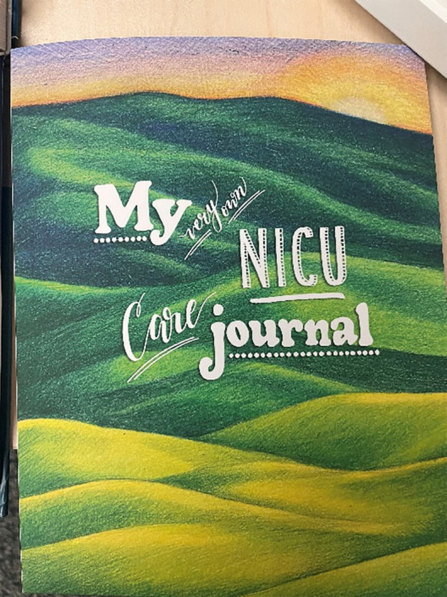
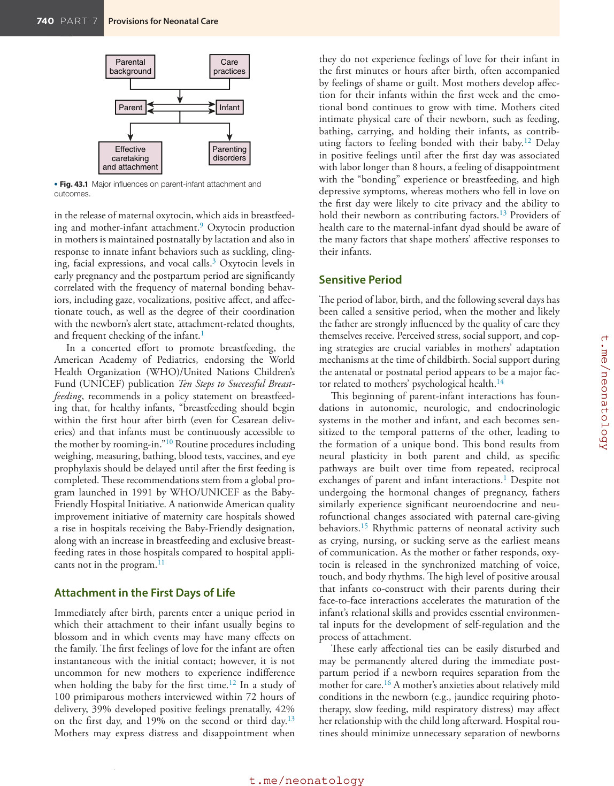
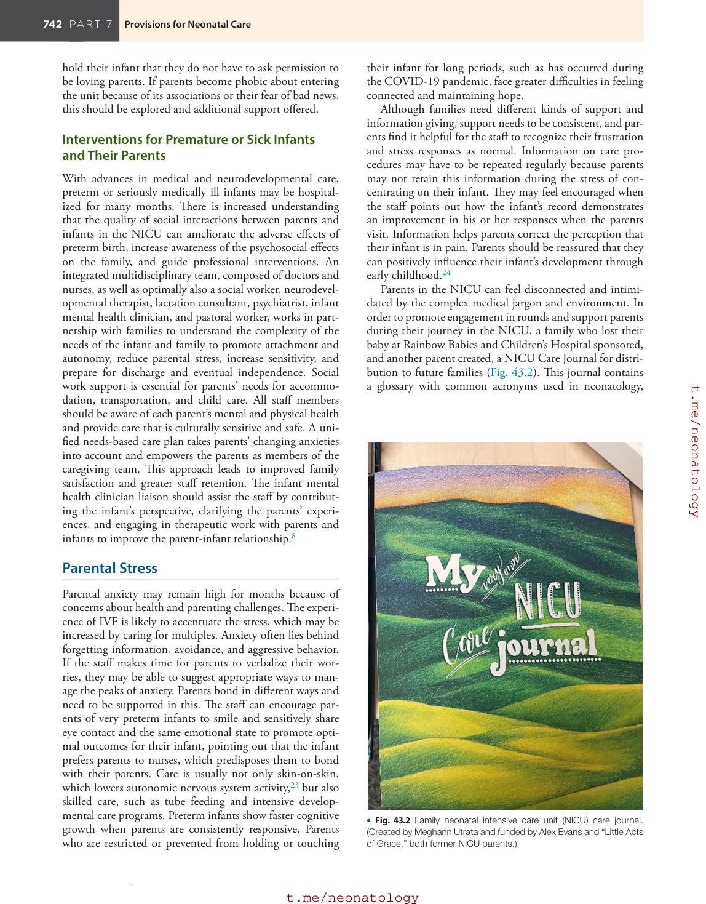
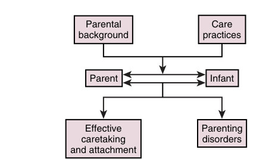

# 43. Support for the Family
> Source attribution: [Source credits](../../SOURCE_CREDITS.md).

## PDF page 748 | printed page 739

43 Support for the Family

### SUSAN HATTERS FRIEDMAN, FRANCES THOMSON-SALO, AND A. REBECCA BALLARD

### Normal Mother-Infant Attachment

The first evidence of maternal affection occurs in pregnancy. The birth of an infant initiates a series of interactions with parents (particularly the mother) designed to initiate attachment and ensure survival. Attachment is a bidirectional emotional and enduring bond that is reciprocated between infant and the caregiver, a process of synchronous coregulation that influences each other’s internal state.1 Human development is sufficiently resilient to withstand some disturbance of the normal postpartum sequence of events that initiate attachment; however, significant problems of either the infant (prematurity, congenital anomalies, or transitional problems such as asphyxia, trauma, or peripartum infection) or the mother (complications of pregnancy, depression) have more substantial capacity to disrupt normal processes. These complications carry a risk for disorganized attachment2 and adverse effects on longterm neurodevelopment in addition to the risks related to prematurity or underlying anomalies.1

### Formation of Mother-Infant Attachment

### Attachment in Pregnancy

Emotional and psychological groundwork for secure attachment begins in pregnancy. Increased levels of oxytocin throughout pregnancy facilitate the formation of an emotional bond between mother and infant in humans by acting to reduce anxiety and to ameliorate responses to external stresses. Mothers who have a less anxious state of mind are more able to increase their focus on infant care and recognize and respond effectively to nonverbal infant cues.3 Unexpected hospitalization during pregnancy, feelings of anxiety and depression, and lack of social support interfere with the development of maternal antenatal attachment. Hospital care practices that reduce anxiety, such as avoiding unnecessary separation of an infant from parents, can contribute greatly to early attachment.4 Fig. 43.1 is a schematic diagram of the major influences on parental behavior and the resulting disturbances that may arise from them. Experiences during labor, parent-infant separation, and hospital

practices during the first hours and days of life are the most easily manipulated variables in this scheme.

### Attachment During Labor

When childbirth moved from the home to the hospital, continuous support of the mother during labor became the exception rather than the routine. Although husbands or partners and female relatives routinely accompany the mother to the delivery room, they usually have little experience in providing labor support and may need support themselves. The clinical value of continuous emotional and physical care during childbirth by a trained doula is supported by the results of the 26 randomized clinical trials conducted over more than two decades.5 Women allocated to continuous support were more likely to have a shorter labor and a spontaneous vaginal birth. In addition, they were less likely to have negative feelings about the birth experience, intrapartum analgesia, or a baby with a low 5-minute Apgar score. Beneficial findings are consistent across the studies despite different cultural, medical, and social practices and have resulted in recommendations for continuous emotional support in laboring women by major health organizations.6

### Attachment in the First Hours After Birth

Nearly 90% of newborns require no special intervention at birth. Suctioning is not typically required with clear amniotic fluid, and clearing of the upper airway can be accomplished by simply wiping the infant’s mouth and nose. Even nonvigorous infants with meconium-stained amniotic fluid do not need routine intubation and endotracheal suctioning.7 It should not be necessary to separate the newborn from the mother to administer the initial steps in stabilization. The newborn should be placed on the mother’s skin immediately after birth and covered by a blanket. Early skin-to-skin care results in more rapid thermal control and decreased incidence of hypothermia in term and late preterm infants.8

The sensory stimuli of touch, warmth, and odor between the mother and infant are powerful vagal stimulants resulting

739

## PDF page 749

Parental background Care practices

Infant Parent

Parenting disorders

Effective caretaking and attachment

• Fig. 43.1 Major influences on parent-infant attachment and outcomes.

in the release of maternal oxytocin, which aids in breastfeeding and mother-infant attachment.9 Oxytocin production in mothers is maintained postnatally by lactation and also in response to innate infant behaviors such as suckling, clinging, facial expressions, and vocal calls.3 Oxytocin levels in early pregnancy and the postpartum period are significantly correlated with the frequency of maternal bonding behaviors, including gaze, vocalizations, positive affect, and affectionate touch, as well as the degree of their coordination with the newborn’s alert state, attachment-related thoughts, and frequent checking of the infant.1

In a concerted effort to promote breastfeeding, the American Academy of Pediatrics, endorsing the World Health Organization (WHO)/United Nations Children’s Fund (UNICEF) publication Ten Steps to Successful Breastfeeding, recommends in a policy statement on breastfeeding that, for healthy infants, “breastfeeding should begin within the first hour after birth (even for Cesarean deliveries) and that infants must be continuously accessible to the mother by rooming-in.”10 Routine procedures including weighing, measuring, bathing, blood tests, vaccines, and eye prophylaxis should be delayed until after the first feeding is completed. These recommendations stem from a global program launched in 1991 by WHO/UNICEF as the Baby- Friendly Hospital Initiative. A nationwide American quality improvement initiative of maternity care hospitals showed a rise in hospitals receiving the Baby-Friendly designation, along with an increase in breastfeeding and exclusive breastfeeding rates in those hospitals compared to hospital applicants not in the program.11

### Attachment in the First Days of Life

Immediately after birth, parents enter a unique period in which their attachment to their infant usually begins to blossom and in which events may have many effects on the family. The first feelings of love for the infant are often instantaneous with the initial contact; however, it is not uncommon for new mothers to experience indifference when holding the baby for the first time.12 In a study of 100 primiparous mothers interviewed within 72 hours of delivery, 39% developed positive feelings prenatally, 42% on the first day, and 19% on the second or third day.13 Mothers may express distress and disappointment when

they do not experience feelings of love for their infant in the first minutes or hours after birth, often accompanied by feelings of shame or guilt. Most mothers develop affection for their infants within the first week and the emotional bond continues to grow with time. Mothers cited intimate physical care of their newborn, such as feeding, bathing, carrying, and holding their infants, as contributing factors to feeling bonded with their baby.12 Delay in positive feelings until after the first day was associated with labor longer than 8 hours, a feeling of disappointment with the “bonding” experience or breastfeeding, and high depressive symptoms, whereas mothers who fell in love on the first day were likely to cite privacy and the ability to hold their newborn as contributing factors.13 Providers of health care to the maternal-infant dyad should be aware of the many factors that shape mothers’ affective responses to their infants.

### Sensitive Period

The period of labor, birth, and the following several days has been called a sensitive period, when the mother and likely the father are strongly influenced by the quality of care they themselves receive. Perceived stress, social support, and coping strategies are crucial variables in mothers’ adaptation mechanisms at the time of childbirth. Social support during the antenatal or postnatal period appears to be a major factor related to mothers’ psychological health.14

This beginning of parent-infant interactions has foundations in autonomic, neurologic, and endocrinologic systems in the mother and infant, and each becomes sensitized to the temporal patterns of the other, leading to the formation of a unique bond. This bond results from neural plasticity in both parent and child, as specific pathways are built over time from repeated, reciprocal exchanges of parent and infant interactions.1 Despite not undergoing the hormonal changes of pregnancy, fathers similarly experience significant neuroendocrine and neurofunctional changes associated with paternal care-giving behaviors.15 Rhythmic patterns of neonatal activity such as crying, nursing, or sucking serve as the earliest means of communication. As the mother or father responds, oxytocin is released in the synchronized matching of voice, touch, and body rhythms. The high level of positive arousal that infants co-construct with their parents during their face-to-face interactions accelerates the maturation of the infant’s relational skills and provides essential environmental inputs for the development of self-regulation and the process of attachment.

These early affectional ties can be easily disturbed and may be permanently altered during the immediate postpartum period if a newborn requires separation from the mother for care.16 A mother’s anxieties about relatively mild conditions in the newborn (e.g., jaundice requiring phototherapy, slow feeding, mild respiratory distress) may affect her relationship with the child long afterward. Hospital routines should minimize unnecessary separation of newborns

## PDF page 750 | printed page 741

from their parents and incorporate parents in daily care of their infants whenever possible.

### Feeding

Feeding, as part of the mother-infant relationship, should be an enjoyable experience in which the infant feels that his or her cues are being recognized. The process of breastfeeding promotes attachment, pleasure, and autonomy for mother and infant as they learn together the intricacies of feeding. Mothers may need support to establish breastfeeding using an electric pump. A mother may feel too self-conscious to express milk in public, be anxious about whether she has enough milk, or feel valued more for her expressed milk than for herself. She may delay breastfeeding out of ambivalence, may experience anxiety, or may consider herself a failure if her infant is slow to suck, or she may feel confused about the use of breasts for nutrition and for sexual intimacy. Mothers who do not wish to or cannot breastfeed also need support, whether or not they express milk. Continuing to express milk for months throughout the night is exhausting, even for the most committed mother.

Infants who become exhausted while feeding, who experience painful oral interventions, or who have been forcibly fed may develop an oral aversion. Feeding difficulties may contribute to insecure parent-infant attachment, and infants may become distressed during sucking because they do not feel securely attached emotionally.

### Attachment Challenges With Sick or Premature Infants

Preterm children, particularly those with neurologic impairment, have been reported to be at risk for dysfunctional attachment relationships.2 Early separation between infant and mother is associated with disorganized attachment and linked to increased parental stress.2 Parents who live a distance from perinatal care centers may experience additional separation because of the necessity of transporting their child to a regional neonatal intensive care unit (NICU). If the infant must be transferred to another hospital, it is important that parents be given a chance to see and touch the infant and take a picture before transfer occurs, receive contact information for the other hospital, and accompany the infant whenever possible.17 Transporting the mother afterward for postpartum care is beneficial; however, financial barriers and lack of insurance provider coverage are problems in some areas. Parents of transported infants often describe the separation in terms of loss and may experience a grief response even when the condition of the infant is not serious. After the initial transport, parents living far away have continued difficulty visiting their infant and may be helped by providing access to overnight accommodations.

The design of the NICU impacts patients and families (see also Chapter 36). Emphasis on family-centered care has promoted design of single-patient rooms rather than

the traditional open-bay NICUs. The single-patient room design can decrease stressful stimuli and allow a private space in which parents and infants can experience their first interactions. Randomized controlled trials have shown that single-patient rooms allow for increased hours of parental visitation18 and decreased length of stay.19 However, after controlling for social support, mothers in single-patient rooms reported more NICU stress than mothers in an open-bay NICU design.18 NICU design benefits from parent feedback in balancing privacy concerns and providing social support to families.

The NICU environment itself is an impediment to parents bonding with their child. The incubator is a physical barrier to a parent’s comforting touch, and the tubes and patches obscure the infant’s cues.20 In addition, the parents may be hesitant to interact with preterm infants due to the infant’s immaturity and medical severity. Preterm infants have less “babyish” physical features and are less active, alert, and responsive than full-term infants. Their cry is perceived as more aversive and distressing to parents. Parental bonding may be delayed until the infant’s physical condition appears to be improved and parents are assured of the infant’s survival.21

Neonates experience a variety of stressors while in the NICU, including painful procedures, mechanical ventilation, reduced maternal care, and auditory and light stimulation. Exposure to painful stimuli causes activation of the hypothalamic-pituitary-adrenal (HPA) axis and subsequent release of glucocorticoids. Cumulative stress, such as a higher number of skin-breaking procedures, can result in altered programming of the HPA axis and decrease in cortisol release in response to stress. Such alterations to neurodevelopment following early-life pain exposure may account for adverse behavioral outcomes later in life, including poorer cognitive outcomes and increased internalizing behavior. Maternal care, especially kangaroo care (see below), can negate consequences related to neonatal pain and promote beneficial outcomes.22

### Difficulty in Bonding

The staff needs to be aware that, if parents continue to approach their infants reluctantly, this may indicate a prolonged complicated reaction, different from a mother’s reaction after birth when being close may stir mixed emotions, such as feelings of failure about the preterm birth. Parents may resist engaging with their infant because of a traumatic birth, shock at the infant’s appearance, or a poor prognosis about survival and disability. When parents cannot hold their infant, they may find it difficult to believe that the infant is their child, particularly with an in vitro fertilization (IVF)-conceived infant. Mothers with a very low birth weight infant may feel less effective because of the need for the nurses’ care; when a parent finds it difficult to attach to a very low birth weight infant, the staff can talk with that parent about the infant’s personality traits. It can be pointed out to parents who feel that they have to ask permission to

## PDF page 751

hold their infant that they do not have to ask permission to be loving parents. If parents become phobic about entering the unit because of its associations or their fear of bad news, this should be explored and additional support offered.

### Interventions for Premature or Sick Infants and Their Parents

With advances in medical and neurodevelopmental care, preterm or seriously medically ill infants may be hospitalized for many months. There is increased understanding that the quality of social interactions between parents and infants in the NICU can ameliorate the adverse effects of preterm birth, increase awareness of the psychosocial effects on the family, and guide professional interventions. An integrated multidisciplinary team, composed of doctors and nurses, as well as optimally also a social worker, neurodevelopmental therapist, lactation consultant, psychiatrist, infant mental health clinician, and pastoral worker, works in partnership with families to understand the complexity of the needs of the infant and family to promote attachment and autonomy, reduce parental stress, increase sensitivity, and prepare for discharge and eventual independence. Social work support is essential for parents’ needs for accommodation, transportation, and child care. All staff members should be aware of each parent’s mental and physical health and provide care that is culturally sensitive and safe. A unified needs-based care plan takes parents’ changing anxieties into account and empowers the parents as members of the caregiving team. This approach leads to improved family satisfaction and greater staff retention. The infant mental health clinician liaison should assist the staff by contributing the infant’s perspective, clarifying the parents’ experiences, and engaging in therapeutic work with parents and infants to improve the parent-infant relationship.8

### Parental Stress

Parental anxiety may remain high for months because of concerns about health and parenting challenges. The experience of IVF is likely to accentuate the stress, which may be increased by caring for multiples. Anxiety often lies behind forgetting information, avoidance, and aggressive behavior. If the staff makes time for parents to verbalize their worries, they may be able to suggest appropriate ways to manage the peaks of anxiety. Parents bond in different ways and need to be supported in this. The staff can encourage parents of very preterm infants to smile and sensitively share eye contact and the same emotional state to promote optimal outcomes for their infant, pointing out that the infant prefers parents to nurses, which predisposes them to bond with their parents. Care is usually not only skin-on-skin, which lowers autonomic nervous system activity,23 but also skilled care, such as tube feeding and intensive developmental care programs. Preterm infants show faster cognitive growth when parents are consistently responsive. Parents who are restricted or prevented from holding or touching

their infant for long periods, such as has occurred during the COVID-19 pandemic, face greater difficulties in feeling connected and maintaining hope.

Although families need different kinds of support and information giving, support needs to be consistent, and parents find it helpful for the staff to recognize their frustration and stress responses as normal. Information on care procedures may have to be repeated regularly because parents may not retain this information during the stress of concentrating on their infant. They may feel encouraged when the staff points out how the infant’s record demonstrates an improvement in his or her responses when the parents visit. Information helps parents correct the perception that their infant is in pain. Parents should be reassured that they can positively influence their infant’s development through early childhood.24

Parents in the NICU can feel disconnected and intimidated by the complex medical jargon and environment. In order to promote engagement in rounds and support parents during their journey in the NICU, a family who lost their baby at Rainbow Babies and Children’s Hospital sponsored, and another parent created, a NICU Care Journal for distribution to future families (Fig. 43.2). This journal contains a glossary with common acronyms used in neonatology,

• Fig. 43.2 Family neonatal intensive care unit (NICU) care journal. (Created by Meghann Utrata and funded by Alex Evans and “Little Acts of Grace,” both former NICU parents.)

• Fig. 43.2 Family neonatal intensive care unit (NICU) care journal. (Created by Meghann Utrata and funded by Alex Evans and “Little Acts of Grace,” both former NICU parents.)

## PDF page 752 | printed page 743

pages for milestone achievements, and impressions for daily rounds, as well as pages for gratitude expressions.

Parents may need encouragement to connect with, support, and nurture themselves as they become exhausted. As the staff becomes familiar with communication patterns between parents and/or support persons, they can encourage parents to reconnect with their extended families, particularly if a mother’s partner cannot support her or there is no partner available. The staff should work with the parents’ support network and be nonprescriptive about how parents share information with the outside world. Parents often feel lonely in the NICU when contact from friends and family declines over time and may find even a brief contact with a clinician supportive. If parents find it difficult to limit intrusive family involvement, the staff can help to manage this sensitively. Siblings may experience adjustment reactions of jealousy and anger and feel neglected; reading relevant story books may help them process these feelings.

### Interventions to Support Parents and Infant

Parents of preterm infants experience high levels of stress and often lack knowledge of how to parent and interact with their infants during their hospital stay. Interventions in the NICU to aid parents’ understanding about their preterm infants and to promote their role as parents may help them participate in their infant’s care in a developmentally sensitive manner, thereby reducing stress and preparing them for when the infant is discharged home. Different approaches are indicated at different times to support parents, the infant, and the relationship in what has been described as a paradigm shift from healing the infant’s medical problems to a focus requiring effective partnership with families25 and including supportive and psychoeducational interventions and perinatal psychotherapy.26

A successful educational-behavioral intervention program for parents of premature infants of 26 to 34 weeks’ gestation (Creating Opportunities for Parent Empowerment, or COPE) found that mothers in the intervention group exhibited significantly less stress while their infant was in the NICU and less depression and anxiety at 2 months’ corrected age compared with mothers in the control group.27 In addition, infants in the intervention group had a mean 4-day shortened length of stay compared with control infants.

Weekly support groups for parents that offer information and emotional support are helpful. Linking parents with others who have had a preterm infant could help them work through some of their grief relatively quickly. Early individualized family-based interventions reduce parental stress and depression.8 Brecht and colleagues28 carried out a comprehensive review of psychoeducational programs, such as the COPE program. Such programs have been found to be effective in preventing post-traumatic stress reactions by helping parents to partner in providing care to the infant, by enhancing parental feelings of self-efficacy, and by reducing distress caused by the infant’s birth and hospitalization.

Brecht et al.28 reported a trend toward early brief interventions that target parent trauma and utilize cognitive behavioral techniques with positive effects on maternal and infant outcomes.

A meta-analysis of interventions for parents to improve developmental outcomes for preterm infants found significant reduction in pooled effects for maternal anxiety and depressive symptoms and positive pooled effects on parental self-efficacy.29 Interventions included psychosocial support, parent education, and/or therapeutic developmental interventions targeting the infant; the positive effects seen in the psychosocial aspects implicate mental health services for families in the NICU as an important adjunct to routine care.

Interventions to reduce maternal symptoms may not necessarily overlap with parental education and developmental care. A meta-analysis of NICU-based interventions to reduce maternal depression and anxiety symptoms found five out of seven interventions for depression and six out of eight interventions for anxiety reduced symptoms compared to the control group.30 For maternal depressive symptoms, cognitive behavioral therapy was associated with significant improvement in maternal symptoms, whereas educational approaches and interventions focused on improving maternal-infant responsiveness were not.

Interventions to minimize the infant’s distress center primarily on the Neonatal Individualized Developmental Care Assessment Program (NIDCAP) established by Heidelise Als,31 which aims to reduce stress linked to the environment, increase awareness of the baby’s behavior, and integrate the parents in their daily routine. The neurodevelopmental therapy team works with parents to develop individualized flexible developmental care plans based on an infant’s developmental stage and behavioral cues. These continue to be important in a long hospitalization, because, when reaching new developmental stages, an infant risks being overwhelmed or bored, and a care plan can offer the family greater consistency.

Infants find it both exciting and soothing to be gazed at by someone who delights in them. They respond best when parents are with them as much as possible and are willing to play with them with positive reciprocity and contingency without overwhelming them. This has positive results for cognitive and psychomotor development, and parents feel supported, knowing that their sensitivity optimizes brain development.32 Parents, particularly fathers, report increased intimacy when they read books to their infants.33 Infants also respond positively to a mutually supportive relationship between parents. Parents who need help to think about the infant’s mind as intentional can be encouraged to carefully observe their infant and become curious about the meaning of behavior, such as playing with the pacifier, responding to imitation, fighting sleep, and being alert to their parent’s feelings. This helps empower parents to respond in a holistic way.

The clinician, as well as thinking with parents about the infant’s happiness, can underscore the importance of

## PDF page 753

recognizing the infant as having agency and learning that negative affect expresses intention. When parents view this as being active and can share in a social exchange, infant competence increases. When parents are very anxious, encouraging neonatal behavioral observation has been found to be effective in enhancing engagement. Parents who are less sensitive and more controlling may need additional support.

### Kangaroo Care

Kangaroo care (see also Chapter 36), now commonly referred to as skin-to-skin contact, originated in South America as a means of keeping at-risk infants warm with limited resources. Subsequent studies in high-income countries have indicated potential benefits in promoting breastfeeding, establishing parent-child attachment, and promoting neurodevelopment. During kangaroo care, the diaper-clad infant is placed in flexed position directly onto the parent’s chest, with maximal skin-to-skin contact, and covered with a shirt or blanket. Skinto-skin care is useful in helping parents develop a closer tie to their infants and may be the first time that parents feel that the infant is truly theirs.34 Specific maternal benefits to kangaroo care have been demonstrated, including reduced maternal anxiety, reports of less maternal depression, and improved maternal attachment behavior in the postpartum period.35,36

The benefits of kangaroo care extend beyond promoting attachment. Kangaroo care promotes physiologic stability and maturation of the autonomic and circadian systems in premature infants, including more quiet sleep, longer sleep cycles, and increased respiratory regularity.22 Kangaroo care decreases premature infant pain profiles prior to a heel stick and may be a viable analgesic for premature infants as young as 28 weeks’ gestational age.22 A meta-analysis of 21 studies involving low birth weight infants showed that kangaroo care was associated with a reduced risk of mortality, nosocomial infection/sepsis, hypothermia, and length of hospital stay.34 In addition, compared with conventional care, kangaroo care was associated with an increased weight, length, and head circumference, as well as an increase in the likelihood of exclusive breastfeeding at discharge or at 40 to 41 weeks’ postmenstrual age.

Benefits of kangaroo care are long lasting. In follow-up at 10 years of age, premature infants who received skin-to-skin contact as neonates showed attenuated stress response, more mature autonomic functioning, organized sleep, better cognitive control, and a more reciprocal mother-child relationship.36 A 20-year follow-up to the original Bogota study on kangaroo care found long-term social and behavioral benefits for infants who received kangaroo care, including increased brain volume, less aggression, and less antisocial behavior.37

Kangaroo care should be considered for all stabilized premature infants, although there is currently no standard definition of infant stabilization or consensus of infant age for its initiation. Additional research is needed to evaluate risks and benefits to more immature infants and those requiring highly technical care, such as conventional or high-frequency mechanical ventilation.

### Family Engagement

### Paternal Issues

There is increased recognition of the importance of the father’s presence in the NICU, both to support the infant and develop the father-infant bond; their need to be an equal co-parent should be recognized.38 Infants move differently in response to a father’s voice.6,39 Actively intervening to promote skin-to-skin contact by fathers within the first day of life, if not the first minutes, if the mother cannot be present, is very helpful.40 Fathers want to be viewed as important to their infant but different from the mother. Although it is not common for gay fathers to have infants in the NICU, gay men, especially of color or lower economic status, may face potential barriers and should be supported. The stress of keeping the family financially viable and making childcare arrangements for siblings has led to paternal stress being described as invisible; fathers often cope by delegating care.

Many fathers, although initially reluctant to be close to their infant, find the contact more positive than expected; a father’s early involvement is likely to positively influence the attachment process and support the mother. When fathers are helped to care for their infants, they relax more at the bedside during opportunities for “meaningful fathering moments,” which in turn contributes to increased paternal nurturing. Involving fathers in developmental care reduces neonatal stress and its neurobiological sequelae and is likely to promote better infant and family outcomes.41

It is important to ask each father how he can best be supported, such as by providing detailed information or an overview of his infant’s status. Fathers should be offered appointments that fit in with their work schedules; they often make the necessary arrangements for these appointments. They tend to prefer support to come from professionals and to be empowered through the sharing of information in an accessible and two-way process, with both written materials and Internet resources.

Participating in a dedicated fathers’ group in recognition of the stress that fathers feel can help the father feel more secure and connected with his baby.42 A father’s behavior toward and attachment to the baby is related to many factors, including genetics, personal relationships, culture, his own experiences with parenting, his ability to tolerate stress, and the baby’s responses to him. Fathers commonly experience a feeling of lack of control when their infant is in the NICU. Encouraging the father to maintain relationships with his family, friends, and staff and providing consistent information orally or written are ways of supporting fathers. Although mothers may be allowed maternity leave, fathers may need to return to work sooner. Work may lead to some sense of control and normalcy but can also lead to feelings of guilt and regret, especially about having been less involved in parenting previous babies; thus new fathers may pivot to prioritize parenthood in their lives.

Having an infant in the NICU stresses the couple’s relationship. Partnerships already in difficulty often do not

## PDF page 754 | printed page 745

survive this stress, which is a further reason for providing support to the couple.

### Staff-Parent Communication

Staff-parent communication is a critical part of the NICU experience. NICU parent studies indicate a need for improved communication. It has been recommended that the staff discuss the baby’s diagnosis and course using “simple straightforward language void of medical jargon and presented in a warm, sympathetic manner.”43 As well, it is suggested that the staff interact with parents as an “expert coach and facilitator” to enable parents to become comfortable in their baby’s care.43

Knowledgeable and understanding team members may be more effective in communication with parents suffering from mental health issues. A study of NICU staff found that challenging interactions were more common among parents with psychotic symptoms, parents who hover (likely related to anxiety levels), or parents who have addictions, among others.44 Psychiatric referrals are needed in some cases, and appropriate boundaries should be set with families. Recommendations have been made that all NICU parents should interact with mental health professionals for support, education, screening, and psychotherapy when needed. As well, mental health professionals should provide support for NICU staff.45

### Family-Centered Care in the Neonatal Intensive Care Unit

Family-centered care is based on the understanding that the family is the most consistent and influential force in the growth and development of the child, that patients and family are integral partners with the health care team, and that the perspectives and information provided by families are essential components of high-quality decision making.17,25 Parents of infants admitted to the NICU are confronted with many challenges, including physical separation from their infant, a bewildering number of care providers, an inability to protect their infant from painful procedures, and, frequently, financial concerns. Family-centered neonatal intensive care endeavors to support families during this stressful time by making the NICU a welcoming environment for families, encouraging parents to participate in care, and educating parents on the NICU environment and their infant’s condition.

Family-centered care has roots in advocacy by NICU parents. In 1992, a group of parents met in a conference with neonatologists to address problems identified by the NICU parents and to explore possible solutions. After the conference, the components laid out in the original document were published as an article (“The principles for family-centered neonatal care”) in the journal Pediatrics. These principles have become incorporated in national statements recommending family-centered care and remain relevant today.46

The NICU should be family friendly, and care should be taken to reduce stressful noises and sights. Facilities for

parents’ comfort and privacy such as rooms where they can relax should be provided, as well as a space in which fathers can work, if necessary, while their infant sleeps. The NICU should not be overly feminine; a father’s name could be on his infant’s crib. Prearranged discussion times that are scheduled to take place away from the infant’s crib usually assist in communication. What the environment communicates to the family should be studied so that hidden barriers to communication and rigid policies can be tackled; however, parents should not feel that their actions are being overly scrutinized. Nurses must be aware that witnessing distress in their infant generates feelings of anger in parents, which may compromise the parent-nurse relationship.47 Increased support and involvement in the infant’s care help allay complaints that stem from anxiety.

Some practices to be considered for implementing family-centered care include the following: • Parents are not visitors but instead are essential compo-

nents of the care team. “Visiting policies” should address nonparent family members and friends, whereas policies related to parents should be more appropriately addressed as “participation in care.” • Parents are integral to care and are encouraged to partici-

pate in patient care rounds, communication with personnel at the change of shifts, and in the bedside care of their infant. Parents should have access to information in their infant’s medical record. Many units have initiated parent documentation into the record. • The physical environment should provide for the needs

of parents, including needs for accessing information, rest, nutrition, privacy, childcare for siblings, and support for their infants by breast milk pumping. Standards for support of families are available.48 • Families should be incorporated at various levels as advi-

sors. The perspective of experienced families should be integral to the unit administrative activities. These could include parents as teachers during orientation and continuing education of the staff, parent advisory committees to collaborate in planning of new policies or ongoing quality improvement activities, and involvement in NICU parent support groups.

### Parental Mental Health Issues

Parental mental health in the NICU is critical for attachment and bonding, participation in care, and infant development.49 Psychiatric support in the NICU can be invaluable. Most referrals to psychiatrists during this time are for depression, anxiety, coping issues, and personality traits.50–52

### Postpartum Depression

Postpartum depression (PPD) is a common complication of childbirth. It occurs in 10% to 20% of postpartum women, with studies showing increased rates of 28% to 70% in the NICU.49,53–55 A systematic literature review showed higher

## PDF page 755

depression scores of mothers of preterm low birth weight infants for at least 12 weeks postpartum and that higher levels of depressive symptoms can persist through the first postpartum year.56 Risk factors include a personal or family history of depression, relationship issues, low socioeconomic status, and stressful life events. Obstetric- and NICU-specific risk factors include multiple birth, very low birth weight, recent stillbirth, less effective coping strategies, maternal role disruption, and lower perception of nursing support. Symptoms may include depressed mood, decreased enjoyment (including of spending time with baby), decreased sleep (difficulty sleeping even when the baby sleeps), decreased energy, feelings of guilt/worthlessness, changes in appetite, and potentially suicidal or violent thoughts.

Differential diagnoses include “baby blues” (seen in the majority of women, with transient symptoms of irritability, tearfulness, and fatigue resolving within 2 weeks of delivery), postpartum psychosis (PPP), bipolar disorder, and medical illness (e.g., thyroid disease, anemia). Depressed mothers are more likely to be disengaged, withdrawn, or hostile, with disrupted mother-infant bonding; thus recognition and treatment are important. Of note, lower maternal NICU visitation rates predicted greater maternal depression at 4 months corrected age.57

Because of its prevalence, PPD screening and prevention measures should be integrated into NICU care. A widely used validated screening tool is the Edinburgh Postnatal Depression Scale (EPDS). A positive screen indicates that further evaluation is warranted. The EPDS is readily accessible online (e.g., through the American Academy of Pediatrics website). Mothers may be referred to psychiatry, family medicine, or obstetrics. If they are actively suicidal or homicidal, they should be evaluated emergently. Antidepressant medications and psychotherapy are treatments of choice. With mild symptoms, psychotherapy alone may be sufficient. In riskbenefit analysis regarding medications in lactation, just as in pregnancy, the well-established risks of untreated maternal depression on development should be considered.58,59

### Postpartum Anxiety

Anxiety is often comorbid with PPD. Risk factors include past traumas, prior high-risk pregnancy or postpartum course, prior fetal/infant loss, low socioeconomic status, poor social support, and past history. Anxiety can become excessive, interfering with daily life and bonding with the infant. Mothers with generalized anxiety disorder (GAD) may demonstrate excessive worry, restlessness despite appearing tired, imagining that the situation is worse than it is, and feelings of being unable to leave the infant’s bedside because of an overwhelming fear of a bad outcome.49

Alternatively, in obsessive-compulsive disorder (OCD), intrusive thoughts and behaviors may occur and cause maternal distress. The mother may, for example, avoid holding the infant for fear that she will cause harm because of distressing obsessive thoughts. Anxious mothers experience higher investment in infant health concerns and intrusive

thoughts—leading to more repetitive questions and phone calls and the repetitive need for reassurance.

Rates of anxiety are elevated among mothers with infants in the NICU.53,54 Maternal role disruption should be minimized. The staff should encourage mothers to look beyond the machines and alarms, to touch and talk to their babies, and to participate in feeding and diapering. The new parenting role can be stressful for anyone, but attempting to take on a much-anticipated role with severely ill infants— infants with tubes and who may not be able to be held or snuggled—can be a significant stressor. Other NICU-specific stressors include feelings of loss of control and the daily uncertainties of life and death. A mother’s perceptions of her infant’s illness are not correlated with the actual illness severity. The mother’s stress level may be related to illness perception rather than to illness severity.60

Anxiety can become a significant issue during any highrisk pregnancy, because the mother may have worries about the baby’s health, delivery, and how well she will fill her new role. Because it can reduce the number of unknowns in advance, a visit to the labor and delivery unit and to the NICU can be helpful. Empowering the pregnant mother (e.g., with Lamaze) may also be useful. Because high anxiety can decrease attachment, it is important to consider. Similar to PPD, treatment for anxiety disorders includes psychotherapy and medication.

### Post-Traumatic Stress Disorder

Both mothers and fathers are at risk for acute stress disorder, which has been identified in 35% of mothers and 24% of fathers within 3 to 5 days of an infant’s admission to the NICU.61 A smaller percentage had persisting symptoms—15% of mothers and 8% of fathers met diagnostic criteria for post-traumatic stress disorder (PTSD) 30 days later. These symptoms can persist long after the birth.62 Symptoms of PTSD include hyperarousal, numbing, avoidance of triggers, and re-experiencing of traumas. The mother with PTSD may actually avoid the infant or the NICU if these experiences are her anxiety triggers. She may appear irritable, be easily startled, and have difficulty with bonding. Early PTSD symptoms predict less sensitive and more controlling maternal behaviors. Mothers of very low birth weight infants who experienced more symptoms of PTSD were less sensitive and effective at structuring the interaction when playing with their infant.63 Mothers with PTSD are also noted to be more controlling in their interactions with their babies. One study seeking to prevent PTSD among mothers of preterm infants found that a brief six-session intervention using trauma-focused cognitive behavioral therapy was effective in reducing symptoms of anxiety and depression, with benefits noted at 6-month follow-up as well.64

### Grief

Parents should have opportunities to grieve for the healthy infant they were expecting. Shock, anger, sadness, disbelief,

## PDF page 756 | printed page 747

and denial may occur, but the parents need to make their peace and bond with their infant. Sensitive care for these families positively impacts their coping. Pediatricians John Kennell and Marshall Klaus were pioneers in recognizing the strong attachment that occurs between mother and baby prior to delivery. In the event of neonatal death, the significant loss should be acknowledged and culturally appropriate rituals used, conveying compassion. Parents should be able to see and hold their deceased infant. Mementos and photographs should be offered, and the funeral or memorial service options should also discussed.65

Maternal grief may begin with a period of shock, confusion, numbness, irritability, or anxiety, followed by intense sadness, longing, guilt, and somatic complaints. A followup visit a month later can help ensure understanding of the information provided and provide an opportunity to address concerns and questions.49 Parents either may avoid reminders of their loss (such as contact with mothers of healthy infants) or may seek opportunities to talk about the baby. Often, a year or two passes before a mother feels back to “normal” in her ability to enjoy life and invest in other relationships. Risk factors for pathologic grief include a history of psychiatric illness, childlessness, and poor social support.49 Those exhibiting maladaptive or destructive behaviors, dominant somatic symptoms, or lack of improvement over the course of months should be referred for evaluation.

### Persisting Trauma Reactions and Complex Grief

Many parents find the ongoing NICU experience traumatic, despite the initial support they receive over the preterm birth, and this may complicate the bonding process. A parent’s own trauma history may affect his or her responses. For example, the multidisciplinary team needs to be aware of a parent who is so anxious that he or she cannot participate in discussions about the infant’s care, while still respecting the parent’s dignity. Parents may face extreme distress or guilt or feel rejection toward the baby if the infant is visibly different or if they feel responsible for the fact that the infant is not as they wished. Deaths of other infants in the NICU may retraumatize parents. It is important that additional support is offered, because infants whose parents experience posttraumatic stress symptoms are more vulnerable to developing eating and sleeping difficulties in the first year of life.

Part of the experience of complex grief may include feeling guilty, for example, about reproductive loss, earlier fetal death, or having an infant with visible differences, or mourning the unavailability of the mother. Fathers may feel stressed recounting their experiences in the NICU months after admission.66 Parents may feel that they face unbearable choices, whether or not their infant survives. Getting to know the infant as a person who is psychologically alive creates a memory of being the parents of their infant, supports them when they fear death, and aids decision-making and grieving. Supporting parents while they face the reality

that their child is dying requires a delicate balance. The staff needs to be culturally sensitive, recognizing each person as a unique individual, whatever his or her ethnocultural group.67 If parents are involved with the staff in end-of-life decision making, this is usually associated with lessened grief. Mutual confidence and communication encourage freedom and creativity around the infant at this time.68 Attention to the infant’s and parents’ pain is important.

Medical and parental views about prolonging life may diverge, particularly when a parent’s spiritual and cultural values make it unacceptable to shorten life. The staff needs to adopt an ethical embracing of difference and recognition when they cannot advise but need to maintain a dialogue to help the family work through the decision-making process.69 Parents need to feel supported through the pain of end-of-life issues and know that their decisions were made out of parental love. They may need the staff to help access trusted supports. When a decision is made to forgo lifesustaining treatments, parents may appreciate being asked whether the staff should indicate to other parents what is happening in case they wish to avoid being there. Parents may need support in explaining to a young child why his or her infant sibling died.

### Postpartum Psychosis

Postpartum psychosis (PPP) is much rarer, occurring in 1 to 3 per 1000 mothers. Delusions (fixed false beliefs out of line with one’s cultural background), disorganized thoughts, hallucinations, rapid mood swings, insomnia, and confusion may occur, often within the first postpartum weeks. Risk is elevated in those with bipolar disorder, personal or family history, sleep deprivation, and psychosocial stressors.70 Medical causes of mental status changes, including anoxia, electrolyte disturbances, thyroiditis, neurologic pathology, or drug-induced causes must be ruled out.

Because of its rapid onset, fluctuating course, and morbidity and mortality risks, psychiatric hospitalization for PPP is usually required. Suspected cases should be referred emergently; untreated PPP carries elevated risks of infanticide and suicide. Mother-infant bonding needs to be less important than infant safety in cases of PPP. Mainstays of treatment of PPP include antipsychotic and mood-stabilizing medications. Medication side effects such as sedation should be considered, and, in some cases, breastfeeding may not be recommended due to medication effects and the impact of sleep disruption on maternal symptoms. Motherinfant visits should be planned when safe and initially occur under supervision. Engagement and follow-up are critical, and child protective services should usually be involved.

### Personality Disorders

In contrast, people with personality disorders evidence chronic, inflexible patterns of behavior and perception. These patterns create dysfunction at work, in the family, and socially. Personality disorders fit into general categories of

## PDF page 757

odd/eccentric (e.g., paranoid), dramatic/erratic/emotional (e.g., borderline, narcissistic, histrionic), or anxious/fearful (e.g., dependent, avoidant). Short of a personality disorder, problematic personality traits tend to come out under periods of stress—such as during a NICU admission with an unwell infant.

Dysfunctional personality traits are an important predictor of parental problems coping with the NICU. A parent with narcissistic personality disorder may disrupt the NICU by excessive demands for special care, self-preoccupation, and lack of empathy, whereas another parent with borderline personality disorder and affective instability may cause difficulties in the team working together. Mothers with borderline personality disorder were significantly more likely to have negative birth outcomes in an Australian sample. They also had frequent comorbid substance abuse and other impairment.71

Addressing personality disorders in parents can help to diminish parental distress and improve physician-parent relationships and parent-infant relationships, in addition to reducing staff stress and unit chaos. To reduce NICU problems from personality disorders, the goals should be to support the parent, minimize disruption, and maintain safety. Consistent boundaries among members of the staff are critical and allow for a more predictable environment so that the focus can be on the needs of the sick infant.

### Boundary Issues and Families With Multiple Risk Factors

In a long-stay admission, some families seek special treatment for their infant and themselves that tends to breach professional boundaries. Nurses on 12-hour shifts in high-technology, life-and-death situations may become like family and find themselves under pressure as parents unconsciously seek concessions for their infant. Parents may also seem intimidating. When the staff comes to feel that some parents are “special,” this is a sign of difficulties to be negotiated. Caring for such families may lead to splits in the team. Multidisciplinary team meetings are important in maintaining professional boundaries and minimizing mixed messages.

A cohesive multidisciplinary team provides the best care for families with complex needs, such as parents with anger management difficulties, serious mental illness, substance use, intellectual or physical disability, disadvantaged life circumstances, extreme youth, or a history of abuse or neglect of other infants. Parents whose behavior the staff finds challenging may inwardly feel despairing or ashamed; terms such as “manipulative” should be avoided when considering needed support. Significant numbers of parents with a psychotic illness have contact with infants in the perinatal period, with symptoms and medication side effects impacting on interactions as well as the parent-child relationship; however, a parent’s right to be treated as a parent should be recognized whenever possible. The staff may find the care of a parent who uses drugs and alcohol challenging if the

parent is substance affected at times or does not visit. Plans enabling parents to access ongoing supports after discharge should be in place. When a parent has anger management problems, the staff needs to set boundaries and address in a nonshaming way that anger is unacceptable, because infants should not be frightened. The staff should also inquire whether the parent needs further support. For the infant’s safety, a referral to child protective services should be considered when there is considerable ambivalence (including self-harm), although it is not always clear when a parent is unable to be a caregiver. Parents may take hospital policy personally and blame the hospital for exacerbating mental health issues. If they are dedicated parents, they may feel offended if they are offered parenting skills advice. When violence is disclosed by a parent, the staff needs to be mindful of a power imbalance between the couple and that one partner may use the hospital as an escape. A nonjudgmental approach to referral for counseling or child protective services is needed, with the inclusion in care planning, if appropriate, of the violent partner. When an infant is to transition from a parent’s care to other caregivers, the infant’s interests must remain primary, and ruptures of attachment should be minimized. Some parents respond to the possibility of their infant being removed from their care by becoming aggressive and may attempt to take flight with the infant.

### Perinatal Psychotherapy

Although parents of a long-stay infant receive more structured interventions and become skilled at knowing their infant, they may increasingly value a confidential space to process feelings about the NICU experience. When they have difficulty relating to their infant, a flexible psychotherapeutic intervention to consolidate internal and external supports is indicated, usually consisting of less structured therapeutic sessions and coping strategies. The clinician needs to respond promptly to the request for help with a crisis or for supportive psychotherapy. Parents may be initially offered weekly appointments together, then flexibly as needed. Ideally, professional help is provided in the NICU environment because families may be reluctant to keep off-site appointments. Parents use this time to process the grief and anger about having a preterm infant or anxiety about the effects on the couple’s sexual relationship, while also focusing on finding joy in their infant. Recognizing the infant as a person means that the attention is a gift of respect and upholds the rights of infants.

Insight-oriented psychotherapy aims to help parents become aware of how the reactivation of past painful experiences contributes to difficulties in relationships with their infant or staff. Some parents decline the offer of medication and try to process their difficulties by talking. For example, a mother’s sadness about her own mother’s unavailability may be evident without being too distressing for her infant.

Parents’ inconsistent messages negatively affect the attachment process, and the clinician should aim to reframe this. A parent’s negative attributions from the first month

## PDF page 758 | printed page 749

onward or suggestions of malevolence need to be challenged so they do not continue, and the pathologic link with the past must be lessened so as not to contribute to insecure attachment.72 Guided observation of the infant can also modify the traumatic representation of the infant. When a parent rejects a tiny or ill infant, that infant urgently needs support to reduce the extreme ambivalence and negativity and to lessen the likelihood of infant withdrawal.

As parents explore feelings about loss or abuse and process recurrent traumatic memories, they usually feel relieved that traumatic feelings about their infant’s birth can be lessened and value this time for themselves. It may be that the integrated care given to long-term NICU families prevents the neglect and abuse that might otherwise stem from unrelieved parental stress at this time.

Parents who feel sensitively cared for by staff are likely to be more sensitively caring of their infant, who in turn is less likely to become a vulnerable child. Above all, parentinclusive assistance that will support these infants and their parents should be determined.73 A follow-up telephone call after discharge consolidates the support. Parents who may not be able to accept support during the hospital stay often renew contact with the staff much later and engage for a considerable time.

### Discharge Planning

Even though parents wish for a long-stay infant to be discharged or transferred to a hospital closer to home, they may also be reluctant for this to occur and feel abandoned by the staff. They may be anxious about managing the care

Key Points

• Having an infant in the neonatal intensive care unit

(NICU) is a significant stressor for parents and families. • Avoiding unnecessary separation of the infant from the

parents contributes positively to early attachment. • Maternal oxytocin levels in pregnancy and postpartum

are correlated with maternal bonding behaviors. • NICU parents should be supported to bond with their

infants. • Parental role disruption in the NICU should be

minimized.

### References

1. Feldman R. The adaptive human parental brain: implications for

children’s social development. Trends Neurosci. 2015;38(6):387–399. 2. Pennestri MH, Gaudreau H, Bouvette-Turcot AA, et al. Attach-

ment disorganization among children in Neonatal Intensive Care Unit: preliminary results. Early Hum Dev. 2015;91(10):601. 3. Galbally M, Lewis AJ, Ijzendoorn M, et al. The role of oxytocin

in mother-infant relations: a systematic review of human studies. Harv Rev Psychiatry. 2011;19(1):1–14. 4. Rossen L, Hutchinson D, Wilson J, et al. Predictors of postnatal

mother-infant bonding: the role of antenatal bonding, maternal

of an infant on oxygen with a nasogastric tube even with outreach care, in addition to resuming care of the infant’s siblings, who may have adjustment reactions. Sustained discharge planning is supportive, including any necessary skills training. If single-room care is not available, the opportunity for parents to room-in with their infant for at least a night in the hospital before discharge should relieve many of their fears about managing at home.

### Summary

In summary, because the newborn completely depends on the parents for survival and optimal development, it is essential to understand the process of bonding as it develops from birth, if not before. Although there is more to understand about this complex phenomenon, individuals responsible for the care of mothers and infants should evaluate hospital procedures and ensure early, sustained mother-infant contact. Care practices should be developed that promote contact of the mother and father with their infant and help them learn and explore the wide range of sensory and motor responses of their newborn infant, whether healthy or requiring intensive care. Parental mental health should be optimized in the NICU to aid in bonding and caregiving.

### Acknowledgments

Marshall Klaus and John Kennell, the original authors of this chapter, were pioneers in identifying the importance of this subject, and much of their work remains relevant, constituting a core of this knowledge.

• Parental mental health is critical for attachment, bond-

ing, and parent participation in care in the NICU. • A cohesive, multidisciplinary team with appropriate

boundaries is important to provide the best care for families with complex needs. • Interventions in the NICU to promote the parental

role and improve their understanding of their premature infant may help reduce stress and prepare them for discharge.

substance use and mental health. Arch Womens Ment Health. 2016;19(4):609–622. 5. Bohren MA, Hofmeyr GJ, Sakala C, et al. Continuous sup-

port for women during childbirth. Cochrane Database Syst Rev. 2017;7:CD003766. 6. American College of Obstetricians and Gynecologists, Commit-

tee on Obstetric Practice. Approaches to Limit Intervention during Labor and Birth; Committee Opinion Number 766, February 2019 (reaffirmed 2021). 7. American Academy of Pediatrics, American Heart Association.

Neonatal Resuscitation (NRP) Textbook. 8th ed. Elk Grove Village, IL: American Academy of Pediatrics; 2021.

## PDF page 759

8. Welch MG, Myers MM. Advances in family-based interventions

in the neonatal ICU. Curr Opin Pediatr. 2016;28:163–169. 9. Moore ER, Bergman N, Anderson GC, et al. Early skin-to-skin

contact for mothers and their healthy newborn infants. Cochrane Database Syst Rev. 2016;11:CD003519. 10. Johnston M, Landers S, Noble L, et al. Breastfeeding and the use

of human milk. Pediatrics. 2012;129(3):e827–e841. 11. Feldman-Winter L, Ustianov J, Anastasio J, et al. Best Fed Begin-

nings: a nationwide quality improvement initiative to increase breastfeeding. Pediatrics. 2017;140(1). pii: e20163121. 12. Røseth I, Bongaardt R, Lyberg A, Sommerseth E, Dahl B. New

mothers’ struggles to love their child. An interpretative synthesis of qualitative studies. Int J Qual Stud Health Well-Being. 2018;13(1):1490621. 13. Pascoe JM, French J. Development of positive feelings in pri-

miparous mothers toward their normal newborns. A descriptive study. Clin Pediatr (Phila). 1989;28(10):452–456. 14. Trombetta T, Giordano M, Santoniccolo F, et al. Pre-natal

attachment and parent-to-infant attachment: a systematic review. Front Psychol. 2021;12:620942. 15. Sobral M, Pacheco F, Perry B, et al. Neurobiological correlates of

fatherhood during the postpartum period: a scoping review. Front Psychol. 2022;13:745767. 16. Klaus MH, Kennell JH, Klaus PH. Bonding: Building the Foun-

dations of Secure Attachment and independence. Cambridge, MA: Perseus; 1995. 17. Committee on Hospital Care and Institute for Patient- and

Family-Centered Care. Patient- and family-centered care and the pediatrician’s role. Pediatrics. 2012;129(2):394–404. 18. Pineda RG, Stransky KE, Rogers C, et al. The single-patient

room in the NICU: maternal and family effects. J Perinatol. 2012;32:545–551. 19. Ortenstrand A, Westrup B, Berggren Broström E, et al. The Stock-

holm Neonatal Family Centered Care Study: effects on length of stay and infant morbidity. Pediatrics. 2010;125(2):e278–e285. 20. Kommers D, Oei G, Chen W, et al. Suboptimal bonding impairs

hormonal, epigenetic and neuronal development in preterm infants, but these impairments can be reversed. Acta Paediatr. 2016;105(7):738–751. 21. Hoffenkamp H, Tooten A, Hall R, et al. The impact of premature

childbirth on parental bonding. Evol Psychol. 2012;10(3):542–561. 22. Mooney-Leber SM, Brummelte S. Neonatal pain and reduced

maternal care: early-life stressors interacting to impact brain and behavioral development. Neuroscience. 2017;342(7):21–36. 23. Nazzari S, Fearon P, Rice F. Maternal caregiving moderates the

impact of antenatal maternal cortisol on infant stress regulation. J Child Psychol Psychiatry. 2022;63(8):871–880. 24. Cheong JLY, Burnett AC, Treyvaud K, et al. Early environment

and long-term outcomes of preterm infants. J Neural Transm. 2020;127(1):1–8. 25. Hall SL, Hynan MT, Phillips R, et al. The neonatal intensive

parenting unit: an introduction. J Perinatol. 2017;37(12):1259– 1264. 26. Bracht M, O’Leary L, Lee SK, O’Brien K. Implementing family-

integrated care in the NICU: a parent education and support program. Adv Neonatal Care. 2013;13(2):115–126. 27. Melnyk BM, Feinstein NF. Reducing hospital expenditures with

the COPE (Creating Opportunities for Parent Empowerment) Program for parents and premature infants: an analysis of direct healthcare neonatal intensive care unit costs and savings. Nurs Adm Q. 2009;33(1):32–37.

28. Brecht CJ, Shaw RJ, St John NH, et al. Effectiveness of therapeu-

tic and behavioral interventions for parents of low-birth-weight premature infants: a review. Infant Ment Health J. 2012;33:651– 665. 29. Benzies KM, Magill-Evans JE, Hayden KA, et al. Key compo-

nents of early intervention programs for preterm infants and their parents: a systematic review and meta-analysis. BMC Pregnancy Childbirth. 2013;13(suppl 1):S10. 30. Mendelson T, Cluxton-Keller F, Vullo GC, et al. NICU-based

interventions to reduce maternal depression and anxiety symptoms: a meta-analysis. Pediatrics. 2017;139(3):e20161870. 31. Als H, Gilkerson L, Duffy FH, et al. A three-center, random-

ized, controlled trial of individualized developmental care for the very low birth weight preterm infants: medical, neurodevelopmental, parenting, and caregiving effects. J Dev Behav Pediatr. 2003;24(6):299–408. 32. Sparano A, Nieznanska AA, De Berardinis D, et al. Preterm

discharge effects: relationship between the maternal experience and newborn’s psychobiological regulation. Polish Psychol Bull. 2011;42:81–85. 33. Lariviere J, Rennick JE. Parent picture-book reading to infants

in the neonatal intensive care unit as an intervention supporting parent-infant interaction and later book reading. J Dev Behav Pediatr. 2011;32(2):146–152. 34. Conde-Agudelo A, Diaz-Rossello J. Kangaroo mother care

to reduce morbidity and mortality in low birthweight infants. Cochrane Database Syst Rev. 2016;8:CD002771. 35. Boundy EO, Dastjerdi R, Spiegelman D, et al. Kangaroo

mother care and neonatal outcomes: a meta-analysis. Pediatrics. 2016;137:1–16. 36. Feldman R, Rosenthal Z, Eidelman AI. Maternal-preterm skin-

to-skin contact enhances child physiologic organization and cognitive control across the first 10 years of life. Biol Psychiatry. 2014;75:56–64. 37. Charpak N, Tessier R, Ruiz JG, et al. Twenty-year follow-up

of kangaroo mother care versus traditional care. Pediatrics. 2017;139(1):e20162063. 38. Noergaard B, Ammentorp J, Garne E, et al. Fathers’ stress in a

neonatal intensive care unit. Adv Neonatal Care. 2018;18(5):413– 422. 39. Hollywood M, Hollywood E. The lived experiences of fathers of

a premature infant on a neonatal intensive care unit. J Neonatal Nurs. 2011;17:32–40. 40. Kenaley KM, Rickolt AL, Vandersteur AL, et al. An intervention

to decrease time to parents’ first hold of infants in the Neonatal Intensive Care Unit requiring respiratory support. J Perinatol. 2020;40(5):812–819. 41. Filippa M, Saliba S, Esseily R, et al. Systematic review shows

the benefits of involving the fathers of preterm infants in early interventions in neonatal intensive care units. Acta Paediatr. 2021;110:2509–2520. 42. Thomson-Salo F, Kuschel C, Kamlin O, Cuzzillo R. A fathers’

group in NICU: recognising and responding to paternal stress, utilising peer support. J Neonatal Nurs. 2017;23(6):294–298. 43. Hall SL, Cross J, Selix NW, et al. Recommendations for enhanc-

ing psychosocial support of NICU parents through staff education and support. J Perinatol. 2015;35:S29–S36. 44. Friedman JB, Friedman SH, Collin M, et al. Staff perceptions of

challenging parent-staff interactions and beneficial strategies in the Neonatal Intensive Care Unit. Acta Paediatr. 2018;107(1): 33–39.

## PDF page 760 | printed page 751

45. Hynan MT, Steinberg Z, Baker L, et al. Recommendations

for mental health professionals in the NICU. J Perinatol. 2015;35:514–518. 46. Gooding JS, Cooper LG, Blaine AI, et al. Family support and

family-centered care in the neonatal intensive care unit: origins, advances, impact. Semin Perinatol. 2011;35(1):20–28. 47. Cricco-Lizza R. The need to nurse the nurse: emotional labor in

neonatal intensive care. Qual Health Res. 2014;24(5):615–628. 48. White RD, Smith JA, Shepley MM. Recommended standards for

newborn ICU design. J Perinatol. 2013;33(suppl 1):S2–S16. 49. Friedman SH, Yang SN, Parsons S, et al. Maternal mental health

in the neonatal intensive care unit. NeoReviews. 2011;12:e85– e93. 50. Friedman SH, Kessler RA, Martin R. Psychiatric help for caregiv-

ers of infants in neonatal intensive care. Psych Serv. 2009;60:554. 51. Friedman SH, Kessler RA, Yang SN, et al. Delivering perinatal

psychiatric services in the neonatal intensive care unit. Acta Paediatr. 2013;102(9):e392–e397. 52. Penny K, Friedman SH, Halsted G. Psychiatric support for mothers

in the neonatal intensive care unit. J Perinatol. 2015;35:451–457. 53. Ballard RA, Friedman SH, Martin R. Postpartum depression and

anxiety among mothers of infants in the neonatal intensive care unit. Presentation at American Psychiatric Association annual Meeting, 2013, San Francisco, USA. 54. Murthy S, Haeusslein L, Bent S, et al. Feasibility of universal

screening for postpartum mood and anxiety disorders among caregivers of infants hospitalized in NICUs: a systematic review. J Perinatol. 2021;41(8):1811–1824. 55. Shovers SM, Bachman SS, Popek L, Turchi RM. Maternal post-

partum depression: risk factors, impacts, and interventions for the NICU and beyond. Curr Opin Pediatr. 2021;33(3):331–341. 56. Vigod SN, Villegas L, Dennis CL, Ross LE. Prevalence and

risk factors for postpartum depression among women with preterm and low-birth-weight infants: a systematic review. BJOG. 2010;117(5):540–550. 57. Greene MM, Rossman B, Patra K, et al. Maternal psychological

distress and visitation to the neonatal intensive care unit. Acta Paediatr. 2015;104:e306–e313. 58. Friedman SH. The ethics of treating depression in pregnancy. J

Prim Health Care. 2015;7:81–83. 59. Friedman SH, Hall RCW. Antidepressant use during preg-

nancy: how to avoid clinical and legal pitfalls. Curr Psychiatr. 2013;12:1016.

60. Brooks S, Rowley S, Broadbent E, et al. Illness perception ratings

of high-risk newborns by mothers and clinicians: relationship to illness severity and maternal stress. Health Psychol. 2012;31:632–639. 61. Lefkowitz DS, Baxt C, Evans JR. Prevalence and correlates of

posttraumatic stress and postpartum depression in parents of infants in the Neonatal Intensive Care Unit (NICU). J Clin Psychol Med Settings. 2010;17(3):230–237. 62. Schecter R, Pham T, Hua A, et al. Prevalence and longevity of

PTSD symptoms among parents of NICU infants analyzed across gestational age categories. Clin Pediatr. 2020;59(2):163–169. 63. Feeley N, Zelkowitz P, Cormier C, et al. Posttraumatic stress

among mothers of very low birthweight infants at 6 months after discharge from the neonatal intensive care unit. Appl Nurs Res. 2011;24:114–117. 64. Shaw RJ, St John N, Lilo E, et al. Prevention of traumatic

stress in mothers of preterms: 6 month outcomes. Pediatrics. 2014;134(2):e481–e488. 65. Harris LL, Douma C. End-of-life care in the NICU: a family-

centered approach. NeoReviews. 2010;11:e194–e199. 66. Fronheiser BJ, Gardner AS, Hozella FC, et al. Fathers’ heightened

stress responses to recounting their NICU experiences months after discharge: a mixed methods pilot study. Am J Perinatol. 2021:1.86. 67. Discenza D. Palliative care in the NICU and why education mat-

ters. Neonatal Network. 2017;36:1. 68. Caeymaex L, Jousselme C, Vasilescu C, et al. Perceived role in

end-of-life decision making in the NICU affects long-term parental grief response. Arch Dis Child Fetal Neonatal Ed. 2013;98(1):F26–F31. 69. Watkins A, Zion D. The role of religion and culture in parental

experience of decision-making in neonatal intensive care units. Presentation at Bioethics Conference, 2012, Melbourne, Australia. 70. Friedman SH, Prakash C, Nagle-Yang C. Postpartum psychosis:

protecting mother and infant. Curr Psychiatr. 2019;18:12–21. 71. Blankley G, Galbally M, Snellen M, et al. Borderline per-

sonality disorder in the perinatal period. Australas Psychiatry. 2015;23(6):688–692. 72. Maselko J, Kubzansky L, Lipsitt L, et al. Mother’s affection at

8 months predicts emotional distress in adulthood. J Epidemiol Community Health. 2010;65(7):621–625. 73. Steinberg Z, Patterson C. Giving voice to the psychological in

the NICU: a relational model. J Infant Child Adolesc Psychother. 2017:25–44.

<!-- SOURCE_LAYOUT_VIEWS -->

## Original layout views and recovered diagrams

Automatic extraction can flatten tables and superscripts. Check the original layout for numeric data, footnotes and image credits. [Source review notes](../../SOURCE_REVIEW_NOTES.md).

### Original source page 749

### Original source page 751

• Fig. 43.1 Major influences on parent-infant attachment and outcomes.

PDF p. 749
