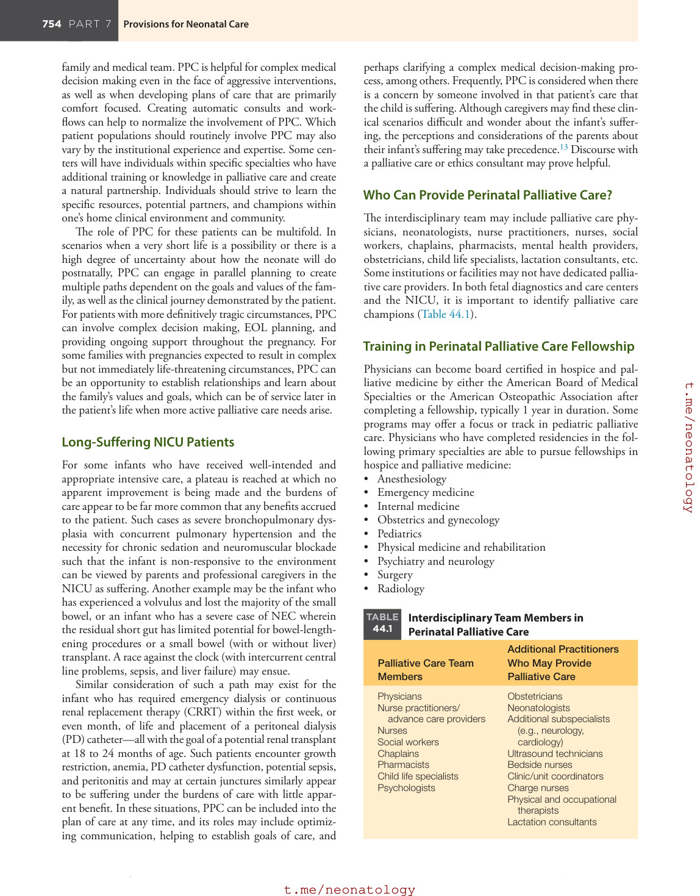
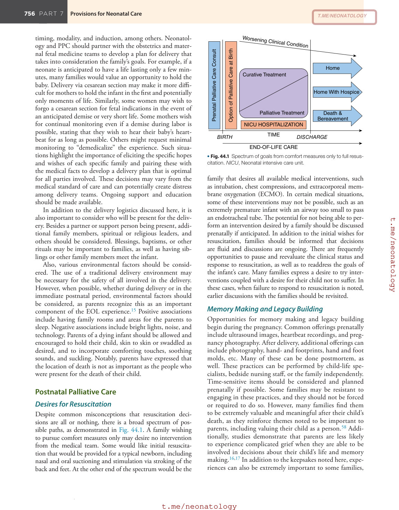
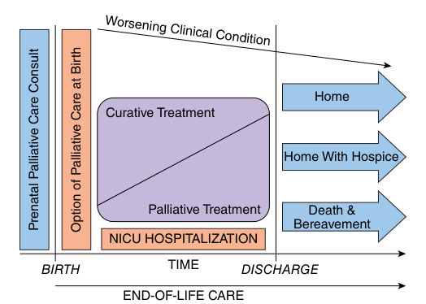

# 44. Perinatal Palliative Care
> Source attribution: [Source credits](../../SOURCE_CREDITS.md).

## PDF page 761 | printed page 752

44 Perinatal Palliative Care

### KELSTAN LYNCH ELLIS AND BRIAN S. CARTER

Go around and see what is being done and then see how your own circumstances can produce another version; there is need for diversity in this field.

### —DAME CICELY SAUNDERS

### What Is Perinatal Palliative Care?

Perinatal palliative care (PPC) consists of the coordinated efforts of a multidisciplinary team to optimize quality of life and comfort for infants with life-limiting conditions and their caregivers. It also includes attending to how the parents of a fetus with a potentially life-limiting condition receive and process new and difficult information, supporting them throughout the very fluid decision-making process, and respecting their values and wishes throughout pregnancy.

### History

The principles of hospice and palliative care were originally described by Dame Cicely Saunders in the late 1950s. She described the need for an interdisciplinary team to provide support for a dying person, emphasizing the concept of “total pain.” As technology and medicine continued to advance, the American Board of Medical Specialties and the Accreditation Council for Graduate Medical Education recognized the subspecialty of Hospice and Palliative Medicine in 2006.

The National Consensus Project for Quality Palliative Care was first released in 2004 and was most recently updated in 2018.1 It has published clinical practice guidelines for quality palliative care that include eight specific domains. Although this text is not specific to the perinatal population, the content can and should be applied to the uniquely vulnerable populations of pregnant women and their fetuses/newborns. These domains include the following: • Structure and processes of care • Physical aspects of care (including symptom management) • Psychological and psychiatric aspects of care • Social aspects of care • Spiritual, religious, and existential aspects of care • Cultural aspects of care

752

• End-of-life (EOL) care • Legal and ethical aspects of care

(See https://www.nationalcoalitionhpc.org/ncp/.) The idea of applying palliative care to newborns was first described separately by Silverman and Whitfield et al. in 1982.2,3 These authors cited the need to apply hospice concepts to neonatal care due to significant advancements in neonatology and the sometimes difficult care processes that come with the management of increasingly smaller newborns, those with congenital anomalies, and those suffering from protracted, complicated, iatrogenic conditions.

### Current State

Over the past several decades, PPC has experienced significant growth and development. In 1971, there were no publications on PPC, but in recent years more than 100 new articles have been published in the peer-reviewed medical literature annually.4 There may be as many as 300 programs currently providing perinatal hospice and palliative care services.5 A 2016 investigation of active PPC programs identified 136 programs in 42 states,6 although this number is likely to have increased since then.

Investigations into the important components of palliative care for families have demonstrated the following key themes:6–8 • Respect for parent preferences and choices • Support • Respect for the infant (“My baby is a person”) • Opportunity to function as parents (bathing, dressing,

holding) • Arrested parenting • Grieving multiple losses • Fragmented health care versus the desire for consistency

of care • Disconnection from family and friends • Feeling utterly alone

In 2019, the American College of Obstetricians and Gynecologists published Committee Opinion on Perinatal Palliative Care Number 786, concluding that PPC care has a dual focus on ameliorating suffering and honoring patient values and can therefore be provided concurrently with life-prolonging interventions. They also recommend that PPC should

## PDF page 762 | printed page 753

include a formal prenatal consultation, development of a birth plan, access to other neonatal and pediatric specialties as needed, and support and care during the prenatal, birth, and postnatal periods, including bereavement counseling.9

### Providing Perinatal Palliative Care

### Who Benefits From Perinatal Palliative Care?

Since the initial discussions published by Silverman2 and Whitfield et al.,3 there have been three broad categories of fetal to neonatal patients who should receive palliative care. First is the extremely premature newborn at the cusp of likely being able to sustain life with the provision of neonatal resuscitation, life support, and admission to the neonatal intensive care unit (NICU). The second category includes infants born with a wide variety of birth anomalies, chromosomal aneuploidy, or other genetic conditions known to lead to complicated, perhaps technology-dependent, lives or lead to an early death. The third category includes children who have received appropriate intensive care but who no longer benefit from it and are perceived to be suffering greater burdens of that care with little to no benefit. These categories were reiterated by Catlin and Carter in their seminal article in 2002; they were again revisited and remain appropriate.4,10

### Extremely Premature Infants

When a pregnancy reaches the age of periviability—generally between and 22 and 24 weeks’ gestation—there are numerous considerations with regard to management of the pregnancy, labor, and delivery, as well as resuscitation and the provision of intensive care in the NICU. The tolerance of labor and delivery, whether an operative delivery is necessary, and what fetal or maternal conditions impact the pregnancy must all be considered. Matters such as intrauterine growth restriction, chorioamnionitis, placental abruption, or cord accidents may result in a marginally responsive newborn at the time of delivery when life-supporting measures must be provided instantly for the infant to secure a foothold in extrauterine life. Prior parental discussions about acceptable risk and what to do when confronted with neonatal instability or complications after birth should inform decision making.11 Yet, uncertainty for each newborn’s short- and long-term prognosis must be acknowledged.12 Hence, the inclusion of PPC may be an adjunct to concurrent intensive care and provide a supportive role while parents traverse the uncertainty of the first postnatal days. A redirection of care away from cure-oriented, life-extending care toward palliative and comfort goals aimed at optimizing human contact and minimizing invasive interventional measures that are deemed to lack benefit, present undue burdens to the baby, and impede a desired quality of life in a foreseeably short lifespan may be considered, particularly when confronted with complications of prematurity such as intracranial hemorrhage, pulmonary hemorrhage, or severe necrotizing enterocolitis (NEC).

### Patients With a Life-Limiting Diagnosis

In some centers, there are mandatory trigger diagnoses that prompt a PPC consult. Examples can be seen in Box 44.1. It is important to note that palliative care involvement can and should occur regardless of the goals of care determined by the

• BOX 44.1 Common Neonatal Trigger Diagnoses

That May Prompt a Perinatal Palliative Care Consult

Central Nervous System

• Severe neural tube defects • Neuronal migration disorders: schizencephaly, polymicrogyria • Severe hypoxic ischemic encephalopathy (HIE) or

prolonged hypoxic events

Cardiac

• Initiation of extracorporeal membrane oxygenation (ECMO) • Complex congenital heart disease: hypoplastic left heart

syndrome or other lesions resulting in single ventricle physiology

Dermatology

• Epidermolysis bullosa

Gastroenterology

• Biliary atresia, severe short gut syndrome, giant

omphalocele

Genetics/Chromosomal

• Aneuploidies: trisomy 13, trisomy 18, severe case of Wolf-

Hirschhorn (4p–) syndrome or Cri du chat (5p–) syndrome • Severe metabolic disorders • Storage disorders • Mitochondrial disorders

Infectious Disease and Immune Disorders

• Severe herpes simplex virus, congenital cytomegalovirus,

congenital toxoplasmosis, congenital Zika syndrome • Severe combined immunodeficiency disorder

Musculoskeletal

• Spinal muscular atrophy type 1, myotonic dystrophies,

congenital diaphragmatic hernia • Severe forms of skeletal dysplasia (osteogenesis

imperfecta, thanatophoric dysplasia)

Respiratory

• Consideration of tracheostomy placement • Severe pulmonary hypoplasia • Asphyxiating thoracic dystrophies

Renal

• Renal dysgenesis, agenesis, hypoplasia, or autosomal

recessive polycystic kidney disease • Potter syndrome and severe oligohydramnios sequence

Other

• Twin-to-twin transfusion syndrome • Extreme prematurity (<24 weeks) • Extremely low birth weight (<500 g)

## PDF page 763

family and medical team. PPC is helpful for complex medical decision making even in the face of aggressive interventions, as well as when developing plans of care that are primarily comfort focused. Creating automatic consults and workflows can help to normalize the involvement of PPC. Which patient populations should routinely involve PPC may also vary by the institutional experience and expertise. Some centers will have individuals within specific specialties who have additional training or knowledge in palliative care and create a natural partnership. Individuals should strive to learn the specific resources, potential partners, and champions within one’s home clinical environment and community.

The role of PPC for these patients can be multifold. In scenarios when a very short life is a possibility or there is a high degree of uncertainty about how the neonate will do postnatally, PPC can engage in parallel planning to create multiple paths dependent on the goals and values of the family, as well as the clinical journey demonstrated by the patient. For patients with more definitively tragic circumstances, PPC can involve complex decision making, EOL planning, and providing ongoing support throughout the pregnancy. For some families with pregnancies expected to result in complex but not immediately life-threatening circumstances, PPC can be an opportunity to establish relationships and learn about the family’s values and goals, which can be of service later in the patient’s life when more active palliative care needs arise.

### Long-Suffering NICU Patients

For some infants who have received well-intended and appropriate intensive care, a plateau is reached at which no apparent improvement is being made and the burdens of care appear to be far more common that any benefits accrued to the patient. Such cases as severe bronchopulmonary dysplasia with concurrent pulmonary hypertension and the necessity for chronic sedation and neuromuscular blockade such that the infant is non-responsive to the environment can be viewed by parents and professional caregivers in the NICU as suffering. Another example may be the infant who has experienced a volvulus and lost the majority of the small bowel, or an infant who has a severe case of NEC wherein the residual short gut has limited potential for bowel-lengthening procedures or a small bowel (with or without liver) transplant. A race against the clock (with intercurrent central line problems, sepsis, and liver failure) may ensue.

Similar consideration of such a path may exist for the infant who has required emergency dialysis or continuous renal replacement therapy (CRRT) within the first week, or even month, of life and placement of a peritoneal dialysis (PD) catheter—all with the goal of a potential renal transplant at 18 to 24 months of age. Such patients encounter growth restriction, anemia, PD catheter dysfunction, potential sepsis, and peritonitis and may at certain junctures similarly appear to be suffering under the burdens of care with little apparent benefit. In these situations, PPC can be included into the plan of care at any time, and its roles may include optimizing communication, helping to establish goals of care, and

perhaps clarifying a complex medical decision-making process, among others. Frequently, PPC is considered when there is a concern by someone involved in that patient’s care that the child is suffering. Although caregivers may find these clinical scenarios difficult and wonder about the infant’s suffering, the perceptions and considerations of the parents about their infant’s suffering may take precedence.13 Discourse with a palliative care or ethics consultant may prove helpful.

### Who Can Provide Perinatal Palliative Care?

The interdisciplinary team may include palliative care physicians, neonatologists, nurse practitioners, nurses, social workers, chaplains, pharmacists, mental health providers, obstetricians, child life specialists, lactation consultants, etc. Some institutions or facilities may not have dedicated palliative care providers. In both fetal diagnostics and care centers and the NICU, it is important to identify palliative care champions (Table 44.1).

### Training in Perinatal Palliative Care Fellowship

Physicians can become board certified in hospice and palliative medicine by either the American Board of Medical Specialties or the American Osteopathic Association after completing a fellowship, typically 1 year in duration. Some programs may offer a focus or track in pediatric palliative care. Physicians who have completed residencies in the following primary specialties are able to pursue fellowships in hospice and palliative medicine: • Anesthesiology • Emergency medicine • Internal medicine • Obstetrics and gynecology • Pediatrics • Physical medicine and rehabilitation • Psychiatry and neurology • Surgery • Radiology

Interdisciplinary Team Members in

TABLE

44.1

Perinatal Palliative Care

Additional Practitioners Who May Provide Palliative Care

Palliative Care Team Members

Physicians Nurse practitioners/

Obstetricians Neonatologists Additional subspecialists

advance care providers Nurses Social workers Chaplains Pharmacists Child life specialists Psychologists

(e.g., neurology, cardiology) Ultrasound technicians Bedside nurses Clinic/unit coordinators Charge nurses Physical and occupational

therapists Lactation consultants

## PDF page 764 | printed page 755

Certification is also available for physicians wishing to become hospice medical directors. This can be achieved with or without palliative care fellowship training. Additional graduate-level training opportunities include the following: • University of Colorado Denver Graduate School

Interprofessional Master of Science in Palliative Care and Palliative Care Certificate Programs • University of Maryland Graduate School Online Master

of Science and Graduate Certificates in Palliative Care • University of Washington Interprofessional Graduate

Certificate Course in Palliative Care • The Coleman Palliative Medicine Training Program,

which offers professional development in communication and supportive care Also, the Center for Palliative Care at Harvard Medical School offers a variety of courses and training opportunities, including palliative care basics for nurses, intensive training for palliative care leaders, and a course in palliative care for hospitalists and intensivists (https://pallcare.hms.harv ard.edu/). The Center to Advance Palliative Care (CAPC) is another resource for palliative care education and offers toolkits and courses on a variety of topics, some of which require a CAPC membership but others are available for free (https://www.capc.org/).

VitalTalk is a training program that focuses on training clinicians in communicating effectively with seriously ill patients and their families. The VitalTalk website has a multitude of accessible resources available a no cost. Additionally, most intensive courses are available for a variety of disciplines, including faculty development, mastering tough conversations, and delivering serious news. VitalTalk Mobile is a virtual course for “busy health care professionals looking to avoid common communication pitfalls” (https:/ /www.vitaltalk.org/).

### Components of Perinatal Palliative Care

An initial PPC consult should include a review of the fetal or neonatal diagnosis, an introduction to palliative care, and a review of the variety of decisions that the woman and her family may face both antenatally and during the perinatal period, taking into consideration before, during, and after the birth. The provision of PPC can be divided into three primary phases: antenatal, delivery, and postnatal.

### Antenatal Diagnosis and Decisions

The delivery of PPC typically follows a consultation after the obstetrical clinician (e.g., obstetrician, maternal-fetalmedicine physician, or certified advance practice provider such as a nurse midwife) makes a diagnosis that raises concerns about the fetal condition and survival throughout the pregnancy (e.g., twin-twin transfusion syndrome with severe growth discordance, congenital anomalies, hydrops), the need for specialty management in a level III or level IV NICU, or the anticipation of a brief life or one complicated

by prolonged hospitalization with an increased risk of death prior to NICU discharge. Whether the PPC consultant meets the family alone, accompanied by other PPC interdisciplinary team members, or in concert with a neonatologist and other specialty physicians (e.g., pediatric cardiologist, surgeon, neurologist, nephrologist), the direction taken typically follows a path of explaining what the condition means for the fetus and the anticipated special needs at or after birth, exploring further diagnostic and treatment options, and addressing a spectrum of outcomes.

Families may or may not have had the diagnosis disclosed to them. PPC can partner with other members of the medical team to present information and then encourage a pause for parents to process the information and to assess parental understanding. PPC can facilitate discussions about the options for next steps, including but not limited to expectant management with birth planning, the potential for fetal interventions if available, termination, and the timing and modality of delivery. Regardless of what decisions are made, comprehensive care should continue for these families, including ongoing palliative care, grief support, continued discussion as the pregnancy evolves, and frequent check-ins regarding the family’s wishes and concerns.

### Birth and Delivery Planning

A major task for the PPC consultant or team is understanding the mother’s (and her partner’s) vision for this pregnancy, their narrative bringing them to this point, and what is most important to them moving forward. Acknowledging and validating the impact that the newly made diagnosis has made are also necessary. Thereafter, the parents’ goals for the pregnancy, the delivery, and the neonatal course should be sensitively discussed. Although a birth plan may be an end goal, it need not be accomplished in the first encounter. As fetal growth and well-being are followed over time (with additional diagnoses being made or the severity of the initial finding being further elaborated), decision making will be fluid as uncertainty waxes and wanes. It is this accompaniment through this uncertain, even liminal, time of pregnancy that may best define the added value of PPC.

The relatively frequent phenomenon of prognostic uncertainty may give rise to an appearance of parental ambiguity. This should not be construed as “denial” regarding a diagnosis or communicated prognosis. Mothers, fathers, and partners all may be trying to find their way forward while contending with something they never anticipated—in a manner similar to what is described regarding older children in critical care whose parents are wrestling with “being a good parent.”14 They may vacillate between seemingly opposite goals, ranging from comfort measures only to full resuscitation and intensive care. What this may represent is a process of accommodation, during which time it is likely best to engage in parallel planning.

Several factors should be considered in delivery planning in situations where palliative care is involved, including

## PDF page 765

timing, modality, and induction, among others. Neonatology and PPC should partner with the obstetrics and maternal fetal medicine teams to develop a plan for delivery that takes into consideration the family’s goals. For example, if a neonate is anticipated to have a life lasting only a few minutes, many families would value an opportunity to hold the baby. Delivery via cesarean section may make it more difficult for mothers to hold the infant in the first and potentially only moments of life. Similarly, some women may wish to forgo a cesarean section for fetal indications in the event of an anticipated demise or very short life. Some mothers wish for continual monitoring even if a demise during labor is possible, stating that they wish to hear their baby’s heartbeat for as long as possible. Others might request minimal monitoring to “demedicalize” the experience. Such situations highlight the importance of eliciting the specific hopes and wishes of each specific family and pairing these with the medical facts to develop a delivery plan that is optimal for all parties involved. These decisions may vary from the medical standard of care and can potentially create distress among delivery teams. Ongoing support and education should be made available.

In addition to the delivery logistics discussed here, it is also important to consider who will be present for the delivery. Besides a partner or support person being present, additional family members, spiritual or religious leaders, and others should be considered. Blessings, baptisms, or other rituals may be important to families, as well as having siblings or other family members meet the infant.

Also, various environmental factors should be considered. The use of a traditional delivery environment may be necessary for the safety of all involved in the delivery. However, when possible, whether during delivery or in the immediate postnatal period, environmental factors should be considered, as parents recognize this as an important component of the EOL experience.15 Positive associations include having family rooms and areas for the parents to sleep. Negative associations include bright lights, noise, and technology. Parents of a dying infant should be allowed and encouraged to hold their child, skin to skin or swaddled as desired, and to incorporate comforting touches, soothing sounds, and suckling. Notably, parents have expressed that the location of death is not as important as the people who were present for the death of their child.

### Postnatal Palliative Care

### Desires for Resuscitation

Despite common misconceptions that resuscitation decisions are all or nothing, there is a broad spectrum of possible paths, as demonstrated in Fig. 44.1. A family wishing to pursue comfort measures only may desire no intervention from the medical team. Some would like initial resuscitation that would be provided for a typical newborn, including nasal and oral suctioning and stimulation via stroking of the back and feet. At the other end of the spectrum would be the

Worsening Clinical Condition

Option of Palliative Care at Birth

Prenatal Palliative Care Consult

Home

Curative Treatment

Home With Hospice

Palliative Treatment

Death & Bereavement NICU HOSPITALIZATION

BIRTH TIME DISCHARGE

END-OF-LIFE CARE

• Fig. 44.1 Spectrum of goals from comfort measures only to full resuscitation. NICU, Neonatal intensive care unit.

family that desires all available medical interventions, such as intubation, chest compressions, and extracorporeal membrane oxygenation (ECMO). In certain medical situations, some of these interventions may not be possible, such as an extremely premature infant with an airway too small to pass an endotracheal tube. The potential for not being able to perform an intervention desired by a family should be discussed prenatally if anticipated. In addition to the initial wishes for resuscitation, families should be informed that decisions are fluid and discussions are ongoing. There are frequently opportunities to pause and reevaluate the clinical status and response to resuscitation, as well as to readdress the goals of the infant’s care. Many families express a desire to try interventions coupled with a desire for their child not to suffer. In these cases, when failure to respond to resuscitation is noted, earlier discussions with the families should be revisited.

### Memory Making and Legacy Building

Opportunities for memory making and legacy building begin during the pregnancy. Common offerings prenatally include ultrasound images, heartbeat recordings, and pregnancy photography. After delivery, additional offerings can include photography, hand- and footprints, hand and foot molds, etc. Many of these can be done postmortem, as well. These practices can be performed by child-life specialists, bedside nursing staff, or the family independently. Time-sensitive items should be considered and planned prenatally if possible. Some families may be resistant to engaging in these practices, and they should not be forced or required to do so. However, many families find them to be extremely valuable and meaningful after their child’s death, as they reinforce themes noted to be important to parents, including valuing their child as a person.58 Additionally, studies demonstrate that parents are less likely to experience complicated grief when they are able to be involved in decisions about their child’s life and memory making.16,17 In addition to the keepsakes noted here, experiences can also be extremely important to some families,

## PDF page 766 | printed page 757

• BOX 44.2 Common Offerings for Memory

Making for Newborns at the End of Life

• Photography including ultrasound images • Heartbeat recording • Handprints/footprints • Molds • Fingerprint charms • Special outfits, blankets, etc. • Baby books or other traditional mementos • Locks of hair

including bathing, holding, attempting to feed, and dressing the infant, as well as experiencing skin-to-skin contact (Box 44.2).

### Disposition and Hospice

Not infrequently, neonates survive longer than anticipated based on prenatal findings. Ideally, this possibility should be included in prenatal discussions, but some families may not be able to engage in such a level of planning until after delivery and survival through the immediate postpartum transition. If an infant is relatively clinically stable after day one or two of life, discharge from the NICU may be appropriate simultaneous with the mother’s discharge, depending on the family’s goals and the infant’s clinical status. The multiple disposition options include discharge home with hospice supports, use of inpatient hospice facilities, or the infant remaining an inpatient through the EOL.

For some families, transition from the hospital to the home environment is highly desirable. Discharge criteria for these infants are frequently different than for the traditional NICU discharge candidate. In some instances, discharge with unresolved respiratory or feeding issues may be appropriate, including discharge with nasogastric feedings or up to 2 L/min of supplemental oxygen via nasal cannula. Discussions about the utilization of these supports as comfort measures, rather than as a means of life prolongation, should occur prior to discharge. In these situations, the medical team should work to identify and establish in-home support, typically in the form of hospice care. Hospice represents a group of services, including nursing, social work, chaplaincy, and more. Typically, hospice nursing staff will visit the home as frequently as needed, usually once or twice a week. It is important to note that hospice care does not include private-duty nursing or staff who come into a home and work a traditional nursing shift. The hospice agency can offer significant support for symptom management and psychosocial support to the family through the infant’s medical journey and after the EOL. It is also worth noting that, given the high degree of uncertainty about a prognosis in many of these circumstances, some infants may do well after discharge and go on to live months or even years, graduating from hospice and transitioning to a different, more traditional level of pediatric and subspecialty care.

Depending on institutional standards and team comfort, continued admission in the NICU or hospital for EOL care may also be appropriate. Efforts should be made to continue partnering with parents and family to engage in meaningful plans of care to support families through the EOL process regardless of the time frame.

Finally, discharge to an inpatient hospice facility or a hospice house may also offer an alternative to remaining in the hospital but avoiding an EOL in a family’s home. This may be a good option for families not wishing to discharge home for a variety of reasons but who do not wish to remain in the hospital. Specific resources vary by area.

### Follow-Up After Discharge

Regardless of the inpatient medical journey, when a baby is discharged from the initial hospitalization a clear follow-up plan should be established. For infants discharged with hospice support, a hospice attending of record should be identified. This may be a local pediatrician, the medical director of the hospice agency, or occasionally a subspecialist closely involved in the patient’s care. Regardless of hospice involvement, engaging in routine pediatric care may be a meaningful experience for some families. Additionally, subspecialty involvement may be indicated for complex symptom management and evolving decision making.

### Psychosocial Support for Teams and Family

One of the primary roles of PPC is to provide ongoing psychosocial support for patient families throughout these challenging circumstances. Doing so requires an emphasis on continuity, serving as stewards of the patient’s story and striving for optimal communication and goal-concordant care, in addition to holding space for emotion processing and neutral safe spaces. This, particularly, requires interdisciplinary collaboration with mutual respect. Many PPC teams include medical clinicians such as doctors and nurses, but equally as important are the roles of social workers, psychologists, child life specialists, chaplains, and more. It is important to surround the family with this intensive support throughout their journey prenatally, during the child’s life, and after death.

Although formal PPC practitioners may vary from institution to institution, there is a significant role for palliative care champions at all levels. These are individuals who can advocate for the principles and practices outlined in this chapter, as well as the involvement of formal PPC when available. These individuals may participate in additional training, either within the institution or externally, and help perpetuate good PPC practices and normalize the involvement of PPC into standards of care.

In addition to supporting patients and families, it frequently is the role of palliative care providers and champions to provide additional support to team members involved in the intensive and complicated work of planning for and executing exceptional PPC. Institutions should strive to offer opportunities for debriefings after patient deaths and other difficult circumstances. Additionally, palliative care

## PDF page 767

education and implementation must be accompanied by discussions of resiliency and mindfulness. PPC inevitably takes a toll on all who are involved the work; long-term impacts such as burnout should be mitigated as much as possible and given appropriate and thorough consideration at each level.

### Symptom Management

The remainder of this chapter focuses on symptom management. Neonatologists are frequently skilled at symptom management in the neonate, and much of this knowledge can be translated into the palliative care realm. Particularly important is considering the underlying cause of the symptom and, if possible, addressing this cause as a primary means of alleviating the symptom. Identifying potential causes for symptoms is also paramount in determining the appropriate intervention or medication for treatment. The most significant difference is the primary focus of the treatment, which, typically in palliative care or comfort-focused settings, is the alleviation of suffering rather than resolving or treating the underlying issue or cause.

In addition to the choice of medication, the dose, route of administration, and potential adverse effects require additional attention in circumstances such as technology removal or end of life. Some families express a desire to remove lines and tubes, creating a more natural state for their child’s EOL. Consistent and convenient routes of administration such as central lines or peripheral intravenous lines may be removed (or may not be replaced if lost) based on each family’s wishes. The benefit of maintaining secure access for symptom control should be discussed with families, and preferences should be elucidated. Most frequently, this is a concern when there is significant concern for pain, seizures, and dystonia. Alternative dosing routes (e.g., oral, buccal, enteral, intranasal) should also be considered to continue symptom control without the need to maintain or establish intravenous access.

### Pain

Pain is among the most concerning symptoms during intensive care and particularly in the context of palliative care or comfort-focused care. Although previously misunderstood, it is now well accepted that inadequate treatment of pain in the neonate is unethical, especially in the EOL setting.18 Exposure to analgesic and anxiolytic medications in infants who die in intensive care units has increased significantly over the past 15 years.19 However, there remain concerns that pain is still inconsistently treated, including in the EOL period.20 This may be related, in part, to concerns about hastening death through pain medication administration. However, evidence demonstrates that infants with adequate pain control live longer than those with uncontrolled pain and agitation.21 Multiple studies have shown that morphine administration is not likely to hasten patient death.22,23 Yet, concerns remain among practitioners and institutions.

Ethically, this is addressed by the principle of double effect, which focuses on the intent of an action rather than the outcome.24 This can be applied to the administration of pain medication at frequency and dosing higher than typically utilized outside of EOL care. If the intention of the action is to alleviate pain and suffering, any associated sequelae, even if anticipated or expected, are considered ethically permissible.

Treating pain requires consistent and objective evaluation of the pain using a consistent scale or method. No individual pain scale has been found to be superior to others.25,26 However, it is important to note that these criteria may be loosened or forgone in the EOL setting dependent on treatment goals and families’ preferences. Families may not want frequent medical assessments that would typically occur in routine pain assessments, and these wishes should be respected. Caregivers and bedside staff can be educated to look for signs of pain and distress in the neonate (e.g., grimacing, agitation), and treatment can be alternatively based on these signs. Additional factors may impact pain assessment and treatment during comfort care; for example, some families may accept some discomfort to be able to spend time with their infant while he or she is awake and alert. Alternatively, many families feel that optimized pain control, even at the expense of wakeful periods, is preferable.

### Nonpharmacologic Treatment of Pain and Suffering

First steps to alleviate pain and suffering should always include nonpharmacological interventions that occasionally are sufficient in the neonatal population. Nonpharmacologic treatments should be continued as adjunctive therapies if additional medications and interventions are added to the comfort plan of care. Many simple interventions reduce pain in neonates in the ICU, including skin-to-skin/ kangaroo care, holding, swaddling, breastfeeding, exposure to the odor of maternal breast milk, non-nutritive sucking (including pacifier use), and massage.27–29 Although not specifically described in the PPC setting in the literature, these are simple, non-invasive interventions that may offer significant benefit with minimal or no risk. Additionally, these are interventions that can frequently be performed by parents or caregivers, allowing families to be actively engaged with their child and minimize the need for medical personnel, which may be desirable to some families.

### Opioids

In conjunction with the nonpharmacologic interventions discussed above, opioids are consistently utilized in the NICU setting when minimizing pain is a primary objective. Opioids are a class of medication used worldwide for the treatment of pain in a multitude of circumstances. Within the central nervous system, opioids bind to the mu, kappa, delta, and sigma receptors and can act as partial or

## PDF page 768 | printed page 759

complete agonists, antagonists, and mixed agonist-antagonists. As a class, opioids can cause respiratory depression, more frequently with fentanyl than morphine, and sedation. Although becoming more controversial for the treatment of many causes of pain, opioids remain a mainstay of pain alleviation in the EOL setting. For the purposes of this discussion, the concerns about opioid misuse and abuse are not addressed.

Morphine and fentanyl are the most utilized opioids in the NICU setting. Morphine is used in almost all patient populations in palliative care and remains an excellent choice in the EOL setting due to its multiple routes of administration and being relatively inexpensive and widely available. Additionally, it can also alleviate dyspnea, another symptom of significant concern in the EOL periods. Important side effects to consider include hyperalgesia, myoclonic movements, or pruritus, which can increase distress in the EOL period.30 These side effects are more likely to occur with the use of continuous morphine infusion. Hyperalgesia should be suspected with persistent pain, despite multiple escalations in opioid dosing. In the event of hyperalgesia, opioid rotation, frequently to hydromorphone, as well as the addition of clonidine as an adjuvant medication, should be considered.31

Fentanyl is significantly more potent than morphine (approximately 100 times), with a shorter onset of action and shorter half-life, making this a favorable choice for rapid titration to achieve pain control. Fentanyl is available in intravenous and intranasal routes, with the latter emerging as a safe and effective means of treating pain in the newborn population.32 Pertinent sequelae to consider with fentanyl use include chest wall rigidity, typically seen with large bolus doses that are rapidly administered,33 and increased frequency of apneas, associated with bolus rather than continuous administration.34

### Non-Opioid Pain Medications

A variety of medications and drug classes can be used in conjunction with or as alternatives to opioids. A frequently utilized medication in this population is acetaminophen, which can be administered orally or rectally as an antipyretic or for mild to moderate pain. This drug is typically widely available and relatively inexpensive. Intravenous paracetamol (the prodrug of acetaminophen) is an effective opioid adjunct for the management of neonatal pain.35 Data on the use of nonsteroidal anti-inflammatory drugs (NSAIDs, such as ibuprofen and naproxen) at the EOL in the newborn population remain lacking but these are generally not utilized.

Much of what is known about neonatal pain control comes from the world of postoperative and procedure research. Both dexmedetomidine and propofol have become widely utilized in these contexts and are gaining popularity in the PPC population. Additionally, clonidine and ketamine are also being considered and used more frequently. These are good alternatives if there are concerns

about respiratory depression from opioid use; however, specific recommendations cannot be made at this time due to a lack of robust literature in the PPC domain. Dexmedetomidine is an alpha-2 adrenoreceptor agonist and is only available intravenously. Its half-life is approximately 2 hours. Another medication in this class is clonidine, which can be used as an opioid adjuvant in cases of hyperalgesia as described above. Propofol offers additional routes of administration (intravenous and intranasal) and has noted variability in patient response.36 Ketamine has multiple desirable properties in addition to pain control, including anxiolysis and amnesia. Typically, it is administered intravenously, although there is emerging evidence of its efficacy when administered intranasally.37,38 Again, none of these medications has significant research demonstrating their utility for PPC, but they may be utilized based on individual experience, unique patient characteristics, and involvement of specialists such as pain management teams or anesthesiology.

Benzodiazepines, most frequently midazolam and lorazepam, can be used in conjunction with opioids to improve pain control, but they should not be utilized as a single agent. This class of medications can also alleviate agitation and anxiety, although validated means of measuring these symptoms are not readily available for the neonatal population. As many as 10% of neonates receiving benzodiazepines can develop myoclonic jerking, a distressing symptom for caregivers.39 This may be related to neurological immaturity or ischemic injury. If myoclonic jerking occurs, transition to another medication should take place. Benzodiazepines can be administered in a variety of routes, making them desirable in the EOL setting, particularly if families choose to not have intravenous access maintained throughout the dying process.

As mentioned previously, the cause of symptoms is an important consideration in medication selection. If there is concern for neuropathic pain, gabapentin may be beneficial. Gabapentin is a gamma-aminobutyric acid analog that is thought to inhibit pain via voltagedependent calcium ion channels in the central nervous system; it has been shown to reduce opioid and sedative medication use.40 This medication can be particularly useful in infants with neuro-irritability, chronic pain, and suspected viscera hyperalgesia. Gabapentin may also be a useful adjunct to morphine.41 There are few side effects of concern with gabapentin, and dosing can be rapidly increased. Another medication with potential neuroreceptor activity is the opioid methadone, although its extremely long half-life makes it unable to be titrated more quickly than every few days, making its utility in the acute EOL period limited.

### Dyspnea

Dyspnea is a significant concern for many families facing the end of their child’s life. This may be expressed as a worry about “suffocation,” “air hunger,” or any description

## PDF page 769

of distress related to the inability to breathe. Patients at risk for dyspnea in the NICU include those who were previously dependent on ventilatory support, especially those who have been managed on positive pressure or a fraction of inspired oxygen (FiO2) of >0.40 for a lengthy period. It is important to clarify that, when treating dyspnea in the EOL setting, the goal is comfort rather than cure. This may feel counterintuitive to many NICU providers, as typically the treatment for dyspnea is to increase respiratory support; however, when the goal is comfort, increasing support will not aid in achieving this goal and may increase suffering. Opioid medications remain the mainstay of treatment for dyspnea in the dying newborn. Specific to the concern of dyspnea, intranasal fentanyl and sublingual morphine are helpful options. The utilization of opioids as previously discussed is also an acceptable method of dyspnea management. Prompt relief of air hunger is desirable due to the ongoing stress witnessing it can cause to family members.

### Anxiety and Agitation

Although there are no standardized or validated tools for monitoring anxiety and agitation at the EOL, these are distressing symptoms for families to observe and should be assessed frequently and treated accordingly. Like pain, initial interventions for the management of anxiety and agitation should include nonpharmacologic interventions and adjusting environmental factors. Additionally, anxiety and agitation may be diminished by achieving adequate pain control and minimizing noxious or invasive interventions. Medical devices, such as endotracheal tubes, suctioning, and monitors, may contribute to agitation, and there should be discussion of reducing noxious stimuli. External stimuli should be similarly reduced when possible, such as eliminating or reducing laboratory testing (heel pricks, phlebotomy, or arterial sticks), imaging studies, bright lights, and noise exposure.

Benzodiazepines are the class of medications most frequently utilized to treat anxiety and agitation in neonatal patients. They reduce anxiety and effect muscle relaxation through the central nervous system, thereby reducing agitation, and thus reducing the augmentation or potentiation of pain. Barbiturates have been used historically to treat agitation and seizures in neonates. Phenobarbital has a long half-life and is difficult to titrate quickly, making it less desirable for acute symptom management purposes. Pentobarbital can be given orally or intravenously; it demonstrates more profound effects than phenobarbital and is shorter acting. Finally, barbiturates have been demonstrated to be effective as a sole agent for sedation in some patients where tolerance to opioid and benzodiazepines has developed due to long-term utilization.42,43 The barbiturate pentobarbital has historical use in euthanasia, which may contribute to practitioner or family distress. However, education about the indication for its use as an anxiolytic agent rather than for euthanasia should be provided, and

continued communication throughout its utilization may alleviate this concern.

### Seizures

Although all uncontrolled symptoms can be difficult to witness in a dying neonate, seizures are particularly distressing for families, due to the physical manifestations of convulsing serving as visible evidence of suffering and the interruption of other importance experiences such as holding. Dying patients are at risk for seizures regardless of a known seizure disorder due to hypoxia and other factors. Therefore anticipation of this should be included in EOL planning, and treatment should be readily accessible. If a patient is known to have an underlying seizure disorder, any established anticonvulsant medications should be continued. As previously mentioned, some benzodiazepines, including lorazepam and midazolam, are frequently used as pain adjuncts and anxiolytics at the EOL. Midazolam has also been studied in the palliative care setting.44 Their multitude of uses, including seizure control, makes benzodiazepines useful for NICU patients experiencing EOL.

### Delirium

The concern for delirium in NICU patients is a relatively new concern, yet it has quickly become identified as an important symptom to address. The Cornell Assessment of Pediatric Delirium can be used in the neonatal population and is tied to developmental anchor points that can be utilized in infants.45 Similar to pain and agitation, delirium and pain also overlap significantly.46 Therefore adequate treatment of pain and additional symptoms should be simultaneously pursued while treating delirium. Consultation with pediatric psychiatry may also be helpful. Patients at risk for delirium in the NICU include older infants (e.g., 2 to months of age or older) with a long history of requiring assisted ventilation and surgical patients demonstrating symptoms despite the use of opioids and benzodiazepines.47–49 There is some evidence indicating effective treatment of neonatal delirium with haloperidol or atypical antipsychotics such as risperidone or quetiapine.47,49–51 Weaning continuous infusions of benzodiazepines and opioids or decreasing dosing may also be effective.

### Sialorrhea

Part of the anticipated death process involves increased difficulty with managing one’s own secretions. This can be exacerbated in NICU patients if there are additional neurologic, musculoskeletal, or respiratory concerns. If not managed adequately and without appropriate education, this can be very distressing to families. Although deep suctioning can be traumatic, oral and pharyngeal suctioning may help alleviate some secretions. The use of atropine drops and transdermal scopolamine is well accepted in older patients52,53 but has yet to be described in the neonatal population.

## PDF page 770 | printed page 761

### Myoclonus

In addition to a potential side effect from opioid use, myoclonic jerking may occur in the neonate because of hypoxic ischemic brain damage or an immature central nervous system. Management should be focused on reversing the underlying cause, if possible. If the jerking is not determined to be the side effect of a medication, discussion with the family and reassurance may be helpful. Neuromuscular blocking agents should not be utilized to mask myoclonus, and they do not have an accepted place in pediatric EOL care.

### Anticipatory Guidance for End of Life

Family members and loved ones of a dying neonate should be informed about the natural dying process and anticipated changes, including changes in respiratory patterns, color change of the skin, vital sign lability, cooling and mottling of the extremities, and any other known anticipated changes. If possible, a general timeline or range should also be discussed, such as the anticipation that a fully ventilator-dependent infant will live for minutes to hours after a palliative extubation or that a patient with anticipated cardiopulmonary failure related to congenital differences may live for hours to days. Open and clear communication about what to expect as part of the dying process should be frequent and fluid, as each individual child has a unique course and every collection of loved ones and family members will have different values and needs.

Key Points

• A variety of neonatal intensive care unit patients benefit

from palliative care, not only those at end of life, but patients and families facing significant uncertainty for the future and complex medical decision making. • Delivery of perinatal palliative care should include an

interdisciplinary approach addressing the physical, psychological, social, spiritual, and cultural considerations of a patient’s care. A central theme of this care should be delineating and aligning with the family’s goals of care.

### References

1. National Consensus Project for Quality Palliative Care. Clinical

Practice Guidelines for Quality Palliative Care. 4th ed. Richmond, VA: National Coalition for Hospice and Palliative Care; 2018. Accessed August 15, 2023. https://www.Nationalcoalitio nhpc.org/ncp 2. Silverman WA. A hospice setting for humane neonatal death.

Pediatrics. 1982;69(2):239. 3. Whitfield JM, Siegel RE, Glicken AD, Harmon RJ, Powers LK,

Goldson EJ. The application of hospice concepts to neonatal care. Am J Dis Child. 1982;136(5):421–424. https://doi.org/10.1001/ archpedi.1982.03970410039009. 4. Carter BS. Pediatric palliative care in infants and neonates. Children

(Basel). 2018;5(2):21. https://doi.org/10.3390/children5020021.

### What the Future Looks Like

PPC continues to be a growing and expanding field. Neonatologists and other clinicians caring for the neonatal population will undoubtedly encounter circumstances necessitating palliative care at an increasing incidence, particularly as technology and science continue to advance. In addition to the increasing number of PPC programs and providers, it is hoped that the future will also offer an increase in research on these topics and continued evolution of the practices discussed in this chapter.54

Multiple organizational decrees have recommended the inclusion of PPC into their standards for obstetrical and neonatal care, including the 2019 American College of Obstetrics and Gynecology outline of the importance of PPC.9

Similarly, the 2013 American Academy of Pediatrics guidelines on hospice and palliative care indicated that palliative care support should be available to patients and families throughout the spectrum of life, including prenatally.55 The National Association of Neonatal Nurses and the National Perinatal Association have both issued position statements endorsing the importance of PPC.56,57 This national recognition represents the importance of this facet of perinatal care and indicates that the inclusion of these practices will continue to expand and grow in the coming years and decades.

• Symptom management in the palliative care context cor-

relates to existing medical management with a shift in focus to optimizing comfort. Important considerations include considering causes for distressing symptoms, incorporating both pharmacologic and nonpharmacologic interventions, and pairing management strategies with family’s priorities and goals.

5. Perinatal Hospice & Palliative Care Programs and Support.

Accessed August 15, 2023. https://www.Perinatalhospice.org 6. Denney-Koelsch E, Black BP, Cote-Arsenault D, et al. A survey

of perinatal palliative care programs in the United States: structure, processes, and outcomes. J Palliat Med. 2016;19(10):1080– 1086. https://doi.org/10.1089/jpm.2015.0536. 7. Cote-Arsenault D, Denney-Koelsch E. “My baby is a person": par-

ents’ experiences with life-threatening fetal diagnosis. J Palliat Med. 2011;14(12):1302–1308. https://doi.org/10.1089/jpm.2011.0165. 8. Wool C, Catlin A. Perinatal bereavement and palliative care offered

throughout the healthcare system. Ann Palliat Med. 2019;8(suppl 1):S22–S29. https://doi.org/10.21037/apm.2018.11.03. 9. Perinatal palliative care: ACOG Committee Opinion, num-

ber 786. Obstet Gynecol. 2019;134(3):e84–e89. https://doi. org/10.1097/AOG.0000000000003425.

## PDF page 771

10. Catlin A, Carter B. Creation of a neonatal end-of-life pallia-

tive care protocol. J Perinatol. 2002;22(3):184–195. https://doi. org/10.1038/sj.jp.7210687. 11. Lantos JD. Ethical issues in treatment of babies born at 22 weeks

of gestation. Arch Dis Child. 2021;106(12):1155–1157. https:// doi.org/10.1136/archdischild-2020-320871. 12. Mercurio MR, Carter BS. Resuscitation policies for extremely

preterm newborns: finally moving beyond gestational age. J Perinatol. 2020;40(12):1731–1733. https://doi.org/10.1038/ s41372-020-00843-4. 13. Tate T. Pediatric suffering and the burden of proof. Pediatrics.

2020;146(suppl 1):S70–S74. https://doi.org/10.1542/peds.2020- 0818N. 14. October TW, Fisher KR, Feudtner C, Hinds PS. The parent per-

spective: "being a good parent" when making critical decisions in the PICU. Pediatr Crit Care Med. 2014;15(4):291–298. https:// doi.org/10.1097/PCC.0000000000000076. 15. Brosig CL, Pierucci RL, Kupst MJ, Leuthner SR. Infant end-of-

life care: the parents’ perspective. J Perinatol. 2007;27(8):510– 516. https://doi.org/10.1038/sj.jp.7211755. 16. Flach K, Gressler NG, Marcolino MAZ, Levandowski DC.

Complicated grief after the loss of a baby: a systematic review about risk and protective factors for bereaved women. Trends in Psychol. 2022. https://doi.org/10.1007/s43076-021-00112-z. 17. Kersting A, Wagner B. Complicated grief after perinatal loss.

Dialogues Clin Neurosci. 2012;14(2):187–194. 18. Anand KJ, Hickey PR. Pain and its effects in the human neonate

and fetus. N Engl J Med. 1987;317(21):1321–1329. https://doi. org/10.1056/NEJM198711193172105. 19. Zimmerman KO, Hornik CP, Ku L, et al. Sedatives and anal-

gesics given to infants in neonatal intensive care units at the end of life. J Pediatr. 2015;167(2):299–304.e3. https://doi. org/10.1016/j.jpeds.2015.04.059. 20. Carbajal R, Rousset A, Danan C, et al. Epidemiology and

treatment of painful procedures in neonates in intensive care units. JAMA. 2008;300(1):60–70. https://doi.org/10.1001/ jama.300.1.60. 21. Chan JD, Treece PD, Engelberg RA, et al. Narcotic and benzodi-

azepine use after withdrawal of life support: association with time to death? Chest. 2004;126(1):286–293. https://doi.org/10.1378/ chest.126.1.286. 22. Provoost V, Cools F, Bilsen J, et al. The use of drugs with a life

shortening effect in end-of-life care in neonates and infants. Intens Care Med. 2006;32(1):133–139. https://doi.org/10.1007/ s00134-005-2863-2. 23. Partridge JC, Wall SN. Analgesia for dying infants whose life

support is withdrawn or withheld. Pediatrics. 1997;99(1):76–79. https://doi.org/10.1542/peds.99.1.76. 24. Sulmasy DP, Pellegrino ED. The rule of double effect: clearing up

the double talk. Arch Intern Med. 1999;159(6):545–550. https:// doi.org/10.1001/archinte.159.6.545. 25. Carter BS, Brunkhorst J. Neonatal pain management. Semin

Perinatol. 2017;41(2):111–116. https://doi.org/10.1053/j.semperi.2016.11.001. 26. Carter BS, Jones PM. Evidence-based comfort care for neonates

towards the end of life. Semin Fetal Neonatal Med. 2013;18(2):88– 92. https://doi.org/10.1016/j.siny.2012.10.012. 27. Harrison D, Reszel J, Bueno M, et al. Breastfeeding for procedural

pain in infants beyond the neonatal period. Cochrane Database Syst Rev. 2016;10:CD011248. https://doi.org/10.1002/14651858. CD011248.pub2.

28. Johnston C, Campbell-Yeo M, Fernandes A, et al. Skin-to-skin

care for procedural pain in neonates. Cochrane Database Syst Rev. 2014;(1):CD008435. https://doi.org/10.1002/14651858. CD008435.pub2. 29. Baudesson de Chanville A, Brevaut-Malaty V, Garbi A,

et al. Analgesic effect of maternal human milk odor on premature neonates: a randomized controlled trial. J Hum Lact. 2017;33(2):300–308. 30. McClain BC, Probst LA, Pinter E, Hartmannsgruber M. Intra-

venous clonidine use in a neonate experiencing opioid-induced myoclonus. Anesthesiol. 2001;95(2):549–550. 31. Agthe AG, Kim GR, Mathias KB, et al. Clonidine as an adjunct

therapy to opioids for neonatal abstinence syndrome: a randomized, controlled trial. Pediatrics. 2009;123(5):e849–e856. https:// doi.org/10.1542/peds.2008-0978. 32. Harlos MS, Stenekes S, Lambert D, et al. Intranasal fentanyl in

the palliative care of newborns and infants. J Pain Symptom Manage. 2013;46(2):265–274. https://doi.org/10.1016/j.jpainsymman.2012.07.009. 33. Fahnenstich H, Steffan J, Kau N, Bartmann P. Fentanyl-

induced chest wall rigidity and laryngospasm in preterm and term infants. Crit Care Med. 2000;28(3):836–839. https://doi. org/10.1097/00003246-200003000-00037. 34. Vaughn PR, Townsend SF, Thilo EH, et al. Comparison of con-

tinuous infusion of fentanyl to bolus dosing in neonates after surgery. J Pediatr Surg. 1996;31(12):1616–1623. https://doi. org/10.1016/s0022-3468(96)90033-0. 35. Harma A, Aikio O, Hallman M, Saarela T. Intravenous

paracetamol decreases requirements of morphine in very preterm infants. J Pediatr. 2016;168:36–40. https://doi.org/10.1016/j. jpeds.2015.08.003. 36. Lam F, Bhutta AT, Tobias JD, et al. Hemodynamic effects of

dexmedetomidine in critically ill neonates and infants with heart disease. Pediatr Cardiol. 2012;33(7):1069–1077. https://doi. org/10.1007/s00246-012-0227-6. 37. Reynolds SL, Bryant KK, Studnek JR, et al. Randomized con-

trolled feasibility trial of intranasal ketamine compared to intranasal fentanyl for analgesia in children with suspected extremity fractures. Acad Emerg Med. 2017;24(12):1430–1440. https:// doi.org/10.1111/acem.13313. 38. Singh V, Gillespie TW, Harvey RD. Intranasal ketamine

and its potential role in cancer-related pain. Pharmacother. 2018;38(3):390–401. https://doi.org/10.1002/phar.2090. 39. Irikura M, Minami E, Ishitsuka Y, et al. Abnormal movements of

Japanese infants following treatment with midazolam in a neonatal intensive care unit: incidence and risk factors. ISRN Pharmacol. 2012;2012:950603. https://doi.org/10.5402/2012/950603. 40. Edwards L, DeMeo S, Hornik CD, et al. Gabapentin use in

the neonatal intensive care unit. J Pediatr. 2016;169:310–312. https://doi.org/10.1016/j.jpeds.2015.10.013. 41. de Leeuw TG, Mangiarini L, Lundin R, et al. Gabapentin as

add-on to morphine for severe neuropathic or mixed pain in children from age 3 months to 18 years—evaluation of the safety, pharmacokinetics, and efficacy of a new gabapentin liquid formulation: study protocol for a randomized controlled trial. Trials. 2019;20(1):49. https://doi.org/10.1186/s13063- 018-3169-3. 42. Yanay O, Brogan TV, Martin LD. Continuous pentobarbital

infusion in children is associated with high rates of complications. J Crit Care. 2004;19(3):174–178. https://doi.org/10.1016/j. jcrc.2004.07.008.

## PDF page 772 | printed page 763

43. Tobias JD. Tolerance, withdrawal, and physical dependency

after long-term sedation and analgesia of children in the pediatric intensive care unit. Crit Care Med. 2000;28(6):2122–2132. https://doi.org/10.1097/00003246-200006000-00079. 44. Zaporowsak-Stachowiak IS, Oduah M, Stachowiak-Zymczak

KLSM. Midazolam: safety of use in palliative care: a systematic critical review. Biomed Pharmacother. 2019;114:108838. https:// doi.org/10.1016/j.biopha.2019.108838. 45. Traube C, Silver G, Kearney J, et al. Cornell assessment of pediat-

ric delirium: a valid, rapid, observational tool for screening delirium in the PICU. Crit Care Med. 2014;42(3):656–663. https:// doi.org/10.1097/CCM.0b013e3182a66b76. 46. Harris J, Ramelet AS, van Dijk M, et al. Clinical recom-

mendations for pain, sedation, withdrawal and delirium assessment in critically ill infants and children: an ESPNIC position statement for healthcare professionals. Intens Care Med. 2016;42(6):972–986. https://doi.org/10.1007/s00134- 016-4344-1. 47. Brahmbhatt K, Whitgob E. Diagnosis and management of

delirium in critically ill infants: case report and review. Pediatrics. 2016;137(3):e20151940. https://doi.org/10.1542/peds.2015- 1940. 48. Edwards LE, Hutchison LB, Hornik CD, et al. A case of infant

delirium in the neonatal intensive care unit. J Neonat Perinat Med. 2017;10(1):119–123. https://doi.org/10.3233/NPM-1637. 49. Groves A, Traube C, Silver G. Detection and manage-

ment of delirium in the neonatal unit: a case series. Pediatrics. 2016;137(3):e20153369. https://doi.org/10.1542/ peds.2015-3369. 50. Patel AK, Biagas KV, Clarke EC, et al. Delirium in children after

cardiac bypass surgery. Pediatr Crit Care Med. 2017;18(2):165– 171. https://doi.org/10.1097/PCC.0000000000001032.

51. Kishk OA, Simone S, Lardieri AB, et al. Antipsychotic treat-

ment of delirium in critically ill children: a retrospective matched cohort study. J Pediatr Pharmacol Ther. 2019;24(3):204–213. https://doi.org/10.5863/1551-6776-24.3.204. 52. Kintzel PE, Chase SL, Thomas W, et al. Anticholinergic medica-

tions for managing noisy respirations in adult hospice patients. Am J Health Syst Pharm. 2009;66(5):458–464. https://doi. org/10.2146/ajhp080194. 53. Norderyd J, Graf J, Marcusson A, et al. Sublingual administra-

tion of atropine eyedrops in children with excessive drooling—a pilot study. Int J Paediatr Dent. 2017;27(1):22–29. https://doi. org/10.1111/ipd.12219. 54. Wool C, Cote-Arsenault D, Perry Black B, et al. Provision of

services in perinatal palliative care: a multicenter survey in the United States. J Palliat Med. 2016;19(3):279–285. https://doi. org/10.1089/jpm.2015.0266. 55. Section on Hospice and Palliative Medicine and Commit-

tee on Hospital Care. Pediatric palliative care and hospice care commitments, guidelines, and recommendations. Pediatrics. 2013;32(5):966–972. https://doi.org/10.1542/peds.2013-2731. 56. National Association of Neonatal Nurses. Palliative and End-of-

Life Care for Newborns and Infants: Position Statement #3063. February 2015. Accessed June 20, 2022. http://nann.org/about/ position-statements 57. Kenner C, Press J, Ryan D. Recommendations for palliative and

bereavement care in the NICU: a family-centered integrative approach. J Perinatol. 2015;35(suppl 1):S19–S23. https://doi. org/10.1038/jp.2015.145. 58. Levick J, Fannon J, Bodemann J, Munch S. NICU bereavement

care and follow-up support for families and staff. Adv Neonatal Care. 2017;17(6):451–460.

<!-- SOURCE_LAYOUT_VIEWS -->

## Original layout views and recovered diagrams

Automatic extraction can flatten tables and superscripts. Check the original layout for numeric data, footnotes and image credits. [Source review notes](../../SOURCE_REVIEW_NOTES.md).

### Original source page 763

### Original source page 765

• Fig. 44.1 Spectrum of goals from comfort measures only to full resuscitation. NICU, Neonatal intensive care unit.

PDF p. 765
