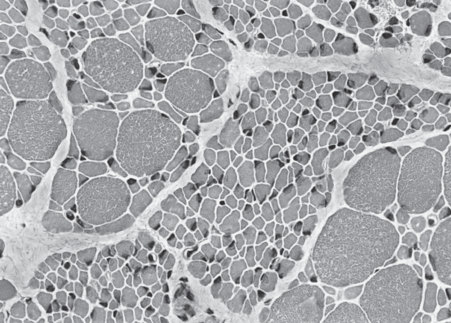
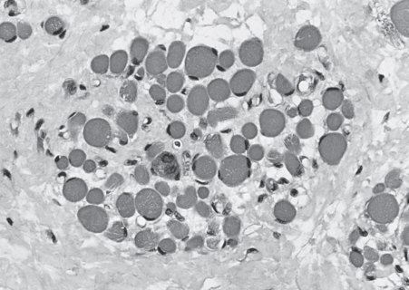
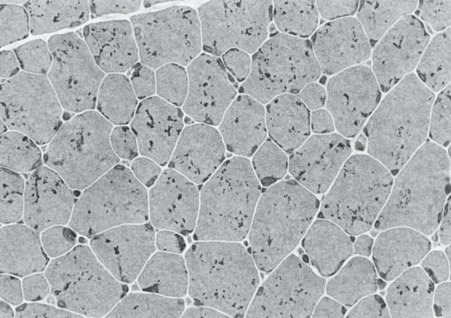
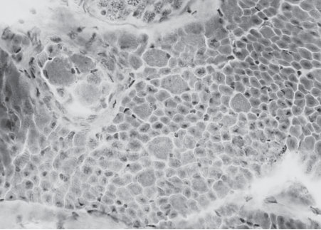
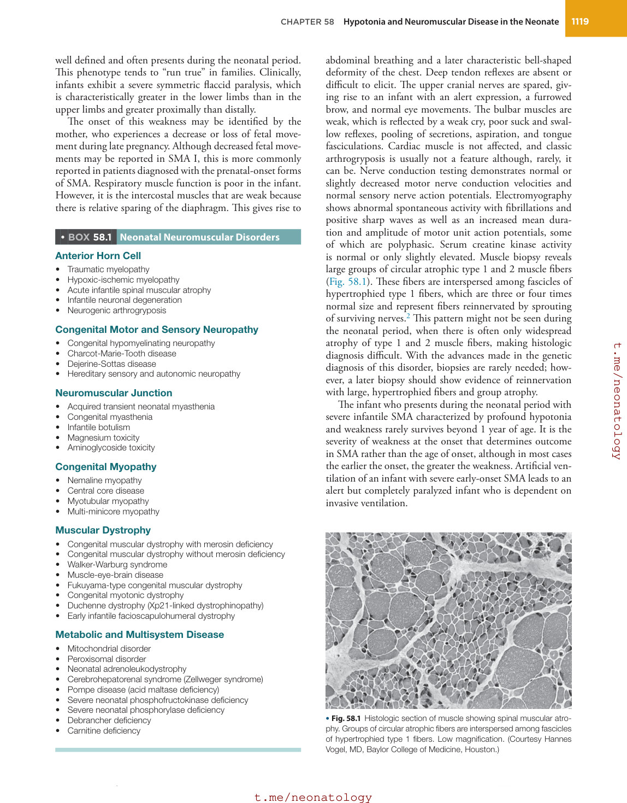
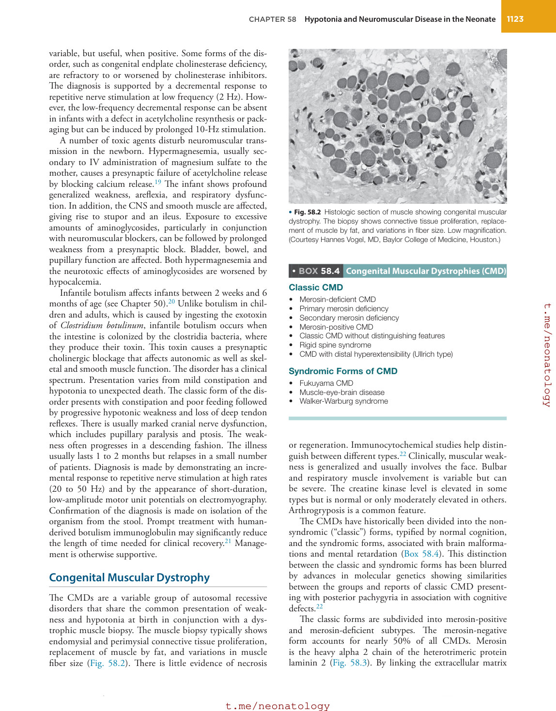
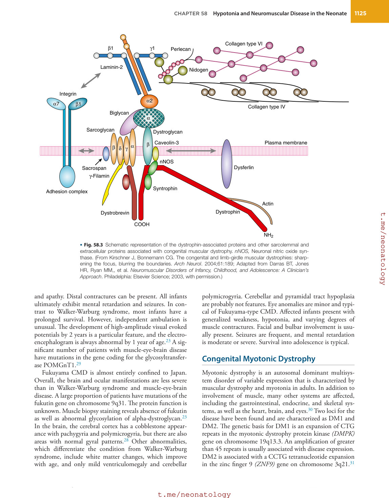
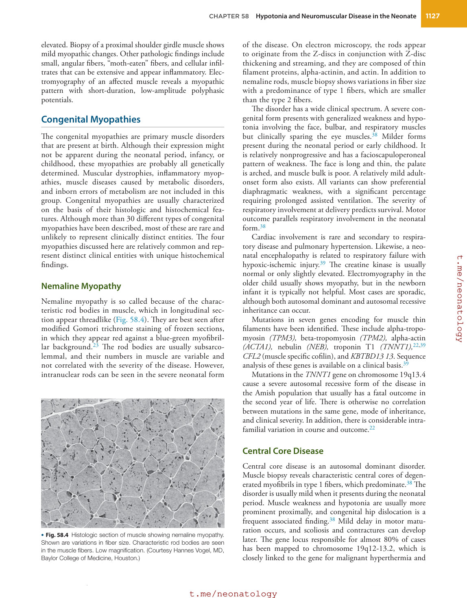
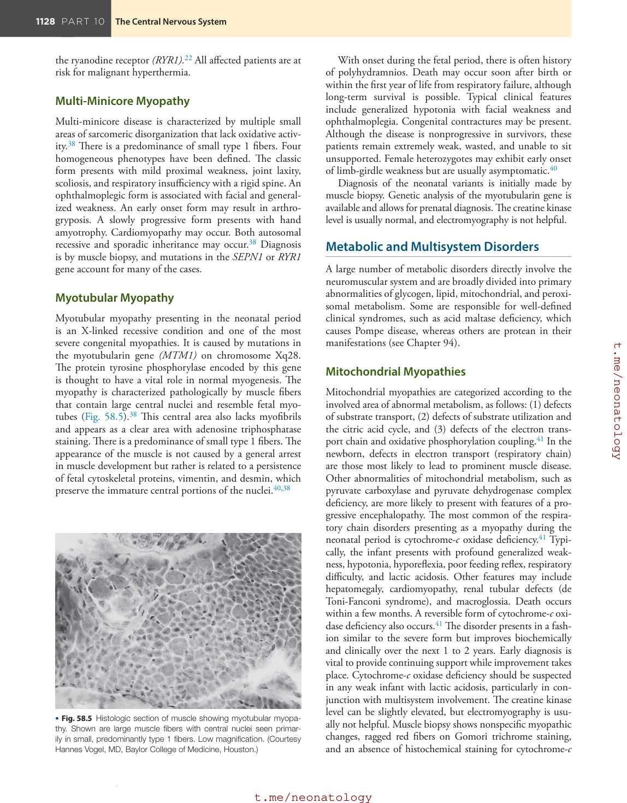
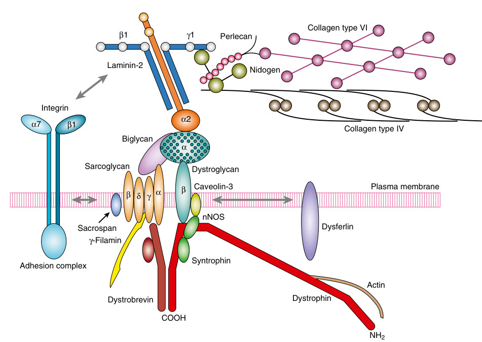

# 58. Hypotonia and Neuromuscular Disease in the Neonate
> Source attribution: [Source credits](../../SOURCE_CREDITS.md).

## PDF page 1121 | printed page 1117

58 Hypotonia and Neuromuscular Disease in the Neonate

### NANCY BASS

Clinicians who care for newborns are often required to consider the possibility that a neuromuscular disorder might be present in a hypotonic infant. The ability to determine the normal expected tone of that infant is vital to assess what additional evaluation might be warranted. Hypotonia can be the result of an insult or disorder in any part of the nervous system, including the brain, spinal cord, and peripheral nervous system. The assessment begins with determination of the normal tone of the neonate. When placed in the supine position, the normal fullterm infant shows active movement of flexed limbs. The hips are flexed 70 to 90 degrees and abducted approximately 10 to 20 degrees. If passive extension of the legs at the knees is attempted, resistance is met when the popliteal angle is approximately 90 degrees. When the child is pulled to the sitting from the supine position, only slight head lag is present, and on reaching the sitting position, the head should wobble in the midline for a few seconds. Similarly, a predominance of flexor tone is found in the upper limbs. When the infant is held under the axilla, normal tone prevents the infant from slipping through the examiner’s hands, and the infant seems to sit in the air. In horizontal suspension, the limbs are flexed, the back is straight, and the head is maintained in the midline for a few seconds. These findings need to be modified for the premature infant who shows decreasing degrees of flexor tone depending on gestational age.

The weak, hypotonic infant has a decrease in the expected resistance of muscle to stretch, and there is a decrease in spontaneous movement. If supine, the infant lies in a froglike position with abduction of the hips and an abnormal extension of the limbs. When pulled to a sitting position, there is head lag with a lack of compensation when the sitting position is reached. In vertical suspension, decreased tone of the shoulder girdle causes the infant to slip through the examiner’s hands, and the legs are more extended than flexed. On horizontal suspension, the back hangs over the examiner’s hand, and

the head and limbs hang loosely. (For further details see Chapter 27.)

### Diagnosis

Almost any condition that affects the central nervous system (CNS) or peripheral nervous system of a newborn can be expressed by a reduction of tone. Furthermore, most acute or multisystem illness in neonates is accompanied by some degree of hypotonia. Therefore the examiner initially must consider whether the infant is acutely ill from sepsis, organ failure, metabolic dysfunction, or other systemic illness. In addition, medications given to the mother in the time right before birth can have an effect on the infant’s muscle tone. Most commonly implicated is magnesium sulfate to prevent preterm labor. If these illnesses are not present, the next step is to consider whether a primary disorder of the CNS or the peripheral nervous system is the cause. In general, a central cause leads to a reduction in tone out of proportion to the degree of muscle weakness, and the limbs demonstrate antigravity power.

Although this finding is useful, there are exceptions. In some hypotonic neonates, there are abnormalities in both the central and peripheral nervous systems. Examples include congenital muscular dystrophy (CMD); congenital myotonic dystrophy; acid maltase deficiency; cervical spinal cord injury; and some mitochondrial, lysosomal, and peroxisomal disorders. In addition, some disorders that are primarily central may initially present with profound hypotonia and weakness. Examples are Prader-Willi syndrome and acute disease such as hemorrhage or infarction involving the deep central gray matter of the brain or spinal cord. Babies with near total asphyxia typically have involvement of the brainstem and at times the upper spinal cord, and thus typically present with profound hypotonia and absence of reflexes, similar to spinal shock seen in acute spinal cord injuries. Conversely, the infant with a mild congenital

1117

## PDF page 1122

myopathy demonstrates some antigravity power in the limbs. Finally, hypotonia might be present in the infant without acute systemic or metabolic illness or abnormalities of the nervous system. In these children, there is an unusual degree of ligamentous laxity such as that seen in Ehlers- Danlos syndrome and osteogenesis imperfecta.

The diagnosis of a neonatal muscle disorder requires a methodical approach similar to that used in the older infant or child. A detailed family, obstetric, and delivery history should be taken. Clues to the presence of a neuromuscular disorder include polyhydramnios, a decrease in fetal movement, and malpresentation, although these conditions can be present in any pregnancy with fetal akinesia (paucity of movement). Information should be obtained about whether there was any birth trauma or asphyxia and on the condition of the infant immediately after delivery.

The general examination begins with observation. Does the infant look sick or distressed? The skin should be examined for pallor, trauma, bruising, or petechiae. Any dysmorphic features or congenital defects of the head, neck, or spine should be noted, as should weight, length, and head size and shape. Each system is then examined with a particular emphasis on respiratory rate, pattern, and diaphragmatic movement; cardiovascular status; the presence of organomegaly; the genitalia; the hips; and the presence of contractures. On neurologic examination, initial observations include the degree of alertness and whether the infant fixes or follows. Posture and spontaneous movements are noted. In particular, movement against gravity should be sought, and the examiner should observe whether movement is greater proximally or distally. When formal examination of the cranial nerves is performed, particular attention should be paid to eye movements. These can be observed as spontaneous movements, elicited by a face or a red ball or induced by gentle rotation of the head (oculovestibular reflex). Caution should be taken when checking this reflex in an infant with possible high cervical cord injury. A lack of fixation or following, but movement with the oculovestibular reflex, suggests a lesion above the brainstem. If the infant is not in severe distress and there is no possibility of cervical spine injury, the degree of hypotonia is assessed by pulling the infant to a sitting position and holding him or her in vertical and horizontal suspension. Passive movement of the joints can assess power and tone in the limbs more gently. Resistance to gentle shaking of an arm or leg also provides a subjective assessment of tone.

On initial observation of a newborn, cerebral dysfunction should be suspected if there are abnormalities in primitive reflexes, poor arousal, paucity of movements in general, or fisting of the hands. Fisting can appear as a “cortical thumb” posture. This is where the thumb is flexed and lies under the first and second fingers. Persistence of this posture is felt to be associated with cerebral dysfunction. The character of the deep tendon reflexes helps distinguish between an upper or lower motor neuron lesion. An upper motor neuron lesion involves descending motor tracts in the brain and spinal cord, whereas a lower motor neuron lesion

involves the anterior horn cell, peripheral motor nerve, or muscle. If they are abnormally brisk with clonus, then an upper motor neuron lesion is suggested. Five to ten beats of ankle clonus is considered normal in the infant. Sustained clonus or that which is persistently asymmetric is typically abnormal and suggests an upper motor lesion. If absent, a neuropathic lesion or a severe myopathy is more likely. As mentioned above, infants with near total asphyxia may have absent reflexes despite their lesion being of central origin. Assessment of sensation should be attempted, because this may indicate a spinal cord lesion. Although quite atypical to present in the newborn, abnormalities in sensation could point to a hereditary sensory neuropathy.

Facial diplegia is a particular finding in some neuromuscular disorders and less likely in others. It is most commonly seen in such disorders as congenital myotonic dystrophy and the congenital myasthenic syndromes. It can also be an early feature of severe acute basal ganglia damage. Note should be made of the infant’s ability to suck and swallow, the pooling of secretions, the character of the cry, and the presence of tongue fasciculations. The latter is most often seen associated with disorders of the anterior horn cell such as infantile spinal muscular atrophy (SMA) but can also be seen in any condition in which there is hypoglossal motor neuron damage, examples of which include storage disorders such as acid maltase deficiency, hypoxic-ischemic damage, and infantile neuronal degeneration.

### Neonatal Neuromuscular Disorders

Neonatal neuromuscular disorders are caused by lesions that affect specific parts of the nervous system, including the anterior horn cell, peripheral nerve, neuromuscular junction, or muscle (Box 58.1). Rapid and continuing advances are being made in our understanding of the molecular genetic basis of these disorders.

There are a number of CNS conditions in which hypotonia is of sufficient severity that a neuromuscular disorder should be suspected. These are not discussed in detail here, but they include chromosomal disorders such as Prader-Willi syndrome and Smith-Magenis syndrome (Smith-Magenis syndrome can be particularly hard to distinguish from a neuromuscular disorder because it can often be associated with hyporeflexia or areflexia),1 multiple minor congenital anomaly syndromes, and metabolic multisystem disorders.

### Spinal Muscular Atrophy

The SMAs are predominantly autosomal recessive disorders characterized by degeneration of the anterior horn cells in the spinal cord and motor nuclei in the lower brainstem. The most frequent and best known is infantile SMA, also called Werdnig-Hoffmann disease (SMA type I).2 Approximately 95% of individuals with SMA are homozygous for a deletion of exon 7 of the survival of motor neuron (SMN) gene (SMN1) on chromosome 5q13.3 Although the phenotype varies in severity and age of onset, the infantile subtype is

## PDF page 1123 | printed page 1119

well defined and often presents during the neonatal period. This phenotype tends to “run true” in families. Clinically, infants exhibit a severe symmetric flaccid paralysis, which is characteristically greater in the lower limbs than in the upper limbs and greater proximally than distally.

The onset of this weakness may be identified by the mother, who experiences a decrease or loss of fetal movement during late pregnancy. Although decreased fetal movements may be reported in SMA I, this is more commonly reported in patients diagnosed with the prenatal-onset forms of SMA. Respiratory muscle function is poor in the infant. However, it is the intercostal muscles that are weak because there is relative sparing of the diaphragm. This gives rise to

• BOX 58.1 Neonatal Neuromuscular Disorders

Anterior Horn Cell

• Traumatic myelopathy • Hypoxic-ischemic myelopathy • Acute infantile spinal muscular atrophy • Infantile neuronal degeneration • Neurogenic arthrogryposis

Congenital Motor and Sensory Neuropathy

• Congenital hypomyelinating neuropathy • Charcot-Marie-Tooth disease • Dejerine-Sottas disease • Hereditary sensory and autonomic neuropathy

Neuromuscular Junction

• Acquired transient neonatal myasthenia • Congenital myasthenia • Infantile botulism • Magnesium toxicity • Aminoglycoside toxicity

Congenital Myopathy

• Nemaline myopathy • Central core disease • Myotubular myopathy • Multi-minicore myopathy

Muscular Dystrophy

• Congenital muscular dystrophy with merosin deficiency • Congenital muscular dystrophy without merosin deficiency • Walker-Warburg syndrome • Muscle-eye-brain disease • Fukuyama-type congenital muscular dystrophy • Congenital myotonic dystrophy • Duchenne dystrophy (Xp21-linked dystrophinopathy) • Early infantile facioscapulohumeral dystrophy

Metabolic and Multisystem Disease

• Mitochondrial disorder • Peroxisomal disorder • Neonatal adrenoleukodystrophy • Cerebrohepatorenal syndrome (Zellweger syndrome) • Pompe disease (acid maltase deficiency) • Severe neonatal phosphofructokinase deficiency • Severe neonatal phosphorylase deficiency • Debrancher deficiency • Carnitine deficiency

abdominal breathing and a later characteristic bell-shaped deformity of the chest. Deep tendon reflexes are absent or difficult to elicit. The upper cranial nerves are spared, giving rise to an infant with an alert expression, a furrowed brow, and normal eye movements. The bulbar muscles are weak, which is reflected by a weak cry, poor suck and swallow reflexes, pooling of secretions, aspiration, and tongue fasciculations. Cardiac muscle is not affected, and classic arthrogryposis is usually not a feature although, rarely, it can be. Nerve conduction testing demonstrates normal or slightly decreased motor nerve conduction velocities and normal sensory nerve action potentials. Electromyography shows abnormal spontaneous activity with fibrillations and positive sharp waves as well as an increased mean duration and amplitude of motor unit action potentials, some of which are polyphasic. Serum creatine kinase activity is normal or only slightly elevated. Muscle biopsy reveals large groups of circular atrophic type 1 and 2 muscle fibers (Fig. 58.1). These fibers are interspersed among fascicles of hypertrophied type 1 fibers, which are three or four times normal size and represent fibers reinnervated by sprouting of surviving nerves.2 This pattern might not be seen during the neonatal period, when there is often only widespread atrophy of type 1 and 2 muscle fibers, making histologic diagnosis difficult. With the advances made in the genetic diagnosis of this disorder, biopsies are rarely needed; however, a later biopsy should show evidence of reinnervation with large, hypertrophied fibers and group atrophy.

The infant who presents during the neonatal period with severe infantile SMA characterized by profound hypotonia and weakness rarely survives beyond 1 year of age. It is the severity of weakness at the onset that determines outcome in SMA rather than the age of onset, although in most cases the earlier the onset, the greater the weakness. Artificial ventilation of an infant with severe early-onset SMA leads to an alert but completely paralyzed infant who is dependent on invasive ventilation.

• Fig. 58.1 Histologic section of muscle showing spinal muscular atrophy. Groups of circular atrophic fibers are interspersed among fascicles of hypertrophied type 1 fibers. Low magnification. (Courtesy Hannes Vogel, MD, Baylor College of Medicine, Houston.)

• Fig. 58.1 Histologic section of muscle showing spinal muscular atrophy. Groups of circular atrophic fibers are interspersed among fascicles of hypertrophied type 1 fibers. Low magnification. (Courtesy Hannes Vogel, MD, Baylor College of Medicine, Houston.)

## PDF page 1124

With the identification of the SMN gene in 1995, the diagnosis of SMA has been greatly facilitated, limiting the need for more invasive investigations. The SMN coding region on chromosome 5q11.2-13.3 contains a telomeric and centromeric copy of the SMN gene, designated SMN1 and SMN2, respectively. These genes are nearly identical in their coding sequence. A single nucleotide polymorphism (840C>T) in SMN2 causes disruption of normal translation. The resultant protein produced by the centromeric copy is often truncated and nonfunctional. SMN2 can produce a small amount of full-length protein, providing partial compensation for mutations in SMN1, but the majority must be produced by SMN1. A direct relationship exists between the number of copies of the SMN2 gene and the age of disease onset, with the neonatal onset SMA phenotype, also referred to as SMA type 0, correlating with the lowest number of SMN2 gene copies. Although continued progress has been made in defining the exact function of SMN protein, it still remains to be further defined. It is known to play a role in critical housekeeping function: socalled spliceosomal small nuclear ribonucleoprotein assembly, which is important for all cells.3 How this translates into loss of the specific motor neuron cell RNA has yet to be elucidated.

In December 2017, nusinersen became the first FDAapproved drug for the treatment of 5q SMA. It is an antisense oligonucleotide and acts to modify pre-mRNA splicing of SMN2 to promote increased production of full-length SMN protein.3 Results of a randomized, double-blind, sham-controlled, phase 3 efficacy and safety trial showed that a significantly higher percentage of infants in the nusinersen group than in the control group had a motor-milestone response (37 of 73 infants [51%] vs. 0 of 37 [0%]). These patients also had a statistically significant likelihood of event-free survival.4 The next therapy to become available was FDA approved in 2020. This is gene replacement therapy with onasemnogene abeparvovec. This involves a single intravenous infusion of an adeno-associated viral vector which contains the SMN1 gene. Patients who showed the most improvement were those who were treated the earliest in their presentation. Some patients even achieved the ability to walk.5 The next drug to be FDA approved was Risdiplam, an oral small molecule drug which acts on the SMN2 pre-messenger RNA splicing to increase the working SMN protein available.6

With these new therapies currently available and the studies showing that the sooner patients are treated the better the outcome, this opened up the door for SMA to become part of the Newborn Screening panel. As of March 2022, 44 states currently screen for SMA. Screening is anticipated to identify 364 babies with SMA, prevent about 30 deaths and have 50 infants avoid assisted ventilation.7 (See also www.curesma.org. Accessed June 25, 2023.)

There are a number of genetically heterogeneous SMA variants, but most of these do not present during the newborn period. The variants most important in neonatal or prenatal presentations of SMA include SMA with

pontocerebellar hypoplasia, X-linked SMA with arthrogryposis owing to mutations in the UBE1 gene, and SMARD1 (SMA with respiratory distress or distal infantile SMA with diaphragm paralysis) that is caused by mutations in the IGHMBP2 gene, the gene encoding the immunoglobulin μ-binding protein.

Arthrogryposis multiplex congenita is a heterogeneous group of disorders characterized by congenital contractures of multiple joints. It is typically the result of decreased fetal movement and can have multiple etiologies from neurogenic, muscular, and genetic syndromes, as well as connective tissue disorders. Many times, the specific etiology cannot be found.8 The neurogenic arthrogryposes are genetically heterogeneous, and both autosomal recessive and X-linked inheritance have been reported. A subgroup of neurogenic arthrogryposis is allelic with SMA type I, and deletions of the SMN gene have been reported. These disorders are of variable severity. Some show no progression, and muscle strength can even improve. In other cases, bulbar and respiratory function is severely affected, and the prognosis is poor. In the X-linked form, there is disease progression and early death.

As noted above, infants with SMARD1 can present as neonates with congenital contractures along with their severe SMA presentation. Traumatic high cervical spinal cord injury (see Chapter 28) is a rare cause of myelopathy that can be misdiagnosed as SMA. In the absence of an asphyxial brain injury, the infant is alert with no cranial nerve signs. The myelopathy is manifested as a flaccid areflexic paralysis, which might be asymmetric. Clues to the diagnosis include evidence of trauma, such as bruising or fractures, and normal results on cranial nerve examination. After a few days, evidence of the myelopathy becomes more apparent with the appearance of bladder distention, priapism, and an absence of sweating below the level of the spinal lesion. Sensory testing is difficult but can be assessed by demonstrating facial grimacing to a prick on the face but showing no response below the neck.

In severe hypoxic–ischemic injury, there can be an areflexic flaccid paralysis resulting from death of spinal motor neurons. However, there are also signs of an encephalopathy and multiorgan system damage.

### Hereditary Motor and Sensory Neuropathies

The hereditary motor and sensory neuropathies are a genetically heterogeneous group of disorders with a spectrum of phenotypes that includes Charcot-Marie-Tooth disease types 1 and 2, hereditary neuropathy with liability to pressure palsies, Dejerine-Sottas syndrome, and congenital hypomyelinating neuropathy.9 These diseases may demonstrate an autosomal dominant, autosomal recessive, or X-linked mode of inheritance. Charcot-Marie-Tooth disease type 1 and hereditary neuropathy with liability to pressure palsies are demyelinating neuropathies, whereas

## PDF page 1125 | printed page 1121

Charcot-Marie-Tooth disease type 2 is an axonal disorder. Congenital onset is unusual, and these three forms of hereditary motor and sensory neuropathy most often present in the older child or young adult. The two types that may present in the neonate include congenital hypomyelinating neuropathy and, less commonly, Dejerine-Sottas syndrome.

Clinical manifestations vary. Affected infants are weak, hypotonic, and areflexic. The weakness is generalized, but a greater distal weakness might be detected. Arthrogryposis may be present in more severe forms. There are usually swallowing and respiratory difficulties. Sometimes facial weakness is present, but extraocular movements are usually normal. Any associated sensory loss is difficult to detect clinically. Prognosis depends on the initial degree of weakness. In some cases, there is an improvement in strength.

The disorders are characterized by markedly decreased motor nerve conduction velocities (typically less than 10 m/s) and elevated cerebrospinal fluid protein. Sural nerve biopsy in relatively mild cases shows varying degrees of hypomyelination with atypical onion-bulb formation. (Nerve biopsy in the neonatal period would be less likely to show the onion bulb formation.) More severe cases may show complete lack of myelin. These disorders result from mutations in different genes. Moreover, different mutations in the same gene cause different phenotypes (Charcot-Marie- Tooth disease type 1, Dejerine-Sottas syndrome, congenital hypomyelinating neuropathy) and, at present, the clinical phenotype cannot always be predicted on the basis of the gene mutation. Identified alleles include Schwann cell genes involved in the formation, structure, and maintenance of peripheral myelin (EGR2, PMP22, MPZ, CX32, 6JB1, PRX), neuronal genes involved in axonal transport (NEFL), and genes affecting both Schwann cell and neuronal structure (MTMR2).10

### Hereditary Sensory and Autonomic Neuropathies

The hereditary sensory and autonomic neuropathies are characterized by selective involvement of peripheral sensory and autonomic neurons (Box 58.2). Disorders are autosomal recessive inheritance with the exception of hereditary sensory and autonomic neuropathy type I, which is autosomal dominant. All present with varying degrees of autonomic dysfunction or insensitivity to pain and temperature. In some, there is absence of the normal axonal flare response to intradermal injection of histamine. In the older child, there is striking self-mutilation.

The best known of the hereditary sensory neuropathies is familial dysautonomia (Riley-Day syndrome; hereditary sensory and autonomic neuropathy type III). This disorder has a high carrier rate in individuals of Ashkenazi Jewish descent and has been mapped to chromosome 9q31-q33. Mutations in the gene for IkB kinase-associated protein (IKBKAP) account for 99% of affected individuals.11 The clinical diagnosis of familial dysautonomia is based on five

• BOX 58.2 Hereditary Sensory and Autonomic

Neuropathies (HSAN)

HSAN type I (hereditary sensory radicular neuropathy,

autosomal dominant) HSAN type II (congenital sensory neuropathy) HSAN type III (Riley-Day syndrome, or familial dysautonomia) HSAN type IV (congenital insensitivity to pain with anhidrosis) HSAN type V (congenital insensitivity to pain with partial

anhidrosis) Progressive pan-neuropathy and hypotonia Congenital autonomic dysfunction with universal pain loss Familial amyloid neuropathy (autosomal dominant)

cardinal criteria: (1) absence of overflow tears, (2) absence of lingual fungiform papillae, (3) depressed patellar reflexes, (4) lack of axonal flare reaction after intradermal injection of histamine, and (5) Ashkenazi Jewish extraction. Additional clinical features typically include hypotonia, labile temperature and blood pressure, breath holding, pallor, poor feeding, failure to thrive, vomiting, loose stools, and irritability.

Treatment of these disorders is mainly supportive, and survival has improved with modern medical therapies. Patients who reach adulthood continue to demonstrate slow progression of their disease. Cognition may be impaired in some forms of the disease.12

Clinical genetic testing is available for familial dysautonomia. The clinical history, family history, and physical examination of the infant suspected of having one of these disorders remains vital in the diagnosis. Sensory nerve conduction studies can supply additional supportive clinical information. Advances in molecular genetic testing have made the need for a nerve tissue biopsy rare.

Congenital central hypoventilation syndrome should be considered in the differential diagnosis of a neonate presenting with an autonomic neuropathy. The classic neonatal form of this disease presents with an infant with hypotonia, decreased or absent deep tendon reflexes, hypoventilation with absence of response to hypercarbia, and autonomic dysfunction. These infants typically have a mutation in the PHOX2B gene and are at risk for Hirschsprung disease and tumors of neural crest origin.13

### Neuromuscular Junction Disorders

Neuromuscular junction disorders are infrequent causes of weakness during the neonatal period. The principal conditions include transient acquired neonatal myasthenia, congenital myasthenia, infantile botulism, and toxic amounts of magnesium or aminoglycosides. These disorders are characterized by abnormal neuromuscular transmission, which is manifested by abnormal muscle fatigability and weakness that is sometimes permanent, particularly in the congenital forms.

Autoimmune myasthenia gravis in children and adults is caused by autoantibodies directed against neuromuscular junction proteins. In 80% of patients, acetylcholine

## PDF page 1126

receptor antibodies are detected in the serum. In the remaining patients, other pathologic antibodies, including those directed against muscle-specific kinase, interfere with the normal function of the acetylcholine receptor, resulting in disease.14

In acquired neonatal myasthenia gravis, the disease is more often active in the mother. However, she may have less obvious disease, be in remission, or not show clinical manifestations until after the pregnancy.14 Transfer of immunoglobulin G antibodies occurs readily across the placenta. However, typical features develop in only 20% of infants born to mothers with myasthenia.15 The proportion of maternal immunoglobulin G antibodies directed against the fetal type versus the adult type of acetylcholine receptor appears to have a strong influence on neonatal manifestations. Although there is no correlation between maternal antibody titers or disease severity and the development of neonatal myasthenia, there is an inverse relationship between maternal disease duration and the incidence of neonatal myasthenia.

The disorder usually presents within a few hours of birth up to 72 hours of life. The most common presentation is generalized weakness and hypotonia.16 Bulbar weakness is usually present, with feeding difficulties from poor sucking and swallowing, and a weak cry. Facial diplegia can be prominent, but ptosis and ophthalmoplegia are seen less frequently. Pooling of secretions and respiratory difficulties occasionally necessitate artificial ventilation. Deep tendon reflexes are normal. Assuming a correct diagnosis and management, most infants recover within a few weeks.16 Some infants are severely affected with a history of polyhydramnios and the presence of arthrogryposis multiplex at birth.17 Treatment is more difficult, and recovery is slower in these infants.

The diagnosis of transient neonatal myasthenia should always be suspected in the infant of a mother with active generalized acetylcholine receptor antibody-positive myasthenia gravis. When signs appear, a cholinesterase inhibitor is administered and the response gauged. To be sure of the diagnosis, an unequivocal and objective response should be chosen, such as an improvement in ventilation and oxygenation or sucking ability. Neostigmine methylsulfate, IM or SC, in a dose of 0.04 mg/kg, is the preferred diagnostic anticholinesterase agent.17a The drug takes effect within 15 minutes of injection and lasts 1 to 3 hours. Muscarinic side effects (diarrhea, increased tracheal secretions) might require the use of atropine in appropriate doses. Although edrophonium chloride has a more rapid onset and less intense muscarinic side effects, there is a risk of respiratory arrest. When necessary, the diagnosis can be confirmed with repetitive nerve stimulation, which should be performed before and after the administration of a cholinesterase inhibitor. A diagnostically positive response occurs when the amplitude of the fifth evoked compound muscle action potential is reduced by 10% or more of the amplitude of the first response, and this decrement is corrected by a cholinesterase inhibitor.

The management of transient neonatal myasthenia gravis must be early and vigorous, because these infants can deteriorate rapidly. Small, frequent tube feedings should be given and early ventilatory support considered. Neostigmine is administered IM or SC at a dose of 0.04 mg/kg every 4 to 6 hours, 30 minutes before meals.17a The oral dose of neostigmine is approximately 10 times the intramuscular dose and is given approximately 45 minutes before feeding. Excessive doses can cause diarrhea, increased secretions, muscle fasciculations, and cholinergic weakness. Disappearance of disease activity is monitored clinically by assessing responses to gradual decreases in the anticholinesterase dose. In addition, repetitive nerve stimulation tests can be performed as well as measurement of acetylcholine receptor antibodies. Tube feeding and artificial ventilation are usually not required for longer than 1 to 2 weeks, and the average duration of treatment is 4 weeks, with recovery in 90% of infants in less than 2 months.

The congenital myasthenic syndromes are infrequent causes of neuromuscular junction failure during the neonatal period but have become increasingly recognized.18 They are a group of genetic disorders that are acetylcholine receptor antibody negative and are caused by either presynaptic or postsynaptic inherited defects of the neuromuscular junction. Those manifested during the neonatal period are shown in Box 58.3. Postsynaptic disorders of the acetylcholine receptor are the most common. The subunit defect form is associated with significant ptosis and variable ophthalmoplegia. The rapsyn mutation involves a mutation of the receptor-associated protein at the synapse. Typically, this is a more severe presentation than the subunit deficiency. In general, unlike acquired transient neonatal myasthenia gravis, ptosis is usually present in addition to varying degrees of ophthalmoplegia, bulbar palsy, and respiratory weakness. Fluctuating, generalized hypotonia and weakness are seen, and episodes of life-threatening apnea can occur. Exacerbations can be induced by activity, febrile illness, or other stress. These disorders often improve with age, but spontaneous exacerbations occur with a risk of sudden infant death. A diagnostic response to cholinesterase inhibitors is

• BOX 58.3 Congenital Myasthenic Syndromes

Presenting During the Neonatal Period

Presynaptic Defects (8%)

• Choline acetyltransferase deficiency • Paucity of synaptic vesicles and reduced quantal release • Similar to Eaton-Lambert syndrome

Synaptic Basal Lamina-Associated Defects (16%)

• Endplate acetylcholine esterase deficiency

Postsynaptic Defects (76%)

• Kinetic abnormality of acetylcholine receptor (slow- and

fast-channel syndromes) • Acetylcholine receptor deficiency (subunit defect) • Acetylcholine receptor deficiency (rapsyn mutation)

## PDF page 1127 | printed page 1123

variable, but useful, when positive. Some forms of the disorder, such as congenital endplate cholinesterase deficiency, are refractory to or worsened by cholinesterase inhibitors. The diagnosis is supported by a decremental response to repetitive nerve stimulation at low frequency (2 Hz). However, the low-frequency decremental response can be absent in infants with a defect in acetylcholine resynthesis or packaging but can be induced by prolonged 10-Hz stimulation.

A number of toxic agents disturb neuromuscular transmission in the newborn. Hypermagnesemia, usually secondary to IV administration of magnesium sulfate to the mother, causes a presynaptic failure of acetylcholine release by blocking calcium release.19 The infant shows profound generalized weakness, areflexia, and respiratory dysfunction. In addition, the CNS and smooth muscle are affected, giving rise to stupor and an ileus. Exposure to excessive amounts of aminoglycosides, particularly in conjunction with neuromuscular blockers, can be followed by prolonged weakness from a presynaptic block. Bladder, bowel, and pupillary function are affected. Both hypermagnesemia and the neurotoxic effects of aminoglycosides are worsened by hypocalcemia.

Infantile botulism affects infants between 2 weeks and 6 months of age (see Chapter 50).20 Unlike botulism in children and adults, which is caused by ingesting the exotoxin of Clostridium botulinum, infantile botulism occurs when the intestine is colonized by the clostridia bacteria, where they produce their toxin. This toxin causes a presynaptic cholinergic blockage that affects autonomic as well as skeletal and smooth muscle function. The disorder has a clinical spectrum. Presentation varies from mild constipation and hypotonia to unexpected death. The classic form of the disorder presents with constipation and poor feeding followed by progressive hypotonic weakness and loss of deep tendon reflexes. There is usually marked cranial nerve dysfunction, which includes pupillary paralysis and ptosis. The weakness often progresses in a descending fashion. The illness usually lasts 1 to 2 months but relapses in a small number of patients. Diagnosis is made by demonstrating an incremental response to repetitive nerve stimulation at high rates (20 to 50 Hz) and by the appearance of short-duration, low-amplitude motor unit potentials on electromyography. Confirmation of the diagnosis is made on isolation of the organism from the stool. Prompt treatment with humanderived botulism immunoglobulin may significantly reduce the length of time needed for clinical recovery.21 Management is otherwise supportive.

### Congenital Muscular Dystrophy

The CMDs are a variable group of autosomal recessive disorders that share the common presentation of weakness and hypotonia at birth in conjunction with a dystrophic muscle biopsy. The muscle biopsy typically shows endomysial and perimysial connective tissue proliferation, replacement of muscle by fat, and variations in muscle fiber size (Fig. 58.2). There is little evidence of necrosis

• Fig. 58.2 Histologic section of muscle showing congenital muscular dystrophy. The biopsy shows connective tissue proliferation, replacement of muscle by fat, and variations in fiber size. Low magnification. (Courtesy Hannes Vogel, MD, Baylor College of Medicine, Houston.)

• BOX 58.4 Congenital Muscular Dystrophies (CMD)

Classic CMD

• Merosin-deficient CMD • Primary merosin deficiency • Secondary merosin deficiency • Merosin-positive CMD • Classic CMD without distinguishing features • Rigid spine syndrome • CMD with distal hyperextensibility (Ullrich type)

Syndromic Forms of CMD

• Fukuyama CMD • Muscle-eye-brain disease • Walker-Warburg syndrome

or regeneration. Immunocytochemical studies help distinguish between different types.22 Clinically, muscular weakness is generalized and usually involves the face. Bulbar and respiratory muscle involvement is variable but can be severe. The creatine kinase level is elevated in some types but is normal or only moderately elevated in others. Arthrogryposis is a common feature.

The CMDs have historically been divided into the nonsyndromic (“classic”) forms, typified by normal cognition, and the syndromic forms, associated with brain malformations and mental retardation (Box 58.4). This distinction between the classic and syndromic forms has been blurred by advances in molecular genetics showing similarities between the groups and reports of classic CMD presenting with posterior pachygyria in association with cognitive defects.22

The classic forms are subdivided into merosin-positive and merosin-deficient subtypes. The merosin-negative form accounts for nearly 50% of all CMDs. Merosin is the heavy alpha 2 chain of the heterotrimeric protein laminin 2 (Fig. 58.3). By linking the extracellular matrix

• Fig. 58.2 Histologic section of muscle showing congenital muscular dystrophy. The biopsy shows connective tissue proliferation, replacement of muscle by fat, and variations in fiber size. Low magnification. (Courtesy Hannes Vogel, MD, Baylor College of Medicine, Houston.)

## PDF page 1128

with transmuscle-membrane, dystrophin-associated glycoproteins, the protein plays a critical role in myogenesis and myotubule membrane stability. It is also expressed in Schwann cells, trophoblasts, skin, and cerebral blood vessels. Mutations in the alpha-2 laminin gene (LAMA2) on chromosome 6q are responsible for the disease. Sequence analysis of the LAMA2 gene is available. Diagnosis can also be achieved with muscle biopsy showing complete absence of merosin with immunocytochemical staining.22,23 The CMDs can be classified according to the protein defect and, in many cases, this can be identified by immunocytochemistry or DNA analysis.22 Abnormalities of extracellular matrix protein defects include laminin alpha 2-deficient CMD (MDC1A) and collagen 6A deficiencies as in Ullrich CMD (UCMD 1, 2, and 3); integrin alpha 7 deficiency (ITGA7); abnormalities of glycosyltransferases, which lead to abnormal O-glycosylation of alpha-dystroglycan and include O-mannosyltransferase 1 (POMT1), O-mannosyltransferase 2 (POMT2), o-linked mannose beta 1,2-N-acetyl glucosaminyl transferase (POMGnT1), fukutin, fukutinrelated protein (FKRP), and acetylglucosaminyltransferaselike protein (LARGE); and endoplasmic reticulum proteins such as selenoprotein N, which causes rigid spine syndrome.

The clinical presentation of merosin deficiency typifies the classic form of the CMDs. There is marked neonatal hypotonia with generalized weakness and atrophy. Although facial weakness may be present, the eye muscles are spared. Contractures occur early and affect multiple joints. Involvement of chest wall muscles results in respiratory difficulties. Cognition is usually not affected. A peripheral neuropathy reflecting absence of merosin expression in Schwann cells can be seen as well. In addition, neuroimaging shows white matter changes, most appreciable after 6 months of age. The abnormality is best characterized by diffuse increased signal intensity on T2-weighted MRI sequences. These findings are thought to correlate with lack of merosin in the cerebral vessel walls.24 A small minority of patients show structural dysgenesis with occipital pachygyria or agyria. Epilepsy is encountered in one-third of patients.25

Although similar in presentation, the other forms of classic CMD can be differentiated based on distinct clinical features and underlying molecular genetics. Ullrich CMD is associated with mutations in the protein subunits of type VI collagen and presents with rigidity of the spine and distal joint hyperextensibility.26,27 Distinct from Ullrich CMD, CMD with rigid spine is associated with early rigidity of the spine and restrictive lung disease. A considerable number of these patients have been found to have mutations of the selenoprotein N gene on chromosome 1p36-p35.28 Selenoprotein N mutations have also been described in patients with multi-minicore disease, a type of congenital myopathy. The function of the protein is unknown. Mutations of the gene for fukutin-related protein on chromosome 19q13 may result in either a severe CMD (CMD type 1C, or MDC1C) or childhood-onset limb-girdle muscular dystrophy.25 Fukutin-related protein is a putative glycosyltransferase and, similar to the syndromic CMDs (discussed

later), this form is associated with defective glycosylation of alpha-dystroglycan protein in the muscle membrane (see Fig. 58.3). A secondary merosin deficiency is also present on histochemical staining.23 CMD with a partial merosin deficiency has been defined in a number of patients by biochemical studies. The partial deficiency is thought to be secondary to an underlying alpha-dystroglycan abnormality with abnormal binding of associated proteins. Linkage to chromosome 1q42 has been made in some of these cases.

The syndromic forms of CMD are associated with brain malformations and ocular findings. The three main types are Walker-Warburg syndrome, muscle-eye-brain disease, and Fukuyama CMD. All three forms result from mutations in genes encoding distinct glycosyltransferases and related proteins involved in post-translational modification of alpha-dystroglycan, a pathogenetic mechanism shared by the more classic phenotype MDC1C, as previously discussed.25 Muscle membrane integrity is compromised by the defective alpha-dystroglycan, which is unable to bind effectively with either extracellular laminin or transmembranous beta-dystroglycan (see Fig. 58.3). Muscle biopsy immunocytochemical techniques demonstrate the abnormal alpha-dystroglycan expression.22,23 In the brain, abnormal alpha-dystroglycan on glial scaffolds, neurons, and their processes are associated with neuronal migrational defects that include disarray of cerebral cortical layering, fusion of the cerebral hemispheres and cerebellar folia, and aberrant migration of granule cells. Disruption of the glial limitans results in cobblestone lissencephaly.22,23

Walker-Warburg syndrome is the most severe of the syndromic CMDs. Few infants survive for more than a few months, although prolonged survival is possible with modern medical techniques. Along with muscular dystrophy, typical features of the syndrome include cobblestone lissencephaly with agenesis of the corpus callosum, cerebellar hypoplasia, hydrocephalus, and encephalocele.23 In contrast with other forms of lissencephaly, there is dysmyelination, with the white matter appearing dark on computed tomography scan and abnormally bright on T2-weighted magnetic resonance images. Ocular findings can include cataracts, microphthalmia, buphthalmos, persistent hyperplastic primary vitreous, and Peter anomaly.3 Some patients with Walker-Warburg syndrome have been found to have mutations in the protein O-mannosyltransferase (POMT1) gene. The gene encodes an enzyme potentially involved in the biosynthesis of specific glycans associated with dystroglycan. The lack of POMT1 mutations in many patients with Walker-Warburg syndrome suggests genetic heterogeneity.23

Muscle-eye-brain disease has many features in common with Walker-Warburg syndrome but is less severe.3 Brain malformations can include cobblestone lissencephaly, absent septum pellucidum, dysgenesis of the corpus callosum, hydrocephalus, and white matter changes similar to Walker-Warburg syndrome. Eye findings include myopia, choroidal hypoplasia, optic nerve pallor, glaucoma, iris hypoplasia, cataracts, and colobomas. Newborns present with hypotonia, weakness, feeding difficulties, poor vision,

## PDF page 1129 | printed page 1125

β1 γ1 Perlecan

Laminin-2

Nidogen

Integrin

α7 α2

β1

Biglycan

α

Sarcoglycan

Dystroglycan

Caveolin-3

α β γ δ β

nNOS

Sacrospan

γ-Filamin

Syntrophin

Adhesion complex

Dystrobrevin

COOH

• Fig. 58.3 Schematic representation of the dystrophin-associated proteins and other sarcolemmal and extracellular proteins associated with congenital muscular dystrophy. nNOS, Neuronal nitric oxide synthase. (From Kirschner J, Bonnemann CG. The congenital and limb-girdle muscular dystrophies: sharpening the focus, blurring the boundaries. Arch Neurol. 2004;61:189; Adapted from Darras BT, Jones HR, Ryan MM,, et al. Neuromuscular Disorders of Infancy, Childhood, and Adolescence: A Clinician’s Approach. Philadelphia: Elsevier Science; 2003, with permission.)

and apathy. Distal contractures can be present. All infants ultimately exhibit mental retardation and seizures. In contrast to Walker-Warburg syndrome, most infants have a prolonged survival. However, independent ambulation is unusual. The development of high-amplitude visual evoked potentials by 2 years is a particular feature, and the electroencephalogram is always abnormal by 1 year of age.23 A significant number of patients with muscle-eye-brain disease have mutations in the gene coding for the glycosyltransferase POMGnT1.29

Fukuyama CMD is almost entirely confined to Japan. Overall, the brain and ocular manifestations are less severe than in Walker-Warburg syndrome and muscle-eye-brain disease. A large proportion of patients have mutations of the fukutin gene on chromosome 9q31. The protein function is unknown. Muscle biopsy staining reveals absence of fukutin as well as abnormal glycosylation of alpha-dystroglycan.23 In the brain, the cerebral cortex has a cobblestone appearance with pachygyria and polymicrogyria, but there are also areas with normal gyral patterns.28 Other abnormalities, which differentiate the condition from Walker-Warburg syndrome, include white matter changes, which improve with age, and only mild ventriculomegaly and cerebellar

Collagen type VI

Collagen type IV

Plasma membrane

Dysferlin

Actin

Dystrophin

NH2

polymicrogyria. Cerebellar and pyramidal tract hypoplasia are probably not features. Eye anomalies are minor and typical of Fukuyama-type CMD. Affected infants present with generalized weakness, hypotonia, and varying degrees of muscle contractures. Facial and bulbar involvement is usually present. Seizures are frequent, and mental retardation is moderate or severe. Survival into adolescence is typical.

### Congenital Myotonic Dystrophy

Myotonic dystrophy is an autosomal dominant multisystem disorder of variable expression that is characterized by muscular dystrophy and myotonia in adults. In addition to involvement of muscle, many other systems are affected, including the gastrointestinal, endocrine, and skeletal systems, as well as the heart, brain, and eyes.30 Two loci for the disease have been found and are characterized as DM1 and DM2. The genetic basis for DM1 is an expansion of CTG repeats in the myotonic dystrophy protein kinase (DMPK) gene on chromosome 19q13.3. An amplification of greater than 45 repeats is usually associated with disease expression. DM2 is associated with a CCTG tetranucleotide expansion in the zinc finger 9 (ZNF9) gene on chromosome 3q21.31

## PDF page 1130

DM1 has a more severe clinical phenotype, with a progressively earlier onset in successive generations (genetic anticipation). Congenital myotonic dystrophy is the earliest presenting form of DM1, and it is an important cause of neonatal neuromuscular dysfunction, with an incidence of at least 1 in 3500 live births. These infants usually have greater than 1000 CTG repeats at the DMPK locus. Nuclear accumulation of the abnormal messenger RNA generated by this large repeat size is thought to cause a delay in the differentiation and maturation of skeletal muscle. With rare exceptions, the disease is inherited from the mother. This is related to oligospermia in male patients as well as a greater propensity for larger repeat expansions (more than 1000) during oogenesis than during spermatogenesis.30,32 The earlier the onset of the disease in the mother and the more severe the clinical expression, the greater the risk for congenital myotonic dystrophy.33 However, the disease can still be seen in offspring of only mildly affected mothers. The phenotypic variation in tissue expression is probably the result of somatic instability of the CTG repeat.32

At birth, affected infants frequently require resuscitation and are subject to the mortality and morbidity associated with neonatal encephalopathy (see Chapter 56). A history of polyhydramnios (from failure of fetal swallowing) and decreased fetal movements is frequent, and premature birth can complicate the diagnosis. Furthermore, delivery can be complicated by prolonged labor and postpartum hemorrhage because of poor uterine contractions.33,26 Generalized weakness and hypotonia in the infant are profound, with facial diplegia and a characteristically tent-shaped triangular upper lip. Deep tendon reflexes are absent or difficult to elicit, and congenital talipes (clubfoot) is often present. Occasionally, joint contractures are more widespread.26 There is often respiratory distress, and poor suck and swallow reflexes present the danger of aspiration. Eye movements are full, although the infant might not readily fix and follow. Poor respiratory function is due not only to muscle weakness but also to pulmonary immaturity and poor central respiratory control.26,34An elevated diaphragm on the right can be seen on radiographic examination and is probably caused by the presence of the liver on that side and weak diaphragmatic muscles. Hydrops fetalis can occur in infants with cardiac failure. Cardiac conduction defects are commonly seen later and typically are not a presenting finding in the newborn. Poor feeding is commonly seen in infants with this disorder. This is most likely multifactorial, including weakness of the facial muscles and most likely delayed gastric motility in these babies.35 Laboratory investigations in general are not helpful, and the creatine kinase level is normal.

The pathologic appearance of muscle differs from that in adults. The fibers are small and round with central nucleation and display poor fiber type differentiation or relatively small type 1 fibers, giving an immature appearance.12 The typical adult features appear later. Electromyography is often noncontributory because of poor movement, although myopathic potentials can be demonstrated. Clinical and

electrical myotonia are not present, but appear later, during early childhood. Neuroimaging reveals ventriculomegaly, intraventricular hemorrhage, subarachnoid hemorrhage, or early periventricular leukomalacia in premature infants. The ventriculomegaly is probably of prenatal origin.36

Diagnosis of myotonic dystrophy is supported by clinical and electromyographic examination of the mother and confirmed by molecular genetic analysis. If the infant survives, the hypotonia and severe weakness gradually improve and are no longer evident by later childhood, although motor development is delayed. The facial diplegia with ptosis, open jaw, and triangular mouth persist, giving rise to a characteristic appearance.26 Many affected infants die early, even with intensive care. There is increased mortality among infants requiring greater than 30 days of ventilation, although eventual maturation of diaphragmatic musculature allows for independent ventilation in most.34 In most patients, mental retardation or significant learning difficulties develop.26 Unless there is a superimposed cerebral palsy syndrome from a complication of prematurity or perinatal asphyxia, most children walk by age 3 years. All patients with congenital myotonic dystrophy eventually manifest the complete spectrum of features typical of adult-onset disease.

### Other Muscular Dystrophies

Severe Xp21-linked dystrophin-deficient muscular dystrophy (Duchenne type) is a degenerative muscle disorder that rarely presents during the neonatal period.8 Information is scarce on a typical phenotype during the neonatal period. Distinguishing features are an absence of arthrogryposis, high serum creatine kinase, and regeneration or degeneration on muscle biopsy. Diagnosis is made by DNA analysis and immunoelectrophoresis or immunocytochemistry.8

Facioscapulohumeral muscular dystrophy is an autosomal dominant disorder that usually presents during early adolescence. Although usually a fairly benign disorder, there is intrafamilial variability, and the disease can present in early infancy.37 The responsible abnormal gene has been assigned to the subtelomeric region of chromosome 4.37 Affected patients have a reduction in the normal number of repeats in the DNA sequence termed D4Z4. In normal individuals, the EcoR1-digested DNA fragment is usually larger than 28 kilobases (kb), whereas a shorter fragment of 14 to 28 kb is detected in cases of facioscapulohumeral muscular dystrophy, correlating with the smaller number of repeats.37 In the early infantile form of the disease, facial weakness is characteristic, and the only manifestation might be partially open eyes during sleep. Progression is variable. In some cases, weakness is relatively mild, with later development of facial and shoulder girdle weakness. In other cases, there is early progressive weakness of the face, shoulder girdle, and ankle dorsiflexion, with loss of independent ambulation by late childhood. Bilateral sensorineural hearing loss is present in many cases. Retinal vascular abnormalities can also be found, which sometimes progress with exudation and retinal detachment. Creatine kinase levels are only moderately

## PDF page 1131 | printed page 1127

elevated. Biopsy of a proximal shoulder girdle muscle shows mild myopathic changes. Other pathologic findings include small, angular fibers, “moth-eaten” fibers, and cellular infiltrates that can be extensive and appear inflammatory. Electromyography of an affected muscle reveals a myopathic pattern with short-duration, low-amplitude polyphasic potentials.

### Congenital Myopathies

The congenital myopathies are primary muscle disorders that are present at birth. Although their expression might not be apparent during the neonatal period, infancy, or childhood, these myopathies are probably all genetically determined. Muscular dystrophies, inflammatory myopathies, muscle diseases caused by metabolic disorders, and inborn errors of metabolism are not included in this group. Congenital myopathies are usually characterized on the basis of their histologic and histochemical features. Although more than 30 different types of congenital myopathies have been described, most of these are rare and unlikely to represent clinically distinct entities. The four myopathies discussed here are relatively common and represent distinct clinical entities with unique histochemical findings.

### Nemaline Myopathy

Nemaline myopathy is so called because of the characteristic rod bodies in muscle, which in longitudinal section appear threadlike (Fig. 58.4). They are best seen after modified Gomori trichrome staining of frozen sections, in which they appear red against a blue-green myofibrillar background.23 The rod bodies are usually subsarcolemmal, and their numbers in muscle are variable and not correlated with the severity of the disease. However, intranuclear rods can be seen in the severe neonatal form

• Fig. 58.4 Histologic section of muscle showing nemaline myopathy. Shown are variations in fiber size. Characteristic rod bodies are seen in the muscle fibers. Low magnification. (Courtesy Hannes Vogel, MD, Baylor College of Medicine, Houston.)

of the disease. On electron microscopy, the rods appear to originate from the Z-discs in conjunction with Z-disc thickening and streaming, and they are composed of thin filament proteins, alpha-actinin, and actin. In addition to nemaline rods, muscle biopsy shows variations in fiber size with a predominance of type 1 fibers, which are smaller than the type 2 fibers.

The disorder has a wide clinical spectrum. A severe congenital form presents with generalized weakness and hypotonia involving the face, bulbar, and respiratory muscles but clinically sparing the eye muscles.38 Milder forms present during the neonatal period or early childhood. It is relatively nonprogressive and has a facioscapuloperoneal pattern of weakness. The face is long and thin, the palate is arched, and muscle bulk is poor. A relatively mild adultonset form also exists. All variants can show preferential diaphragmatic weakness, with a significant percentage requiring prolonged assisted ventilation. The severity of respiratory involvement at delivery predicts survival. Motor outcome parallels respiratory involvement in the neonatal form.38

Cardiac involvement is rare and secondary to respiratory disease and pulmonary hypertension. Likewise, a neonatal encephalopathy is related to respiratory failure with hypoxic-ischemic injury.39 The creatine kinase is usually normal or only slightly elevated. Electromyography in the older child usually shows myopathy, but in the newborn infant it is typically not helpful. Most cases are sporadic, although both autosomal dominant and autosomal recessive inheritance can occur.

Mutations in seven genes encoding for muscle thin filaments have been identified. These include alpha-tropomyosin (TPM3), beta-tropomyosin (TPM2), alpha-actin (ACTA1), nebulin (NEB), troponin T1 (TNNT1),22,39 CFL2 (muscle specific cofilin), and KBTBD13 13. Sequence analysis of these genes is available on a clinical basis.39

Mutations in the TNNT1 gene on chromosome 19q13.4 cause a severe autosomal recessive form of the disease in the Amish population that usually has a fatal outcome in the second year of life. There is otherwise no correlation between mutations in the same gene, mode of inheritance, and clinical severity. In addition, there is considerable intrafamilial variation in course and outcome.22

### Central Core Disease

Central core disease is an autosomal dominant disorder. Muscle biopsy reveals characteristic central cores of degenerated myofibrils in type 1 fibers, which predominate.38 The disorder is usually mild when it presents during the neonatal period. Muscle weakness and hypotonia are usually more prominent proximally, and congenital hip dislocation is a frequent associated finding.38 Mild delay in motor maturation occurs, and scoliosis and contractures can develop later. The gene locus responsible for almost 80% of cases has been mapped to chromosome 19q12-13.2, which is closely linked to the gene for malignant hyperthermia and

• Fig. 58.4 Histologic section of muscle showing nemaline myopathy. Shown are variations in fiber size. Characteristic rod bodies are seen in the muscle fibers. Low magnification. (Courtesy Hannes Vogel, MD, Baylor College of Medicine, Houston.)

## PDF page 1132

the ryanodine receptor (RYR1).22 All affected patients are at risk for malignant hyperthermia.

### Multi-Minicore Myopathy

Multi-minicore disease is characterized by multiple small areas of sarcomeric disorganization that lack oxidative activity.38 There is a predominance of small type 1 fibers. Four homogeneous phenotypes have been defined. The classic form presents with mild proximal weakness, joint laxity, scoliosis, and respiratory insufficiency with a rigid spine. An ophthalmoplegic form is associated with facial and generalized weakness. An early onset form may result in arthrogryposis. A slowly progressive form presents with hand amyotrophy. Cardiomyopathy may occur. Both autosomal recessive and sporadic inheritance may occur.38 Diagnosis is by muscle biopsy, and mutations in the SEPN1 or RYR1 gene account for many of the cases.

### Myotubular Myopathy

Myotubular myopathy presenting in the neonatal period is an X-linked recessive condition and one of the most severe congenital myopathies. It is caused by mutations in the myotubularin gene (MTM1) on chromosome Xq28. The protein tyrosine phosphorylase encoded by this gene is thought to have a vital role in normal myogenesis. The myopathy is characterized pathologically by muscle fibers that contain large central nuclei and resemble fetal myotubes (Fig. 58.5).38 This central area also lacks myofibrils and appears as a clear area with adenosine triphosphatase staining. There is a predominance of small type 1 fibers. The appearance of the muscle is not caused by a general arrest in muscle development but rather is related to a persistence of fetal cytoskeletal proteins, vimentin, and desmin, which preserve the immature central portions of the nuclei.40,38

• Fig. 58.5 Histologic section of muscle showing myotubular myopathy. Shown are large muscle fibers with central nuclei seen primarily in small, predominantly type 1 fibers. Low magnification. (Courtesy Hannes Vogel, MD, Baylor College of Medicine, Houston.)

With onset during the fetal period, there is often history of polyhydramnios. Death may occur soon after birth or within the first year of life from respiratory failure, although long-term survival is possible. Typical clinical features include generalized hypotonia with facial weakness and ophthalmoplegia. Congenital contractures may be present. Although the disease is nonprogressive in survivors, these patients remain extremely weak, wasted, and unable to sit unsupported. Female heterozygotes may exhibit early onset of limb-girdle weakness but are usually asymptomatic.40

Diagnosis of the neonatal variants is initially made by muscle biopsy. Genetic analysis of the myotubularin gene is available and allows for prenatal diagnosis. The creatine kinase level is usually normal, and electromyography is not helpful.

### Metabolic and Multisystem Disorders

A large number of metabolic disorders directly involve the neuromuscular system and are broadly divided into primary abnormalities of glycogen, lipid, mitochondrial, and peroxisomal metabolism. Some are responsible for well-defined clinical syndromes, such as acid maltase deficiency, which causes Pompe disease, whereas others are protean in their manifestations (see Chapter 94).

### Mitochondrial Myopathies

Mitochondrial myopathies are categorized according to the involved area of abnormal metabolism, as follows: (1) defects of substrate transport, (2) defects of substrate utilization and the citric acid cycle, and (3) defects of the electron transport chain and oxidative phosphorylation coupling.41 In the newborn, defects in electron transport (respiratory chain) are those most likely to lead to prominent muscle disease. Other abnormalities of mitochondrial metabolism, such as pyruvate carboxylase and pyruvate dehydrogenase complex deficiency, are more likely to present with features of a progressive encephalopathy. The most common of the respiratory chain disorders presenting as a myopathy during the neonatal period is cytochrome-c oxidase deficiency.41 Typically, the infant presents with profound generalized weakness, hypotonia, hyporeflexia, poor feeding reflex, respiratory difficulty, and lactic acidosis. Other features may include hepatomegaly, cardiomyopathy, renal tubular defects (de Toni-Fanconi syndrome), and macroglossia. Death occurs within a few months. A reversible form of cytochrome-c oxidase deficiency also occurs.41 The disorder presents in a fashion similar to the severe form but improves biochemically and clinically over the next 1 to 2 years. Early diagnosis is vital to provide continuing support while improvement takes place. Cytochrome-c oxidase deficiency should be suspected in any weak infant with lactic acidosis, particularly in conjunction with multisystem involvement. The creatine kinase level can be slightly elevated, but electromyography is usually not helpful. Muscle biopsy shows nonspecific myopathic changes, ragged red fibers on Gomori trichrome staining, and an absence of histochemical staining for cytochrome-c

• Fig. 58.5 Histologic section of muscle showing myotubular myopathy. Shown are large muscle fibers with central nuclei seen primarily in small, predominantly type 1 fibers. Low magnification. (Courtesy Hannes Vogel, MD, Baylor College of Medicine, Houston.)

## PDF page 1133 | printed page 1129

oxidase. Electron microscopy of muscle fibers demonstrates lipid and glycogen accumulations and an increased number of large, abnormal-looking mitochondria. The benign and severe forms are differentiated by immunohistochemical techniques, using antibodies directed against different subunits of cytochrome-c oxidase. In the fatal form, there is an absence of DNA-encoded subunit VIIa, b. In the benign form, however, both this subunit and the mitochondrial DNA-encoded subunit II are absent.41 Cytochrome-c oxidase deficiency in Leigh syndrome (encephalopathy and magnetic resonance imaging changes) has been associated with mutations of SURF1, a gene located on chromosome 9q34. However, mutations have not been found in patients with cytochrome-c oxidase without Leigh syndrome.

### Disism Disorders of Glycogen Metabolism

Apart from acid maltase (alpha-glucosidase) deficiency (Pompe disease), the autosomal recessive disorders of glycogen metabolism (see Chapter 90) present only rarely during the neonatal period.42 These rare presentations occur with debrancher enzyme deficiency, phosphorylase deficiency, and phosphofructokinase deficiency.

### Pompe Disease (Type II Glycogen Storage Disease)

The infantile form of Pompe disease is caused by a deficiency of acid maltase (alpha-glucosidase). The disorder can present during the neonatal period, although clinical onset during the second month of life is more usual.41,43 The enzyme deficiency causes glycogen accumulation in anterior horn cells of the spinal cord and in the muscles, heart, liver, and brain. Infants present with profound generalized weakness, hypotonia, hyporeflexia, impaired awareness, heart failure, and hepatomegaly. Tongue fasciculations, a large tongue, and severe bulbar weakness are often present. The chest radiograph and electrocardiogram demonstrate cardiomegaly, short PR intervals, and giant QRS complexes. The serum creatine kinase and liver enzymes are elevated, and electromyography shows combinations of denervation and myopathy, including fibrillations and small polyphasic potentials. Muscle biopsy reveals vacuoles containing glycogen, which stain with periodic acid-Schiff. The gene for the alpha-glucosidase enzyme protein is located on chromosome 17q23-25. Diagnosis typically is made by demonstrating the enzyme deficiency in leukocytes, lymphocytes, fibroblasts, or muscle, or by demonstrating mutations in both alleles. Glucosidase alpha acid (GAA) is the only gene known to be associated with Pompe disease. However, there is extensive genetic heterogeneity, and common mutations are found only in ethnic groups such as Ashkenazi Jews or the Amish in Pennsylvania. Prenatal diagnosis has been successful by demonstrating enzyme deficiency in cultured amniotic cells, linkage analysis, and mutation analysis. Prognosis is usually poor, with most infants dying within the first 6 months of life. Enzyme replacement therapy can in some cases delay the need for ventilator support and cardiac morbidity, but response is highly variable.43

### Debrancher Enzyme Deficiency (Type III Glycogen Storage Disease)

Rarely, debrancher enzyme deficiency can present during the neonatal period with hypotonia, weakness, hypoglycemia, hepatomegaly, and liver dysfunction. Muscle biopsy shows abnormal glycogen storage, and diagnosis is established by demonstration of the debrancher enzyme deficiency.41,42

### McArdle Disease (Type V Glycogen Storage Disease)

There are three different isozymes of phosphorylase (liver, brain, muscle), genes of which have been cloned and localized to different chromosomes.41,42 Deficiency of the muscle enzyme on chromosome 11p13 causes McArdle disease.41 Clinical presentation occurs typically during adolescence, with exercise intolerance, cramps, and myoglobinuria. However, the disorder shows clinical variability and rarely presents during the neonatal period. Infantile McArdle disease presents as a weak, hypotonic infant typically with feeding difficulties. In some infants, the weakness is extreme, contractures are present, and the outcome fatal. Even in the less severe neonatal form, the weakness is slowly progressive but without significant cranial nerve dysfunction. Muscle biopsy shows variations in fiber size, absence of phosphorylase staining, and subsarcolemmal glycogen-containing vacuoles. Unlike Pompe disease, the accumulated glycogen is not membrane bound.38,42 Definitive diagnosis is made by demonstrating deficiency of the muscle isozyme or by demonstrating mutations in the phosphorylase gene. Treatment for this condition remains limited. Studies looking at the effect of high-protein diets or ingestion of sucrose before exercise show variable results.44

### Phosphofructokinase Deficiency (Type VII Glycogen Storage Disease)

Phosphofructokinase deficiency usually presents with cramps on exercise and myoglobinuria. A severe infantile form presents during the neonatal period.41 Affected infants exhibit hypotonia, progressive weakness, and contracture formation. Some infants have seizures, cortical blindness, and mental retardation.42 The muscle biopsy findings are similar to those of McArdle disease, with non-membranebound subsarcolemmal glycogen deposits. Diagnosis is established by demonstrating a reduction of phosphofructokinase activity biochemically and histochemically.42,38

### Primary Carnitine Deficiency

Primary carnitine deficiency is caused by a deficiency in the transport of carnitine from plasma into the cells of affected tissues. This involves a defect in the organic cation carnitine transporter 2 (OCTN2) encoded by the solute carrier family 22 member 5 (SLC22A5) gene.45 The disorder usually presents in early childhood with a cardiomyopathy, proximal muscle weakness, or recurrent encephalopathy. Rarely, it presents during the neonatal period with weakness, hypotonia,

## PDF page 1134

and cardiomyopathy. Hypoketotic hypoglycemia is a clue to diagnosis.45 Muscle biopsy shows lipid-containing vacuoles, and serum and muscle carnitine levels are low. The carnitine transporter defect can be demonstrated in cultured fibroblasts.

### Peroxisomal Disorders

Peroxisomal disorders can present during the neonatal period with profound hypotonia, weakness, and, at times, hyporeflexia or areflexia. Signs include CNS dysfunction,

Key Points

### • Infants with a neonatal neuromuscular disorder typically

have severe muscle weakness in addition to hypotonia that is more commonly seen without weakness if secondary to a central cause.

### • Infantile spinal muscular atrophy, a previously untreat-

able and frequently fatal disorder, now has three FDAapproved medications for treatment, with additional emerging therapies on the horizon. Early recognition and treatment produce the best outcomes.

### • Neuromuscular junction disorders are infrequent causes of

weakness in the neonate but illustrate the importance of a good maternal history so as to be aware of the acquired types such as acquired neonatal myasthenia gravis.

### References

1. Yuan B, Neira J, Gu S, et al. Nonrecurrent PMP22-RAI1 con-

tiguous gene deletions arise from replication-based mechanisms and result in Smith-Magenis syndrome with evident peripheral neuropathy. Hum Genet. 2016;135(10):1161–1174. https:// doi.org/10.1007/s00439-016-1703-5. Epub 2016 Jul 7. PMID: 386852; PMCID: PMC5021589. 2. Nicolau S, Waldrop MA, Connolly AM, Mendell JR. Spi-

nal muscular atrophy. Semin Pediatr Neurol. 2021;37:100878. https://doi.org/10.1016/j.spen.2021.100878. Epub 2021 Feb 11. PMID: 33892848. 3. Lejman J, Zieliński G, Gawda P, Lejman M. Alternative splic-

ing role in new therapies of spinal muscular atrophy. Genes. 2021;12(9):1346. https://doi.org/10.3390/genes12091346. PMID: 34573328; PMCID: PMC8468182. 4. Finkel RS, et al. Nusinersen versus sham control in infantile-onset

spinal muscular atrophy. N Engl J Med. 2017;377:1723–1732. 5. Mendel JM, et al. Single-dose gene-replacement therapy for spi-

nal muscular atrophy. N Engl J Med. 2017;377:1713–1722. 6. Darras BT, Masson R, Mazurkiewicz-Bełdzińska M, et al; FIREFISH

Working Group. Risdiplam-treated infants with type 1 spinal muscular atrophy versus historical controls. N Engl J Med. 2021;385(5):427– 435. https://doi.org/10.1056/NEJMoa2102047. PMID: 34320287. 7. Jędrzejowska M. Advances in newborn screening and presymp-

tomatic diagnosis of spinal muscular atrophy. Degener Neurol Neuromuscul Dis. 2020;10:39–47. https://doi.org/10.2147/ DNND.S246907. PMID: 33364872; PMCID: PMC7751307. 8. Duan D, Goemans N, Takeda S, Mercuri E, Aartsma-Rus A.

Duchenne muscular dystrophy. Nat Rev Dis Primers. 2021;7(1):13. https://doi.org/10.1038/s41572-021-00248-3. PMID: 33602943.

facial dysmorphism (as in Zellweger syndrome), hepatomegaly, cataracts, retinopathy, calcific stippling of epiphyses, and rhizomelia.46 These disorders are discussed in Chapter 94.

### Acknowledgments

The author would like to acknowledge the contributions of Drs. Timothy E. Lotze and Geoffrey Miller, who were authors of this chapter in previous editions.

### • Congenital muscular dystrophies are a group of disorders

typically presenting with severe weakness and hypotonia with central (leukoencephalopathy and brain migrational abnormalities) as well as peripheral (dystrophic muscle) causes.

### • Congenital myotonic dystrophy is a trinucleotide repeat

disorder that presents with severe hypotonia, generalized weakness, and a tent-shaped triangular upper lip, typically from maternal inheritance.

### • Nemaline myopathy is one of the congenital myopathies

that can present in the neonatal period with severe weakness involving the face, bulbar, and respiratory muscles.

9. Eggermann K, Gess B, Häusler M, et al. Hereditary neuropathies.

Dtsch Arztebl Int. 2018;115(6):91–97. https://doi.org/10.3238/ arztebl.2018.0091. PMID: 29478438; PMCID: PMC5832893. 10. Gemelli C, Geroldi A, Massucco S, et al. Genetic workup for Char-

cot-Marie-Tooth neuropathy: a retrospective single site experience covering 15 years. Life. 2022;12(3):402. https://doi.org/10.3390/ life12030402. PMID: 35330153; PMCID: PMC8948690. 11. George L, Chaverra M, Wolfe L, et al. Familial dysautono-

mia model reveals Ikbkap deletion causes apoptosis of Pax3+ progenitors and peripheral neurons. Proc Natl Acad Sci U S A. 2013;110(46):18698–18703. https://doi.org/10.1073/ pnas.1308596110. Epub 2013 Oct 30. PMID: 24173031; PMCID: PMC3831979. 12. Auer-Grumbach M. Hereditary sensory and autonomic neu-

ropathies. Handb Clin Neurol. 2013;115:893–906. https://doi. org/10.1016/B978-0-444-52902-2.00050-3. PMID: 23931820. 13. Trang H, Samuels M, Ceccherini I, et al. Guidelines for diagnosis

and management of congenital central hypoventilation syndrome. Orphanet J Rare Dis. 2020;15(1):252. https://doi.org/10.1186/ s13023-020-01460-2. PMID: 32958024; PMCID: PMC7503443. 14. Peragallo JH. Pediatric myasthenia gravis. Semin Pediatr

Neurol. 2017;24(2):116–121. https://doi.org/10.1016/j. spen.2017.04.003. Epub 2017 Apr 7. PMID: 28941526. 15. Kochhar PK, Schumacher RE, Sarkar S. Transient neonatal myasthenia

gravis: refining risk estimate for infants born to women with myasthenia gravis. J Perinatol. 2021;41(9):2279–2283. https://doi.org/10.1038/ s41372-021-00970-6. Epub 2021 Feb 17. PMID: 33597740. 16. Santiago Gonçalves C, Nunes Marques MI, Antunes S, Serrano

A. Transient neonatal myasthenia gravis: a case report. Cureus. 2021;13(12):e20592. https://doi.org/10.7759/cureus.20592. Published 2021 Dec 22.

## PDF page 1135 | printed page 1131

17. Midelfart Hoff J, Midelfart A. Maternal myasthenia gravis: a

cause for arthrogryposis multiplex congenita. J Child Orthop. 2015;9(6):433–435. https://doi.org/10.1007/s11832-015-0690-8. Epub 2015 Oct 19. PMID: 26482518; PMCID: PMC4661156. 18. Engel AG, Shen XM, Selcen D, Sine SM. Congenital myas-

thenic syndromes: pathogenesis, diagnosis, and treatment. Lancet Neurol. 2015;14(4):420–434. https://doi.org/10.1016/ S1474-4422(14)70201-7. Erratum in: Lancet Neurol. 2015 May;14(5):461. PMID: 25792100; PMCID: PMC4520251. 19. Numoto S, Kakita H, Takeshita S, et al. Effects of mater-

nal magnesium sulfate treatment on newborns. Pediatr Int. 2022;64(1):e14747. https://doi.org/10.1111/ped.14747. Epub 2021 Dec 17. PMID: 33904213. 20. Rosow LK, Strober JB. Infant botulism: review and clinical

update. Pediatr Neurol. 2015;52(5):487–492. 21. Rao AK, Sobel J, Chatham-Stephens K, Luquez C. Clini-

cal guidelines for diagnosis and treatment of botulism, 2021. MMWR Recomm Rep (Morb Mortal Wkly Rep). 2021;70(2):1–30. https://doi.org/10.15585/mmwr.rr7002a1. PMID: 33956777; PMCID: PMC8112830. 22. Butterfield RJ. Congenital muscular dystrophy and congenital

myopathy. Continuum. 2019;25(6):1640–1661. https://doi. org/10.1212/CON.0000000000000792. PMID: 31794464. 23. Falsaperla R, Praticò AD, Ruggieri M, et al. Congenital muscu-

lar dystrophy: from muscle to brain. Ital J Pediatr. 2016;42(1):78. https://doi.org/10.1186/s13052-016-0289-9. PMID: 27576556; PMCID: PMC5006267. 24. Sarkozy A, Foley AR, Zambon AA, et al. LAMA2-related dystro-

phies: clinical phenotypes, disease biomarkers, and clinical trial readiness. Front Mol Neurosci. 2020;13:123. https://doi.org/10.3389/ fnmol.2020.00123. PMID: 32848593; PMCID: PMC7419697. 25. Salvati A, Bonaventura E, Sesso G, et al. Epilepsy in LAMA2-

related muscular dystrophy: a systematic review of the literature. Seizure. 2021;91:425–436. https://doi.org/10.1016/j. seizure.2021.07.020. Epub 2021 Jul 21. PMID: 34325301. 26. Yonekawa T, Nishino I. Ullrich congenital muscular dystrophy: clinico-

pathological features, natural history and pathomechanism(s). J Neurol Neurosurg Psychiatry. 2015;86(3):280–287. https://doi.org/10.1136/ jnnp-2013-307052. Epub 2014 Jun 17. PMID: 24938411. 27. Zanoteli E, Soares PS, Silva AMSD, et al. Clinical features of

collagen VI-related dystrophies: a large Brazilian cohort. Clin Neurol Neurosurg. 2020;192:105734. https://doi.org/10.1016/j. clineuro.2020.105734. Epub 2020 Feb 10. PMID: 32065942. 28. Agarwal A, Sabat S, Kanekar S. Fukuyama congenital muscular

dystrophy. Cureus. 2022;14(2):e21902. https://doi.org/10.7759/ cureus.21902. PMID: 35273857; PMCID: PMC8901159. 29. Kanagawa M. Dystroglycanopathy: from elucidation of molec-

ular and pathological mechanisms to development of treatment methods. Int J Mol Sci. 2021;22(23):13162. https://doi. org/10.3390/ijms222313162. PMID: 34884967; PMCID: PMC8658603. 30. Johnson NE. Myotonic muscular dystrophies. Continuum.

2019;25(6):1682–1695. https://doi.org/10.1212/CON. 0000000000000793. PMID: 31794466. 31. Raheem O, Olufemi SE, Bachinski LL, et al. Mutant (CCTG)n

expansion causes abnormal expression of zinc finger protein 9 (ZNF9) in myotonic dystrophy type 2. Am J Pathol. 2010;177(6):3025–3036. https://doi.org/10.2353/ajpath.2010.100179. Epub 2010 Oct 22. PMID: 20971734; PMCID: PMC2993290. 32. Lanni S, Pearson CE. Molecular genetics of congenital myo-

tonic dystrophy. Neurobiol Dis. 2019;132:104533. https://doi.

org/10.1016/j.nbd.2019.104533. Epub 2019 Jul 19. PMID: 31326502. 33. Johnson NE, Hung M, Nasser E, et al. The impact of pregnancy

on myotonic dystrophy: a registry-based study. J Neuromuscul Dis. 2015;2(4):447–452. https://doi.org/10.3233/JND-150095. PMID: 27858748; PMCID: PMC5240614. 34. Omura JC, Chen M, Haviland M, Apkon S. Respiratory out-

comes in children with congenital myotonic dystrophy. J Pediatr Rehabil Med. 2021. https://doi.org/10.3233/PRM-200726. Epub ahead of print. PMID: 34806628. 35. Zapata-Aldana E, Ceballos-Sáenz D, Hicks R, Campbell C. Pre-

natal, neonatal, and early childhood features in congenital myotonic dystrophy. J Neuromuscul Dis. 2018;5(3):331–340. https:// doi.org/10.3233/JND-170277. PMID: 30010141. 36. Peglar LM, Nagaraj UD, Tian C, Venkatesan C. White matter lesions

detected by magnetic resonance imaging in neonates and children with congenital myotonic dystrophy. Pediatr Neurol. 2019;96:64– 69. https://doi.org/10.1016/j.pediatrneurol.2019.03.004. Epub 2019 Mar 13. PMID: 31005477. 37. Steel D, Main M, Manzur A, et al. Clinical features of facioscapu-

lohumeral muscular dystrophy 1 in childhood. Dev Med Child Neurol. 2019;61(8):964–971. https://doi.org/10.1111/ dmcn.14142. Epub 2019 Jan 20. PMID: 30663041. 38. Ogasawara M, Nishino I. A review of core myopathy: central core

disease, multiminicore disease, dusty core disease, and core-rod myopathy. Neuromuscul Disord. 2021;31(10):968–977. https:// doi.org/10.1016/j.nmd.2021.08.015. Epub 2021 Sep 17. PMID: 34627702. 39. Laitila J, Wallgren-Pettersson C. Recent advances in nemaline

myopathy. Neuromuscul Disord. 2021;31(10):955–967. https:// doi.org/10.1016/j.nmd.2021.07.012. Epub 2021 Jul. 40. Cassandrini D, Trovato R, Rubegni A, et al. Italian Network on

Congenital Myopathies. Congenital myopathies: clinical phenotypes and new diagnostic tools. Ital J Pediatr. 2017;43(1):101. https://doi.org/10.1186/s13052-017-0419-z. PMID: 29141652; PMCID: PMC5688763. 41. Tarnopolsky MA. Metabolic myopathies. Continuum (Minneap

Minn). Muscle and Neuromuscular Junction Disorders. 2016;22(6): 1829–1851. https://doi.org/10.1212/CON.0000000000000403. PMID: 27922496. 42. Muzetti JH, do Valle DA, Santos MLSF, et al. Neurological char-

acteristics of pediatric glycogen storage disease. Front Endocrinol. 2021;12:685272. https://doi.org/10.3389/fendo.2021.685272. PMID: 34093448; PMCID: PMC8176209. 43. Bay LB, Denzler I, Durand C, et al. Infantile-onset Pompe disease:

diagnosis and management. Arch Argent Pediatr. 2019;117(4):271– 278. English, Spanish. https://doi.org/10.5546/aap.2019.eng.271. PMID: 31339275. 44. Quinlivan R, Martinuzzi A, Schoser B. Pharmacological and nutri-

tional treatment for McArdle disease (Glycogen Storage Disease type V). Cochrane Database Syst Rev. 2014;2014(11):CD003458. https://doi.org/10.1002/14651858.CD003458.pub5. PMID: 25391139; PMCID: PMC7173724. 45. Frigeni M, Balakrishnan B, Yin X, et al. Functional and

molecular studies in primary carnitine deficiency. Hum Mutat. 2017;38(12):1684–1699. https://doi.org/10.1002/humu.23315. Epub 2017 Sep 14. PMID: 28841266; PMCID: PMC5665702. 46. Klouwer FC, Berendse K, Ferdinandusse S, et al. Zellweger spectrum

disorders: clinical overview and management approach. Orphanet J Rare Dis. 2015;10:151. https://doi.org/10.1186/s13023-015-0368- 9. PMID: 26627182; PMCID: PMC4666198.

<!-- SOURCE_LAYOUT_VIEWS -->

## Original layout views and recovered diagrams

Automatic extraction can flatten tables and superscripts. Check the original layout for numeric data, footnotes and image credits. [Source review notes](../../SOURCE_REVIEW_NOTES.md).

### Original source page 1123

### Original source page 1127

### Original source page 1129

### Original source page 1131

### Original source page 1132

• Fig. 58.3 Schematic representation of the dystrophin-associated proteins and other sarcolemmal and extracellular proteins associated with congenital muscular dystrophy. nNOS, Neuronal nitric oxide synthase. (From Kirschner J, Bonnemann CG. The congenital and limb-girdle muscular dystrophies: sharpening the focus, blurring the boundaries. Arch Neurol. 2004;61:189; Adapted from Darras BT, Jones HR, Ryan MM,, et al. Neuromuscular Disorders of Infancy, Childhood, and Adolescence: A Clinician’s Approach. Philadelphia: Elsevier Science; 2003, with permission.)

PDF p. 1129
