# 59. Disorders in Head Shape and Size
> Source attribution: [Source credits](../../SOURCE_CREDITS.md).

## PDF page 1136 | printed page 1132

59 Disorders in Head Shape and Size

### XIAOFEI ZHOU AND KRYSTAL TOMEI

### Summary

This chapter explores those conditions that cause abnormal head shape or head size in the newborn infant. The underlying causes, clinical presentation, diagnosis, and available interventions will be presented.

### Examination of the Head

Abnormalities are first identified by observation of the general shape and texture of the head and scalp. The anterior fontanelle, demarking the junction of the frontal and parietal bones at the intersection of the metopic, coronal, and sagittal sutures, should always be palpated. It is usually soft, flat, and pulsatile with the heartbeat. The anterior fontanelle may be tense or full when a child is crying, but sustained bulging of the fontanelle may be indicative of an underlying pathologic process associated with elevated intracranial pressure (ICP). The anterior fontanelle usually closes by 18 months of age, although some studies have shown that it can take up to 24 months to fully close (mean 16.3 months for boys and 18.8 months for girls).1,2 The posterior fontanelle is smaller and denotes the junction of the parietal and occipital bones at the intersection of the sagittal and lambdoid sutures. It usually closes by 3 months of age. Palpation for abnormal splaying or overlap of the cranial sutures should also be recorded.

Head circumference should be recorded with each examination, because it is a gauge of intracranial volume. The occipitofrontal circumference (OFC) is obtained with a tape measure firmly pressed against the scalp to include the occiput at or just above the external occipital protuberance (inion) and the forehead just above the glabella. Age-adjusted measurements should be made on growth charts for preterm infants.3,4 Normal head growth occurs at approximately 2 cm per month in the first 3 months, 1 cm per month in the next 3 months, and then 0.5 cm per month for the next 6 months.

1132

### The Neonate

### Neurulation and Cleavage

An in-depth review of craniofacial development is beyond the scope of this chapter; however, there are well-studied defects in embryogenesis that lead to abnormally shaped heads in the neonate. Microcephaly, or a small head, is a primary manifestation of embryologic and congenital abnormalities resulting in a small brain (Fig. 59.1).5 Briefly, the embryologic process begins with primary neurulation between days 17 and 27 of gestation. Errors in neurulation and neural tube closure lead to dysraphic malformations. The most devastating of all neural tube defects is anencephaly (Fig. 59.2). This fatal condition results from the failure of the anterior neuropore to close and leads to an absent cranial vault.

Abnormal cleavage—the separation of the embryonic forebrain to form paired telencephalic hemispheres by day 33 of gestation—can lead to conditions such as holoprosencephaly.6–8 Varying degrees of holoprosencephaly exist, ranging from semilobar, lobar, and to the most complete form of alobar holoprosencephaly (Fig. 59.3). Associated median facial defects can range from a single midline eye to orbital hypotelorism, nose flattening, cleft lip and palate, or trigonocephaly.

### Migration

Neuronal migration is the radial and tangential process by which the cerebrum is formed.9 Progenitor cells migrate from the ventricular zone and basal forebrain to create the cortex. When this migration does not occur normally, gyral anomalies like schizencephaly (cleft in the hemisphere) (Fig. 59.4), lissencephaly (“smooth brain”) (Fig. 59.5), or polymicrogyria occur (Fig. 59.6).10 Midline structures are also often involved, such as partial or complete failure of the corpus callosum to form, i.e., agenesis of the corpus

## PDF page 1137 | printed page 1133

A

• Fig. 59.1 Primary microcephaly. (A) T1-weighted sagittal MRI. (B) T1-weighted coronal MRI.

• Fig. 59.2 Anencephaly.

• Fig. 59.3 Semilobar holoprosencephaly, coronal specimen.

B

• Fig. 59.4 Open-lipped schizencephaly. T1-weighted coronal MRI shows a large open cleft communicating with the right lateral ventricle and the absence of the septum pellucidum.

callosum (Fig. 59.7). The septum pellucidum can also be absent. Abnormal migration can also lead to syndromes of neuronal heterotopias, such as Aicardi syndrome, which is characterized by microcephaly.9

Neural crest cells, first formed in a zone between the neural plate and the ectoderm, also play a major role in the formation of the fetal skull and face. Errors in the migration of neural crest cells, such as in Waardenburg syndrome and

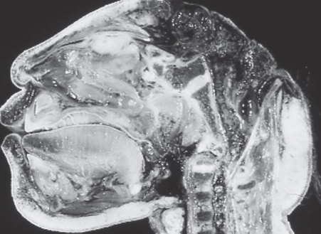

• Fig. 59.2 Anencephaly.

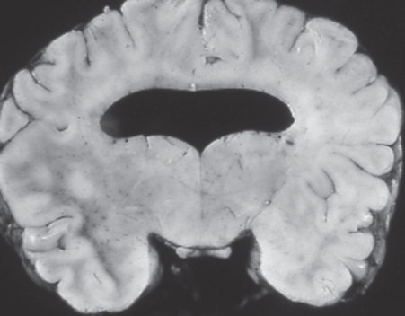

• Fig. 59.3 Semilobar holoprosencephaly, coronal specimen.

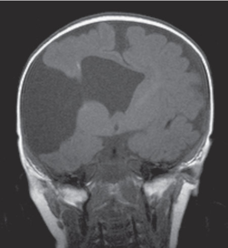

• Fig. 59.4 Open-lipped schizencephaly. T1-weighted coronal MRI shows a large open cleft communicating with the right lateral ventricle and the absence of the septum pellucidum.

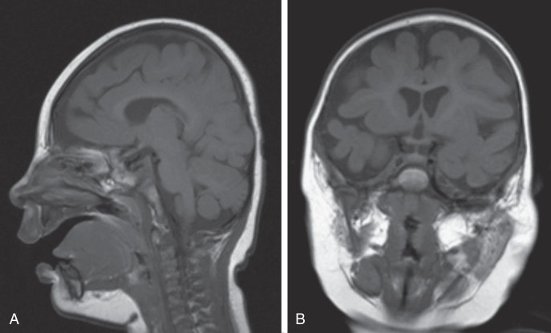

• Fig. 59.1 Primary microcephaly. (A) T1-weighted sagittal MRI. (B) T1-weighted coronal MRI.

## PDF page 1138

• Fig. 59.5 Lissencephaly, coronal specimen.

• Fig. 59.6 Polymicrogyria.

craniofrontal dysplasia, lead to improperly formed faces and heads.9

### Congenital Infections

In utero infections, collectively known as TORCH (toxoplasmosis, other agents [syphilis, varicella-zoster, parvovirus], rubella, cytomegalovirus, and herpes simplex virus) infections, also produce insults to the development of the craniofacial system. Microcephaly, associated even in the setting of hydrocephalus in toxoplasmosis infection, is commonly observed (Fig. 59.8).11

### Hydrocephalus

Macrocephaly, defined as an orbitofrontal circumference more than two standard deviations above the mean, can be attributed to three possible processes. First, macrencephaly, enlargement of the brain itself, can lead to large heads and

• Fig. 59.7 Agenesis of the corpus callosum. T1-weighted MRI also demonstrates the absence of septum pellucidum and a large midline cerebrospinal fluid collection.

• Fig. 59.8 Congenital toxoplasmosis. Noncontrast CT scan shows ex vacuo hydrocephalus and periventricular calcifications.

is seen in certain genetic, neurocutaneous, or metabolic syndromes.12 Second, neoplasms or abnormal structures, such as vascular lesions like vein of Galen malformations, can lead to macrocephaly. Third, hydrocephalus can lead to macrocephalic and neurologic manifestations.

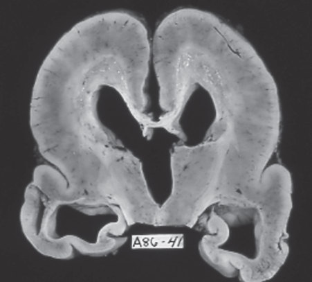

• Fig. 59.5 Lissencephaly, coronal specimen.

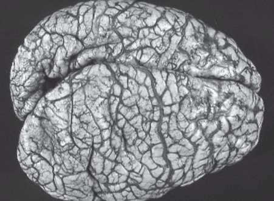

• Fig. 59.6 Polymicrogyria.

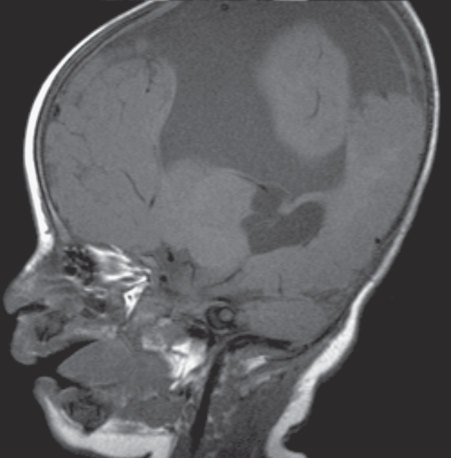

• Fig. 59.7 Agenesis of the corpus callosum. T1-weighted MRI also demonstrates the absence of septum pellucidum and a large midline cerebrospinal fluid collection.

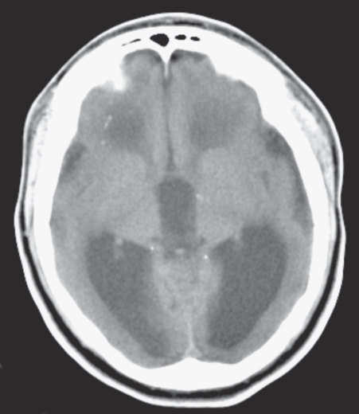

• Fig. 59.8 Congenital toxoplasmosis. Noncontrast CT scan shows ex vacuo hydrocephalus and periventricular calcifications.

## PDF page 1139 | printed page 1135

The normal rate of cerebrospinal fluid (CSF) production is about 0.3 mL/min, or 20 mL/h.13,14 In premature infants, the rate of CSF formation is lower. The newborn has a total CSF volume of about 50 mL. Normal CSF production occurs in the choroid plexus, and reabsorption into the venous system occurs via arachnoid villi granulations in the venous sinuses. An impaired balance between production and absorption, whether it be structural or metabolic, leads to enlargement of the CSF fluid spaces. The clinical manifestation of hydrocephalus depends on the status of the cranial sutures at the time of clinical onset. In a newborn with open sutures, macrocephaly with tense or bulging fontanelles and split sutures may be presenting signs. However, a child over 2 years of age can present without macrocephaly but with signs of elevated ICP, including headache, irritability, vomiting, lethargy, or “sunset” eyes.

Hydrocephalus may be categorized as either acquired or congenital. Acquired causes included post-hemorrhagic and post-meningitic hydrocephalus. Congenital causes include Dandy-Walker malformation, Chiari malformation, or aqueductal stenosis.15

### Intraventricular Hemorrhage

Post-hemorrhagic hydrocephalus can occur as a consequence of trauma, but it is most often seen in premature infants with germinal matrix hemorrhage. The germinal matrix is a rich vascular network found in the periventricular subependyma and normally involutes by 36 weeks’ gestation.16,17 However, in premature neonates, this involution does not occur completely; therefore intraventricular hemorrhage (IVH) is most common in prematurity, with some studies showing up to 27% of preterm infants under 1500 g being affected.18 Nonetheless, term infants can also develop IVH, but this is usually associated with an underlying coagulopathy.18,19

IVH may result in ventriculomegaly without clinical hydrocephalus. A grading system of IVH based on the site of hemorrhage and presence of ventriculomegaly or intracerebral hemorrhage is used to describe IVH and prognosticate, with higher grades correlating with worse outcome. Grade 1 is isolated to blood within the germinal matrix; grade 2 is bleeding within but without enlargement of the ventricles; grade 3 is bleeding within and concurrent enlargement of the ventricles; and grade 4 is hemorrhage extending to the surrounding brain parenchyma (Fig. 59.9). Close observation in neonates with IVH and ventriculomegaly is recommended to monitor for the development of hydrocephalus.17 Post-hemorrhagic hydrocephalus is defined as ventriculomegaly with signs of elevated ICP, including increased OFC. Post-hemorrhagic hydrocephalus results in malfunctioning arachnoid villi because of arachnoiditis (Figs. 59.10 and 59.11). Efforts to halt progression include either limiting CSF production (i.e., diamox) or removing excess CSF (i.e., serial lumbar or ventricular taps either directly or by reservoir placement or subgaleal

• Fig. 59.9 Posthemorrhagic hydrocephalus. Diffuse intraventricular hemorrhage secondary to germinal matrix bleed (grade IV) is seen in this coronal specimen.

### * *

• Fig. 59.10 Posthemorrhagic hydrocephalus after grade IV intraventricular hemorrhage of prematurity. CT scan demonstrates lateral ventricle enlargement and left frontal encephalomalacia (asterisks) at the site of parenchymal hemorrhage.

shunt).20–22 Permanent diversion with CSF shunting may ultimately be required.

### Congenital Brain Malformations

Congenital malformations, such as Dandy-Walker and Chiari malformations, are often associated with macrocephaly and hydrocephalus. Dandy-Walker malformations are characterized by fourth ventricular cystic transformation, partial or complete agenesis of the cerebellar vermis,

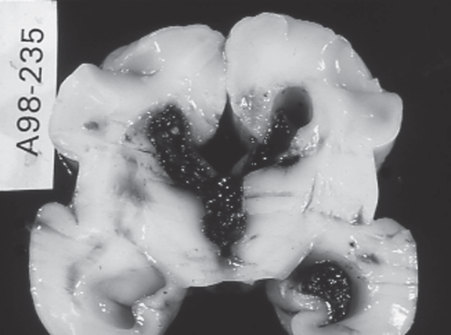

• Fig. 59.9 Posthemorrhagic hydrocephalus. Diffuse intraventricular hemorrhage secondary to germinal matrix bleed (grade IV) is seen in this coronal specimen.

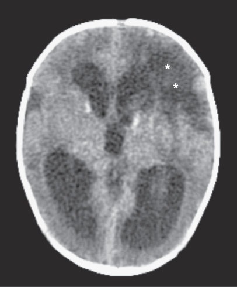

• Fig. 59.10 Posthemorrhagic hydrocephalus after grade IV intraventricular hemorrhage of prematurity. CT scan demonstrates lateral ventricle enlargement and left frontal encephalomalacia (asterisks) at the site of parenchymal hemorrhage.

## PDF page 1140

• Fig. 59.11 Posthemorrhagic hydrocephalus. Coronal ultrasound scan shows enlarged lateral ventricles and intraventricular blood.

• Fig. 59.12 Dandy-Walker malformation. T1-weighted sagittal MRI demonstrates cystic transformation of the fourth ventricle with posterior fossa enlargement, elevation of the torcular herophili, and dysgenesis of the inferior cerebellar vermis.

and posterior cranial fossa enlargement with upward displacement of the torcula heterophili, transverse sinuses, and tentorium (Fig. 59.12). The resultant obstructive hydrocephalus leads to supratentorial ventriculomegaly, which is present at birth or progresses over time. Externally, patients may have a high-riding external occipital protuberance. Occipital encephaloceles or meningoceles, cleft lip and palate, or other craniofacial malformations are frequently observed.23 The malformation is more

• Fig. 59.13 Chiari II malformation. T1-weighted sagittal MRI shows partial agenesis of the corpus callosum (arrows) and multiple anomalies, including enlargement of the massa intermedia, beaking of the tectum, herniation of the cerebellum below the foramen magnum, and kinking of the medulla.

frequently observed in females than males and occurs in approximately 1 in 25,000 live births.23

Chiari II malformation is another congenital anomaly that is commonly associated with hydrocephalus and sometimes with macrocephaly. The malformation is characterized by an abnormal hindbrain secondary to a small posterior fossa, low-lying transverse sinuses and tentorium, beaked tectum, and herniation of the cerebellar vermis below the foramen magnum. (Fig. 59.13) This malformation is uniformly associated with a lumbosacral myelomeningocele.24 In regard to OFC, the head may not be enlarged at birth, with even the possibility of a small cranium because of decompression of the CSF into the myelomeningocele sac. However, after closure of the myelomeningocele, it is important to continue to monitor the OFC because it may begin to rapidly expand. When untreated, this obstructive hydrocephalus manifests as cranial neuropathies or brainstem dysfunction because of downward pressure.

### Other Causes

Other causes of hydrocephalus and concomitant macrocephaly include aqueductal stenosis, neoplasms, and vascular malformations. Each of these entities causes noncommunicating hydrocephalus but is not always evident at birth.

Stenosis of the cerebral aqueduct can be congenital or acquired, and it accounts for approximately 10% of pediatric hydrocephalus. Radiographically, there is enlargement of the lateral and third ventricles with a normal fourth ventricle (Fig. 59.14). A narrowed aqueduct alters the dynamic flow and reabsorption of CSF.25 Macrocephaly is not generally

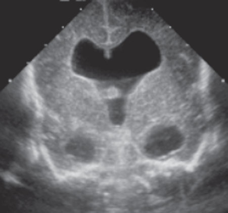

• Fig. 59.11 Posthemorrhagic hydrocephalus. Coronal ultrasound scan shows enlarged lateral ventricles and intraventricular blood.

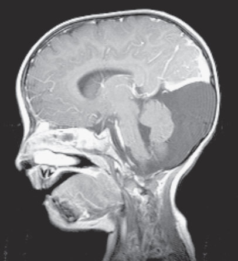

• Fig. 59.12 Dandy-Walker malformation. T1-weighted sagittal MRI demonstrates cystic transformation of the fourth ventricle with posterior fossa enlargement, elevation of the torcular herophili, and dysgenesis of the inferior cerebellar vermis.

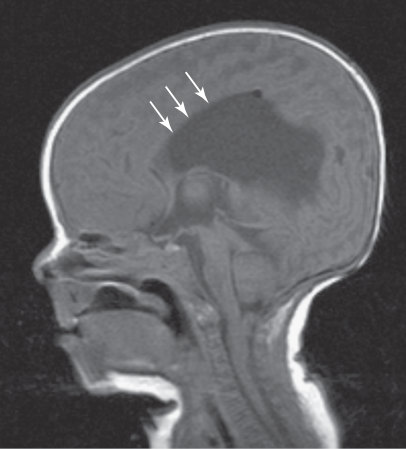

• Fig. 59.13 Chiari II malformation. T1-weighted sagittal MRI shows partial agenesis of the corpus callosum (arrows) and multiple anomalies, including enlargement of the massa intermedia, beaking of the tectum, herniation of the cerebellum below the foramen magnum, and kinking of the medulla.

## PDF page 1141 | printed page 1137

• Fig. 59.14 Aqueductal stenosis. T1-weighted sagittal MRI shows noncommunicating hydrocephalus secondary to stenosis of the aqueduct of Sylvius (arrow). The lateral and third ventricles are enlarged, with a normal-sized fourth ventricle. An arachnoid cyst is present inferior to the cerebellum.

evident at birth but may progress before suture closure if the stenosis is severe. Acquired aqueductal stenosis can occur as the consequence of a neoplasm. However, changes in head shape or head size may not be evident unless the neoplasm was present before suture closure. Examples include both slow-growing tumors such as choroid plexus papilloma, low-grade astrocytoma, and ganglioglioma (Fig. 59.15) and rapidly growing ones such as primitive neuroectodermal tumor and teratoma (Fig. 59.16).

Vascular lesions are a rare cause of macrocephaly and hydrocephalus in the newborn. Vein of Galen malformations often present with high-output heart failure and concomitant macrocephaly and hydrocephalus. This malformation arises in the third trimester of pregnancy because of a persistent embryonic prosencephalic vein of Markowski. Endovascular treatment of the malformation is the mainstay of intervention, but the hydrocephalus may require direct treatment via shunting or third ventriculostomy in symptomatic children who either cannot undergo endovascular treatment or must be treated in stages.26

### Hydranencephaly

Hydranencephaly is a rare congenital anomaly marked by almost complete absence of the cerebral hemispheres. It is thought to occur as the result of a major in utero vascular insult during the second trimester, particularly bilateral occlusion of the carotid arteries. The brain undergoes intrauterine liquefaction and is essentially reduced to a bag of

### *

• Fig. 59.15 T1-weighted contrast-enhanced MRI demonstrating dysembryoplastic neuroepithelial tumor, a low-grade primary neoplasm of the right temporal lobe (asterisk).

• Fig. 59.16 T1-weighted contrast-enhanced MRI demonstrating a large primitive neuroectodermal tumor of the right temporal lobe deforming the brain.

water, a meningeal sac containing CSF with high protein content. The diencephalon, brainstem, and posterior fossa structures are spared, and a thin occipital cortical rim may permit some visual function.

The newborn with hydranencephaly may appear neurologically normal at birth because of the normally functioning thalami and brainstem. Difficulty with visual

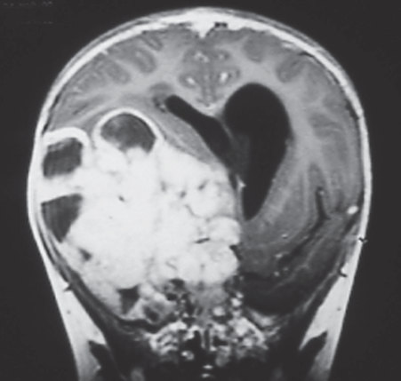

• Fig. 59.16 T1-weighted contrast-enhanced MRI demonstrating a large primitive neuroectodermal tumor of the right temporal lobe deforming the brain.

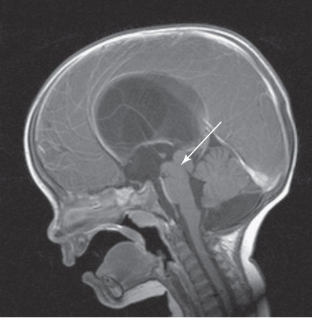

• Fig. 59.14 Aqueductal stenosis. T1-weighted sagittal MRI shows noncommunicating hydrocephalus secondary to stenosis of the aqueduct of Sylvius (arrow). The lateral and third ventricles are enlarged, with a normal-sized fourth ventricle. An arachnoid cyst is present inferior to the cerebellum.

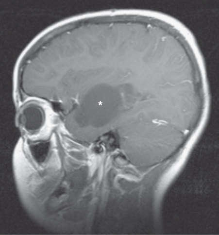

• Fig. 59.15 T1-weighted contrast-enhanced MRI demonstrating dysembryoplastic neuroepithelial tumor, a low-grade primary neoplasm of the right temporal lobe (asterisk).

## PDF page 1142

fixing and following may be appreciated. The head size may be normal or even small at birth but can enlarge rapidly owing to malabsorption of the proteinaceous CSF. On occasion, the diagnosis of hydranencephaly is made after several months because of failure to achieve developmental milestones.

Significant macrocephaly may be treated with a ventriculoperitoneal shunt. The decision to shunt can be difficult because shunting is primarily done to make it easier to care for the infant and does not lead to an improved level of neurologic function. The long-term outcome for infants with hydranencephaly is poor, and most do not live for more than 1 or 2 years.

Hydranencephaly can be diagnosed by ultrasound, although magnetic resonance imaging (MRI) is much more accurate (Fig. 59.17). Hydranencephaly is distinguished from anencephaly by the presence of intact meninges and skull. It is important to distinguish between hydranencephaly and advanced hydrocephalus, which may have a similar clinical and radiographic presentation. The compressed cerebral mantle in hydrocephalus can expand, sometimes dramatically, after ventricular shunt placement.

### Craniosynostosis

Abnormally shaped heads of infancy go beyond micro- or macrocephaly. In the instance of a misshapen head, the differential includes craniosynostosis and deformational plagiocephaly. Of these two, deformational plagiocephaly is the far most common cause of an asymmetric head shape. The incidence of positional plagiocephaly has skyrocketed since the adoption of the “Back to Sleep” campaign with nearly a 400% increase in plastic surgery referrals for plagiocephaly from 2000–2003 to 2004–2007.27 The hallmark of craniosynostosis is the premature fusion of cranial sutures. The pathologic fusion of sutures, if left untreated, places infants

A B

• Fig. 59.17 Hydranencephaly: T1-weighted sagittal (A) and coronal (B) magnetic resonance images show almost complete absence of the cerebral hemispheres with preservation of the thalami (arrows) and hindbrain.

at risk for head shape abnormalities and hydrocephalus, as well as elevated ICP secondary to craniocephalic disproportion.28 Although the incidence of elevated ICP varies widely in the literature, it is estimated to be between 4.5% and 44% of untreated children with craniosynostosis.29 Of the children treated with elevated ICP symptoms, the majority had improvement in classic ICP-related symptoms such as headache, but fewer had resolution or improvement in symptoms such as developmental delay.30 In the majority of craniosynostosis cases, only a single suture is involved, causing characteristic head shapes that will be described further. Rarely, multiple suture fusions combine as part of a greater craniofacial syndrome. Thus craniosynostosis can be subdivided into either nonsyndromic or syndromic subtypes (Box 59.1). It should also be noted that although the majority of craniosynostosis is caused by primary closure of sutures, secondary causes can include metabolic or hematologic disorders such as rickets, hyperthyroidism, polycythemia vera, and thalassemia.

• BOX 59.1 Causes of Abnormal Head Shape

Craniosynostosis Nonsyndromic • Sagittal synostosis • Metopic synostosis • Unilateral coronal synostosis • Bilateral coronal synostosis • Metopic synostosis

Syndromic • Muenke syndrome • Apert syndrome • Crouzon syndrome • Pfeiffer syndrome • Saethre-Chotzen syndrome

Deformational Plagiocephaly

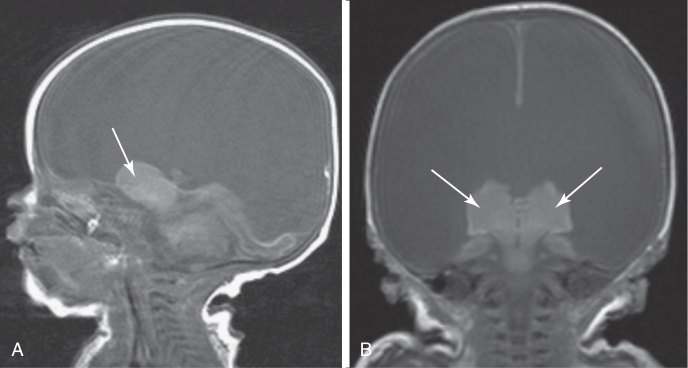

• Fig. 59.17 Hydranencephaly: T1-weighted sagittal (A) and coronal (B) magnetic resonance images show almost complete absence of the cerebral hemispheres with preservation of the thalami (arrows) and hindbrain.

## PDF page 1143 | printed page 1139

The characteristic head shapes seen in craniosynostosis occur as a result of failure of perpendicular growth of the bones of the skull vault relative to the suture and compensatory growth at nonfused sites.31 Defects in fibroblast growth factor receptors (FGFRs) have been implicated in the etiology of craniosynostosis.31,32 Normally, signals from the dura promote patent sutures until completion of brain growth, but these signals are altered in cases of craniosynostosis.

The first step in diagnosing premature suture closure is the physical exam. Knowledge of the general types of misshapen heads can lead one to identify the fused suture (Table 59.1). In neonates, sutures are relatively mobile, and fusion of the suture can be diagnosed by the absence of mobility along the suture of concern in combination with the shape of the infant’s head. Ultrasound is a noninvasive and noradiation technique that can be used in young infants with thin bones. Depending on the study, sensitivity ranged from 71% to 100% and specificity ranged from 86% to 100%.28 Plain skull x-rays can also confirm the diagnosis, which demonstrate sclerosis along all or part of the fused suture. A computed tomography (CT) scan increases sensitivity for diagnosis and may be useful in children who are older where suture mobility is not as easily palpable and can be useful for operative planning should a reconstruction be warranted.

### Nonsyndromic Craniosynostosis

Sagittal craniosynostosis is the most common type of craniosynostosis. Premature sagittal suture fusion occurs in approximately 1:1000 live births with a 4:1 male to female preponderance.31 An infant typically presents with scaphocephaly, or “boat-shaped head” (Figs. 59.18 and 59.19). Specifically, there is a narrowed biparietal diameter with compensatory frontal bossing, temporal hollowing, and a prominent occipital protuberance. Neurologically,

TABLE

Abnormal Head Shapes

59.1

Term Definition

Scaphocephaly Boat head

Dolichocephaly Long head

Clinocephaly Saddle head

Brachycephaly Short head

Plagiocephaly Oblique head

Trigonocephaly Triangular head

Turricephaly Towering head

Acrocephaly Peaked head

Oxycephaly Pointed head

Hypsicephaly High head

Kleeblattschadel Cloverleaf head

scaphocephalic infants are most often normal. Numerous surgical procedures exist to remodel the head, including minimally invasive or open techniques. Open surgical techniques are generally reserved for older patients who can tolerate higher blood loss and surgical comorbidities. Minimally invasive techniques are suitable for younger populations but do require more post-operative adjunctive care, including helmets.33 Early intervention allows for normal brain growth, which triples in weight within a year, to help guide the remodeled head to a more normal shape.

Metopic craniosynostosis presents with trigonocephaly—a triangular-shaped forehead with a vertical keel (Fig. 59.20). The anterior cranial vault is reduced with associated hypotelorism, lateral canthi elevation, and temporal

• Fig. 59.18 Sagittal synostosis. Skull radiograph shows fusion of the sagittal suture (arrowheads) with scaphocephaly and frontal bossing.

Fused Suture

Sagittal

Sagittal

Sagittal

Bilateral coronal or lambdoid

Unilateral coronal, lambdoid, deformational

Metopic

Multiple

Multiple

Multiple

Multiple

Multiple

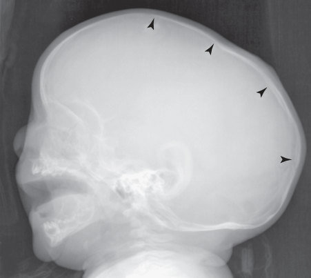

• Fig. 59.18 Sagittal synostosis. Skull radiograph shows fusion of the sagittal suture (arrowheads) with scaphocephaly and frontal bossing.

## PDF page 1144

A

• Fig. 59.19 Sagittal synostosis, with scaphocephaly, frontal bossing, and protuberance at the occiput. (A) Side view. (B) Top view.

A

• Fig. 59.20 Trigonocephaly secondary to premature fusion of the metopic suture. (A) Top view. (B) T1-weighted MRI.

hollowing. Infants with severe craniofacial deformities can be treated surgically with endoscopic procedures or bifrontal craniotomy with orbital bar advancements.

Premature fusion of the coronal suture produces either plagiocephaly or brachycephaly, depending on whether one or bilateral coronal sutures are fused. Unilateral coronal synostosis is characterized by an “oblique” head shape with flattening of the ipsilateral forehead, compensatory bossing of the contralateral side, and ipsilateral nasal root deviation (Fig. 59.21). The ipsilateral orbit is shallow with the superolateral margin drawn upward and backward, giving rise to

B

Bthe classic “harlequin eye” deformity seen on radiographs (Fig. 59.22). Cranial vault reconstruction also includes craniotomy with orbital bar advancement.

Bicoronal craniosynostosis presents with brachycephaly, or “short” head. There are palpable ridges over both coronal sutures with the head foreshortened in the anterior-posterior plane. Sometimes, there is widening of the head and compensatory increased height, termed turricephaly (Fig. 59.23). Surgical correction is similar to that for unicoronal synostosis. Although most commonly nonsyndromic, all children with bicoronal synostosis should be evaluated

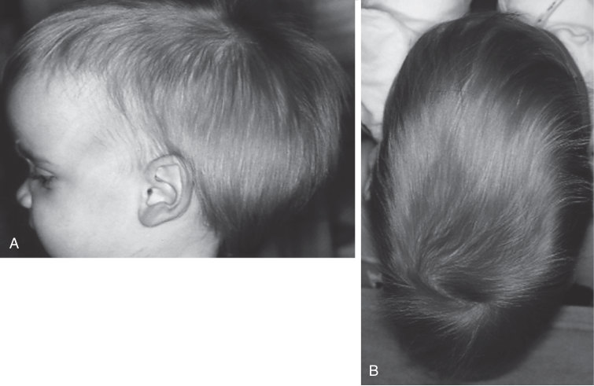

• Fig. 59.19 Sagittal synostosis, with scaphocephaly, frontal bossing, and protuberance at the occiput. (A) Side view. (B) Top view.

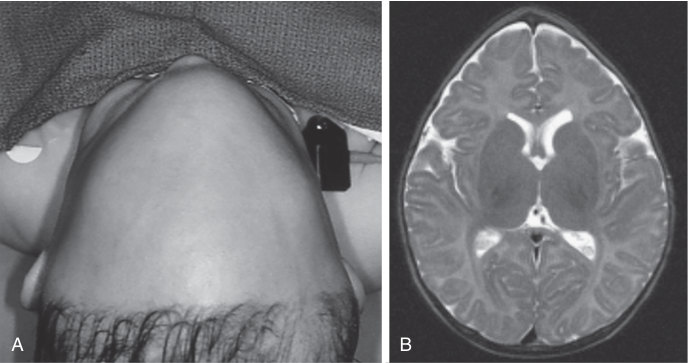

• Fig. 59.20 Trigonocephaly secondary to premature fusion of the metopic suture. (A) Top view. (B) T1-weighted MRI.

## PDF page 1145 | printed page 1141

A

• Fig. 59.21 Unilateral right coronal synostosis. There is facial asymmetry, ipsilateral frontal flattening, and vertical orbital dystopia with inferior displacement of the contralateral orbit. (A) Front view. (B) Top view.

• Fig. 59.22 Unilateral right coronal synostosis (arrows) on threedimensional CT scan. The ipsilateral orbit is drawn upward and backward (harlequin eye).

to rule out underlying malformations because premature bicoronal suture fusion is a hallmark for syndromic craniosynostosis.34

### Positional Plagiocephaly

Also known as deformational posterior plagiocephaly, cranial asymmetry caused by flattening of the occiput is a common neurosurgical referral to rule out lambdoid craniosynostosis. Premature closure of the lambdoid suture is quite rare, estimated to account for approximately 3% of

B

• Fig. 59.23 Bicoronal synostosis (arrows). Three-dimensional CT scan shows brachyturricephaly.

all craniosynostosis cases.31 However, a thorough physical exam can quickly help decipher positional plagiocephaly from true posterior plagiocephaly. In positional plagiocephaly, the head mimics the shape of a parallelogram when viewed from above. There is unilateral occipital flattening with ipsilateral frontal prominence. The key to distinguishing positional plagiocephaly from plagiocephaly arising from craniosynostosis is the position of the ipsilateral ear. In positional plagiocephaly, the ipsilateral ear is displaced forward with both ears in the same horizontal plane due to positional shifting of the ipsilateral skull. In lambdoid

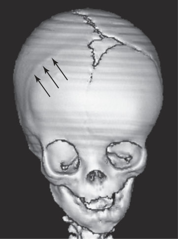

• Fig. 59.22 Unilateral right coronal synostosis (arrows) on threedimensional CT scan. The ipsilateral orbit is drawn upward and backward (harlequin eye).

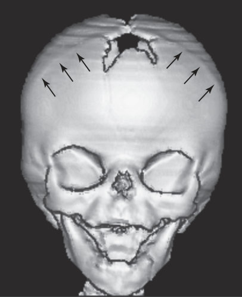

• Fig. 59.23 Bicoronal synostosis (arrows). Three-dimensional CT scan shows brachyturricephaly.

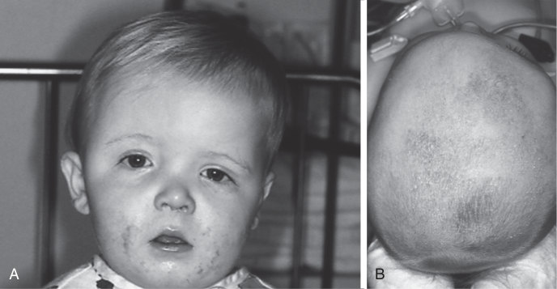

• Fig. 59.21 Unilateral right coronal synostosis. There is facial asymmetry, ipsilateral frontal flattening, and vertical orbital dystopia with inferior displacement of the contralateral orbit. (A) Front view. (B) Top view.

## PDF page 1146

• Fig. 59.24 Deformational plagiocephaly (left) with right occipital flattening and anterior displacement of the ipsilateral ear. Right lambdoid synostosis (right) with right occipital flattening and posterior and inferior displacement of the ipsilateral ear.

synostosis, the ipsilateral ear is displaced posteriorly because of restriction of growth perpendicular to the fused lambdoid suture (Fig. 59.24).

### Syndromic Craniosynostosis

Craniofacial syndromes with craniosynostosis are often inherited in an autosomal dominant fashion. The most frequent syndromes have been localized to mutations encoding fibroblast growth receptor genes.34 Clinically, there are symptoms common to craniofacial syndromes, including hearing loss, respiratory difficulties related to midface hypoplasia, and cognitive deficits with or without the development of hydrocephalus.34

Muenke syndrome is the most common of the syndromic craniosynostoses, afflicting as many as 1 in 30,000 live births.34 It is inherited in an autosomal dominant fashion, with the FGFR3 gene implicated. The coronal suture is often involved with bilateral synostosis, which is more commonly seen than unilateral synostosis. However, there is variability in presentation ranging from a single suture involvement to pansynostosis. Sensorineural hearing loss is also more common in this syndrome compared to others. In addition, there is often mild midface hypoplasia with hypertelorism.

Apert syndrome can affect up to 1 in 65,000 births. Most mutations causing this syndrome are sporadic, although there are reports of autosomal dominant transmission.34 The FGFR2 gene is most often implicated. Clinically, the external head shape most often seen is brachyturricephaly with a flattened occiput (Fig. 59.25). The coronal sutures are fused with a widely open anterior fontanelle and metopic suture. Other hallmark features include maxillary hypoplasia, symmetric hand syndactyly, and cognitive delay.

Crouzon syndrome patients are similar in appearance to Apert syndrome patients; however, the craniofacial anomalies are not present at birth. The coronal sutures are typically involved, and brachycephaly is often observed. Other

• Fig. 59.25 Apert syndrome. There is brachyturricephaly, maxillary hypoplasia, hypertelorism with downsloping of the palpebral fissures, and a depressed nasal bridge. The child also has symmetric syndactyly of the hands and feet.

typical features include exophthalmos and maxillary hypoplasia (Fig. 59.26). Unlike Apert syndrome, cognitive delay is infrequent.

Other syndromes include Pfeiffer and Saethre- Chotzen syndromes. In Pfeiffer syndrome, there is usually involvement of the coronal suture, with frequent involvement of the sagittal and lambdoid sutures. Other associated symptoms include maxillary hypoplasia and choanal atresia (Fig. 59.27). Noncranial hallmark features of Pfeiffer syndrome include broad thumbs and great toes. Patients with Saethre-Chotzen syndrome present with brachycephaly, low-lying hairlines, ptosis, and hypertelorism.

### Conclusion

Examination of the infant head shape and size is critical to evaluate for underlying pathologies that may impair neurologic development. Macrocephaly or accelerated head growth in the neonate should prompt evaluation for hydrocephalus or mass lesions. Premature infants remain at risk for germinal matrix hemorrhage, which may predispose infants to post-hemorrhagic hydrocephalus. Abnormalities in head shape should prompt evaluation for craniosynostosis, although positional plagiocephaly remains a much more common etiology for an abnormal head shape in an infant.

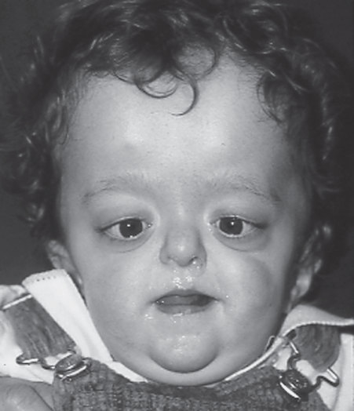

• Fig. 59.25 Apert syndrome. There is brachyturricephaly, maxillary hypoplasia, hypertelorism with downsloping of the palpebral fissures, and a depressed nasal bridge. The child also has symmetric syndactyly of the hands and feet.

## PDF page 1147 | printed page 1143

B

A

### • Fig. 59.26 Crouzon syndrome (craniofacial dysostosis) with brachyturricephaly, exophthalmos, and max-

illary hypoplasia. (A) Frontal view. (B) Side view.

A B

### • Fig. 59.27 Pfeiffer syndrome. (A) Side view. There is brachyturricephaly, maxillary hypoplasia, and choanal

atresia (note indwelling tracheostomy). (B) Undersurface of the skull at craniofacial reconstruction demonstrates convolutional markings from increased intracranial pressure.

Key Points

### • An abnormally large head is a common sequela of hydro-

cephalus in infants; however, there are a range of causes of hydrocephalus in these patients.

### References

1. Aisenson MR. Closing of the anterior fontanelle. Pediatrics.

1950;6(2):223–226. 2. Pindrik J, Ye X, Ji BG, Pendleton C, Ahn ES. Anterior

fontanelle closure and size in full-term children based on head computed tomography. Clin Pediatr (Phila). 2014;53(12):1149–1157.

### • Early identification, surveillance, and intervention are

critical to successful outcomes in hydrocephalus.

### • A thorough physical exam will most often provide the

diagnosis in the setting of an abnormal head shape.

3. Casey PH, Kraemer HC, Bernbaum J, Yogman MW, Sells JC.

Growth status and growth rates of a varied sample of low birth weight, preterm infants: a longitudinal cohort from birth to three years of age. J Pediatr. 1991;119(4):599–605. 4. Sherry B, Mei Z, Grummer-Strawn L, Dietz WH. Evaluation of

and recommendations for growth references for very low birth weight (< or =1500 grams) infants in the United States. Pediatrics. 2003;111(4 Pt 1):750–758.

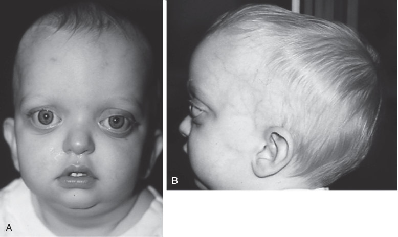

• Fig. 59.26 Crouzon syndrome (craniofacial dysostosis) with brachyturricephaly, exophthalmos, and maxillary hypoplasia. (A) Frontal view. (B) Side view.

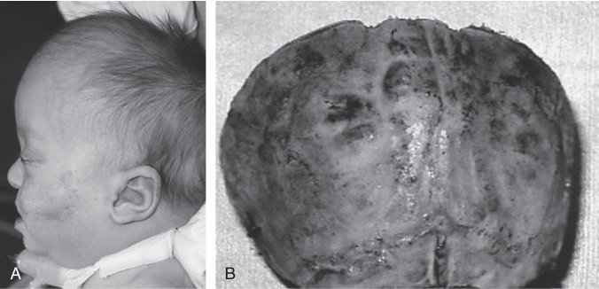

• Fig. 59.27 Pfeiffer syndrome. (A) Side view. There is brachyturricephaly, maxillary hypoplasia, and choanal atresia (note indwelling tracheostomy). (B) Undersurface of the skull at craniofacial reconstruction demonstrates convolutional markings from increased intracranial pressure.

## PDF page 1148

5. Richtsmeier JT, Flaherty K. Hand in glove: brain and skull

in development and dysmorphogenesis. Acta Neuropathol. 2013;125(4):469–489. 6. Dubourg C, Bendavid C, Pasquier L, Henry C, Odent S, David

V. Holoprosencephaly. Orphanet J Rare Dis. 2007;2:8. 7. Dyment DA, Sawyer SL, Chardon JW, Boycott KM. Recent

advances in the genetic etiology of brain malformations. Curr Neurol Neurosci Rep. 2013;13(8):364. 8. Winter TC, Kennedy AM, Woodward PJ. Holoprosencephaly: a

survey of the entity, with embryology and fetal imaging. Radiographics. 2015;35(1):275–290. 9. Adameyko I, Fried K. The nervous system orchestrates and integrates

craniofacial development: a review. Front Physiol. 2016;7:49. 10. Metin C, Vallee RB, Rakic P, Bhide PG. Modes and mishaps

of neuronal migration in the mammalian brain. J Neurosci. 2008;28(46):11746–11752. 11. Neu N, Duchon J, Zachariah P. TORCH infections. Clin Perina-

tol. 2015;42(1):77–103, (viii). 12. Seal A. Fifteen-minute consultation on the infant with a large

head. Arch Dis Child Educ Pract Ed. 2013;98(4):122–125. 13. Cutler RW, Page L, Galicich J, Watters GV. Formation and absorp-

tion of cerebrospinal fluid in man. Brain. 1968;91(4):707–720. 14. Rubin RC, Henderson ES, Ommaya AK, Walker MD, Rall DP.

The production of cerebrospinal fluid in man and its modification by acetazolamide. J Neurosurg. 1966;25(4):430–436. 15. Beuriat PA, Puget S, Cinalli G, et al. Hydrocephalus treatment

in children: long-term outcome in 975 consecutive patients. J Neurosurg Pediatr. 2017;20(1):10–18. 16. Szymonowicz W, Schafler K, Cussen LJ, Yu VY. Ultrasound

and necropsy study of periventricular haemorrhage in preterm infants. Arch Dis Child. 1984;59(7):637–642. 17. Shah NA, Wusthoff CJ. Intracranial hemorrhage in the neonate.

Neonatal Netw. 2016;35(2):67–71. 18. Szpecht D, Szymankiewicz M, Nowak I, Gadzinowski J. Intra-

ventricular hemorrhage in neonates born before 32 weeks of gestation-retrospective analysis of risk factors. Childs Nerv Syst. 2016;32(8):1399–1404. 19. Afsharkhas L, Khalessi N, Karimi Panah M. Intraventricular

hemorrhage in term neonates: sources, severity and outcome. Iran J Child Neurol. 2015;9(3):34–39. 20. Petraglia AL, Moravan MJ, Dimopoulos VG, Silberstein HJ.

Ventriculosubgaleal shunting--a strategy to reduce the incidence of shunt revisions and slit ventricles: an institutional experience

and review of the literature. Pediatr Neurosurg. 2011;47(2):99– 107. 21. Peretta P, Ragazzi P, Carlino CF, Gaglini P, Cinalli G. The role

of Ommaya reservoir and endoscopic third ventriculostomy in the management of post-hemorrhagic hydrocephalus of prematurity. Childs Nerv Syst. 2007;23(7):765–771. 22. Kormanik K, Praca J, Garton HJ, Sarkar S. Repeated tapping

of ventricular reservoir in preterm infants with post-hemorrhagic ventricular dilatation does not increase the risk of reservoir infection. J Perinatol. 2010;30(3):218–221. 23. Spennato P, Mirone G, Nastro A, et al. Hydrocephalus in

Dandy-Walker malformation. Childs Nerv Syst. 2011;27(10): 1665–1681. 24. McLone DG, Knepper PA. The cause of Chiari II malformation:

a unified theory. Pediatr Neurosci. 1989;15(1):1–12. 25. Emery JL, Staschak MC. The size and form of the cerebral aque-

duct in children. Brain. 1972;95(3):591–598. 26. Primikiris P, Hadjigeorgiou G, Tsamopoulou M, et al. Review

on the current treatment status of vein of Galen malformations and future directions in research and treatment. Expert Rev Med Devices. 2021;18(10):933–954. 27. Branch LG, Kesty K, Krebs E, et al. Deformational plagiocephaly

and craniosynostosis: trends in diagnosis and treatment after the "back to sleep" campaign. J Craniofac Surg. 2015;26(1):147–150. 28. Whitsell N, Meyer L. Craniosynostosis - a review for providers. S

D Med. 2021;74(2):83–88. 29. Wall SA, Thomas GP, Johnson D, et al. The preoperative inci-

dence of raised intracranial pressure in nonsyndromic sagittal craniosynostosis is underestimated in the literature. J Neurosurg Pediatr. 2014;14(6):674–681. 30. Still ME, Chidarala S, Alvarado A, Neal D, Governale L, Ching

J. Craniosynostosis surgery for increased intracranial pressure. J Craniofac Surg. 2021. 31. Governale LS. Craniosynostosis. Pediatr Neurol. 2015;53(5):394–

401. 32. Gripp KW, McDonald-McGinn DM, Gaudenz K, et al. Identifi-

cation of a genetic cause for isolated unilateral coronal synostosis: a unique mutation in the fibroblast growth factor receptor 3. J Pediatr. 1998;132(4):714–716. 33. Dempsey RF, Monson LA, Maricevich RS, et al. Nonsyndromic

craniosynostosis. Clin Plast Surg. 2019;46(2):123–139. 34. Wang JC, Nagy L, Demke JC. Syndromic craniosynostosis.

Facial Plast Surg Clin North Am. 2016;24(4):531–543.

<!-- SOURCE_LAYOUT_VIEWS -->

## Original layout views and recovered diagrams

Automatic extraction can flatten tables and superscripts. Check the original layout for numeric data, footnotes and image credits. [Source review notes](../../SOURCE_REVIEW_NOTES.md).

### Original source page 1137

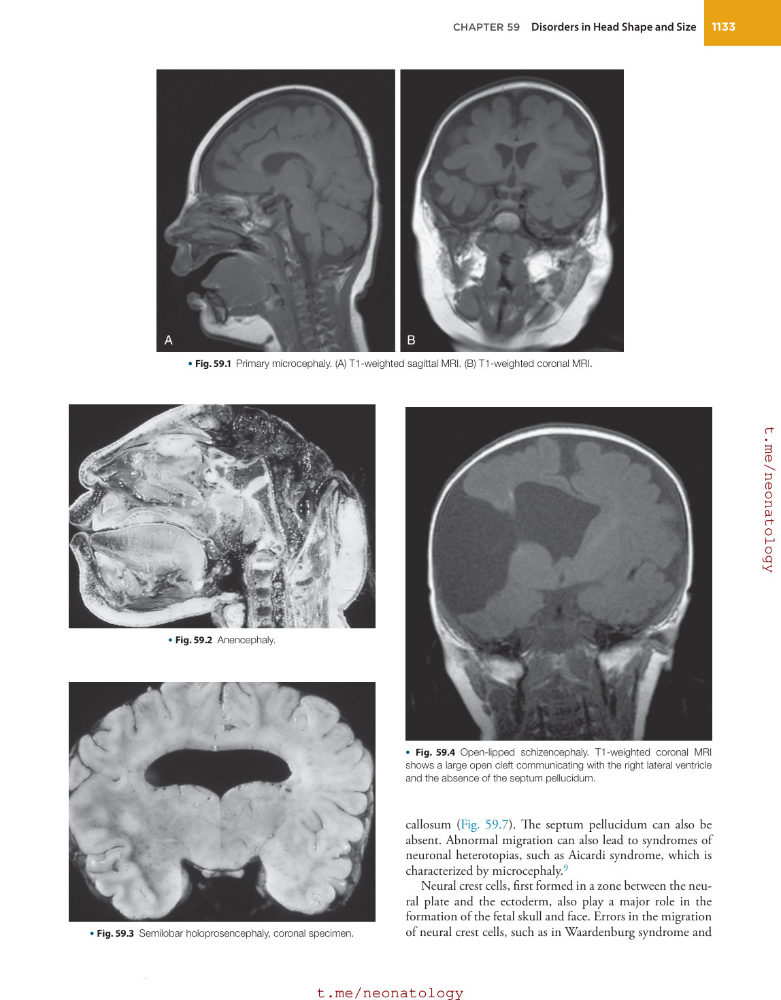

### Original source page 1138

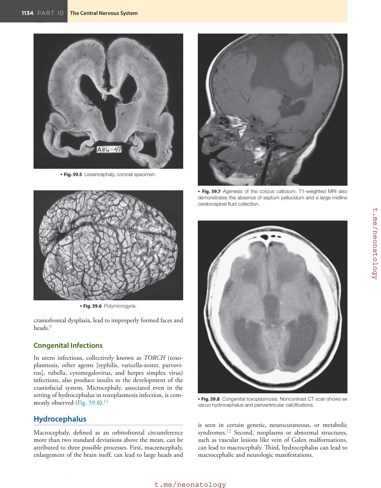

### Original source page 1139

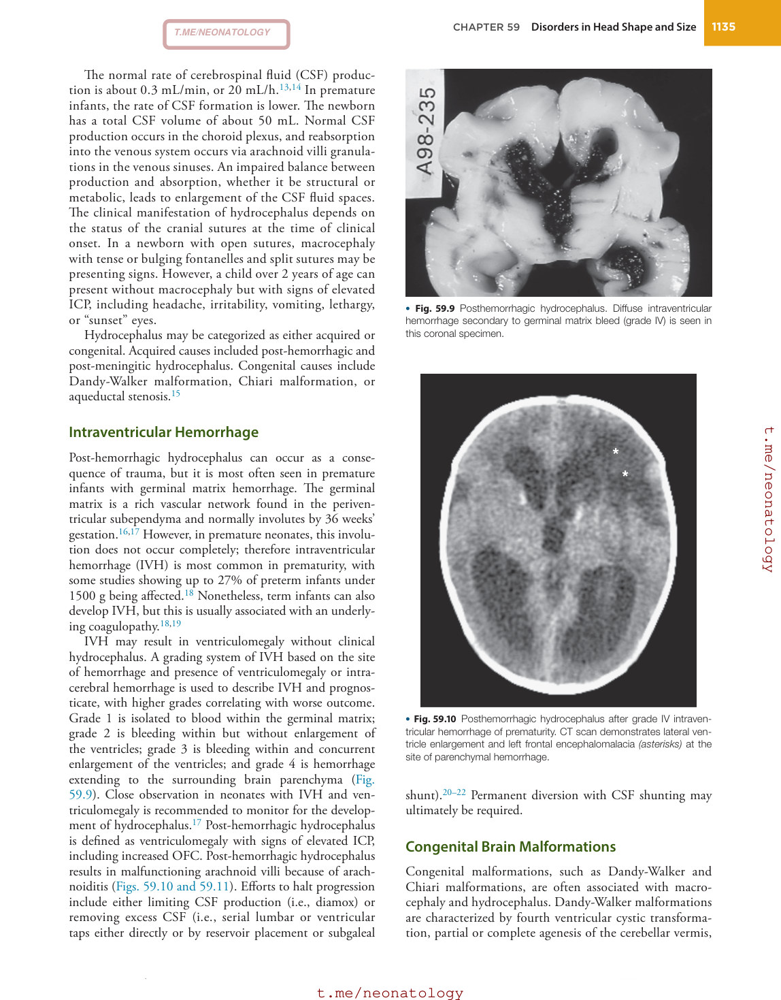

### Original source page 1140

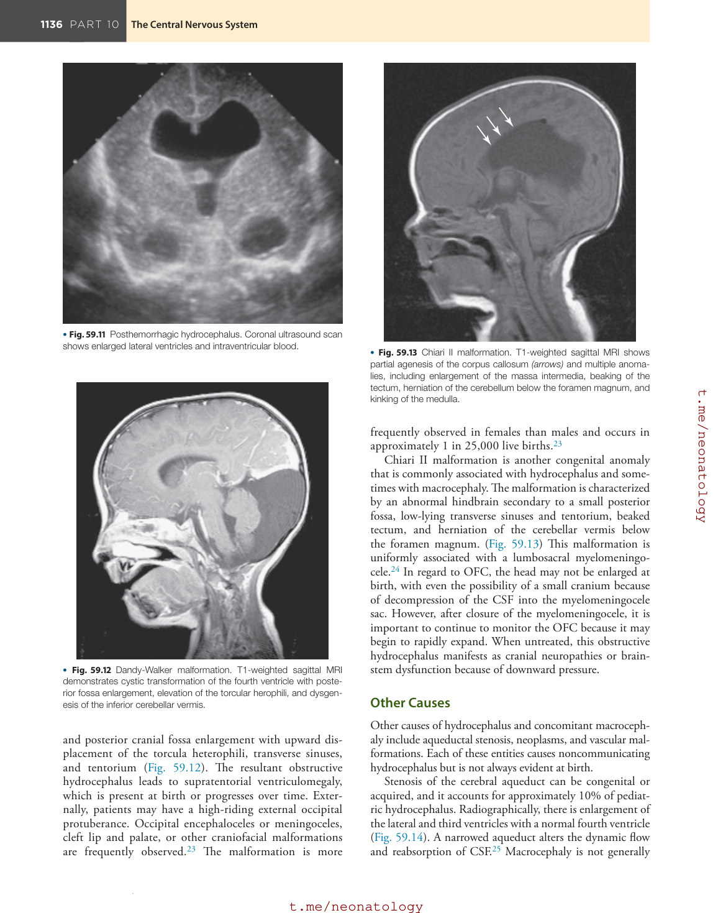

### Original source page 1141

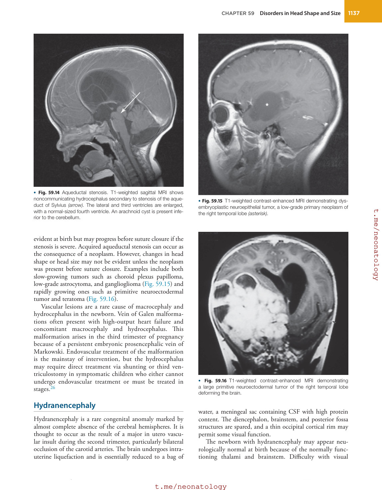

### Original source page 1142

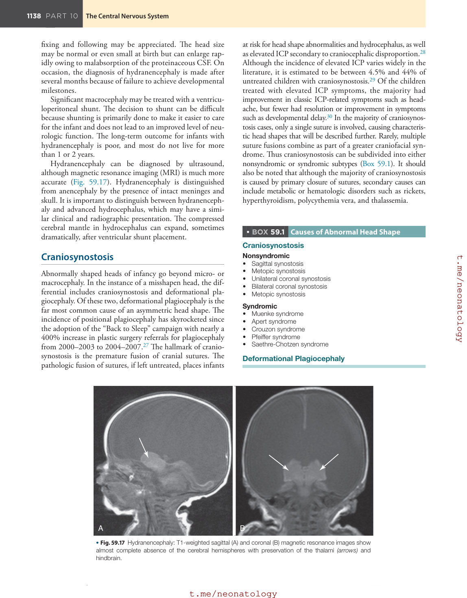

### Original source page 1143

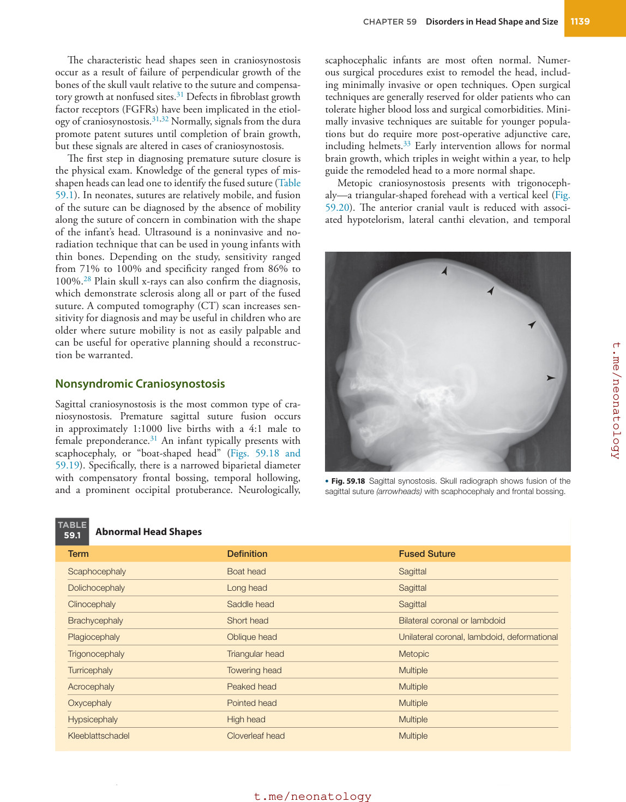

### Original source page 1144

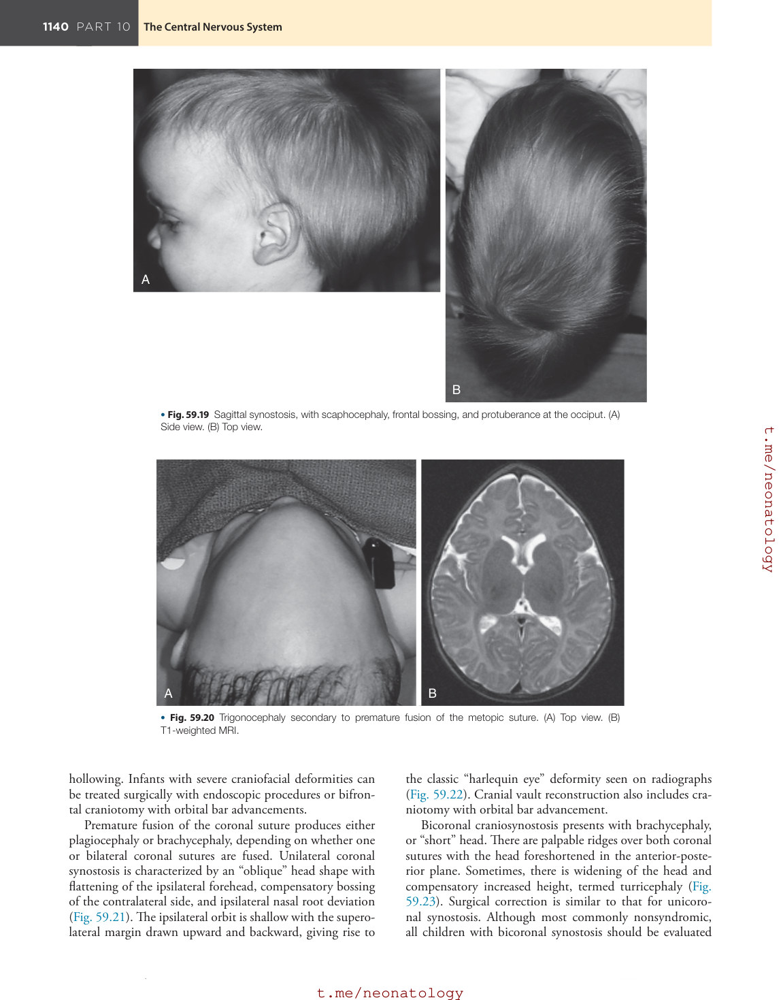

### Original source page 1145

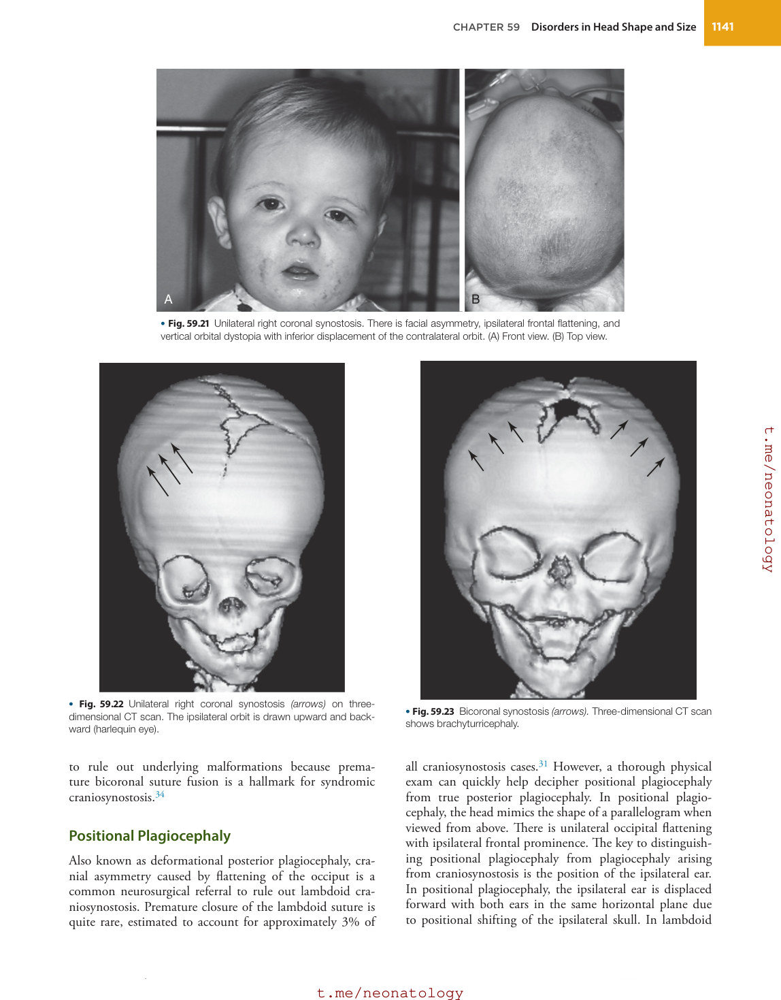

### Original source page 1146

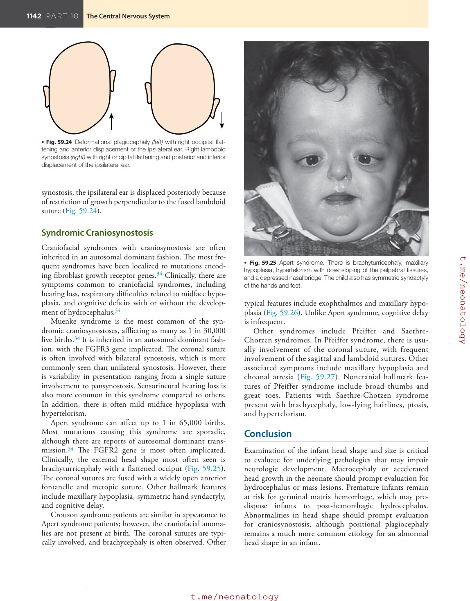

### Original source page 1147

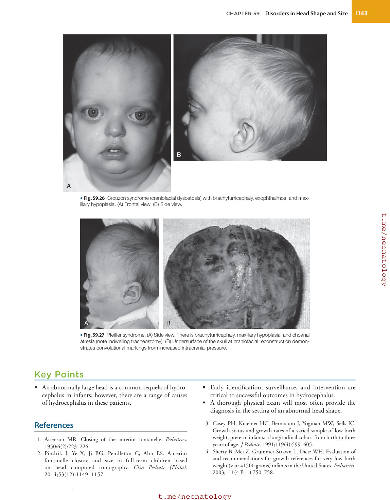

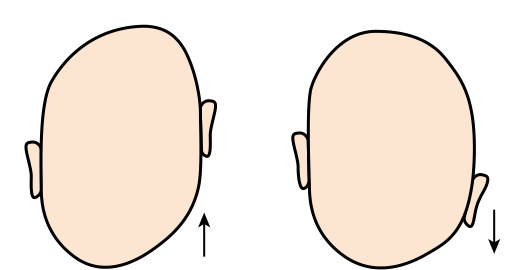

• Fig. 59.24 Deformational plagiocephaly (left) with right occipital flattening and anterior displacement of the ipsilateral ear. Right lambdoid synostosis (right) with right occipital flattening and posterior and inferior displacement of the ipsilateral ear.

PDF p. 1146
