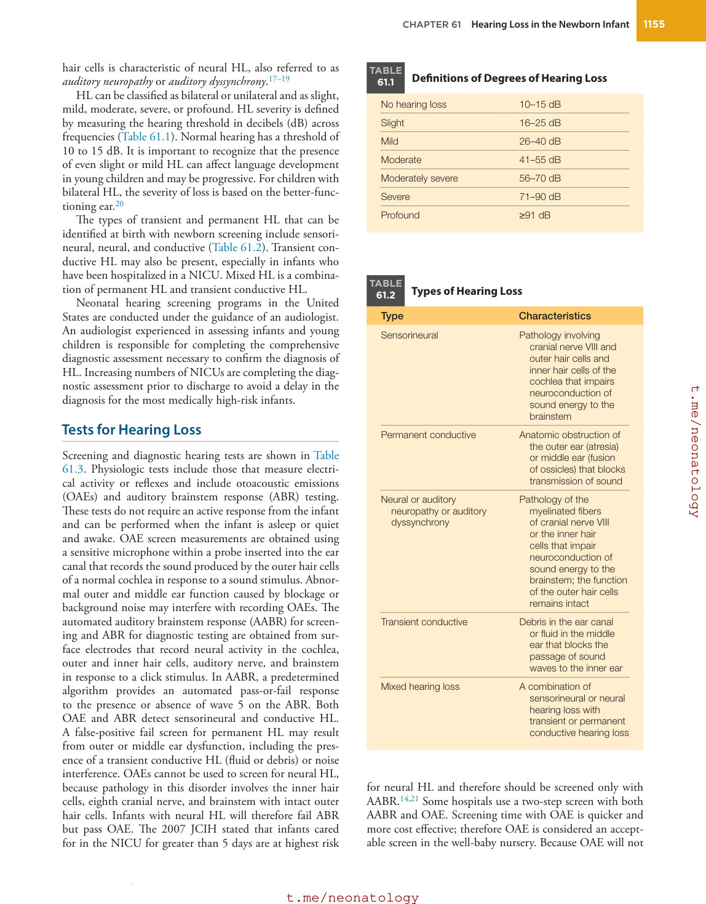
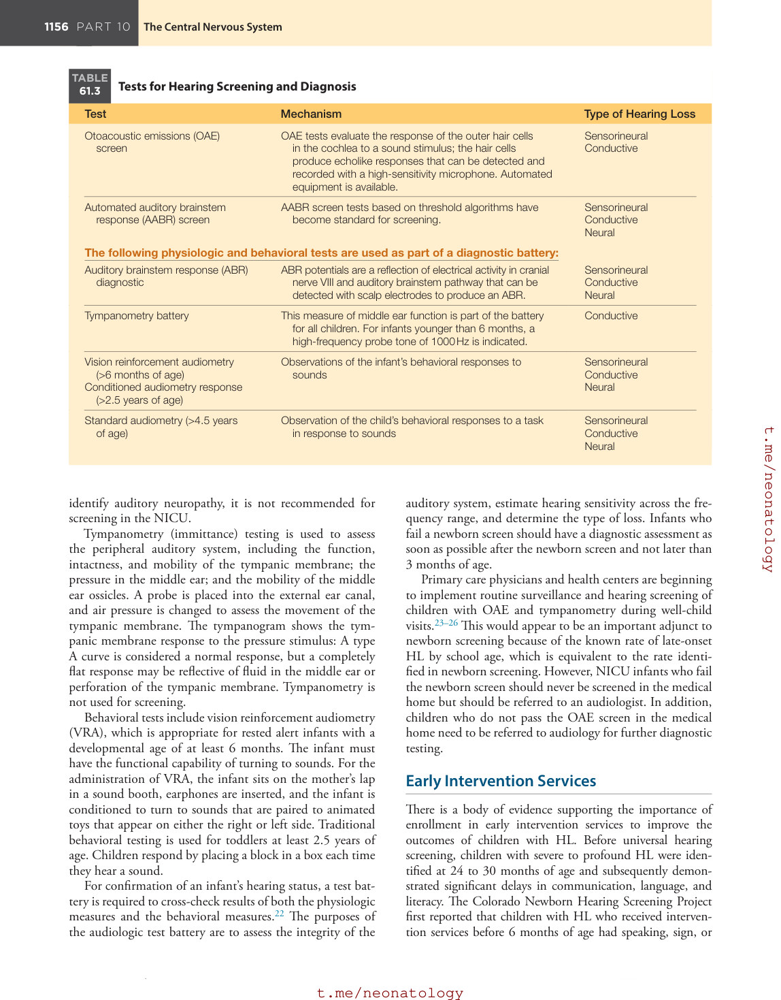
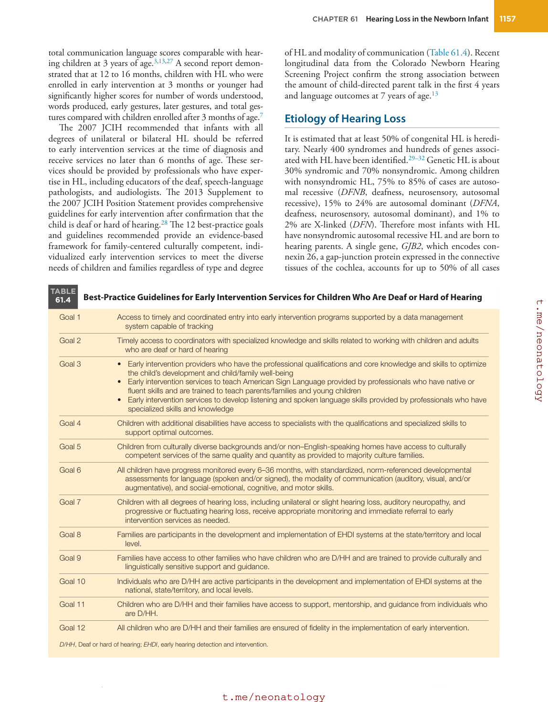

# 61. Hearing Loss in the Newborn Infant
> Source attribution: [Source credits](../../SOURCE_CREDITS.md).

## PDF page 1158 | printed page 1154

61 Hearing Loss in the Newborn Infant

### BETTY R. VOHR

### Background

Tremendous progress has been made during the past 25 years in the identification of hearing loss (HL) in newborns. The National Institutes of Health issued a “Consensus Statement on Early Identification of Hearing Impairment in Infants and Young Children” in 1993 that concluded that all infants admitted to the neonatal intensive care unit (NICU) should be screened for HL before hospital discharge and that universal hearing screening should be implemented for all infants within the first 3 months of life.1 The percentage of infants screened for HL in the United States increased from 46% in 1999 to 98.4% in 2014. The percentage of infants who fail the screening process is about 1.6%, and the rates of permanent HL subsequently diagnosed by comprehensive audiology testing range from one to three per 1000, making congenital HL the most common birth defect diagnosed as a result of the newborn screening process (https://www.cdc.gov/ncbddd/ hearingloss/2019-data/01-data-summary.html#data-item).

A report to assess the impact of universal hearing screening in a large cohort of infants identified a prevalence of deafness by school age of 3.65/1000 compared to a neonatal rate of 1.79/1000.2 The prevalence of deafness by 3 to 17 years of age as reported by the Centers for Disease Control and Prevention (CDC) National Health Interview Survey for the years 1997 to 2005 was 5/1000 (https://www.cdc.gov/ncbd dd/hearingloss/data.html). It is important to recognize that the neonatal screen does not identify all HL and is least sensitive to mild impairments. Undetected, HL in young infants and children negatively affects communication development, academic achievement, literacy, and social and emotional development,3,4 whereas early identification and intervention, particularly within the first 6 months of life, clearly provide benefit for communication development in infants.3,5–9 There is accumulating evidence that the brain may be optimally responsive to language input early in life.10–13

Based on these findings, the 2007 Joint Committee on Infant Hearing (JCIH) Position Statement published

1154

the 1-3-6 recommendation to maximize the outcomes of infants with all degrees of HL14: (1) All infants in the NICU and well-baby nursery should be screened for HL at no later than 1 month of age. (2) Infants who do not pass the screen should have a comprehensive evaluation by an audiologist skilled in assessing infants and children no later than 3 months of age, for confirmation of hearing status. When a diagnosis of permanent HL has been made, timely referral for assistive technology for enhancing access to language is indicated.13–15 (3) Infants with confirmed HL should receive appropriate intervention no later than 6 months of age from professionals with expertise in HL and deafness in infants and young children.16

### Normal/Typical Hearing and Hearing Loss

The ear consists of outer, middle, and inner components. The external ear includes the pinna and the outer ear canal. Sound waves travel through the air and are conducted through the outer ear canal to the tympanic membrane, where vibrations enter the middle ear and are amplified and transmitted through the ossicles to the fluid within the cochlea (inner ear). Sound waves in the inner ear are transmitted through the fluid and stimulate both the outer and inner hair cells of the cochlea. The outer hair cells respond to sound energy by producing an echo of sounds referred to as otoacoustic emissions (OAEs), and the inner hair cells act by converting mechanical energy into electrical energy transmitted to the cochlear branch of the eighth cranial nerve, the brainstem, and finally the auditory cortex for perception of the meaning of sounds. In normal hearing individuals, all components of the pathway are intact and functioning. Blockage of sound conduction in the outer or middle ear may result in either transient (fluid or debris) or permanent (anatomic abnormality such as atresia or microtia) conductive HL. Failure of sound transmission within the cochlea, outer and inner hair cells, and eighth cranial nerve is a manifestation of sensorineural HL, whereas pathology of the inner hair cells and eighth cranial nerve with intact outer

## PDF page 1159 | printed page 1155

hair cells is characteristic of neural HL, also referred to as auditory neuropathy or auditory dyssynchrony.17–19

HL can be classified as bilateral or unilateral and as slight, mild, moderate, severe, or profound. HL severity is defined by measuring the hearing threshold in decibels (dB) across frequencies (Table 61.1). Normal hearing has a threshold of 10 to 15 dB. It is important to recognize that the presence of even slight or mild HL can affect language development in young children and may be progressive. For children with bilateral HL, the severity of loss is based on the better-functioning ear.20

The types of transient and permanent HL that can be identified at birth with newborn screening include sensorineural, neural, and conductive (Table 61.2). Transient conductive HL may also be present, especially in infants who have been hospitalized in a NICU. Mixed HL is a combination of permanent HL and transient conductive HL.

Neonatal hearing screening programs in the United States are conducted under the guidance of an audiologist. An audiologist experienced in assessing infants and young children is responsible for completing the comprehensive diagnostic assessment necessary to confirm the diagnosis of HL. Increasing numbers of NICUs are completing the diagnostic assessment prior to discharge to avoid a delay in the diagnosis for the most medically high-risk infants.

### Tests for Hearing Loss

Screening and diagnostic hearing tests are shown in Table 61.3. Physiologic tests include those that measure electrical activity or reflexes and include otoacoustic emissions (OAEs) and auditory brainstem response (ABR) testing. These tests do not require an active response from the infant and can be performed when the infant is asleep or quiet and awake. OAE screen measurements are obtained using a sensitive microphone within a probe inserted into the ear canal that records the sound produced by the outer hair cells of a normal cochlea in response to a sound stimulus. Abnormal outer and middle ear function caused by blockage or background noise may interfere with recording OAEs. The automated auditory brainstem response (AABR) for screening and ABR for diagnostic testing are obtained from surface electrodes that record neural activity in the cochlea, outer and inner hair cells, auditory nerve, and brainstem in response to a click stimulus. In AABR, a predetermined algorithm provides an automated pass-or-fail response to the presence or absence of wave 5 on the ABR. Both OAE and ABR detect sensorineural and conductive HL. A false-positive fail screen for permanent HL may result from outer or middle ear dysfunction, including the presence of a transient conductive HL (fluid or debris) or noise interference. OAEs cannot be used to screen for neural HL, because pathology in this disorder involves the inner hair cells, eighth cranial nerve, and brainstem with intact outer hair cells. Infants with neural HL will therefore fail ABR but pass OAE. The 2007 JCIH stated that infants cared for in the NICU for greater than 5 days are at highest risk

TABLE

Definitions of Degrees of Hearing Loss

61.1

No hearing loss 10–15 dB

Slight 16–25 dB

Mild 26–40 dB

Moderate 41–55 dB

Moderately severe 56–70 dB

Severe 71–90 dB

Profound ≥91 dB

TABLE

Types of Hearing Loss

61.2

Type Characteristics

Sensorineural Pathology involving

cranial nerve VIII and outer hair cells and inner hair cells of the cochlea that impairs neuroconduction of sound energy to the brainstem

Permanent conductive Anatomic obstruction of

the outer ear (atresia) or middle ear (fusion of ossicles) that blocks transmission of sound

Neural or auditory

Pathology of the

neuropathy or auditory dyssynchrony

myelinated fibers of cranial nerve VIII or the inner hair cells that impair neuroconduction of sound energy to the brainstem; the function of the outer hair cells remains intact

Transient conductive Debris in the ear canal

or fluid in the middle ear that blocks the passage of sound waves to the inner ear

Mixed hearing loss A combination of

sensorineural or neural hearing loss with transient or permanent conductive hearing loss

for neural HL and therefore should be screened only with AABR.14,21 Some hospitals use a two-step screen with both AABR and OAE. Screening time with OAE is quicker and more cost effective; therefore OAE is considered an acceptable screen in the well-baby nursery. Because OAE will not

## PDF page 1160

TABLE

Tests for Hearing Screening and Diagnosis

61.3

Test Mechanism

Otoacoustic emissions (OAE)

OAE tests evaluate the response of the outer hair cells

screen

in the cochlea to a sound stimulus; the hair cells produce echolike responses that can be detected and recorded with a high-sensitivity microphone. Automated equipment is available.

Automated auditory brainstem

AABR screen tests based on threshold algorithms have

response (AABR) screen

become standard for screening.

The following physiologic and behavioral tests are used as part of a diagnostic battery:

Auditory brainstem response (ABR)

ABR potentials are a reflection of electrical activity in cranial

diagnostic

nerve VIII and auditory brainstem pathway that can be detected with scalp electrodes to produce an ABR.

Tympanometry battery This measure of middle ear function is part of the battery

for all children. For infants younger than 6 months, a high-frequency probe tone of 1000 Hz is indicated.

Vision reinforcement audiometry

Observations of the infant’s behavioral responses to

(>6 months of age) Conditioned audiometry response

sounds

(>2.5 years of age)

Standard audiometry (>4.5 years

Observation of the child’s behavioral responses to a task

of age)

in response to sounds

identify auditory neuropathy, it is not recommended for screening in the NICU.

Tympanometry (immittance) testing is used to assess the peripheral auditory system, including the function, intactness, and mobility of the tympanic membrane; the pressure in the middle ear; and the mobility of the middle ear ossicles. A probe is placed into the external ear canal, and air pressure is changed to assess the movement of the tympanic membrane. The tympanogram shows the tympanic membrane response to the pressure stimulus: A type A curve is considered a normal response, but a completely flat response may be reflective of fluid in the middle ear or perforation of the tympanic membrane. Tympanometry is not used for screening.

Behavioral tests include vision reinforcement audiometry (VRA), which is appropriate for rested alert infants with a developmental age of at least 6 months. The infant must have the functional capability of turning to sounds. For the administration of VRA, the infant sits on the mother’s lap in a sound booth, earphones are inserted, and the infant is conditioned to turn to sounds that are paired to animated toys that appear on either the right or left side. Traditional behavioral testing is used for toddlers at least 2.5 years of age. Children respond by placing a block in a box each time they hear a sound.

For confirmation of an infant’s hearing status, a test battery is required to cross-check results of both the physiologic measures and the behavioral measures.22 The purposes of the audiologic test battery are to assess the integrity of the

Type of Hearing Loss

Sensorineural Conductive

Sensorineural Conductive Neural

Sensorineural Conductive Neural

Conductive

Sensorineural Conductive Neural

Sensorineural Conductive Neural

auditory system, estimate hearing sensitivity across the frequency range, and determine the type of loss. Infants who fail a newborn screen should have a diagnostic assessment as soon as possible after the newborn screen and not later than 3 months of age.

Primary care physicians and health centers are beginning to implement routine surveillance and hearing screening of children with OAE and tympanometry during well-child visits.23–26 This would appear to be an important adjunct to newborn screening because of the known rate of late-onset HL by school age, which is equivalent to the rate identified in newborn screening. However, NICU infants who fail the newborn screen should never be screened in the medical home but should be referred to an audiologist. In addition, children who do not pass the OAE screen in the medical home need to be referred to audiology for further diagnostic testing.

### Early Intervention Services

There is a body of evidence supporting the importance of enrollment in early intervention services to improve the outcomes of children with HL. Before universal hearing screening, children with severe to profound HL were identified at 24 to 30 months of age and subsequently demonstrated significant delays in communication, language, and literacy. The Colorado Newborn Hearing Screening Project first reported that children with HL who received intervention services before 6 months of age had speaking, sign, or

## PDF page 1161 | printed page 1157

total communication language scores comparable with hearing children at 3 years of age.3,13,27 A second report demonstrated that at 12 to 16 months, children with HL who were enrolled in early intervention at 3 months or younger had significantly higher scores for number of words understood, words produced, early gestures, later gestures, and total gestures compared with children enrolled after 3 months of age.7

The 2007 JCIH recommended that infants with all degrees of unilateral or bilateral HL should be referred to early intervention services at the time of diagnosis and receive services no later than 6 months of age. These services should be provided by professionals who have expertise in HL, including educators of the deaf, speech-language pathologists, and audiologists. The 2013 Supplement to the 2007 JCIH Position Statement provides comprehensive guidelines for early intervention after confirmation that the child is deaf or hard of hearing.28 The 12 best-practice goals and guidelines recommended provide an evidence-based framework for family-centered culturally competent, individualized early intervention services to meet the diverse needs of children and families regardless of type and degree

TABLE

### Best-Practice Guidelines for Early Intervention Services for Children Who Are Deaf or Hard of Hearing

61.4

Goal 1 Access to timely and coordinated entry into early intervention programs supported by a data management

system capable of tracking

Goal 2 Timely access to coordinators with specialized knowledge and skills related to working with children and adults

who are deaf or hard of hearing

Goal 3 • Early intervention providers who have the professional qualifications and core knowledge and skills to optimize

the child’s development and child/family well-being • Early intervention services to teach American Sign Language provided by professionals who have native or

fluent skills and are trained to teach parents/families and young children • Early intervention services to develop listening and spoken language skills provided by professionals who have

specialized skills and knowledge

Goal 4 Children with additional disabilities have access to specialists with the qualifications and specialized skills to

support optimal outcomes.

Goal 5 Children from culturally diverse backgrounds and/or non–English-speaking homes have access to culturally

competent services of the same quality and quantity as provided to majority culture families.

Goal 6 All children have progress monitored every 6–36 months, with standardized, norm-referenced developmental

assessments for language (spoken and/or signed), the modality of communication (auditory, visual, and/or augmentative), and social-emotional, cognitive, and motor skills.

Goal 7 Children with all degrees of hearing loss, including unilateral or slight hearing loss, auditory neuropathy, and

progressive or fluctuating hearing loss, receive appropriate monitoring and immediate referral to early intervention services as needed.

Goal 8 Families are participants in the development and implementation of EHDI systems at the state/territory and local

level.

Goal 9 Families have access to other families who have children who are D/HH and are trained to provide culturally and

linguistically sensitive support and guidance.

Goal 10 Individuals who are D/HH are active participants in the development and implementation of EHDI systems at the

national, state/territory, and local levels.

Goal 11 Children who are D/HH and their families have access to support, mentorship, and guidance from individuals who

are D/HH.

Goal 12 All children who are D/HH and their families are ensured of fidelity in the implementation of early intervention.

D/HH, Deaf or hard of hearing; EHDI, early hearing detection and intervention.

of HL and modality of communication (Table 61.4). Recent longitudinal data from the Colorado Newborn Hearing Screening Project confirm the strong association between the amount of child-directed parent talk in the first 4 years and language outcomes at 7 years of age.13

### Etiology of Hearing Loss

It is estimated that at least 50% of congenital HL is hereditary. Nearly 400 syndromes and hundreds of genes associated with HL have been identified.29–32 Genetic HL is about 30% syndromic and 70% nonsyndromic. Among children with nonsyndromic HL, 75% to 85% of cases are autosomal recessive (DFNB, deafness, neurosensory, autosomal recessive), 15% to 24% are autosomal dominant (DFNA, deafness, neurosensory, autosomal dominant), and 1% to 2% are X-linked (DFN). Therefore most infants with HL have nonsyndromic autosomal recessive HL and are born to hearing parents. A single gene, GJB2, which encodes connexin 26, a gap-junction protein expressed in the connective tissues of the cochlea, accounts for up to 50% of all cases

## PDF page 1162

of profound nonsyndromic HL. More than 100 mutations of GJB2 have been identified. A single GJB2 mutation, 35delG, accounts for up to 70% of the mutations. The etiology of HL will be reviewed relative to the risk factors for HL published by the JCIH in 2007 and 2019 (Box 61.1).

Several mitochondrial DNA mutations of the 12S rRNA gene are associated with aminoglycoside-induced nonsyndromic HL. This is potentially important for NICU infants, because aminoglycosides remain one of the most common medications administered in the NICU.33 Studies have examined the frequency of these genes in NICU populations and identified a rate of ∼1% to 1.8%,34,35 but neither of them identified an association in neonates between the presence of the genetic marker in conjunction with aminoglycoside administration and HL. Neonatal genetic screening with rapid turnaround is steadily becoming more available. A concern with the current reports, however, is that mitochondrial HL has a variable age of onset and may not be identified in the newborn period. In addition, it has been suggested that there may be a modifier gene effect that is protective.35

### Risk Factors

The first two risk factors in Box 61.1 are obtained by parent report. Parents may not be aware of a family history

• BOX 61.1 Risk Factors Associated With

Permanent Congenital, Delayed- Onset, or Progressive Hearing Loss

1. Caregiver concernsa regarding hearing, speech, language,

or developmental delay 2. Family history of permanent HLa 3. Neonatal intensive care for greater than 5 days and

hyperbilirubinemia requiring exchange transfusion regardless of length of stay 4. In utero infections, such as cytomegalovirus,a Zika virus,

herpes virus, rubella, syphilis, and toxoplasmosis 5. Craniofacial anomalies, including atresia, microtia, and

temporal bone anomalies 6. Physical findings, such as white forelock, that are

associated with syndromes known to include a sensorineural or permanent conductive HL 7. Syndromes associated with HL or progressive or late-

onset HL,a such as neurofibromatosis, osteopetrosis, and Usher syndrome; other frequently identified syndromes include Waardenburg, Alport, Pendred, and Jervell and Lange-Nielsen 8. Neurodegenerative disordersa such as Hunter syndrome

or sensory motor neuropathies such as Friedreich ataxia or Charcot-Marie-Tooth disease 9. Culture-positive postnatal infectionsa associated with

sensorineural HL, including confirmed bacterial and viral (especially herpesviruses and varicella) meningitis 10. Head trauma, especially basal skull or temporal bone

fracture that requires hospitalization 11. Chemotherapya

HL, Hearing loss. aRisk factors that are greater for delayed-onset or progressive HL.

of HL (risk factor 2) or of syndromes associated with HL until discussing the possibility with relatives. If a family history of HL is reported for an infant who passes the screen, ongoing surveillance is indicated with at least one follow-up audiologic assessment by 24 to 30 months of age. All families with an infant with HL, regardless of family history of HL, will benefit from a genetics consultation. Risk factor 1, caregiver concern regarding hearing, speech, language, or developmental delay in the first 2 to 3 years of life,36 has also been shown to be associated with an increased risk for lateonset or progressive HL not detected in a newborn screen. It is important to remember that the rate of HL doubles between birth and school age from one to three per 1000 in newborns to about three to four per 1000 at school age22; therefore caregiver concern should prompt a referral for further evaluation.

Medical complications are associated with 40% of childhood permanent HL. Risk factor 3 includes infants requiring NICU care for greater than 5 days and any of the following exposures regardless of length of stay: extracorporeal membrane oxygenation, assisted ventilation, exposure to ototoxic medications (gentamicin and tobramycin) or loop diuretics (furosemide or lasix), and hyperbilirubinemia requiring exchange transfusion.37–39 Risk factor 4 includes in utero infections such as cytomegalovirus (CMV), herpes, rubella, syphilis, toxoplasmosis, and Zika virus.40 CMV remains the most common medical cause of both early- and delayed-onset HL in infants and children.41–43 Most infants with congenital CMV infection have no clinical findings at birth, and the diagnosis goes unrecognized. Treatment of children with positive CMV, but without clinical findings or HL, with valgancyclovir remains controversial because of an increased risk of side effects.44,45 Zika virus is also a neurotropic virus that has emerged and is associated with early and possibly delayed-onset HL. It may occur in association with abnormalities of the central nervous system, and the type of HL is either sensorineural or auditory neuropathy.46,47 Because of the association with CNS abnormalities, these infants should be screened with AABR.

Risk factors 5 to 8 are all associated with congenital abnormalities or syndromes. Risk factor 5 includes craniofacial anomalies, such as those involving the pinna or ear canal, ear pits, and temporal bone anomalies.48 These defects are common in both the well-baby nursery and the NICU. Many of these findings reflect abnormalities in the embryologic development of the ear. The external ear, middle ear, and Eustachian tube develop from the branchial apparatus beginning at the fourth week of gestation. The pinna arises from the coalescence of the first and second arch tissues of the first branchial cleft, which will become the external auditory canal. The Eustachian tube and middle ear space develop from the first pharyngeal pouch, and the ossicles from the mesoderm of the first and second arches. The inner ear develops from surface ectoderm and neuroectoderm beginning in the third week of gestation, with the cochlea, semicircular canals, utricle, and saccule formed by 15 weeks. The inner ear reaches adult size by 23 weeks. Risk

## PDF page 1163 | printed page 1159

factor 6 includes visible physical findings such as white forelock, which is associated with Waardenburg syndrome.

Risk factor 7 includes syndromes associated with neonatal, progressive, or late-onset HL such as neurofibromatosis, osteopetrosis, and Usher syndrome. Usher syndrome is the most common cause of autosomal recessive syndromic HL (4%–6% of children with HL). Affected individuals develop vestibular problems secondary to progressive retinitis pigmentosa and become blind with increasing age. Subtypes are associated with either mild to severe or severe to profound HL. Early diagnosis is critical, because a visual means of communication is not an option for a child who will become blind with increasing age. Other frequently identified syndromes include Waardenburg, Pendred, Jervell and Lange-Nielsen, branchio-otorenal, and Alport syndromes.29,30,49 The most common autosomal dominant syndrome is Waardenburg syndrome. It occurs in 1% to 4% of children with HL. Children have sensorineural or permanent conductive HL and associated heterochromia iridis. Pendred syndrome is the second most common autosomal recessive cause of syndromic HL. It is characterized by severe to profound HL and euthyroid goiter, which presents during adolescence or later. An abnormality called Mondini dysplasia or dilated vestibular aqueduct, which is diagnosed by computed tomography examination of the temporal bones, is associated with Pendred syndrome. Jervell and Lange-Nielsen syndrome is characterized by prolongation of the QT segment on electrocardiogram and is associated with sudden infant death and syncope. Children with QT prolongation should be seen in consultation by cardiology for management. Branchio-otorenal syndrome is autosomal dominant and occurs in 2% of HL. It is characterized by preauricular pits, malformed pinnae, branchial fistulas, and renal anomalies. Alport syndrome is X-linked or autosomal recessive, occurs in 1% of children with HL, and is associated with progressive HL.

Risk factor 8 consists of neurodegenerative disorders such as Hunter syndrome or sensory motor neuropathies such as Friedreich ataxia and Charcot-Marie-Tooth syndrome.49

Risk factor 9 is culture-positive postnatal infections and includes confirmed bacterial and viral (especially herpesviruses and varicella virus) meningitis. Meningitis is associated with an increased incidence of sensorineural HL.50,51 Children with cochlear implants may be at increased risk of meningitis.52,53

Risk factors 10 and 11 are risk factors encountered after discharge. Serious head trauma, especially basal skull or temporal bone fractures requiring hospitalization, is a risk factor for HL in childhood.54,55 Although rare in children, chemotherapy for leukemia or cancer remains a risk factor, which in some cases is reversible.56

Box 61.1 specifically identifies the risk factors associated with delayed-onset HL. Although all children with a risk factor should have ongoing surveillance in the medical home and at least one follow-up visit with an audiologist, children with increased risk for delayed-onset HL may benefit from more frequent assessments.

### Medical Workup for Hearing Loss and Care Coordination

An initial physician visit is beneficial after a newborn hearing screen is failed. At that time, parents are informed of the risk of HL and the importance of follow-up with an audiologist. A second physician visit should be scheduled with the family as soon as a diagnosis of HL is made to discuss the audiologist’s report, provide information on community resources, and offer support for the family during a stressful time. During the postdiagnosis appointment, the physician reviews the pregnancy, neonatal, and family history for HL; re-examines the child for evidence of any craniofacial abnormalities or a syndrome associated with HL; and discusses the benefits of early intervention services and amplification. The primary care physician therefore needs to be aware of community resources and support the family’s choice of early intervention program and mode of communication. Ongoing communication of the primary provider with the family is necessary to answer questions and provide support. Sharing evidence of significantly improved outcomes as a result of early diagnosis and early intervention provides some reassurance and comfort to the family. During this time of transition, some families derive benefit from meeting other families with young children with HL who are further along in the process. Successful care coordination of the child with HL requires the partnering of the primary care provider, audiologist, otolaryngologist, early intervention provider, developmental pediatrician, geneticist, and, most importantly, the family.

Every infant with confirmed HL should be evaluated by an otolaryngologist with knowledge of pediatric HL. The otolaryngologist conducts a comprehensive assessment to determine the etiology of HL and provides recommendations and information to the family, audiologist, and primary care provider on candidacy for amplification, assistive devices, and surgical intervention, including reconstruction, bone-anchored hearing aids, and cochlear implantation.

Because of the prevalence of hereditary HL, all families of children with confirmed HL should be offered a genetics evaluation and counseling. This evaluation can provide families with information on etiology, prognosis, associated disorders, and the likelihood of HL in future offspring. The geneticist will review the family history for specific genetic disorders or syndromes, examine the child, and complete genetic testing for syndromes or gene mutations for nonsyndromic HL such as GJB2 (connexin 26).30,57,58

Additional referrals may be made at that time for a developmental assessment or other indicated specialty evaluation. Because 30% to 40% of children with confirmed HL have comorbidities or other disabilities, the primary care physician should closely monitor developmental milestones and initiate referrals for suspected disabilities as needed.25 Because of the association of HL with vision impairments and the importance of vision for children with HL, it is recommended that each child with a permanent HL have at least one examination to assess visual acuity by an ophthalmologist experienced in evaluating infants.

## PDF page 1164

### Middle Ear Disease

Otitis media with effusion (OME) is highly prevalent among young children, and about 90% of children have an episode of OME before starting school.59 Middle ear status should be monitored closely in children with permanent HL, because the presence of middle ear effusion can further compromise hearing. Recommendations related to diagnosis of OME include examination with a pneumatic otoscope and documentation of laterality, duration of effusion, and severity of symptoms. Although about 40% to 50% of children with OME do not have symptoms,60 some children, including those with unilateral HL, may have associated balance problems.61,62 Medical management of OME in children with permanent HL may include hearing testing, amplification adjustment, and tympanostomy tubes.60 Most OME is self-limited, and 75% to 90% of cases spontaneously resolve in 3 months. Therefore a 3-month period of observation is recommended. Evidence suggests that no benefit is derived from the use of antihistamines or decongestants in children. Children with persistent OME (≥4 months’ duration) with associated persistent HL or structural injury to the tympanic membrane or middle ear become candidates for surgical intervention with tympanostomy, which has been shown to be associated with decreases in middle ear effusion and improved hearing.

### Communication Options

One of the important decisions that the family needs to make for the child is the communication mode that will work optimally for the child and family.59 There are five options. Auditory oral communication encourages the use of residual hearing and amplification with visual support (speech reading), and the goal is spoken language. Auditory verbal communication is based on listening skills alone, and the goal is spoken language. Cued speech uses a visual communication system that combines listening with eight hand shapes in four placements near the face and supports spoken language. Total communication combines all means of communication and encourages simultaneous use of speech and sign. Deaf children learn American Sign Language, and English is learned as a second language when American Sign Language has been mastered. The choice of communication option for the family may change over time depending on the progress of the child and the degree of HL. For example, for an infant born with a profound HL, the family may initially choose total communication, but, after a cochlear implant at 12 months of age, they may use predominantly auditory verbal or auditory oral communication.

### Audiologic Devices

### Hearing Aids

Hearing aids are compact and worn either in-the-ear (ITE) or behind-the-ear (BTE). They can be fitted on an infant in

the first month of life. The main components are the microphone that picks up sounds and the amplifier. The audiologist uses computer programming to adjust the sound for an individual child’s needs. If the child has different degrees of HL at different frequencies, the audiologist adjusts the gain (loudness) by frequency. Normal speech range is from 500 to 2000 Hz. Ear molds are made from an impression of the child’s ear. As a young infant grows, the ear molds may have to be replaced every 6 to 8 weeks.

### Frequency-Modulated Systems

Frequency-modulated (FM) systems were developed for individuals with HL to hear better in noisy environments. An FM system consists of a microphone and a receiver. A small radio transmitter is attached to a microphone and a small radio receiver. A parent or teacher wears the FM transmitter and microphone while the child wears the FM receiver. The FM transmitter sends a low-power radio signal to the FM receiver, which must be within 50 feet of the transmitter. The FM receiver gets the signal from the microphone and sends it to a personal hearing aid or cochlear implant. Listening to the FM signal is similar to listening to speech only inches away. FM systems can be used in a variety of situations, including in the home, while shopping, or at school.

### Cochlear Implants

Children and adults who are deaf or severely hard of hearing can be fitted for cochlear implants. According to the US Food and Drug Administration (FDA), as of December 2019, approximately 736,000 people worldwide have received implants. In the United States, roughly 118,000 adults and 65,000 children have received them.63 Candidacy age criteria for pediatric cochlear implantation has continued to decrease from ≥2 years in 1990 to 18 months in 1998, 12 months in 2000, and 9 months in 2020.64 There are increasing reports demonstrating the beneficial effects on speech and language for infants with bilateral profound HL implanted before 12 months of age and with greater cumulative wear time.65–69 In cases of deafness caused by meningitis, implants may be placed early in the first year of life. Children up to 7 years of age appear to derive the greatest benefit from a cochlear implant for the development of speech.12,62 Because of an increased risk for bacterial meningitis, it is recommended that physicians monitor all patients with cochlear implants52,53 for middle ear and other infections.70 Streptococcus pneumoniae is the most common pathogen causing meningitis in cochlear implant recipients.53 All children with cochlear implants should be vaccinated according to the American Academy of Pediatrics (AAP) high-risk schedule.

### Continued Surveillance

The 2007 and 2019 JCIH Position Statements have recommendations for ongoing surveillance in the medical home

## PDF page 1165 | printed page 1161

for all infants with and without risk factors for HL.14,15,72 Regular surveillance of developmental milestones, auditory skills, parental concerns, and middle ear status should be performed in the medical home, consistent with the AAP periodicity schedule. All infants should have an objective standardized screen of global development with a validated screening tool at 9, 18, and 24 to 30 months of age or at any time if the health care professional or family has concerns. Language screens that can be used in the primary care setting include the Early Language Milestone Scale,73 the MacArthur Communicative Development Inventory,74 the Language Development Survey,75 and Ages and Stages.76

Infants who do not pass the speech-language portion of a global screening or for whom there is a concern regarding hearing or language should be referred for speech-language evaluation and audiology assessment. This recommendation was implemented because of the known increase in the number of children identified with HL between the newborn screen and school age. This is related to three factors: (1) mild HL is missed with newborn screening tools, (2) some children experience delayed-onset or progressive HL such as that associated with CMV, and (3) some children experience late-onset HL secondary to meningitis, trauma, or chemotherapy. Infants with OME may have transient HL and associated language delays.

Further management and evaluation of hearing skills and HL have been outlined by Cunningham et al.77 in an AAP Clinical Report. In addition to risk factors for HL, the report specifically addresses the need for continued surveillance of speech and language milestones in the first 36 months of life.25,77

### Stress and Impact on the Family

Parents perceive varying degrees of stress when they are informed that their infant has failed a newborn hearing screen. Although the screen result may be either a falsepositive or a true fail, most parents will have some increase in worry until their infant is rescreened. NICU infants have higher false-positive rates and higher fail rates than wellbaby nursery infants. In one study of well-baby nursery infants, parents reported increased “worry” at 2 to 8 weeks

Key Points

• Neonates requiring care in the neonatal intensive care

unit are at increased risk of auditory neuropathy and should always be screened with automated auditory brainstem response. • Hearing loss (HL) is found in association with genetic

mutations, over 400 congenital syndromes, and medical risk factors such as extreme prematurity and cytomegalovirus infection. • Undetected HL in infants and children negatively affects

communication development, academic achievement, literacy, and social-emotional development.

of age when they returned for the rescreen.78 Mothers who were more informed about hearing screening experienced decreased worry. Physicians who understand the screening process can support the family whose infant fails the screen, encourage the family to return for the rescreen, and follow up with the family about the rescreen results. A second study reported that mothers of infants with a false-positive screen did not report increased levels of stress or impact at 12 to 16 months or at 18 to 24 months.78 In addition, greater family resources were protective against persistent stress, whereas NICU stays contributed to prolonged stress.79

There is a continuum of stress for families whose infants are identified with HL that increases as they progress through the hearing screen fail, rescreen fail, diagnostic fail, and intervention process.80 Perception of stress at the time of diagnosis varies significantly among parents. Parents who are culturally deaf may have anticipated the diagnosis and be totally comfortable with it. Hearing parents of children diagnosed with an HL perceive greater stress, which is, in part, related to the fear of disability.79,81 About 95% of children with congenital HL are born to hearing parents. Prompt sharing of diagnostic test results with the family and physician and referral to early intervention services by the audiologist on the day of diagnosis may provide needed information and support to parents to mitigate stress.

If the physicians become aware of financial difficulties experienced by the family, the case manager from Part C Early Intervention should be alerted to assist the family to identify resources such as a hearing aid loaner program, Social Security benefit, Katie Beckett Program, or eligibility for Medicaid. The physician may also facilitate referrals to parent support groups such as Hands and Voices and Family Voices. Because half of the children identified with congenital HL have been in a NICU and because about 40% of children with permanent HL have other disabilities, these children may require the resources of a number of different medical and educational disciplines, adding to both financial and emotional burdens.72,82,83

In summary, infants born in 2024 with congenital HL who have early identification, amplification, and intervention have enhanced opportunities for successful communication and academic achievement.

• Early amplification and increased daily use of hearing

aids are associated with improved speech and developmental outcomes. • Provision of early intervention services no later than 6

months of age is associated with improved speech and American Sign Language communication skills. • Newborn hearing screening does not identify all HL, and

ongoing surveillance of hearing skills and language skills in the medical home to identify progressive and lateonset HL is indicated.

## PDF page 1166

### References

1. NIH Consensus Statement. Early identification of hearing impair-

ment in infants and young children. Medscape. 1993;11(1):1–24. 2. Watkin P, Baldwin M. The longitudinal follow up of a universal

neonatal hearing screen: the implications for confirming deafness in childhood. Int J Audiol. 2012;51(7):519–528. 3. Yoshinaga-Itano C. Early intervention after universal neonatal

hearing screening: impact on outcomes. Ment Retard Dev Disabil Res Rev. 2003;9(4):252–266. 4. Yoshinaga-Itano C, Coulter D, Thomson V. Developmental out-

comes of children with hearing loss born in Colorado hospitals with and without universal newborn hearing screening programs. Semin Neonatol. 2001;6(6):521–529. 5. Nelson HD, Bougatsos C, Nygren P. Universal newborn hear-

ing screening: systematic review to update the 2001 US Preventive Services Task Force Recommendation. Pediatrics. 2008;122(1):e266–e276 (Force USPST). 6. Tomblin JB, Harrison M, Ambrose SE, et al. Language outcomes

in young children with mild to severe hearing loss. Ear Hear. 2015;36(suppl 1):76S–91S. 7. Vohr B, Jodoin-Krauzyk J, Tucker R, et al. Early language out-

comes of early-identified infants with permanent hearing loss at 12 to 16 months of age. Pediatrics. 2008;122(3):535–544. 8. Vohr B, Jodoin-Krauzyk J, Tucker R, et al. Expressive vocabulary

of children with hearing loss in the first 2 years of life: impact of early intervention. J Perinatol. 2011;31(4):274–280. 9. Vohr B, Topol D, Girard N, et al. Language outcomes and ser-

vice provision of preschool children with congenital hearing loss. Early Hum Dev. 2012;88(7):493–498. 10. Cardon G, Campbell J, Sharma A. Plasticity in the developing

auditory cortex: evidence from children with sensorineural hearing loss and auditory neuropathy spectrum disorder. J Am Acad Audiol. 2012;23(6):396–411; quiz 495. 11. Cardon G, Sharma A. Central auditory maturation and behavioral

outcome in children with auditory neuropathy spectrum disorder who use cochlear implants. Int J Audiol. 2013;52(9):577–586. 12. Gilley PM, Sharma A, Mitchell TV, Dorman MF. The influ-

ence of a sensitive period for auditory-visual integration in children with cochlear implants. Restor Neurol Neurosci. 2010;28(2):207–218. 13. Yoshinaga-Itano C, Sedey AL, Mason CA, et al. Early interven-

tion, parent talk, and pragmatic language in children with hearing loss. Pediatrics. 2020;146(suppl 3):S270–S277. 14. American Academy of Pediatrics, Joint Committee on Infant

Hearing. Position statement: principles and guidelines for early hearing detection and intervention programs. Pediatrics. 2007;120(4):898–921. 15. Joint Committee on Infant Hearing. Year 2019 position state-

ment: principles and guidelines for early hearing detection and intervention programs. J Early Hear Detect Interv. 2019;4(2):1– 44. 16. Yoshinaga-Itano C. Principles and guidelines for early interven-

tion after confirmation that a child is deaf or hard of hearing. J Deaf Stud Deaf Educ. 2014;19(2):143–175. 17. Roush P, Frymark T, Venediktov R, Wang B. Audiologic

management of auditory neuropathy spectrum disorder in children: a systematic review of the literature. Am J Audiol. 2011;20(2):159–170. 18. Starr A, Rance G. Auditory neuropathy. Handb Clin Neurol.

2015;129:495–508.

19. Wake M, Poulakis Z. Slight and mild hearing loss in primary

school children. J Paediatr Child Health. 2004;40(1–2):11–13. 20. American Speech-Language-Hearing Association. Type, Degree,

and Configuration of Hearing Loss; 2017. Accessed July 17, 2023. https://hearingspecialistsofmichigan.com/wp-content/ uploads/2014/09/AIS-Hearing-Loss-Types-Degree-Configuration.pdf 21. Norrix LW, Velenovsky DS. Auditory neuropathy spectrum dis-

order: a review. J Speech Lang Hear Res. 2014;57(4):1564–1576. 22. Watkin PM, Baldwin M. Identifying deafness in early childhood:

requirements after the newborn hearing screen. Arch Dis Child. 2011;96(1):62–66. 23. American Academy of Pediatrics. Universal Newborn Hearing

Screening, Diagnosis, and Intervention: Guidelines for Pediatric Medical home Providers. Elk Grove Village, IL: American Academy of Pediatrics; 2010. http://www.medicalhomeinfo.org/ downloads/pdfs/Algorithm1_2010.pdf 24. American Academy of Pediatrics. Guidelines for Rescreening in

the Medical Home Following a “Do Not Pass” Newborn Hearing Screening. https://www.aap.org/en-us/advocacy-and-policy/aaphealth-initiatives/PEHDIC/Documents/NBHSRescreening1%2 00414.pdf 25. Harlor Jr AD, Bower C, Committee on Practice and Ambula-

tory Medicine, Section on Otolaryngology–Head and Neck Surgery. Hearing assessment in infants and children: recommendations beyond neonatal screening. Pediatrics. 2009;124(4): 1252–1263. 26. Ross DS, Visser SN. Pediatric primary care physicians’ practices

regarding newborn hearing screening. J Prim Care Community Health. 2012;3(4):256–263. 27. Yoshinaga-Itano C. Levels of evidence: universal new-

born hearing screening (UNHS) and early hearing detection and intervention systems (EHDI). J Commun Disord. 2004;37(5):451–465. 28. Joint Committee on Infant Hearing of the American Academy

of Pediatrics, Muse C, Harrison J, et al. Supplement to the JCIH 2007 position statement: principles and guidelines for early intervention after confirmation that a child is deaf or hard of hearing. Pediatrics. 2013;131(4):e1324–e1349. 29. Alford RL, Arnos KS, Fox M, et al. American College of

Medical Genetics and Genomics guideline for the clinical evaluation and etiologic diagnosis of hearing loss. Genet Med. 2014;16(4):347–355. 30. Carey JC, Palumbos JC. Advances in the understanding of the

genetic causes of hearing loss in children inform a rational approach to evaluation. Indian J Pediatr. 2016;83(10):1150–1156. 31. Nance WE, Kearsey MJ. Relevance of connexin deafness (DFNB1)

to human evolution. Am J Hum Genet. 2004;74(6):1081–1087. 32. Smith EE, du Souich C, Dragojlovic N, et al. Genetic counseling

considerations with rapid genome-wide sequencing in a neonatal intensive care unit. J Genet Couns. 2019;28(2):263–272. 33. Clark RH, Bloom BT, Spitzer AR, Gerstmann DR. Reported

medication use in the neonatal intensive care unit: data from a large national data set. Pediatrics. 2006;117(6):1979–1987. 34. Ealy M, Lynch KA, Meyer NC, Smith RJ. The prevalence of mito-

chondrial mutations associated with aminoglycoside-induced sensorineural hearing loss in an NICU population. Laryngoscope. 2011;121(6):1184–1186. 35. Johnson RF, Cohen AP, Guo Y, et al. Genetic mutations and

aminoglycoside-induced ototoxicity in neonates. Otolaryngol Head Neck Surg. 2010;142(5):704–707.

## PDF page 1167 | printed page 1163

36. Dedhia K, Kitsko D, Sabo D, Chi DH. Children with senso-

rineural hearing loss after passing the newborn hearing screen. JAMA Otolaryngol Head Neck Surg. 2013;139(2):119–123. 37. Fligor BJ, Neault MW, Mullen CH, et al. Factors associated with

sensorineural hearing loss among survivors of extracorporeal membrane oxygenation therapy. Pediatrics. 2005;115(6):1519–1528. 38. Robertson CM, Howarth TM, Bork DL, Dinu IA. Permanent

bilateral sensory and neural hearing loss of children after neonatal intensive care because of extreme prematurity: a thirty-year study. Pediatrics. 2009;123(5):e797–e807. 39. Wickremasinghe AC, Risley RJ, Kuzniewicz MW, et al. Risk of

sensorineural hearing loss and bilirubin exchange transfusion thresholds. Pediatrics. 2015;136(3):505–512. 40. Dumanch KA, Holte L, O’Hollearn T, et al. High risk factors

associated with early childhood hearing loss: a 3-year review. Am J Audiol. 2017;26(2):129–142. 41. Boppana SB, Fowler KB, Pass RF, et al. Congenital cytomegalo-

virus infection: association between virus burden in infancy and hearing loss. J Pediatr. 2005;146(6):817–823. 42. Fowler KB, Boppana SB. Congenital cytomegalovirus (CMV)

infection and hearing deficit. J Clin Virol. 2006;35(2):226–231. 43. Rawlinson WD, Palasanthiran P, Hall B, et al. Neonates with

congenital cytomegalovirus and hearing loss identified via the universal newborn hearing screening program. J Clin Virol. 2018;102:110–115. 44. Cannon MJ, Griffiths PD, Aston V, Rawlinson WD. Universal

newborn screening for congenital CMV infection: what is the evidence of potential benefit? Rev Med Virol. 2014;24(5):291–307. 45. Kimberlin DW, Jester PM, Sanchez PJ, et al. Valganciclovir for

symptomatic congenital cytomegalovirus disease. N Engl J Med. 2015;372(10):933–943. 46. de Fatima Vasco Aragao M, van der Linden V, Brainer-Lima AM,

et al. Clinical features and neuroimaging (CT and MRI) findings in presumed Zika virus related congenital infection and microcephaly: retrospective case series study. BMJ. 2016;353:i1901. 47. Leal MC, Muniz LF, Ferreira TS, et al. Hearing loss in infants

with microcephaly and evidence of congenital Zika virus infection - Brazil, November 2015-May 2016. MMWR Morb Mortal Wkly Rep. 2016;65(34):917–919. 48. Swibel Rosenthal LH, Caballero N, Drake AF. Otolaryngologic

manifestations of craniofacial syndromes. Otolaryngol Clin North Am. 2012;45(3):557–577, vii. 49. Nance WE. The genetics of deafness. Ment Retard Dev Disabil Res

Rev. 2003;9(2):109–119. 50. Adachi N, Ito K, Sakata H. Risk factors for hearing loss after

pediatric meningitis in Japan. Ann Otol Rhinol Laryngol. 2010;119(5):294–296. 51. Cohen BE, Durstenfeld A, Roehm PC. Viral causes of hear-

ing loss: a review for hearing health professionals. Trends Hear. 2014;18. 52. Biernath KR, Reefhuis J, Whitney CG, et al. Bacterial meningitis

among children with cochlear implants beyond 24 months after implantation. Pediatrics. 2006;117(2):284–289. 53. Reefhuis J, Honein MA, Whitney CG, et al. Risk of bacterial

meningitis in children with cochlear implants. N Engl J Med. 2003;349(5):435–445. 54. Bergemalm PO. Progressive hearing loss after closed head injury:

a predictable outcome? Acta Otolaryngol. 2003;123(7):836–845. 55. Lew HL, Lee EH, Miyoshi Y, et al. Brainstem auditory-

evoked potentials as an objective tool for evaluating hearing dysfunction in traumatic brain injury. Am J Phys Med Rehabil. 2004;83(3):210–215.

56. Gruss I, Handzel O, Ingber S, Beiser M. [Hearing loss due to che-

motherapy and radiation therapy in young children]. Harefuah. 2012;151(1):24–28. 62. 57. Santos RL, Aulchenko YS, Huygen PL, et al. Hearing impair-

ment in Dutch patients with connexin 26 (GJB2) and connexin 30 (GJB6) mutations. Int J Pediatr Otorhinolaryngol. 2005;69(2):165–174. 58. Seligman KL, Shearer AE, Frees K, et al. Genetic causes of hear-

ing loss in a large cohort of cochlear implant recipients. Otolaryngol Head Neck Surg. 2021:1945998211021308. 59. Meinzen-Derr J, Sheldon RM, Henry S, et al. Enhancing lan-

guage in children who are deaf/hard-of-hearing using augmentative and alternative communication technology strategies. Int J Pediatr Otorhinolaryngol. 2019;125:23–31. 60. Rosenfeld RM, Schwartz SR, Pynnonen MA, et al. Clinical

practice guideline: tympanostomy tubes in children. Otolaryngol Head Neck Surg. 2013;149(suppl 1):S1–S35. 61. Engel-Yeger B, Golz A, Parush S. Impact of middle ear effu-

sion on balance performance in children. Disabil Rehabil. 2004;26(2):97–102. 62. Sokolov M, Gordon KA, Polonenko M, et al. Vestibular and bal-

ance function is often impaired in children with profound unilateral sensorineural hearing loss. Hear Res. 2019;372:52–61. 63. National Institute on Deafness and Other Communication Dis-

orders. Cochlear Implants. Accessed July 17, 2023. http://www. nidcd.nih.gov/health/hearing/pages/coch.aspx 64. Warner-Czyz AD, Roland Jr JT, Thomas D, Uhler K, Zombek

L. American Cochlear Implant Alliance Task Force guidelines for determining cochlear implant candidacy in children. Ear Hear. 2022;43(2):268–282. 65. Gagnon EB, Eskridge H, Brown KD, Park LR. The impact of cumu-

lative cochlear implant wear time on spoken language outcomes at age 3 Years. J Speech Lang Hear Res. 2021;64(4):1369–1375. 66. Leigh J, Dettman S, Dowell R, Briggs R. Communication devel-

opment in children who receive a cochlear implant by 12 months of age. Otol Neurotol. 2013;34(3):443–450. 67. Mitchell RM, Christianson E, Ramirez R, et al. Auditory com-

prehension outcomes in children who receive a cochlear implant before 12 months of age. Laryngoscope. 2020;130(3):776–781. 68. Miyamoto RT, Hay-McCutcheon MJ, Kirk KI, et al. Language

skills of profoundly deaf children who received cochlear implants under 12 months of age: a preliminary study. Acta Otolaryngol. 2008;128(4):373–377. 69. Yoshinaga-Itano C, Baca RL, Sedey AL. Describing the trajectory

of language development in the presence of severe-to-profound hearing loss: a closer look at children with cochlear implants versus hearing aids. Otol Neurotol. 2010;31(8):1268–1274. 70. Moon PK, Qian ZJ, Ahmad IN, et al. Infectious complica-

tions following cochlear implant: risk factors, natural history, and management patterns. Otolaryngol Head Neck Surg. 2022:1945998221082530. 71. Deleted in review. 72. Committee on Practice and Ambulatory MedicineBright

Futures Periodicity Schedule Workgroup. 2021 recommendations for preventive pediatric health care. Pediatrics. 2021;147(3):e2020049776. https://doi.org/10.1542/peds.2020- 049776. PMID: 33593848. 73. Coplan J. Early Language Milestone Scale. 2nd ed. Austin, TX:

Pro-ed; 1993. 74. Fenson L, Dale PS, Resnick JS, et al. The MacArthur Communica-

tive Development Inventories: User’s Guide and Technical Manual. San Diego, CA: Singular Publishing; 1993.

## PDF page 1168

75. Rescoria L. The language development survey: a screening

tool for delayed language in toddlers. J Speech Hear Disord. 1989;54:587–599. 76. Bricker D, Squires J. Ages and Stages Questionnaires: A Parent-

Completed, Child-Monitoring System. Baltimore, MD: Paul H. Brookes Publishing Co; 1999. 77. Cunningham M, Cox EO. Committee on Practice and Ambu-

latory Medicine and the Section on Otolaryngology and Bronchoesophagology. Hearing assessment in infants and children: recommendations beyond neonatal screening. Pediatrics. 2003;111(2):436–440. 78. Vohr BR, Letourneau KS, McDermott C. Maternal worry about

neonatal hearing screening. J Perinatol. 2001;21(1):15–20. 79. Vohr BR, Jodoin-Krauzyk J, Tucker R, et al. Results of new-

born screening for hearing loss: effects on the family in the first

2 years of life. Arch Pediatr Adolesc Med. 2008;162(3):205– 211. 80. Stuart A, Moretz M, Yang EYK. An investigation of mater-

nal stress after neonatal hearing screening. Am J Audiol. 2000;9:135–141. 81. Quittner AL, Barker DH, Cruz I, et al. Parenting stress

among parents of deaf and hearing children: associations with language delays and behavior problems. Parent Sci Pract. 2010;10(2):136–155. 82. Mitchell RE. National profile of deaf and hard of hearing stu-

dents in special education from weighted survey results. Am Ann Deaf. 2004;149(4):336–349. 83. Mohr PE, Feldman JJ, Dunbar JL. The societal costs of severe to

profound hearing loss in the United States. Policy Anal Brief H Ser. 2000;2(1):1–4.

<!-- SOURCE_LAYOUT_VIEWS -->

## Original layout views and recovered diagrams

Automatic extraction can flatten tables and superscripts. Check the original layout for numeric data, footnotes and image credits. [Source review notes](../../SOURCE_REVIEW_NOTES.md).

### Original source page 1159

### Original source page 1160

### Original source page 1161

