# 68. Apnea, Bradycardia, Hypoxemia, and the Foundation of Respiratory Control
> Source attribution: [Source credits](../../SOURCE_CREDITS.md).

## PDF page 1306 | printed page 1304

68 Apnea, Bradycardia, Hypoxemia, and the Foundation of Respiratory Control

### MARY ELAINE PATRINOS

Breathing results in the exchange of oxygen and carbon dioxide between the lungs and the environment while maintaining homeostasis and control of blood pH. Energy-consuming breathing movements do occur in utero. Maturation of breathing is a continuous process that bridges fetal and neonatal life. Especially for premature infants, immature fetal breathing responses result in irregular respiratory effort, apnea, bradycardia, and hypoxemia.

### Fetal Breathing

Fetal breathing activity has been described in many species and is present very early in gestation. Breathing activity in the human fetus can be detected by 11 weeks’ gestation using ultrasound. Although the placenta is the site of gas exchange in utero, fetal breathing is important for lung growth and development. Decreased diaphragmatic activity has been associated with pulmonary hypoplasia. Fetal breathing movement (FBM) has also been shown to significantly increase fetal cardiac output and blood flow to a number of vital organs, including the heart, brain, and placenta. FBM changes from early continuous movement that seems to originate from the spinal cord to a phasic pattern that occurs only during rapid eye movement (REM) in the third trimester with total cessation of breathing during non-REM sleep, possibly secondary to descending inhibitory pontine input to the medullary rhythm-generating center. The mechanisms underlying loss of phasic FBM and the establishment of continuous breathing after birth are not clear. However, several factors have been implicated, including serotonin, gamma-aminobutyric acid (GABA), corticotrophin-releasing factor, and prostaglandins.1

Fetal hypercapnia increases the incidence and depth of FBM only during REM sleep without affecting breathing

1304

frequency. This response is present from 24 weeks’ gestation, and CO2 sensitivity increases with advancing gestational age. In contrast, fetal hypocapnia causes a decrease or disappearance of FBM, which implies that a baseline CO2 level is essential for the presence of FBM. Although the fetus lives in a relatively hypoxemic state (PaO2 23–27 mm Hg), oxygen delivery in utero is adequate, matching oxygen consumption and allowing for fetal activity and growth. Unlike adults, the fetus responds to hypoxemia with a decrease in breathing activity. The cause of this hypoxic ventilatory depression in utero appears to be central in origin. Brainstem transection or lesions in the lateral upper pons allow acute hypoxemia to stimulate FBM even in the absence of the carotid bodies. This is consistent with the concept that hypoxic depression is the result of descending pontine or suprapontine inhibition. Unlike the fetal breathing response to hypercapnia, the hypoxic response is logical in the sense that an increase in fetal respiratory activity in response to hypoxemia would be counterproductive.

### Postnatal Development of Respiratory Control

Although better developed than the fetal pattern, the degree of maturity of respiratory control in the newborn is directly related to gestational age at birth. Almost every aspect of respiratory control is immature, from peripheral afferent input to central respiratory output and respiratory muscle responses. There seems to be an overriding inhibitory influence of central origin in the control of breathing in the neonate. This is manifested by a decreased response to CO2, a paradoxical response to hypoxemia, an exaggerated reflex apnea, and irregular breathing. The origin of this inhibitory

## PDF page 1307 | printed page 1305

effect on neonatal breathing could be secondary to increased inhibitory pathways, decreased excitatory pathways, or a combination of both.

### Neonatal Breathing Pattern

Neonatal respiratory activity is irregular. Spontaneous changes occur among eupnea, apnea, periodic breathing, and tachypnea. Respiratory frequency, often inversely proportional to body weight, may be quite variable in the preterm infant. Periods of slow respiratory rates are secondary to prolongation of expiratory time (TE), whereas inspiratory time (TI) remains relatively unchanged during development. Extreme prolongation of TE results in respiratory pauses and apnea, which occur frequently in preterm and, to a lesser extent, in healthy term neonates. Paradoxical inward movement of the rib cage during inspiration is especially common in preterm infants. The mechanism behind this paradoxical movement is related to a combination of a highly compliant rib cage and diminished intercostal muscle tone opposed by diaphragmatic contraction. The effort required to produce a tidal volume during these paradoxical movements is substantially greater than during “normal” breathing, which further hinders an already immature respiratory system. Because of chest wall instability and immature lung development, the preterm infant often compensates with a shortened expiratory time and expiratory breaking to maintain expiratory lung volume. Occasional sigh breaths reopen areas of atelectasis. Apnea often leads to a loss in lung volume, decrease in functional residual capacity (FRC), and reduction in oxygen stores.2 The incidence of central apnea decreases with advancing gestational age and is present in almost all infants with a birth weight less than 1000 g or gestational age less than 28 weeks. At 43 to 44 weeks’ corrected gestational age, the incidence of apnea is comparable to that of a term neonate. Apnea is not exclusively confined to preterm babies. Healthy term infants may also have apnea exceeding 20 seconds on home monitoring.3

### Hypercapnia and Acidosis

Small increases in arterial PCO2 resulting in central acidosis increase ventilation dramatically. The ventilatory response to CO2 is the net result of activation of both peripheral and central chemoreceptors. The contribution of the peripheral chemoreceptors, mainly through the carotid body, is 10% to 40% of the total hypercapneic response. Central chemoreceptors originally thought to be confined to the ventrolateral medulla have been found to be widespread in the brainstem, including the retrotrapezoid nucleus, the region of the nucleus tractus solitarius, the region of the locus coeruleus, the rostral aspect of the ventral respiratory group, and the medullary raphe.4 Serotonergic (5-hydroxytryptamine [5-HT]) neurons are important for ventilatory control and arousal to hypercapnia, exhibiting a robust response to increases in CO2 or decrease in pH. There is evidence that

exposure to nicotine during development reduces the chemosensitivity of 5-HT neurons.5 The ventilatory response to CO2 is impaired in preterm infants relative to term newborns and adults; however, it increases with advancing postnatal and gestational age. Possible mechanisms for this impaired response to CO2 include changes in the mechanical properties of the lung, maturation in the peripheral or central chemoreceptors, or changes in the central integration of chemoreceptor or other neuronal signals. Multiple studies have indicated a central origin for the attenuated CO2 response in preterm babies, in particular those with apnea. However, a cause-and-effect relationship between apnea of prematurity and the attenuated response to CO2 has not been clearly established, and both might simply represent facets of a decreased respiratory drive.

### Hypoxemia

Unlike adults who express a sustained response to hypoxemia, the neonatal hypoxic ventilatory response is biphasic, with an initial increase in ventilation that lasts 1 to 2 minutes, followed by a decline that falls below baseline ventilation in preterm infants (Fig. 68.1). This late decline has traditionally been termed hypoxic ventilatory depression. Although the increase in tidal volume is sustained, breathing frequency decreases during hypoxic exposure, hence the biphasic response. The increase in ventilation occurs

450

Minute ventilation

400

(mL/min/kg)

350

300

250

Frequency (breaths per min)

60

55

50

45

40

8

Tidal volume (mL/kg)

7

6

5 5 4 3 2 1 Control

Time (minutes) • Fig. 68.1 The ventilatory response to 15% oxygen in 4- to 6-week-old preterm infants.

## PDF page 1308

through activation of peripheral chemoreceptors located primarily in the carotid body and is eliminated by carotid body denervation. During development, the initial rise increases, but the late depression decreases with advancing postnatal age. Several mechanisms have been postulated to explain the pathogenesis of late respiratory depression, including a time-dependent decrease in carotid body stimulation, hypocapnea secondary to the initial hyperventilation, and a decrease in metabolism. Increasing evidence, however, suggests a central origin for hypoxic ventilatory depression, probably through interaction of multiple neurotransmitters, including adenosine, GABA, and endorphins, or through descending inhibitory pontine tracts. Consistent with these findings is the observation that a progressive decrease in inspired oxygen concentration causes a significant flattening of carbon dioxide responsiveness in preterm infants (Fig. 68.2).

### Laryngeal and Pulmonary Afferent Reflexes

Stimulation of the laryngeal mucosa, either chemically (water, ammonium chloride, or acidic solutions) or mechanically, causes inhibition of breathing and apnea in neonates and newborn animals. This reflex-induced apnea, known as the laryngeal chemoreflex (LCR), is usually associated with glottic closure, swallowing, bradycardia, and hypotension and has been shown to undergo maturational changes with age. Although it may serve a protective function, preterm infants express an exaggerated LCR as evidenced by a prolonged apnea response to instilling saline in the oropharynx. The mechanisms underlying such maturational change in reflex-induced apnea are not known but seem to be related

.500

100% O2

.400

40% O2

21% O2

.300

VE L/min/kg

15% O2

.200

.100

0 30 40 50

PACO2 (mm Hg)

• Fig. 68.2 Steady-state carbon dioxide response curves at different inspired oxygen concentrations. The more hypoxic the infant is, the flatter the response to carbon dioxide.

to a decrease in central neural output or a dominance of inhibitory pathways. The inhibitory neurotransmitters adenosine and GABA have both been implicated where blockade of GABAA receptors prevented, and activation of adenosine A2A exaggerated, the LCR.6

Lung afferents play an important role in regulating respiratory timing and may play a role in apnea of prematurity. Stimulation of pulmonary stretch receptors through increasing lung volume causes shortening of inspiratory time, prolongation of expiratory time, or both. This reflex is known as the Hering-Breuer reflex. The decrease in respiratory frequency and prolongation of expiratory time following institution of nasal continuous positive airway pressure (CPAP) is mediated through activation of this reflex. This probably serves to prevent lung overdistension on CPAP. The Hering-Breuer deflation reflex is activated on deflation of the lung and results in inspiratory augmentation. However, unlike term infants, preterm infants are less likely to initiate breathing and tend to have respiratory pauses on deflation of the lung, thus making them less likely to recover from an apnea event.

### Neurotransmitters and Neuromodulators

There are limited data regarding the balance of excitatory and inhibitory neurotransmitters during development of respiratory control. Because invasive studies cannot be performed in newborn infants, most studies on the relationship of neurotransmitters to respiratory control are based on the effect of these substances or their inhibitors on the breathing responses to hypoxemia, hypercapnia, and reflex apnea in animal models. The most widely studied neurotransmitters in relation to disturbances in control of breathing include adenosine, GABA, prostaglandins, endorphins, and serotonin (5-HT).

GABA is the major inhibitory neurotransmitter in the central nervous system (CNS). It has been implicated in the attenuated ventilatory responses to hypoxemia, hypercapnia, and LCR. Blocking GABAA receptors prevented hypoxic ventilatory depression and the decrease in breathing frequency in response to CO2 and attenuated the LCR. Both structural and functional differences in GABAA receptors have been observed during development. GABAA receptors are hetero-oligomers assembled from five subunits. During embryonic and early postnatal development, the brainstem has a much higher GABAA receptor density than does the adult brainstem, and the “mix” of GABAA receptor subunits differs from that in adults. Therefore GABA has the potential to play a key role in the vulnerability of preterm infants to breathing disturbances, including apnea of prematurity. Of interest is the observation that GABA may switch from an excitatory to an inhibitory neurotransmitter during the transition from fetal to neonatal life.

Adenosine, a product of adenosine triphosphate (ATP), is ubiquitous to most brain tissue as well as cerebrospinal fluid (CSF). Adenosine receptors are also found throughout the body in multiple organ systems including renal,

## PDF page 1309 | printed page 1307

respiratory, cardiovascular, and gastrointestinal. Adenosine is known to depress neural function and respiration, and its level has been shown to increase during hypoxemia in brain tissue, CSF, and plasma. Furthermore, adenosine antagonists reversed hypoxic depression in anesthetized newborn piglets. The role of adenosine in apnea of prematurity is demonstrated by the ability of methylxanthines, theophylline, and caffeine, which are non-specific adenosine receptor inhibitors, to decrease the incidence of apnea. Adenosine acts presynaptically to inhibit the release of acetylcholine, norepinephrine, dopamine, serotonin, and GABA, producing sedation and anticonvulsant effects. Adenosine receptors may be inhibitory (A1) or excitatory (A2B). Caffeine competitively inhibits A1 and A2A receptors, resulting in an increase in neuronal activity and release of brain norepinephrine, dopamine, and serotonin. Circulating catecholamines are also increased.7 An interaction between adenosine and GABA in the regulation of breathing has been documented. Blockade of GABAA receptors abolished the inhibition of phrenic activity and the exaggerated LCR induced by adenosine A2A agonist. Furthermore, A2A receptors were found to co-localize on GABAergic neurons in the medulla oblongata of both piglets and rats. These data suggest that the mechanism of action of methylxanthines in the prevention of apnea of prematurity is through central blockade of either inhibitory A1 receptors or excitatory A2 adenosine receptors on GABAergic neurons.6 In either case, respiratory inhibition is diminished.

Exogenous endorphin and enkephalin analogs have been shown to produce a consistent decrease in respiration in fetal and neonatal animals. Endorphin levels are elevated in the human neonate at birth, and endogenous opioids were found to modulate the hypoxic ventilatory response in newborn infants and animals. Furthermore, the opioid antagonist naloxone produced an improvement in apnea and periodic breathing in infants in whom β-endorphin– like immunoreactivity in the CSF was elevated. Although these data support a role for opioids in respiratory control in neonates, the effect of anesthesia in such studies and the interaction of opioids with other inhibitory neurotransmitters must be clarified. Infusion of prostaglandin E1 (PGE1) may produce respiratory depression in infants during treatment for ductal dependent critical congenital heart disease. PGE1 has been shown to decrease, and indomethacin has been shown to enhance, phrenic activity in newborn piglets.

The involvement of serotonin in respiratory control is well established; however, the nature of this involvement is complex. Both activation and inhibition of breathing have been described with different doses and routes of administration. The different responses may be due, in part, to the effect on different subtypes of serotonin receptors preferentially expressed on respiratory neurons. Serotonin has been implicated as a regulatory factor in the production of apneusis. Blocking 5-HT1A receptors has been shown to reverse apneustic breathing, which might result during hypoxemia or ischemia. Serotonergic neurons in the raphe nuclei play an important role in the maturation of central

chemoreception. This has been highlighted by findings in cohorts of sudden infant death syndrome (SIDS) victims (Japanese, African-American, and White) in whom there was a significant positive association with the presence of a homozygous gene that encodes for the long allele of the 5-HT transporter promoter (5-HTT), as well as the long allele itself. In both studies, SIDS victims were more likely than control subjects to express the long allele of 5-HTT, as well as to miss the short allele of 5-HTT.8 Therefore it is possible that a delay in maturation of serotonergic neurons or overexpression of the long allele for 5-HTT in the arcuate nucleus, as well as in other respiratory groups, might contribute to a failure of arousal and inadequate respiratory response to a life-threatening event. There is increasing evidence that this may be the underlying mechanism in the pathogenesis of SIDS.

### Neonatal Apnea, Bradycardia, and Hypoxemia

### Definitions and Epidemiology

Apnea has traditionally been defined as the cessation of breathing for greater than 15 to 20 seconds. Shorter events (<15 seconds) also meet criteria for apnea if accompanied by oxygen desaturation and bradycardia. Types of apnea include central, obstructive, and mixed (demonstrating both central and obstructive components). Central apnea is characterized by total cessation of respiratory effort with no evidence of obstruction. In obstructive apnea, the infant tries to breathe against an obstructed upper airway, resulting in chest wall motion without air flow. Mixed apnea consists of obstructed respiratory effort usually following a central pause (Fig. 68.3) and is the most common type of apnea in preterm infants. The site of upper airway obstruction is mostly in the pharynx; however, it may also occur at the larynx and possibly at both sites. These three patterns of apnea appear to form a continuum in which airway obstruction may also be involved in purely central events and vice versa.9

Standard bedside monitoring or impedance monitoring in the neonatal intensive care unit (NICU) detects central apnea and bradycardia but is unable to detect obstructive and mixed apnea. It is well known that interval monitoring and nursing documentation of apnea/periodic breathing in the medical record are not accurate and fail to correlate with electronically recorded events. However, it is still the practice in most centers to rely on nursing documentation as a measure of apnea, bradycardia, and oxygen desaturation frequency and severity. The latest trend in cardiorespiratory monitoring analyzes continuous heart rate (HR), respiratory rate, and oxygen saturation data (big data) to predict short-term (e.g., sepsis) and potentially long-term respiratory and neurodevelopmental outcomes.10 Results from a large multicenter trial demonstrated that the use of HR characteristics monitoring significantly reduced mortality in very low birth weight infants.11

## PDF page 1310

Central apnea

Rib cage

Abdomen

200 B/M

HR

0 B/M 100%

SaO2

0%

0 5 10 15 20 25 30 35

Seconds • Fig. 68.3 Characteristic mixed apnea of approximately 20 seconds’ duration commencing with a central component and prolonged by obstructed inspiratory efforts. In the absence of simultaneous measurement of rib cage and abdominal motion, as occurs during routine impedance monitoring, the inspiratory efforts are not recognized as obstructed. As noted in this tracing, bradycardia and desaturation are secondary to the cessation of effective ventilation during the mixed apnea. B/M, Beats per minute; HR, heart rate; SaO2, arterial oxygen saturation.

The definition of bradycardia is variable and is, in part, based on gestational and postmenstrual age. Bradycardia may be defined as a HR <100 beats per minute (bpm) or <70 to 80 bpm in the full term or convalescing preterm infant approaching discharge. There is no consensus for the definition of bradycardia or what qualifies as a clinically significant event. In the historic Collaborative Home Infant Monitoring Evaluation (CHIME) study, conventional HR thresholds were defined for purposes of scoring recorded data as a HR of <60 bpm for at least 5 seconds or <80 bpm for at least 15 seconds in infants <44 weeks’ postmenstrual age.3 A recent quality improvement project to reduce practice variability in the management of apnea of prematurity used a HR of <80 bpm for >5 seconds based on nursing documentation to define a clinically significant bradycardia event.12

Intermittent hypoxemia/hypoxemia (IH) is a reflection of respiratory instability in preterm infants. IH has been associated with a variety of conditions, including retinopathy of prematurity (ROP), wheezing, bronchopulmonary dysplasia (BPD), neurodevelopmental impairment, and death.13,14 Oxidative stress resulting from IH may play a role in the pathogenesis of these conditions. IH is associated with wide fluctuations in oxygen saturation, but no standard definition exists. Common thresholds include oxygen saturation of <80%, <85%, or <90%. Respiratory instability

Obstructive breaths

Bradycardia

Desaturation

(apnea, periodic breathing), increased oxygen consumption, and poor respiratory function contribute to IH.15

In animal models, chronic IH increases activation of the sympathetic nervous system with cardiovascular and metabolic consequences, including type 2 diabetes, hypertension, and heart failure.16 Cardiovascular morbidity may be related to sensitization of the carotid body from free-radical injury. Prolonged desaturation episodes in the absence of apnea or bradycardia, both in healthy preterm infants and more commonly in infants with BPD, could represent obstructive apnea, hypoventilation, or intrapulmonary right-to-left shunting. The long-term consequences of apnea, bradycardia, and especially intermittent hypoxemia remain a concern for extremely preterm infants. The 2016 American Academy of Pediatrics (AAP) clinical report on apnea of prematurity encourages individual units to develop policies and procedures for the management of apnea, bradycardia, and desaturation events.17

### Pathogenesis

Apnea of prematurity is a developmental disorder that reflects physiologic rather than pathologic immaturity of respiratory control (Table 68.1). However, despite major advances in our understanding of the control of breathing, the exact mechanisms responsible for apnea in premature

### Automatic table extraction — verify rendered original

|Col1|Col2|Central apnea|Col4|O|bstructive breaths|Col7|Col8|
|---|---|---|---|---|---|---|---|
|||||||||
|||||||||
|||||||||
||||||Bradycar|dia||
|||||||||
|||||||Desaturation||
|||||||||

[Original table](../../tables/ch068_p1310_1.jpg)

## PDF page 1311 | printed page 1309

TABLE

Factors Implicated in the Pathogenesis of Apnea of Prematurity

68.1

Central Mechanisms Peripheral Reflex Pathways

Decreased central chemosensitivity Decreased carotid body activity

Hypoxic ventilatory depression Increased carotid body activity

Upregulated inhibitory neurotransmitters

Laryngeal chemoreflex

(e.g., GABA, adenosine)

Downregulated serotonin Excessive bradycardic response to hypoxia

GABA, γ-Aminobutyric acid.

infants have not been clearly identified. This is understandable in view of the limitations of studying human infants and the lack of an animal model that exhibits spontaneous apnea. Therefore most of our knowledge is derived from both physiologic studies in preterm infants and studies in immature animals. Immaturity of respiratory responses in preterm infants affects all levels of respiratory control, including central and peripheral chemosensitivity, as well as inhibitory pulmonary afferents. This immaturity is manifested by impaired ventilatory responses to hypoxemia and hypercapnia and an exaggerated inhibitory response to stimulation of airway receptors. Although a direct relationship has not been demonstrated between a disturbed respiratory control mechanism and the occurrence of apnea in preterm infants, strong associations are very well established. Histologically, immaturity of the preterm brain is manifested by a decreased number of synaptic connections, dendritic arborizations, and a paucity of myelin. Functionally, auditoryevoked responses are impaired in infants with apnea when compared with matched preterm control subjects, indicating a delay in brainstem conduction time. Interestingly, this delay improves after treatment with methylxanthines, signifying a functional rather than an anatomic immaturity.

The impairment of central chemosensitivity in preterm neonates is evident by the flat ventilatory response to CO2 when compared with that in term neonates or adults. This impairment of hypercapneic ventilatory response is more pronounced in preterm neonates with apnea when compared with their controls without apnea. In other words, at the same level of CO2 and for the same degree of change in alveolar CO2, minute ventilation in babies with apnea is decreased (Fig. 68.4). Whereas exposure to hyperoxia silences the carotid body and may induce apnea, hypoxic ventilatory depression does not seem to contribute to the initiation of apnea, because most infants are not hypoxic before apnea occurs. However, when apnea does occur, it might prolong apnea and delay its recovery.

Peripheral chemoreceptors are located primarily in the carotid body and are responsible for stimulating breathing in response to hypoxemia. Both enhanced and reduced peripheral chemoreceptor function may lead to apnea, bradycardia, or desaturation in the premature infant. In utero, the carotid chemoreceptor O2 sensitivity is adapted to the

Others

Genetic predisposition

Sepsis and cytokines

Bilirubin

Infants with apnea Infants without apnea

500

Minute ventilation

(mL/min/kg)

400

300

Difference in slope P < .001

200 35 40 45 50 55

PACO2 (mm Hg)

• Fig. 68.4 The ventilatory response to carbon dioxide has a decreased slope in infants with apnea.

normally low PaO2 of the mammalian fetal environment (23–27 mm Hg). At term, following the fourfold increase in PaO2 when regular breathing is established in room air, peripheral chemoreceptors are silenced. This is followed by a gradual increase in hypoxic chemosensitivity, although the mechanisms underlying this maturation are not completely understood.18 A similar developmental profile has been described for both preterm and term infants; however, the contribution of immaturity of the peripheral chemoreceptors to apnea of prematurity is not clear. Apnea can persist for many weeks to months in premature infants despite maturation of peripheral chemosensitivity. Excessive peripheral chemoreceptor sensitivity in response to repeated hypoxemia as seen in babies with BPD may also destabilize breathing patterns. Data in rat pups indicate that conditioning with intermittent hypoxic exposures results in facilitation of carotid body sensory discharge in response to subsequent hypoxic exposure. Furthermore, preterm infants with a high frequency of apnea were found to have increased carotid body activity.18 Hypoxemia can also inhibit metabolism in the preterm infant and decrease CO2 levels, thereby narrowing the difference between baseline CO2 and the apneic threshold CO2 (CO2 level below which apnea occurs). The baseline PaCO2 in both preterm and term infants was found to be only 1 to 1.3 mm Hg above the apneic threshold.19 The closeness of the apneic threshold to baseline CO2, together with excessive activation of the carotid body, might allow small oscillations of CO2 in response to mild hyperventilation, startles, or stimulation to cause apnea. Although LCR

### Automatic table extraction — verify rendered original

|Col1|Infants with apnea Infants without apnea|Col3|Col4|Col5|Col6|Col7|
|---|---|---|---|---|---|---|
||Difference in slope _P_ < .001|Difference in slope _P_ < .001|Difference in slope _P_ < .001|Difference in slope _P_ < .001|Difference in slope _P_ < .001|Difference in slope _P_ < .001|
||||||||
||||||||
||||||||

[Original table](../../tables/ch068_p1311_1.jpg)

## PDF page 1312

DECREASED RESPIRATORY DRIVE

APNEA, HYPOVENTILATION

Inhibitory reflexes

Decreased O2 delivery

BRADYCARDIA DESATURATION

Carotid

body

• Fig. 68.5 Proposed physiologic mechanisms whereby apnea induces reflex bradycardia. This can occur secondary to hypoxemia in the absence of lung inflation or by stimulation of upper airway inhibitory afferents.

is thought to be an important contributor to apnea, bradycardia, and desaturation episodes associated with feeding and gastroesophageal reflux (GER) in preterm babies, the relationship of LCR to apnea of prematurity is less clear. The association of both apnea of prematurity and LCR with swallowing movements, as well as the observation of glottic closure and swallowing in fetal lambs during spontaneous apnea, points to the possibility of a common neural network controlling both functions. Furthermore, similar to apnea of prematurity, LCR matures with advancing gestational age and is thought to be exaggerated in immature newborns and animals secondary to decreased central neural output or a dominance of inhibitory pathways.20

Rapid eye movement (REM) or active sleep is the predominant sleep state in preterm infants. It has long been recognized that respiratory control is disturbed during REM sleep. The primary mechanism appears to be a loss of upper airway muscle tone, resulting in pharyngeal collapse and airway obstruction. Paradoxical breathing during active sleep may also lead to hypoxemia and apnea.

The mechanism underlying bradycardia associated with apnea is not clear, although it has been postulated that bradycardia during apnea might be related to hypoxic stimulation of the carotid body chemoreceptors, especially in the absence of lung inflation (Fig. 68.5). On the other hand, bradycardia occurs simultaneously with apnea during stimulation of laryngeal receptors, suggesting a central mechanism for the production of both apnea and bradycardia. The interaction between central respiratory and cardiovascular centers in the production of bradycardia in association with apnea of prematurity requires further investigation.

The impact of genetic variability on the regulation of breathing and apnea is suggested by the finding of a mutation in the PHOX2B gene in patients with congenital central hypoventilation. Similar to preterm infants with apnea, these children are characteristically symptomatic during the initial months of life and demonstrate absent or extremely reduced ventilatory responses to CO2 and hypoxemia even though no obvious brain, muscular, cardiac, or pulmonary lesions are apparent.21 Tamim and colleagues22 found a higher incidence of apnea of prematurity in infants born to

Prematurity

Impaired oxygenation Inhibitory reflexes

Apnea

Infection CNS pathology

Metabolic disorders

• Fig. 68.6 Specific contributory causes of apnea. CNS, Central nervous system.

first-degree consanguineous parents than in other infants. These findings raise the possibility of a role for developmentally regulated genes that might contribute to the vulnerability of preterm neonates to apnea. It has also been demonstrated that specific polymorphisms in the adenosine receptor A2A gene are associated with apnea of prematurity, BPD, and response to caffeine therapy.23

### Clinical Associations

Apnea of prematurity can be physiologic or the presenting sign of a change in status, or it may accompany other conditions that adversely affect the preterm infant. With the current and widespread early use of caffeine and broad application of noninvasive respiratory support strategies in the NICU, the severity of clinical apnea and bradycardia in the 21st century has substantially decreased. When apnea does become a concern, a thorough investigation of possible etiologies is always warranted, especially when an escalation in respiratory support is required (Fig. 68.6). Sepsis, other causes of inflammation, and CNS disorders, particularly intracranial hemorrhage, seizures, hypoxic ischemic encephalopathy, and brain malformations, can present with apnea in both preterm and term infants. Term infants with documented apnea require a thorough history and physical examination, monitoring, and evaluation for CNS abnormalities, as well as infectious, genetic, and metabolic disorders.24

Sepsis is a known trigger of apnea and is routinely investigated as a potential cause, especially when associated with other symptoms. In rat pups, systemic administration of cytokine interleukin-1β (IL-1β) inhibited respiratory activity, both at rest and in response to hypoxemia, and this respiratory inhibition was diminished by prior blockade of prostaglandin synthesis with indomethacin. In subsequent work from the same group of investigators, evidence was presented for IL-1β binding to IL-1 receptors on vascular endothelial cells of the blood-brain barrier during a systemic immune response. Activation of the IL-1 receptor, in turn, induces synthesis of prostaglandin E2, which, when released into respiratory-related regions of the brainstem, results in respiratory depression.25 Intrapulmonary inflammation has also been shown to increase cytokine expression in the brainstem and decrease hypoxic ventilatory response.26 New-onset apnea or an increase in

## PDF page 1313 | printed page 1311

the baseline incidence of apnea should prompt an investigation for sepsis or necrotizing enterocolitis (NEC). In the older infant, the presentation of sepsis, respiratory syncytial virus (RSV), and other respiratory viral infections may be heralded by apnea.

Episodes of hypoxemia often occur in infants with BPD. Immature respiratory control superimposed on abnormal lung function and pulmonary vasoconstriction may all play a role in the occurrence of these events.27 Approximately 50% of extremely preterm infants have BPD, and it is this population that has a prolonged course of apnea of prematurity. It is reasonable to speculate that the desaturation and bradycardia that often prolong hospitalization for the most preterm infants are associated with a certain degree of lung injury.

Anemia, whether iatrogenic, physiologic, or a result of acute blood loss, is also common in preterm infants and may contribute to an increase in apnea frequency or severity. The potential benefits from transfusion of packed red blood cells (pRBCs) could be from an improvement in oxygen-carrying capacity, elimination of hypoxic respiratory depression, or an increase in intravascular volume. Zagol and colleagues28 demonstrated the relationship between hematocrit and apnea in two ways. They found that not only were transfusions associated with fewer computer-detected apneic events but that an inverse relationship existed between admission hematocrit values and the probability of future apnea. These findings suggest that decreased oxygen-carrying capacity is a major trigger for apnea of prematurity.28 The frequency of IH has also been shown to decrease following pRBC transfusions when compared with nonpRBC transfusions29

Other conditions that may precipitate apnea include common metabolic disorders such as hypoglycemia, hypocalcemia, electrolyte imbalances, temperature instability, and metabolic derangements associated with inborn errors of metabolism. Medications including opiates, benzodiazepines, magnesium sulfate, and PGE1 can cause apnea.

Periodic breathing is an immature respiratory pattern with short cycles of a few breaths alternating with respiratory pauses. Periodic breathing is absent in the first few days of life and becomes more frequent at 2 to 4 weeks of age (similar to the characteristics of intermittent hypoxemia). Even in term infants, periodic breathing may persist for up to 6 months of age. This time frame correlates with interactions between a maturing chemoreceptor response and progressive myelination and maturation of the central respiratory control systems.30 Patel and colleagues31 used an automated periodic breathing detection system to analyze bedside monitors on all infants <35 weeks’ gestation. They concluded that on average, infants spend <6% of the time in periodic breathing and that an acute increase may reflect illness or physiologic stressors. Extreme periodic breathing was defined as periodic breathing for >10% of a 12-hour period and >6 standard deviations above the mean for

gestational age and postmenstrual age. In 45% of infants with extreme periodic breathing, a temporal relationship was found between infection or NEC.31

### Gastroesophageal Reflux and Neonatal Apnea

GER is often implicated as a cause of neonatal apnea (also see Chapter 86). Although it is true that both GER and apnea are common in preterm infants, investigations of the timing of reflux in relation to apneic events demonstrate that they are rarely temporally linked. Furthermore, when apnea and reflux coincide, there is no evidence that GER prolongs the apnea or worsens its severity.32 Although physiologic experiments in animal models reveal that reflux of gastric contents to the larynx induces reflex apnea, there is no clear evidence that the treatment of reflux will treat apnea in most preterm infants. In a study examining the temporal association between recorded cardiorespiratory events and GER using a multichannel intraluminal impedance-pH probe, a subject-specific association was found in three of seven infants. These infants, born between 24 and 29 weeks’ gestation, underwent polysomnography at 39 to 48 weeks’ postconceptional age because of persistent cardiorespiratory events and as part of a presurgical evaluation for fundoplication. Two of the infants improved following a fundoplication procedure.33 Although a relationship between cardiorespiratory events and GER was identified in this select group of infants, the management of reflux with agents that decrease gastric acidity or enhance gastrointestinal motility should not be used routinely for the treatment of apnea and bradycardia of prematurity. Moreover, antacid therapy is not benign. Several studies have shown that the use of H2 blockers and proton pump inhibitors poses an increased risk for infection and NEC. A safety study from Italy examined the association among ranitidine therapy and infections, NEC, and death in very-low-birth-weight infants. The ranitidine-exposed patients had a significant increase in all three adverse outcomes.34

### Brief, Resolved, Unexplained Events

In 2016, the AAP issued a new clinical practice guideline that provided significant enhancements to the management of patients with an apparent life-threatening event (ALTE). A new acronym—brief, resolved, unexplained event (BRUE)—was created and defined. A BRUE presents in infancy and has at least one or more of the following presentations with no other explanation after conducting a full history and physical examination.

Criteria were developed to categorize an infant as low or high risk (Box 68.1).35 Since the publication of the 2016 guidelines, recommendations continue to be refined because most patients presenting to emergency departments with a BRUE are classified as high risk and are hospitalized.

## PDF page 1314

• BOX 68.1 BRUE Definition

High-Risk Criteriaa

• Cyanosis or pallor • Absent, decreased, or irregular breathing • Marked change in tone (hyper- or hypotonia) • Altered level of responsiveness

Low-Risk Criteria

• >60 days of age • Gestational age ≥32 weeks; postconceptional age ≥45

weeks • First BRUE • Event duration <1 minute • No cardiopulmonary resuscitation required by trained

medical provider • Benign history and physical exam findings

aAn event occurring in an infant <1 year of age that is not resolved with ≥1 of the 4 criteria.

A multicenter retrospective cohort study of infants hospitalized with a BRUE concluded that a diagnosis could not be determined in most cases. In addition, for those patients for whom a diagnosis was made, the majority were benign or self-limited conditions.36

### Treatment Continuous Positive Airway Pressure

Various forms of noninvasive and invasive respiratory support are used to treat clinically significant apnea in the NICU, usually in conjunction with caffeine citrate. Because apnea, bradycardia, and intermittent hypoxemia rarely occur in isolation, the noninvasive support that is selected should consider other common comorbidities such as respiratory distress syndrome (RDS), pneumonia, and BPD. CPAP, often at 4 to 6 cmH2O, has been used safely and effectively for almost 40 years. CPAP treats the obstructive component of apnea by splinting the upper airway with positive pressure, thereby reducing the risk of pharyngeal or laryngeal collapse. CPAP also increases FRC and improves oxygenation. At a higher FRC, time from cessation of breathing to hypoxemia and resultant bradycardia is prolonged. Other noninvasive support strategies include bilevel CPAP (BiPAP), noninvasive positive pressure ventilation (NIPPV), and high-flow nasal cannula (HFNC; or nasal high-flow therapy [nHFT]). HFNC, defined as flows >1 L/ min, is a popular alternative to CPAP largely because of its more comfortable and less traumatic patient interface, especially in more mature infants. A 2016 clinical report from the AAP Committee on Fetus and Newborn concluded that there is no evidence to support the use of NIPPV or BiPAP in the treatment of apnea of prematurity and that safety concerns persist for the use of HFNC.37 An experienced group of clinical researchers in the field of nHFT (HFNC) published a consensus approach with guidelines that include the need for adequate heating and humidification,

prongs that are sized to prevent occlusion of the nares (to avoid extremely elevated airway pressures), and initial flow rates of 4 to 6 L/min with a maximum flow of 8 L/min.38 Neurally adjusted ventilatory assistance (NAVA) is the latest noninvasive ventilator strategy available to support patients with apnea of prematurity. In a retrospective, single-center investigation comparing noninvasive NAVA-synchronized ventilation (NIV-NAVA) with nonsynchronized NIPPV, NIV-NAVA was associated with a significant reduction in the number of bradycardia events per day.39

### Xanthine Therapy

Methylxanthines have been the mainstay of pharmacologic treatment for apnea of prematurity for decades. Both theophylline and caffeine are used, and both have multiple physiologic and pharmacologic mechanisms of action. Xanthine therapy increases minute ventilation, improves CO2 sensitivity, decreases hypoxic depression of breathing, promotes bronchodilation, enhances diaphragmatic activity, and decreases periodic breathing. The precise way in which xanthines improve respiratory mechanics via an increase in respiratory neural output is still under investigation; however, competitive antagonism of adenosine receptors is well documented. Although adenosine acts as an inhibitory neuroregulator in the CNS via activation of adenosine A1 receptors, an effect on adenosine A2A receptor activation of GABAergic neurons might also play a role. The methylxanthines, especially aminophylline, have some well-documented acute adverse effects. Toxic levels may produce tachycardia, cardiac dysrhythmias, feeding intolerance, and, infrequently, seizures. These effects are rarely seen with caffeine. Mild diuresis is caused by all methylxanthines. The observation that xanthine therapy causes an increase in metabolic rate and oxygen consumption of approximately 20% suggests that caloric demands may be increased at a time when an infant’s nutritional status is already compromised. Another positive attribute of caffeine is its direct anti-inflammatory effect on the lung.40 The Caffeine Therapy for Apnea of Prematurity (CAP) study, a landmark placebo-controlled trial, was designed to test the short- and long-term safety of caffeine. This study demonstrated a significant reduction in the rate of BPD and improved survival without neurodevelopmental impairment. At the doses used in this trial, neonatal caffeine therapy also reduced the incidence of a hemodynamically significant patent ductus arteriosus (PDA) and a reduction in the incidence of severe ROP.41–43

Many questions remain concerning the dose and timing of caffeine despite the success of this therapy (Table 68.2).44 Guidance from the AAP Committee on Fetus and Newborn states that caffeine citrate is safe and effective for the treatment of apnea of prematurity when administered at a 20-mg/kg loading dose and a 5- to 10-mg/kg/d maintenance dose.17 The timing for discontinuing caffeine is also unclear, and evidence is lacking to inform practice. Because IH continues following resolution of clinical apnea, it is uncertain

## PDF page 1315 | printed page 1313

if a longer duration of caffeine therapy is warranted. Future clinical trials may answer this question.45

### Other Therapeutic Approaches

Doxapram is an agent that stimulates peripheral and central chemoreceptors and for many years has been advocated by some as adjunctive therapy for persistent apnea of prematurity. A systematic review confirmed previous reports that, based on limited evidence, adverse effects of the drug, and no benefit over theophylline, its routine use cannot be recommended.46

Any approach to nursing care that optimizes the infant’s well-being is clearly desirable. Kangaroo care, or skin-toskin care, has achieved widespread acceptance for high-risk infants and provides an opportunity for greater parental involvement. Although the advocates of this approach have suggested a decrease in apnea rates, the evidence does not support this impression. In an effort to move toward safe sleep practices in the NICU, clinically stable preterm infants are often placed supine beginning at 32 weeks’ postmenstrual age. This practice is inconsistent with the custom of placing an infant in the prone position to promote cardiorespiratory stability. For the purpose of assessing the effects of sleep position and sleep state on cardiorespiratory events and to determine the optimal timing for supine positioning, investigators conducted a longitudinal study in extremely preterm and very preterm infants. Their conclusion was that prone positioning improves cardiorespiratory stability in extremely preterm infants and that positionrelated effects on the frequency of bradycardia and desaturation were not related to postmenstrual age.47 Supplemental oxygen to avoid hypoxic respiratory depression is another treatment for apnea; however, the ideal arterial oxygen saturation (SaO2) target range remains elusive (currently in the range of 90%–95%) and is likely on a continuum associated with gestational and postnatal age. The frequency and severity of oxygen desaturation accompanying apnea would be decreased at higher baseline SaO2. A low O2 saturation target is associated with an increased rate of IH.48 Investigators from the University of California, Los Angeles, published data using neuromodulation of limb proprioceptive afferents by means of a noninvasive vibratory device placed on one hand and one foot. Significantly fewer respiratory

TABLE

Neonatal Caffeine Therapy: Unresolved Issues

68.2

Issue Pros Cons

Optimal dosage Higher doses more strongly enhance

Adenosine receptor subtype inhibition of inflammation is variable

respiratory neural output

Preliminary report of cerebellar injury Proposed need for postnatal dose adjustments

When to start Early onset of therapy improves various

Available data are largely based on associations rather than

morbidities

When to stop Prolonged therapy decreases duration of

May prolong hospitalization and potentially increase home

intermittent hypoxic episodes

pauses, bradycardia, and intermittent hypoxemia events occurred during vibration periods.49

### Resolution and Consequences of Apnea, Bradycardia, and Intermittent Hypoxemia

Apnea of prematurity generally resolves by 36 to 40 weeks’ postconceptional age. Cardiorespiratory events in most preterm infants return to baseline “normal full-term” levels by 43 to 44 weeks’ postconceptional age.3 In infants ≤26 weeks’ gestation, resolution may take longer. For a subset of infants, the persistence of cardiorespiratory events can delay hospital discharge despite having achieved other physiologic developmental milestones. In these infants, apnea longer than 20 seconds is rare; rather, these infants exhibit frequent bradycardia to less than 70 or 80 bpm with short respiratory pauses.50 As mentioned earlier, bedside nursing observations are known to be an unreliable measure of apnea and bradycardia and do not correlate with electronic recordings of events; however, they may be beneficial when trying to determine which episodes are clinically significant. The 2016 clinical report from the AAP Committee on Fetus and Newborn emphasizes the lack of consistent definitions for apnea, bradycardia, and desaturation and recognizes that monitoring practices vary among NICUs. These inconsistencies have major implications on length of stay (Box 68.2).17 To assess the maturation of respiratory control in premature infants and better inform discharge planning, Lorch and colleagues51 examined the success rates (the percentage of infants who had no additional events) following various event-free intervals. They found that the risk of recurrence of apnea or bradycardia depends on both the gestational age and postmenstrual age at the time of the last event. For the entire cohort in this retrospective study, a 95% success rate was achieved with a 7-day apnea- or bradycardia-free interval.51

Because of the growing concern over the consequences of intermittent hypoxemia and recognition that intermittent hypoxemia persists after discontinuation of caffeine for the treatment of apnea of prematurity, extended caffeine dosing until term-adjusted age has recently been proposed and is under investigation.52,53

Correlating apnea and its consequences with an unfavorable neurologic outcome is problematic, because apnea and

and dose dependent, raising safety concerns

randomized trials

monitor use

## PDF page 1316

brain injury may coexist in premature infants, making it challenging to determine causality. However, evidence is mounting, and there are data that suggest a link between delayed apnea resolution and the severity of the apnea course with impaired neurodevelopmental outcome.54 A high number of cardiorespiratory events recorded after discharge via home cardiorespiratory monitoring also appear to correlate with a less favorable neurodevelopmental outcome.55 A 2014 retrospective chart review in extremely low birth weight infants found an association between a greater frequency and severity of bradycardia and worse language development in the first 2 years of life after adjusting for neonatal and social variables.56 And, finally, in a post hoc analysis of the Canadian Oxygen Trial, prolonged hypoxemic episodes in the first 2 to 3 months of life were associated with adverse 18-month outcomes.57 Former preterm infants appear to be at greater risk of later sleep-disordered breathing. Recurrent episodes of desaturation during early life and resultant effects on neuronal plasticity related to peripheral or central respiratory control mechanisms may serve as the underlying mechanisms for such a putative relationship.

• BOX 68.2 Guidance for Hospital Discharge of

Preterm Infants With Apnea

• Individual neonatal intensive care units are encouraged to

develop monitoring policies. • Lower heart rate alarm settings in convalescing infants >33

to 34 weeks may be reasonable. • Cessation of caffeine may be considered when an infant

has been free of clinically significant apnea or bradycardia events off positive pressure support for 5 to 7 days or at 33 to 34 weeks’ postmenstrual age, whichever comes first. • Brief, isolated bradycardias that spontaneously resolve and

feeding events that resolve with interruption of feeding are common and generally need not delay discharge. • Individual units are encouraged to develop policies

and procedures for assessment, intervention, and documentation of bradycardia/desaturation events.

Apnea of prematurity

Relative incidence

24 wk GA

Preterm Term

Age • Fig. 68.7 Schematic representation of the timing of sudden infant death syndrome (SIDS) in term (40 weeks’ gestation) and very preterm (24 weeks’ gestation) infants in relation to the decline in incidence of apnea of prematurity. It appears that apnea has largely resolved by 44 weeks’ postconceptional age, which is before the peak incidence of SIDS at all gestational ages (GA).

### Apnea and Sudden Infant Death Syndrome

Apnea of prematurity and SIDS are separate conditions; however, prematurity is known to be a significant risk factor for SIDS. Malloy and Freeman58 showed that the mean postconceptional age at which SIDS occurs in preterm infants is younger than that of term infants and that clinically significant apnea of prematurity resolves by that postnatal age (Fig. 68.7). The incidence of SIDS has decreased by more than half with the introduction of the international campaign to avoid all sleep positions except supine. However, the relative contribution of other risk factors, including maternal smoking and socioeconomic factors, to the incidence of SIDS increased during the same period (Fig. 68.8),59 emphasizing the need to target these factors to further reduce the risk of SIDS.

100

74% 86% 89%

Prevalence among

80

SIDS cases (%)

60

57% 47%

40

24%

20

0 1984– 1988

1989– 1993 1994– 1998

1999– 2003

Period of death

Put down prone to sleep Maternal smoking during pregnancy Social class IV, V, or unemployed

• Fig. 68.8 The prevalence of each of these 3 risk factors among victims of sudden infant death syndrome (SIDS) as reported by the Back to Sleep campaign. Social class IV, Semi-skilled occupation; social class V, unskilled occupation. Current practice remains to target these high-risk groups, including co-sleeping.62 (Adapted from Fleming P, Blair PS. Sudden infant death syndrome and parental smoking. Early Hum Dev. 2007;83:721.)

SIDS (m ± SD)

40 wk GA

3 mos 6 mos

## PDF page 1317 | printed page 1315

In the 2016 AAP policy statement from the Task Force on Sudden Infant Death Syndrome, SIDS is considered a subcategory of sudden unexpected infant death (SUID). Illdefined and unspecified causes of mortality and accidental suffocation and strangulation in bed are other recognized causes of SUID. As with SIDS, all other causes of SUID are

Key Points

### • Apnea of prematurity is a developmental disorder

inversely associated with gestational age.

### • Consensus is lacking regarding a clinically significant

apnea, bradycardia, or desaturation event.

### • The analysis of big data, including continuous vital

sign trends (e.g., heart rate, respiration rate, oxygen

### References

1. Abu-Shaweesh JM. Maturation of respiratory reflex responses in

the fetus and neonate. Semin Neonatol. 2004;9:169. 2. Di Fiore JM, Poets CF, et al. Cardiorespiratory events in pre-

term infants: interventions and consequences. J Perinatol. 2016;36:251. 3. Ramanathan R, Collaborative Home Infant Monitoring Evalu-

ation (CHIME) Study Group, et al. Cardiorespiratory events recorded in the home: comparison of healthy infant with those at increased risk for SIDS. JAMA. 2001;285:2199. 4. Nattie E. Central chemosensitivity, sleep, and wakefulness. Respir

Physiol. 2001;129:257. 5. Avraam J, Wu Y, Richerson GB. Perinatal nicotine reduces che-

mosensitivity of medullary 5-HT neurons after maturation in culture. Neuroscience. 2020;446:80. 6. Abu-Shaweesh JM. Activation of central adenosine A(2A) recep-

tors enhances superior laryngeal nerve stimulation-induced apnea in piglets via a GABAergic pathway. J Appl Physiol. 2007;103:1205. 7. Aranda JV, Beharry KD. Pharmacokinetics, pharmacodynamics

and metabolism of caffeine in newborns. Semin Fetal Neonatal Med. 2020;25:101183. 8. Weese-Mayer DE, et al. Sudden infant death syndrome. Associa-

tion with a promoter polymorphism of the serotonin transporter gene. Am J Med Genet. 2003;117A:268. 9. Poets CF. Apnea of prematurity: what can observational studies

tell us about pathophysiology? Sleep Med. 2010;11:701. 10. Kumar N, Akangire G, Sullivan B, et al. Continuous vital sign

analysis for predicting and preventing neonatal diseases in the twenty-first century: big data to the forefront. Pediatr Res. 2020;87:210. 11. Moorman JR, Carlo WA, Kattwinkel J, et al. Mortality reduction

by heart rate characteristic monitoring in very low birth weight neonates: a randomized trial. J Pediatr. 2011;159(6):900. 12. Coughlin K, Posencheg M, Orfe L, et al. Reducing variation in

the management of apnea of prematurity in the intensive care nursery. Pediatrics. 2020;145(2):e20190861. 13. Raffay TM, Dylag AM, Sattar A, et al. Neonatal intermittent

hypoxemia events are associated with diagnosis of bronchopulmonary dysplasia at 36 weeks postmenstrual age. Pediatr Res. 2019;85:318. 14. Jensen EA, Whyte RK, Schmidt B, et al. Association between

intermittent hypoxemia and severe bronchopulmonary dysplasia in preterm infants. Am J Respir Crit Care Med. 2021;204(10):1192.

inversely related to gestational age and the biologic, environmental, and sociodemographic vulnerabilities associated with prematurity.60,61 Hospital discharge practices that include modeling a safe sleep environment and parent education that emphasizes safe sleep practices are paramount in the effort to prevent SUIDs after discharge.

saturation), represents the future of bedside cardiorespiratory monitoring in the neonatal intensive care unit that will allow for the prediction of short- and long-term morbidities, and mortality.

15. Di Fiore JM, Vento M. Intermittent hypoxemia and oxi-

dative stress in preterm infants. Respir Physiol Neurobiol. 2019;266:121. 16. Di Fiore JM, Poets CF, et al. Cardiorespiratory events in pre-

term infants: etiology and monitoring technologies. J Perinatol. 2016;36:165. 17. Eichenwald EC. Committee on Fetus and Newborn, Ameri-

can Academy of Pediatrics. Apnea of prematurity. Pediatrics. 2016;137(1):e20153757. 18. Nock ML, et al. Relationship of the ventilatory response to hypoxia

with neonatal apnea in preterm infants. J Pediatr. 2004;144:291. 19. Khan A, et al. Measurement of the CO2 apneic threshold in new-

born infants: possible relevance for periodic breathing and apnea. J Appl Physiol. 2005;98:1171. 20. Abu-Shaweesh JM, Martin RJ. Neonatal apnea: what’s new. Pedi-

atr Pulmonol. 2008;43:937. 21. Gozal D. Congenital central hypoventilation syndrome. An

update. Pediatr Pulmonol. 1998;26:273. 22. Tamim H, National Collaborative Perinatal Neonatal Network,

et al. Consanguinity and apnea of prematurity. Am J Epidemiol. 2003;158:942. 23. Kumral A, et al. Genetic basis of apnoea of prematurity and caf-

feine treatment response: role of adenosine receptor polymorphisms. Acta Paediatr. 2012;101:e299. 24. Patrinos ME, Martin RJ. Apnea in the term infant. Semin Fetal

Neonatal Med. 2017;22(4):240–244. 25. Hofstetter AO, et al. The induced prostaglandin E2 pathway is a

key regulator of the respiratory response to infection and hypoxia in neonates. Proc Natl Acad Sci USA. 2007;104:9894. 26. Kannan VB, et al. Vagal afferents modulate cytokine-mediated

respiratory control at the neonatal medulla oblongata. Resp Physiol Neurobiol. 2011;178:458–464. 27. Martin RJ, DiFiore JM, Walsh MC. Hypoxic episodes in bron-

chopulmonary dysplasia. Clin Perinatol. 2015;42(4):825. 28. Zagol K, et al. Anemia, apnea of prematurity, and blood transfu-

sions. J Pediatr. 2012;161:417. 29. Kovatis KZ, Di Fiore JM, Martin RJ, et al. Effect of blood trans-

fusions on intermittent hypoxic episodes in a Prospective study of very low birth weight infants. J Pediatr. 2020;222:65. 30. Edwards BA, Sands SA, et al. Postnatal maturation of breathing

stability and loop gain: the role of carotid chemoreceptor development. Respir Physiol Neurobiol. 2013;184:144. 31. Patel M, Mohr M, et al. Clinical associations with immature

breathing in preterm infants: part 2: periodic breathing. Pedatr Res. 2016;80(1):28.

## PDF page 1318

32. Di Fiore J, et al. Characterization of cardiorespiratory events fol-

lowing gastroesophageal reflux (GER) in preterm infants. J Perinatol. 2010;30:683. 33. Nunez J, et al. Temporal association of polysomnographic car-

diorespiratory events with GER detected by MII-pH probe in the premature infant at term. J Pediatr Gastroenterol Nutr. 2011;52:523. 34. Terrin G, et al. Ranitidine is associated with infections, necro-

tizing enterocolitis, and fatal outcome in newborns. Pediatrics. 2012;129:e40. 35. Tieder JS, Bonkowsky JL, et al. Brief resolved unexplained events

(formerly apparent life-threatening events) and evaluation of lower-risk infants. Pediatrics. 2016;137(5):e20160690. 36. Bochner R, Tieder JS, Sullivan E, et al. Explanatory diagnoses

following hospitalization for a brief resolved unexplained event. Pediatrics. 2021;148(5):e2021052673. 37. Cummings JJ, Polin RA. Committee on fetus and newborn,

American Academy of Pediatrics. Noninvasive respiratory support. Pediatrics. 2016;137(1):e20153758. 38. Yoder BA, Manley B, et al. Consensus approach to nasal high-

flow therapy in neonates. J Perinatol. 2017;37:809. 39. Tabacaru CR, Moores RR, Khoury J, et al. NAVA-synchronized

compared to nonsynchronized noninvasive ventilation for apnea, bradycardia, and desaturation events in VLBW infants. Pediatr Pulmonol. 2019;54:1742. 40. Weichelt U, et al. Prevention of hyperoxia-mediated pulmo-

nary inflammation in neonatal rats by caffeine. Eur Respir J. 2013;41:966. 41. Schmidt B, Roberts RS, Anderson PJ, et al. Academic perfor-

mance, motor function, and behavior 11 years after neonatal caffeine citrate therapy for apnea of prematurity: an 11-year follow-up of the CAP randomized clinical trial. JAMA Pediatr. 2017;171(6):564–572. 42. Schmidt B, et al. Caffeine therapy for apnea of prematurity. N

Engl J Med. 2006;354:2112. 43. Schmidt B, et al. Survival without disability to age 5 years after

neonatal caffeine therapy for apnea of prematurity. JAMA. 2012;307:275. 44. Dobson NR, Hunt CE. Caffeine: an evidence-based success story

in VLBW pharmacotherapy. Pediatr Res. 2018;84:333–340. 45. Conlon S, Di Fiore J, Martin RJ. Are we over-treating

hypoxic spells in preterm infants? Semin Fetal Neonatal Med. 2021;26(3)101227. 46. Vliegenthart RJ, Ten Hove CH, et al. Doxapram treatment

for apnea of prematurity: a systematic review. Neonatology. 2017;111(2):162–171.

47. Shepherd KL, Yiallourou SR, Odoi A, et al. When does prone

sleeping improve cardiorespiratory status in preterm infants in the NICU? Sleep. 2020;43(4):zsz256. 48. Di Fiore JM, et al. Low oxygen saturation target range is associ-

ated with increased incidence of intermittent hypoxemia. J Pediatr. 2012;161:1047. 49. Kesavan K, Frank P, et al. Neuromodulation of limb proprio-

ceptive afferents decreases apnea of prematurity and accompanying intermittent hypoxia and bradycardia. PLoS One. 2016;11(6):e0157349. 50. Di Fiore JM, et al. Cardiorespiratory events in preterm infants

referred for apnea monitoring studies. Pediatrics. 2001;108:1304. 51. Lorch SA, et al. Epidemiology of apnea and bradycardia resolu-

tion in premature infants. Pediatrics. 2011;128:e1. 52. Dobson NR, Rhein LM, et al. Caffeine decreases intermittent

hypoxia in preterm infants nearing term-equivalent age. J Perinatol. 2017;37(10):1135. 53. Rhein LM, Dobson NR, et al. Effects of caffeine on intermittent

hypoxia in infants born prematurely, a randomized clinical trial. JAMA Pediatr. 2014;168(3):250. 54. Pillekamp F, et al. Factors influencing apnea and bradycardia of

prematurity—implications for neurodevelopment. Neonatology. 2007;91:155. 55. Hunt CE, et al. Cardiorespiratory events detected by home mem-

ory monitoring and one-year neurodevelopmental outcome. J Pediatr. 2004;145:465. 56. Greene MM, Patra K, et al. Cardiorespiratory events in extremely

low birth weight infants: neurodevelopmental outcome at 1 and 2 years. J Perinatol. 2014;34:562. 57. Poets CF, Roberts RS, et al. Association between intermittent

hypoxemia or bradycardia and late death or disability in extremely preterm infants. JAMA. 2015;314(6):595. 58. Malloy MH, Freeman Jr DH. Birth weight- and gestational age-

specific sudden infant death syndrome mortality: United States, 1991 versus 1995. Pediatrics. 2000;105:1227. 59. Fleming P, Blair PS. Sudden infant death syndrome and parental

smoking. Early Hum Dev. 2007;83:721. 60. AAP Task Force on Sudden Infant Death Syndrome. SIDS

and other sleep-related infant deaths: updated 2016 recommendations for a safe infant sleeping environment. Pediatrics. 2016;138(5):e20162938. 61. Ostfeld BM, Schwartz-Soicher O, et al. Prematurity and sud-

den unexpected infant deaths in the United States. Pediatrics. 2017;140(1):e20163334. 62. Fleming PJ, Blair PS, Pease A. Sudden unexpected death in

infancy: aetiology, pathophysiology, epidemiology and prevention in 2015. Arch Dis Child. 2015;100:984–988.

<!-- SOURCE_LAYOUT_VIEWS -->

## Original layout views and recovered diagrams

Automatic extraction can flatten tables and superscripts. Check the original layout for numeric data, footnotes and image credits. [Source review notes](../../SOURCE_REVIEW_NOTES.md).

### Original source page 1308

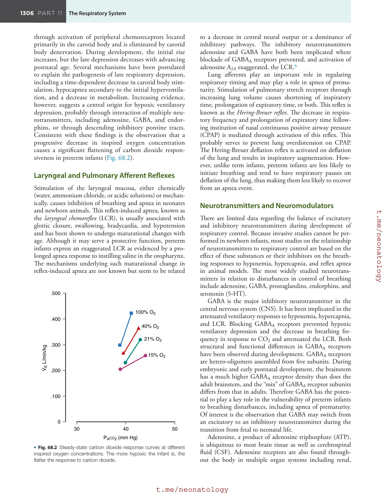

### Original source page 1310

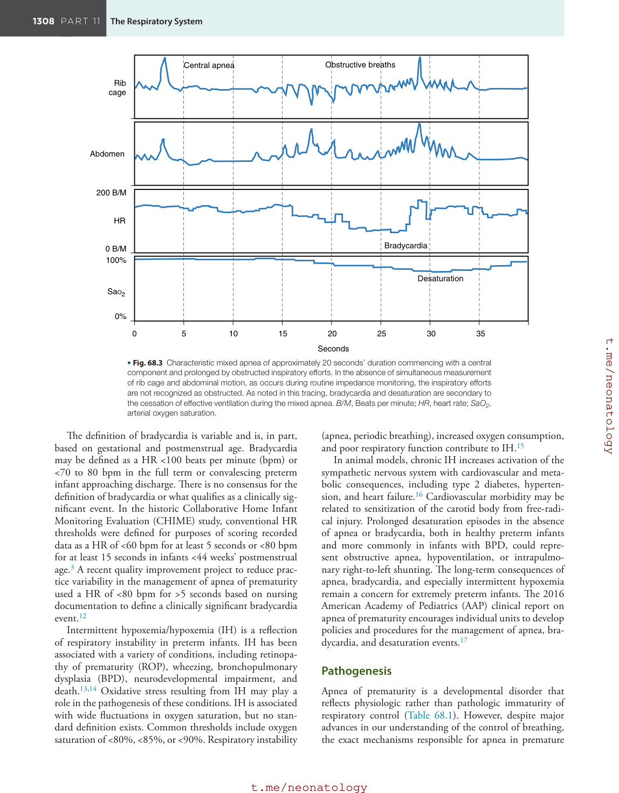

### Original source page 1311

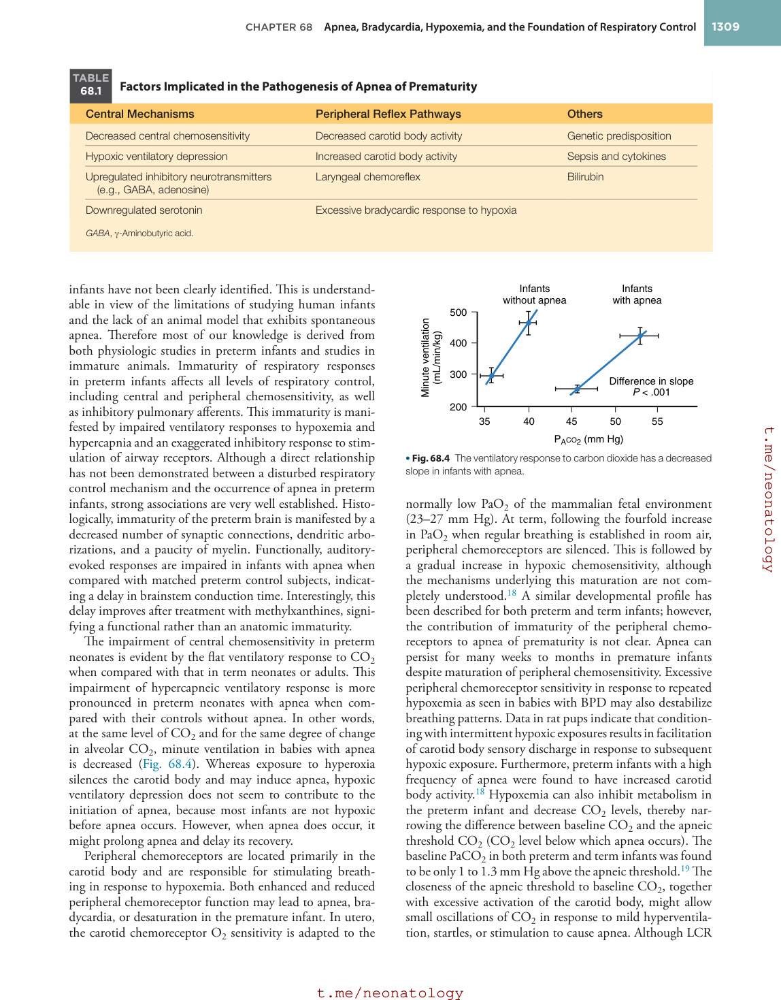

### Original source page 1312

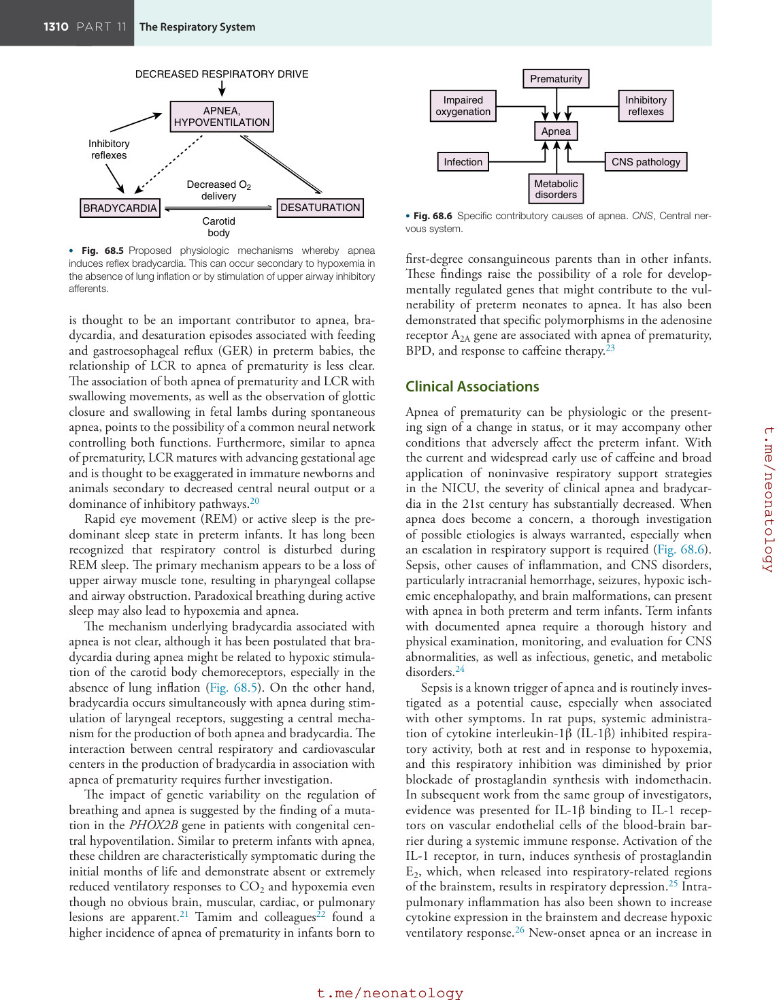

### Original source page 1314

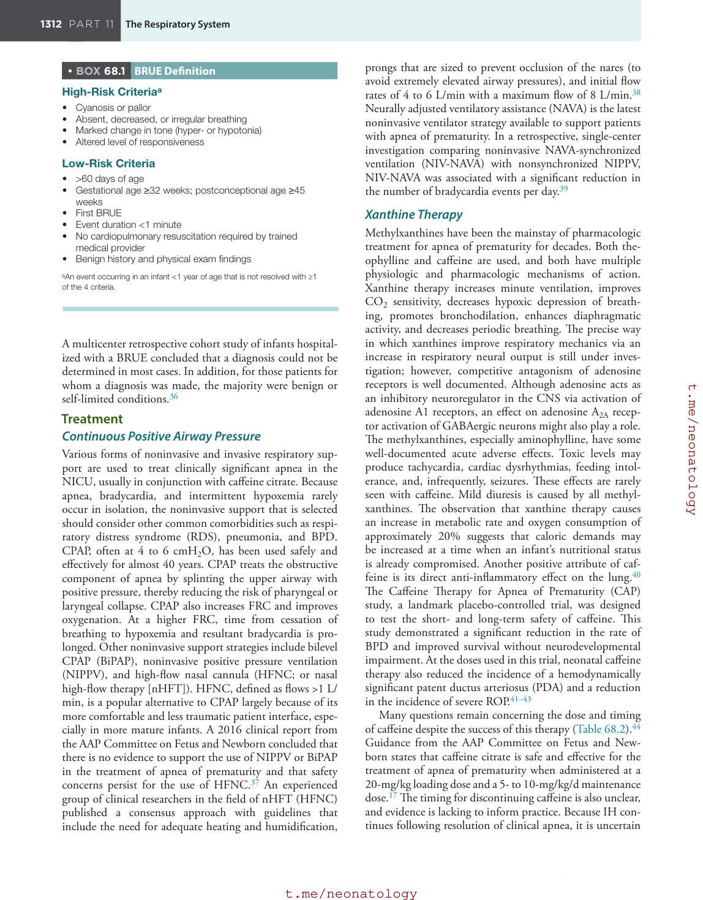

### Original source page 1315

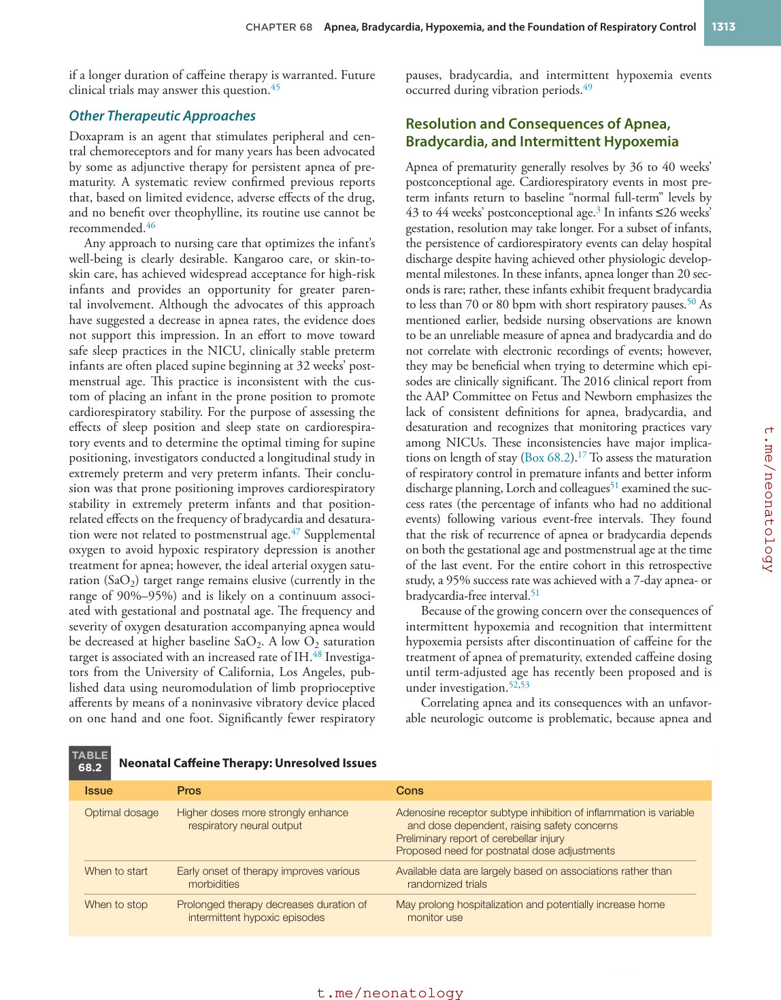

### Original source page 1316

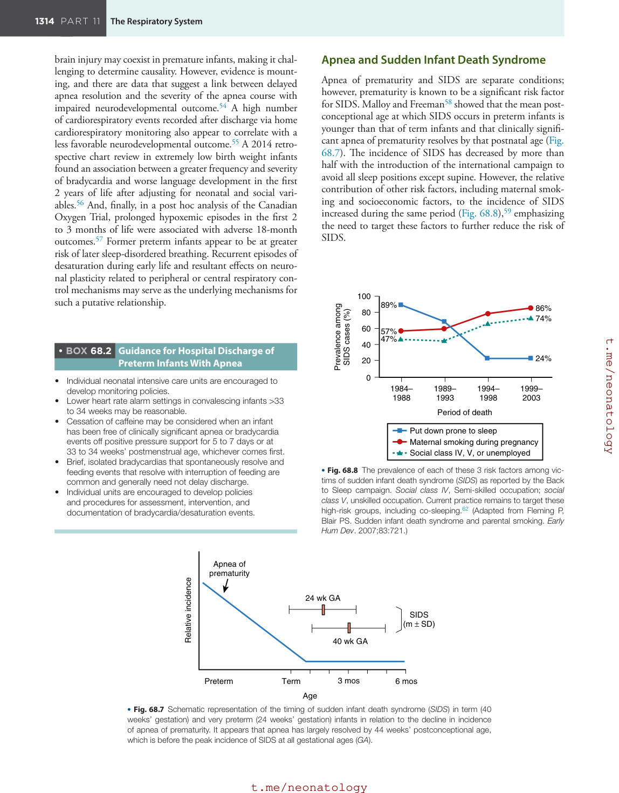

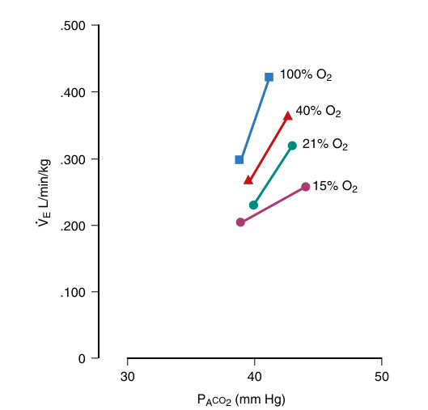

• Fig. 68.2 Steady-state carbon dioxide response curves at different inspired oxygen concentrations. The more hypoxic the infant is, the flatter the response to carbon dioxide.

PDF p. 1308

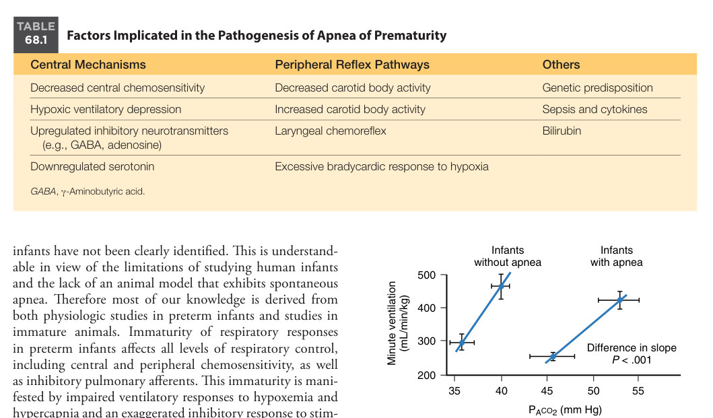

• Fig. 68.4 The ventilatory response to carbon dioxide has a decreased slope in infants with apnea.

PDF p. 1311

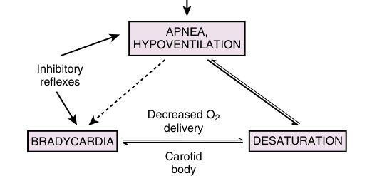

• Fig. 68.5 Proposed physiologic mechanisms whereby apnea induces reflex bradycardia. This can occur secondary to hypoxemia in the absence of lung inflation or by stimulation of upper airway inhibitory afferents.

PDF p. 1312

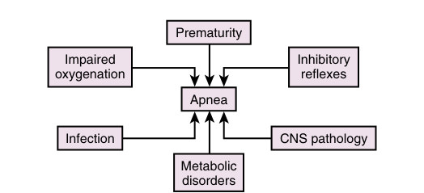

• Fig. 68.6 Specific contributory causes of apnea. CNS, Central nervous system.

PDF p. 1312

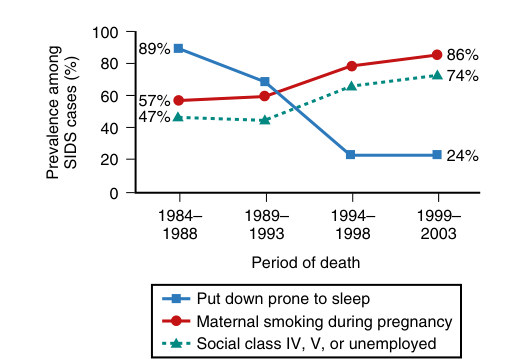

• Fig. 68.8 The prevalence of each of these 3 risk factors among victims of sudden infant death syndrome (SIDS) as reported by the Back to Sleep campaign. Social class IV, Semi-skilled occupation; social class V, unskilled occupation. Current practice remains to target these high-risk groups, including co-sleeping.62 (Adapted from Fleming P, Blair PS. Sudden infant death syndrome and parental smoking. Early Hum Dev. 2007;83:721.)

PDF p. 1316
