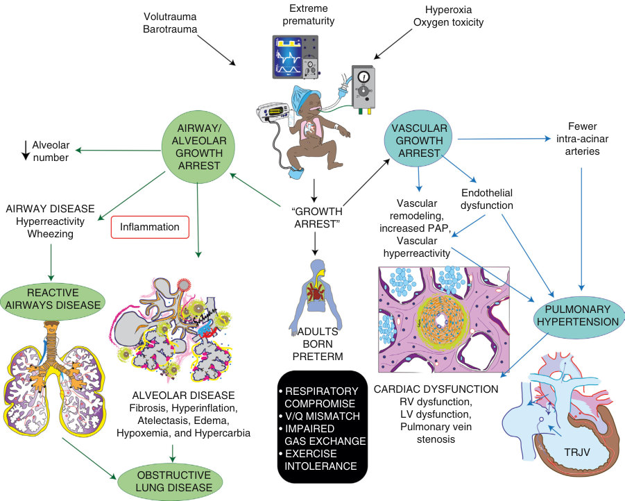
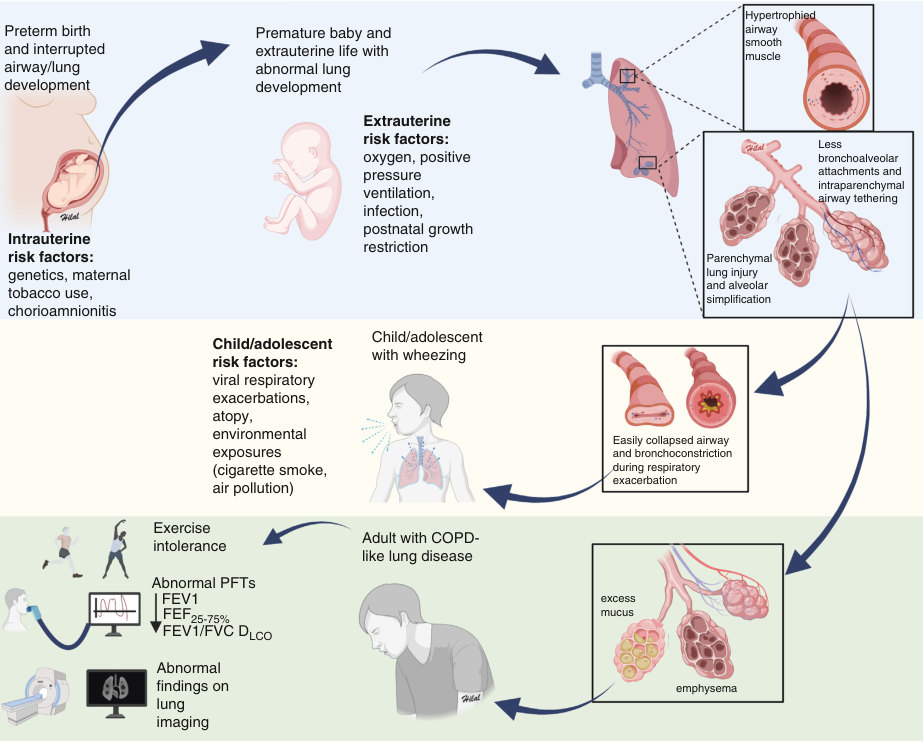
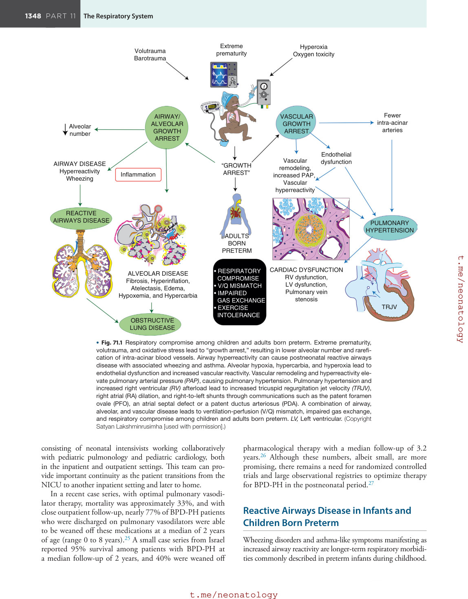
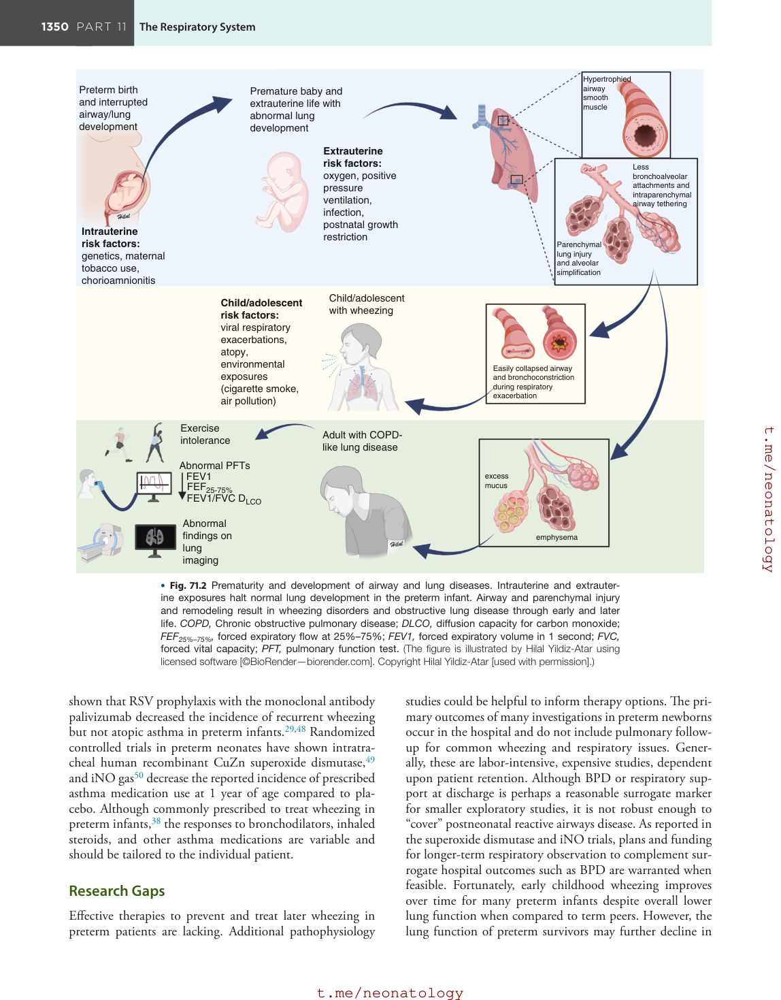
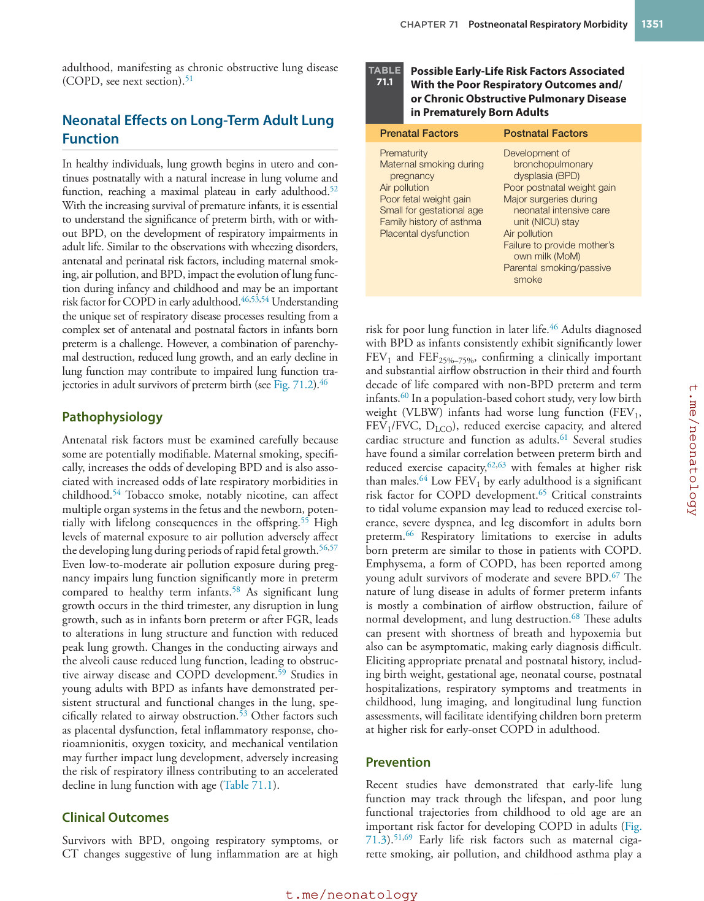
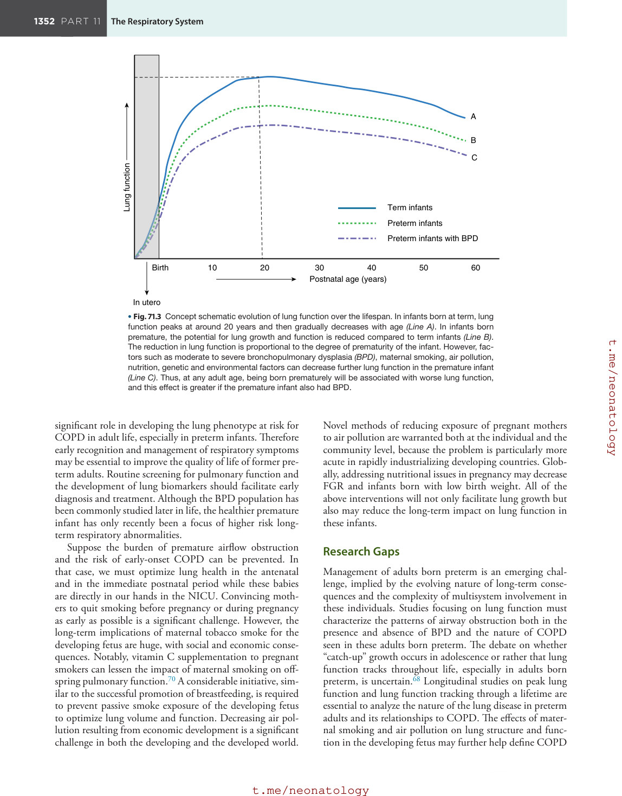
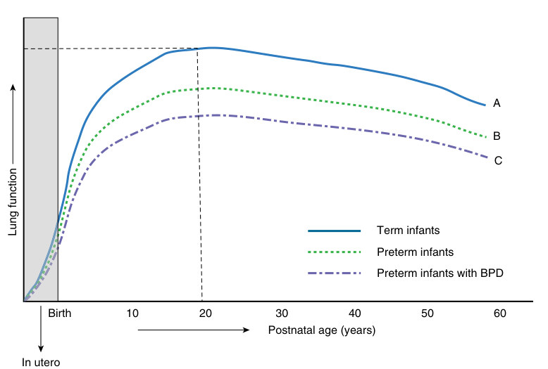

# 71. Postneonatal Respiratory Morbidity
> Source attribution: [Source credits](../../SOURCE_CREDITS.md).

## PDF page 1348 | printed page 1346

71 Postneonatal Respiratory Morbidity

### THOMAS M. RAFFAY, HILAL YILDIZ-ATAR, VASANTHA H.S. KUMAR, SATYAN LAKSHMINRUSIMHA, AND RITA M. RYAN

### Introduction

Ever since Dr. David Barker1 brought to our attention the concept of “fetal origins of adult disease,” we have learned that perinatal factors impact long-term respiratory outcomes in survivors of preterm birth. Many events that occur in the fetal, neonatal, or early childhood portion of life have the potential for either positive or negative effects on lung development. Animal models of altered intrauterine growth demonstrate significant adverse effects on lung development.2 Simple exposure to supplemental oxygen results in alveolar simplification and affects the development of the heart and the kidneys.3 In this chapter, we will explore the long-term respiratory outcomes of preterm infants, focusing on the three main disease processes seen after neonatal intensive care unit (NICU) discharge in childhood or adulthood: postneonatal pulmonary hypertension (PNPH), childhood reactive airways disease, and impaired lung function in adulthood. PNPH is a distinction from persistent pulmonary hypertension of the newborn (PPHN), which is a failure of transition to postnatal circulation after birth. It is important to highlight that PNPH is often underdiagnosed and has a very high mortality risk. The pathogenesis and management of PPHN are reviewed in Chapter 73. Another important sequela of prematurity is impaired alveoli and airway development. We have chosen to examine specifically post-NICU discharge wheezing because of reactive airways disease, in distinction from classic atopic asthma. In the final section of this chapter, we highlight impaired lung function in adults who were born preterm.

### Postneonatal Pulmonary Hypertension

Infantile and childhood pulmonary hypertension beyond the neonatal period can occur in several situations: • Preterm infants with bronchopulmonary dysplasia (BPD)4 • Preterm and term infants with pulmonary hypoplasia

(secondary to congenital diaphragmatic hernia and other

1346

lung anomalies or secondary to oligohydramnios of any etiology) • Fetal growth restriction (FGR), also known as intrauter-

ine growth restriction (IUGR), presenting as small for gestational age (SGA) • Congenital heart disease and genetic conditions such as

trisomy 21.

### Prevalence of the Problem

Lung disease of prematurity is associated with a spectrum of pulmonary vascular disease (PVD), with only severe cases manifesting overt clinical and echocardiographic evidence of pulmonary hypertension.4 PNPH has been reported in 18% to 37% of infants with BPD at some time during the hospital course.5–7 With the increased survival of extremely preterm infants, despite improvements in the respiratory management of evolving BPD and early pulmonary vasodilator therapy when appropriate, the rates of BPD and possibly pulmonary hypertension associated with bronchopulmonary dysplasia (BPD-PH) in preterm infants discharged from the NICU have not decreased over the last 20 years.8 Occasionally, preterm infants may not have signs of pulmonary hypertension at discharge but manifest hypoxemia and pulmonary hypertension during an intercurrent illness (such as bronchiolitis) or a surgical procedure (gastrostomy or hernia repair). Infants with BPD-PH have worse neurodevelopmental outcomes, impaired somatic growth, higher rates of tracheostomy, increased need for supplemental oxygen, more severe feeding problems, and frequent readmissions to the hospital compared to infants with BPD without pulmonary hypertension.9 The mortality rates among infants with BPD-PH are high and vary depending on the severity of pulmonary hypertension. Khemani et al. reported survival rates of 61 ± 8% at 1 year and 52 ± 11% by 2 to 3 years.10 Factors associated with poor survival include the severity of BPD, a history of FGR, and supra-systemic pulmonary hypertension at the time of

## PDF page 1349 | printed page 1347

initial diagnosis. Similarly, del Cerro et al. reported 77% survival at 1 year and 66% at 2 to 3 years after diagnosis of BPD-PH.7 At school age, children born preterm have higher estimated pulmonary arterial pressures (PAPs) compared with children born at term, and among children born preterm, those with BPD have higher PAP compared to infants without BPD.11 Similar trends of higher mean PAP during right heart catheterization were observed among young adults born preterm compared with adults born at term.12 However, several studies noted no differences in pulmonary hemodynamics among 7- to 8-year-old and 8- to 12-yearold preterm infants.13,14 These findings suggest that changes in pulmonary vascular development secondary to preterm birth and BPD may result in lifelong changes in pulmonary hemodynamics but may resolve with time in other children.

### Pathogenesis

Extreme preterm birth results in an arrest of lung development, leading to a decrease in alveolar number and rarefication of intra-acinar arteries (Fig. 71.1). The reduction in vessel number, compounded by alveolar hypoxia, hypercarbia, and hyperoxic stress, contributes to endothelial dysfunction and pulmonary arterial smooth muscle proliferation. Disruption of vascular growth and abnormal growth factor signaling lead to impaired lung structure with a reduction in alveolar-capillary surface area, decreased pulmonary blood flow, increased airway reactivity, ventilation-perfusion (V/Q) mismatch, and impaired gas exchange; these result in later exercise intolerance, respiratory decompensation with acute infections, intercurrent illness, and pulmonary hypertension.4 Over time, the chronic increase in mean PAP can result in right ventricular (RV) dysfunction.

### Management

Infants with PNPH should be followed by a multidisciplinary team after discharge from the NICU. Gas exchange can be assessed with pulse oximetry and capillary blood gases. Supplemental oxygen is recommended if SpO2 is less than 92% in room air, including at night or during sleep. The optimal target SpO2 in PNPH is controversial; the American Thoracic Society/American Heart Association (ATS/AHA) guidelines recommend 92% to 95%,15 and European guidelines suggest ≥95% for confirmed pediatric pulmonary hypertension.9 Neither has been studied systematically in PNPH, which remains a crucial research gap. Optimal nutritional management and assessment of ongoing growth are also critical in the follow-up of infants with PNPH. Recent studies suggest that preterm infants who received high volumes of their mother’s milk had better cardiac function and pulmonary hemodynamics at 1-year follow-up.16 Periodic echocardiography to estimate systolic PAP and assess RV function can guide pulmonary vasodilator management, but again, neither timing of echocardiogram follow-up nor vasodilator management has been well studied in this population. The presence of a tricuspid regurgitation jet velocity (TRJV) greater than 3 m/s with an

estimated systolic PAP greater than 35 mm Hg or greater than 50% of systemic systolic pressure has been used to define pulmonary hypertension.4 However, the absence of a measurable TRJV does not rule out pulmonary hypertension. Other echocardiographic findings such as RV dilation, RV hypertrophy, interventricular septal flattening, pulmonary arterial dilation, and right atrial enlargement can be associated with pulmonary hypertension.4 Serial echocardiography is indicated to monitor disease progression or disease resolution over time. Cardiac catheterization is indicated when the response to therapy is suboptimal, a second pulmonary vasodilator is being considered, if concerns for vascular anomalies such as pulmonary vein stenosis arise (such as poor response to optimal pulmonary vasodilator therapy or signs of pulmonary edema secondary to postcapillary obstruction), or when echocardiographic findings alone cannot explain the clinical picture.9 Acute vasoreactivity testing with 100% oxygen with or without inhaled nitric oxide (iNO) during cardiac catheterization may help prognostication and aid in optimizing therapies.17 Serial monitoring of the N-terminal cleavage product of brain natriuretic peptide (NT-pro-BNP) in combination with echocardiography may be useful to assess disease progression in BPD-PH.9 However, multicenter trials are needed to drive clinical care in PNPH because BNP level interpretation is mainly based on expert opinions.

### Treatment With Pulmonary Vasodilator Therapy

There is a paucity of randomized controlled trials evaluating pulmonary vasodilators in PNPH after NICU discharge. Guidelines for initiation, dose adjustment, and cessation of pulmonary vasodilators in PPNH are based primarily on observational studies and expert opinion.15,18 Sildenafil, tadalafil, and bosentan are commonly used oral agents along with inhaled or subcutaneous prostacyclin analogs (e.g., iloprost, treprostinil SQ) in children with suboptimal response to oral agents. Decisions are further complicated by the risk of adverse events associated with pulmonary vasodilator therapy and the United States Food and Drug Administration (FDA) warning regarding the use of sildenafil in children.19,20 Overall, caution is needed in the use of pharmacologic treatment of PNPH, and more studies are urgently warranted. In some settings, such as pulmonary venous obstruction, left ventricular dysfunction, presence of cardiac shunts, and/or systemic-pulmonary collateral vessels, pulmonary vasodilator therapy may increase the risk of pulmonary edema and worsen respiratory status.21,22 Detailed descriptions of available pharmacotherapy options for pulmonary vasodilation, in general, are provided in Chapter 73. Dose titration, initiation of the new therapy, and cessation of pulmonary hypertension therapy should be done carefully with close outpatient follow-up. Severe PNPH cases that do not respond to therapy with evidence of RV failure may need surgical intervention (such as atrial septostomy or reverse Potts shunt)23 or even lung transplant.24 Most large pediatric centers have a pulmonary hypertension team

## PDF page 1350

Extreme prematurity

Volutrauma Barotrauma

AIRWAY/ ALVEOLAR GROWTH ARREST

Alveolar number

AIRWAY DISEASE Hyperreactivity Wheezing

“GROWTH ARREST”

Inflammation

REACTIVE AIRWAYS DISEASE

ADULTS BORN PRETERM

• RESPIRATORY COMPROMISE • V/Q MISMATCH • IMPAIRED GAS EXCHANGE • EXERCISE INTOLERANCE

ALVEOLAR DISEASE Fibrosis, Hyperinflation, Atelectasis, Edema, Hypoxemia, and Hypercarbia

OBSTRUCTIVE LUNG DISEASE

### • Fig. 71.1 Respiratory compromise among children and adults born preterm. Extreme prematurity,

volutrauma, and oxidative stress lead to “growth arrest,” resulting in lower alveolar number and rarefication of intra-acinar blood vessels. Airway hyperreactivity can cause postneonatal reactive airways disease with associated wheezing and asthma. Alveolar hypoxia, hypercarbia, and hyperoxia lead to endothelial dysfunction and increased vascular reactivity. Vascular remodeling and hyperreactivity elevate pulmonary arterial pressure (PAP), causing pulmonary hypertension. Pulmonary hypertension and increased right ventricular (RV) afterload lead to increased tricuspid regurgitation jet velocity (TRJV), right atrial (RA) dilation, and right-to-left shunts through communications such as the patent foramen ovale (PFO), an atrial septal defect or a patent ductus arteriosus (PDA). A combination of airway, alveolar, and vascular disease leads to ventilation-perfusion (V/Q) mismatch, impaired gas exchange, and respiratory compromise among children and adults born preterm. LV, Left ventricular. (Copyright Satyan Lakshminrusimha [used with permission].)

consisting of neonatal intensivists working collaboratively with pediatric pulmonology and pediatric cardiology, both in the inpatient and outpatient settings. This team can provide important continuity as the patient transitions from the NICU to another inpatient setting and later to home.

In a recent case series, with optimal pulmonary vasodilator therapy, mortality was approximately 33%, and with close outpatient follow-up, nearly 77% of BPD-PH patients who were discharged on pulmonary vasodilators were able to be weaned off these medications at a median of 2 years of age (range 0 to 8 years).25 A small case series from Israel reported 95% survival among patients with BPD-PH at a median follow-up of 2 years, and 40% were weaned off

Hyperoxia Oxygen toxicity

Fewer intra-acinar arteries

VASCULAR GROWTH ARREST

Endothelial dysfunction Vascular remodeling, increased PAP, Vascular hyperreactivity

PULMONARY HYPERTENSION

CARDIAC DYSFUNCTION RV dysfunction, LV dysfunction, Pulmonary vein stenosis TRJV

pharmacological therapy with a median follow-up of 3.2 years.26 Although these numbers, albeit small, are more promising, there remains a need for randomized controlled trials and large observational registries to optimize therapy for BPD-PH in the postneonatal period.27

### Reactive Airways Disease in Infants and Children Born Preterm

Wheezing disorders and asthma-like symptoms manifesting as increased airway reactivity are longer-term respiratory morbidities commonly described in preterm infants during childhood.

• Fig. 71.1 Respiratory compromise among children and adults born preterm. Extreme prematurity, volutrauma, and oxidative stress lead to “growth arrest,” resulting in lower alveolar number and rarefication of intra-acinar blood vessels. Airway hyperreactivity can cause postneonatal reactive airways disease with associated wheezing and asthma. Alveolar hypoxia, hypercarbia, and hyperoxia lead to endothelial dysfunction and increased vascular reactivity. Vascular remodeling and hyperreactivity elevate pulmonary arterial pressure (PAP), causing pulmonary hypertension. Pulmonary hypertension and increased right ventricular (RV) afterload lead to increased tricuspid regurgitation jet velocity (TRJV), right atrial (RA) dilation, and right-to-left shunts through communications such as the patent foramen ovale (PFO), an atrial septal defect or a patent ductus arteriosus (PDA). A combination of airway, alveolar, and vascular disease leads to ventilation-perfusion (V/Q) mismatch, impaired gas exchange, and respiratory compromise among children and adults born preterm. LV, Left ventricular. (Copyright Satyan Lakshminrusimha [used with permission].)

## PDF page 1351 | printed page 1349

Wheezing or whistling in the chest is a high-pitched noise auscultated during breathing that occurs when air is forced through constricted narrow airways. This whistling sound is often best heard during expiration but can also be present during inspiration when the airways are severely constricted. Infants born preterm, including those born moderate-to-late preterm, are at elevated risk for later wheeze and airway hyperreactivity.28–30 When compared to term infants, expiratory flow restriction is more common in infants and children born preterm, even those without BPD or who were not born extremely premature.29,31 The wheezing phenotypes in preterm children generally differ from their term-born peers with allergic asthma. The airway hyperreactivity observed among children born preterm is strongly associated with a history of supplemental oxygen exposure and/or positive pressure and lower gestational age,28,29,32–34 compared with the airway hyperreactivity in term controls which, instead, is associated with a history of genetic inheritance, allergy, environment, and inflammation.35,36 This problem of expiratory flow restriction and treatment for wheezing remains common in contemporary cohorts despite the widespread use of targeted oxygen saturations and noninvasive positive pressure such as nasal continuous positive airway pressure (CPAP).37,38

### Pathophysiology

The causes of longer-term airway hyperreactivity following preterm birth are multifactorial, including early lung and airway injury, remodeling, pre- and postnatal infection, environmental exposures such as tobacco and air pollution, and nutritional influences. In preterm neonates with BPD, it is speculated that airway smooth muscle hypertrophy coupled to parenchymal lung injury with alveolar simplification may contribute to poorly tethered intrapulmonary airways, airway collapse, and elevated airway resistance at baseline and in response to bronchoconstriction during respiratory exacerbations (Fig. 71.2). In preterm cohorts with and without BPD, elevated inspired oxygen concentrations and mean airway pressure during just the first few days of life were associated with an increased risk of childhood wheezing and adverse respiratory outcomes.32,33,39,40 Maternal tobacco use; perinatal inflammation such as chorioamnionitis; postnatal infections, particularly respiratory viruses; and pollution have been well described to associate with childhood wheezing and asthma.30,35,36,41

Term rodents are born during a stage of lung and airway development analogous to an extremely preterm newborn. Neonatal rodent and human fetal smooth muscle models suggest that exposure to even low concentrations of supplemental oxygen42–44 and/or the pressure effects of CPAP or in vitro smooth muscle stretch45 during this early stage of lung development predispose to alveolar simplification, smooth muscle hypertrophy, and functional airway reactivity. In these models, even modest hyperoxia of 40% supplemental oxygen increases airway smooth muscle deposition and alters neural signaling to further enhance contractility and decrease the relaxation of airway smooth muscle.

Interestingly, in the in vivo rodent models, supplemental oxygen of 40% to 60% causes the greatest increase in airway smooth muscle deposition and airway hyperreactivity to methacholine-induced bronchoconstriction compared to >70% oxygen exposures.42,43 The high supplemental oxygen exposures instead result in elevated baseline airway resistance with less airway hyperreactivity, more severe alveolar simplification, less airway tethering, and greater deposition of elastin—many of the hallmarks of BPD. Similarly, when human fetal airway smooth muscle cells are grown in ≤60% oxygen, the cells proliferate and are hyperresponsive to cholinergic and histamine stimulation; however, when the cells are grown in greater than 60% oxygen, they display increased apoptosis and blunted responsiveness.44

### Clinical Outcomes

Preterm neonates are at high risk of developing wheezing/ airway hyperreactivity in infancy and childhood. As a group, they display expiratory flow restriction on formal pulmonary function testing, and they frequently receive medical treatment for asthma-like symptoms. The Prematurity and Respiratory Outcomes Program (PROP) multicenter trial reported that during the first year of age, more than half of all enrolled preterm survivors were prescribed one or more postdischarge respiratory medications, most commonly an inhaled bronchodilator,38 and noted that they had numerous postdischarge respiratory morbidities.40 In a different birth cohort followed serially at time points between 9 months and 11 years of age, the preterm-born group had higher rates of early and persistent wheeze compared to term peers.30 Encouragingly, in this study, a large proportion of these preterm-born children had early wheeze that resolved with time. However, in different studies, when pulmonary function testing was repeated over time, trajectories were impaired in the preterm infants.46,47 The poorest trajectory outcomes were associated with home tobacco exposure, earlier gestation at birth, a family history of asthma, longer exposure to supplemental oxygen, and mechanical ventilation.

### Prevention

In a recent cohort study of preterm newborns, despite increased use of noninvasive nasal ventilation and positive pressure, there was no significant decrease in supplemental oxygen dependence at 36 weeks and no significant improvements in childhood lung function.37 More encouraging, in a prospective birth cohort of more than 10,000 term and preterm children, breastfeeding was shown to be protective of wheezing in both groups, except for late-onset wheeze after 7 years of age in the preterm group.30

Several pharmaceutical interventions have been shown to decrease childhood wheezing and asthma-like symptoms in this high-risk preterm population. Infections with respiratory viruses have been strongly associated with an increased risk of developing childhood wheezing, especially infection with a respiratory syncytial virus (RSV).35,36 It has been

## PDF page 1352

Preterm birth and interrupted airway/lung development

Premature baby and extrauterine life with abnormal lung development

Extrauterine risk factors: oxygen, positive pressure ventilation, infection, postnatal growth restriction

Intrauterine risk factors: genetics, maternal tobacco use, chorioamnionitis

Child/adolescent with wheezing

Child/adolescent risk factors: viral respiratory exacerbations, atopy, environmental exposures (cigarette smoke, air pollution)

Exercise intolerance

Adult with COPDlike lung disease

Abnormal PFTs FEV1 FEF25-75% FEV1/FVC DLCO

Abnormal findings on lung imaging

• Fig. 71.2 Prematurity and development of airway and lung diseases. Intrauterine and extrauterine exposures halt normal lung development in the preterm infant. Airway and parenchymal injury and remodeling result in wheezing disorders and obstructive lung disease through early and later life. COPD, Chronic obstructive pulmonary disease; DLCO, diffusion capacity for carbon monoxide; FEF25%–75%, forced expiratory flow at 25%–75%; FEV1, forced expiratory volume in 1 second; FVC, forced vital capacity; PFT, pulmonary function test. (The figure is illustrated by Hilal Yildiz-Atar using licensed software [©BioRender—biorender.com]. Copyright Hilal Yildiz-Atar [used with permission].)

shown that RSV prophylaxis with the monoclonal antibody palivizumab decreased the incidence of recurrent wheezing but not atopic asthma in preterm infants.29,48 Randomized controlled trials in preterm neonates have shown intratracheal human recombinant CuZn superoxide dismutase,49 and iNO gas50 decrease the reported incidence of prescribed asthma medication use at 1 year of age compared to placebo. Although commonly prescribed to treat wheezing in preterm infants,38 the responses to bronchodilators, inhaled steroids, and other asthma medications are variable and should be tailored to the individual patient.

### Research Gaps

Effective therapies to prevent and treat later wheezing in preterm patients are lacking. Additional pathophysiology

Hypertrophied airway smooth muscle

Less bronchoalveolar attachments and intraparenchymal airway tethering

Parenchymal lung injury and alveolar simplification

Easily collapsed airway and bronchoconstriction during respiratory exacerbation

excess mucus

emphysema

studies could be helpful to inform therapy options. The primary outcomes of many investigations in preterm newborns occur in the hospital and do not include pulmonary followup for common wheezing and respiratory issues. Generally, these are labor-intensive, expensive studies, dependent upon patient retention. Although BPD or respiratory support at discharge is perhaps a reasonable surrogate marker for smaller exploratory studies, it is not robust enough to “cover” postneonatal reactive airways disease. As reported in the superoxide dismutase and iNO trials, plans and funding for longer-term respiratory observation to complement surrogate hospital outcomes such as BPD are warranted when feasible. Fortunately, early childhood wheezing improves over time for many preterm infants despite overall lower lung function when compared to term peers. However, the lung function of preterm survivors may further decline in

• Fig. 71.2 Prematurity and development of airway and lung diseases. Intrauterine and extrauterine exposures halt normal lung development in the preterm infant. Airway and parenchymal injury and remodeling result in wheezing disorders and obstructive lung disease through early and later life. COPD, Chronic obstructive pulmonary disease; DLCO, diffusion capacity for carbon monoxide; FEF25%–75%, forced expiratory flow at 25%–75%; FEV1, forced expiratory volume in 1 second; FVC, forced vital capacity; PFT, pulmonary function test. (The figure is illustrated by Hilal Yildiz-Atar using licensed software [©BioRender—biorender.com]. Copyright Hilal Yildiz-Atar [used with permission].)

## PDF page 1353 | printed page 1351

adulthood, manifesting as chronic obstructive lung disease (COPD, see next section).51

### Neonatal Effects on Long-Term Adult Lung Function

In healthy individuals, lung growth begins in utero and continues postnatally with a natural increase in lung volume and function, reaching a maximal plateau in early adulthood.52 With the increasing survival of premature infants, it is essential to understand the significance of preterm birth, with or without BPD, on the development of respiratory impairments in adult life. Similar to the observations with wheezing disorders, antenatal and perinatal risk factors, including maternal smoking, air pollution, and BPD, impact the evolution of lung function during infancy and childhood and may be an important risk factor for COPD in early adulthood.46,53,54 Understanding the unique set of respiratory disease processes resulting from a complex set of antenatal and postnatal factors in infants born preterm is a challenge. However, a combination of parenchymal destruction, reduced lung growth, and an early decline in lung function may contribute to impaired lung function trajectories in adult survivors of preterm birth (see Fig. 71.2).46

### Pathophysiology

Antenatal risk factors must be examined carefully because some are potentially modifiable. Maternal smoking, specifically, increases the odds of developing BPD and is also associated with increased odds of late respiratory morbidities in childhood.54 Tobacco smoke, notably nicotine, can affect multiple organ systems in the fetus and the newborn, potentially with lifelong consequences in the offspring.55 High levels of maternal exposure to air pollution adversely affect the developing lung during periods of rapid fetal growth.56,57 Even low-to-moderate air pollution exposure during pregnancy impairs lung function significantly more in preterm compared to healthy term infants.58 As significant lung growth occurs in the third trimester, any disruption in lung growth, such as in infants born preterm or after FGR, leads to alterations in lung structure and function with reduced peak lung growth. Changes in the conducting airways and the alveoli cause reduced lung function, leading to obstructive airway disease and COPD development.59 Studies in young adults with BPD as infants have demonstrated persistent structural and functional changes in the lung, specifically related to airway obstruction.53 Other factors such as placental dysfunction, fetal inflammatory response, chorioamnionitis, oxygen toxicity, and mechanical ventilation may further impact lung development, adversely increasing the risk of respiratory illness contributing to an accelerated decline in lung function with age (Table 71.1).

### Clinical Outcomes

Survivors with BPD, ongoing respiratory symptoms, or CT changes suggestive of lung inflammation are at high

Possible Early-Life Risk Factors Associated

TABLE

71.1

With the Poor Respiratory Outcomes and/ or Chronic Obstructive Pulmonary Disease in Prematurely Born Adults

Prenatal Factors Postnatal Factors

Prematurity Maternal smoking during

Development of

bronchopulmonary dysplasia (BPD) Poor postnatal weight gain Major surgeries during

pregnancy Air pollution Poor fetal weight gain Small for gestational age Family history of asthma Placental dysfunction

neonatal intensive care unit (NICU) stay Air pollution Failure to provide mother’s

own milk (MoM) Parental smoking/passive

smoke

risk for poor lung function in later life.46 Adults diagnosed with BPD as infants consistently exhibit significantly lower FEV1 and FEF25%–75%, confirming a clinically important and substantial airflow obstruction in their third and fourth decade of life compared with non-BPD preterm and term infants.60 In a population-based cohort study, very low birth weight (VLBW) infants had worse lung function (FEV1, FEV1/FVC, DLCO), reduced exercise capacity, and altered cardiac structure and function as adults.61 Several studies have found a similar correlation between preterm birth and reduced exercise capacity,62,63 with females at higher risk than males.64 Low FEV1 by early adulthood is a significant risk factor for COPD development.65 Critical constraints to tidal volume expansion may lead to reduced exercise tolerance, severe dyspnea, and leg discomfort in adults born preterm.66 Respiratory limitations to exercise in adults born preterm are similar to those in patients with COPD. Emphysema, a form of COPD, has been reported among young adult survivors of moderate and severe BPD.67 The nature of lung disease in adults of former preterm infants is mostly a combination of airflow obstruction, failure of normal development, and lung destruction.68 These adults can present with shortness of breath and hypoxemia but also can be asymptomatic, making early diagnosis difficult. Eliciting appropriate prenatal and postnatal history, including birth weight, gestational age, neonatal course, postnatal hospitalizations, respiratory symptoms and treatments in childhood, lung imaging, and longitudinal lung function assessments, will facilitate identifying children born preterm at higher risk for early-onset COPD in adulthood.

### Prevention

Recent studies have demonstrated that early-life lung function may track through the lifespan, and poor lung functional trajectories from childhood to old age are an important risk factor for developing COPD in adults (Fig. 71.3).51,69 Early life risk factors such as maternal cigarette smoking, air pollution, and childhood asthma play a

## PDF page 1354

Lung function

Birth 10 20 30

Postnatal age (years)

In utero

• Fig. 71.3 Concept schematic evolution of lung function over the lifespan. In infants born at term, lung function peaks at around 20 years and then gradually decreases with age (Line A). In infants born premature, the potential for lung growth and function is reduced compared to term infants (Line B). The reduction in lung function is proportional to the degree of prematurity of the infant. However, factors such as moderate to severe bronchopulmonary dysplasia (BPD), maternal smoking, air pollution, nutrition, genetic and environmental factors can decrease further lung function in the premature infant (Line C). Thus, at any adult age, being born prematurely will be associated with worse lung function, and this effect is greater if the premature infant also had BPD.

significant role in developing the lung phenotype at risk for COPD in adult life, especially in preterm infants. Therefore early recognition and management of respiratory symptoms may be essential to improve the quality of life of former preterm adults. Routine screening for pulmonary function and the development of lung biomarkers should facilitate early diagnosis and treatment. Although the BPD population has been commonly studied later in life, the healthier premature infant has only recently been a focus of higher risk longterm respiratory abnormalities.

Suppose the burden of premature airflow obstruction and the risk of early-onset COPD can be prevented. In that case, we must optimize lung health in the antenatal and in the immediate postnatal period while these babies are directly in our hands in the NICU. Convincing mothers to quit smoking before pregnancy or during pregnancy as early as possible is a significant challenge. However, the long-term implications of maternal tobacco smoke for the developing fetus are huge, with social and economic consequences. Notably, vitamin C supplementation to pregnant smokers can lessen the impact of maternal smoking on offspring pulmonary function.70 A considerable initiative, similar to the successful promotion of breastfeeding, is required to prevent passive smoke exposure of the developing fetus to optimize lung volume and function. Decreasing air pollution resulting from economic development is a significant challenge in both the developing and the developed world.

A

B

C

Term infants

Preterm infants

Preterm infants with BPD

40 50 60

Novel methods of reducing exposure of pregnant mothers to air pollution are warranted both at the individual and the community level, because the problem is particularly more acute in rapidly industrializing developing countries. Globally, addressing nutritional issues in pregnancy may decrease FGR and infants born with low birth weight. All of the above interventions will not only facilitate lung growth but also may reduce the long-term impact on lung function in these infants.

### Research Gaps

Management of adults born preterm is an emerging challenge, implied by the evolving nature of long-term consequences and the complexity of multisystem involvement in these individuals. Studies focusing on lung function must characterize the patterns of airway obstruction both in the presence and absence of BPD and the nature of COPD seen in these adults born preterm. The debate on whether “catch-up” growth occurs in adolescence or rather that lung function tracks throughout life, especially in adults born preterm, is uncertain.68 Longitudinal studies on peak lung function and lung function tracking through a lifetime are essential to analyze the nature of the lung disease in preterm adults and its relationships to COPD. The effects of maternal smoking and air pollution on lung structure and function in the developing fetus may further help define COPD

## PDF page 1355 | printed page 1353

characteristics in adults. Understanding the role of prenatal, postnatal, and environmental factors that predispose to COPD in these adults is vital in developing appropriate management strategies. Tools such as predictive analytics may help assess the risk of COPD in adults born preterm based on lung function testing and antenatal and postnatal factors.

### Summary

Neonatologists now sometimes care for preterm infants not only in the intensive care setting but also in multidisciplinary teams in outpatient follow-up clinics. As more information is gained, we should speak up and use our voices to enlighten women and our obstetrician colleagues about the effects of prenatal exposures on the long-term

Key Points

### • Preterm neonates are at risk of developing moderate to

severe pulmonary diseases in early childhood and later adulthood.

### • Although symptomatically they may look similar, child-

hood/adulthood diseases in surviving preterm infants have different underlying pathophysiology profiles that need targeted treatment. More studies in older children and adults that examine premature birth as a factor could inform these targeted treatments.

### References

1. Barker DJ. The fetal and infant origins of adult disease. BMJ.

1990;301:1111. 2. Darby JRT, Varcoe TJ, Orgeig S, Morrison JL. Cardiorespira-

tory consequences of intrauterine growth restriction: influence of timing, severity and duration of hypoxaemia. Theriogenology. 2020;150:84–95. 3. Kumar VHS, Wang H, Kishkurno S, et al. Long-term effects

of neonatal hyperoxia in adult mice. Anat Rec. 2018;301:717– 726. 4. Mourani PM, Abman SH. Pulmonary vascular disease in bron-

chopulmonary dysplasia: pulmonary hypertension and beyond. Curr Opini Pediatr. 2013;25:329–337. 5. Savoia M, Morassutti FR, Castriotta L, et al. Pulmonary hyperten-

sion in a neonatologist-performed echocardiographic follow-up of bronchopulmonary dysplasia. Eur J Pediatr. 2021;180:1711– 1720. 6. Krishnan U, Feinstein JA, Adatia I, et al. Pediatric Pulmonary

Hypertension Network (PPHNet). Evaluation and management of pulmonary hypertension in children with bronchopulmonary dysplasia. J Pediatr. 2017;188:24–34.e1. 7. del Cerro MJ, Sabate Rotes A, Carton A, et al. Pulmonary

hypertension in bronchopulmonary dysplasia: clinical findings, cardiovascular anomalies and outcomes. Pediatr Pulmonol. 2014;49:49–59. 8. Stoll BJ, Hansen NI, Bell EF, et al. Eunice Kennedy Shriver

National Institute of Child Health and Human Development Neonatal Research Network. Trends in care practices, morbidity, and mortality of extremely preterm neonates, 1993-2012. JAMA. 2015;314:1039–1051.

lung outcomes of our preterm infants. We also have a better understanding of how daily routine care in the NICU, including oxygen and ventilatory support, has long-lasting effects on preterm infants. Improving long-term neurodevelopmental outcomes has been the target of many neonatologists and pediatricians around the world; however, as we are learning more about childhood and adulthood outcomes of NICU patients, other organ systems deserve attention and multicenter research studies. In addition to the lung, we are learning more about the effects of premature birth on later kidney and cardiac function. Long-term studies come with their own challenges with being more expensive and requiring more labor-intensive follow-up and collaborations with different subspecialties. With the information we have to date, one must be mindful of the lifespan effects (good and bad) of our critical and noncritical decisions in the NICU.

### • Preterm infants require long-term follow-up after neo-

natal intensive care unit (NICU) discharge, with multidisciplinary care to decrease the risk of morbidity and mortality related to their prematurity.

### • Adult-onset diseases in preterm neonates are multifac-

torial. Factors include but are not limited to the intrauterine environment, maternal diet, secondhand smoke, postnatal factors, and later environmental exposures during childhood and adulthood.

9. Hansmann G, Sallmon H, Roehr CC, et al. European Pediat-

ric Pulmonary Vascular Disease Network (EPPVDN). Pulmonary hypertension in bronchopulmonary dysplasia. Pediatr Res. 2021;89(3):446–455. 10. Khemani E, McElhinney DB, Rhein L, et al. Pulmonary artery

hypertension in formerly premature infants with bronchopulmonary dysplasia: clinical features and outcomes in the surfactant era. Pediatrics. 2007;120:1260–1269. 11. Zivanovic S, Pushparajah K, Calvert S, et al. Pulmonary artery

pressures in school-age children born prematurely. J Pediatr. 2017;191:42–49.e43. 12. Goss KN, Beshish AG, Barton GP, et al. Early pulmonary vas-

cular disease in young adults born preterm. Am J Respir Crit Care Med. 2018;198:1549–1558. 13. Joshi S, Wilson DG, Kotecha S, et al. Cardiovascular function in

children who had chronic lung disease of prematurity. Arch Dis Child Fetal Neonatal Ed. 2014;99:F373–F379. 14. Korhonen P, Hyodynmaa E, Lautamatti V, et al. Cardiovascular

findings in very low birthweight schoolchildren with and without bronchopulmonary dysplasia. Early Hum Dev. 2005;81:497–505. 15. Abman SH, Hansmann G, Archer SL, et al. Pediatric pulmo-

nary hypertension: guidelines from the American Heart Association and American Thoracic Society. Circulation. 2015;132(21): 2037–2099. 16. El-Khuffash A, Lewandowski AJ, Jain A, et al. Cardiac perfor-

mance in the first year of age among preterm infants fed maternal breast milk. JAMA Netw Open. 2021;4:e2121206. 17. Frank BS, Schafer M, Grenolds A, et al. Acute vasoreactivity test-

ing during cardiac catheterization of neonates with bronchopulmonary dysplasia-associated pulmonary hypertension. J Pediatr. 2019;208:127–133.

## PDF page 1356

18. Hansmann G, Sallmon H, Roehr CC, et al. European pediatric

pulmonary vascular disease N. Pulmonary hypertension in bronchopulmonary dysplasia. Pediatr Res. 2021;89(3):446–455. 19. Abman SH, Kinsella JP, Rosenzweig EB, et al. Implications of

the FDA warning against the use of sildenafil for the treatment of pediatric pulmonary hypertension. Am J Respir Crit Care Med. 2013;187(6):572–575. 20. Barst RJ, Beghetti M, Pulido T, et al. STARTS-2: long-

term survival with oral sildenafil monotherapy in treatmentnaive pediatric pulmonary arterial hypertension. Circulation. 2014;129(19):1914–1923. 21. Lakshminrusimha S, Kinsella JP, Krishnan US, et al. Just say no

to iNO in preterms—really? J Pediatr. 2020;218:243–252. 22. Chandrasekharan P, Lakshminrusimha S, Abman SH. When to

say no to inhaled nitric oxide in neonates? Semin Fetal Neonatal Med. 2021;26:101200. 23. Grady RM. Beyond transplant: roles of atrial septostomy and

potts shunt in pediatric pulmonary hypertension. Pediatr Pulmonol. 2021;56:656–660. 24. Liu N, Cummings OW, Lagstein A, et al. Lung transplantation

for bronchopulmonary dysplasia in adults: a clinical and pathologic study of 3 cases. Am J Surg Pathol. 2020;44:509–515. 25. Nees SN, Rosenzweig EB, Cohen JL, et al. Targeted therapy for

pulmonary hypertension in premature infants. Children (Basel). 2020;7:97. 26. Kadmon G, Schiller O, Dagan T, et al. Pulmonary hypertension

specific treatment in infants with bronchopulmonary dysplasia. Pediatr Pulmonol. 2017;52:77–83. 27. Lakshminrusimha S. Neonatal and postneonatal pulmonary

hypertension. Children. 2021;8:131. 28. Been JV, Lugtenberg MJ, Smets E, et al. Preterm birth and child-

hood wheezing disorders: a systematic review and meta-analysis. PLoS Med. 2014;11:e1001596. 29. Moreno-Galdo A, Perez-Yarza EG, Ramilo O, et al; SAREPREM

3235 Investigators. Recurrent wheezing during the first 3 years of life in a birth cohort of moderate-to-late preterm infants. Pediatr Allergy Immunol. 2020;31:124–132. 30. Kotecha SJ, Watkins WJ, Lowe J, et al. Comparison of the

associations of early-life factors on wheezing phenotypes in preterm-born children and term-born children. Am J Epidemiol. 2019;188:527–536. 31. Thunqvist P, Tufvesson E, Bjermer L, et al. Lung function

after extremely preterm birth-a population-based cohort study (express). Pediatr Pulmonol. 2018;53:64–72. 32. Di Fiore JM, Dylag AM, Honomichl RD, et al. Early inspired

oxygen and intermittent hypoxemic events in extremely premature infants are associated with asthma medication use at 2 years of age. J Perinatol. 2019;39:203–211. 33. Dylag AM, Kopin HG, O’Reilly MA, et al. Early neonatal oxy-

gen exposure predicts pulmonary morbidity and functional deficits at 1 year. J Pediatr. 2020;223:20–28.e22. 34. Pagano F, Conti MG, Boscarino G, et al. Atopic manifestations

in children born preterm: a long-term observational study. Children. 2021;8:843. 35. Lodge CJ, Zaloumis S, Lowe AJ, et al. Early-life risk factors for

childhood wheeze phenotypes in a high-risk birth cohort. J Pediatr. 2014;164:289–294.e281–e282. 36. Bobolea I, Arismendi E, Valero A, Agusti A. Early life origins

of asthma: a review of potential effectors. J Investig Allergol Clin Immunol. 2019;29:168–179. 37. Doyle LW, Carse E, Adams AM, et al. Victorian Infant Collab-

orative Study G. Ventilation in extremely preterm infants and

respiratory function at 8 years. N Engl J Med. 2017;377:329– 337. 38. Ryan RM, Keller RL, Poindexter BB, et al; PROP Investigators.

Respiratory medications in infants <29 weeks during the first year postdischarge: the prematurity and respiratory outcomes program (prop) consortium. J Pediatr. 2019;208:148–155.e143. 39. Stevens TP, Dylag A, Panthagani I, et al. Effect of cumulative

oxygen exposure on respiratory symptoms during infancy among vlbw infants without bronchopulmonary dysplasia. Pediatr Pulmonol. 2010;45:371–379. 40. Keller RL, Feng R, DeMauro SB, et al; Prematurity and Respi-

ratory Outcomes Program. Bronchopulmonary dysplasia and perinatal characteristics predict 1-year respiratory outcomes in newborns born at extremely low gestational age: a prospective cohort study. J Pediatr. 2017;187:89–97.e83. 41. Decrue F, Gorlanova O, Salem Y, et al; BILD Study Group.

Increased impact of air pollution on lung function in preterm versus term infants: the BILD study. Am J Respir Crit Care Med. 2022;205:99–107. 42. Dylag AM, Haak J, Yee M, O’Reilly MA. Pulmonary mechan-

ics and structural lung development after neonatal hyperoxia in mice. Pediatr Res. 2020;87:1201–1210. 43. Onugha H, MacFarlane PM, Mayer CA, et al. Airway hyperreac-

tivity is delayed after mild neonatal hyperoxic exposure. Neonatology. 2015;108:65–72. 44. Hartman WR, Smelter DF, Sathish V, et al. Oxygen dose respon-

siveness of human fetal airway smooth muscle cells. Am J Physiol Lung Cell Mol Physiol. 2012;303:L711–L719. 45. Mayer CA, Roos B, Teske J, et al. Calcium-sensing receptor and

CPAP-induced neonatal airway hyperreactivity in mice. Pediatr Res. 2022;91:1391–1398. 46. Simpson SJ, Turkovic L, Wilson AC, et al. Lung function tra-

jectories throughout childhood in survivors of very preterm birth: a longitudinal cohort study. Lancet Child Adolesc Health. 2018;2:350–359. 47. Levin JC, Sheils CA, Gaffin JM, et al. Lung function trajectories

in children with post-prematurity respiratory disease: identifying risk factors for abnormal growth. Respir Res. 2021;22:143. 48. Mochizuki H, Kusuda S, Okada K, et al. Scientific Committee

for Elucidation of Infantile Asthma. Palivizumab prophylaxis in preterm infants and subsequent recurrent wheezing. Six-year follow-up study. Am J Respir Crit Care Med. 2017;196:29–38. 49. Davis JM, Parad RB, Michele T, et al. North American Recom-

binant Human CuZnSOD Study Group. Pulmonary outcome at 1 year corrected age in premature infants treated at birth with recombinant human CuZn superoxide dismutase. Pediatrics. 2003;111:469–476. 50. Hibbs AM, Walsh MC, Martin RJ, et al. One-year respiratory

outcomes of preterm infants enrolled in the nitric oxide (to prevent) chronic lung disease trial. J Pediatr. 2008;153:525–529. 51. McGrath-Morrow SA, Collaco JM. Bronchopulmonary dys-

plasia: what are its links to COPD? Ther Adv Respir Dis. 2019;13:1753466619892492. 52. Kerstjens HA, Rijcken B, Schouten JP, Postma DS. Decline of

fev1 by age and smoking status: facts, figures, and fallacies. Thorax. 1997;52:820–827. 53. Islam JY, Keller RL, Aschner JL, et al. Understanding the

short- and long-term respiratory outcomes of prematurity and bronchopulmonary dysplasia. Am J Respir Crit Care Med. 2015;192:134–156. 54. Morrow LA, Wagner BD, Ingram DA, et al. Antenatal determi-

nants of bronchopulmonary dysplasia and late respiratory disease

## PDF page 1357 | printed page 1355

in preterm infants. Am J Respir Crit Care Med. 2017;196:364– 374. 55. Banderali G, Martelli A, Landi M, et al. Short and long term

health effects of parental tobacco smoking during pregnancy and lactation: a descriptive review. J Transl Med. 2015;13:327. 56. Hsu HH, Chiu YH, Coull BA, et al. Prenatal particulate air

pollution and asthma onset in urban children. Identifying sensitive windows and sex differences. Am J Respir Crit Care Med. 2015;192:1052–1059. 57. Rice MB, Rifas-Shiman SL, Litonjua AA, et al. Lifetime exposure

to ambient pollution and lung function in children. Am J Respir Crit Care Med. 2016;193:881–888. 58. Decrue F, Gorlanova O, Salem Y, et al; BILD Study Group.

Increased impact of air pollution on lung function in preterm vs. term infants: the BILD study. Am J Respir Crit Care Med. 2022;205:99–107. 59. Maritz GS, Harding R. Life-long programming implications of

exposure to tobacco smoking and nicotine before and soon after birth: evidence for altered lung development. Int J Environ Res Public Health. 2011;8:875–898. 60. Gough A, Linden M, Spence D, et al. Impaired lung function

and health status in adult survivors of bronchopulmonary dysplasia. Eur Respir J. 2014;43:808–816. 61. Yang J, Epton MJ, Harris SL, et al. Reduced exercise capacity

in adults born very low birth weight: a population-based cohort study. Am J Respir Crit Care Med. 2022;205:88–98. 62. Clemm HH, Vollsaeter M, Roksund OD, et al. Exercise capacity

after extremely preterm birth. Development from adolescence to adulthood. Ann Am Thorac Soc. 2014;11:537–545.

63. Svedenkrans J, Henckel E, Kowalski J, et al. Long-term

impact of preterm birth on exercise capacity in healthy young men: a national population-based cohort study. PLoS One. 2013;8:e80869. 64. Vrijlandt EJ, Gerritsen J, Boezen HM, Duiverman EJ; Dutch

POPS-19 Collaborative Study Group. Gender differences in respiratory symptoms in 19-year-old adults born preterm. Respir Res. 2005;6:117. 65. Lange P, Celli B, Agusti A, et al. Lung-function trajectories lead-

ing to chronic obstructive pulmonary disease. N Engl J Med. 2015;373:111–122. 66. Lovering AT, Elliott JE, Laurie SS, et al. Ventilatory and sensory

responses in adult survivors of preterm birth and bronchopulmonary dysplasia with reduced exercise capacity. Ann Am Thorac Soc. 2014;11:1528–1537. 67. Wong P, Murray C, Louw J, et al. Adult bronchopulmonary dys-

plasia: computed tomography pulmonary findings. J Med Imaging Radiat Oncol. 2011;55:373–378. 68. Bolton CE, Bush A, Hurst JR, et al. Lung consequences in adults

born prematurely. Thorax. 2015;70:574–580. 69. Sly PD, Bush A. From the cradle to the grave: the early-life ori-

gins of chronic obstructive pulmonary disease. Am J Respir Crit Care Med. 2016;193:1–2. 70. Shorey-Kendrick LE, McEvoy CT, O’Sullivan SM, et al. Impact

of vitamin C supplementation on placental DNA methylation changes related to maternal smoking: association with gene expression and respiratory outcomes. Clin Epigenetics. 2021;13:177.

<!-- SOURCE_LAYOUT_VIEWS -->

## Original layout views and recovered diagrams

Automatic extraction can flatten tables and superscripts. Check the original layout for numeric data, footnotes and image credits. [Source review notes](../../SOURCE_REVIEW_NOTES.md).

### Original source page 1350

### Original source page 1352

### Original source page 1353

### Original source page 1354

• Fig. 71.3 Concept schematic evolution of lung function over the lifespan. In infants born at term, lung function peaks at around 20 years and then gradually decreases with age (Line A). In infants born premature, the potential for lung growth and function is reduced compared to term infants (Line B). The reduction in lung function is proportional to the degree of prematurity of the infant. However, factors such as moderate to severe bronchopulmonary dysplasia (BPD), maternal smoking, air pollution, nutrition, genetic and environmental factors can decrease further lung function in the premature infant (Line C). Thus, at any adult age, being born prematurely will be associated with worse lung function, and this effect is greater if the premature infant also had BPD.

PDF p. 1354
