# 72. Cardiac Embryology
> Source attribution: [Source credits](../../SOURCE_CREDITS.md).

## PDF page 1358 | printed page 1358

72 Cardiac Embryology

### STEPHANIE M. FORD AND MICHIKO WATANABE

### Introduction

Congenital heart defects (CHDs) affect about 1% of all live births around the world, with variations in reporting depending on birth rates and access to medical care.1 The care of children with CHDs has increasingly become a neonatal specialty, aided by prenatal detection. The fetal diagnosis of critical CHDs decreases postsurgical morbidity and mortality, and reparative or palliative cardiovascular surgery is commonplace in the first months of life.2 This success has led to a larger population of adults with CHDs and an expansion of a subspecialty for the care of these individuals. In parallel with these clinical advances, there has been exciting progress in understanding the cellular and molecular basis of normal and abnormal cardiogenesis and the relationship of heart defects to other congenital defects. The global incidence of CHDs has not decreased and has in fact increased as prenatal detection becomes more common worldwide.1 Yet, our knowledge of the pathogenesis of CHDs is far from complete. Understanding normal and abnormal cardiac embryology is critical to understanding the pathology underlying CHDs and ultimately their prevention.

The mature heart is the product of gene expression driven by endogenous and exogenous influences. The developing heart manifests its morphologic and physiologic plasticity under environmental stimuli. A detailed understanding of the factors that drive normal cardiogenesis is necessary for understanding the causes and consequences of abnormal development. Errors in cardiac morphogenesis involved with septation, valve formation, and proper patterning of the great vessels are responsible for most forms of CHDs. Normal heart development requires precise timing for coordination of the complex three-dimensional contortions of tissues, but, paradoxically, these tissues also have a remarkable capacity for modifications that compensate for mistakes. These adjustments allow abnormal heart structures and resultant functions to be compatible with life up to and even after birth, but they complicate identification of the primary causes of cardiac anomalies. This chapter focuses on clinically relevant aspects of cardiac embryology and how disruptions of this process may lead to CHDs.

1358

### Overview of Normal Heart Development

The following description of human heart development, especially the earlier events, is synthesized from information provided by studies of animal models and human embryonic and fetal tissues. A timetable of selected events in human heart development is presented in Fig. 72.1,3 which depicts the major transitions in early mammalian heart development.

The primordia of the heart are formed by bilaterally symmetric heart fields derived from the lateral plate mesoderm. These primordia migrate through the primitive streak, between the ectoderm and endoderm layers, to become symmetric mesoderm regions on either side of the primitive streak. During body folding, the primary heart fields fuse to form a tubular structure comprised of an inner layer of endocardium, a thick layer of extracellular matrix, and an outer layer of myocardium. This apparently “simple” tube begins to contract rhythmically and grows differentially so that dilations (primordia of the heart chambers) and constrictions (primordia of the partitions between chambers) appear along its length. Later additions from the second heart field to the distal ends of the tubular heart form the outflow tract and the sinus venosus. Dextral looping of the tube brings the venous caudal portion to a more dorsal position and to the left of the arterial cranial portion as septation of the tubular heart begins. The epicardium arises from tissue dorsal to the heart at the level of the atrioventricular (AV) junction and spreads over the outer surface of the myocardium as a layer of squamous epithelial cells and associated connective tissue during the early phase of septation. This layer is key to coronary vessel and fibroblast development in the heart.

The atrial chamber divides into two chambers by the growth of the septum primum, which forms perforations to create the foramen secundum. A second atrial septum subsequently grows to the right of the primary atrial septum and forms a one-way valve (right-to-left blood flow) between the two atria in the fetus. This avenue of blood flow, the foramen ovale, is permanently closed shortly after birth to functionally complete atrial septation. Ventricular septation is not complete at the time the primary atrial septum is formed. The ventricular septum results from the

## PDF page 1359 | printed page 1359

• Fig. 72.1 Overview of cardiac embryology in human gestation. (From Schoenwolf GC, Bleyl S, Brauer P, et al. Larsen’s Human Embryology. 5th ed. London: Churchill Livingstone; 2014.)

growth and remodeling of trabecular sheets, continues with expansion of the ventricular chambers, and ends with the fusion of several tissues, including endocardial cushions from several sources and the muscular septum, to form the membranous and muscular interventricular septum. The outflow tract septation is the result of growth and fusion of spiraling ridges that eventually divide the truncus into aortic and pulmonary tracts. The venous and arterial vessels (aortic arches) undergo partial incorporation into cardiac chambers, differential degeneration, fusion, and growth to attain the mature structures.

The human heart has completed the major morphogenetic processes 8 weeks after fertilization. What follows is the completion of maturation of structures, growth, accumulation of cellular junctions at the intercalated discs, biochemical and metabolic adjustments, and compensation for the abrupt changes in patterns of blood flow at birth, such

as permanent closure of the foramen ovale of the atrial septum and closure and fibrosis of the ductus arteriosus and ductus venosus.

### Scientific Basis of Cardiogenesis

### Precardiac to Cardiac Tissues: Commitment and Formation of Primary Axes

The tissue regions giving rise to the heart have been mapped by the application of dyes, particles, and radiolabels at stages when the vertebrate embryo is comprised of two layers: the epiblast (or primitive ectoderm) and the hypoblast (or primitive endoderm). The process of gastrulation, the movement of precardiac epiblast cells through the primitive streak, appears to be important in specification (Fig. 72.2A).4 These cells migrate laterally to form the left and

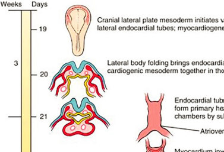

• Fig. 72.1 Overview of cardiac embryology in human gestation. (From Schoenwolf GC, Bleyl S, Brauer P, et al. Larsen’s Human Embryology. 5th ed. London: Churchill Livingstone; 2014.)

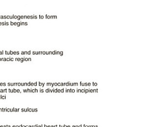

Unmatched source image; PDF page 1359. Consult the original caption.

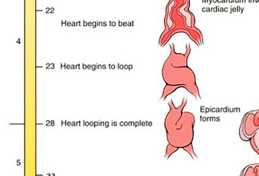

• Fig. 72.1 Overview of cardiac embryology in human gestation. (From Schoenwolf GC, Bleyl S, Brauer P, et al. Larsen’s Human Embryology. 5th ed. London: Churchill Livingstone; 2014.)

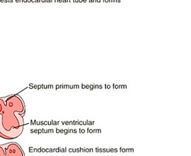

Unmatched source image; PDF page 1359. Consult the original caption.

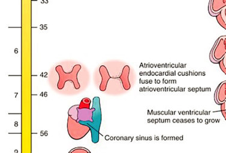

• Fig. 72.1 Overview of cardiac embryology in human gestation. (From Schoenwolf GC, Bleyl S, Brauer P, et al. Larsen’s Human Embryology. 5th ed. London: Churchill Livingstone; 2014.)

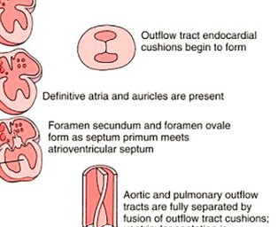

Unmatched source image; PDF page 1359. Consult the original caption.

## PDF page 1360

### • Fig. 72.2 (A–E) Myocardial progenitors in the chick primitive streak

and their fates in the heart tube. The craniocaudal organization of progenitor cells (A) transitions as they migrate and assume a mediolateral orientation (B). Cranial sections marked by asterisks (B) become the ventral portion of the heart tube (C) and later the rightmost border of the looping heart (D). At, Atrium; AVC, atrioventricular canal; C, conus; LV, left ventricle; RV, right ventricle; T, truncus. (Adapted from Kirby M. Cardiac Development. Oxford University Press; 2007.)

Sinus node

AV-node

### RA

### RCA

First heart field (FHF)

Anterior second heart field (SHF)

Posterior second heart field (SHF)

Cardiac neural crest cells (CNCC)

### IVC

Proepicardium (PE)

Epicardium

### • Fig. 72.3 Cardiac progenitor populations and their derivatives. The different cell populations that contrib-

ute to the final cardiac structure are listed with their special locations indicated in the image. Note that this particular image separates some cardiac neural crest cell progenitors from the second heart field, though the cardiac neural crest cells do contribute to the atria, right ventricle (RV), septae, and outflow tracts. AV, Atrioventricular; IVC, inferior vena cava; LA, left atrium; LAD, left anterior descending (artery); LCx, left circumflex artery; LV, left ventricle; RA, right atrium; SVC, superior vena cava. (Adapted from Kloesel B, NiNardo JA, Brody S. Cardiac embryology and molecular mechanisms of congenital heart disease: a primer for anesthesiologists. Anesth Analg. 2016;123(3):551–569.)

right heart fields (see Fig. 72.2B), which then create the horseshoe-shaped first and second heart fields around the end of the primitive streak, the primitive node. The second heart fields are adjacent to and influenced by cardiac neural crest cells, which are implicated in many genetic syndromes, including RASopathies (mutations of the Ras-MAPK pathway) such as 22q11 deletion syndromes.

The origin of cells in the embryonic heart determines their ultimate destination (Fig. 72.3).5 Disruptions in the early migration of these cells cause specific congenital malformations in the four-chambered heart. The first heart field, which makes the primitive heart tube, forms the left ventricle and the atria. The right ventricle, valves, parts of the atria, and outflow tracts are made from the second heart field and cardiac neural crest cells, all of which must migrate to the first heart field to expand the primitive heart tube. Understanding the cell lineages makes it easier to understand the origins of congenital heart disease and how malformations can be tied together.

### The Tubular and Looping Heart

Within each side of the first heart fields primitive endocardial tubes form, come together, and fuse as the lateral body portions fold to create the primitive heart tube. The

Aorta

### SVC

Pulmonary arteries

LCx

### LA

### LV

### RV

### LAD

Conduction system

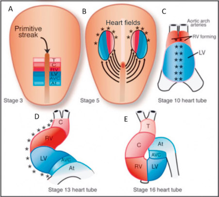

• Fig. 72.2 (A–E) Myocardial progenitors in the chick primitive streak and their fates in the heart tube. The craniocaudal organization of progenitor cells (A) transitions as they migrate and assume a mediolateral orientation (B). Cranial sections marked by asterisks (B) become the ventral portion of the heart tube (C) and later the rightmost border of the looping heart (D). At, Atrium; AVC, atrioventricular canal; C, conus; LV, left ventricle; RV, right ventricle; T, truncus. (Adapted from Kirby M. Cardiac Development. Oxford University Press; 2007.)

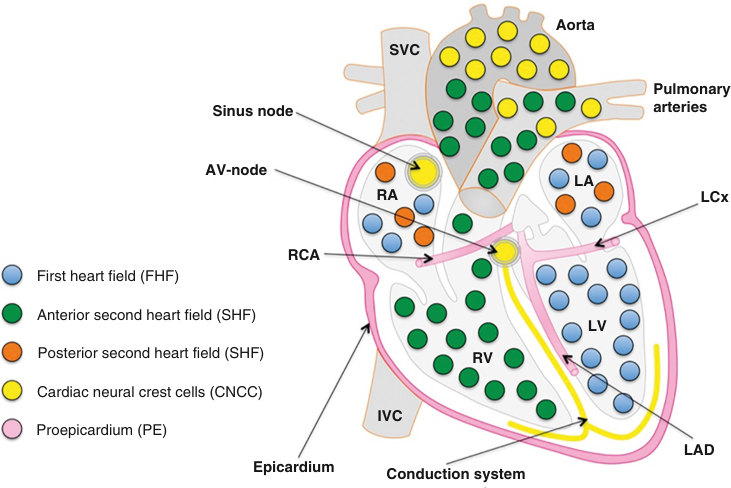

• Fig. 72.3 Cardiac progenitor populations and their derivatives. The different cell populations that contribute to the final cardiac structure are listed with their special locations indicated in the image. Note that this particular image separates some cardiac neural crest cell progenitors from the second heart field, though the cardiac neural crest cells do contribute to the atria, right ventricle (RV), septae, and outflow tracts. AV, Atrioventricular; IVC, inferior vena cava; LA, left atrium; LAD, left anterior descending (artery); LCx, left circumflex artery; LV, left ventricle; RA, right atrium; SVC, superior vena cava. (Adapted from Kloesel B, NiNardo JA, Brody S. Cardiac embryology and molecular mechanisms of congenital heart disease: a primer for anesthesiologists. Anesth Analg. 2016;123(3):551–569.)

## PDF page 1361 | printed page 1361

most caudal cells of the right and left heart fields will form the most ventral portion of the primitive heart tube (asterisks in Fig. 72.2). The inflow portion of the heart quickly gains pacemaker activity and initiates slow, unidirectional contractions along the tube. Concurrent with this process, endocardial and myocardial cells, which form the layers of the developing heart, emerge from a common precursor.6 The myocardium secretes a thick layer of acellular extracellular matrix, also known as cardiac jelly, which creates a distinct layer between the myocardium and the endocardium (Fig. 72.4). This tissue progression requires cell differentiation, sorting, and polarization. Evidence supports both negative and positive influences from the surrounding neural tissue and endoderm on these processes.

The primitive heart tube undergoes three connected steps—looping, convergence, and wedging—all of which are crucial to normal cardiac septation. Looping is the first obvious structural left-right lateralization in the developing embryo (Fig. 72.5).7 The heart tube elongates and folds into an “S” shape to the right. The direction of looping will determine the ultimate ventricular positions. Looping to the right will give the normal dextro, or “D,” looping. If the primitive tube loops to the left, this will result in levo, or “L,” looping, with the left ventricle on the right side and the right ventricle on the left side (Fig. 72.6).8 The left-right handedness of looping is directed by monocilia in the primitive node many stages before looping starts. These

• Fig. 72.4 In vivo images of a quail heart. The images demonstrate portions of the cardiac cycle in a stage 14 quail embryo. The cardiac jelly is an acellular (black) layer between the myocardium and the endocardium. (Image from the laboratory of Dr. Stephanie Ford.)

• Fig. 72.5 The progression of looping in the tubular heart. (Modified from Schleich J-M, Abdulla T, Summers R, et al. An overview of cardiac morphogenesis. Arch Cardiovasc Dis. 2013;106(11):612–623.)

cilia are angled 40° posterior and rotate in a clockwise direction, resulting in a leftward laminar flow of fluid containing key signaling molecules. Mutations in genes responsible for ciliary ultrastructure result in syndromes such as Kartagener syndrome.9 Importantly, the primitive atrium is not involved in this portion of looping, so atrial position is not severely disturbed by abnormal looping. Atrial positions are affected by situs abnormalities as seen in heterotaxy syndromes. Left-right embryologic abnormalities have a wide range of known genetic causes in which mutations interfere with early breaking of left-right symmetry, abnormal signal transduction or gene expression in the lateral plate mesoderm, and abnormal morphogenesis of internal organs.10

Convergence is the process of proper orientation of the inflow and outflow tracts (Fig. 72.7). The inflow tract rises cranially behind the outflow tract such that the inflow and outflow tracts are aligned, with the outflow tract ventral to the inflow tract. Abnormalities can lead to irregularities in atrial and ventricular septa and outflow tracts. Convergence and looping are dependent on lengthening of the polar ends of the heart tube, which is achieved by the addition of cells from the second heart field. The original primitive heart tube will grow to become the left ventricle and portions of the AV canal, and additions from the second heat field will direct formation of the outflow tracts, right ventricle, and atria. As cardiac neural crest cells influence the second heart field, it becomes easier to understand how neural crest

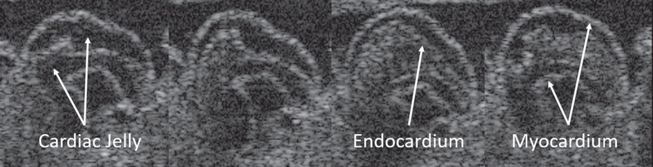

• Fig. 72.4 In vivo images of a quail heart. The images demonstrate portions of the cardiac cycle in a stage 14 quail embryo. The cardiac jelly is an acellular (black) layer between the myocardium and the endocardium. (Image from the laboratory of Dr. Stephanie Ford.)

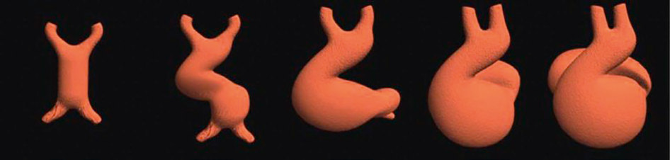

• Fig. 72.5 The progression of looping in the tubular heart. (Modified from Schleich J-M, Abdulla T, Summers R, et al. An overview of cardiac morphogenesis. Arch Cardiovasc Dis. 2013;106(11):612–623.)

## PDF page 1362

### T T

### T

D-loop L-loop

### B

### V V V

### B B

### A A A

Primitive cardiac tube

• Fig. 72.6 Looping in the primitive cardiac tube. Correct looping to the right, or “D” looping, compared to left, or “L” looping. A, Atrium; B, bulbus cordis, or another part of the ventricle; T, truncus arteriosus, or outflow tract; V, ventricle. (Adapted from Maldjian PD, Saric M. Approach to dextrocardia in adults: review. Am J Roentgenol. 2007;188(6 suppl):S39–S49. Copyright © 2007 American Roentgen Ray Society.)

cell–associated diseases such as 22q11 deletion syndromes and velocardiofacial syndromes result in abnormalities of these cardiovascular structures.

Occurring in parallel with convergence and septation (see Fig. 72.7) is wedging (Fig. 72.8). Here, the outflow tract rotates counterclockwise approximately 45°, resulting in the future aorta residing behind the future pulmonary artery (see Fig. 72.8d–e). The aortic portion shortens, and the future site of the aortic valve “wedges” between the future tricuspid and mitral valves. This separates the mitral valve from the septum, which is why the mitral valve has no connections to the septal wall. If convergence and wedging do not occur correctly, then the outflow tract, the ventricular septum, and the AV endocardial cushion tissue do not meet. This results in conotruncal defects such as double inlet left ventricle, double outlet right ventricle, and tetralogy of Fallot.11

The vertebrate heart tube normally loops to the right side of the embryo. Sidedness appears to be influenced by factors acting at a time when the heart is not recognizable as

• Fig. 72.7 The early stages of cardiac development while in the tubular phase include looping, convergence, and wedging. The red circles indicate the changing positions of the future aortic valve. A, Atrium; AVC, atrioventricular canal; LV, left ventricle; OT, outflow tract; RV, right ventricle. (Modified from Schleich J-M, Abdulla T, Summers R, et al. An overview of cardiac morphogenesis. Arch Cardiovasc Dis. 2013;106(11):612–623.)

• Fig. 72.8 Process of aortic wedging. The outflow tract descends and rotates (a–c), aligning it with the center of the atrioventricular valves and canal. The area of the future aortic valve then migrates between the future tricuspid and mitral valves (d, e). (Adapted from Kirby M. Cardiac Development. Oxford University Press; 2007.)

a distinct organ structure.13 Transplantation studies using the early chicken embryo suggest that left and right sidedness are already determined in the precardiac mesoderm stages. Sidedness can also be regulated in part by retinoids. Retinoic acid–soaked bead implants in chicken embryos or application of all-trans retinoic acid in mouse embryos cause transposition of the great arteries.14 Abnormalities in the direction of cardiac looping also occur in humans.15 These abnormalities are linked to an autosomal recessive gene defect that has been detected in the Amish population and another gene defect in the X chromosome (Xq24-q27.1)

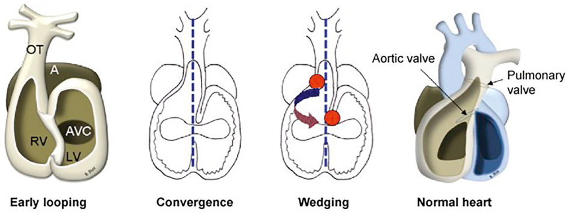

• Fig. 72.7 The early stages of cardiac development while in the tubular phase include looping, convergence, and wedging. The red circles indicate the changing positions of the future aortic valve. A, Atrium; AVC, atrioventricular canal; LV, left ventricle; OT, outflow tract; RV, right ventricle. (Modified from Schleich J-M, Abdulla T, Summers R, et al. An overview of cardiac morphogenesis. Arch Cardiovasc Dis. 2013;106(11):612–623.)

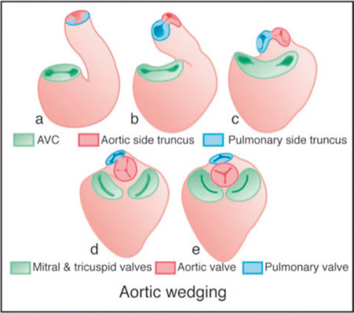

• Fig. 72.8 Process of aortic wedging. The outflow tract descends and rotates (a–c), aligning it with the center of the atrioventricular valves and canal. The area of the future aortic valve then migrates between the future tricuspid and mitral valves (d, e). (Adapted from Kirby M. Cardiac Development. Oxford University Press; 2007.)

## PDF page 1363 | printed page 1363

in the general population.16 Interestingly, abnormalities in genes associated with left-right asymmetry may also be responsible for apparently isolated cases of CHDs. Mutations in the laterality CFC1 gene have manifested as transposition of the great arteries in humans without other obvious laterality defects.

Two mouse mutants have abnormalities in sidedness. The iv/iv mutant mouse develops L-looping and dextrocardia 50% of the time.17 A large percentage of these mice have a combination of cardiac defects, including persistent sinus venosus, atrial and ventricular septal defects, common AV canal, double outlet right ventricle, tetralogy of Fallot, and transposition of the great arteries. This gene has been mapped to mouse chromosome 12, which is homologous to human chromosome 14. The inv/inv mutant mouse develops situs inversus close to 100% of the time.18 Mutation screens using the zebrafish have uncovered a number of genes involved in laterality specification and indicate that there are organ-specific laterality regulators.19 Identification of the genes involved in these human, mouse, and zebrafish mutations could provide valuable insight into the mechanisms of normal dextral looping of the heart.20

### Septation Endocardial Development: Formation of Cushion Tissue

Septation of the heart begins with swelling of the extracellular matrix between the endocardium and the myocardium at specific regions of the heart tube. These regions include the AV junction, the outflow tract, the leading edge of the primary atrial septum, and the ridge of the interventricular septum. As chamber differentiation proceeds, endocardial cushions grow into the lumen of the tubular heart and act as primitive valves to promote unidirectional blood flow. These simple mounds of extracellular matrix lined by a single layer of endocardial cells eventually mature into valves with thinned valve leaflets. A complex set of inductive events has been elucidated by studying cushion formation of the AV junction and the outflow tract.21 These events include signaling between the specialized myocardium and a subset of competent endocardial cells through growth factors (e.g., transforming growth factor-β [TGF-β], vascular endothelial growth factor [VEGF], bone morphogenetic proteins [BMPs]) and extracellular matrix molecules. Various proteases and homeobox genes are also involved.

The subsequent cascade of events includes release and migration of cells from the endocardial epithelium (termed endothelial-mesenchymal transition [EMT]) into the previously acellular cardiac jelly and proliferation, death, and differentiation of these endocardial mesenchyme cells within a complex matrix. The cushions are also populated by cardiac neural crest cells. The cushions eventually give rise to, or at least greatly influence, the subsequent development of septa and valves of the heart. Because a number of factors, cell types, and tissues are involved in this process at multiple levels and at different stages, there are many sites where mistakes can occur. It is therefore not surprising that septation

defects are so common. The differentiation of resilient valves requires remodeling of the extracellular matrix. It has been revealed that steps in cardiac valve differentiation and maturation share mechanisms with those of cartilage, tendon, and bone development.22

In the primitive atrium, a ring of tissue, the septum primum, grows toward the endocardial cushions near the AV junction (Fig. 72.9). Through apoptosis, fenestrations form in this tissue, creating the osteum secundum. The osteum primum, between the tip of this outgrowth of the septum primum and the endocardial cushion, closes as the tissue advances. The atrial roof folds inward, and the septum secundum begins to grow down on the right of the septum primum and continues in a crescent shape to form to the right of the base of the septum primum. This makes the septum primum a flap over the foramen ovale, allowing only right-to-left flow across the atria.

Ventricular and outflow tract septation occur in tandem, and aberrations in one may have structural consequences for the other. The myocardium from the outer curvature of the ventricle invaginates, growing cranially. AV canal endocardial cushions grow toward the myocardium, completing the ventricular septum. Outflow tract endocardial cushions form ridges that spiral along the conotruncus (Fig. 72.10). These ridges grow together to divide the conotruncus into

• Fig. 72.9 Atrial septation. The septum primum extends from the roof of the common atrium toward the endocardial cushion (A). Fenestrations appear, creating the osteum primum (B), and then the septum secundum descends from the roof of the atrium to the right of the septum primum (C), covering the osteum primum. This creates the patent foramen ovale (PFO), through which blood can flow in a right-to-left direction but not in the reverse (D). (Modified from Rana BS, Thomas MR, Calvert PA, et al. Echocardiographic evaluation of patent foramen ovale prior to device closure. JACC Cardiovasc Imaging. 2010;3(7):749–760.)

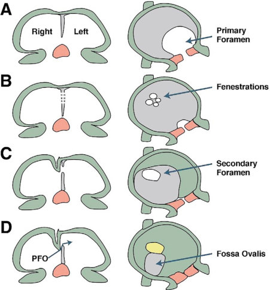

• Fig. 72.9 Atrial septation. The septum primum extends from the roof of the common atrium toward the endocardial cushion (A). Fenestrations appear, creating the osteum primum (B), and then the septum secundum descends from the roof of the atrium to the right of the septum primum (C), covering the osteum primum. This creates the patent foramen ovale (PFO), through which blood can flow in a right-to-left direction but not in the reverse (D). (Modified from Rana BS, Thomas MR, Calvert PA, et al. Echocardiographic evaluation of patent foramen ovale prior to device closure. JACC Cardiovasc Imaging. 2010;3(7):749–760.)

## PDF page 1364

• Fig. 72.10 Septation of the ventricles and conotruncus. A portion of the right ventricle has been removed to show the positions of the outflow tracts. Conotruncal ridges (yellow and green) grow from the outflow tract, creating a spiral septum represented here at multiples levels in (A, B). This septum separates the aortic and pulmonary outflow tracts. The conotruncal septum then extends to the muscular portion of the ventricular and atrial septa, completing the ventricular septum (C, D). (Adapted from Schoenwolf G, Bleyl S, Brauer P, et al. Larsen’s Human Embryology. 5th ed. London: Churchill Livingstone; 2014.)

the trunks of the aorta and pulmonary artery. The AV canal and outflow tract endocardial cushions join, completing ventricular septation.

Endocardial cushions act as primitive valves and include the precursor cells of mature valves. During endothelial mesenchymal transition (EMT), TGF-β and Notch signaling induces endothelial cells to adopt an invasive phenotype, and cells invade the previously acellular cardiac jelly. These cells adopt a mesenchymal phenotype to create fibrous tissue and collagen (Fig. 72.11). As the cushions grow, they delaminate from the myocardium, forming thin strands (chordae tendineae) that attach to outgrowths of myocardium (papillary muscles). The tricuspid valve attaches to papillary muscles on the interventricular

septum, as well as the free wall of the right ventricle. The mitral valve, however, has attachments only to the apex and the free wall of the left ventricle. Septal attachments do not form because the aortic valve displaces the primitive mitral valve from the septum during wedging. These early valve differences help identify ventricles during fetal and neonatal echocardiography.

Semilunar valve formation is similar to that of the AV valves; however, the apical surfaces of the valve leaflets develop depressions, eventually molding the leaflets into cusps (see Fig. 72.11). The arterial surfaces of the cusps become a more condensed fibrous tissue. Rather than chordae tendineae and papillary muscles, the leaflets extend attachments into the vessel walls to anchor them.

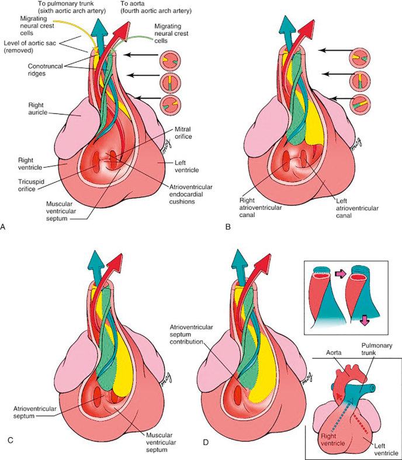

• Fig. 72.10 Septation of the ventricles and conotruncus. A portion of the right ventricle has been removed to show the positions of the outflow tracts. Conotruncal ridges (yellow and green) grow from the outflow tract, creating a spiral septum represented here at multiples levels in (A, B). This septum separates the aortic and pulmonary outflow tracts. The conotruncal septum then extends to the muscular portion of the ventricular and atrial septa, completing the ventricular septum (C, D). (Adapted from Schoenwolf G, Bleyl S, Brauer P, et al. Larsen’s Human Embryology. 5th ed. London: Churchill Livingstone; 2014.)

## PDF page 1365 | printed page 1365

• Fig. 72.11 Atrioventricular (AV) and semilunar valve formation. During looping, the myocardium secretes cardiac jelly, which is a gelatinous matrix rich in hyaluronan. Some of the myocardial cells lining these regions release factors that activate a subset of the overlaying endocardium, resulting in select endocardial cells that invade the cardiac jelly and assume a mesenchymal phenotype. This process is known as endothelial-mesenchymal transition (EMT). These cells proliferate, migrate, and differentiate. In AV valves, the portion of the cushions adjacent to the underlying myocardium differentiates onto a fibroblastic phenotype. Fenestrations develop and coalesce beneath this layer, resulting in delamination of the tissue from the developing cushion. Fenestrations also develop in the residual mesenchymal tissue strands, and these will develop into the tendinous cords of the AV valves. Semilunar valves form similarly, but instead of delaminating they form conical depressions facing the myocardium in a process referred to as excavation. Fibrous tissue radiates from the primitive valve cusps into the myocardial wall, anchoring the valve leaflets. (From Butcher JT, Markwald RR. Valvulogenesis: the moving target. Philos Trans R Soc Lond B Biol Sci. 2007;362(1484):1489–1503.)

The atrial septum, ventricular septum, and all valves are formed from the second heart field–derived endocardial cushions. Therefore valve and septal defects are commonly found together. Classically, the common AV canal has been known as “the endocardial defect,” as it includes malformations of both AV valves, the atrial septum, and the ventricular septum. However, not all of these defects must be present for the defects to be endocardial cushion defects. In fact, many of the valve and septal defects seen clinically are variations of endocardial cushion defects.

### Neural Crest Contributions to Cardiogenesis

A subset of neural crest cells that originate and migrate from the dorsal region of the neural tube contributes significantly to the development of the heart and associated vessels (Fig. 72.12).23,24 The role of the neural crest has been

determined by the study of avian embryos using immunohistochemical neural crest markers, transplantation (quail-chicken chimeras), ablation, and genetic manipulation of mice. The neural crest cells from the cranial and trunk regions of the neural tube migrate through the third, fourth, and sixth aortic arches (Fig. 72.13) to contribute to the walls of the aortic arch arteries, including the proximal aorta, the stems of the proximal coronary arteries, and the sympathetic and parasympathetic innervation of the heart (including the cardiac ganglia). A subset enters the heart within the endocardium and is involved in septation of the aortic and pulmonary trunk. A subset also appears to enter the heart and regulates the formation and maturation of the cardiac conduction system.25 Removal or disruption of neural crest cells causes cardiac inflow anomalies, including double inlet left ventricle, tricuspid atresia,

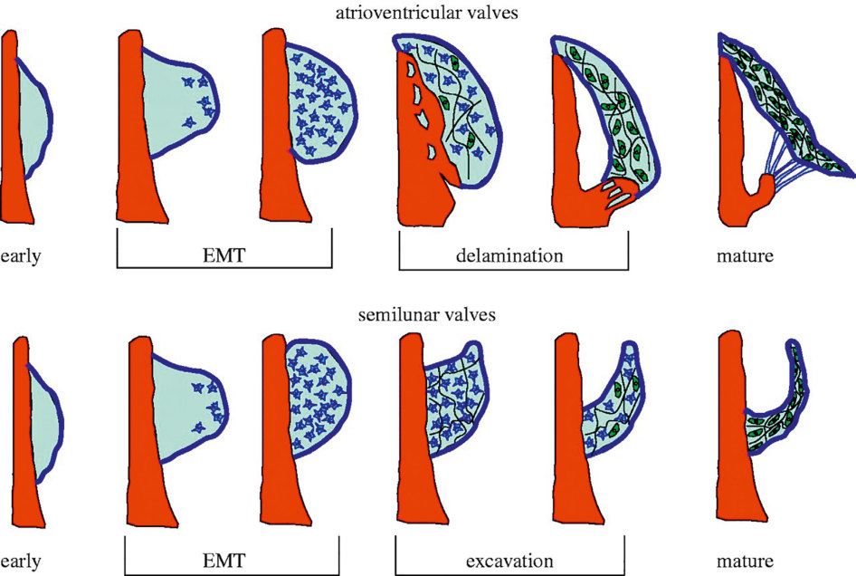

• Fig. 72.11 Atrioventricular (AV) and semilunar valve formation. During looping, the myocardium secretes cardiac jelly, which is a gelatinous matrix rich in hyaluronan. Some of the myocardial cells lining these regions release factors that activate a subset of the overlaying endocardium, resulting in select endocardial cells that invade the cardiac jelly and assume a mesenchymal phenotype. This process is known as endothelial-mesenchymal transition (EMT). These cells proliferate, migrate, and differentiate. In AV valves, the portion of the cushions adjacent to the underlying myocardium differentiates onto a fibroblastic phenotype. Fenestrations develop and coalesce beneath this layer, resulting in delamination of the tissue from the developing cushion. Fenestrations also develop in the residual mesenchymal tissue strands, and these will develop into the tendinous cords of the AV valves. Semilunar valves form similarly, but instead of delaminating they form conical depressions facing the myocardium in a process referred to as excavation. Fibrous tissue radiates from the primitive valve cusps into the myocardial wall, anchoring the valve leaflets. (From Butcher JT, Markwald RR. Valvulogenesis: the moving target. Philos Trans R Soc Lond B Biol Sci. 2007;362(1484):1489–1503.)

## PDF page 1366

• Fig. 72.12 Origins of the endothelium: The ventral surface of the mouse heart with the sinus venosusderived endothelial cells is labeled yellow (left panel), and the endocardial-derived cells are in green (right panel). (Adapted from Chen HI, Sharma B, Akerberg BN, et al. The sinus venosus contributes to coronary vasculature through VEGFC-stimulated angiogenesis. Development. 2014;141(23):4500–4512.)

and straddling tricuspid valve; cardiac outflow anomalies, including persistent truncus arteriosus; and abnormalities in the aortic arch arteries, including interruption of the aorta, double aortic arch, variable absence of the carotid arteries, and left aortic arch. In contrast, the systemic and pulmonary venous structures are not as affected by disruption of cardiac neural crests.

A more global role for the cardiac neural crest is now recognized after the findings that removal or disturbance of cardiac neural crest cells can influence the function and proliferation of cardiomyocytes before neural crest cells migrate into the heart.26 Findings point to a role for cardiac neural crest–derived cells in influencing the mesenchyme of the secondary or anterior heart-forming field that produces late-forming cardiac structures, including the outflow tract.27,28 Because disturbances of neural crest development have the potential to cause cardiovascular anomalies, factors controlling normal neural crest cell development are receiving much attention. 22q11 deletion and related syndromes that include craniofacial and outflow tract abnormalities are believed to result from disruption of neural crest cell development.29

The CHDs most commonly found in 22q11 deletion syndromes include conotruncal defects such as tetralogy of Fallot, pulmonary atresia with ventricular septal defect, truncus arteriosus, interrupted aortic arch, isolated aortic arch anomalies, and ventricular septal defects.30 Consider that 22q11 deletion syndromes are associated with abnormalities in cardiac neural crest cells and the second heart field. Fig. 72.13 displays the derivatives of neural crest cells. Understanding the origins and derivatives of the neural crest cells helps explain how these cardiac neural crest cell abnormalities lead to these specific CHDs.

The search for the “DiGeorge syndrome gene” was confounded by the number of candidate genes in the

• Fig. 72.13 Migration and distribution of cardiac neural crest cells from the neural tube to the heart. The cardiac neural crest cells originate from a small portion of the neural tube adjacent to the otic placode (Oto) and the first to fourth somites (labeled S1–S4). They then migrate through the third, fourth, and sixth aortic arches (labeled 3, 4, and 6 in the diagram) to reach the heart. (Reprinted with permission from Kirby ML. Cardiac Development. Oxford University Press; 2007.)

DiGeorge critical region and by the differences between the phenotypes of mice and humans mutated in homologous genes. It is also puzzling that individuals without the deletion can closely resemble those with the DiGeorge region missing. TBX1 and CRKL are currently described

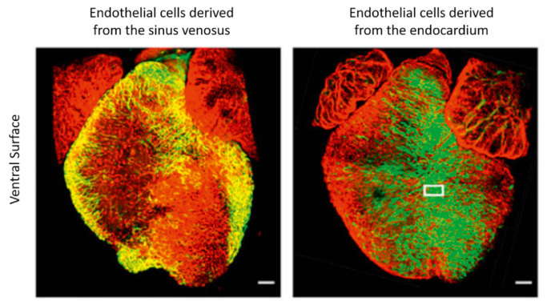

• Fig. 72.12 Origins of the endothelium: The ventral surface of the mouse heart with the sinus venosusderived endothelial cells is labeled yellow (left panel), and the endocardial-derived cells are in green (right panel). (Adapted from Chen HI, Sharma B, Akerberg BN, et al. The sinus venosus contributes to coronary vasculature through VEGFC-stimulated angiogenesis. Development. 2014;141(23):4500–4512.)

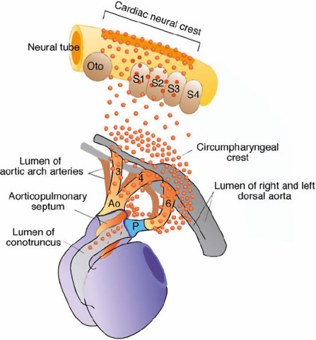

• Fig. 72.13 Migration and distribution of cardiac neural crest cells from the neural tube to the heart. The cardiac neural crest cells originate from a small portion of the neural tube adjacent to the otic placode (Oto) and the first to fourth somites (labeled S1–S4). They then migrate through the third, fourth, and sixth aortic arches (labeled 3, 4, and 6 in the diagram) to reach the heart. (Reprinted with permission from Kirby ML. Cardiac Development. Oxford University Press; 2007.)

## PDF page 1367 | printed page 1367

as the best candidate genes within the most common 22q11 deletion. However, researchers continue to propose that there is no single affected gene responsible for the defects associated with DiGeorge or the 22q11 deletion syndrome. Rather, a combination of affected genes within that region, as well as those outside that region, appears to regulate the same critical cellular processes. Data suggest that many of the mutations identified in individuals with a range of craniofacial and cardiac syndromes that include 22q11 deletion syndrome are in genes associated with the extracellular signal-regulated kinase (ERK) pathway.31,32 These genes include upstream genes such as TBX1 and CRKL and downstream genes such as SRF. A broader hypothesis is emerging that anything that dysregulates the activity of the ERK pathway up or down in developing neural crest cells results in craniofacial and cardiac syndromes.

### Development of the Cardiac Conduction System

Primordia of the pulse-generating system function early in the caudal region of the tubular heart and allow unidirectional blood flow, but subsequent events in the development of the cardiac conduction system (CCS) are not well understood. Investigations of CCS embryogenesis in a variety of species, including the mouse, chicken, and zebrafish, have contributed to this understanding.33 Classic histologic analyses are limited in the information they provide because the early CCS cannot be readily distinguished histologically or even structurally from the surrounding myocardium. Biochemical markers have been detected that transiently stain portions of the CCS and have been used to follow these tissues during the three-dimensionally complex morphogenesis of the heart. The rabbit model is unique in that there is a marker for it, NF-150, an antibody against neurofilament proteins, that delineates its CCS throughout development and into the adult. These markers show that some of the tissues that give rise to the CCS can be distinguished from other cardiomyocytes as early as the tubular heart stages, because they have a different pattern of gene expression and cell proliferation.

Lineage tracing of myocardial cells provided clues to the origin of the CCS. The clonal relationship between CCS cells and working cardiomyocytes suggests that these specialized myocardia can be recruited from unspecialized myocardial cells. Evidence from avian systems supports the hypothesis that the vasculature can be the source of factors that initiate such recruitment, with endothelin-1 being a strong candidate for signaling.34

Less is known about the physiology of the developing CCS primarily because of technical barriers to resolution. These barriers are being overcome by advances in biomedical engineering technologies, such as optical mapping using voltagesensitive fluorescent dyes and optical coherence tomography, that allow the capture of images of the tiny beating heart at high spatiotemporal resolution. The tubular heart has a peristaltic-type contraction pattern resulting from a pulse-generating focus of cells and a slow distribution of action potentials

radiating evenly from that region in all directions.35 In the septating heart, alternating regions of relatively slow and fast conduction allow pumping of blood in one direction, with the endocardial cushions acting as primitive valves. Slow regions, such as the sinus venosus, AV junction, and outflow tract, cause a delay of the impulse conduction between chambers.36 The ventricular conduction system achieves its mature morphology simultaneously with the appearance of the mature sequence of activation.37 Subsequent differentiation allows for increasing speed of action potential conduction through the fascicular portion of this system and compensation for the growth of the heart. Maturation of the fibrous ring that separates the atrial from ventricular muscle and the connective tissue sheath around the conduction system also follows, serving as an insulative barrier to inappropriate conduction to neighboring working myocardium.

### Epicardium

The epicardium is a relatively late-forming cardiac tissue that does not appear until septation is under way. It provides the bulk of the non-cardiomyocyte cellular components, including smooth muscle cells, fibroblasts, and endothelial cells. The progression of epicardial development has been studied in detail using avian and mouse models. The epicardium, the outer layer of the heart, forms by the growth of epithelial tissue from the dorsal mesothelium of the sinus venosus region. This single-cell layer spreads in a stereotyped pattern over the myocardium. The squamous epithelium of the primitive epicardium and the myocardium are initially juxtaposed, but rapid accumulation and differentiation of connective tissue components between these layers ensue to thicken the epicardium. The cells within the epicardium invade the myocardium and the endocardium, giving rise to valve cells, fibroblasts, smooth muscle cells, and other components of the coronary vasculature.38 The controversy regarding the origin of the coronary endothelial cells is understandable because of the apparently conflicting findings from lineage tracing studies. Using retroviral lineage tracing, precursor cells labeled in the proepicardium were found to give rise to endothelial cells as well as smooth muscle cells.24 However, Cre-lox lineage tracing using what appeared to be epicardial-specific promoters identified only a small subset of labeled coronary endothelial cells.39,40 Other investigators using a novel lineage tracing approach showed evidence that endothelial cells come from the endocardial lining of the sinus venosus.41 More recently, it was proposed that coronary endothelial cells within the myocardium originate from endocardial cells within the ventricles.42 Another investigation using another lineage tracing method now proposes that the bulk of coronary endothelial cells come from the cells within the epicardium (subepicardial cells) that originate from the endocardium lining the atrium or sinus venosus.43 These findings are not necessarily in conflict; the endothelium lining the myriad of vessels within the myocardium is likely to come from several sources, depending on location within the heart and the types of vessel (see Fig. 72.12).

## PDF page 1368

The epicardium is also the tissue in which cardiac ganglia develop, nerves travel, and fat cells accumulate. Evidence suggests that the embryonic epicardium may also include cells that can contribute a subset of cardiomyocytes.39,40 This interesting tissue and its interaction with the myocardium are the focus of much current research.

### Lymphatics

Although it is known that the adult vertebrate heart has an extensive lymphatic network, the lymphatic vasculature of the embryonic heart is still under active investigation. Cardiac lymphatics develop shortly after formation of the coronary vasculature, which is around the eighth week of gestation in humans. Lymphatic vessels start around the mediastinal lymphatics and grow from the base to the apex, following the vasculature.44,45 The vessels connect to form capillaries without a muscular wall, later connecting to the main lymphatic network. By the fourth month of gestation, the lymphatics have covered most of the surface of the heart, and then they grow into the myocardium (Fig. 72.14). The reader is referred to the review by Gancz et al.46 for a more

• Fig. 72.14 Anatomy of cardiac lymphatics in a mature heart. The major cardiac lymphatics (green) and coronary vessels (red arteries and blue veins) are alongside the lymphatics vessels. The cross-section shows how the lymphatics drain from the endocardium vessels to the larger epicardial vessels. The vessels are drained from apex to base toward the mediastinal lymph nodes. (Adapted from Gancz D, Perlmoter G, Yaniv K. Formation and growth of cardiac lymphatics during embryonic development, heart regeneration, and disease. Cold Spring Harb Perspect Biol. 2020;12(6):a037176. Copyright © 2020 Cold Spring Harbor Laboratory Press; all rights reserved.)

thorough explanation of cardiac lymphatic formation and function.

### Cell Division and Cell Death

Differential control of cell division and cell death can in part account for the enormous differences in morphologic features of the various regions of the heart. For example, the cells of the thin-walled atria divide less than the cells of the thick-walled ventricle. The central structures of the fascicular CCS slow their proliferation rate early compared with surrounding myocardium.47 Apoptosis—programmed cell death—is a developmentally controlled strategy in the morphogenesis of many structures. It occurs during pruning of the nervous system and sculpting of digits of the hands and feet, and it occurs at many sites throughout cardiogenesis.48 Endocardial cushion mesenchyme cells, which include cardiac neural crest cells, undergo a high level of apoptosis during septation. A high frequency of apoptosis of cardiomyocytes occurs coincident with outflow tract morphogenesis. Experimental manipulation to increase or decrease cell death at this stage results in conotruncal abnormalities.49 Thus regulated apoptosis of outflow tract cardiomyocytes is critical for the normal docking of the great arteries with the ventricles. Environmental and genetic factors that alter the level of apoptosis at these critical stages and sites in the developing heart may contribute to CHDs.

### Human Genetics

The more common genetic disorders that affect heart development are T21, T18, T13, and 22q11 deletions. All of the syndromes below can usually be detected by routine prenatal testing that would include first-trimester fetal ultrasounds, cell-free DNA screening (noninvasive prenatal test [NIPT]), or pregnancy-associated plasma protein A (PAPP- A). Karyotyping of chromosomes from cells collected by amniocentesis or chorionic villus sampling often follow to confirm the diagnosis.

Trisomy 21 (Down syndrome) is most commonly associated with the presence of three copies of chromosome 21 or, in rare cases, a translocation of an extra piece of chromosome 21. This and other trisomies are caused by improper cell division either during meiosis or, less commonly, early in embryonic development. T21 mosaicism, in which only a subset of cells has the trisomy, may also be present. Features seen in individuals with trisomy 21 include craniofacial features and neurodevelopmental disorders, and 50% will have some type of CHD. The more common CHDs detected in T21 infants include AV septal defect (a defect of endocardial cushions), ventricular septal defect, persistent ductus arteriosus, and tetralogy of Fallot.50,51 Infants with T21 are also more likely to have persistent pulmonary hypertension, both with and without CHD.52,53

Trisomy 18, or Edwards syndrome, is characterized by slow prenatal growth resulting in low birth weight, small craniofacial features, anomalies of the extremities, and CHDs. The prognosis is grim, with many individuals succumbing

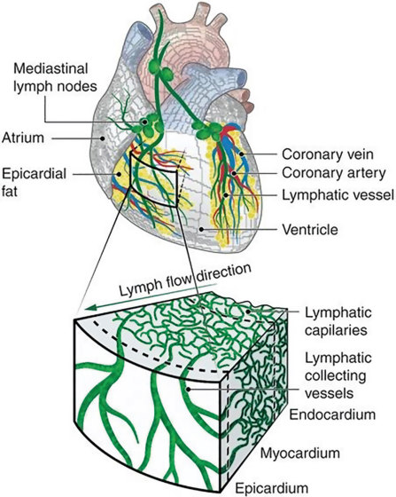

• Fig. 72.14 Anatomy of cardiac lymphatics in a mature heart. The major cardiac lymphatics (green) and coronary vessels (red arteries and blue veins) are alongside the lymphatics vessels. The cross-section shows how the lymphatics drain from the endocardium vessels to the larger epicardial vessels. The vessels are drained from apex to base toward the mediastinal lymph nodes. (Adapted from Gancz D, Perlmoter G, Yaniv K. Formation and growth of cardiac lymphatics during embryonic development, heart regeneration, and disease. Cold Spring Harb Perspect Biol. 2020;12(6):a037176. Copyright © 2020 Cold Spring Harbor Laboratory Press; all rights reserved.)

## PDF page 1369 | printed page 1369

to prenatal death or death soon after birth. CHDs seen in T18 include ventricular septal defect, persistent/patent ductus arteriosus, pulmonary stenosis, coarctation of the aorta, and abnormal heart valves.54,55

Trisomy 13, or Patau syndrome, is characterized by prenatal death or death soon after birth, slow growth and low birth weight, craniofacial anomalies, holoprosencephaly, exophthalmos, or omphalocele, as well as other anomalies throughout the body. CHDs are detected in 80% of newborns with trisomy 13 and include the range of CHDs found in trisomy 18. Ventricular septal defects are the most common.56 Surgery to correct CHDs in individuals with trisomy 13 or 18 is much more common now than 20 or even 10 years ago, although it still carries significant risks for morbidity and mortality.57

The 22q11 deletion syndrome (DiGeorge/velocardiofacial syndrome) has been discussed briefly above in the context of cardiac neural crest cells because it is considered a neurocristopathy, or a disease caused by disturbances in the generation, migration, or differentiation of neural crest cells. It is also categorized as a RASopathy because it results in abnormalities in signaling of the RAS pathway. Most of these patients have a microdeletion of the region 22q11.2 that contains many genes (30–40) including TBX1. Clinical and mouse studies have shown that TBX1 codes for a key transcription factor. Its absence prevents the expression of

Key Points

• The majority of cardiac development is complete by 8

weeks’ human gestation. • The primary heart field is responsible for the left ven-

tricle and portions of the atria, whereas the second heart field and cardiac neural crest cells are responsible for parts of the atria, valve, outflow tract, and right ventricle formation.

### References

1. van der Linde D, Konings EEM, Slager MA, et al. Birth preva-

lence of congenital heart disease worldwide. J Am Coll Cardiol. 2011;58(21):2241–2247. https://doi.org/10.1016/j.jacc.2011. 08.025. 2. Holland BJ, Myers JA, Woods CR. Prenatal diagnosis of criti-

cal congenital heart disease reduces risk of death from cardiovascular compromise prior to planned neonatal cardiac surgery: a meta-analysis. Ultrasound Obstet Gynecol. 2015;45(6):631–638. https://doi.org/10.1002/uog.14882. 3. Schoenwolf G, Bleyl S, Brauer P, Francis-West P. In: Larsen’s

Human Embryology. 5th ed. Churchill Livingstone; 2014. 4. Kirby M. Cardiac Development. Oxford University Press; 2007. 5. Kloesel B, Dinardo JA, Body SC. Cardiac embryology and

molecular mechanisms of congenital heart disease – a primer for anesthesiologists. Anesth Analg. 2016;123(3):551. https://doi. org/10.1213/ANE.0000000000001451. 6. Linask KK, Lash JW. Early heart development: dynam-

ics of endocardial cell sorting suggests a common origin with

genes, leading to multiple malformations.58 Phenotypes of these patients vary widely from mild to severe and typically include neurodevelopmental, craniofacial, and a wide range of cardiac anomalies. A large proportion of individuals with this syndrome (75%) have CHDs that include conotruncal defects such as truncus arteriosus, interrupted aortic arch B, and tetralogy of Fallot.59

Cardiomyopathies are intrinsic disorders of heart muscle that are generally classified morphologically as hypertrophic, dilated, restrictive, and arrhythmogenic.60,61 A genetic basis can be identified in a majority of these lesions, usually a mutation in a sarcomeric or structural gene that results in contractile abnormalities. Hundreds of mutations in dozens of genes have been identified as causative in familial and sporadic forms of cardiomyopathy.60 The ultimate cardiac phenotype can develop at any age but occasionally presents in the neonatal period.62 Left ventricular noncompaction is an increasingly recognized (particularly in neonates) form of cardiomyopathy characterized by dense trabeculation of the normally smooth-walled left ventricular cavity. This is a poorly understood defect that may be caused by abnormalities in the Notch signaling pathway or mutations in various sarcomeric genes.62,63 Ongoing genetic studies are focused not only on the identification of genetic abnormalities leading to cardiomyopathy but also on investigating the factors that lead to clinical disease progression.

• Looping of the primitive heart tube to the right (D) or

left (L) will determine ventricular position but not atrial position. • Cardiac neural crest cells play multiple roles in development

of the function and structure of the heart and great vessels. • The epicardium, the last heart layer to appear, plays roles

in coronary vessel and valve development.

cardiomyocytes. Dev Dyn. 1993;196(1):62–69. https://doi. org/10.1002/aja.1001960108. 7. Schleich JM, Abdulla T, Summers R, Houyel L. An overview of

cardiac morphogenesis. Arch Cardiovasc Dis. 2013;106(11):612– 623. https://doi.org/10.1016/j.acvd.2013.07.001. 8. Maldjian PD, Saric M. Approach to dextrocardia in adults:

review. Am J Roentgenol. 2007;188(suppl 6):S39–S49. https:// doi.org/10.2214/AJR.06.1179. 9. Horani A, Brody SL, Ferkol TW. Picking up speed: advances in

the genetics of primary ciliary dyskinesia. Pediatr Res. 2014;75(1– 2):158–164. https://doi.org/10.1038/pr.2013.200. 10. Deng H, Xia H, Deng S. Genetic basis of human left-right asym-

metry disorders. Expert Rev Mol Med. 2014;16:e19. https://doi. org/10.1017/erm.2014.22. 11. Kirby ML, Waldo KL. Neural crest and cardiovascular pattern-

ing. Circ Res. 1995;77(2):211–215. https://doi.org/10.1161/01. RES.77.2.211. 12. Deleted in review. 13. Ramsdell AF. Left-right asymmetry and congenital cardiac

defects: getting to the heart of the matter in vertebrate left-right

## PDF page 1370

axis determination. Dev Biol. 2005;288(1):1–20. https://doi. org/10.1016/j.ydbio.2005.07.038. 14. Irie K. All trans-retinoic acid induced cardiovascular malforma-

tions. In: Bockman D, ed. Embryonic Origins of Defective Heart Development. New York Academy of Science; 1990:387. 15. Carmi R, Boughman JA, Rosenbaum KR. Human situs deter-

mination is probably controlled by several different genes. Am J Med Genet. 1992;44(2):246–247. https://doi.org/10.1002/ ajmg.1320440228. 16. Casey B, Devoto M, Jones KL, Ballabio A. Mapping a gene

for familial situs abnormalities to human chromosome Xq24q27.1. Nat Genet. 1993;5(4):403–407. https://doi.org/10.1038/ ng1293-403. 17. Hummel KP, Chapman DB. Visceral inversion and associated

anomalies in the mouse. J Heredity. 1959;50(1):9–13. https:// doi.org/10.1093/oxfordjournals.jhered.a106870. 18. Yokoyama T, Copeland NG, Jenkins NA, et al. Reversal

of left-right asymmetry: a situs inversus mutation. Science. 1993;260(5108):679–682. 19. Chen JN, van Bebber F, Goldstein AM, et al. Genetic steps to

organ laterality in zebrafish. Comp Funct Genomics. 2001;2(2):60– 68. https://doi.org/10.1002/cfg.74. 20. Bisgrove BW, Morelli SH, Yost HJ. Genetics of human lateral-

ity disorders: insights from vertebrate model systems. Annu Rev Genomics Hum Genet. 2003;4(1):1–32. https://doi.org/10.1146/ annurev.genom.4.070802.110428. 21. Person AD, Klewer SE, Runyan RB. Cell biology of cardiac cush-

ion development. Int Rev Cytol. 2005;243:287–335. https://doi. org/10.1016/S0074-7696(05)43005-3. 22. O’Donnell A, Yutz KE. Mechanisms of heart valve development

and disease. Development. 2020;147(13):dev183020. https://doi. org/10.1242/DEV.183020. 23. Hutson MR, Kirby ML. Neural crest and cardiovascu-

lar development: a 20-year perspective. Birth Defects Res C Embryo Today. 2003;69(1):2–13. https://doi.org/10.1002/ bdrc.10002. 24. Mikawa T. Cardiac lineages. In: Harvey R, Rosenthal N, eds.

Heart Development. Academic Press; 1999:19. 25. Gurjarpadhye A, Hewett KW, Justus C, et al. Cardiac neu-

ral crest ablation inhibits compaction and electrical function of conduction system bundles. Am J Physiol Heart Circ Physiol. 2007;292(3):H1291–H1300. https://doi.org/10.1152/ajpheart.01017.2006. 26. Creazzo TL, Godt RE, Leatherbury L, et al. Role of cardiac

neural crest cells in cardiovascular development. Annu Rev Physiol. 1998;60(1):267–286. https://doi.org/10.1146/annurev. physiol.60.1.267. 27. Snarr BS, Kern CB, Wessels A. Origin and fate of cardiac mes-

enchyme. Dev Dyn. 2008;237(10):2804–2819. https://doi. org/10.1002/dvdy.21725. 28. Yutzey KE, Kirby ML. Wherefore heart thou? Embryonic ori-

gins of cardiogenic mesoderm. Dev Dyn. 2002;223(3):307–320. https://doi.org/10.1002/dvdy.10068. 29. Emanuel B. The genetic basis of conotruncal cardiac defects: the

chromosome 22q11.2 deletion. In: Harvey R, Rosenthal N, eds. Heart Development. Academic Press; 1999:463. 30. Carotti A, Digilio MC, Piacentini G, et al. Cardiac defects and

results of cardiac surgery in 22q11.2 deletion syndrome. Dev Disabil Res Rev. 2008;14(1):35–42. https://doi.org/10.1002/ DDRR.6. 31. Aoki Y, Niihori T, Narumi Y, et al. The RAS/MAPK syndromes:

novel roles of the RAS pathway in human genetic disorders.

Hum Mutat. 2008;29(8):992–1006. https://doi.org/10.1002/ humu.20748. 32. Newbern J, Zhong J, Wickramasinghe RS, et al. Mouse and human

phenotypes indicate a critical conserved role for ERK2 signaling in neural crest development. Proc Natl Acad Sci U S A. 2008; 105(44):17115–17120. https://doi.org/10.1073/pnas.0805239105. 33. Jongbloed MRM, Mahtab EAF, Blom NA, et al. Development

of the cardiac conduction system and the possible relation to predilection sites of arrhythmogenesis. Sci World J. 2008;8:239–269. https://doi.org/10.1100/tsw.2008.40. 34. Gourdie RG, Harris BS, Bond J, et al. Development of the car-

diac pacemaking and conduction system. Birth Defects Res Part C Embryo Today - Rev. 2003;69(1):46–57. https://doi.org/10.1002/ bdrc.10008. 35. Kamino K. Optical approaches to ontogeny of electrical activity

and related functional organization during early heart development. Physiol Rev. 1991;71(1):53–91. 36. de Jong F, Opthof T, Wilde AA, et al. Persisting zones of slow

impulse conduction in developing chicken hearts. Circ Res. 1992;71(2):240–250. 37. Chuck ET, Freeman DM, Watanabe M, Rosenbaum DS. Chang-

ing activation sequence in the embryonic chick heart. Implications for the development of the His-Purkinje system. Circ Res. 1997;81(4):470–476. 38. Männer J, Pérez-Pomares JM, Macías D, Muñoz-Chápuli R.

The origin, formation and developmental significance of the epicardium: a review. Cells Tissues Organs. 2001;169(2):89–103. doi:47867. 39. Cai CL, Martin JC, Sun Y, et al. A myocardial lineage derives

from Tbx18 epicardial cells. Nature. 2008;454(7200):104–108. https://doi.org/10.1038/nature06969. 40. Zhou B, Ma Q, Rajagopal S, et al. Epicardial progenitors con-

tribute to the cardiomyocyte lineage in the developing heart. Nature. 2008;454(7200):109–113. https://doi.org/10.1038/ nature07060. 41. Sharma B, Chang A. Red-Horse K. Coronary artery develop-

ment: progenitor cells and differentiation pathways. Annu Rev Physiol. 2017;79(1):1–19. https://doi.org/10.1146/annurevphysiol-022516-033953. 42. Wu B, Zhang Z, Lui W, et al. Endocardial cells form the coro-

nary arteries by angiogenesis through myocardial-endocardial VEGF signaling. Cell. 2012;151(5):1083–1096. https://doi. org/10.1016/j.cell.2012.10.023. 43. Tian X, Hu T, Zhang H, et al. Subepicardial endothelial cells

invade the embryonic ventricle wall to form coronary arteries. Cell Res. 2013;23(9):1075–1090. https://doi.org/10.1038/ cr.2013.83. 44. Juszyński M, Ciszek B, Stachurska E, et al. Development of lym-

phatic vessels in mouse embryonic and early postnatal hearts. Dev Dyn. 2008;237(10):2973–2986. https://doi.org/10.1002/ DVDY.21693. 45. Kampmeier OF. On the lymph flow of the human heart,

with reference to the development of the channels and the first appearance, distribution, and physiology of their valves. Am Heart J. 1928;4(2):210–222. https://doi.org/10.1016/ S0002-8703(28)90071-X. 46. Gancz D, Perlmoter G, Yaniv K. Formation and growth of cardiac

lymphatics during embryonic development, heart regeneration, and disease. Cold Spring Harb Perspect Biol. 2020;12(6):1–18. https://doi.org/10.1101/CSHPERSPECT.A037176. 47. Sedmera D, Reckova M, DeAlmeida A, et al. Spatiotemporal pat-

tern of commitment to slowed proliferation in the embryonic

## PDF page 1371 | printed page 1371

mouse heart indicates progressive differentiation of the cardiac conduction system. Anat Rec A Discov Mol Cell Evol Biol. 2003;274(1):773–777. https://doi.org/10.1002/ar.a.10085. 48. Pansky B. Review of Medical Embryology. Macmillan; 1982. 49. Rothenberg F, Fisher SA, Watanabe M. Sculpting the car-

diac outflow tract. Birth Defects Res Part C Embryo Today - Rev. 2003;69(1):38–45. https://doi.org/10.1002/bdrc.10007. 50. Versacci P, di Carlo D, Digilio MC, Marino B. Cardiovascular

disease in Down syndrome. Curr Opin Pediatr. 2018;30(5):616– 622. https://doi.org/10.1097/MOP.0000000000000661. 51. Lin AE, Santoro S, High FA, et al. Congenital heart defects

associated with aneuploidy syndromes: new insights into familiar associations. Am J Medl Genet Part C: Semin Med Genet. 2020;184(1):53–63. https://doi.org/10.1002/AJMG.C.31760. 52. Weijerman ME, van Furth AM, van der Mooren MD, et al.

Prevalence of congenital heart defects and persistent pulmonary hypertension of the neonate with Down syndrome. Eur J Pediatr. 2010;169(10):1195. https://doi.org/10.1007/S00431-010- 1200-0. 53. Cua CL, Blankenship A, North AL, et al. Increased incidence

of idiopathic persistent pulmonary hypertension in Down syndrome neonates. Pediatr Cardiol. 2007;28(4):250–254. https:// doi.org/10.1007/S00246-006-0011-6. 54. Sennaiyan U, Kiruthika S, Krishna M. Septal defect with poly-

valvular involvement: a cardiac imaging hallmark of Trisomy 18. Ann Pediatr Cardiol. 2021;14(4):559. https://doi.org/10.4103/ APC.APC_271_20. 55. Cereda A, Carey JC. The trisomy 18 syndrome. Orphanet J Rare

Dis. 2012;7(1):81. https://doi.org/10.1186/1750-1172-7-81. 56. Diaz D, Benjamin RH, Navarro Sanchez ML, et al. Patterns of

congenital anomalies among individuals with trisomy 13 in Texas. Am J Med Genet A. 2021;185(6):1787. https://doi.org/10.1002/ AJMG.A.62175. 57. Cooper DS, Riggs KW, Zafar F, et al. Cardiac surgery in patients

with trisomy 13 and 18: an analysis of the Society of Thoracic

Surgeons Congenital Heart Surgery Database. J Am Heart Assoc. 2019;8(13):e012349. https://doi.org/10.1161/JAHA.119.012349. 58. Morrow BE, McDonald-McGinn DM, Emanuel BS, et al. Molec-

ular genetics of 22q11.2 deletion syndrome. Am J Med Genet A. 2018;176(10):2070. https://doi.org/10.1002/AJMG.A.40504. 59. Goldmuntz E. 22q11.2 deletion syndrome and congeni-

tal heart disease. Am J Med Genet Part C: Semin Med Genet. 2020;184(1):64–72. https://doi.org/10.1002/AJMG.C.31774. 60. Towbin JA. Inherited cardiomyopathies. Circ J. 2014;78(10):

2347–2356. 61. Braunwald E. Cardiomyopathies: an overview. Circ Res.

2017;121(7):711–721. https://doi.org/10.1161/CIRCRE- SAHA.117.311812. 62. Lee TM, Hsu DT, Kantor P, et al. Pediatric cardiomyopathies.

Circ Res. 2017;121(7):855–873. https://doi.org/10.1161/CIR- CRESAHA.116.309386. 63. Luxán G, Casanova JC, Martínez-Poveda B, et al. Mutations in

the NOTCH pathway regulator MIB1 cause left ventricular noncompaction cardiomyopathy. Nat Med. 2013;19(2):193–201. https://doi.org/10.1038/nm.3046. 64. Rana BS, Thomas MR, Calvert PA, et al. Echocardiographic eval-

uation of patent foramen ovale prior to device closure. JACC Cardiovasc Imaging. 2010;3(7):749–760. https://doi.org/10.1016/J. JCMG.2010.01.007. 65. Butcher JT, Markwald RR. Valvulogenesis: the moving target.

Philos Trans R Soc Lond B Biol Sci. 2007;362(1484):1489–1503. https://doi.org/10.1098/rstb.2007.2130. 66. Hutson MR, Kirby ML. Model systems for the study of heart

development and disease cardiac neural crest and conotruncal malformations. Semin Cell Dev Biol. 2007;18(1):101. https://doi. org/10.1016/J.SEMCDB.2006.12.004. 67. Chen HI, Sharma B, Akerberg BN, et al. The sinus venosus con-

tributes to coronary vasculature through VEGFC-stimulated angiogenesis. Development (Camb). 2014;141(23):4500–4512. https://doi.org/10.1242/dev.113639.

<!-- SOURCE_LAYOUT_VIEWS -->

## Original layout views and recovered diagrams

Automatic extraction can flatten tables and superscripts. Check the original layout for numeric data, footnotes and image credits. [Source review notes](../../SOURCE_REVIEW_NOTES.md).

### Original source page 1359

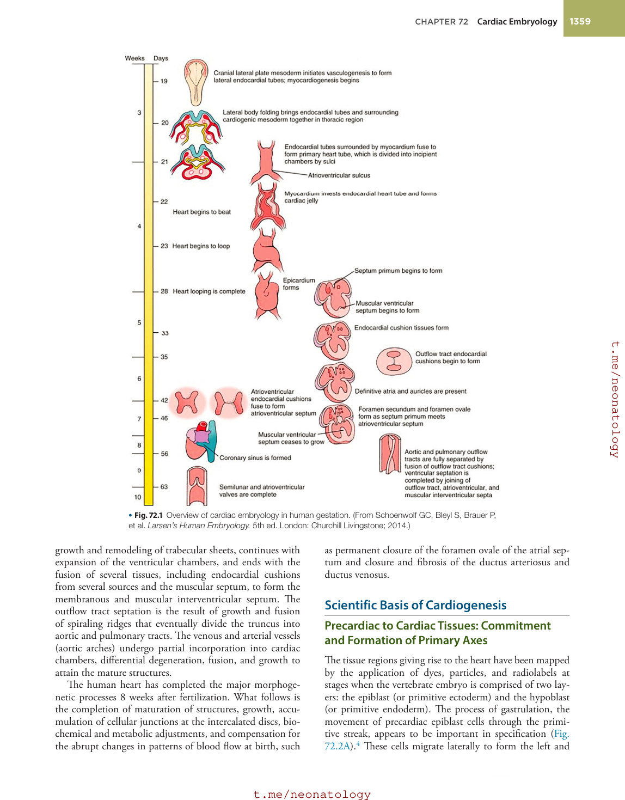

### Original source page 1360

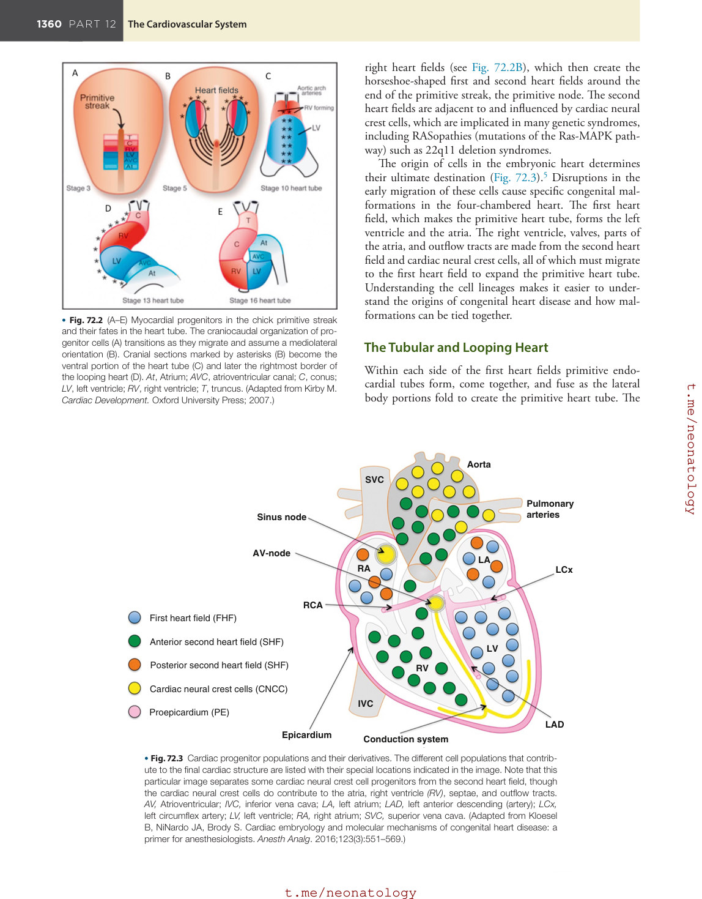

### Original source page 1361

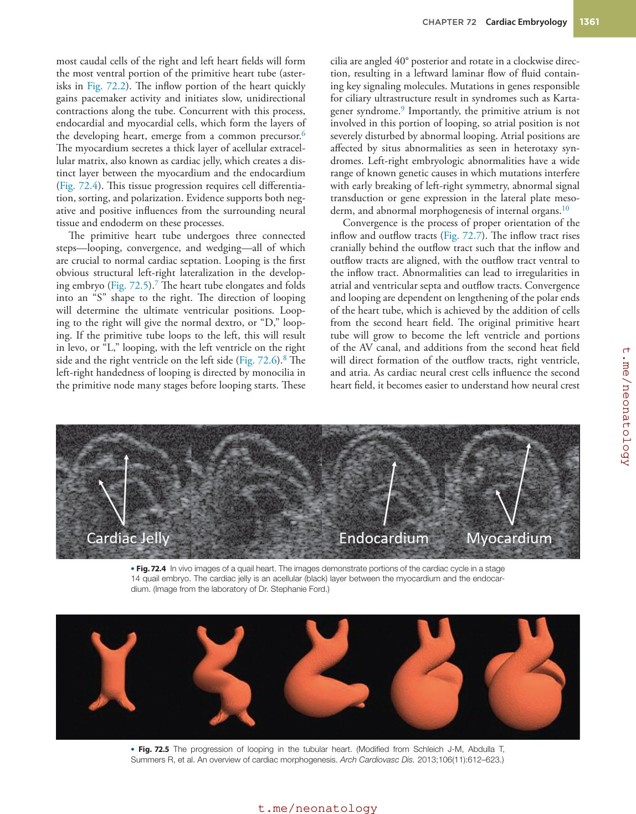

### Original source page 1362

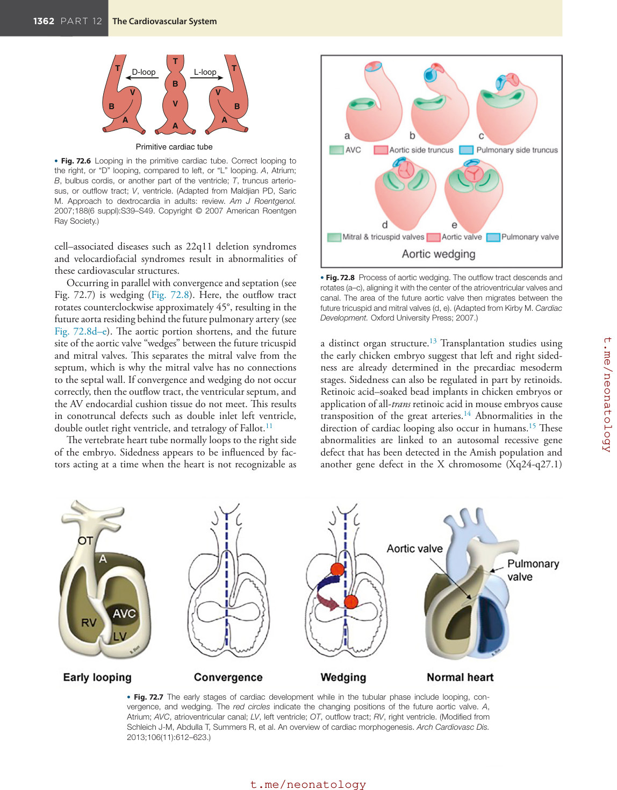

### Original source page 1363

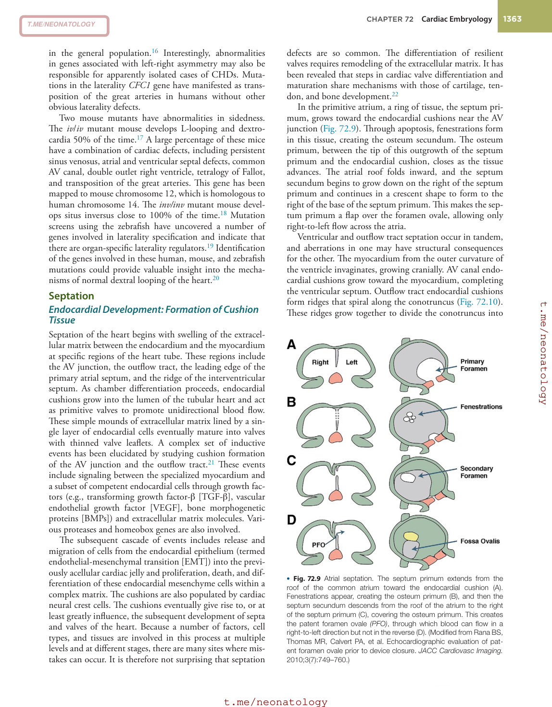

### Original source page 1364

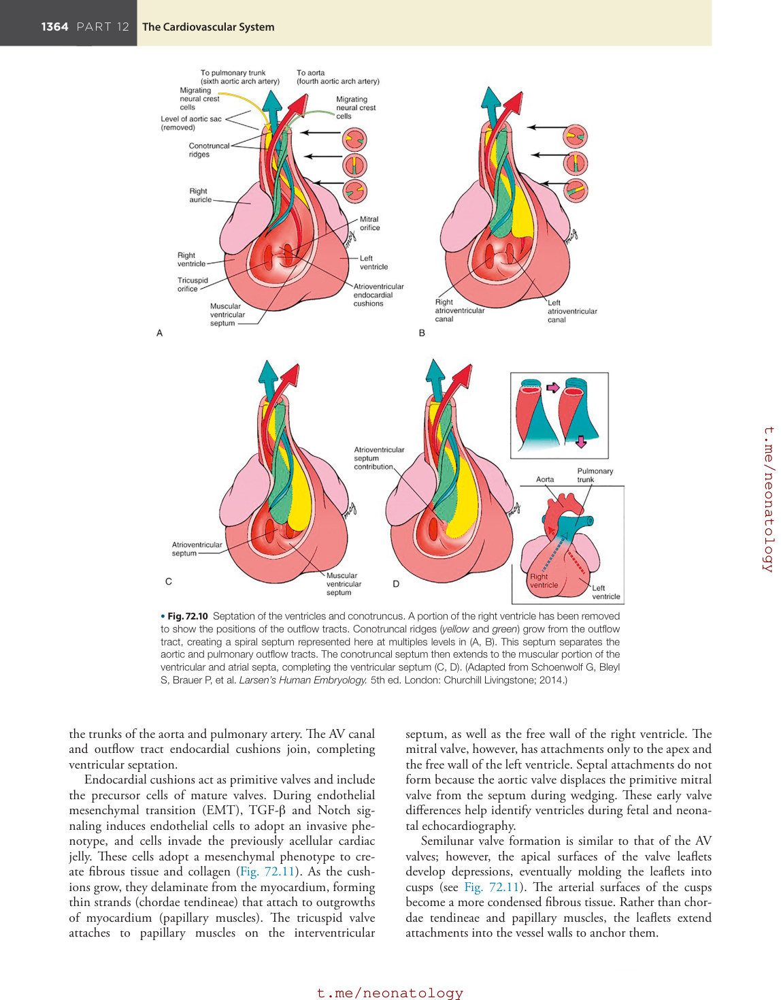

### Original source page 1365

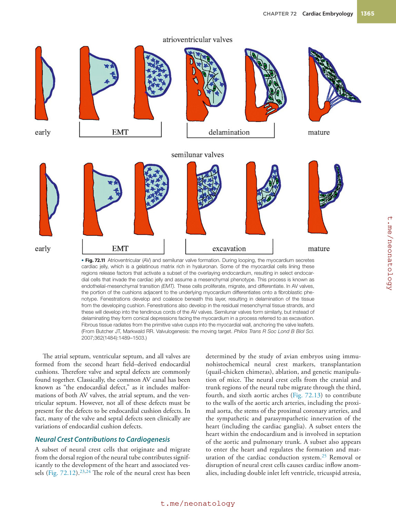

### Original source page 1366

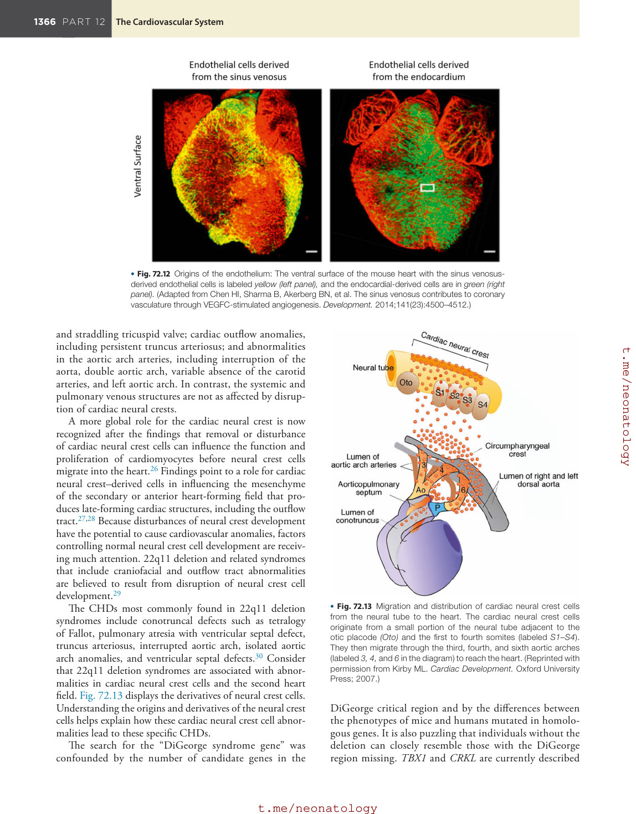

### Original source page 1368

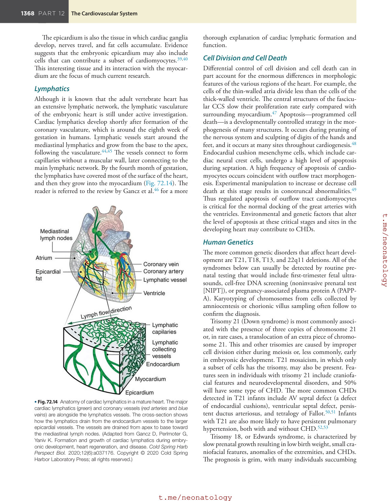

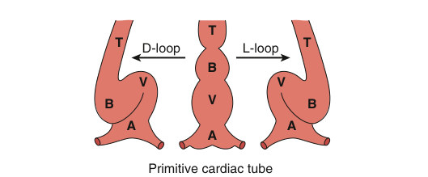

• Fig. 72.6 Looping in the primitive cardiac tube. Correct looping to the right, or “D” looping, compared to left, or “L” looping. A, Atrium; B, bulbus cordis, or another part of the ventricle; T, truncus arteriosus, or outflow tract; V, ventricle. (Adapted from Maldjian PD, Saric M. Approach to dextrocardia in adults: review. Am J Roentgenol. 2007;188(6 suppl):S39–S49. Copyright © 2007 American Roentgen Ray Society.)

PDF p. 1362
