# 78. Disorders of Cardiac Rhythm and Conduction in Newborns
> Source attribution: [Source credits](../../SOURCE_CREDITS.md).

## PDF page 1452 | printed page 1452

78 Disorders of Cardiac Rhythm and Conduction in Newborns

### BRYAN CANNON AND CHRISTOPHER S. SNYDER

Neonates experience a wide variety of cardiac arrhythmias, varying from benign and asymptomatic to life threatening. In this chapter, we discuss both normal and abnormal variations in cardiac rate and rhythms that are encountered during the newborn period.

### Normal Sinus Rhythm and Sinus Node Dysfunction

### Normal Sinus Rhythm and Its Variations

The initiation of normal cardiac electrical activity begins in the sinus node, a small epicardial structure that is located at the posterior junction of the superior vena cava and right atrium. It receives input from the sympathetic and parasympathetic nervous systems, and the balance of these inputs determines the patient’s heart rate at any given moment. At rest or sleep, vagal nerve stimulation (parasympathetic) is increased, resulting in slowing of the underlying heart rate and potentially even sinus bradycardia. During periods of stress, stimulation, or activity, the sympathetic nervous tone predominates, leading to an increase in heart rate and potentially sinus tachycardia.

It is important to remember that in children with normal cardiac anatomy, variations between sinus bradycardia and sinus tachycardia are physiologic and common findings. One can determine that the electrical impulse of the atrium is generated from the sinus node by analyzing the electrocardiogram (ECG), specifically the P-wave axis, looking for a positive P-wave deflection in leads I and aVF.

### Sinus Bradycardia

Sinus bradycardia is defined as a heart rate less than 60 beats per minute (bpm) in older children and adults. However, in newborns, their resting heart rate is typically faster, with a normal resting heart rate between 90 and 160 bpm, with

1452

intermittent decreases to as low as 70 bpm during rest or sleep.

Sinus bradycardia is a physiologic or normal heart rhythm in infants with a structurally normal heart and is the result of transient increases in vagal tone. This increase in vagal tone is almost always related to an underlying process, such as increased intracranial pressure, acute abdominal process (e.g., necrotizing enterocolitis), suctioning of an endotracheal tube, gastric reflux, apnea of prematurity, or medications (e.g., sedatives, beta blockers).

The majority of periodic episodes of sinus bradycardia in neonates are related to an abrupt increase in vagal tone that results in sinus pauses or dropped heartbeats, leading to transient decreases in the heart rate into 40 seconds. Episodic abrupt decreases in the heart rate with an otherwise normal heart tend to be caused by a secondary process (intubation) and rarely have a primary cardiac etiology. Occasionally, these transient bradycardic episodes or pauses can be relatively long lasting, up to 30 seconds or more, depending on the underlying stimulus.

The evaluation of bradycardia involves obtaining an ECG to ensure that there is no evidence of atrioventricular (AV) block or other primary cardiac cause such as a channelopathy. The primary method used to assess the overall function of the sinus node in a neonate is a 24-hour cardioscan monitor (Holter) that records all electrical cardiac impulses during the monitoring period. A Holter monitor is used to evaluate the infant’s heart rate variability (normal variations from fast to slow) as well as maximum and minimum heart rates, but this event has been called into question.1

If one wanted to prove that sinus bradycardia is caused by increased vagal tone, the administration of a vagal nerve antagonist such as atropine (muscarinic-cholinergic blocking agent) would result in a rapid increase in the heart rate, proving if the bradycardia is secondary to increased vagotonia, although this is only rarely clinically indicated. There is minimal or no heart rate increase to atropine in those

## PDF page 1453 | printed page 1453

infants and children with primary sinus node dysfunction. Patients with sinus node dysfunction also typically have bradycardia that persists throughout the day and may only reach a maximum heart rate of 100 to 130 bpm.

Treatment of sinus bradycardia is rarely required. Evaluation for an underlying cause (e.g., seizures, reflux, or apnea) should be undertaken, particularly in cases of episodic bradycardia. If a neonate has a slow underlying rate but has no evidence of hemodynamic compromise, in general, no intervention is required. A pacemaker may be placed if there is persistent hemodynamically significant sinus node dysfunction, but this is exceptionally rare in the neonatal population.

### Sinus Tachycardia

Sinus tachycardia is as increase in the sinus rate above 160 to 180 bpm in infants. It is usually a normal physiologic response to anemia, hyperthyroidism, fever, agitation, infection, or medications, to name just a few causes. It is rarely caused by a primary cardiac etiology, unless there is underlying cardiac dysfunction such as seen with myocarditis.

It is important to ensure that an elevated heart rate is sinus tachycardia and is not caused by an abnormal cardiac rhythm such as supraventricular tachycardia (SVT). The typical maximum heart rate in a “normal” infant is 220 bpm minus the age of the patient. Critically ill neonates may sometimes exceed this rate; sinus tachycardia at rates greater than 220 bpm should warrant evaluation for the presence of pathology.

Some other findings that suggest a pathologic mechanism of tachycardia are: 1. A lack of heart rate variability 2. Abnormal P-wave morphology or axis (normally upright

in leads I and aVF) on ECG 3. Prolongation of PR interval 4. Very rapid increases or decreases in heart rate 5. Abnormal cardiac function on echocardiogram

The best method for initial evaluation of sinus tachycardia typically involves obtaining an ECG to ensure that there is no evidence of a pathologic arrhythmia. Similar to sinus bradycardia, a 24-hour Holter can be helpful in ruling out SVT in questionable cases when one evaluates it for heart rate variability, episodes of pauses, and/or changes in the P-wave axis.

Treatment of sinus tachycardia is directed at treating the underlying cause. Neonates with high resting heart rates generally do not require any antiarrhythmic treatment but should be closely evaluated to make sure they do not have a secondary cause such as infection or anemia.

### Sinus Arrhythmia

Sinus arrhythmia, also known as respiratory sinus arrhythmia, is phasic variations in the heart rate that occurs with respiration, resulting in an increase in heart rate during inspiration and a decrease in heart rate with expiration (Fig. 78.1).

Sinus arrhythmia is caused by the Bainbridge or baroreceptor reflex. During inspiration, the intrathoracic pressure decreases and triggers increased venous blood return to the right atrium. The increased volume in the right atrium is registered by stretch receptors, which causes an increase in heart rate. The opposite situation occurs during expiration, resulting in decreases in the heart rate.

This variation is sometimes thought to be a pathologic arrhythmia because the heart rate variability is often quite pronounced during auscultation in young children and infants. However, in most situations, the diagnosis can be made by noting heart rate variation that correlates with the respiratory cycle. Appropriate ECG interpretation is helpful if the diagnosis is in question. On an ECG, there is variation in the rate but no change in the appearance of the P-wave morphology or axis, thus confirming the diagnosis.

This condition is physiologic and does not require any treatment or follow-up.

### Tachyarrhythmias

### Atrial Tachycardias Premature Atrial Contractions

Premature atrial contractions (PACs) are early depolarizations of atrial tissue occurring outside of the sinus node. As the impulse originates from an area different than the sinus node, the P wave will often have a different morphology than the “normal” P wave from the sinus node.

PACs usually conduct through the AV node, bundle of His, and right and left bundle branches to the ventricles. If atrial activation occurs early enough that the AV node or bundle of His is refractory, the PACs will not conduct to the ventricle; this is commonly referred to as a “blocked” PAC. In this case the premature P wave is seen without a following QRS complex. When this occurs clinically (on telemetry), these blocked PACs are often interpreted as bradycardia, which is not an accurate description of what is occurring electrically in the heart. If a PAC activation wavefront passes through the AV node, but either the right or left bundle branch is still refractory, this results in a wide QRS (aberrant ventricular conduction). This can be mistaken for a premature ventricular contraction (PVC), but close observation will show atrial activation before the QRS, thus making the diagnosis of a PAC. All three of these examples, conducted, non-conducted, and aberrantly conducted PACs, may be present in the same patient.

PACs are commonly seen in healthy newborns and may occur frequently (>200 per hour) in an individual patient. In patients with isolated PACs, they may occur in a pattern of two PACs in a row, also known as an atrial couplet. If every other beat is a PAC, then this pattern is known as atrial bigeminy. Atrial couplets and bigeminy are benign and make no impact on the individual’s prognosis when compared with those with isolated PACs as long as atrial tachycardia (3 or more beats) is not present. Rarely, PACs in a bigeminal pattern will block (i.e., every other beat is

## PDF page 1454

aVR

I

II

aVL

III

aVF

• Fig. 78.1 Sinus arrhythmia in a healthy child. Note that all P waves look exactly the same, although there is marked variation in their rate.

a non-conducted PAC), thus resulting in bradycardia. It is important to evaluate the ECG in fetuses and neonates with bradycardia to ensure that this pattern is not the cause of their “bradycardia.” This pattern is especially common in fetuses that are referred for episodes of extreme bradycardia with intermittent episodes of normal conduction.2 These fetuses are usually not in distress, and it is worthwhile to explain these circumstances to other care providers before decisions are made concerning early or emergent delivery.

Isolated PACs usually are benign and do not require any therapy. In most newborns, PACs will resolve in the first few months of life and cause no hemodynamic compromise or clinical symptoms. A follow-up visit with a pediatric cardiologist may be recommended at 4 to 6 months post-delivery to ensure resolution.

### Atrial Ectopic Tachycardia

When three or more consecutive PACs occur in an infant or neonate at a rate faster than 120 bpm, the term atrial ectopic

V1

V2

V3

tachycardia (AET) is used. AET is typically the result of an increased automaticity of atrial myocardium. With this mechanism, there is abnormal firing of atrial tissue originating outside the sinus node. With an automatic focus, there are typically “warming up” and “cooling down” periods for the tachycardia. This frequently involves rapid increases or decreases in heart rate over several beats, rather than initiation or termination in a single beat. Most AETs are paroxysmal in nature, resulting in little if any harm to the patient, but they may be incessant. The majority of neonates with AET also have frequent isolated PACs. The abnormal focus can be located almost anywhere in the atrium, with common foci being along the crista terminalis in the right atrium or the pulmonary veins. In AET, the activation of atria is different from that of normal sinus rhythm, resulting in a different P-wave morphology on the ECG. Occasionally, the focus may occur near the sinus node (i.e., right upper pulmonary vein or right atrial appendage), producing P-wave morphology similar to the one in sinus rhythm, so

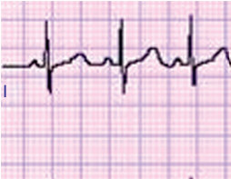

• Fig. 78.1 Sinus arrhythmia in a healthy child. Note that all P waves look exactly the same, although there is marked variation in their rate.

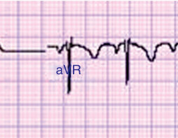

• Fig. 78.1 Sinus arrhythmia in a healthy child. Note that all P waves look exactly the same, although there is marked variation in their rate.

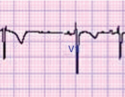

Unmatched source image; PDF page 1454. Consult the original caption.

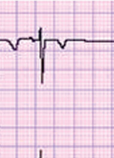

Unmatched source image; PDF page 1454. Consult the original caption.

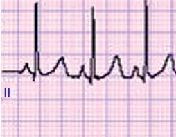

• Fig. 78.1 Sinus arrhythmia in a healthy child. Note that all P waves look exactly the same, although there is marked variation in their rate.

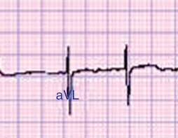

• Fig. 78.1 Sinus arrhythmia in a healthy child. Note that all P waves look exactly the same, although there is marked variation in their rate.

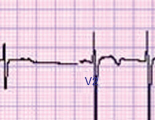

Unmatched source image; PDF page 1454. Consult the original caption.

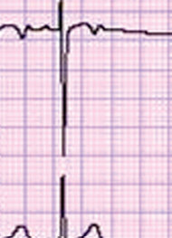

Unmatched source image; PDF page 1454. Consult the original caption.

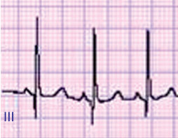

• Fig. 78.1 Sinus arrhythmia in a healthy child. Note that all P waves look exactly the same, although there is marked variation in their rate.

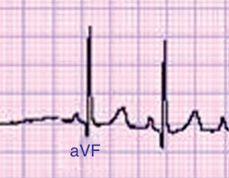

• Fig. 78.1 Sinus arrhythmia in a healthy child. Note that all P waves look exactly the same, although there is marked variation in their rate.

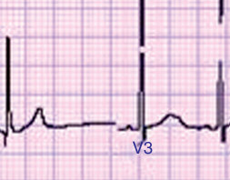

Unmatched source image; PDF page 1454. Consult the original caption.

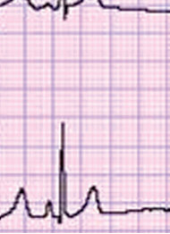

Unmatched source image; PDF page 1454. Consult the original caption.

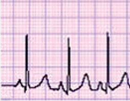

• Fig. 78.1 Sinus arrhythmia in a healthy child. Note that all P waves look exactly the same, although there is marked variation in their rate.

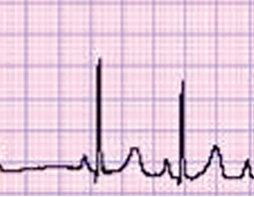

• Fig. 78.1 Sinus arrhythmia in a healthy child. Note that all P waves look exactly the same, although there is marked variation in their rate.

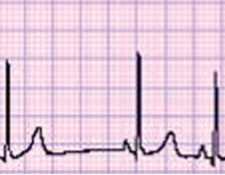

Unmatched source image; PDF page 1454. Consult the original caption.

## PDF page 1455 | printed page 1455

careful inspection of the P-wave morphology using a 12or 15-lead ECG is warranted to look for subtle changes in P-wave morphology.

Although an abnormal focus of atrial tissue is the usual cause of atrial tachycardia, mechanical stimulation of the atria can also cause an atrial tachycardia. This is seen in neonates who have an intravenous catheter with the tip located in the atrium. This catheter then creates an atrial tachycardia by directly stimulating the atria. One differential clue to the mechanism of this unique form of SVT is a very fast and irregular atrial tachycardia. A chest radiograph to visualize line position should be performed to ensure that the cause of the tachycardia is not line related before initiation of treatment.

Evaluation of an atrial tachycardia involves an ECG and Holter monitoring. Rapid, incessant AET can negatively affect ventricular function because of the heart’s inability to “rest” or slow down. Therefore an echocardiogram is usually part of the initial evaluation in the newborn period to evaluate function and rule out congenital heart disease with a dilated atrium as the cause of the atrial tachycardia. Electrolyte disturbances are a very rare cause of AET in neonates but should be corrected if present.

Treatment of AET may be attempted with medications such as beta blockers (propranolol), sodium channel blockers (flecainide), or class III antiarrhythmic medications (sotalol, amiodarone). The majority of neonatal AETs resolve in the first 6 months of life, and long-term therapy is rarely necessary. Cardiac catheterization and radiofrequency ablation (RFA) are high-risk procedures in neonates and are typically not performed except in extreme cases of medically refractory atrial tachycardia with depressed function. In very rare cases, mechanical support using extracorporeal membrane oxygenation (ECMO) is required to support the circulation until the tachycardia can be controlled or ablated.

### Atrial Flutter

Atrial flutter is a classic example of atrial reentry tachycardia. In this type of tachycardia, the circuit or substrate for reentry is the atrial myocardium located around the tricuspid valve. The area of slow conduction in this type of arrhythmia is generally located between the inferior vena cava (IVC) and the tricuspid valve annulus in an area referred to as the isthmus. The velocity of the impulse propagation is slow through the isthmus, allowing recovery of the atrial myocardium ahead of it and therefore allowing the atrial wavefront to propagate.

The typical atrial rate of neonatal atrial flutter is between 300 and 600 bpm and is much faster than the flutter seen in older children and adults. However, the ventricular rate is slower because of the decremental properties of the AV node not allowing for rapid conduction. The conduction to the ventricles is generally in a 2:1, 3:1, or 4:1 pattern (Fig. 78.2) and may vary among these conduction rates, resulting in an irregular rhythm. Occasionally, the AV conduction can be rapid, resulting in ventricular rates greater than 200 bpm, which may be poorly tolerated by the fetus and/or neonate.

In most cases, the diagnosis of atrial flutter is made with a simple surface ECG, noting the continuous sawtooth pattern of atrial activity. However, it may be necessary to administer adenosine to the patient while recording an ECG, which blocks atrial conduction down the AV node and allows for rapid, easy identification of the sawtooth pattern classically described for this arrhythmia in patients when the P waves are masked by QRS complexes or T waves.

The treatment for atrial flutter is synchronized electrical cardioversion with 0.5 to 2 J/kg. Higher joules may be required in some cases because of the relatively small surface area of the cardioversion paddles/patches in neonates.3,4 The best position for the paddles, or patches, is front to back, slightly to the left side of the chest. It may be necessary to turn the infant on its side to get the paddles into appropriate position. Rapid atrial pacing (overdrive pacing) may also be used to terminate the tachycardia, but this method can be difficult to achieve with the rapid atrial rate seen in neonatal flutter, resulting in a lower overall success rate.5,6 In addition to these two methods, antiarrhythmic medications, usually digoxin, can be loaded for 24 hours and the patient observed for up to 48 hours to see if the tachycardia terminates. This method has lower success rates when compared with synchronized cardioversion.

Atrial flutter in an otherwise healthy newborn generally does not return once the patient is converted to normal sinus rhythm, unless there is another underlying arrhythmia that caused the atrial flutter, such as atrial tachycardia. Because of this low rate of recurrence, no routine antiarrhythmic treatment is necessary for either short- or long-term treatment once the patient is in normal sinus rhythm.3–6 If the atrium is dilated, or if the patient has recurrent atrial flutter or structural heart disease, treatment with antiarrhythmic medications such as propranolol or digoxin may be warranted.

### Atrial Fibrillation

Neonatal atrial fibrillation (AFib) is an exceptionally rare dysrhythmia in this patient population and is typically seen only in patients with severe structural congenital heart disease (such as Ebstein anomaly of the tricuspid valve), an accessory pathway (Wolff-Parkinson-White [WPW]), or those with cardiac channelopathies.7

It is important to distinguish AFib from a rare form of AET called chaotic atrial tachycardia (or multifocal atrial tachycardia), because both result in an irregular tachycardia with disorganized atrial activity on the ECG. Chaotic atrial tachycardia (also referred to as multifocal atrial tachycardia) is a form of atrial tachycardia in which there are rapid bursts of tachycardia from multiple areas of the atria. AFib is an incessant arrhythmia that typically will respond to cardioversion. However, chaotic atrial tachycardia tends to occur in short bursts with sinus beats interspersed with runs of tachycardia and a varying P-wave axis. This type of tachycardia either does not respond to cardioversion or quickly returns after cardioversion.

Treatment of AFib in neonates involves synchronized cardioversion. Pediatric cardiology consultation should be

## PDF page 1456

• Fig. 78.2 Atrial flutter with 4:1 atrioventricular conduction in a 1-day-old newborn.

obtained because AFib is extremely rare in neonates and generally occurs in only the sickest neonates with other cardiac disorders. Chaotic atrial tachycardia requires medical treatment with antiarrhythmic medications such as beta blockers, flecainide, sotalol, or amiodarone, alone or in combinations, with a goal simply to control the ventricular rate, not to cure the atrial tachycardia.

### Reentrant Supraventricular Tachycardia

SVT caused by a reentrant mechanism is the most common form of SVT in this population. In a reentrant tachycardia, there are two distinct conducting pathways linked around an area of non-conducting tissue. Failure to conduct in one of these pathways (block) causes the impulse to conduct in the other and then turn around in the first pathway, creating an electrical loop that causes tachycardia (Fig. 78.3).

There are two common reentrant mechanisms of SVT seen in the neonatal population. The first, and by far the most common in newborns and infants, is caused by an accessory pathway.8 The second is because of reentry around the AV node, also known as atrioventricular nodal reentry tachycardia or AVNRT.

### Supraventricular Tachycardia Caused by a Manifest Accessory Pathway

In the normal cardiac conduction system, only a single connection exists linking atrial impulses to the ventricles, the bundle of His. The bundle of His penetrates the fibrous AV ring and is the only structure capable of conducting electrical impulses from the atria to the ventricles under normal circumstances. During normal sinus rhythm, the activation wavefront travels from the sinus node across the atrial myocardium, then to the AV node, bundle of His to the right and left bundle branches, and ultimately exiting to the ventricular myocardium, resulting in cardiac depolarization.

If an accessory pathway is present, it serves as an additional conduction pathway for electrical impulses to travel between the atria and the ventricles. Accessory pathways can conduct an impulse in both directions (antegrade, from atria to ventricles, and retrograde, from ventricles to atria) or only in one direction (exclusively antegrade or retrograde). If an accessory pathway is capable of conducting the impulse only from the ventricles to the atria (retrograde), it is referred to as a concealed accessory pathway, and the baseline ECG will appear normal. If an accessory pathway is capable of conducting an impulse from the atria to the ventricles, it is referred to as a manifest accessory pathway,9 resulting in what is known as ventricular pre-excitation on the baseline ECG. Patients with pre-excitation (also known

as WPW) have an area of early ventricular activation on their ECG. This early ventricular activation on the ECG is referred to as a delta wave, which results in a short PR interval and widened QRS complex (Fig. 78.4). Pre-excitation is present because the electrical impulse travels from the atria to the ventricles over two pathways—through the AV node/ bundle of His, which has decremental properties, and down the accessory pathway. When activation travels down the normal conduction system (AV node), a normal physiologic delay of conduction occurs. This delay in conduction is a built-in mechanism to assure that atrial systole will occur before ventricular systole. Although there is a delay in conduction (decrement) through the AV node, no such delay exists when electrical activity conducts down the manifest accessory pathway. Therefore the atrial impulse travels quickly from the atria to the ventricles across the accessory pathway and activates the ventricular myocardium before it would be activated through the normal conduction system, resulting in a delta wave on the ECG.

About 20% of patients with WPW have underlying structural heart disease (most commonly Ebstein anomaly); therefore an echocardiogram should be performed at some point after the diagnosis is made. WPW syndrome is sporadic in the vast majority of cases, but there is a rare hereditary cause, occurring in about 1 to 3 per 1000 individuals.10

Patients with a manifest accessory pathway, or WPW, have an increased risk of AFib for reasons that, to date, are not well understood. If AFib occurs in a patient with WPW, an irregularly irregular, wide complex tachycardia ensues (Fig. 78.5). In infants and neonates, there are almost no other causes of an irregularly wide complex tachycardia other than AFib in the presence of an accessory pathway, although this occurrence is extremely rare in infants and neonates. Patients with WPW and AFib also have the risk of sudden cardiac death.11 In AFib, these accessory pathways may conduct atrial impulses rapidly to the ventricles, resulting in rapid ventricular activation that may result in ventricular fibrillation and cardiac arrest. For this reason, adenosine, which blocks AV nodal conduction, should be used in a controlled environment by an individual with knowledge of how to resuscitate an infant in cardiac arrest. In addition, the use of digoxin and calcium channel blockers, medications that block AV nodal conduction, are relatively contraindicated in patients with WPW.

### Supraventricular Tachycardia Caused by a Concealed Accessory Pathway

Patients with a concealed accessory pathway are at risk of developing SVT secondary to a reentrant mechanism.12,13 SVT is usually initiated by a premature atrial or ventricular

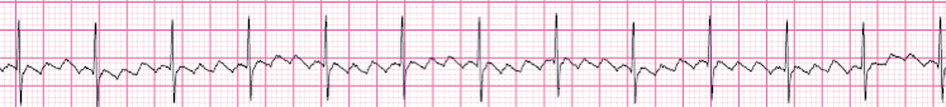

• Fig. 78.2 Atrial flutter with 4:1 atrioventricular conduction in a 1-day-old newborn.

## PDF page 1457 | printed page 1457

A

C • Fig. 78.3 Reentrant supraventricular tachycardia: (A) Normal conduction down both sides of a reentrant circuit. The electrical impulses collide and there is no reentry. (B) Block in one pathway and conduction in the other. (C) The impulse from the conducting pathway reaches the other pathway. (D) This pathway now conducts, setting up an electrical circuit of reentrant tachycardia.

• Fig. 78.4 Electrocardiogram of a patient with Wolff-Parkinson-White syndrome shows a short PR interval, widened QRS, and slurring of the upstroke of the QRS.

• Fig. 78.5 Pre-excited atrial fibrillation in a patient with Wolff-Parkinson-White syndrome. Note the irregularly irregular wide complex rhythm.

contraction. The premature beat will block in one of these two conduction pathways—the accessory pathway or the AV node. If the premature beat blocks in the accessory pathway, the activation wavefront travels down the normal conduction system (AV node and bundle of His) to the ventricles. The conduction wavefront then passes through the

B

Dventricular myocardium. The wavefront then reaches the accessory pathway, which has had time to recover and is able to conduct electrical impulses. The electrical impulse travels retrograde, from the ventricle to the atria, then back down the AV node to perpetuate the tachycardia. This type of tachycardia, known as orthodromic tachycardia, is generally

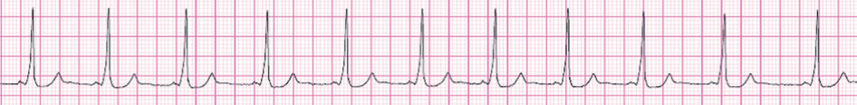

• Fig. 78.4 Electrocardiogram of a patient with Wolff-Parkinson-White syndrome shows a short PR interval, widened QRS, and slurring of the upstroke of the QRS.

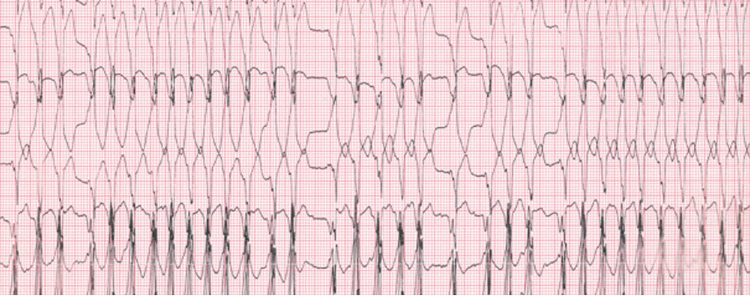

• Fig. 78.5 Pre-excited atrial fibrillation in a patient with Wolff-Parkinson-White syndrome. Note the irregularly irregular wide complex rhythm.

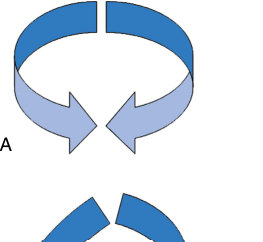

• Fig. 78.4 Electrocardiogram of a patient with Wolff-Parkinson-White syndrome shows a short PR interval, widened QRS, and slurring of the upstroke of the QRS.

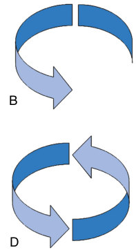

Unmatched source image; PDF page 1457. Consult the original caption.

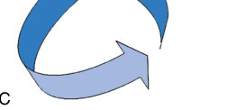

• Fig. 78.4 Electrocardiogram of a patient with Wolff-Parkinson-White syndrome shows a short PR interval, widened QRS, and slurring of the upstroke of the QRS.

## PDF page 1458

a narrow complex in nature because it travels down the normal conduction system to get to the ventricles. Each of the components of this circuit is integral to allow for propagation of the tachycardia, and disruption of the circuit in any of the limbs will terminate the tachycardia (Fig. 78.6).

### Supraventricular Tachycardia Caused by Atrioventricular Nodal Reentry Tachycardia

A third form of reentrant tachycardia seen in neonates is AVNRT. In this form of SVT, the entire circuit is contained within the proximal portion of the AV node, and no true accessory pathway is present. Its reentry circuit is located between the slow and fast limbs of the AV node.14,15 In most individuals, the AV node has both of these inputs, which coalesce to form the compact AV node, which then continues to the bundle of His. Because slow and fast pathways have different conduction properties, a reentry tachycardia between these inputs can and often does occur. The resulting tachycardia is AV nodal reentry. Because AVNRT has a reentry mechanism, it is usually started by a premature atrial or ventricular beat. On ECG, it usually presents as a narrow complex tachycardia that is indistinguishable from an accessory pathway-mediated tachycardia. AVNRT has a developmental component and is rare in neonates and infants but is relatively common as a mechanism of tachycardia in older teenagers and adults.8

### Supraventricular Tachycardia

The clinical presentation of SVT in neonates or infants, regardless of the cause (AVRT or AVNRT), is the same, with a rapid increase in heart rate and narrow complex tachycardia on their ECG. Ventricular rates are greater than 200 bpm, but rates as fast as 300 bpm can be seen. It is rare to have a sinus rate greater than 220 bpm, and any rate exceeding this number should raise the possibility for the presence of an abnormal mechanism of tachycardia, including reentrant SVT.

In the neonatal period, it is not uncommon for SVT to present as a wide complex tachycardia, generally with a left bundle branch block. In this situation, this aberrant conduction is caused by the prolonged recovery or refractory period of one of the bundles, right or left. The differential diagnosis for a wide complex tachycardia in a newborn is ventricular tachycardia (VT) or SVT with aberrancy, with SVT with aberrancy being much more common in this very young population.

V5

• Fig. 78.6 Baseline electrocardiogram (first 10 beats) shows pre-excitation. The QRS complex #11 (arrow) represents premature atrial contraction followed by a reentrant narrow complex tachycardia (orthodromic supraventricular tachycardia).

In patients with either a concealed accessory pathway or AVNRT, the major clinical manifestation is a rapid heart rate, which is discovered either by auscultation or by monitoring. Occasionally, infants can present with depressed myocardial function if the tachycardia is persistent. Infants generally tolerate these rapid heart rates for hours to days, manifesting generalized symptoms such as poor feeding and irritability. Patients with WPW (manifest accessory pathway) may be diagnosed when tachycardia occurs or if preexcitation is noted on a monitor or routine ECG. Many patients with WPW are also asymptomatic, meaning they have evidence of WPW on their ECG but no evidence of tachycardia or syncope, and these patients do not require medical treatment.16 They should be followed by a pediatric cardiologist or electrophysiologist to ensure that SVT does not develop, but up to 80% have spontaneous resolution of their pre-excitation within the first year of life.17

If a patient presents with an acute episode of SVT, the goal is to terminate the tachycardia in the most humane, stable way in an environment where rapid intubation, cardioversion, and resuscitation can be carried out. If the patient is hemodynamically unstable, the doctor must decide which method of cardioversion is immediately available, whether adenosine or direct current cardioversion. The doctor must also be prepared to intubate the patient and have intravenous pressors and even ECMO available to support the infant afterward. The typical dose required to cardiovert a neonate is between 0.5 and 1 J/kg, but larger doses may be required, particularly in smaller neonates. If there is a QRS complex that is generating a pulse, the cardioversion should be synchronized to the QRS complex.

If the patient is hemodynamically stable, other methods should be attempted before heading directly to electrical cardioversion. Automated blood pressure machines may not register an accurate blood pressure in the face of a rapid tachycardia, and other methods of assessing cardiac output such as skin perfusion, level of consciousness, and peripheral pulses may be needed to determine if adequate perfusion is occurring. The first line of therapy in the hospital used for cardioversion in a neonate is either adenosine administration or vagal stimulation. Vagal stimulation slows conduction through the AV node and interrupts a reentrant SVT. An effective maneuver frequently used to convert infants is placing a small bag or glove filled with ice over the entire face for 10 to 15 seconds. To elicit the appropriate diving seal reflex, the majority of the face/mouth and nose must be covered. Care must be exercised not to cause frostbite to the

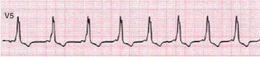

• Fig. 78.6 Baseline electrocardiogram (first 10 beats) shows pre-excitation. The QRS complex #11 (arrow) represents premature atrial contraction followed by a reentrant narrow complex tachycardia (orthodromic supraventricular tachycardia).

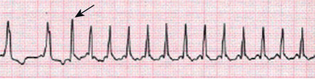

Unmatched source image; PDF page 1458. Consult the original caption.

## PDF page 1459 | printed page 1459

delicate neonatal skin from prolonged or repeated ice exposure. Holding a child upside down (with proper support) can also induce a vagal response. Gagging, ocular pressure, and anal stimulation in general should be avoided.

If the child is in the hospital, intravenous (IV) adenosine (0.1–0.4 mg/kg/dose) would generally be the recommended step to convert the infant/neonate back into normal rhythm. Adenosine must be administered in a rapid IV push followed by a 5 to 10 cc bolus of normal saline or Ringer lactate. This form of cardioversion is extremely effective, resulting in normalization of the neonate’s rhythm in the vast majority of cases.

The use of IV digoxin has fallen out of use since the advent of adenosine. The use of IV (or oral) calcium channel blockers is relatively contraindicated in patients under a year of age because there have been reports of sudden deaths, likely caused by the extreme sensitivity of the infantile conduction system to calcium. The use of IV amiodarone is included in Pediatric Advanced Life Support (PALS) and Neonatal Advanced Life Support (NALS) algorithms, but the use of this medication should be reserved for the conversion of refractory cases of SVT and is best administered in conjunction with consultation by a pediatric cardiologist who can assist with the long-term management of the patient, especially considering that the half-life of amiodarone can be up to 90 days in a neonate.

The long-term goal of treatment is to prevent SVT recurrence. Around 60% to 80% of SVTs that present in the neonatal period resolve spontaneously within the first year of life.18,19 In general, medical treatment is recommended after a single episode of tachycardia for the vast majority of cases. The usual duration of medical treatment for SVT is approximately 1 year, with some pushing for shorter (6 months) of total treatment.20 In older patients, generally around 15 kg, there is the option of performing an electrophysiology study and ablation of their mechanism of tachycardia. The risks of this procedure are significantly higher when performed in children under 4 years of age or less than 15 kg.21 For this reason, ablations in neonates and infants are reserved for those patients with drug-refractory tachycardias and decreased function in whom no other options exist.

Beta blockers such as propranolol are a generally safe and quite effective first-line medical therapy for the treatment of SVT. Propranolol is dosed at 2–4 mg/kg/day or 0.5–1 mg/kg/dose, dispensed every 6 hours or every other feed in a neonate. Once the infant begins sleeping through the night, the dosing can be spaced out to every 8 hours. Some centers also use digoxin, another relatively effective firstline agent in the treatment of SVT. Digoxin is frequently used to successfully treat fetal tachycardias. Digoxin is generally dosed at 4 to 5 μg/kg/dose given twice a day.

Second-line agents for the treatment of neonatal tachycardias, when propranolol and/or digoxin have failed to completely control the arrhythmia, include sotalol, flecainide, or amiodarone.22,23 Each of these potent medications are extremely effective in the treatment of neonatal tachycardias, but all have potential side effects. Before the

use of any of these medications alone or in combination, consultation with a pediatric cardiologist and/or electrophysiologist is recommended.

### Permanent Form of Junctional Reciprocating Tachycardia

A unique type of accessory pathway–mediated tachycardia is the permanent form of junctional reciprocating tachycardia (PJRT). Initially, this tachycardia was thought to arise from the AV junction, but it is actually caused by a concealed, slowly conducting retrograde-only accessory pathway. Because these accessory pathways conduct very slowly, the tachycardia presents with P waves clearly visible on the surface ECG.24 The ECG in tachycardia has a characteristic morphology with deeply negative P waves in the inferior leads II, III, and aVF (Fig. 78.7).

This type of tachycardia is frequently present immediately after birth, but because of its slow rate (potentially as slow as 150 bpm), it may not be noted during examinations in newborns and infants. In addition, the tachycardia has P waves before each QRS complex, which may be mistaken for sinus rhythm if it is not recognized that the atrial impulse is not coming from the sinus node (sinus P waves should be positive in leads I, II, and aVF). PJRT also tends to be an incessant tachycardia with minimal variation in the heart rate and may lead to a tachycardia-induced cardiomyopathy if left untreated. There may be spontaneous termination of the tachycardia followed by several sinus beats with spontaneous re-initiation (Fig. 78.8).

Treatment of PJRT in the neonatal and infantile periods is typically done with antiarrhythmics. Beta blockers may be initiated but are frequently ineffective. Flecainide is currently the treatment of choice for this incessant tachycardia, and it is often effective, even after a single dose. Ultimately, the vast majority of these patients will require an ablation when they are older because this form of tachycardia does not resolve spontaneously.

### Junctional Ectopic Tachycardia

In patients with junctional ectopic tachycardia (JET), the focus of tachycardia is located within the bundle of His (most commonly) or proximal bundle branches (very rarely). The mechanism of JET is caused by increased automaticity in this region.15 JET can be either congenital, of which many are of genetic etiology, or acquired, which occurs after congenital cardiac surgery. Congenital JET is rare but very frequently leads to arrhythmia or tachycardiainduced cardiomyopathy, resulting from its incessant and rapid rates upward of 260 bpm. Congenital JET generally presents in fetuses, neonates, and infants less than 6 months of age and is likely to be incessant, have faster rates, and have an associated mortality rate of greater than 50% (Fig. 78.9).25,26

Postoperative JET is seen in patients who have undergone surgical repair of congenital heart defects. The cause of JET in these patients is multifactorial and is thought to be caused by swelling/edema, electrolyte imbalances,

## PDF page 1460

IaVR

V1

II

aVL

V2

aVF V3

III

• Fig. 78.7 Electrocardiogram in a patient with permanent form of junctional reciprocating tachycardia shows a narrow complex tachycardia with negative P waves in the inferior leads II, III, and aVF.

catecholamine surges, and use of certain pressor medications such as epinephrine and dopamine, as well as longer aortic cross clamp and bypass times. As the localized edema or the electrolyte or catecholamine imbalance resolves, the JET will frequently subside. If not, short-term medical management with amiodarone or procainamide is warranted.

Because the focus of tachycardia is located within the His complex, the QRS complexes are expected to be narrow and identical to the sinus QRS.27 Because the focus of the tachycardia is located within the bundle of His, the relationship between the atria and ventricles is variable. The typical presentation of this tachycardia is no association between the P waves and the QRS complexes on the ECG (ventriculoatrial [VA] dissociation), with the narrow ventricular rate being faster than the atrial rate. However, in the majority of pediatric cases, there is retrograde conduction through the AV node, resulting in 1:1 VA conduction, or VA Wenckebach is present with the P wave occurring simultaneously with the QRS complex. The tachycardia typically has minimal response to adenosine other than it can be used to disassociate the atrium from the ventricle, with continuity of the tachycardia at the same rate.

Congenital JET is a rare, life-threatening tachycardia that may not respond to any form of intervention. The current medical management for JET is to remove additional catecholamines and initiate amiodarone, which is currently considered the most effective antiarrhythmic agent available. Over time, two additional medications have also come into favor for the treatment of JET: ibutilide and sotalol in its IV form. Both of these medications have been shown to be effective in the treatment, but both have side effects that

V4

V5

V6

should warrant a pediatric cardiologist or electrophysiologist before use.

Post-operative JET generally resolves within 3 to 5 days after surgical repair. The decision to treat or not to treat these fragile neonates depends on the overall patient status. The heart rate during JET generally is in the range of 150 to 170 bpm, but the main question is whether the patient is hemodynamically stable. If so, then no specific treatment is required. In post-operative neonates, when JET does affect hemodynamic status, the following steps should be taken: 1. Treat fever and/or cool the patient. 2. Decrease/wean all catecholamines. 3. Initiate atrial pacing at rates faster than the JET rate to

restore AV synchrony. 4. Administer amiodarone, sotalol, or procainamide intra-

venously for at least 48 hours.

### Ventricular Arrhythmias

### Premature Ventricular Contractions

A premature ventricular contraction (PVC) is a spontaneous depolarization of the ventricular myocardium that results in an early or premature beat (Fig. 78.10). PVCs in infants or neonates may not have as wide of a QRS duration as seen in older patients, but they frequently have a morphology that is different and wider than that of the normal sinus QRS. Intermittent pre-excitation or an aberrantly conducted PAC are in their differential diagnosis, but these can be ruled out with a simple ECG. PVCs in neonates with a structurally normal heart typically have a benign prognosis and do not require any form

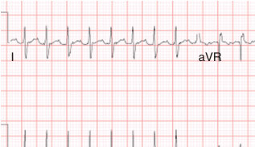

• Fig. 78.7 Electrocardiogram in a patient with permanent form of junctional reciprocating tachycardia shows a narrow complex tachycardia with negative P waves in the inferior leads II, III, and aVF.

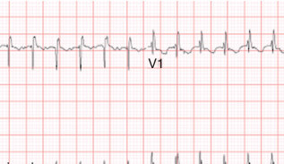

• Fig. 78.7 Electrocardiogram in a patient with permanent form of junctional reciprocating tachycardia shows a narrow complex tachycardia with negative P waves in the inferior leads II, III, and aVF.

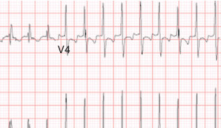

Unmatched source image; PDF page 1460. Consult the original caption.

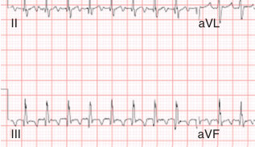

• Fig. 78.7 Electrocardiogram in a patient with permanent form of junctional reciprocating tachycardia shows a narrow complex tachycardia with negative P waves in the inferior leads II, III, and aVF.

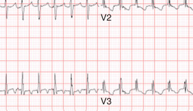

• Fig. 78.7 Electrocardiogram in a patient with permanent form of junctional reciprocating tachycardia shows a narrow complex tachycardia with negative P waves in the inferior leads II, III, and aVF.

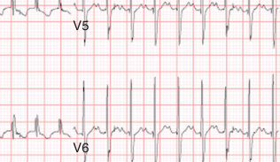

Unmatched source image; PDF page 1460. Consult the original caption.

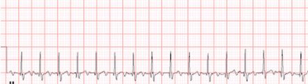

• Fig. 78.7 Electrocardiogram in a patient with permanent form of junctional reciprocating tachycardia shows a narrow complex tachycardia with negative P waves in the inferior leads II, III, and aVF.

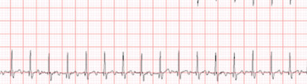

Unmatched source image; PDF page 1460. Consult the original caption.

## PDF page 1461 | printed page 1461

aVR

IaVL

aVF III

*

I

### • Fig. 78.8 Permanent form of junctional reciprocating tachycardia with deeply negative P waves in leads

II, III, and aVF. Note the spontaneous termination followed by a sinus beat (denoted by *) and reinitiation of the tachycardia, with the first beat of tachycardia being aberrantly conducted (arrow), seen on the rhythm strip at the bottom of the electrocardiogram.

### • Fig. 78.9 Narrow-complex tachycardia with ventriculoatrial dissociation (no relationship between the P

waves and QRS complexes) diagnostic of junctional ectopic tachycardia.

V1

V2

V3

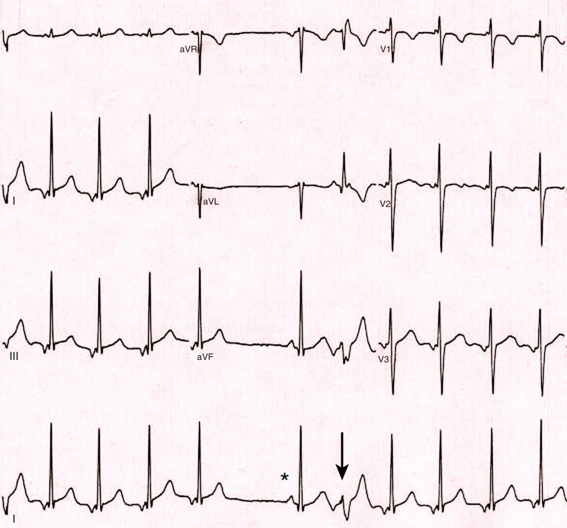

• Fig. 78.8 Permanent form of junctional reciprocating tachycardia with deeply negative P waves in leads II, III, and aVF. Note the spontaneous termination followed by a sinus beat (denoted by *) and reinitiation of the tachycardia, with the first beat of tachycardia being aberrantly conducted (arrow), seen on the rhythm strip at the bottom of the electrocardiogram.

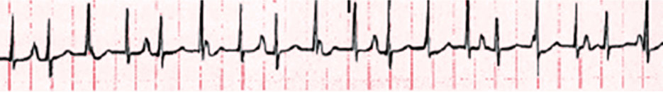

• Fig. 78.9 Narrow-complex tachycardia with ventriculoatrial dissociation (no relationship between the P waves and QRS complexes) diagnostic of junctional ectopic tachycardia.

## PDF page 1462

aVR

V1

aVL

V2

aVF

V3

V5

• Fig. 78.10 A patient with a structurally normal heart and frequent monomorphic premature ventricular contractions in bigeminy pattern.

of treatment. Exceptionally rarely, PVCs may cause symptoms or a decrease in systolic function if they occur with an extremely high frequency.

### Characteristics of Benign Premature Ventricular Contractions

1. Lack of symptoms 2. Structurally normal heart and normal cardiac function

by echocardiogram 3. Disappearance of PVCs at faster heart rates 4. Negative family history for sudden death or inherited

arrhythmia disorder

### Evaluation

PVCs in this population are generally heard on physical exam as either an extra or skipped beat, or they may be found during routine monitoring on babies in the newborn nursery or intensive care unit for other reasons. The standard for evaluation of PVCs is first an ECG to make the appropriate diagnosis, then a 24-hour Holter monitor to quantify the burden of ventricular ectopy and to evaluate for VT (three or more PVCs in a row). It is reasonable to perform an echocardiogram on selected patients with PVCs to evaluate for the presence of congenital heart disease and to assess ventricular function. It is very rare for electrolyte abnormalities or hyperthyroidism to result in PVCs, but these, plus the placement of all intravenous lines, should be evaluated if clinically indicated.

V4

V5

V6

### Treatment

The vast majority of infants and neonates with isolated PVCs and a negative family history for sudden cardiac death or channelopathies require no treatment. The only recommendation is that these patients follow up with a pediatric cardiologist within their first 3 to 6 months of life to assess if the PVCs are still present. If they persist, the pediatric cardiologist may wish to place another 24-hour Holter monitor and potentially re-evaluate their cardiac function if PVCs remain frequent.

### Ventricular Tachycardia

VT is a rhythm disturbance that originates below the bifurcation of bundle of His. This typically presents with a wide complex rhythm, which in neonates constitutes a QRS duration of greater than 80 ms (Fig. 78.11). Any time one is faced with a patient with VT, one must differentiate it from the benign rhythm called accelerated ventricular rhythm or idioventricular rhythm. Idioventricular rhythm is characterized by its rate, which by definition is no more than 20% faster than the underlying sinus rate, and the patient is asymptomatic and hemodynamically stable. This rhythm is almost always considered benign and requires no intervention.28 In infants with structurally normal hearts, true VT is quite rare and generally has a benign prognosis. However, there are VTs that are either so fast or so frequent that they may affect the patient’s hemodynamics and cardiac function and require aggressive treatment.

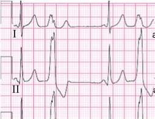

• Fig. 78.10 A patient with a structurally normal heart and frequent monomorphic premature ventricular contractions in bigeminy pattern.

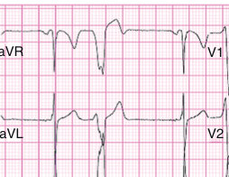

• Fig. 78.10 A patient with a structurally normal heart and frequent monomorphic premature ventricular contractions in bigeminy pattern.

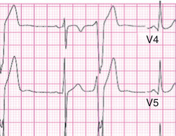

Unmatched source image; PDF page 1462. Consult the original caption.

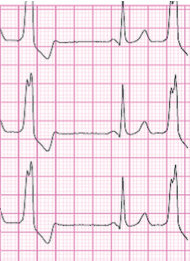

Unmatched source image; PDF page 1462. Consult the original caption.

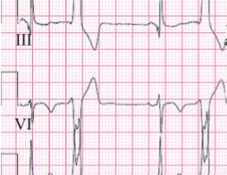

• Fig. 78.10 A patient with a structurally normal heart and frequent monomorphic premature ventricular contractions in bigeminy pattern.

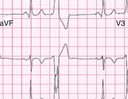

• Fig. 78.10 A patient with a structurally normal heart and frequent monomorphic premature ventricular contractions in bigeminy pattern.

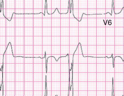

Unmatched source image; PDF page 1462. Consult the original caption.

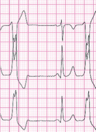

Unmatched source image; PDF page 1462. Consult the original caption.

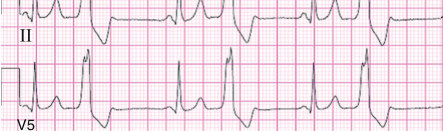

• Fig. 78.10 A patient with a structurally normal heart and frequent monomorphic premature ventricular contractions in bigeminy pattern.

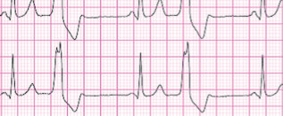

Unmatched source image; PDF page 1462. Consult the original caption.

## PDF page 1463 | printed page 1463

23 days Male Test ind:VT

235 Vent rate PR interval QRS duration QT/QTc P-R-T axes

BPM

* 156 250/494 * 99

ms ms ms -83

** All leads at half standard **

IaVR V1

II

aVL

V2

III aVF

V3

II

• Fig. 78.11 A 15-lead electrocardiogram in a 23-day-old patient with a structurally normal heart with ventricular tachycardia. Note the relatively narrow QRS complex.

In neonates with structurally normal hearts, VT generally is caused by an automatic focus. The focus of the tachycardia is frequently from the outflow tract (most commonly the right ventricular outflow tract) or one of the fascicles in the left ventricle (most commonly the left posterior fascicle). Additional, yet rare, causes of neonatal VT are myocardial hamartomas or tumors. These extremely rare causes of neonatal VT tend to be incessant and extremely difficult to control with medications. However, if the tachycardia can be controlled, hamartomas frequently regress in the first several years of life, but some cardiac tumors require surgical resection.

Infants with poor ventricular function (e.g., patients with neonatal myocarditis) or structural cardiac disease can also present with VT; therefore it is very important to assess these patients with a complete echocardiogram and possibly a cardiac MRI before the initiation of any form of treatment to help assess the overall patient’s status and potentially get clues as to the longevity of treatment and the patient’s prognosis.

### Treatment

1. In children with a structurally normal heart, the type of

therapy usually depends on the stability of the patient and the rate and frequency of the tachycardia. In asymptomatic individuals with idioventricular rhythm, no therapy is required, but close follow-up is recommended.

V4 V3R

V4R

V5

V6 V7

Frequently, this type of ventricular dysrhythmia resolves in the first several months of life. 2. In patients with rapid (above 200–220 bpm) or fre-

quent VT and normal ventricular function, therapy with beta blockers, generally propranolol at 0.5–1 mg/kg/ dose every 6 hours, is the initial choice. If propranolol is ineffective, or beta blockers are contraindicated, then treatment with flecainide, sotalol, or amiodarone may be used, with close follow-up for potential side effects. 3. In children with very fast or incessant tachycardia, or in

those with decreased ventricular function, rapid control of tachycardia is important. This is best achieved with the use of intravenous medications such as amiodarone, lidocaine, or sotalol. Long-term therapy of neonatal VT depends on its underlying cause. Many neonatal VTs resolve spontaneously within the first several months to years of life. RFA is an option to treat those patients with refractory tachycardia, but it is generally not performed in these patients except under the direst of circumstances because of the risk in patients this age. If a hamartoma or tumor is identified, surgical excision should be considered because these tumors’ borders or edges are frequently visible to the naked eye on the ventricular myocardium and removing them often eliminates the tachycardia. In neonates with poor ventricular function and VT, these patients may require ventricular assistance until cardiac function recovers. In severe cases, ECMO may be

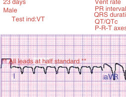

• Fig. 78.11 A 15-lead electrocardiogram in a 23-day-old patient with a structurally normal heart with ventricular tachycardia. Note the relatively narrow QRS complex.

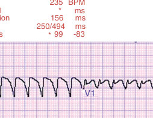

• Fig. 78.11 A 15-lead electrocardiogram in a 23-day-old patient with a structurally normal heart with ventricular tachycardia. Note the relatively narrow QRS complex.

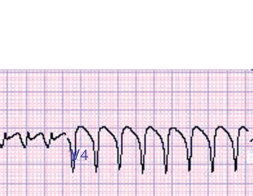

Unmatched source image; PDF page 1463. Consult the original caption.

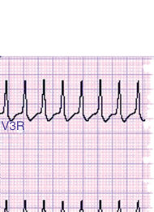

Unmatched source image; PDF page 1463. Consult the original caption.

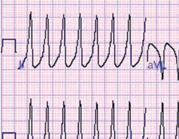

• Fig. 78.11 A 15-lead electrocardiogram in a 23-day-old patient with a structurally normal heart with ventricular tachycardia. Note the relatively narrow QRS complex.

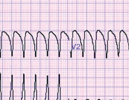

• Fig. 78.11 A 15-lead electrocardiogram in a 23-day-old patient with a structurally normal heart with ventricular tachycardia. Note the relatively narrow QRS complex.

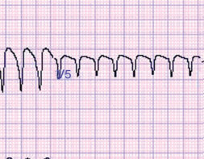

Unmatched source image; PDF page 1463. Consult the original caption.

Unmatched source image; PDF page 1463. Consult the original caption.

• Fig. 78.11 A 15-lead electrocardiogram in a 23-day-old patient with a structurally normal heart with ventricular tachycardia. Note the relatively narrow QRS complex.

• Fig. 78.11 A 15-lead electrocardiogram in a 23-day-old patient with a structurally normal heart with ventricular tachycardia. Note the relatively narrow QRS complex.

Unmatched source image; PDF page 1463. Consult the original caption.

## PDF page 1464

required to sustain perfusion until the arrhythmias can be controlled.

Implantable cardioverter-defibrillator (ICD) therapy is quite difficult in this size of patient, at least in part because of the size and bulk of the devices. Their placement is typically not possible in neonates and small infants because of the large size of the ICD, ICD lead, and coil necessary for the system to function properly, but it has been done.29 The implant of these life-saving devices can be considered in children less than 1 year who are at high risk for recurrent, life-threatening ventricular arrhythmias such as long QT syndrome (LQTS) with multiple VT/fibrillation episodes, but this procedure is quite difficult and requires a very knowledgeable team consisting of a pediatric electrophysiologist and cardiovascular surgeon. Placing an ICD in young children is typically done by an epicardial approach requiring a median sternotomy to position. The shocking coil can be placed either over the heart or outside the pericardium, or arrays can be placed in the subcutaneous tissue that will allow for the appropriate delivery of energy to the patient.

### Toxicities and Depletions

Hyperkalemia, medication overdosing, and other metabolic disturbances such as acidosis or hypoxemia can affect ventricular depolarization and myocardial function and result in arrhythmias. Neonates, particularly the most premature ones, may be more susceptible to these conditions, and recognizing this and the ECG characteristics of each of these conditions is important. The hallmark feature of severe electrolyte or acid-base disturbances is a loss of delineation between the QRS complex and the T wave. This ultimately results in a “sine wave” pattern on the ECG.30 Additional abnormalities caused by electrolyte excess include a peaked appearance of T waves, ST segment elevation, and prolongation of the QT interval (Fig. 78.12). Recognition of these patterns, especially in premature neonates, allows for rapid treatment to correct the underlying disturbance, because antiarrhythmic medications are generally not helpful in these situations. For hyperkalemia, treatment depends on the severity of the hyperkalemia and ranges from removal of supplemental potassium to calcium gluconate, administering glucose, and insulin to dialysis.

### Tachycardia-Induced Cardiomyopathy

In some cases, incessant tachycardia can result in a decrease in the patient’s ventricular function. When dysfunction occurs, it is often described as severe. It is important to perform an echocardiogram on all neonates with tachycardia episodes if the duration of the episode is unknown to evaluate their ventricular function or contractility and to evaluate for underlying structural abnormalities. Any form of tachycardia, be it SVT or VT, can result in depressed cardiac function if the rate is fast enough and the duration is long enough. Knowing the patient’s function, by performing a

quick function check before cardioversion, is a critical part of the planning for this procedure and can assist with the patient’s outcome post-cardioversion. Rarely, these patients’ function is so bad before cardioversion that they may require intubation and even circulatory assistance with either pressors or ECMO.31,32

### Atrioventricular Conduction Disturbances

During normal sinus rhythm, the electrical activation wavefront initiates from the sinus node to activate the right and left atria. The activation wavefront reaches the AV node, bundle of His (the only structure penetrating the fibrous AV annulus connecting atria and ventricles), and finally travels to the right and left bundle branches to activate the right and left ventricle correspondingly. There is typically a delay as the impulse goes through the AV node and bundle of His, and this delay creates the PR interval noted on the ECG in neonates.

### First-Degree Atrioventricular Block

First-degree AV (FAV) block is manifested by prolongation of the PR interval on the ECG while each sinus or atrial beat reaches the ventricles (Fig. 78.13). To make the diagnosis of FAV in the newborn or neonate, the PR interval needs to measure longer than 160 ms. The PR interval reflects the time from initiation of atrial activation, plus the travel time through the atrial tissue and the AV node. Any delay of impulse propagation at any level during this activation will result in prolongation of the PR interval and the diagnosis of FAV. Although this is referred to as first-degree heart block, it is not a true block within the conduction system, and a better terminology is “prolonged AV conduction.”

The AV node, similar to the sinus node, receives innervation from both parasympathetic and sympathetic nervous systems. Increased parasympathetic or vagal tone often leads to a delay in impulse conduction through the AV node. This increase in vagal tone is the most common cause of firstdegree heart block. A first-degree block frequently resolves when a catecholamine or sympathetic surge is present. The abnormal or non-physiologic reasons for PR prolongation in a neonate are cardiomyopathies, congenital heart disease (Ebstein anomaly, primum atrial septal defect, and AV canal), and medications like digoxin.

No treatment is indicated for FAV block. In cases in which a significant PR prolongation is seen, periodic follow-up may be indicated to ensure that a more advanced block does not develop. An increase in vagal tone that can be seen with reflux or apnea can result in transient prolongation of the PR interval with rapid normalization after the episode. Secondary causes such as this should be evaluated for in patients that experience episodic PR prolongation. In the neonatal period, persistent PR prolongation is uncommon and should warrant evaluation, including an echocardiogram to evaluate for structural abnormalities or myocarditis.

## PDF page 1465 | printed page 1465

aVR

V1

aVL

V2

aVF V3

• Fig. 78.12 Electrocardiogram in a patient with hyperkalemia (potassium level of 11 mEq/L). Note the sine wave pattern (particularly in lead V1) with no distinction between the QRS and T waves.

• Fig. 78.13 Example of first-degree atrioventricular block.

### Second-Degree Atrioventricular Block

In patients with second-degree AV block, some but not all of the sinus beats conduct to the ventricles. On the ECG, this results in some of the P waves not being followed by a QRS complex.

Second-degree AV block is usually divided into two forms, type 1 and type 2 block. Type 1 second-degree AV block is also referred to either Wenckebach or Mobitz type I. The ECG in patients with Wenckebach shows progressive lengthening of the PR interval until one QRS is not conducted or is “dropped.” The next conducted beat typically will have a normal PR interval (Fig. 78.14). Wenckebach frequently is a physiologic phenomenon and is caused by increase in vagal tone, which can be seen in normal sleeping infants. As common as this disorder is, it is relatively rare in neonates and requires further evaluation with a Holter monitor and a cardiology consult to determine if there are any other causes. The same potential causes for sinus bradycardia also apply to Wenckebach, and careful observation for reflux, apnea, or seizures is indicated.

V4

V3R

V5

V4R

V6 V7

Second-degree type 2 AV block, or Mobitz type II, is another conduction abnormality that is almost never seen in the neonatal population. This type of block involves the failure of propagation of a P wave without prolongation of the PR interval before the block. Careful measurement of the PR interval is essential to determine the difference between type 1 and type 2 AV block in neonates because the prolongation of the PR interval may be only a few milliseconds in type 1 AV block. Type 2 second-degree AV block is abnormal and requires pacemaker implantation.9

### Third-Degree Atrioventricular Block

In the patients with third-degree or complete AV block (Fig. 78.15), there is no conduction of sinus beats from the atria to the ventricles caused by abnormality of the AV node or bundle of His or the bundle branches. In this situation, ventricular activation will depend on the underlying junctional or ventricular escape rhythm that initiated below the level of the block. The underlying junctional rhythm is typically a narrow complex, coming from a junctional focus. If the

• Fig. 78.12 Electrocardiogram in a patient with hyperkalemia (potassium level of 11 mEq/L). Note the sine wave pattern (particularly in lead V1) with no distinction between the QRS and T waves.

• Fig. 78.13 Example of first-degree atrioventricular block.

## PDF page 1466

V1

• Fig. 78.14 Patient with type 1, second-degree heart block during sleep. Progressive PR prolongation is seen until QRS complex drop.

• Fig. 78.15 Complete atrioventricular (AV) block with AV dissociation and a narrow complex junctional escape rhythm.

escape rhythm originates from below the His bifurcation, the QRS will be wide.

To make the diagnosis of complete AV block, there should be no relationship between the atria and ventricles (AV dissociation) at any time. The atrial rate should be faster than the ventricular rate, and there should be P waves present that should conduct but do not. It is frequently necessary to obtain a long ECG strip or Holter monitor to confirm the diagnosis because the atrial rate and ventricular rate may be similar, giving the appearance of AV conduction when actually none is present.

A complete AV block can be either acquired or congenital. The acquired form of complete AV block in neonates is usually a complication of cardiac surgery but rarely can be caused by myocarditis or endocarditis.

The congenital form of complete AV block may be seen as an isolated anomaly or in association with a congenital heart defect. As an isolated anomaly, complete AV block is seen in children born to mothers with systemic lupus erythematosus or mixed connective tissue disease, particularly Sjögren syndrome. Antibodies that are present in the mother (most commonly anti-Ro and anti-La antibodies) cross the placenta and directly affect the function of the AV node.33 The majority of mothers are asymptomatic during their pregnancy but have detectable antibodies when tested. Occasionally, there will be progression of the AV block from second degree to complete AV block during the pregnancy.

Congenital complete AV block occasionally goes unnoticed for many years in the patient if the underlying junctional rate is relatively fast, especially considering that most young patients tolerate complete AV block without symptoms.

Fetuses with complete heart block diagnosed in utero should not be delivered early solely on the basis of their heart rate. If poor ventricular function or hydrops fetalis is present, a decision should be made about delivery timing with the obstetrician, neonatologist, and pediatric cardiologist. In the immediate newborn period, assessment of hemodynamic stability should be performed immediately. Neonates

frequently tolerate heart rates as slow as 50 to 60 bpm with little or no hemodynamic compromise.34

If temporary pacing is required to assist with hemodynamic compromise, this requires insertion of either a temporary transvenous pacing lead or surgical placement of temporary pacing wire(s), because long-term transcutaneous pacing is technically challenging because of the size of the pads and the patient’s need for sedation and muscle relaxation.

Long-term treatment of third-degree AV block requires the placement of a pacemaker. In many children with congenital heart block, the pacemaker implantation can be delayed until they are older, unless there are specific indications for permanent pacemaker placement, including 35,36: 1. Presence of symptoms (intolerance of feeding, sweating

with feeds, poor weight gain, etc.) 2. Wide-complex (ventricular) escape rhythm 3. Significant pauses (more than 3 seconds or more than

two to three times the underlying basic cycle length) on Holter monitor or ECG monitoring 4. The mean heart rate below 50 bpm in patients with a

structurally normal heart or 70 bpm in patients with coexisting significant congenital heart disease 5. Either left ventricular dysfunction or greatly increased

size 6. Complex ventricular ectopy

If indicated, pacemakers can be placed using a transvenous (insertion through the subclavian vein, across the tricuspid valve into the right ventricle) or epicardial approach in which leads are directly sewn onto the epicardial surface of the heart after a sternotomy. In general, an epicardial approach is almost always used in neonates because of the small size of the veins and heart and the patient’s future growth.

### Genetic Arrhythmia Syndromes

Genetic arrhythmia syndromes are inherited disorders that lead to cardiac dysrhythmias and potentially death. The majority of these genetic disorders are categorized as channelopathies that affect myocardial ion channels (e.g.,

• Fig. 78.15 Complete atrioventricular (AV) block with AV dissociation and a narrow complex junctional escape rhythm.

## PDF page 1467 | printed page 1467

sodium, potassium, calcium) responsible for the electrical impulses within the myocardium. Disruptions in these channels result in altered electrical depolarization and repolarization, which can lead to atrial and/or ventricular arrhythmias. Examples of channelopathies include LQTS, catecholaminergic polymorphic ventricular tachycardia (CPVT), Brugada syndrome, and short QT syndrome. Although CPVT may be a potential cause of sudden infant death syndrome (SIDS), generally LQTS is likely a major culprit of neonatal arrhythmia and sudden death.

### Long QT Syndrome

Congenital LQTS is a multifaceted genetic disorder that manifests by prolongation of the corrected QT interval (QTc) on the ECG. The clinical importance of this syndrome is that it is associated with potentially lethal cardiac arrhythmias such as torsades de pointes (TdP) (Fig. 78.16). TdP is a polymorphic ventricular tachyarrhythmia that frequently degenerates into ventricular fibrillation and may lead to sudden death. Because TdP is often not sustained, the patient with LQTS may present with recurrent syncopal or seizure episodes. The syncope is the result of significantly reduced cardiac output during the arrhythmia and brain hypoperfusion resulting in true seizures.

Based on the type of channels or currents that are malfunctioning, LQTS is subdivided into multiple different subtypes. The majority of known LQT cases are caused by LQT1, LQT2, and LQT3 syndromes, and the type of mutation frequently can be determined by genetic testing.

Although patients may have a prolonged QT interval on their ECG, they may not have LQTS. There are other causes of a prolonged QT interval on the ECG, including medications (methadone, erythromycin, albuterol, etc.)

• Fig. 78.16 Episode of torsades de pointes initiation in a patient with long QT syndrome.

and electrolyte disturbances (hypocalcemia, hypokalemia). These must be evaluated as a cause or exacerbating factor for the prolongation of the QT interval on the neonate’s ECG. Drug-induced QT prolongation (particularly when the QTc is >500 ms) can result in life-threatening ventricular arrhythmias similar to congenital LQTS.

Clinical Presentation

In older patients, there are typical triggers for each of the LQTSs. The typical event triggers in patients with LQT type 1 are exercise or emotional stress. In patients with LQT type 2, symptoms are usually triggered by sudden noise (e.g., alarm clock, doorbell), but can also be caused by exercise. Patients with type 3 LQT syndrome typically become symptomatic at rest or during sleep.

In neonates, LQTS can present in a multitude of ways. It may be identified incidentally on an ECG done for another reason or done for a family history of LQTS. It may present as a pseudo or pure AV block, either complete or 2:1. In any patient with AV block, the QT interval must be carefully evaluated to ensure that an underlying diagnosis is not LQTS presenting as AV block. LQTS may also present with ventricular arrhythmias. In fact, some SIDS cases may result from arrhythmias as a result of LQTS.37,38 Any patient presenting with TdP should have a high index of suspicion for having a long QT. Other ventricular arrhythmias should warrant evaluation of the QT interval on a routine ECG.

Electrocardiogram Findings and Diagnosis

The hallmark of LQTS is prolongation of the QTc. Measuring the QT interval in newborns can be difficult because they frequently have flattened T waves, making determination

• Fig. 78.16 Episode of torsades de pointes initiation in a patient with long QT syndrome.

## PDF page 1468

of the exact end point of the T wave difficult. There may be transient prolongation of the QT interval seen immediately after birth that may resolve in the first week of life. QTc intervals greater than 500 ms should always be considered to be abnormal and require further evaluation. Intervals greater than 500 ms are likely caused by LQTS in the absence of a medication prolonging the QTc, electrolyte disturbances, or other medical conditions known to prolong the QTc interval (e.g., brain injury). In the immediate newborn period, QTc intervals are typically less than 450 ms, but those identified between 450 and 500 ms require further evaluation because many patients with QTcs in this range will not have an underlying channelopathy. However, the longer the QTc interval, the more likely it is that the patient has an abnormality causing the QT prolongation, and a QTc of greater than 500 is never normal.

By general consensus, the QTc interval is best measured in leads II and V5 on the ECG. To prevent common errors in measuring and overestimating the QT interval, the complex with a sharp T-wave ending should be selected if possible. U waves that are not greater than 50% of the height of the T wave should not be included when measuring the QT interval. Because the QT interval varies with heart rate, it must be corrected using one of several formulas. The most commonly used is Bazett formula, in which the measured QT interval is divided by the square root of the previous R to R interval (interval from one QRS complex to the next QRS complex) with all values measured in seconds (not milliseconds):

      

C

Corrected QT QT QT Interval sec / RR interval

Because LQTS is a genetic disorder, screening with an ECG of all first-degree relatives of affected individuals is recommended. If a positive genetic test is noted in the index case for a long QT mutation, genetic testing is recommended on all first-degree relatives. Genetic testing is

Key Points

• Neonates can experience all forms of arrhythmias, from

benign to life threatening. • Atrial flutter is seen in newborn babies, and the initial

treatment is synchronized cardioversion. • Intravenous adenosine is the treatment of choice for the

hospitalized neonate in supraventricular tachycardia to convert the baby back into normal rhythm.

### References

1. Uusitalo A, Tikkakoski A, Reinikainen M, et al. Extrasystoles

or short bradycardias of the newborn seldom require subsequent 24 hour electrocardiographic monitoring. Acta Paediatr. 2022;111(5):979–984. 2. Mejia E, Hoyt W, Snyder CS. Symptomatic atrial bigeminy mas-

querading as congenital complete heart block. Cardiol Young. 2021:1–3.

available and positive in at least 75% to 80% of patients with LQTS. If no genetic testing is available, ECG screening of all first-degree relatives should be performed. Genetic testing should be considered in all patients with LQTS because it may predict the course of disease and suggest medication therapy.

Treatment

All patients with LQTS should avoid medications known to have QTc prolonging effect (www.crediblemeds.org). Patients with LQTS should be started on a nonselective beta blocker (typically nadolol or propranolol) as soon as a diagnosis is made or suspected, and consultation with a pediatric cardiologist with expertise in LQTS is indicated.39,40 Neonates with AV block caused by LQTS are at a particularly high risk of life-threatening ventricular arrhythmias and sudden death. Pacing may be an effective treatment in preventing episodes of pause-dependent TdP in this population, and placement of a permanent pacemaker is generally indicated in these patients before discharge. Some have also attempted sympathectomy.41

Treatment of Torsades de Pointes

In patients who present with recurrent TdP, in addition to standard therapy, the following should be considered: 1. Discontinue any potential offending drug. Avoid amio-

darone if possible because this may further prolong the QT interval. 2. Magnesium bolus and continuous infusion even if the

serum magnesium level is normal. Magnesium decreases calcium influx, thus lowering the amplitude of early after-depolarizations (EADs), which frequently cause TdP.42,43 3. Isoproterenol can be used if magnesium is unsuccessful.

Isoproterenol may increase the baseline heart rate and may prevent bradycardia or pause-dependent episodes.

• Sixty to eighty percent of newborn supraventricular

tachycardias resolve by 1 year of age. • Not all patients born with congenital complete atrioven-

tricular block require the immediate implantation of a pacemaker.

3. Casey FA, McCrindle BW, Hamilton RM. Neonatal atrial flut-

ter: significant early morbidity and excellent long-term prognosis. Am Heart J. 1997;133:302–306. 4. Drago F, Mazza A, et al. Isolated neonatal atrial flutter: clinical

features, prognosis and therapy. G Ital Cardiol. 1998;28(4):365– 368. 5. Dunnigan A, Benson Jr W, Benditt DG. Atrial flutter in

infancy: diagnosis, clinical features, and treatment. Pediatrics. 1985;75:725–729.

## PDF page 1469 | printed page 1469

6. Mendelsohn A, Dick M, Serwer GA. Natural history of isolated

atrial flutter in infancy. J Pediatr. 1991;119:386–391. 7. Radford DJ, Izukawa T. Atrial fibrillation in children. Pediatrics.

1977;59:250–256. 8. Blaufox AD, Rhodes JF, Fishberger SB. Age related changes in

dual AV nodal physiology. Pacing Clin Electrophysiol. 2000;23(4 Pt 1):477–480. 9. Epistein A, DiMarco J, Ellenbogen K, et al. ACC/AHA/HRS

2008 guidelines for device-based therapy of cardiac rhythm abnormalities. J Am Coll Cardiol. 2008;5:21. 10. Munger TM, Packer DL, Hammill SC, et al. A population study of

the natural history of Wolff-Parkinson-White syndrome in Olmsted County, Minnesota, 1953–1989. Circulation. 1993;87(3):866–873. 11. Hein JJ, Wellens MC. The EKG in Emergency Decision Making.

2nd ed. St Louis: Elsevier; 2006. 12. Dick II M, ed. Clinical Cardiac Electrophysiology in the Young.

New York: Springer; 2006. 13. Walsh E, Saul P, Triedman J. Cardiac Arrhythmias in Children

and Young Adults with Congenital Heart Disease. Baltimore: Lippincott Williams & Wilkins; 2001. 14. Cannon B, Snyder C. Disorders of cardiac rhythm and conduc-

tion. In: Allen HD, Driscoll DJ, Shaddy RE, et al., eds. Moss and Adams’ Heart Disease in Infants, Children, and Adolescents. 8th ed. Philadelphia: Lippincott Williams & Wilkins; 2012. 15. Driscoll D. Fundamentals of Pediatric Cardiology. Philadelphia:

Lippincott Williams & Wilkins; 2006. 16. Cohen MI, Triedman JK, Cannon BC, et al. PACES/HRS expert

consensus statement on the management of the asymptomatic young patient with a Wolff-Parkinson-White (WPW, ventricular preexcitation) electrocardiographic pattern: developed in partnership between the Pediatric and Congenital Electrophysiology Society (Paces) and the Heart Rhythm Society (HRS). Endorsed by the governing bodies of PACES, HRS, the American College of Cardiology Foundation (ACCF), the American Heart Association (AHA), the American Academy of Pediatrics (AAP), and the Canadian Heart Rhythm Society (CHRS). Heart Rhythm. 2012;9(6):1006–1024. 17. Perry JC, Garson A. Supraventricular tachycardia due to Wolff-

Parkinson-White syndrome in children: early disappearance and late recurrence. J Am Coll Cardiol. 1990;16:1215–1220. 18. Deal BJ, Keane JF, Gillette PC, et al. Wolff-Parkinson-White

syndrome and supraventricular tachycardia during infancy: management and follow-up. J Am Coll Cardiol. 1985;5:130–135. 19. Wu MH, Chang YC, Lin JL, et al. Probability of supraven-

tricular tachycardia recurrence in pediatric patients. Cardiology. 1994;85:284–289. 20. Aljohani O, Herrick N, Borques A, et al. Antiarrhythmic treat-

ment duration and tachycardia recurrence in infants with supraventricular tachycardia. Pediatr Cardiol. 2021;42(3):716–720. 21. Van Hare GF, Javitz H, Carmelli D, et al. Pediatric Electro-

physiology Society. Prospective assessment after pediatric cardiac ablation: demographics, medical profiles, and initial outcomes. J Cardiovasc Electrophysiol. 2004;15(7):759–770. 22. García-García E, De Ceballos RD. Acquired hypothyroidism in a

newborn treated with amiodarone in the first week of life. Indian Pediatr. 2017;54(5):420–421. 23. Li X, Zhang Y, Liu H, et al. Efficacy of intravenous sotalol for

treatment of incessant tachyarrhythmias in children. Am J Cardiol. 2017;119(9):1366–1370.

24. Gillette P, Garson A. Clinical Pediatric Arrhythmias. 2nd ed. Phil-

adelphia: W.B. Saunders; 1999. 25. Garson A, Gillette PC. Junctional ectopic tachycardia in chil-

dren: electrocardiography, electrophysiology, and pharmacologic response. Am J Cardiol. 1979;44:298–302. 26. Villain E, Vetter VL, Garcia JM, et al. Evolving concepts in the

management of congenital junctional ectopic tachycardia: a multicenter study. Circulation. 1990;81:1544–1549. 27. Collins KK, Van Hare GF, Kertesz NJ, et al. Pediatric nonpost-

operative junctional ectopic tachycardia medical management and interventional therapies. J Am Coll Cardiol. 2009;53(8):690– 697. 28. Pfammatter JP, Paul T. Idiopathic ventricular tachycardia in

infancy and childhood: a multicenter study on clinical profile and outcome. Working Group on Arrhythmias and Electrophysiology of the Association for European Pediatric Cardiology. J Am Coll Cardiol. 1999;33(7):2067–2072. 29. Ten Harkel A, Witsenburg M, de Jong P, et al. Efficacy of an

implantable cardioverter-defibrillator in a neonate with LQT3 associated arrhythmias. Europace. 2005;7:77–84. 30. Maurice JHM, Ferry MRJ, Hersbach MD. Sine-wave pattern

arrhythmia and sudden paralysis that result from severe hyperkalemia. Circulation. 2007;116:e2–e4. 31. Cooper DS, Jacobs JP, Moore L, et al. Cardiac extracorporeal life

support: state of the art in 2007. Cardiol Young. 2007;17:104–115. 32. Matsydi T, Tsuboi N, Nishimura N, Nakagawa S. Extracorporeal

life support as a treatment of supraventricular tachycardia in a newborn. Pediatr Emerg Care. 2021;37(2):e75–e76. 33. Sonesson SE, Hedlund M, Ambrosi A, Wahren-Herlenius M. Fac-

tors influencing fetal cardiac conduction in anti-Ro/SSA-positive pregnancies. Rheumatology (Oxford). 2017;56(10):1755–1762. 34. Schmidt K, Ulmer H, Silverman N, et al. Perinatal outcome of

fetal complete atrioventricular block: a multicenter experience. JACC (J Am Coll Cardiol). 1991;17:1360–1366. 35. Michaelsson M, Riesenfeld T, Johnson A. Natural history of

congenital complete atrioventricular block. Pacing Clin Electrophysiol. 1997;20(8 Pt 2):2098–2101. 36. Villain E. Indications for pacing in patients with congeni-

tal heart disease. Pacing Clin Electrophysiol. 2008;31(suppl 1): S17–S20. 37. Schwartz PJ. Prolongation of the QT interval and the sudden

infant death syndrome. N Engl J Med. 1998;338:1709–1714. 38. Wilders R. Cardiac ion channelopathies and sudden infant death

syndrome. ISRN Cardiol. 2012;2012:846171. 39. Schwartz PJ. Pharmacological and non-pharmacological manage-

ment of the congenital long QT syndrome: the rationale. Pharmacol Ther. 2011;131(1):171–177. 40. von Alvensleben JC, LaPage MJ, Caruthers R, Bradley DJ. Nado-

lol for treatment of supraventricular tachycardia in infants and young children. Pediatr Cardiol. 2017;38(3):525–530. 41. Surendran S, Kumar TK, Knott-Craig CJ. Left thoracic sym-

pathectomy in a premature infant with long QT syndrome and heart failure. Cardiol Young. 2017;27(1):178–180. 42. Hoshino K, Ogawa K, Hishitani T, et al. Successful uses of mag-

nesium sulfate for torsades de pointes in children with long QT syndrome. Pediatr Int. 2006;48(2):112–117. 43. Tzivoni D, Keren A, Cohen AM, et al. Magnesium therapy for

torsades de pointes. Am J Cardiol. 1984;53:528–530.

<!-- SOURCE_LAYOUT_VIEWS -->

## Original layout views and recovered diagrams

Automatic extraction can flatten tables and superscripts. Check the original layout for numeric data, footnotes and image credits. [Source review notes](../../SOURCE_REVIEW_NOTES.md).

### Original source page 1454

### Original source page 1456

### Original source page 1457

### Original source page 1458

### Original source page 1460

### Original source page 1461

### Original source page 1462

### Original source page 1463

### Original source page 1465

### Original source page 1466

### Original source page 1467

• Fig. 78.14 Patient with type 1, second-degree heart block during sleep. Progressive PR prolongation is seen until QRS complex drop.

PDF p. 1466
