# 80. The Hemostatic System
> Source attribution: [Source credits](../../SOURCE_CREDITS.md).

## PDF page 1499 | printed page 1500

80 The Hemostatic System

### HILDA DING, DIVYASWATHI CITLA-SRIDHAR, AND SANJAY P. AHUJA

### Summary

Neonatal hemostasis involves complex interactions of the vascular endothelium, platelets, and coagulations through various developmental periods, and it is influenced by multiple clinical conditions. As a result, it is important to understand the different hemostatic challenges in neonates that require attention to minimize risks of morbidity and mortality. The chapter provides a general review of neonatal hemostasis and common conditions that increase the risks of bleeding and/or thrombosis in this unique population.

### Overview of Normal Hemostasis

The strategic elements of the hemostatic system are vascular endothelium, platelets, and coagulation proteins. The immediate response to vascular injury is transient arteriolar vasoconstriction caused by reflex neurogenic mechanisms and local secretion of vasoactive factors. This is followed by activation of platelets and coagulation proteins. Finally, once bleeding is controlled, blood vessel patency is restored by the fibrinolytic system. Hence, the normal hemostatic response can be viewed to occur in the following three phases (Fig. 80.1): 1. Initiation and formation of the platelet plug (primary

hemostasis) 2. Propagation of the clotting process by the coagulation

cascade followed by termination of clotting by antithrombotic control mechanisms (secondary hemostasis) 3. Removal of the clot by the fibrinolytic system (tertiary

hemostasis)

### Vitamin K Physiology in Neonates

Vitamin K is present in a variety of dietary sources and is also produced by intestinal bacteria. Vitamin K is a cofactor for γ-glutamyl carboxylase, an enzyme that performs posttranslational carboxylation, converting glutamate residues in proteins to γ-carboxyglutamate residues (Fig. 80.2). These residues facilitate membrane interactions mediated by calcium ions and are necessary for proper function of procoagulant factors (coagulation factors II, VII, IX, and X) and natural anticoagulants (proteins C and S). The newborn infant has a particularly fragile

1500

vitamin K status because of limited hepatic stores at birth, limited placental transfer of vitamin K, variable and limited content of vitamin K in breast milk, and an initially sterile gastrointestinal system.1

### Developmental Hemostasis in the Neonate

Proteins required for hemostasis do not cross the placenta and are synthesized by the fetus. Distinctive, quantitative and qualitative, gestational age–dependent differences involving various components of hemostasis have been well characterized in neonates (Table 80.1).2,3 These differences are more pronounced in premature infants. Although neonatal platelets are hyporeactive, the concentration and function of von Willebrand factor (VWF) are increased in neonates because of the presence of ultra-large hemostatically potent VWF multimers.4 Vitamin K–dependent factors II, VII, IX, and X, and contact factors XI and XII, are reduced to about 50% of normal adult values, whereas the levels of the factors V, VIII, and XIII are similar to adult ranges. Although fibrinogen concentration is within normal adult ranges, it exists in a fetal form in the first 3 weeks of life. Fetal fibrinogen has a different composition compared with adult fibrinogen (increased sialic acid and phosphorus content) and shows decreased rates of fibrin polymerization, which results in prolonged thrombin clotting time (TCT) in normal neonates.5 Similarly, concentrations of antithrombin, protein C, and protein S are significantly lower at birth, and the overall fibrinolytic capacity is decreased in neonates. On the other hand, despite significantly reduced total protein S antigen levels in neonatal plasma, the difference in the concentration of the anticoagulant, active, free form of protein S between infants and adults is much less pronounced, owing to low or undetectable C4b-binding protein in the neonatal period.6 As a result of all these counterbalanced differences, the neonatal hemostatic system remains physiologically intact in the healthy neonate but lacks adequate reserve under stress conditions. Therefore the risk of both bleeding and thrombosis is increased in sick neonates and is further increased in premature infants.

## PDF page 1500 | printed page 1501

Blood vessel

GPIIb-IIIa

Platelets

GPIb/V/IX

Primary platelet plug

A

TF+FVIIa

TFPI

FVa

FXa

AT

Thrombin

Fibrinogen→Fibrin FXIIIa

Cross-linked hemostatic clot

BtPA uPA

Plasmin

Plasminogen

Fibrin

K FXIIa FXIa

Clot lysis

C

### • Fig. 80.1 Overview of the three phases of hemostasis. (A) Primary hemostasis is dependent on interactions among platelets, the vascular endo-

thelium, and coagulation proteins (von Willebrand factor [VWF] and fibrinogen). VWF associated with collagen in the exposed subendothelial matrix interacts with platelet GPIb/V/IX complex to mediate “platelet adhesion,” whereas VWF and fibrinogen bind platelet GPIIb-IIIa to mediate “platelet aggregation.” (B) Secondary hemostasis involves sequential activation of coagulation factors. Formation of F (factor) VIIa-tissue factor (TF) complex is the major initiating event, which results in the generation of small amounts of thrombin (initiation phase or intrinsic pathway). These amounts of thrombin activate platelets and additional coagulation factors (amplification phase or extrinsic pathway), which results in a burst of thrombin formation so that a stable fibrin clot can be formed. This process is subsequently terminated by three types of natural anticoagulants: antithrombin (AT), which inhibits the activity of thrombin and factors (IXa, Xa, XIa, and XIIa); protein C, which is activated by thrombomodulin (TM), thrombin, and its cofactor protein S, which inhibits factors Va and VIIIa; and TF pathway inhibitor (TFPI), which inhibits FXa and TF/FVII. (C) Tertiary hemostasis (fibrinolysis) functions to remove formed clots after hemostasis is secured. α1-AT 1 and 2, α1-antitrypsin 1 and 2; FDP, fibrin degradation products; PAI 1 and 2, plasminogen activator inhibitor 1 and 2; t-PA, tissue plasminogen activator; uPA, urokinase plasminogen activator.

VWF fibrinogen

PC

Contact

system FXIIa FXIa FIXa FVIIIa

TM PS

APC

PAI 1 & 2

α1-AT α2-AP TAFI

FDP

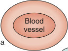

Unmatched source image; PDF page 1500. Consult the original caption.

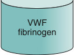

Unmatched source image; PDF page 1500. Consult the original caption.

## PDF page 1501

Y-Carboxylated coagulation proteins GGCX

Coagulation proteins

Vitamin K hydroquinone Vitamin K epoxide

Vitamin K quinone VKR VKOR

Dietary sources Bacterial production

• Fig. 80.2 The vitamin K cycle. GGCX, Vitamin K γ-glutamyl carboxylase; VKOR, vitamin K epoxide reductase; VKR, vitamin K reductase.

TABLE

Hemostatic Parameters in the Newborn

80.1

Decreased Compared With Adult Reference Ranges

Within Normal Adult Reference Ranges

Increased Compared With Adult Reference Ranges

Factor II Factor VII Factor IX Factor X Factor XI Factor XII Pre-kallikrein HMWK Antithrombin Heparin cofactor II Protein C Protein S TFPI Plasminogen

Fibrinogen Factor V Factor XIII α2-antiplasmin

Factor VIII (mildly) VWFa α2-Macroglobulin

t-PA PAI-1

aVWF concentration and function are both increased, and ultra-large molecular weight multimers are present in neonatal plasma. Platelet count and mean platelet volume vary with gestational and postnatal ages with wider intervals than adult reference ranges, prothrombin time (PT) is minimally prolonged, and activated partial thromboplastin time (aPTT) is markedly prolonged. Thrombin clotting time (TCT) is also prolonged. Platelet function studies show shorter bleeding times; shorter closure times by the platelet function analyzer (PFA-100); and decreased platelet aggregation in response to thrombin, ADP, and epinephrine. HMWK, High molecular weight kininogen; PAI-1, plasminogen activator inhibitor-1; TFPI, tissue factor pathway inhibitor; t-PA, tissue plasminogen activator; VWF, von Willebrand factor. Data from Andrew M, Paes B, Milner R, et al. Development of the human coagulation system in the full-term infant. Blood. 1987;70:165– 172; Andrew M, Paes B, Milner R, et al. Development of the human coagulation system in the healthy premature infant. Blood. 1988;72:1651–1657.

### General Approach to Neonatal Bleeding Disorders

Bleeding disorders in neonates can be inherited but are more often acquired. It is clinically useful to classify bleeding disorders into those affecting primary hemostasis (blood vessels, VWF, and platelets) and those affecting secondary hemostasis (coagulation proteins). Disorders involving tertiary hemostasis (fibrinolytic system) are exceedingly rare. Acquired bleeding disorders can affect multiple components in the hemostatic system, and these can result in complex hemostatic abnormalities. The evaluation of bleeding disorders in neonates can be challenging because of subtle or nonspecific clinical presentations and difficulties in both obtaining adequate specimen for coagulation testing and interpreting the results of these tests in the context of developmental hemostasis. A systematic approach and the involvement of a pediatric hematologist are vital to establishing the diagnosis and planning the therapeutic approach to a neonate with a suspected bleeding disorder. A complete history and physical examination is an essential first step that directs further laboratory work-up (Table 80.2). The laboratory evaluation of neonates with suspected bleeding disorders is best carried out in a rational, stepwise fashion (Fig. 80.3). An initial hemostatic screen is performed, and this is followed by additional testing if an abnormality is identified on the initial screen. Additional testing is also indicated if the clinical suspicion remains high despite a normal hemostatic screen. Screening tests do exclude several less common or milder bleeding disorders (see Fig. 80.3). Moreover, several potential pitfalls should be kept in mind regarding laboratory evaluation of hemostasis in neonates (Table 80.3).7 Although many of these issues can be overcome, the major challenge in hemostatic testing in neonates remains the establishment of appropriate neonatal reference values that are analyzer- and reagent-specific and, at the same time, are clinically relevant (i.e., reference ranges that can accurately distinguish “disease” from “normal”).7

### Neonatal Platelet Disorders

This group of disorders results when platelets are either decreased in number (thrombocytopenia), functionally defective (thrombocytopathy), or both. Typical manifestations include petechiae (singly or in crops), bruising, and hemorrhage from mucosal surfaces. Bleeding from a heel stick puncture is often the first clinical indicator of an issue. Although generally rare, serious bleeding can complicate some of the more severe platelet defects.

### Neonatal Thrombocytopenia (Quantitative Platelet Disorders)

Thrombocytopenia in a neonate of any viable gestational age was traditionally defined as a platelet count of less than 150 × 109 per L.8,9 However, gestational and postnatal agespecific reference intervals for platelet counts have been

## PDF page 1502 | printed page 1503

TABLE

### Pertinent History and Physical Examination Findings in Neonatal Bleeding Disorders

80.2

History • Presentations suggestive of neonatal bleeding disorders include diffuse purpura/ecchymoses, oozing from

the umbilical stump, excessive bleeding from peripheral puncture/heel stick sites, large cephalohematomas without significant birth trauma history, prolonged bleeding following circumcision, intracranial hemorrhage in a term or late-preterm infant without history of birth trauma, and unexplained bleeding in a very low birth weight infant. • Bleeding in a well neonate is suggestive of an inherited coagulation disorder or an immune-mediated

thrombocytopenia, whereas a sick preterm neonate is more likely to have acquired hemostatic disorder. • Vitamin K administration. • Maternal and obstetric history, including history of prior pregnancies and their outcomes, maternal

medications (e.g., anticonvulsants can cause neonatal vitamin K deficiency), and maternal immune thrombocytopenia, which can cause neonatal thrombocytopenia. • Family history, including parental ethnic background and consanguinity, and family history of bleeding.

Physical

• The finding of purpura, petechiae, ecchymoses, and mucosal bleeding in neonates is suggestive of a

examination

primary hemostatic defect. • The presence of dysmorphic features/congenital anomalies may suggest an underlying genetic defect as

some genetic syndromes are associated with a congenital bleeding tendency, most commonly involving platelets.

Bleeding newborn

Initial screen (CBC, PT, aPTT, TCT)

Low platelets Normal platelets

Hemostatic disorders that can have normal screen Mild von Willebrand disease Mild hemophilia A or B Mild factor XI or other single-factor deficiency Factor XIII deficiency Fibrinolytic defects (α2AP deficiency, PAI-1 deficiency) Platelet function defects Vascular connective tissue disorders

### • Fig. 80.3 Approach to laboratory evaluation of coagulation in neonates. aPTT, Activated partial thrombo-

plastin time; CBC, complete blood count; PT, prothrombin time; TCT, thrombin clotting time.

described that should be considered when investigating thrombocytopenia in premature neonates.10 Thrombocytopenia is one of the most frequent hematologic disorders encountered in the sick neonate.8,9 This is evidenced by a fairly high incidence among neonates admitted to the

Factor VII

Prolonged PT

Factor VIII,

### IX, XI

Prolonged aPTT

Fibrinogen, Factor II, V, X, multiple factors

Prolonged PT and aPTT

Prolonged TCT

Fibrinogen

Factor XIII, platelet function, others as indicated

Normal PT, aPTT and TCT

neonatal intensive care unit (NICU) (18%–35%) compared with a relatively low overall incidence (0.1%–2%).11 The incidence is inversely proportional to gestational age and/or birth weight.12 Severe thrombocytopenia (platelet count <50 × 109/L) is less common, affecting 2.4%

### Automatic table extraction — verify rendered original

|Bleeding newborn|Col2|
|---|---|
|||

[Original table](../../tables/ch080_p1502_1.jpg)

### Automatic table extraction — verify rendered original

|Low platelets Normal platelets Prolonged PT Prolonged aPTT Hemostatic disorders that can have normal screen Prolonged PT Mild von Willebrand disease and aPTT Mild hemophilia A or B Mild factor XI or other single-factor deficiency Factor XIII deficiency Prolonged Fibrinolytic defects (α2AP deficiency, PAI-1 deficiency) TCT Platelet function defects Vascular connective tissue disorders Normal PT, aPTT and TCT|Col2|Col3|
|---|---|---|
|Low platelets Normal platelets Prolonged PT Prolonged aPTT Prolonged PT and aPTT Prolonged TCT Normal PT, aPTT and TCT **Hemostatic disorders that can have normal screen** Mild von Willebrand disease Mild hemophilia A or B Mild factor XI or other single-factor deficiency Factor XIII deficiency Fibrinolytic defects (α2AP deficiency, PAI-1 deficiency) Platelet function defects Vascular connective tissue disorders|Normal PT, aPTT and TCT|Normal PT, aPTT and TCT|
|Low platelets Normal platelets Prolonged PT Prolonged aPTT Prolonged PT and aPTT Prolonged TCT Normal PT, aPTT and TCT **Hemostatic disorders that can have normal screen** Mild von Willebrand disease Mild hemophilia A or B Mild factor XI or other single-factor deficiency Factor XIII deficiency Fibrinolytic defects (α2AP deficiency, PAI-1 deficiency) Platelet function defects Vascular connective tissue disorders|Normal PT, aPTT and TCT||

[Original table](../../tables/ch080_p1502_2.jpg)

## PDF page 1503

TABLE

Special Considerations in Neonatal Hemostatic Laboratory Testing

80.3

Variable Sources of Error

Preanalytical Insufficient sample volume and underfilling of collection

tubes

Heparin contamination (sample collected from

indwelling catheters or into a preheparinized syringe) Specimen activation

High hematocrit at birth (required citrate-to-blood ratio

of 9:1 may not be achieved using standard collection tubes)

Analytical Elevated levels of bilirubin or lipids and hemolysis

in neonates can interfere with optical density measurements used to determine end points of some coagulation tests

Postanalytical Defining appropriate reference ranges for neonates

to 10% of all neonates and 14% of extremely low birth weight (ELBW) infants.9 The predisposition of neonates to develop thrombocytopenia in response to illness is likely a result of the limited ability of the neonatal megakaryopoietic axis to increase platelet production in response to platelet consumption.8 Although a large number of disease processes have been associated with thrombocytopenia in neonates, impaired platelet production is the prevailing mechanism in most cases of neonatal thrombocytopenia; consumption and/or sequestration underlie thrombocytopenia in 25% to 35% of cases.9 The differential diagnosis, and consequently diagnostic evaluation, of neonates with thrombocytopenia is usually based on onset (early onset ≤72 hours and late onset >72 hours), overall presentation, and natural course (Table 80.4). Although the most common identifiable causes are chronic fetal hypoxia in early-onset thrombocytopenia and sepsis and necrotizing enterocolitis (NEC) in late-onset thrombocytopenia, no etiology is identified in a significant proportion of thrombocytopenia among ELBW neonates.13

### Neonatal Thrombocytopenic Disorders Requiring Special Attention Immune-Mediated Thrombocytopenias

Fetal and Neonatal Alloimmune Thrombocytopenia

Fetal and neonatal alloimmune thrombocytopenia (FNAIT) is the most common cause of severe neonatal thrombocytopenia and of intracranial hemorrhage (ICH) in term neonates.14 FNAIT occurs at an estimated

Possible Solution(s)

Establishment of standard protocols, techniques

for specimen collection, and transport and microtization of assays

When the hematocrit exceeds 0.55 (55%), the

reduced plasma volume requires a decrease in the volume of anticoagulant used to maintain the ratio of 9:1 using the following formula: C (mL) = 1.85 × 10−3 × (100 − Hct [%]) × V (mL) C = mL of 3.2% sodium citrate anticoagulant; Hct

(%) = hematocrit of the patient in %; and V = mL of whole blood in tube

Additional centrifugation of the sample

Use of age-related reference ranges specific

for analyzer-reagent combination used in the coagulation laboratory

incidence of 1/1000 to 2000 live births.15 FNAIT results from transplacental passage of maternal antibodies which adhere to fetal platelets expressing paternal antigens that the mother lacks. Fetomaternal incompatibility involving certain human platelet antigens (HPAs) specifically expressed by fetal platelets leads to the production of a maternal IgG alloantibody in response to exposure to fetal blood. Maternal IgG crosses the placenta, often in early pregnancy, and binds to fetal platelets. The fetal platelets are cleared in the reticuloendothelial system, resulting in fetal and neonatal thrombocytopenia. Genetic incompatibility to platelet antigens is necessary but not sufficient for FNAIT, because the observed frequency of the clinical syndrome is far lower than what would be expected based on genetic frequency alone.14,15 Thus other factors, including genetic immune response modifiers and HLA alleles, must be important in the pathophysiology.15 The frequency of significant bleeding in FNAIT is striking compared with other thrombocytopenic disorders such as immune thrombocytopenia (ITP). Alloantibody-mediated secondary effects, such as platelet dysfunction and megakaryocytic damage resulting in prolonged thrombocytopenia and endothelial injury, may be responsible for the high incidence of severe bleeding (e.g., HPA-1a antigen is expressed by endothelial cells).16 HPA frequencies vary among different ethnic groups; the severity of FNAIT can correlate with the specific HPA incompatibility identified.

FNAIT should be strongly considered in one of two clinical scenarios: (1) in an otherwise healthy neonate,

## PDF page 1504 | printed page 1505

TABLE

### Causes of Neonatal Thrombocytopenia

80.4

Classification Causes

Early-onset (≤72 h) Chronic fetal hypoxia/placental insufficiency (PIH, IUGR,

diabetes)

Aneuploidy (trisomies 18, 13, 21, isochromosome 18q,

triploidy, Turner syndrome)

Perinatal asphyxia

Early neonatal sepsis (Escherichia coli, GBS,

Haemophilus influenza) DIC

Immune-mediated thrombocytopenias (FNAIT,

autoimmune thrombocytopenia from maternal ITP)

Kasabach-Merritt syndrome

Thrombosis (renal vein thrombosis, aortic thrombosis,

portal vein thrombosis, CSVT)

Thrombotic microangiopathies (congenital TTP, familial

atypical HUS)

Congenital infections (CMV, toxoplasma, others)

Bone marrow failure syndromes or replacement

(congenital leukemia, metastatic neuroblastoma, storage disorders)

Inborn errors of metabolism (organic acidemia)

Inherited thrombocytopenias

Late-onset (>72 h) Late-onset sepsis (bacterial/fungal)

NEC Autoimmune thrombocytopenia from maternal ITP Congenital infection (CMV, toxoplasma, others) Kasabach-Merritt syndrome Inborn errors of metabolism Inherited thrombocytopenias Drug-induced thrombocytopenia (β-lactams,

vancomycin, indomethacin, ibuprofen, H2-blockers, heparin)

CMV, Cytomegalovirus; CSVT, cerebral sinovenous thrombosis; DIC, disseminated intravascular coagulation; FNAIT, fetal and neonatal alloimmune thrombocytopenia; GBS, group B Streptococcus; HUS, hemolytic uremic syndrome; ITP, immune thrombocytopenia; IUGR, intrauterine growth restriction; NEC, necrotizing enterocolitis; PIH, pregnancy-induced hypertension; SLE, systemic lupus erythematosus; TTP, thrombotic thrombocytopenic purpura. Data from Roberts I, Stanworth S, Murray NA. Thrombocytopenia in the neonate. Blood Rev. 2008;22:173–186.

born after an uneventful pregnancy and delivery, exhibiting petechiae or widespread purpura within 24 to 48 hours of birth associated with severe thrombocytopenia (platelet count <50 × 109/L), or (2) in cases in which ICH, porencephaly, or ventriculomegaly is discovered during fetal life. About 10% to 20% of clinically recognized cases have ICH, which can be symptomatic or discovered incidentally on routine radiographical studies. In utero, 50% to 75% of ICH occurs. It can be fatal in one-third of cases, and in the rest can result in significant neurologic sequelae. Confirmation of a clinical diagnosis of FNAIT requires two laboratory approaches: (1) platelet antigen incompatibility

Presentation

Slowly evolving, mild–moderate

thrombocytopenia, nadir at days 4–7; resolution by day 10

Dysmorphism, congenital anomalies

Sick neonate with severe thrombocytopenia

Well full-term neonate with severe

thrombocytopenia Severe thrombocytopenia, DIC, enlarging

cutaneous, or visceral vascular tumor

Unexplained thrombocytopenia, clinical

features of organ dysfunction (e.g., renal insufficiency in renal vein thrombosis, seizures in CSVT)

Hemolysis, hyperbilirubinemia, multiorgan

dysfunction Stigmata of congenital infections

Pancytopenia, additional systemic

manifestations

Associated clinical features

Persistent unexplained thrombocytopenia,

associated congenital anomalies

Rapid-onset severe thrombocytopenia with

slow recovery History of maternal thrombocytopenia/SLE As above

Resolution upon withdrawal of offending drug

is demonstrated by genotyping (polymerase chain reaction [PCR] techniques) and phenotyping (flow cytometry, various immunoassay methods), and (2) there is evidence of maternal alloantibody directed against the identified alloantigen (various immunoassays such as enzyme-linked immunosorbent assay [ELISA] and using maternal serum tested against paternal platelets and/or platelets from normal donors with known platelet alloantigen phenotypes).14,17 Neuroimaging of all neonates with suspected FNAIT is recommended because some will have asymptomatic central nervous system bleeding requiring more aggressive treatment measures.

## PDF page 1505

### Autoimmune Thrombocytopenia in Infants Born to Mothers With Immune Thrombocytopenic Purpura

Neonatal ITP caused by transplacental passage of maternal IgG antiplatelet autoantibodies occurs in up to 12% to 28% of mothers who develop primary or secondary (owing to systemic lupus erythematosus) ITP during pregnancy.18–20 The risk of severe thrombocytopenia and ICH in affected neonates is significantly lower compared with FNAIT (<15% and <2%, respectively). Maternal platelet counts during pregnancy cannot reliably predict the risk of neonatal thrombocytopenia; however, a maternal platelet count less than 50 × 109/L at delivery and a history of severe thrombocytopenia in a previous neonate may be useful indicators of the likelihood of significant neonatal thrombocytopenia

TABLE

### Inherited Thrombocytopenic Syndromes That Can Present in the Neonatal Period

80.5

Syndrome Genetics Hemostatic Features

Large/Giant Platelets, MPV >11 fl

MYH9-related

AD (22q11) Mild bleeding tendency Mild–moderate thrombocytopenia

thrombocytopenia (May- Hegglin anomaly and Fechtner, Epstein, and Sebastian syndromes)

with mild platelet dysfunction

Bernard-Soulier syndrome AR (17pter-p12;

Severe bleeding tendency Variable thrombocytopenia with

22q11.2; 3q21)

defective platelet adhesion

X-linked thrombocytopenia

XL (Xp11.23) Severe bleeding tendency Severe thrombocytopenia with

with dyserythropoiesis

defective platelet function

11q terminal deletion

AD (11q23) Mild bleeding tendency Severe neonatal thrombocytopenia

disorder (Paris-Trousseau thrombocytopenia/ Jacobsen syndrome)

that resolves over time, and persistent platelet dysfunction

Normal-Sized Platelets, MPV 7-11 fl

Congenital

AR (1p34) Severe bleeding tendency Severe neonatal thrombocytopenia

amegakaryocytic thrombocytopenia

Thrombocytopenia and

AR (?) Severe bleeding tendency Severe neonatal thrombocytopenia

absent radii

Thrombocytopenia and

AD (7p15-p14.2) Severe bleeding tendency Severe neonatal thrombocytopenia

radial synostosis

Small Platelets, MPV <7 fl

Classic Wiskott-Aldrich

XL (Xp11.23-p11.22) Severe bleeding tendency with

syndrome

significant risk of bleeding Severe neonatal thrombocytopenia

X-linked thrombocytopenia XL (Xp11.23-p11.22) Severe bleeding tendency with

significant risk of bleeding Severe neonatal thrombocytopenia

AD, Autosomal dominant; AR, autosomal recessive; MPV, Mean platelet volume; XL, X-linked.

complicating the current pregnancy.21 Typically, the nadir platelet count in affected neonates is observed between days 2 and 5 after birth with resolution by day 7; however, some neonates may continue to have thrombocytopenia secondary to maternal ITP for months, necessitating long-term monitoring. Evaluation of affected neonates should include serial platelet counts and screening transcranial ultrasonography (if platelet count is <50 × 109/L).

### Inherited Thrombocytopenias

Inherited thrombocytopenias are a rare, heterogeneous group of disorders with a highly variable bleeding tendency (Table 80.5). Although far less common than acquired forms, inherited thrombocytopenias should be considered

Additional Findings

Neutrophil inclusions, ±

sensorineural hearing loss, ± nephritis, ± cataracts

None

Microcytic anemia,

dyserythropoiesis, thalassemia, splenomegaly

Developmental delay, growth

restriction, dysmorphism, and multiple congenital anomalies (Jacobsen syndrome)

Marrow failure during second

decade

Shortened/absent radii bilaterally Bleeding tendency and

thrombocytopenia improve after infancy

Fused radius, incomplete range of

motion, other skeletal defects, and sensorineural hearing loss Thrombocytopenia usually does not

improve with time

Immunodeficiency, autoimmunity,

eczema, lymphoma

Manifestations besides

microthrombocytopenia are uncommon.

## PDF page 1506 | printed page 1507

in neonates with persistent, unexplained thrombocytopenia since birth; bleeding tendency disproportionate to the platelet counts; family history of thrombocytopenia; typical congenital anomalies/dysmorphism; or suggestive blood smear abnormalities (consistently large or small platelets, abnormal platelet granules, or neutrophil inclusions called Döhle bodies). Except for Wiskott-Aldrich syndrome and X-linked thrombocytopenia (XLT), in which increased consumption of platelets in addition to defective production is implicated, thrombocytopenia in these disorders is caused by impaired production. Platelet dysfunction, identified in many inherited thrombocytopenias, is responsible for the significant bleeding tendency that is out of proportion to the measured platelet count and is characteristic of some of these disorders (e.g., Bernard-Soulier syndrome). The diagnostic evaluation of these disorders can be challenging. Testing should be conducted by a clinician with expertise and directed by clinical manifestations, physical examination findings, and initial lab results. Platelet function testing is imperfect, labor intensive, and requires relatively large volumes of blood for immediate processing. Some tests are available only in research laboratories. Genetic and/or molecular studies are needed to confirm the diagnosis in some inherited platelet disorders (such as Wiskott-Aldrich syndrome/XLT).

### Platelet Function Disorders (Qualitative Platelet Disorders)

Qualitative platelet disorders include a large number of abnormalities, which are either inherited or acquired (Box 80.1). These disorders pose diagnostic challenges, because the tests needed to fully evaluate platelet function can be complex, requiring a great deal of expertise, and are often restricted to specialized coagulation and/or research laboratories. As a group, these disorders present as primary hemostatic defects of variable severity characterized by mucocutaneous bleeding (bruising, petechiae). Although congenital platelet function defects rarely cause pathologic bleeding in the neonatal period, the severe platelet function disorders such as Glanzmann thrombasthenia and Bernard- Soulier syndrome can present in neonates (Table 80.6). Some of these congenital disorders are associated with thrombocytopenia, whereas others cause isolated platelet dysfunction with normal platelet counts. For more information about these disorders, the reader is referred to an excellent review by Nurden et al.22

### Management of Platelet Disorders in Neonates

Besides treating the underlying cause, platelet transfusions are the mainstay therapy for most neonates with platelet disorders. In neonatal thrombocytopenia, platelet transfusions can be given therapeutically in those with active bleeding or, in most cases, prophylactically to prevent serious bleeding events, particularly ICH and intraventricular

• BOX 80.1 Causes of Platelet Function Defects

Acquired

• Uremia • Liver disease • Extracorporeal membrane oxygenation and

cardiopulmonary bypass • Disseminated intravascular coagulation • Medications (indomethacin, ibuprofen, nitric oxide, others) • Hypothermia

Inherited

• Primary platelet function defects • Defective platelet adhesion (platelet-type VWD, Bernard-

Soulier syndrome) • Defective platelet aggregation (Glanzmann thrombasthenia) • Defective receptor interactions and abnormal signal

transduction • Receptor defects (thromboxane A2 receptor defect,

purinergic receptor defects for ADP and ATP, collagen receptor defects) • Arachidonic acid pathway defects (cyclooxygenase-1

deficiency and thromboxane synthase deficiency) • Signal transduction defects (defects in G-protein

activation, defects in phosphatidylinositol metabolism, defects in calcium mobilization, and defects in protein phosphorylation) • Defective granule storage and secretion • Deficiency of α granules (gray platelet syndrome, Quebec

platelet disorder, arthrogryposis-renal dysfunctioncholestasis syndrome) • Deficiency of δ granules (idiopathic δ-storage pool disease,

Chediak-Higashi syndrome, Hermansky-Pudlak syndrome) • Deficiency of α and δ granules (11q terminal deletion

disorder) • Defective procoagulant function (Scott syndrome) • Secondary platelet function defects • VWD • Congenital afibrinogenemia

ADP, Adenosine diphosphate; ATP, adenosine triphosphate; VWD, von Willebrand disease.

hemorrhage (IVH) in preterm infants. Although the correlation between platelet count and the risk of a clinical hemorrhage is poor, the risk of bleeding is likely higher in neonates with FNAIT, sepsis, or NEC, particularly those with extreme prematurity.23,24 Because of the paucity of evidence-based guidelines, considerable variability exists in practice as well as in published guidelines (Tables 80.7A and 80.7B).8,25–28 In a multicenter randomized trial of 660 infants with severe thrombocytopenia, born at less than 34 weeks of gestation age, those randomly assigned to receive prophylactic platelet transfusions at a plateletcount threshold of 50,000 per cubic millimeter had a significantly higher rate of death or major bleeding within 28 days after randomization than those who received platelet transfusions at a platelet-count threshold of 25,000 per cubic millimeter.25 Some recommendations are, however, more restrictive, accepting lower platelet triggers for transfusions because of recognition that the clinical condition

## PDF page 1507

TABLE

### Glanzmann Thrombasthenia Versus Bernard-Soulier Syndrome

80.6

Glanzmann Thrombasthenia

Epidemiology International frequency data are unknown; Increased

incidence in certain ethnic groups (South Indian Hindus, Iraqi Jews, French gypsies, and Jordanian nomadic tribes) and families with consanguinity

Pathophysiology Defective platelet aggregation caused by quantitative

or qualitative defect of platelet GpIIb/IIIa (fibrinogen receptor)

Inheritance Autosomal recessive

Thrombocytopenia No

Aggregation studies Absent platelet aggregation in response to all agonists

except ristocetin

Diagnosis Flow cytometric studies of platelet surface glycoprotein

expression, GpIIb/IIIa

TABLE

### Platelet Transfusion Thresholds in Neonates (Platelet Counts × 109/L)

### 80.7A

Nonbleeding

Preterm

Published Guidelines

Bleeding

Term Stable Unstable

Most restrictive <20 <30 <20 <50

Least restrictive <50 <100 <30 <100

ECMO, Extracorporeal membrane oxygenation. Data from Christensen RD, Carroll PD, Josephson CD. Evidence-based advances in transfusion practice in neonatal intensive care units. Neonatology. 2014;106(3):245–253. Blanchette VS, Hume HA, Levy GJ, et al. Guidelines for auditing pediatric blood transfusion practices. Am J Dis Child. 1991;145:787–796; Gibson BE, Todd A, Roberts I, et al. Transfusion guidelines for neonates and older children. Br J Haematol. 2004;124:433–453.

TABLE

### Platelet Transfusion Protocola

### 80.7B

Platelet Count (# per cubic millimeter) Transfuse Platelets If:

<100,000 • Evidence of active or recentb

major bleedingc • Before major surgeryd

50,000–100,000 No routine prophylactic

transfusion

25,000–50,000 • Infants <1 week old with birth

weight <1 kg • Clinically unstable infants • Receiving indocin or ibuprofen

for PDA closure

<25,000 • In all cases

a2022, Rainbow Babies and Children’s Hospital, Cleveland, OH. bWithin 72 hours. cIntracranial hemorrhage (including intraventricular hemorrhage), pulmonary hemorrhage, frank rectal bleeding, or any bleeding requiring PRBC transfusion. dMajor surgery does not include: retinopathy of prematurity laser ablation, chest tube placement, peripherally inserted central catheter placement, lumbar puncture.

Bernard-Soulier Syndrome

Estimated prevalence <1 in 1,000,000

Defective platelet adhesion caused by

quantitative or qualitative defects of platelet GPIb-IX-V receptor complex (von Willebrand factor receptor)

Autosomal recessive

Yes (of variable severity)

Failure to aggregate with ristocetin, normal

aggregation response to other agonists

Flow cytometric studies of platelet surface

glycoprotein expression, GpIb/IX

Before Invasive Procedure ECMO

<50 <100

<100

is an important determinant of the risk of bleeding and because of concerns regarding the risks of platelet transfusions (e.g., transfusion-related acute lung injury, bacterial contamination, alloimmunization).

Treatment of infants with suspected FNAIT should be initiated promptly and without awaiting definitive test results. The mainstay of therapy is platelet transfusions, which should be given in nonbleeding, well neonates if the platelet count is less than 30 × 109 per L and, in neonates with ICH or other major bleeding events, it is recommended to maintain platelet counts initially above 100 × 109 per L and then above 50 × 109 per L for at least 7 days.29 HPA-1a/5b negative platelets are compatible in greater than 90% of cases with FNAIT, or washed, irradiated maternal platelets are used as the platelet products of choice because they result in higher and longer-lasting platelet count increments.14,29 If, however, matched platelets are not immediately available, random donor platelets should be given instead.29 Intravenous immunoglobulin (IVIG) and corticosteroids can also be used as adjuvant therapies.29 Antenatal management of pregnancies at risk for FNAIT is complex, requiring a multidisciplinary approach. Standard medical treatment consists of weekly

## PDF page 1508 | printed page 1509

IVIG in early pregnancy with or without systemic corticosteroids. Intrauterine platelet antigen-negative platelet transfusions are reserved for medical treatment failures and for prophylaxis of acute hemorrhage at the time of fetal blood sampling.29 Early cesarean delivery has also been advocated to decrease the risk of ICH, although evidence is lacking.

Recommended management of neonatal ITP consists of the following: Umbilical cord platelet count to be obtained at delivery or as soon as possible, and, if platelet count is less than 50 × 109 per L, it is recommended to perform head ultrasound. If ICH is present, IVIG and steroids are advised to maintain platelet count greater than 100 × 109 per L for 1 week, and greater than 50 × 109 per L for another week. If a neonate has bleeding or if platelet count is less than 30 × 109 per L, IVIG with or without platelet transfusion is advised.30 Cesarean section, unless otherwise indicated for obstetric reasons, and intrapartum fetal platelet count measurements are not recommended.30

In neonates with significant bleeding because of congenital platelet disorders or acquired platelet dysfunction, anti-fibrinolytic drugs (epsilon aminocaproic acid and tranexamic acid), and recombinant activated factor VII can be used as adjuvant to or, in some cases, in place of platelet transfusions. Patients with Bernard-Soulier syndrome or Glanzmann thrombasthenia are at increased risk of isoimmunization and/or alloimmunization from platelet transfusion therapy, which can result in platelet transfusion refractoriness rendering future platelet transfusions largely ineffective.31 For certain inherited platelet disorders, such as congenital amegakaryocytic thrombocytopenia and Wiskott-Aldrich syndrome, hematopoietic stem cell transplantation from suitable donors can be curative.32,33

### Neonatal Coagulation Disorders

This group of disorders results in impairment of secondary hemostasis resulting in bleeding that is typically delayed and in deep tissues. As for platelet disorders, inherited or, more commonly, acquired mechanisms are involved. In this section, coagulation disorders are described that can present in neonates.

### Inherited Coagulation Disorders

Inherited coagulation disorders usually present with abnormal bleeding in an otherwise healthy neonate. Although a positive family history can confirm the diagnosis, an inherited bleeding disorder in the absence of family history is still possible in cases arising as a result of new mutations or inherited in an autosomal recessive fashion.

### Hemophilia

Hemophilia, the most common inherited bleeding disorder to present in the neonatal period, is caused by deficiency of factor VIII (hemophilia A) or, less commonly, factor IX (hemophilia B). Hemophilia is classified according to

severity on the basis of plasma procoagulant concentrations. Patients are categorized as having mild hemophilia (>5% but <40% normal factor [<0.05–<0.40 IU/mL]), moderately severe hemophilia (1%–5% normal factor [0.01–0.05 IU/mL]), and severe hemophilia (<1% normal factor [<0.01 IU/mL]). The annual incidences of hemophilias A and B in the United States are 1 in 5000 and 1 in 30,000 male births, respectively. In all, 60% and 44% of these new cases, respectively, have severe phenotype. In both disorders, thrombin generation is markedly decreased, which leads to delayed formation and poor stability of the hemostatic clot.

Both hemophilias A and B are X-linked recessive disorders caused by a variety of gene mutations. It is estimated that up to 30% of mutations in hemophilia A are de novo mutations. Hemophilia A and B are clinically indistinguishable, and clinical manifestations early in life are almost always confined to boys. The pattern of bleeding in newborns with hemophilia differs significantly from that in older children and adults. Data reported by the U.S. Centers for Disease Control and Prevention (CDC)’s Universal Data Collection (UDC) showed that among newborns with hemophilia, 44% had a bleeding episode by 1 month of age.34 Iatrogenic bleeding is the most common hemorrhagic manifestation, typically presenting as significant oozing or hematoma formation following venous or arterial puncture, heel stick, intramuscular vitamin K injection, or circumcision. Extracranial hemorrhage (ECH) including subgaleal hemorrhage and cephalohematomas, as well as ICH, can also occur in neonates with hemophilia. The incidence of ICH in neonates with severe hemophilia is 1% to 7%.35,36 ICH is more common than ECH, and the most frequent site of hemorrhage is subdural.35 Risk factors for cranial bleeding include forceps/vacuum instrumentation during delivery, severe phenotype, and preterm delivery. ICH can have dramatic (seizures, focal deficits) or subtle presentations or can be asymptomatic or “silent.” ECH also demands attention because it can cause massive blood loss in neonates with hemophilia. Finally, umbilical, musculoskeletal, and gastrointestinal and other organ bleeding are infrequently encountered in hemophilic neonates.34,37

The diagnosis of hemophilia in neonates requires laboratory confirmation. Isolated prolongation of the activated partial thromboplastin time (aPTT) is usually found on routine coagulation testing. The definitive diagnosis of hemophilia requires measurement of factor levels in uncontaminated cord blood or neonatal venous blood samples. Although it is usually possible to confirm a diagnosis of hemophilia A of any severity in the neonatal period, irrespective of the gestational age, confirmation of mild hemophilia B is problematic. Unlike factor VIII, factor IX levels are reduced at birth and are further reduced in preterm infants. It is therefore possible to make a diagnosis of severe and moderate hemophilia B at birth, but for mildly affected neonates, confirmation requires repeat testing at 6 months of age or molecular analysis if the genetic defect is known.38 Controversy exists regarding role, timing, and optimal technique for radiologic assessment of

## PDF page 1509

ICH in neonates with hemophilia. The British Committee for Standards in Hematology has published guidelines that recommend screening cranial ultrasound in all neonates with severe or moderate hemophilia before discharge and cranial MRI or CT scan in symptomatic neonates even if the ultrasound is normal, owing to the low sensitivity of ultrasound for the detection of subdural bleeding.39

The management of neonatal hemophilia can be summarized as follows.39

Management During Delivery

The optimal mode of delivery remains unclear and may be best determined on an individual basis, taking into account obstetric and hemostatic factors, as risk of ICHs and major bleeds are similar for both vaginal delivery and cesarean section.40 Vacuum extraction, forceps, and invasive monitoring procedures, such as placement of fetal scalp electrodes and fetal scalp blood sampling, should be avoided. A written delivery plan should be prepared by a multidisciplinary team that includes obstetric care for the mother, planned mode of delivery, and immediate postnatal care for the newborn. When the delivery is imminent, the hematology team, the neonatologist, the hemostasis lab, and the blood bank should be notified. The delivery plan should be reviewed. The availability of replacement factor concentrate should be ensured.38

Management in the Postnatal Period

Intramuscular vitamin K should be withheld until hemophilia is excluded. Oral vitamin K can be given instead if there is a delay in diagnosis or if hemophilia is confirmed. Following confirmation of diagnosis, short-term prophylactic replacement therapy (with specific factor concentrates) may be given to neonates following traumatic, instrumented, preterm delivery, or a prolonged second stage of labor. The benefits of factor replacement must be weighed against the risk of inhibitor development, although a report from the CDC demonstrated no difference in inhibitor rates with neonatal factor exposure.35

Management of Clinically Significant Bleeding in Neonates

Before confirmation of diagnosis, fresh frozen plasma (15– 25 mL/kg) should be given. After confirmation of diagnosis, recombinant factor VIII or IX concentrates should be given with close monitoring, because neonates may require higher doses to achieve desired factor levels and may demonstrate a shortened factor half-life. Although extended half-life factors are now available for use in hemophilia, use in neonates and previously untreated patients is not yet recommended outside of a clinical trial.41

Emicizumab, a recombinant humanized bispecific mono clonal antibody that mimics the function of activated FVIII with a long half-life and subcutaneous (SC) mode of delivery, has been approved by the Food and Drug Administration (FDA) for the prevention of bleeding in patients of all ages with hemophilia A, despite sparse data in infants.42 There have been case reports of its successful use in neonates;

however, there are limited data on the safety and efficacy of initiating emicizumab in previously untreated neonates.43,44

### von Willebrand Disease

Despite being the most common inherited bleeding disorder overall, initial presentation and identification of most forms of von Willebrand disease (VWD) in neonates is rare, owing to physiologically increased VWF concentration and function in neonates compared to adults. The classification of VWD consists of type 1 disease, which is a partial quantitative deficiency in VWF; type 2 disease, which is characterized by various qualitative (functional) defects in VWF; and type 3 disease, which is owing to a total quantitative deficiency of VWF. A subtype of type 1 VWD, Vicenza variant, with features of increased clearance of VWF, has been identified.45 Although most types of VWD are inherited in an autosomal dominant fashion, type 3 is recessively inherited as homozygous or compound heterozygous. Laboratory tests in VWD usually include measurements of plasma VWF antigen (VWF:Ag), VWF function by VWF ristocetin cofactor assay (VWF:RCo) or VWF GPIbM Activity assay, FVIII coagulant activity (FVIII:C), and assessment of the circulating plasma VWF (VWF multimers).46 Two types of VWD can present in neonates.

Type 2B VWD is characterized by increased affinity for VWF to platelets leading to the formation of circulating platelet aggregates that are reversibly sequestered in the microcirculation. Neonates with this type can present with moderate thrombocytopenia and bleeding. This rare type of VWD should be considered in the differential diagnosis of unexplained neonatal thrombocytopenia.47

VWD type 3, the most severe form, represents ≤1% of all VWD cases but is the type most likely to present in neonates. Bleeding manifestations are variable. Mucosal bleeding is more common than in hemophilia A, whereas ICH rates are extremely low in type 3 VWD. This may be attributed to low, but residual, factor VIII activity.48 On coagulation testing, type 3 VWD is characterized by prolonged aPTT, undetectable VWF:Ag and VWF:Rco, very low factor VIII:C (<1 IU/mL), and absent VWF multimers.46

Because of the clinical and laboratory overlap with severe hemophilia A, testing for type 3 VWD should be considered in neonates with suspected severe hemophilia A, particularly when the sex, clinical course, or laboratory data are not typical.49,50 Management of bleeding in VWD requires factor replacement using plasma-derived VWF-containing factor VIII concentrate for moderate to severe bleeding or recombinant VWF. In older children who present with mild VWD (type 1 and some type 2), desmopressin (DDAVP) is used to increase VWF levels. Because of the risk of hyponatremia, desmopressin (DDAVP) should not be used in the treatment of neonatal VWD.51

### Rare Inherited Coagulation Disorders

Rare inherited coagulopathies comprise less than 5% of all inherited deficiencies of coagulation. They are generally inherited as autosomal-recessive traits. Unlike hemophilia, causative mutations, identifiable in 80% to 90% of patients, are private (i.e., unique for each affected kindred).52,53

## PDF page 1510 | printed page 1511

Because of their rarity, data on clinical manifestations and management are relatively limited, but it is clear that a number of these disorders are associated with a severe bleeding tendency, which may manifest itself in neonates (Table 80.8).53 Typical manifestations in neonates include soft tissue bleeding, umbilical stump bleeding, and post-circumcision bleeding. ICH is also a relatively common feature of these disorders.54 These disorders should be suspected in neonates with bleeding tendency and prolonged clotting times. A prolonged PT with a normal aPTT is indicative of factor VII deficiency, whereas a prolonged aPTT with a normal PT is indicative of factor XI deficiency, provided that VWD and hemophilia have been ruled out. The prolongation of both tests should point to the possible deficiencies of factor X, factor V, prothrombin, or fibrinogen; dysfibrinogenemia; or combined factor deficiencies. Factor XII, prekallikrein, and high molecular weight kininogen, if deficient, will prolong the aPTT but are not associated with clinical bleeding. Factor XIII deficiency is an exception in that both PT and aPTT are normal. Quantitative factor XIII assays are preferred over the urea clot stability assay for diagnosis of this factor deficiency. Confirmation of diagnosis is achieved by specific factor coagulant activity assays and, rarely, antigen assays. Although DNA mutation analysis is rarely performed, results can be useful for prenatal diagnosis.54

### Acquired Coagulation Disorders

Acquired deficiency or impairment of coagulation is a frequent complication in sick neonates. In the next section,

TABLE

Rare Inherited Coagulation Disorders That Can Present in the Neonatal Period

80.8

Disorder Estimated Prevalencea

Afibrinogenemiab 1

Factor II deficiency 0.5

Factor V deficiency 1

Factor VII deficiency 2

Factor X deficiency 1

Factor XI deficiency 1

Factor XIII deficiencyc 0.5

Combined FV and FVIII deficiency 0.5

Combined vitamin K–dependent coagulation

0.5

factor deficiencyd

aPer 1 million population. bInherited fibrinogen disorders can manifest as quantitative defects (afibrinogenemia and hypofibrinogenemia) or qualitative defects (dysfibrinogenemia). Neonatal presentation is usually seen in afibrinogenemia, which is characterized by the complete deficiency of plasma fibrinogen. cIn addition to bleeding tendency, affected neonates can have impaired wound healing. dSeverely affected neonates may also exhibit features that resemble “warfarin embryopathy,” including nasal hypoplasia, distal digital hypoplasia, epiphyseal stippling, and mild conductive hearing loss attributed to dysfunction of other vitamin K–dependent proteins (osteocalcin and matrix Gla proteins). FFP, Fresh frozen plasma; PCC, prothrombin complex concentrate. Data from Bolton-Maggs PH, Perry DJ, Chalmers EA, et al. The rare coagulation disorders—review with guidelines for management from the United Kingdom Haemophilia Centre Doctors’ Organisation. Haemophilia. 2004;10:593–628.

three important acquired coagulopathies in neonates are reviewed: vitamin K deficiency, disseminated intravascular coagulation (DIC), and coagulopathy of liver disease.

### Vitamin K Deficiency

As discussed, vitamin K is a critical cofactor required for posttranslational modification of coagulation proteins II, VII, IX, and X. In the absence of vitamin K, these proteins are dysfunctional and are released into the circulation in a decarboxylated form known as proteins induced by vitamin K absence (PIVKA). The presence of PIVKA without coagulation deficit indicates subclinical vitamin K deficiency.1 The recommended dietary intake of vitamin K is 1 μg/kg body weight/day.1 Vitamin K deficiency can be idiopathic or secondary. Secondary causes include the following: 1. Inadequate intake, which can occur in infants exclusively

receiving unsupplemented breast milk, infants on broadspectrum antibiotics that eliminate intestinal vitamin K–producing bacteria, or infants who are receiving total parenteral nutrition without vitamin K supplementation. 2. Poor absorption or fat malabsorption state caused by

cholestatic liver disease, pancreatic insufficiency, or intestinal disorders (e.g., short bowel syndrome). 3. Poor utilization, as seen in significant liver disease. 4. Vitamin K antagonism because of warfarin therapy.

Vitamin K deficiency bleeding (VKDB) is a rare, but potentially life-threatening, bleeding disorder which presents in three different patterns (Table 80.9). In neonates who have not received vitamin K soon after birth, the incidence of VKDB is estimated at 35 (10.5–80) per 100,000

Treatment

Cryoprecipitate and fibrinogen concentrates

FFP and PCC

FFP

FFP and rVIIa

FFP and PCC

FFP and FXI concentrate

Cryoprecipitate, FFP, and FXIII concentrate

FFP

Vitamin K (oral or parenteral), FFP

## PDF page 1511

TABLE

Vitamin K–Deficiency Bleeding Presentations in Neonates

80.9

Presentation Bleeding Sites

Early (first 24 h) Scalp, subperiosteal, skin, intracranial,

intrathoracic, intra-abdominal

Classical (days 1–7) Gastrointestinal, umbilical, skin, nose,

circumcision

Late (≥day 8; peak 3–8 weeks) Intracranial, skin, gastrointestinal

Data from Van Winckel M, De Bruyne R, Van De Velde S, et al. Vitamin K, an update for the paediatrician. Eur J Pediatr. 2009;168:127–134.

live births.55 Isolated prolongation of the PT is the earliest laboratory evidence of vitamin K deficiency, followed by prolongation of the aPTT. The diagnosis is confirmed by correction of these parameters by vitamin K administration or by assays of the specific factors. Other confirmatory tests, such as measurement of decarboxy prothrombin (PIVKA- II) and measurement of vitamin K concentrations, are rarely able to return a result in real time, limiting their clinical utility for routine laboratory use.56

Treatment of VKDB requires parenteral vitamin K administration by slow IV infusion or subcutaneously if venous access cannot be established. For neonates who are bleeding, fresh frozen plasma should also be given. Prothrombin complex concentrates (PCCs) should be considered in the presence of life-threatening hemorrhage or ICH when it is necessary to rapidly normalize the levels of the depleted coagulation factors.1 In the United States prevention of VKDB by administration of a single intramuscular injection of vitamin K soon after birth is the current standard practice and has been almost universally effective. Because of likely poor absorption, compliance, and shorter duration of effect, single or repeated oral doses of vitamin K is ineffective for long-term protection.56–58

### Disseminated Intravascular Coagulation

DIC is a clinicopathologic syndrome that is characterized by systemic activation of coagulation and fibrinolysis, consumption of platelets and coagulation factors, and generation of fibrin clots that can lead to ischemic organ damage or failure. DIC represents a continuum in severity with definable phases characterized by initial localization and compensation (non-overt or compensated DIC) that progresses into widespread dysregulation of coagulation and fibrinolysis (overt or decompensated DIC).

Although the risk of developing DIC is believed to be highest in neonates, accurate data on the epidemiology of DIC in neonates are lacking because of difficulties in establishing the diagnosis and, consequently, underestimation

Etiologies

Maternal drugs (e.g., warfarin, anticonvulsants)

Mainly idiopathic, breastfeeding (low milk intake)

Idiopathic or secondary, exclusive breastfeeding in the

absence of vitamin K administration, undiagnosed cholestasis often present. Secondary cases from malabsorption resulting from underlying disease (e.g., biliary atresia, α-1-antitrypsin, cystic fibrosis) or chronic diarrhea. Antibiotic therapy sometimes implicated.

• BOX 80.2 Common Causes of Disseminated

Intravascular Coagulation in Neonates

• Sepsis • Perinatal hypoxia-ischemia (perinatal asphyxia, placental

abruption) • Necrotizing enterocolitis • Severe hepatic dysfunction • Respiratory disorders (RDS, MAS) • Metabolic disorders (galactosemia, others) • Vascular anomalies (Kasabach-Merritt syndrome) • Hematologic disorders (purpura fulminans caused by

protein C or S deficiency, erythroblastosis fetalis)

MAS, Meconium aspiration syndrome; RDS, respiratory distress syndrome.

of the true frequency of this disorder.59 DIC in neonates can be triggered by a variety of pathologic conditions (Box 80.2). The cardinal manifestations of overt DIC are caused by excessive bleeding and microvascular thrombosis. Hemorrhagic symptoms include petechiae and bruising, oozing from venipuncture sites, bleeding from traumatic and surgical wounds, and, in severe cases, bleeding involving internal organs. Thrombosis typically manifests as biochemical and/ or clinical evidence of end-organ dysfunction. Kasabach- Merritt syndrome (KMS) represents a localized form of DIC seen in association with cutaneous or occasionally visceral congenital vascular lesions such as kaposiform hemangioendothelioma and tufted angiomas.60 The pathophysiology of KMS is generally presumed to be that of platelet trapping by abnormally proliferating endothelium within the vascular anomaly. This results in the activation of platelets with a secondary consumption of clotting factors. In a recent study of infants with KMS secondary to kaposiform hemangioendothelioma, the use of prednisolone and sirolimus compared to sirolimus alone has shown to improve outcomes in terms of more durable response and decreased complications.61

The diagnosis of DIC, particularly in the early stages, can be problematic because there is no single laboratory test

## PDF page 1512 | printed page 1513

that can establish or rule out DIC. Hence, the diagnosis is often made on the basis of an appropriate clinical suspicion supported by laboratory evidence of procoagulant and fibrinolytic system activation coupled with anticoagulant consumption. Laboratory abnormalities seen in DIC include thrombocytopenia, elevated fibrin degradation products (FDPs) or D-dimers, prolonged PT, prolonged aPTT, prolonged TCT, and a low fibrinogen. Serial testing may be necessary for the diagnosis, given the dynamic nature of DIC and that fibrinogen is an acute-phase reactant; plasma fibrinogen can remain well within the normal range despite ongoing consumption.

Successful treatment of DIC relies largely on reversal of the underlying condition and supporting adequate blood flow and oxygen delivery. Blood component transfusions (platelets, fresh frozen plasma, and cryoprecipitate) are an important part of supportive treatment in DIC. In cases of DIC in which thrombosis predominates, such as arterial or venous thromboembolism or severe purpura fulminans (PF), therapeutic anticoagulation with unfractionated heparin (UFH) may be considered. Except for the use of protein C concentrates in PF owing to protein C deficiency, anticoagulant concentrates (protein C, antithrombin), recombinant factor VIIa, and recombinant tissue plasminogen activator (t-PA) are not generally indicated for the routine treatment of DIC.

### Coagulopathy of Acute Liver Disease

Because the liver is involved in the production of both procoagulants (Factors II, V, IX, XI and XIII) and anticoagulants (protein C, protein S and antithrombin), acute liver disease affects hemostasis in several different ways. Hemostatic abnormalities associated with acute liver failure include thrombocytopenia and thrombocytopathy, decreased production of coagulation factors, vitamin K deficiency, reduced vitamin K-dependent γ-carboxylase activity, acquired dysfibrinogenemia, decreased fibrinolytic activity, and DIC. The net result is a complex bleeding diathesis of variable severity, where spontaneous bleeding is rare, but serious bleeding after invasive procedures can occur. However, studies have shown a lowerthan-expected bleeding risk that is likely because of the concurrent changes in procoagulant and anticoagulant protein synthesis with the possibility of shifting toward a hypercoagulable state.62

Coagulation testing often shows prolonged PT and aPTT, thrombocytopenia, decreased fibrinogen level, and decreased concentrations of factors VII and V. A normal or elevated factor VIII concentration distinguishes primary liver disease from DIC, as factor FVIII is produced by endothelial cells in the acute phase and not affected in acute liver disease.63 Conventional coagulation assays do not fully reflect the hemostatic status and do not predict risk of bleeding, because these studies only measure the effect of procoagulants and do not take into account the role of platelets or other cellular components.64 Hence, there may not be any benefit to correcting coagulopathy

in nonbleeding neonates. Treatment of active hemorrhage includes blood product transfusions (FFP, cryoprecipitate, platelets) and vitamin K administration. Recombinant factor VIIa has also been used successfully to maintain hemostasis, although there is an increased risk of thrombosis in this setting.56,65

### Neonatal Thrombotic Disorders

Neonates, particularly those who are critically ill, have a significantly increased risk of developing thrombotic events. This increased risk can be explained by the presence of risk factors unique to this period of time that can promote thrombosis (sepsis, inflammation, hypotension, hypoxia, and the use of intravascular catheters in smallcaliber vessels), as well as the developmental hemostatic differences in neonates discussed earlier.56 Acquired and inherited prothrombotic conditions including factor V Leiden and prothrombin gene mutation; deficiencies of protein C, protein S, and antithrombin; elevated factor VIII, lipoprotein (a), and homocysteine; and antiphospholipid antibodies are known risk factors for thrombosis. However, the contribution of neonatal, and especially maternal, prothrombotic conditions in the causation of thrombosis in neonates is not well characterized. Data from various registries, which likely underrepresent the true frequency of thrombotic complications in newborns, have reported incidences of up to 5.1 per 100,000 live births and 2.4 per 1000 NICU admissions, with 45% to 55% of these events affecting preterm infants.66 However, the incidence is increasing, with the annual rate of venous thromboembolism in neonates in the United States rising from 44 to 75 per 10,000 admissions.67 Common neonatal thrombotic events include thrombosis of upper/lower venous system, portal veins, renal veins, or cerebral venous sinuses, as well as peripheral and CNS arterial thrombosis. The most common trigger for neonatal thrombotic events is an indwelling vascular access device. It is estimated that 1% of neonates with catheters have symptomatic thrombosis, and the incidence of catheter-associated asymptomatic thrombosis is 20% to 30%.68

### Neonatal Deep Vein Thrombosis of the Upper/ Lower Venous System

Almost all cases of deep vein thrombosis (DVT) of the upper and lower venous system in neonates are associated with indwelling central venous lines such as an umbilical venous catheter (UVC), peripherally inserted central catheter (PICC), or Broviac catheter.69 Manifestations are highly variable and include catheter dysfunction, limb or face swelling, discoloration of the skin and/or distention of the superficial veins, persistent chylous effusion, and superior vena cava (SVC) syndrome. Some cases are asymptomatic and are identified incidentally on radiologic studies. Diagnosis is most commonly established by compression Doppler ultrasound. For thrombosis involving the upper central

## PDF page 1513

venous system (proximal subclavian vein, brachiocephalic vein, SVC), Doppler ultrasound has lower sensitivity, and other imaging modalities such as echocardiography or venography (magnetic resonance, computed tomography, or conventional) are often required to make the diagnosis of DVT in this location. In general, the recommended management of acute and symptomatic central venous line– related DVT includes anticoagulation therapy, usually with low molecular weight heparin (LMWH), for a total of 6 to 12 weeks. The central venous line should be removed if no longer required or if it is nonfunctioning. Anticoagulation therapy 3 to 5 days before the central venous line removal is recommended. If the central venous line is still required and is functioning, it may be left in place. If the central venous line is still in place on completion of therapeutic anticoagulation, a prophylactic anticoagulation should be given to prevent recurrent thrombosis until such time as the central venous line is removed. The management of radiologically detected asymptomatic central venous line–related DVT is less clear. If central line access is still required, management options include either anticoagulation in the absence of contraindications or close clinical and radiologic monitoring.70

### Neonatal Portal Vein Thrombosis

Neonatal portal vein thrombosis (PVT) is an under-recognized thrombotic event. It is most commonly encountered in association with UVC placement, with an incidence of 1 in 100,000 live births and most often isolated to the left portal vein.71 Risk factors include both UVC-related factors, such as inappropriate UVC placement (low or intrahepatic), and prolonged catheterization and transfusion through the UVC, as well as patient-related factors, including low birth weight, low-flow state, hypoxia, infection, sepsis, congenital malformations, and gestational diabetes mellitus. PVT is often asymptomatic or associated with subtle, or nonspecific, clinical and laboratory signs. Unexplained thrombocytopenia and abnormal liver function tests may be initial manifestations in a proportion of cases.72 Diagnosis is usually established by Doppler ultrasound. Management is similar to any central venous line–related DVT, although it is not clear if anticoagulation improves outcome. Therefore it is reasonable to avoid anticoagulation with close monitoring with imaging if PVT does not progress to other portal veins or the inferior vena cava (IVC) and the UVC can be removed.71 Long-term complications of PVT include portal hypertension and hepatic lobar atrophy, which is usually asymptomatic. As such, PVT is the major cause of extrahepatic portal hypertension and gastrointestinal bleeding in childhood.73

### Neonatal Renal Vein Thrombosis

Neonatal renal vein thrombosis (RVT) is the most prevalent non-catheter-related thrombotic event during the neonatal period, accounting for up to 20% of all thrombotic

events in newborns, with an estimated incidence rate of 2.6 per 100,000 live births.71,74 Risk factors include a history of perinatal asphyxia, gestational diabetes mellitus, prematurity, dehydration, infection, and congenital heart disease.74 Involvement of renal veins may also be seen in the context of central venous line–related thrombosis of the IVC. Males are more commonly affected than females, representing 67.2% of cases.74 Approximately 70% of neonatal RVT cases are unilateral, with a left-sided predominance. Most neonates with RVT will manifest with one or more of the three cardinal clinical features of macroscopic (or microscopic) hematuria, palpable flank mass, and thrombocytopenia.74 Other manifestations include acute renal injury, which can be present in a significant number of cases, distant embolization, and hypertension. Diagnosis is confirmed by Doppler ultrasonography. In addition to noting increased echogenicity within the renal vein and lack of flow on imaging, early findings can include kidney enlargement, loss of cortico-medullary differentiation and echogenic interlobar streaking.74 Current management guidelines recommend either supportive care with radiologic monitoring for extension of thrombosis or anticoagulation for 6 to 12 weeks for unilateral RVT in the absence of renal impairment or extension into the IVC; anticoagulation for 6 to 12 weeks for unilateral RVT that extends into the IVC; and anticoagulation alone for 6 to 12 weeks or initial thrombolytic therapy with t-PA, followed by anticoagulation for 6 to 12 weeks for bilateral RVT with evidence of renal impairment.75 Acute complications of RVT include adrenal hemorrhage and distant embolization. Long-term complications include chronic renal insufficiency and hypertension.74

### Neonatal Arterial Thrombosis

The majority of arterial thromboses in neonates are caused by indwelling arterial catheters, including extremity catheters, cardiac catheters, and umbilical artery catheters. Neonatal aortic thrombosis is a potentially life-threatening arterial thrombotic event that is most commonly associated with the use of umbilical arterial catheters but has also been reported to occur spontaneously.76 Risk factors of arterial thrombosis in neonates include prematurity, maternal hypertension, asphyxia, respiratory distress syndrome, prolonged mechanical ventilation, meconium aspiration, thrombocytopenia, age 7 days or older at admission, small for gestational age, and congenital heart disease.77,78 Affected neonates can be asymptomatic or present with irritability, absent/diminished peripheral pulses, and coldness or duskiness of extremities. Additional manifestations include catheter dysfunction, hypertension, acute renal injury, mesenteric ischemia, and signs of heart failure.77 Long-term complications include limb amputation and hypertension. Diagnosis is confirmed by Doppler ultrasound. Management typically includes immediate removal of the indwelling arterial catheter and anticoagulation therapy for 5 to 7 days. Thrombolytic therapy or surgical

## PDF page 1514 | printed page 1515

thrombectomy should be considered for limb, organ, or life-threatening arterial ischemia.75

### Neonatal Stroke

See Chapter 55.

### Neonatal Purpura Fulminans

Neonatal PF describes a clinicopathologic entity characterized by dermal microvascular thrombosis, DIC, and perivascular hemorrhage, occurring in the newborn period.79 Inherited cases are most commonly caused by homozygous deficiency of proteins C or S. Acquired causes are more common and often are associated with severe infection, most commonly group B streptococcus causing a consumptive coagulopathy and a relative deficiency of protein C and/or S.79 Neonatal PF usually presents with a rapid onset of cutaneous purpuric lesions shortly after birth and DIC. The skin lesions initially appear dark red and then become purpleblack and indurated. They occur at previous sites of trauma (e.g., intravenous cannula insertion sites), and they may initially be mistaken as bruising. There is a predilection for the limbs, although buttocks and thighs are often affected. In time, the areas may become necrotic and gangrenous, resulting in loss of extremities.79 Other manifestations include thrombosis of the cerebral vasculature, vitreous hemorrhage, and retinal detachment that may result in partial or complete blindness, and large vessel venous thromboses such as RVT.79 Diagnosis is based on typical clinical presentation. Confirmation of inherited forms requires demonstration of undetectable levels of protein C or protein S, a heterozygous state in the parents, and, if possible, identification of the molecular defect.79 Treatment should be initiated promptly and includes replacement therapy with fresh frozen plasma (or protein C concentrate for patients with protein C deficiency),80 followed by indefinite anticoagulation for inherited cases. For acquired cases, the mainstay of therapy is aggressive treatment of the underlying cause and supportive therapy.79,80

### Neonatal Antithrombotic Therapy

Antithrombotic agents, which include anticoagulants and thrombolytics, are increasingly used in neonates for treatment of thromboembolism and for prevention of thrombosis in neonates with congenital heart disease and those requiring mechanical circulatory support. The immaturity of the hemostatic system in neonates leads to differences in the pharmacokinetics of commonly used antithrombotic agents and increased risk of bleeding.81

### Anticoagulants

In neonates, unfractionated heparin (UFH) and LMWH are the two most commonly used anticoagulants. Both agents function as an anticoagulant by potentiating the inhibitory effects of antithrombin on thrombin and factor Xa.

LMWH, which is derived from UFH, has a more profound inhibitory effect on factor Xa than on thrombin.81 Because antithrombin levels are significantly decreased in neonates, higher initial doses are required to achieve the target anticoagulation levels. LMWH has more stable pharmacokinetics and thus more predictable responses than UFH.81

UFH is most often used for the treatment and prevention of thromboembolic events, prevention of thrombosis during cardiac catheterization, and for maintaining the patency of venous and arterial catheters and extracorporeal circuits in cardiopulmonary bypass and extracorporeal life support. UFH in pediatrics is administered as an intravenous infusion. The therapeutic dose recommended for treatment of thromboembolic events in neonates is 28 units/kg per hour, administered as a continuous intravenous infusion and titrated to a target aPTT or antifactor Xa activity level. A bolus dose of 75 units per kg IV, administered over 10 minutes, may be given immediately before initiating the maintenance infusion to accelerate achievement of target anticoagulation.75 The prophylactic dose of UFH is 10 units/kg per hour, administered as continuous intravenous infusion.75 The standard concentration for UFH infusion in neonates is 50 units per mL, and it is important that this concentration be stocked for the NICU and for use in infants to avoid dosing errors.

The aPTT and the anti-factor Xa activity are the two assays commonly used to monitor UFH. Target levels for therapeutic anticoagulation for thromboembolic events are an aPTT of 1.5 to 2.5 times the control aPTT, usually 60 to 85 seconds, or an anti-factor Xa activity of 0.35 to 0.7 units per mL.75 Although the anti-factor Xa assay, which is generally considered a more reliable measure of the anticoagulant effect, may be preferred to the aPTT in neonates, neither test is ideal. Monitoring of UFH in neonates remains challenging, with a high degree of inter- and intrapatient variability in dosing, leading to difficulty in maintaining target levels.81 Antithrombin supplementation, either with fresh frozen plasma or antithrombin concentrate, is sometimes used for neonates in whom therapeutic heparinization has been difficult to achieve despite dose escalation.

The most important adverse effect of anticoagulation is bleeding. Heparin-induced bleeding in neonates as a result of accidental overdose, owing to drug error in which a higher heparin infusion concentration is erroneously dispensed and administered, is a common serious and avoidable problem in hospitals. Because UFH is used for a variety of clinical indications other than therapeutic and prophylactic infusions (e.g., line flushes), a variety of heparin concentrations are available on hospital formularies, potentially leading to these kinds of errors.75 Treatment of bleeding owing to UFH includes immediate termination of the infusion and administration of protamine sulfate (if rapid reversal is required). Heparin-induced thrombocytopenia, a very serious adverse event that can lead to severe thrombotic complications, can affect up to 1% of neonates, particularly those with congenital heart disease.81

## PDF page 1515

The most frequently used LMWH in pediatrics is enoxaparin. In neonates, LMWH (enoxaparin) has replaced UFH as the anticoagulant of choice in the initial treatment of thromboembolism because of more predictable pharmacokinetics and ease of administration and monitoring. LMWH is also the preferred agent for long-term anticoagulation in neonates. Nevertheless, in neonates at risk for bleeding, UFH is still preferred because of its shorter half-life and complete reversibility with protamine sulfate, and because of currently limited data in direct oral anticoagulants. The traditionally recommended therapeutic dose of enoxaparin for treatment of thromboembolic events in neonates is 1.5 mg/kg per dose, administered subcutaneously every 12 hours.75 However, a higher initial dose (1.8–2 mg/kg/dose) administered subcutaneously every 12 hours is commonly used at major pediatric thrombosis centers, based on data that suggest a higher final dose requirement in this patient population, especially in preterm infants.75 The recommended prophylactic dose of enoxaparin in neonates is 0.75 mg/kg per dose, administered subcutaneously every 12 hours.75 LMWH is monitored by the anti-factor Xa assay. A common ordering error occurs when providers request a factor X activity assay rather than the anti-factor Xa activity assay. Some laboratories have renamed the anti-factor Xa activity assay as an LMWH activity assay to avoid this problem. The target anti-factor Xa activity, measured 4 to 6 hours after dose administration, is 0.5 to 1 unit per mL for therapeutic anticoagulation and 0.1 to 0.3 units per mL for prophylactic anticoagulation.75 Adverse effects such as bleeding and heparin-induced thrombocytopenia are infrequent. Protamine sulfate can be administered in serious bleeding but does not completely reverse the anticoagulant effects of LMWH.

In a multicenter randomized controlled trial, rivaroxaban, a direct oral anticoagulant, has been shown to be effective after initial heparinization in treating pediatric patients with venous thromboembolism without increased bleeding, and with a similar recurrence rate of thrombosis as compared to standard anticoagulants.82 This study included a small group of term neonates who were at least 2.6 kg at birth and had reliable feeding for at least 10 days. The most common risk factor in this group was the presence of a catheter, and there was no recurrent thrombosis. Therefore, although data remain limited at this time, direct acting oral anticoagulants could become a feasible option for neonates with venous thromboembolism in the future. This would in turn decrease treatment burden because laboratory monitoring and dose adjustments are not commonly needed.

While conventional treatment for venous thromboembolism involves 3 months of anticoagulation, a multicenter

Key Points

• There are developmental differences in the neonatal

hemostatic system that can aid in the diagnosis and management decisions of common conditions in the neonatal period.

randomized clinical trial demonstrated 6 weeks of treatment was noninferior in provoked venous thromboembolism without increasing risk of bleeding and recurrent thrombosis.83 Although promising, only a small group of neonates were enrolled; therefore data remain limited, and it is recommended that the risks and benefit for each individual patient be considered.

### Thrombolytics

Alteplase, recombinant t-PA, is the thrombolytic agent of choice. Although its use is becoming more frequent, there are no well-established indications. The main indication for thrombolysis remains life-, organ-, or limb-threatening thromboembolism. An important consideration in neonates is that plasminogen levels are significantly lower in newborn infants, which may result in reduced clinical efficacy. Plasminogen supplementation with fresh frozen plasma infusion should be considered before administration of alteplase in neonates to enhance the thrombolytic effect. Thrombolytic therapy is contraindicated in any clinical situation with serious bleeding or increased bleeding risk, including prematurity (<32 weeks’ gestation).75 The recommended dose of alteplase is 0.5 mg/kg per hour, infused for 6 hours. Lower doses of 0.06 to 0.1 mg/kg per hour have also been successfully used and may be associated with lower bleeding risk. Prophylactic UFH (i.e., 10 units/kg per hour) is typically administered concurrently with alteplase infusion, which is then followed by therapeutic heparinization after discontinuation of thrombolytic therapy.75 Close clinical and laboratory monitoring (PT, aPTT, fibrinogen, D-dimer, and platelet counts) is required. In patients receiving thrombolytic therapy, fibrinogen levels should be kept greater than 100 mg per dL and platelets should be kept at 100,000 per μL to reduce bleeding risk.75 A screening head ultrasound, CT scan, or brain MRI is commonly obtained in neonates before initiation of thrombolytic therapy to confirm the absence of ICH at baseline. The major adverse event is bleeding, including serious and life-threatening hemorrhages. ICH has been reported in up to one-fourth of neonates receiving thrombolytic therapy.75 Retroperitoneal bleeding has also been reported.84 As a result, this should be used with an abundance of caution in neonates, especially in those with prematurity. Major bleeding is treated by stopping the infusion of the thrombolytic agent and anticoagulant; administering cryoprecipitate (usual dose of 1 unit/5 kg or 5–10 mL/kg), an antifibrinolytic agent (e.g., aminocaproic acid or tranexamic acid), or both; and administering other blood products as indicated.75

• Neonates with bleeding disorders and alloimmune

thrombocytopenia have varied presentations, and they are at risk for serious life-threatening bleeding, including intracranial hemorrhage.

## PDF page 1516 | printed page 1517

### • A delivery and perinatal management plan prepared

by a multidisciplinary team is recommended for neonates known to be at risk for inherited bleeding disorders.

### • Intramuscular injection of vitamin K at birth remains

the standard of care to minimize risks of vitamin K deficiency bleeding.

### • Neonates carry unique risks for thrombosis.

### References

1. Araki S, Shirahata A. Vitamin K deficiency bleeding in infancy.

Nutrients. 2020;12(3):780. https://doi.org/10.3390/nu12030780. 2. Andrew M, Paes B, Milner R, et al. Development of the human coag-

ulation system in the full-term infant. Blood. 1987;70(1):165–172. 3. Andrew M, Paes B, Milner R, et al. Development of the human

coagulation system in the healthy premature infant. Blood. 1988;72(5):1651–1657. 4. Ferrer-Marín F, Sola-Visner M. Neonatal platelet physiology and

implications for transfusion. Platelets. 2022;33(1):14–22. https:// doi.org/10.1080/09537104.2021.1962837. 5. Witt I, Müller H, Künzer W. Evidence for the existence of foetal

fibrinogen. Thromb Diath Haemorrh. 1969;22(1):101–109. 6. Schwarz HP, Muntean W, Watzke H, et al. Low total protein S

antigen but high protein S activity due to decreased C4b-binding protein in neonates. Blood. 1988;71(3):562–565. 7. Monagle P, Ignjatovic V, Savoia H. Hemostasis in neonates and

children: pitfalls and dilemmas. Blood Rev. 2010;24(2):63–68. https://doi.org/10.1016/j.blre.2009.12.001. 8. Carr R, Kelly AM, Williamson LM. Neonatal thrombocyto-

penia and platelet transfusion - a UK perspective. Neonatology. 2015;107(1):1–7. https://doi.org/10.1159/000365163. 9. Chakravorty S, Roberts I. How I manage neonatal thrombo-

cytopenia. Br J Haematol. 2012;156(2):155–162. https://doi. org/10.1111/j.1365-2141.2011.08892.x. 10. Wiedmeier SE, Henry E, Sola-Visner MC, Christensen RD.

Platelet reference ranges for neonates, defined using data from over 47,000 patients in a multihospital healthcare system. J Perinatol. 2009;29(2):130–136. https://doi.org/10.1038/ jp.2008.141. 11. Cremer M, Sallmon H, Kling PJ, et al. Thrombocytopenia and

platelet transfusion in the neonate. Semin Fetal Neonatal Med. 2016;21(1):10–18. https://doi.org/10.1016/j.siny.2015.11.001. 12. Christensen RD, Baer VL, Henry E, et al. Thrombocytopenia in

small-for-gestational-age infants. Pediatrics. 2015;136(2):e361– e370. https://doi.org/10.1542/peds.2014-4182. 13. Christensen RD, Henry E, Wiedmeier SE, et al. Thrombocytope-

nia among extremely low birth weight neonates: data from a multihospital healthcare system. J Perinatol. 2006;26(6):348–353. https://doi.org/10.1038/sj.jp.7211509. 14. Bussel JB, Vander Haar EL, Berkowitz RL. New developments in

fetal and neonatal alloimmune thrombocytopenia. Am J Obstet Gynecol. 2021;225(2):120–127. https://doi.org/10.1016/j. ajog.2021.04.211. 15. Peterson JA, McFarland JG, Curtis BR, Aster RH. Neonatal

alloimmune thrombocytopenia: pathogenesis, diagnosis and management. Br J Haematol. 2013;161(1):3–14. https://doi. org/10.1111/bjh.12235. 16. Bakchoul T, Bassler D, Heckmann M, et al. Management

of infants born with severe neonatal alloimmune thrombocytopenia: the role of platelet transfusions and intravenous

### • Low molecular weight heparin and unfractionated hepa-

rin remain the standard of care for the treatment of thrombosis in neonates. However, rivaroxaban, a direct oral anticoagulant, has been shown to be effective in limited neonatal subjects and offers promise for the future.

### • Thrombolytic therapy carries high risks for bleeding and

should only be considered in neonates with life-, organ-, or limb-threatening thromboembolism.

immunoglobulin. Transfusion. 2014;54(3):640–645. https://doi. org/10.1111/trf.12336. 17. Winkelhorst D, Oepkes D, Lopriore E. Fetal and neonatal alloim-

mune thrombocytopenia: evidence based antenatal and postnatal management strategies. Expert Rev Hematol. 2017;10(8):729– 737. https://doi.org/10.1080/17474086.2017.1346471. 18. Gilmore KS, McLintock C. Maternal and fetal outcomes of pri-

mary immune thrombocytopenia during pregnancy: a retrospective study. Obstet Med. 2018;11(1):12–16. https://doi.org/10.11 77/1753495X17727408. 19. Kawaguchi K, Matsubara K, Takafuta T, et al. Factors predictive

of neonatal thrombocytopenia in pregnant women with immune thrombocytopenia. Int J Hematol. 2014;99(5):570–576. https:// doi.org/10.1007/s12185-014-1562-6. 20. Eslick R, McLintock C. Managing ITP and thrombocytopenia in

pregnancy. Platelets. 2020;31(3):300–306. https://doi.org/10.10 80/09537104.2019.1640870. 21. Jensen JD, Wiedmeier SE, Henry E, et al. Linking maternal

platelet counts with neonatal platelet counts and outcomes using the data repositories of a hospital health care system. Am J Perinatol. 2011;28(8):597–604. https://doi.org/10.105 5/s-0031-1276733. 22. Nurden AT, Nurden P. Inherited thrombocytopenias: history,

advances and perspectives. Haematologica. 2020;105(8):2004– 2019. https://doi.org/10.3324/haematol.2019.233197. 23. Christensen RD. Platelet transfusion in the neonatal intensive care

unit: benefits, risks, alternatives. Neonatology. 2011;100(3):311– 318. https://doi.org/10.1159/000329925. 24. Del Vecchio A, Motta M, Radicioni M, Christensen RD. A con-

sistent approach to platelet transfusion in the NICU. J Matern Fetal Neonatal Med. 2012;25(suppl 5):93–96. https://doi.org/10 .3109/14767058.2012.716985. 25. Curley A, Stanworth SJ, Willoughby K, et al. Randomized

trial of platelet-transfusion thresholds in neonates. N Engl J Med. 2019;380(3):242–251. https://doi.org/10.1056/NEJ- Moa1807320. 26. Hasan R, Saifee NH. Benefits of lower neonatal platelet transfu-

sion thresholds. Transfusion. 2021;61(6):1672–1675. https://doi. org/10.1111/trf.16386. 27. Christensen RD, Carroll PD, Josephson CD. Evidence-

based advances in transfusion practice in neonatal intensive care units. Neonatology. 2014;106(3):245–253. https://doi. org/10.1159/000365135. 28. Blanchette VS, Hume HA, Levy GJ, et al. Guidelines for

auditing pediatric blood transfusion practices. Am J Dis Child. 1991;145(7):787–796. 29. Lieberman L, Greinacher A, Murphy MF, et al. Fetal and neo-

natal alloimmune thrombocytopenia: recommendations for evidence-based practice, an international approach. Br J Haematol. 2019;185(3):549–562. https://doi.org/10.1111/bjh.15813. 30. Provan D, Arnold DM, Bussel JB, et al. Updated international

consensus report on the investigation and management of primary

## PDF page 1517

immune thrombocytopenia. Blood Adv. 2019;3(22):3780–3817. https://doi.org/10.1182/bloodadvances.2019000812. 31. Lambert MP. Inherited platelet disorders: a modern approach

to evaluation and treatment. Hematol Oncol Clin North Am. 2019;33(3):471–487. https://doi.org/10.1016/j.hoc.2019.01.008. 32. Cancio M, Hebert K, Kim S, et al. Outcomes in hematopoietic

stem cell transplantation for congenital amegakaryocytic thrombocytopenia. Transplant Cell Ther. 2022;28(2):101.e1–101.e6. https://doi.org/10.1016/j.jtct.2021.10.009. 33. Agarwal N, Citla Sridhar D, Malay S, et al. Wiskott Aldrich syn-

drome: healthcare utilizations and disparities in transplant care. Sci Rep. 2021;11(1):4654. https://doi.org/10.1038/s41598-021- 84328-0. 34. Kulkarni R, Soucie JM. Pediatric hemophilia: a review. Semin

Thromb Hemost. 2011;37(7):737–744. https://doi.org/10.105 5/s-0031-1297164. 35. Kulkarni R, Presley RJ, Lusher JM, et al. Complications of hae-

mophilia in babies (first two years of life): a report from the Centers for Disease Control and Prevention Universal Data Collection System. Haemophilia. 2017;23(2):207–214. https://doi. org/10.1111/hae.13081. 36. Zwagemaker AF, Gouw SC, Jansen JS, et al. Incidence and mor-

tality rates of intracranial hemorrhage in hemophilia: a systematic review and meta-analysis. Blood. 2021;138(26):2853–2873. https://doi.org/10.1182/blood.2021011849. 37. Kulkarni R, Soucie JM, Lusher J, et al. Sites of initial bleeding

episodes, mode of delivery and age of diagnosis in babies with haemophilia diagnosed before the age of 2 years: a report from the Centers for Disease Control and Prevention’s (CDC) Universal Data Collection (UDC) project. Haemophilia. 2009;15(6):1281– 1290. https://doi.org/10.1111/j.1365-2516.2009.02074.x. 38. Moorehead PC, Chan AKC, Lemyre B, et al. A practical guide

to the management of the fetus and newborn with hemophilia. Clin Appl Thromb Hemost. 2018;24(9_suppl):29S–41S. https:// doi.org/10.1177/1076029618807583. 39. Chalmers E, Williams M, Brennand J, et al. Guideline on the

management of haemophilia in the fetus and neonate. Br J Haematol. 2011;154(2):208–215. https://doi.org/10.1111/j.1365- 2141.2010.08545.x. 40. Andersson NG, Chalmers EA, Kenet G, et al. Mode of delivery

in hemophilia: vaginal delivery and Cesarean section carry similar risks for intracranial hemorrhages and other major bleeds. Haematologica. 2019;104(10):2100–2106. https://doi.org/10.3324/ haematol.2018.209619. 41. Mancuso ME, Santagostino E. Outcome of clinical trials with

new extended half-life FVIII/IX concentrates. J Clin Med. 2017;6(4):39. https://doi.org/10.3390/jcm6040039. 42. Callaghan MU, Negrier C, Paz-Priel I, et al. Long-term outcomes

with emicizumab prophylaxis for hemophilia A with or without FVIII inhibitors from the HAVEN 1-4 studies. Blood. 2021;137(16):2231– 2242. https://doi.org/10.1182/blood.2020009217. 43. Pierce GF, Hart DP, Kaczmarek R. Committee on Coagula-

tion Products Safety Supply, Access (CPSSA) of the World Federation of Hemophilia (WFH). Safety and efficacy of emicizumab and other novel agents in newborns and infants. Haemophilia. 2019;25(5):e334–e335. https://doi.org/10.1111/hae. 13822. 44. Mason JA, Young G. Emicizumab prophylaxis in infants with

severe haemophilia A without inhibitors: Illustrative realworld cases to support shared decision-making. Haemophilia. 2021;27(5):724–729. https://doi.org/10.1111/hae.14353. 45. Rawley O, O’Sullivan JM, Chion A, et al. von Willebrand

factor arginine 1205 substitution results in accelerated

macrophage-dependent clearance in vivo. J Thromb Haemost. 2015;13(5):821–826. https://doi.org/10.1111/jth.12875. 46. James PD, Connell NT, Ameer B, et al. ASH ISTH NHF WFH

2021 guidelines on the diagnosis of von Willebrand disease. Blood Adv. 2021;5(1):280–300. https://doi.org/10.1182/bloodadvances.2020003265. 47. Proud L, Ritchey AK. Management of type 2b von Will-

ebrand disease in the neonatal period. Pediatr Blood Cancer. 2017;64(1):103–105. https://doi.org/10.1002/pbc.26168. 48. Metjian AD, Wang C, Sood SL, et al. Bleeding symptoms

and laboratory correlation in patients with severe von Willebrand disease. Haemophilia. 2009;15(4):918–925. https://doi. org/10.1111/j.1365-2516.2009.02025.x. 49. Adjambri AE, Bouvier S, N’guessan R, et al. Discovery of type

3 von Willebrand disease in a cohort of patients with suspected hemophilia A in Côte d’Ivoire. Mediterr J Hematol Infect Dis. 2020;12(1):e2020019. https://doi.org/10.4084/MJHID.2020.019. 50. Boylan B, Rice AS, De Staercke C, et al. Evaluation of von Wille-

brand factor phenotypes and genotypes in hemophilia A patients with and without identified F8 mutations. J Thromb Haemost. 2015;13(6):1036–1042. https://doi.org/10.1111/jth.12902. 51. Connell NT, Flood VH, Brignardello-Petersen R, et al. ASH

ISTH NHF WFH 2021 guidelines on the management of von Willebrand disease. Blood Adv. 2021;5(1):301–325. https://doi. org/10.1182/bloodadvances.2020003264. 52. Bolton-Maggs PH. The rare inherited coagulation disorders.

Pediatr Blood Cancer. 2013;60(suppl 1):S37–S40. https://doi. org/10.1002/pbc.24336. 53. Batsuli G, Kouides P. Rare coagulation factor deficiencies (factors

VII, X, V, and II). Hematol Oncol Clin North Am. 2021;35(6):1181– 1196. https://doi.org/10.1016/j.hoc.2021.07.010. 54. Kenet G, Chan AK, Soucie JM, Kulkarni R. Bleeding disorders

in neonates. Haemophilia. 2010;16(suppl 5):168–175. https:// doi.org/10.1111/j.1365-2516.2010.02316.x. 55. Jullien S. Vitamin K prophylaxis in newborns. BMC Pediatr.

2021;21(suppl 1):350. https://doi.org/10.1186/s12887-021- 02701-4. 56. Davenport P, Sola-Visner M. Hemostatic challenges in neo-

nates. Front Pediatr. 2021;9:627715. https://doi.org/10.3389/ fped.2021.627715. 57. Sankar MJ, Chandrasekaran A, Kumar P, et al. Vitamin K pro-

phylaxis for prevention of vitamin K deficiency bleeding: a systematic review. J Perinatol. 2016;36 Suppl 1(suppl 1):S29–S35. https://doi.org/10.1038/jp.2016.30. 58. Ng E, Loewy AD. Guidelines for vitamin K prophylaxis in new-

borns. Paediatr Child Health. 2018;23(6):394–402. https://doi. org/10.1093/pch/pxy082. 59. Rajagopal R, Thachil J, Monagle P. Disseminated intravascular

coagulation in paediatrics. Arch Dis Child. 2017;102(2):187– 193. https://doi.org/10.1136/archdischild-2016-311053. 60. Lewis D, Vaidya R. Kasabach Merritt syndrome. In: StatPearls.

Treasure Island, FL: StatPearls Publishing; 2022. 61. Ji Y, Chen S, Zhou J, et al. Sirolimus plus prednisolone vs siroli-

mus monotherapy for kaposiform hemangioendothelioma: a randomized clinical trial. Blood. 2022;139(11):1619–1630. https:// doi.org/10.1182/blood.2021014027. 62. Bulut Y, Sapru A, Roach GD. Hemostatic balance in pediatric

acute liver failure: epidemiology of bleeding and thrombosis, physiology, and current strategies. Front Pediatr. 2020;8:618119. https://doi.org/10.3389/fped.2020.618119. 63. Kim A, Niu B, Woreta T, Chen PH. Clinical considerations of

coagulopathy in acute liver failure. J Clin Transl Hepatol. 2020;8(4): 407–413. https://doi.org/10.14218/JCTH.2020.00058.

## PDF page 1518 | printed page 1519

64. Kawada PS, Bruce A, Massicotte P, et al. Coagulopathy in children

with liver disease. J Pediatr Gastroenterol Nutr. 2017;65(6):603– 607. https://doi.org/10.1097/MPG.0000000000001721. 65. Dang CN, Katakam LI, Smith PB, et al. Recombinant activated

factor VIIa treatment for refractory hemorrhage in infants. J Perinatol. 2011;31(3):188–192. https://doi.org/10.1038/jp.2010.85. 66. Makatsariya A, Bitsadze V, Khizroeva J, et al. Neonatal throm-

bosis. J Matern Fetal Neonatal Med. 2022;35(6):1169–1177. https://doi.org/10.1080/14767058.2020.1743668. 67. van Ommen CH, Sol JJ. Developmental hemostasis and manage-

ment of central venous catheter thrombosis in neonates. Semin Thromb Hemost. 2016;42(7):752–759. https://doi.org/10.105 5/s-0036-1592299. 68. Bacciedoni V, Attie M, Donato H. Comité Nacional de Hema-

tología, Oncología y Medicina transfusional. Thrombosis in newborn infants. Arch Argent Pediatr. 2016;114(2):159–166. https:// doi.org/10.5546/aap.2016.eng.159. 69. Citla Sridhar D, Abou-Ismail MY, Ahuja SP. Central venous catheter-

related thrombosis in children and adults. Thromb Res. 2020;187:103– 112. https://doi.org/10.1016/j.thromres.2020.01.017. 70. Park CK, Paes BA, Nagel K, et al. Thrombosis and Hemostasis

in Newborns (THiN) Group. Neonatal central venous catheter thrombosis: diagnosis, management and outcome. Blood Coagul Fibrinolysis. 2014;25(2):97–106. https://doi.org/10.1097/ MBC.0b013e328364f9b0. 71. Bhatt MD, Chan AK. Venous thrombosis in neonates. Fac Rev.

2021;10:20. https://doi.org/10.12703/r/10-20. 72. Pergantou H, Avgeri M, Komitopoulou A, et al. Venous thrombo-

embolism at uncommon sites in neonates and children. J Pediatr Hematol Oncol. 2014;36(8):624–629. https://doi.org/10.1097/ MPH.0000000000000116. 73. Williams S, Chan AK. Neonatal portal vein thrombosis: diagnosis

and management. Semin Fetal Neonatal Med. 2011;16(6):329– 339. https://doi.org/10.1016/j.siny.2011.08.005. 74. Brandão LR, Simpson EA, Lau KK. Neonatal renal vein throm-

bosis. Semin Fetal Neonatal Med. 2011;16(6):323–328. https:// doi.org/10.1016/j.siny.2011.08.004. 75. Monagle P, Chan AKC, Goldenberg NA, et al. Antithrombotic

therapy in neonates and children: Antithrombotic Therapy and Prevention of Thrombosis, 9th ed: American College of Chest Physicians Evidence-Based Clinical Practice Guidelines [published correction appears in chest. 2014;146(6):1694.

Dosage error in article text] [published correction appears in chest. 2014;146(5):1422]. Chest. 2012;141(2 Suppl):e737S– e801S. https://doi.org/10.1378/chest.11-2308. 76. Nagel K, Tuckuviene R, Paes B, Chan AK. Neonatal aortic throm-

bosis: a comprehensive review. Klin Padiatr. 2010;222(3):134– 139. https://doi.org/10.1055/s-0030-1249662. 77. Rizzi M, Goldenberg N, Bonduel M, et al. Catheter-related arte-

rial thrombosis in neonates and children: a systematic review. Thromb Haemost. 2018;118(6):1058–1066. https://doi.org/10.1 055/s-0038-1642635. 78. Bhat R, Kwon S, Zaniletti I, et al. Risk factors associated

with venous and arterial neonatal thrombosis in the intensive care unit: a multicentre case-control study. Lancet Haematol. 2022;9(3):e200–e207. https://doi.org/10.1016/ S2352-3026(21)00399-9. 79. Price VE, Ledingham DL, Krümpel A, Chan AK. Diagnosis

and management of neonatal purpura fulminans. Semin Fetal Neonatal Med. 2011;16(6):318–322. https://doi.org/10.1016/j. siny.2011.07.009. 80. Manco-Johnson MJ, Bomgaars L, Palascak J, et al. Efficacy and

safety of protein C concentrate to treat purpura fulminans and thromboembolic events in severe congenital protein C deficiency. Thromb Haemost. 2016;116(1):58–68. https://doi.org/10.1160/ TH15-10-0786. 81. Young G. Old and new antithrombotic drugs in neonates and

infants [published correction appears in Semin Fetal Neonatal Med. 2013;18(1):66]. Semin Fetal Neonatal Med. 2011;16(6):349– 354. https://doi.org/10.1016/j.siny.2011.07.002. 82. Male C, Lensing AWA, Palumbo JS, et al. Rivaroxaban com-

pared with standard anticoagulants for the treatment of acute venous thromboembolism in children: a randomised, controlled, phase 3 trial. Lancet Haematol. 2020;7(1):e18–e27. https://doi. org/10.1016/S2352-3026(19)30219-4. 83. Goldenberg NA, Kittelson JM, Abshire TC, et al. Effect of antico-

agulant therapy for 6 weeks vs 3 months on recurrence and bleeding events in patients younger than 21 years of age with provoked venous thromboembolism: the Kids-DOTT Randomized Clinical Trial [published correction appears in JAMA. 2022;327(12):1188]. JAMA. 2022;327(2):129–137. https://doi.org/10.1001/jama.2021.23182. 84. Greene LA, Goldenberg NA. Deep vein thrombosis: throm-

bolysis in the pediatric population. Semin Intervent Radiol. 2012;29(1):36–43. https://doi.org/10.1055/s-0032-1302450.

<!-- SOURCE_LAYOUT_VIEWS -->

## Original layout views and recovered diagrams

Automatic extraction can flatten tables and superscripts. Check the original layout for numeric data, footnotes and image credits. [Source review notes](../../SOURCE_REVIEW_NOTES.md).

### Original source page 1499

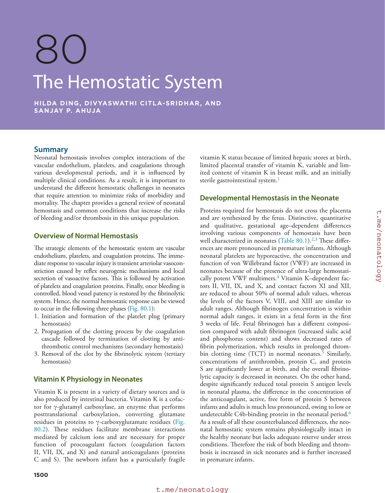

### Original source page 1500

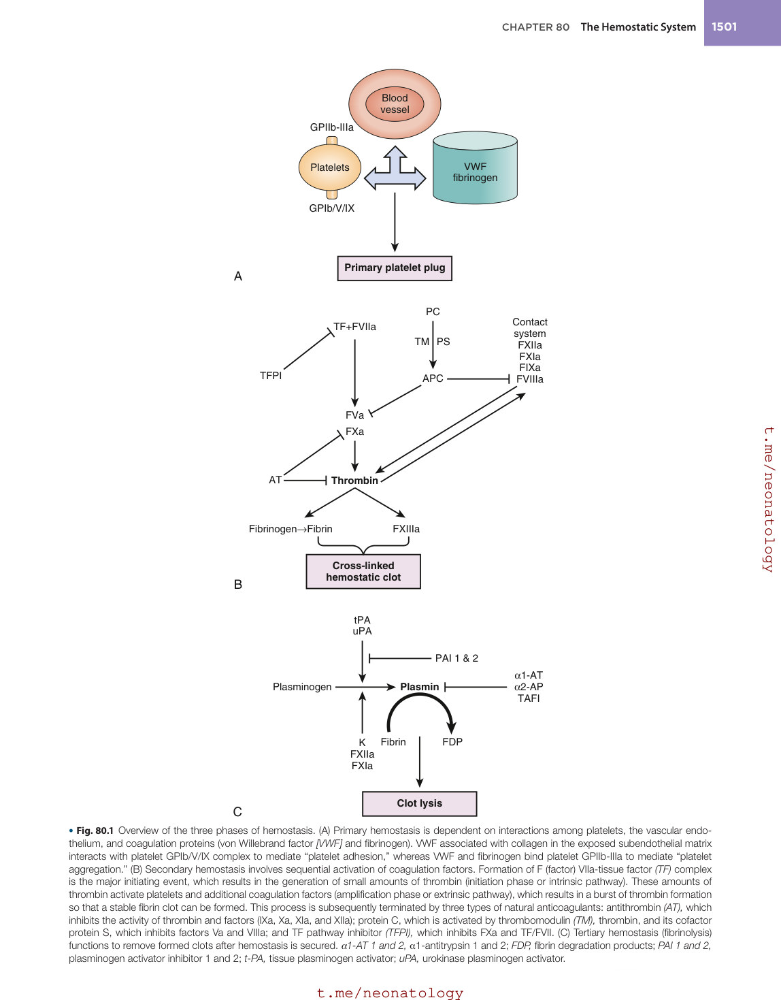

### Original source page 1501

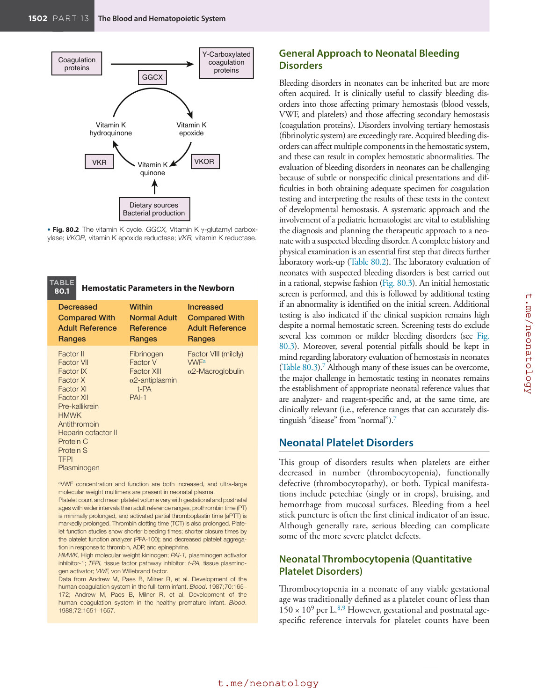

### Original source page 1502

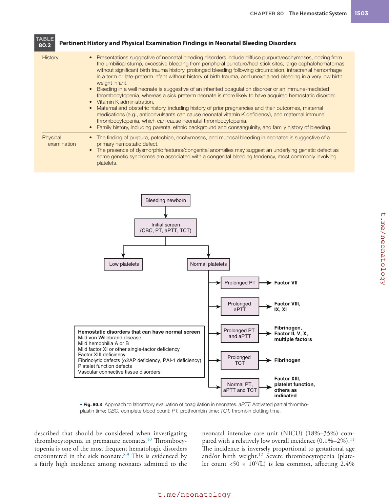

### Original source page 1503

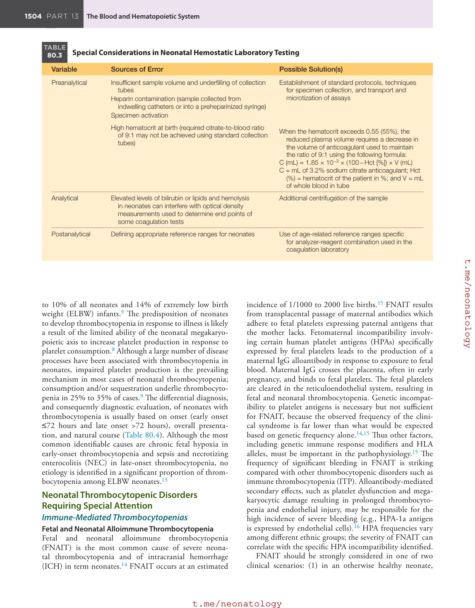

### Original source page 1504

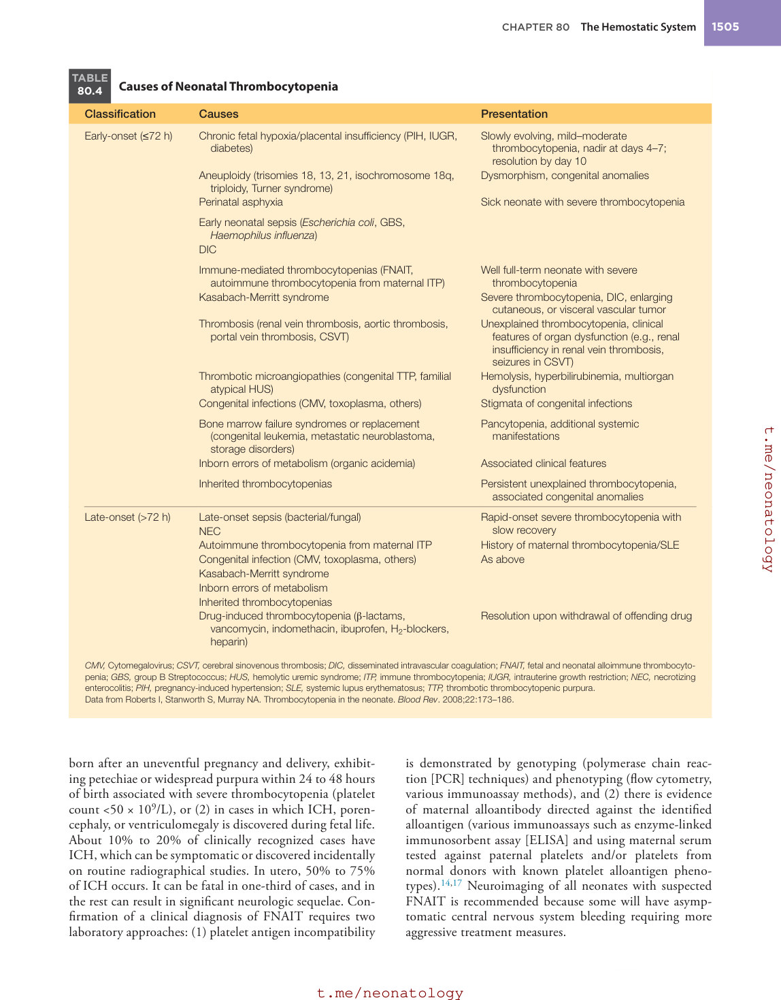

### Original source page 1505

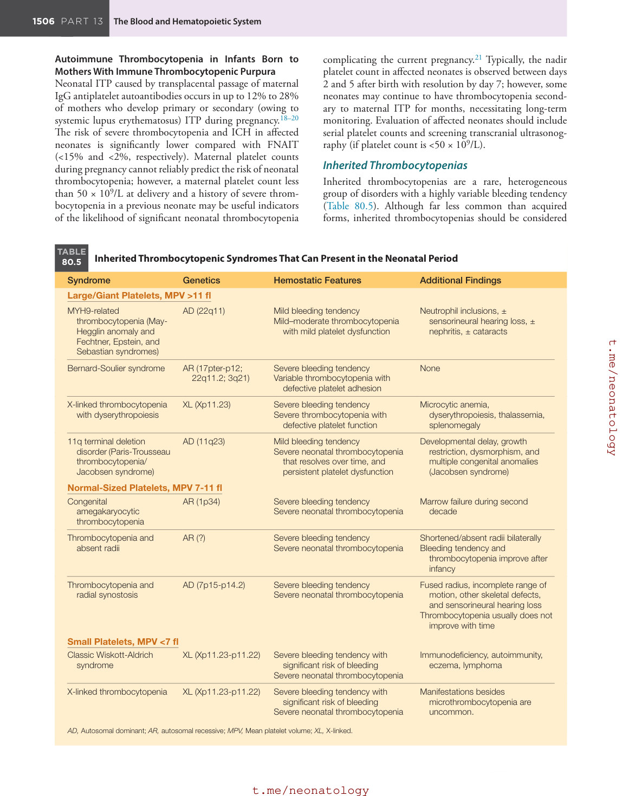

### Original source page 1506

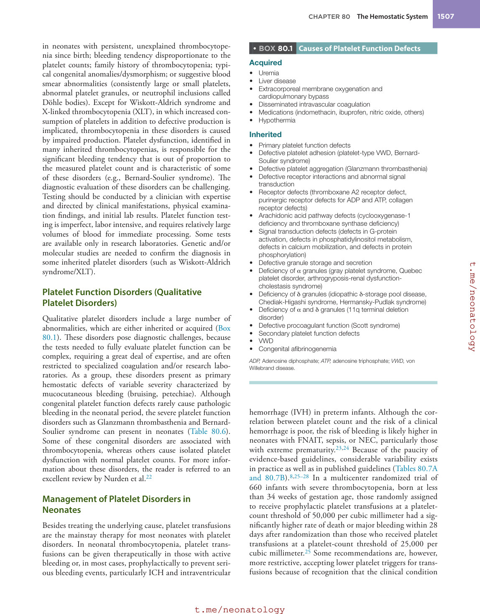

### Original source page 1507

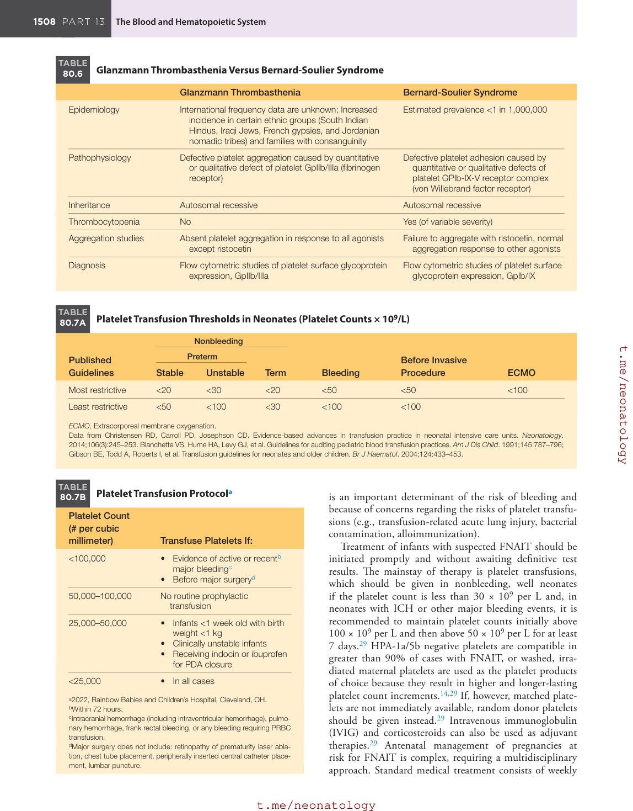

### Original source page 1510

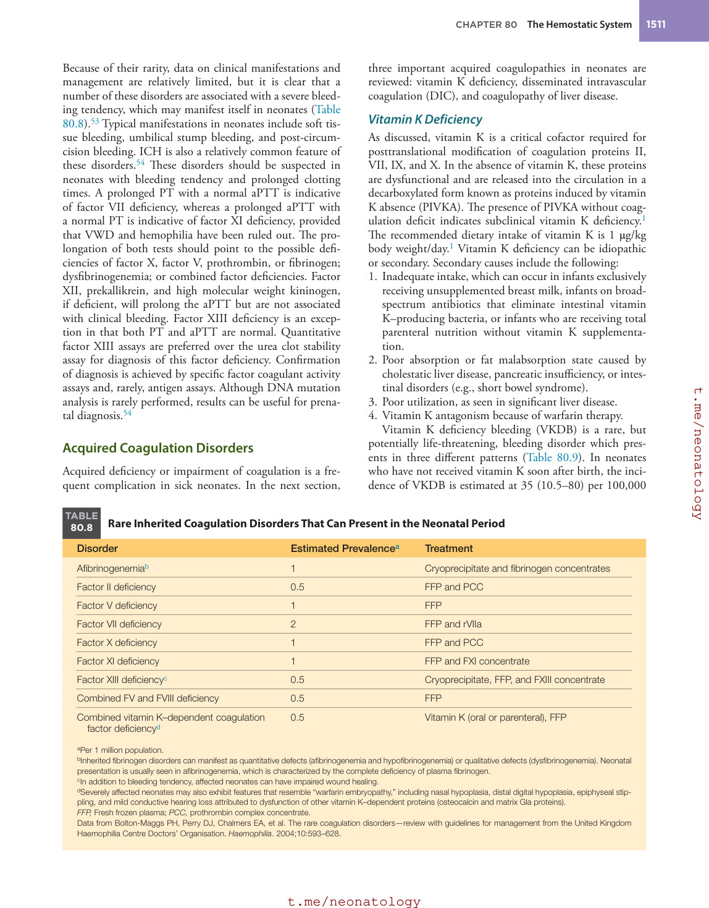

### Original source page 1511

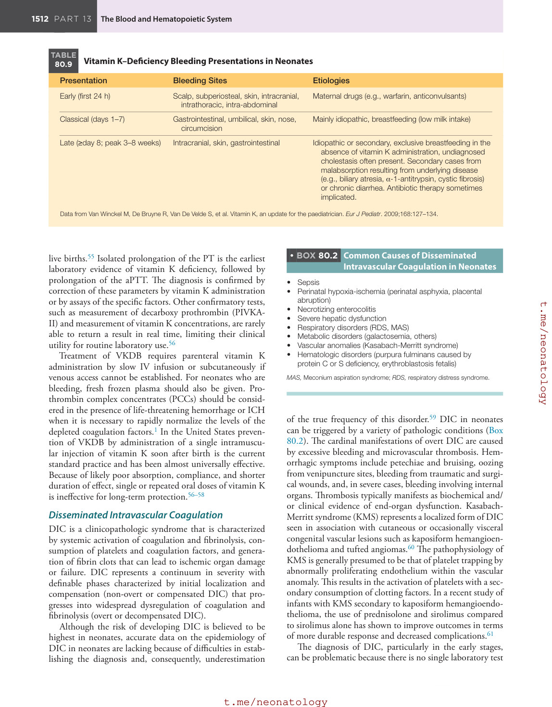

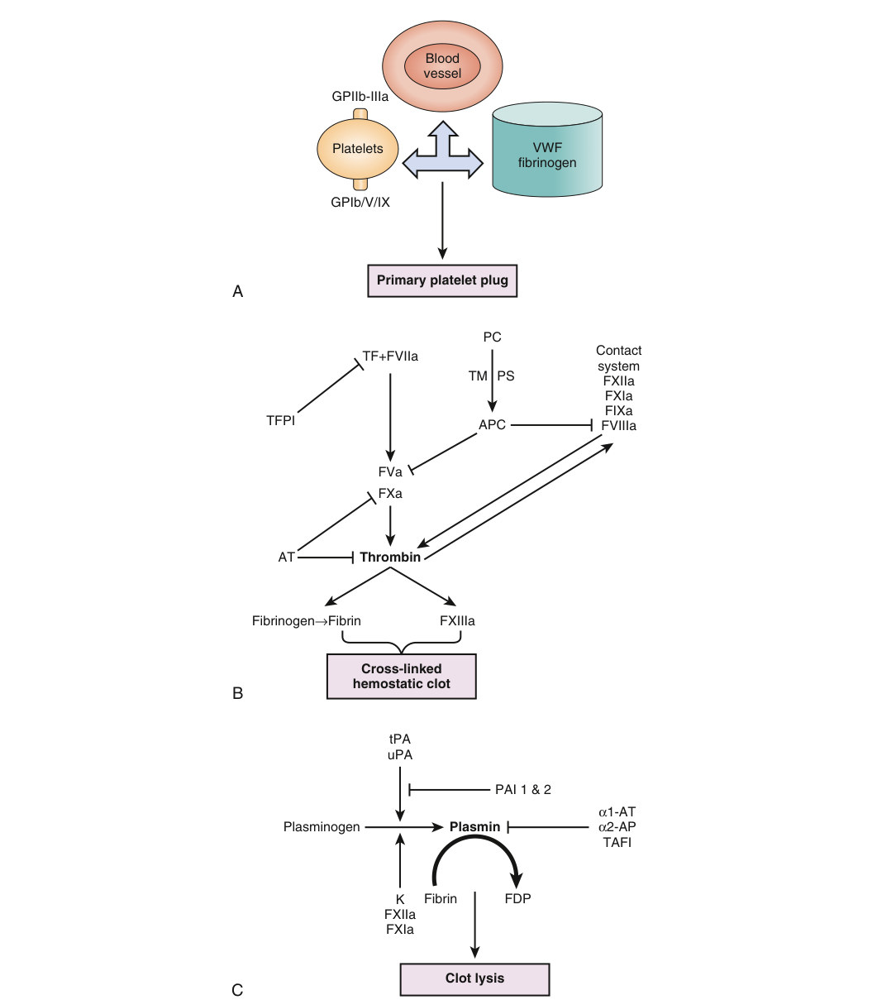

• Fig. 80.1 Overview of the three phases of hemostasis. (A) Primary hemostasis is dependent on interactions among platelets, the vascular endothelium, and coagulation proteins (von Willebrand factor [VWF] and fibrinogen). VWF associated with collagen in the exposed subendothelial matrix interacts with platelet GPIb/V/IX complex to mediate “platelet adhesion,” whereas VWF and fibrinogen bind platelet GPIIb-IIIa to mediate “platelet aggregation.” (B) Secondary hemostasis involves sequential activation of coagulation factors. Formation of F (factor) VIIa-tissue factor (TF) complex is the major initiating event, which results in the generation of small amounts of thrombin (initiation phase or intrinsic pathway). These amounts of thrombin activate platelets and additional coagulation factors (amplification phase or extrinsic pathway), which results in a burst of thrombin formation so that a stable fibrin clot can be formed. This process is subsequently terminated by three types of natural anticoagulants: antithrombin (AT), which inhibits the activity of thrombin and factors (IXa, Xa, XIa, and XIIa); protein C, which is activated by thrombomodulin (TM), thrombin, and its cofactor protein S, which inhibits factors Va and VIIIa; and TF pathway inhibitor (TFPI), which inhibits FXa and TF/FVII. (C) Tertiary hemostasis (fibrinolysis) functions to remove formed clots after hemostasis is secured. α1-AT 1 and 2, α1-antitrypsin 1 and 2; FDP, fibrin degradation products; PAI 1 and 2, plasminogen activator inhibitor 1 and 2; t-PA, tissue plasminogen activator; uPA, urokinase plasminogen activator.

PDF p. 1500

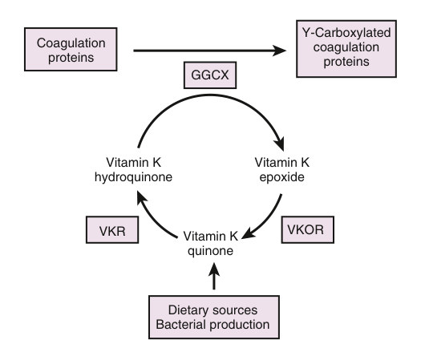

• Fig. 80.2 The vitamin K cycle. GGCX, Vitamin K γ-glutamyl carboxylase; VKOR, vitamin K epoxide reductase; VKR, vitamin K reductase.

PDF p. 1501

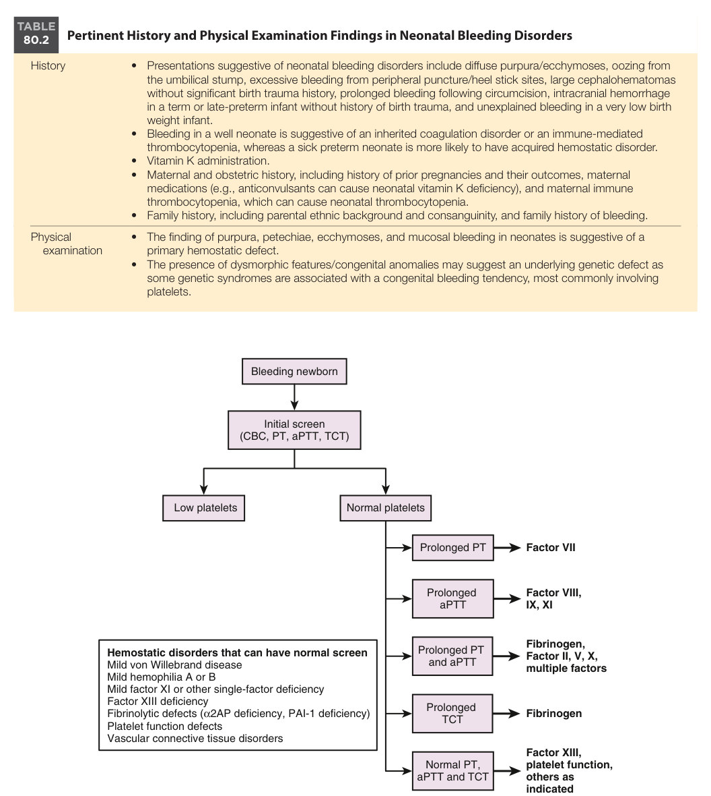

• Fig. 80.3 Approach to laboratory evaluation of coagulation in neonates. aPTT, Activated partial thromboplastin time; CBC, complete blood count; PT, prothrombin time; TCT, thrombin clotting time.

PDF p. 1502
