# 82. White Blood Cells and Immune Disorders
> Source attribution: [Source credits](../../SOURCE_CREDITS.md).

## PDF page 1552 | printed page 1553

82 White Blood Cells and

Immune Disorders

### IRINA PATEVA, VERANIA Y. HUERTA URRUTIA, JOHN LETTERIO, AND SANJAY P. AHUJA

### White Blood Cells

Human myelopoiesis begins in the embryo at about 8 weeks. Hematopoietic stem cells (HSCs) develop during embryogenesis. This process takes place in two different anatomic sites: the yolk sac and the aorta-gonad-mesonephros region. HSCs colonize the bone marrow at birth.1 By 20 weeks of gestation, neutrophils demonstrate partial functional activity. Neutrophils are derived from a common stem cell progenitor, which also gives rise to mature erythrocytes, megakaryocytes (and ultimately platelets), eosinophils, basophils, and monocytes (Fig. 82.1). Leukocytes serve as major effector cells for host defense against invading organisms. Neutrophils circulate in the blood until they encounter specific chemotactic signals that promote adhesion to the vascular endothelium and migration through (diapedesis) and movement to the sites of microbial invasion (chemotaxis). Mononuclear phagocytes (monocytes, macrophages) function primarily as cells resident within certain tissues, such as the spleen, lungs, and peritoneum, where they interact closely with lymphocytes to generate a local immune response. Both neutrophils and mononuclear phagocytes, as members of the innate immune system, take up opsonized targets (internalization, phagocytosis). The targets are then destroyed within intracellular vacuoles by the release of hydrolytic enzymes and reactive oxygen intermediates (respiratory burst activity).

Neonatal leukocytes demonstrate impaired adhesion and chemotaxis. Defects in phagocytosis are debated. Neutrophil survival appears to be decreased. A variety of recently identified growth factors and cytokines regulate proliferation and differentiation along neutrophilic lineage (see Chapter 81, Table 81.2). Granulocyte colony-stimulating factor (G-CSF) has been used in patients with low neutrophil counts.

### Number and Kinetics of Phagocytes

The circulating blood neutrophil pool reflects a dynamic equilibrium among several compartments. Within the bone marrow are the dividing (or mitotic) pool, the differentiation

(or maturation) pool, and the storage pool. Outside the bone marrow are the circulating pool, the vascular marginated pool, and the peripheral tissue pool. Neutrophils transit the circulating pool only during a brief 5- to 6-hour period before arrival in tissues. Thus changes in the white blood cell (WBC) count or differential reflect rapid changes in a relatively small yet highly fluctuant pool. Estimates suggest that the peripheral blood neutrophil count represents less than 5% of total neutrophils. About 20% are in the marrow neutrophil precursor pool, 75% are in the marrow storage pool, and 3% are in the marginated vascular pool (Table 82.1). Neutrophils have a residence time of 9 days in marrow, 5 to 6 hours in blood, and 1 to 4 days in peripheral tissues.

Neutrophil counts at birth depend on birth weight and gestational age. For term and near-term infants their absolute neutrophil count (ANC) increases at birth, followed by a sharp three- to fivefold increase (of up to ANC of 1500) in next 18 hours of life and later. It gradually decreases after this but is elevated for the first 2 months of life (Table 82.2).2 ANC values are lower in very low birth weight infants.3 ANC is the product of the total WBC count and the percentage of mature neutrophils plus bands:

ANC = WBC × (% neutrophils + % bands) × 0.01

Neutropenia is defined as an ANC value that is two standard deviations below the mean or lower than the 5th percentile. Based on Manroe et al., such value is an ANC less than 1800/μL, whereas Mouzinho charts would suggest an ANC less than 1000/μL.4

Neutrophilia is an elevation of the blood neutrophil count greater than two standard deviations above the mean or value above the 95th percentile.5

### Neutropenia

Neutropenia is a common finding in the neonatal intensive care unit (NICU), particularly during the first week of life

1553

## PDF page 1553

Stem cells

Committed progenitors

Pre-T cell

Lymphoid stem cell

Pre-B cell

BFU-E CFU-E

Meg-CFC

Multi- CFC Hematopoietic stem cell

Mast-CFC

Eo-CFC

Self-renewal

G-CFC

GM-CFC

M-CFC

Oc-CFC

• Fig. 82.1 Hematopoietic stem cell differentiation. BFU-E, Burst-forming units, erythroid; CFC, colonyforming cells; CFU-E, colony-forming unit, erythroid; Eo-CFC, eosinophil colony-forming cells; G-CFC, granulocyte colony-forming cells; GM-CFC, granulocyte-macrophage colony-forming cells; M-CFC, macrophage colony-forming cells; Meg-CFC, megakaryocyte colony-forming cells; Oc-CFC, osteoclast colony-forming cells.

TABLE

Adult Blood Neutrophil Pools and Kinetics

82.1

Pool Definition/Calculation

Total blood neutrophil pool

All neutrophils in the circulation

(TBNP)

Circulating neutrophil pool

Blood neutrophil concentration

(CNP)

multiplied by blood volume

Marginal neutrophil pool

Total blood neutrophil pool less

(MNP)

circulating pool (MNP = TBNP − CNP)

Kinetics Definition/Calculation

t1⁄2 (Blood clearance half-

Disappearance time of half of the

time)

labeled neutrophils from circulation

Neutrophil turnover rate

(NTR)

Adapted from Beutler E, Lichtman MA, Md Coller BS, et al. Williams’ Hematology. 5th ed. New York: McGraw-Hill; 1995.

and in lower birth weight and ill infants. Neutropenia results from a decline in neutrophil production or from accelerated destruction, as well as from changes in the relative distribution of neutrophils between the circulating pool and the marrow and peripheral tissue pools. Most cases are caused by acquired defects, many of which are transient. Persistent and profound neutropenia, particularly in an infant with dysmorphic features, should be investigated (Box 82.1).

Mature cells

T-lymphocyte

B-lymphocyte/ plasma cell

Erythrocyte

Megakaryocyte/ platelets

Basophil/ mast cell

Eosinophil

Neutrophil

Monocyte/ macrophage

Osteoclast

Mean Pool Size (×107/kg) 95% Limits

70 14–160

31 11–46

39 0–85

Mean Value 95% Limits

6.7 h 4–10 h

163 × 107/kg/day 50–340 × 107/kg/day

Laboratory investigation begins with a complete blood count (CBC) and evaluation of the peripheral blood smear, looking for defects in the other cell lines as well as leukocyte morphology. Serial CBCs are often appropriate before bone marrow aspiration and biopsy. Strong consideration should be made as to whether the neutropenia could be part of an immunologic defect such as severe combined immunodeficiency disorder; absolute lymphocyte count, lymphocyte

## PDF page 1554 | printed page 1555

Polymorphonuclear Leukocyte and Band

TABLE

82.2

Counts in the Newborn During the First 2 Days of Life

Absolute Neutrophil Count (per μL)

Absolute Band Count (per μL)

Band-to- Neutrophil Ratio

Age (h)

Birth 3500–6000 1300 0.14

12 8000–15,000 1300 0.14

24 7000–13,000 1300 0.14

36 5000–9000 700 0.11

48 3500–5200 700 0.11

Normal values were obtained from the assessment of 3100 separate white blood cell counts obtained from 965 infants; 513 counts were from infants considered to be completely normal at the time the count was obtained and for the preceding and subsequent 48 hours. There was no difference in the normal ranges when infants were compared by either birth weight (whether greater or less than 2500 g) or gestational age. Data from Manroe BL, Rosenfeld CR, Weinberg AG, et al. The differential leukocyte count in the assessment and outcome of early-onset neonatal group B streptococcal disease. J Pediatr. 1977;91:632–637.

• BOX 82.1 Etiologies of Early-Onset Neutropenia

• Congenital infection • Prematurity • Sepsis • Birth asphyxia • Maternal hypertension • Maternal preeclampsia • Maternal treatment with chemotherapeutic agents • Intrauterine growth restriction • Bone marrow failure syndromes • Bone marrow infiltration • Congenital neutropenias

subsets, serum immunoglobulins, and specific testing of B and T lymphocyte function may be needed. There are multiple commercially available genetic panels that can be used in the evaluation of neonates with suspected primary immune deficiency disorders (PIDDs) manifesting with neutropenia as well as congenital neutropenia syndromes. Bone marrow morphologic examination and assessment of cellularity, myeloid maturation, and presence of fibrosis can be performed. Bone marrow cytogenetics, fluorescence in situ hybridization (FISH) for suspected genetic defects or myelodysplasia, and iron staining can also be performed. Rarely, ancillary testing such as electron microscopy of the bone marrow, fetal hemoglobin levels, and pancreatic enzymes may be ordered.

Severe neutropenia is defined by an ANC less than 500/μL. Very severe neutropenia requires ANC less than 200/μL. Moderate neutropenia occurs at ANC less than 1000/μL.

Neutropenia can be either central or peripheral depending on whether or not the bone marrow is depleted in mature progenitors. Central neutropenia carries a higher infection risk.6 Infectious risk depends on the duration of neutropenia and on whether the remaining neutrophils function normally. Bacterial and fungal infections are most common in neutropenia. Typical organisms include staphylococci, streptococci, enterococci, pneumococci, Pseudomonas, gram-negative bacilli, Candida, and Aspergillus. The skin, mucous membranes, nasopharyngeal region, and lungs are most commonly infected.

### Extrinsic Defects of Phagocyte Function

Sepsis and Postinfectious Neutropenia

Infection is the most common cause of neutropenia in the neonate. Neutropenia is a risk factor for infection and sepsis, but it can also occur as a result of overwhelming sepsis. Neonates are particularly at risk for this complication because their neutrophil storage pools are smaller. Neutrophil counts are sometimes unmeasurable in the peripheral blood if the bone marrow neutrophil pool is exhausted. Both increased vascular neutrophil margination and vascular-to-tissue neutrophil movement are associated with circulating neutropenia during sepsis. Among hospitalized infants, neonatal sepsis continues to be a major cause of morbidity and mortality. Neonates with very low birth weight are most vulnerable and are prone to early- and late-onset sepsis.7 Detection of sepsis in a timely fashion is critical for the treatment and survival of the neonate. The significance of cord blood neutropenia as a screening tool for early-onset sepsis (EOS) was not clear; however, a large retrospective study published recently concluded that cord blood neutropenia was significantly associated with EOS, and the addition of cord neutropenia to current EOS risk factors increased the detection rate of EOS.8 Another recent retrospective study of neonates of less than 32 weeks’ gestation, conducted by Shah et al., demonstrated that leukopenia, neutropenia, and both leukopenia and neutropenia at birth were strongly associated with EOS.9

Cytokines such as G-CSF have been used without clear benefit in preventing sepsis in neonates. They are used more commonly, empirically, in neutropenic neonates with serious infection or sepsis.

Granulocyte transfusions are discussed in Chapter 84.

Neonatal Alloimmune Neutropenia

Neonatal alloimmune neutropenia (NAIN) is a rare cause of neutropenia with an incidence between 0.1% and 0.81%.10–12 However, it can present as severe infection with a mortality rate of up to 5%.12 The cause is analogous to Rh hemolytic disease of the newborn. The neutropenia, which can be severe, is caused by maternal sensitization to paternally inherited human neutrophil antigens (HNA). Currently, 11 HNAs within 5 different HNA systems are known: 4 HNA-1 alleles, 1 HNA-2 alleles, 2 HNA-3 alleles, 2 HNA-4 alleles, and 2 HNA-5 alleles.13,14 If maternal immunoglobulin (Ig)G crosses the placenta and coats the

## PDF page 1555

fetal neutrophils, they will be destroyed by opsonization. Isolated neutropenia (<1000/μL) with normal maternal neutrophil count should trigger suspicion. The diagnosis depends on detection of maternal antineutrophil antibodies in the serum of mother and baby.

Most common antibodies are directed against HNA-1 antigens 1a, 1b, and 1c. HNA typing of the mother and father confirms the diagnosis. If the father is homozygous, the risk for future alloimmune neutropenia is 100%. It is worth noting that, although NAIN is more common in second and subsequent pregnancies, it has been described to occur in first pregnancy.14 Affected newborns often develop fever in the first few days of life with associated cutaneous infections, omphalitis, pneumonia, otitis media, necrotizing enterocolitis, meningitis,14 and sepsis. Treatment consists of supportive care with antibiotics and sometimes G-CSF or intravenous immune globulin (IVIG). As expected for the half-life of maternal IgG, infant neutrophil counts generally return to normal within the first 1 to 3 months of life.10

Autoimmune Neutropenia of Infancy (Chronic Benign Neutropenia)

In this case, antibodies are developed by the infant against his own neutrophils. Antineutrophil antibodies have been detected in the serum of infants in the first months of life, although very rarely. It is usually diagnosed between the ages of 5 and 15 months, often discovered during the evaluation of fever or infection. A peripheral monocytosis or eosinophilia may be present. Most common is the primary autoimmune neutropenia (not associated with an underlying disorder); severe infection is uncommon, but central neutropenia raises the risk. Secondary neutropenia that is associated with autoimmune disease, infections, or drugs may be more severe.15 Because neutropenia masks signs and symptoms of severe infection and also increases infectious risk, medical evaluation is recommended for moderate to high fever, and empiric antibiotic coverage is often instituted when the ANC is less than 500 per μL. Autoimmune neutropenia is self-limited, with resolution in the first 2 to 3 years of life. Confirmatory testing demonstrates antineutrophil antibodies in the serum most often against the FcRγIIIb receptor or CD16.15 If a bone marrow analysis is performed, there may be a paucity of neutrophils and myeloid progenitor cells depending on the specificity of the antibody for mature or progenitor cell antigens. The overall bone marrow cellularity may be normal or hypercellular.6 Therapy for autoimmune neutropenia depends on the severity of the neutropenia-associated symptoms (e.g., recurrent fevers requiring frequent medical evaluations and/or severe infection). Often, no treatment is needed. Supportive care with antibiotics either for brief empiric coverage in the setting of severe neutropenia or to treat infection is important. G-CSF has been used in the setting of severe infection with neutropenia and also for prevention of recurrent symptomatic severe neutropenia.15

Neonatal Iso-Immune Neutropenia

This is noted in infants whose mothers have autoimmune disease with passive passage of maternal antineutrophil antibodies to the fetus. In such cases, both mother and infant are neutropenic. Usually neutropenia is transient and asymptomatic.16

For example, as also reported by Zuppa et al., neutropenia as a hematologic manifestation, among others (anemia, thrombocytopenia), was found at birth and in follow-up in infants whose mothers had systemic lupus erythematosus, Sjögren syndrome, or other connective tissue diseases. In all cases, the hematologic manifestations were without clinical manifestations and in most cases, there was complete normalization at 9 months.17

Drug-Induced Neutropenia

An enormous number of agents have been implicated as causes of neutropenia (Box 82.2). The mechanisms include direct bone marrow suppression or immune-mediated destruction. Anti-inflammatory drugs, semisynthetic penicillins, antiseizure medications, and a host of other drugs commonly used in the newborn nursery can cause neutropenia. Exposure of the fetus in utero to maternal treatment with chemotherapy also leads to neonatal leukopenia and neutropenia. As reported by La Nasa et al., the incidence of neutropenia peaks when chemotherapy is given 22 to 28 days before birth, whereas leukopenia is highest if delivery is less than 7 days from chemotherapy.18

Recovery from marrow toxic effects generally begins within several days after the offending agent is discontinued. As with recovery from chemotherapy-induced neutropenia, recovery of peripheral neutrophil counts is ushered in by a rise in circulating monocytes and immature neutrophils in the peripheral blood.

### Therapeutic Uses of Granulocyte Colony- Stimulating Factor and Granulocyte-Macrophage Colony-Stimulating Factor

The cytokines G-CSF and granulocyte-macrophage colony-stimulating factor (GM-CSF) are members of a family of hematopoietic growth factors that stimulate production of mature WBCs in the bone marrow. These two cytokines also enhance neutrophil and monocyte functions, such as neutrophil oxidative metabolism, chemotaxis, and phagocytosis. Both are normally present at low concentrations in serum. G-CSF levels are about threefold higher in the cord blood of premature infants than in term infants in the first 3 days of life. G-CSF levels peak at 7 hours of life, followed by a rise in the neutrophil count at about 13 hours of life.19 Whether preterm and full-term infants are capable of mounting an appropriate cytokine response to infection or sepsis, and whether neonatal cells respond adequately to cytokines, is still under investigation. The first randomized trial reported 5-year follow-up outcomes of children who received GM-CSF as very-small-for-gestational-age preterm babies. It reported that GM-CSF raised neonatal neutrophil counts but did not reduce the

## PDF page 1556 | printed page 1557

• BOX 82.2 Some Common Drugs Associated With

Idiosyncratic Neutropenia

Analgesics and Anti-Inflammatory Agents

• Indomethacina • Acetaminophen

Antibiotics

• Cephalosporins • Chloramphenicola • Clindamycin • Gentamicin • Isoniazid • Penicillins and semisynthetic penicillinsa • Rifampin • Streptomycin • Sulfonamidesa • Tetracyclines • Trimethoprim-sulfamethoxazole • Vancomycin

Anticonvulsants

• Carbamazepine • Mephenytoin • Phenytoin • Valproate

Antihistamines (H2 Blockers)

• Cimetidine • Ranitidine

Antimalarials

• Amodiaquine • Chloroquine • Dapsone • Pyrimethamine • Quinine

Cardiovascular Drugs

• Captopril • Disopyramide • Hydralazine • Methyldopa • Procainamide • Propranolol • Quinidine • Tocainide

Diuretics

• Acetazolamide • Chlorothiazide • Chlorthalidone • Ethacrynic acid • Hydrochlorothiazide

aMore often reported to cause neutropenia in epidemiologic studies. Adapted from Beutler E, Lichtman MA, Md Coller BS, et al. Williams’ Hematology. 5th ed. New York: McGraw-Hill; 1995.

prevalence of neonatal sepsis or other neonatal morbidities, nor affected neurodevelopment later in childhood.20 The utility of these growth factors in the treatment and prevention of sepsis in non-neutropenic infants, however, has not been clearly demonstrated.7,21 However, based on

limited studies, there might be utility of growth factor use when systemic infection is accompanied by severe neutropenia as it may reduce mortality.21 Newer publications demonstrate that in newborns with neutropenia (≤5000 cells/mm3), the use of GCSF reduces the risk of in-hospital death by 19% (nnt = 5).22

On the other hand, clinical trials using pharmacologic doses of G-CSF have clearly shown benefit in patients with congenital neutropenia by reducing infectious morbidity and mortality and improving quality of life.23 It is also effective in correcting immune-mediated neutropenias when patients present with infections and an ANC less than 500/μL. A recent review by Christensen summarizes the use of hematopoietic growth factors in clinical neonatology and provides guidelines for use.24

### Inherited Disorders Associated With Neutropenia

Congenital Neutropenias

The congenital neutropenias are a group of disorders that persist for at least 3 months, whether intermittent or permanent, severe or mild, with or without extra-hematopoietic findings, and that are caused by a constitutional genetic defect. About half of the genetic defects reported in neutropenia registries are in the neutrophil elastase gene ELA2, which can cause permanent or intermittent (cyclic) neutropenia. The risk of infection correlates with the severity of the neutropenia and increases with dysfunction of the neutrophils or other components of the immune system. Many of these inherited disorders also have nonhematologic manifestations and are associated with a risk of leukemogenesis that necessitates an early and accurate diagnosis.25 Treatment is supportive, with antibiotics and antifungal prophylaxis, and sometimes G-CSF. Stem cell transplantation is indicated for some syndromes.6

Congenital Neutropenia With Primarily Hematopoietic Abnormalities

Severe Congenital Neutropenia. Kostmann syndrome was the first severe congenital neutropenia to be described. In the first several months of life, infants manifest severe neutropenia (ANC <200/μL) with recurrent infections (e.g., omphalitis, skin abscesses, respiratory tract infections, sepsis). Bone marrow examination reveals a paucity of myeloid cells and arrest at the promyelocyte or myelocyte stage. Defects are found in the ELA2, HAX-1, and, less commonly, in the genes coding for the G-CSF receptor. Inheritance may be autosomal dominant, autosomal recessive, or sporadic. Antibiotic and antifungal prophylaxis, aggressive treatment of infections, and high-dose G-CSF treatment in responsive patients have improved morbidity and mortality, but early death is still common. Patients who survive early childhood are at risk for myelodysplastic syndrome and acute myeloid leukemia. Stem cell transplantation is an option for selected patients. Later neurologic manifestations of developmental delay and seizures are seen in patients with HAX-1 mutations.6

Cyclic Neutropenia and ELA2 Mutations. Cyclic neutropenia is diagnosed later than Kostmann syndrome, often in the second year of life or later. Patients present with fevers, mouth ulcers, and infections during the nadir of the ANC,

## PDF page 1557

which is documented by two to three CBCs per week for 6 weeks, to cycle neutrophil counts approximately every 21 days plus or minus 3 days. Autosomal dominant ELA2 mutations are the most common and severe. Sporadic inheritance is also described. Supportive care for fevers and infections and possible use of G-CSF to modulate the nadir are common management strategies.6

Congenital Neutropenia With Extra Hematopoietic Abnormalities

The most common congenital neutropenias with extra hematopoietic defects in neutropenia registries are HAX-1 mutations, Shwachman-Diamond syndrome (SDS), and the glucose-6-phosphatase complex disorders. Many rare congenital neutropenia syndromes have been described clinically, and some have associated genetic defects identified. Deficits in neutrophil function as well as a myriad of dysmorphic defects are associated with these syndromes, although it is important to realize that not all defects are present in the neonatal period and not all defects appear in a particular patient. The reader is referred to an excellent review of congenital neutropenia by Donadieu and co-workers for more details.6

Shwachman-Diamond Syndrome. Once believed rare, but now accounting for about one-fourth of patients in neutropenia registries, SDS is characterized by pancreatic exocrine dysfunction, failure to thrive, neutropenia of varying degrees, neutrophil chemotactic dysfunction, and many other dysmorphic features presenting at various times over the life of the patient. Bony abnormalities, rash, cytopenias, mental retardation, and failure to thrive are among the most common features. SDS is often included as part of the differential diagnoses with Pearson syndrome and cystic fibrosis. Hematologic manifestations include intermittent neutropenia, cytopenias, aplastic anemia, myelodysplastic syndrome (mutations in chromosome 7), and leukemic transformation. Autosomal recessive inheritance is described, often with defects in the SBDS gene on 7q11 with resultant defect in ribosomal function affecting multiple organ systems.26 Diagnostic testing may include radiographic demonstration of skeletal abnormalities, evidence of pancreatic insufficiency (decreased fecal elastase and low serum trypsinogen), as well as hematologic changes. Finding of typical mutation is diagnostic. Supportive care with pancreatic enzyme replacement, G-CSF for neutropenia or severe infection, antibiotics, and antifungals are recommended. Monitoring for malignant transformation is important. HSC transplantation is indicated for severe cytopenia, myelodysplastic syndrome, or acute myeloid leukemia.23

Glucose-6-Phosphatase Complex Disorders: Glycogen

Storage Disease Type 1b and G6PC3. Hepatic glycogen can be dephosphorylated by G-6-P to produce glucose as an energy source. Two of the three proteins that comprise the G-6-P complex on the endoplasmic reticulum are associated with congenital neutropenia: the translocase SLC37A4 and the catalytic protein G6PC3. G6PC3 disorders are characterized by severe, permanent neutropenia with myeloid arrest, thin skin, genitourinary abnormalities, cardiac disease, and myopathy.6

GSD1b is characterized by hypoglycemia at birth, lactic acidemia, hepatomegaly with hepatic glycogen accumulation, Crohn-like colitis, neutropenia, and variable neutrophil dysfunction. Diagnosis is based on constellation of symptoms and genetic testing. Patients respond to G-CSF, although in GSD1b, patients may develop worsening splenomegaly. acute myelogenous leukemia (AML) has been reported in GSD1b.23

### Congenital Neutropenia With Defective Immune System

As part of the innate immune system, neutrophils participate in the development of the adaptive immune system, and there are some shared receptors and proteins among lymphocytes and neutrophils. Neutropenia may be an early presenting feature of a more global and lethal immunologic defect, with or without autoimmune phenomena. Recent publications highlight the need to consider PIDDs in the differential diagnosis when evaluating infants with neutropenia.27 Young age at presentation, failure to thrive, lymphopenia, eczema, and serious infections should be signals that a comprehensive evaluation of innate and adaptive immunity should be undertaken.

X-Linked Neutropenia/Myelodysplasia

An X-linked mutation of the Wiskott-Aldrich syndrome (WAS) gene protein presents with neutropenia but without the classic WAS phenotype.

Cartilage-Hair Hypoplasia. Cartilage-hair hypoplasia is a rare autosomal recessive disorder characterized by shortlimbed dwarfism, fine hair, hyperextensible digits, increased susceptibility to infection, lymphopenia, impaired cellular immunity, and chronic neutropenia. This autosomal recessive disease is caused by mutations in RMRP, a noncoding RNA gene involved in mitochondrial DNA replication, ribosome biogenesis, and ribosomal RNA processing.6

Dyskeratosis Congenita. Dyskeratosis congenita is characterized by neutropenia (and other cytopenias), abnormal skin pigmentation, nail dystrophy, and mucosal leukoplakia. Other features include immunodeficiency, fragile bones, tooth decay, short stature, alopecia or premature graying, gonadal hypoplasia, urethral abnormalities, pulmonary fibrosis, liver cirrhosis, esophageal strictures, mental retardation, and a predisposition to cancers of the skin, gastrointestinal tract, and other sites.

### Other Related Syndromes

Bone Marrow Failure Syndromes

See Diamond-Blackfan anemia, Fanconi anemia, and SDS (Chapter 80).

Congenital Neutropenia With Inborn Errors of Metabolism

Isovaleric, methylmalonic, and propionic acidemias; hyperglycinemia; and tyrosinemia are associated with neutropenia. See Chapter 94.

### Neutrophilia

Neutrophilia is the specific elevation of the ANC more than two standard deviations above the mean. Infection is

## PDF page 1558 | printed page 1559

Hematologic Manifestations of Down

TABLE

82.3

Syndrome

Cell Defect

Red blood cell Macrocytosis

Anemia

Polycythemia

White blood cell Transient abnormal myelopoiesis

Leukocytosis

Neutropenia

Acute leukemia

Platelets Thrombocytosis

Thrombocytopenia

Adapted from Dixon N, Kishani PS, Zimmerman S. Clinical manifestations of hematologic and oncologic disorders in patients with Down syndrome. Am J Med Genet. 2006;142C:149–157.

the most common cause. Other causes include stress, birth asphyxia, and hypoxia.

### Leukemoid Reaction

Newborns sometimes mount an exaggerated response to infection. As in older children, the circulating neutrophil count increases, and a left shift occurs (band forms, myelocytes, and metamyelocytes increase in the peripheral circulation). A significant increase in early neutrophil precursors in the peripheral blood, as well as an increase in the WBC count (generally exceeding 50,000/μL), is considered a leukemoid reaction. A normal newborn in the first 2 days of life displays neutrophilia. Immature myeloid forms and even blasts can be seen in the first day or two, and these are especially common in premature infants. A leukemoid reaction associated with severe infection in the newborn often is accompanied by neutrophil cytoplasmic vacuoles and toxic granulations. A rare, autosomal dominant hereditary neutrophilia has been described.

Down Syndrome Hematologic Abnormalities and Transient Abnormal Myelopoiesis

Hematologic abnormalities are common in Down syndrome (Table 82.3). The American Academy of Pediatrics recommends ordering a CBC for newborns with Down syndrome to screen for hematologic problems. About 10% of infants who have Down syndrome develop a transient clonal myeloproliferative disorder now called transient abnormal myelopoiesis (TAM). This process also sometimes occurs in a phenotypically normal child with trisomy 21 mosaicism, including an isolated clone of trisomy 21 bone marrow cells. TAM is characterized by a leukoerythroblastic picture with megakaryoblasts in the peripheral blood, variable thrombocytopenia, and hepatosplenomegaly.28 Abnormalities of all three hematopoietic cell lineages have been described. It is believed that mutations in the megakaryocyte transcription factor GATA1 occur during the period of

• BOX 82.3 Transient Abnormal Myelopoiesis:

High-Risk Features

• WBC >100 × 109/L • Disseminated intravascular coagulation • Failure to clear blasts • Prematurity • Ascites/pleural effusion • Hepatic or renal dysfunction • Respiratory compromise

WBC, White blood cells. Adapted from Roy A, Roberts I, Vyas P. Biology and management of transient abnormal myelopoiesis (TAM) in children with Down syndrome. Semin Fetal Neonatal Med. 2012;17:196–201.

fetal liver hematopoiesis. There are no clinical, hematologic, or cytogenetic parameters that can predict if the newborn has TAM, which resolves, or acute leukemia. The median age at diagnosis of TAM is 3 to 7 days. Almost all cases are diagnosed by 2 months of age and resolve by 3 to 6 months. Transient myeloproliferative disorder can be life-threatening or fatal from complications of hepatic fibrosis/liver failure, hydrops fetalis, or hyperleukocytosis (Box 82.3).29 At least half of infants with TAM show no associated clinical symptoms (silent TAM). Recent developments in genomic technology reveal that these patients may carry minor GATA1 mutant clones. Next-generation sequencing (NGS) of TAM and myeloid leukemia of Down syndrome (ML-DS) patient samples identified additional mutations in genes involved in epigenetic regulation. DNA methylation analysis suggests that epigenetic dysregulation may be involved in the progression from TAM to ML-DS.30 About 10% to 20% of infants with TAM will develop ML-DS. Somatic mutations in GATA1 have been reported in nearly all cases of TAM and ML-DS. NGS-based methods can identify neonates with minor GATA1 mutant clones.30 In the absence of leukocytosis greater than 100,000 WBC/μL, refractory disseminated intravascular coagulation (DIC), massive organomegaly, respiratory compromise, renal dysfunction, or impending liver failure from hepatic fibrosis, pediatric oncologists adopt a wait-and-see approach in managing TAM. Infants with organ infiltration or severe leukocytosis can be managed with low-dose cytarabine.31

### Neutrophil Functional Defects

These conditions are rare; however, neonatologists need to be aware of them. Below are conditions most commonly seen in infancy.

### Oxidative Killing Disorder: Chronic Granulomatous Disease

Chronic granulomatous disease (CGD) is a rare, genetically heterogeneous disorder characterized by inherited defects in generation of the respiratory burst by nicotinamide adenine dinucleotide phosphate (NADPH) oxidase in neutrophils, monocytes, and macrophages. Some patients are mildly affected, whereas others develop severe, recurrent bacterial

## PDF page 1559

A B

C D

• Fig. 82.2 Attachment and spread of leukocyte adhesion deficiency (LAD) (A) and control (B) neutrophils through cell surface integrins, as visualized through scanning electron microscopy. Orientation and movement of LAD (C) and control (D) neutrophils to a chemotactic gradient (from the right), as visualized by means of scanning microscopy. (Adapted from Anderson DC, Schmalstieg FC, Arnaout MA, et al. Abnormalities of polymorphonuclear leukocyte function associated with a heritable deficiency of high molecular weight surface glycoproteins (GP 138): common relationship to diminished cell adherence. J Clin Invest. 1985;74:536–551.)

and fungal infections of skin, mucous membranes, liver, lung, spleen, and lymph nodes in the setting of increased or normal neutrophil counts. Catalase-positive bacteria and Aspergillus species are common pathogens. Most patients manifest symptoms within the first year of life. However, the vast majority of patients with CGD are diagnosed between 1 and 3 years of age.32 Onset of CGD has been rarely reported in neonates, and although the spectrum of microorganisms causing infections in neonates with CGD is similar to that of older patients, the clinical manifestations are more diverse.33 Inadequate neutrophil killing or ingestion is associated with a chronic inflammatory response that culminates in the formation of macrophage-containing granulomas throughout the gastrointestinal and urinary tracts. Because four distinct gene products are required for functional NADPH oxidase activity, defects in any one of these components can lead to this disorder. CGD is usually X-linked in inheritance and associated with the gp91 protein, gp91phox, but autosomal recessive forms are associated with defects in p22phox, p47phox, and p67phox. Diagnosis is made by spectrophotometric measurement of superoxide production or by measurement of reactive oxygen species production by flow cytometry, fluorometry, or chemiluminescence. Genetic analysis of affected patients can identify the specific genetic defect. Therapy involves prophylactic antibiotics and antifungal agents. Recombinant interferon-γ-1b prophylaxis

has also been effective in reducing the incidence of infections. HSC transplantation is an option for severe disease.34

### Adhesion Disorders: Leukocyte Adhesion Deficiency Types I and II

Leukocyte adhesion deficiency (LAD) includes a rare group of autosomal recessive disorders characterized by persistent leukocytosis, delayed separation of the umbilical cord, and recurrent infections. LAD-I is characterized by the impairment of the respiratory burst generation of complementopsonized microorganisms and is associated with defects in neutrophil adhesion and chemotaxis (Fig. 82.2). The clinical picture varies depending on the relative deficiency of CD18, the β2 subunit of integrin. LAD should be suspected in any infant who has unusually severe bacterial infections accompanied by normal to increased blood leukocyte counts. There is a striking absence of pus at the site of infection because neutrophils do not migrate from the vasculature to sites of inflammation within tissues. Diagnosis is made by flow cytometry analysis demonstrating a deficiency of CD18 or CD11b/CD18. Carriers can be identified by the expression of about 50% of normal CD18 on circulating neutrophils. In addition to persistent leukocytosis and recurrent bacterial infections, the autosomal recessive clinical syndrome LAD- II (Rambam-Hasharon syndrome) described in a few Israeli patients includes short stature, severe mental retardation, and

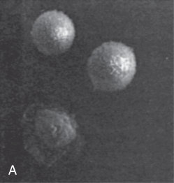

• Fig. 82.2 Attachment and spread of leukocyte adhesion deficiency (LAD) (A) and control (B) neutrophils through cell surface integrins, as visualized through scanning electron microscopy. Orientation and movement of LAD (C) and control (D) neutrophils to a chemotactic gradient (from the right), as visualized by means of scanning microscopy. (Adapted from Anderson DC, Schmalstieg FC, Arnaout MA, et al. Abnormalities of polymorphonuclear leukocyte function associated with a heritable deficiency of high molecular weight surface glycoproteins (GP 138): common relationship to diminished cell adherence. J Clin Invest. 1985;74:536–551.)

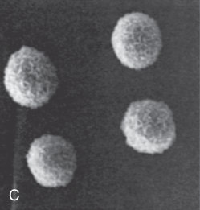

• Fig. 82.2 Attachment and spread of leukocyte adhesion deficiency (LAD) (A) and control (B) neutrophils through cell surface integrins, as visualized through scanning electron microscopy. Orientation and movement of LAD (C) and control (D) neutrophils to a chemotactic gradient (from the right), as visualized by means of scanning microscopy. (Adapted from Anderson DC, Schmalstieg FC, Arnaout MA, et al. Abnormalities of polymorphonuclear leukocyte function associated with a heritable deficiency of high molecular weight surface glycoproteins (GP 138): common relationship to diminished cell adherence. J Clin Invest. 1985;74:536–551.)

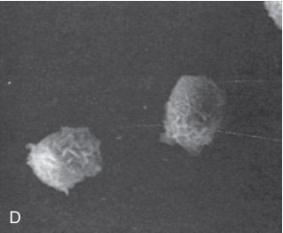

Unmatched source image; PDF page 1559. Consult the original caption.

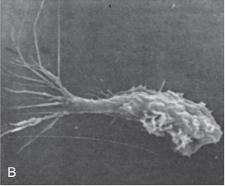

Unmatched source image; PDF page 1559. Consult the original caption.

## PDF page 1560 | printed page 1561

the hh (Bombay) RBC phenotype. The molecular defect in these patients is a defect of fucosyl transferase, the enzyme responsible for carbohydrate linkages associated with the AB blood groups, specifically the sialyl-Lewis X structure. Sialyl- Lewis X (CD15a) is necessary for the formation of the neutrophil cell surface ligand recognized by the endothelial cell surface E- and P-selectin receptors. Neutrophils from these patients exhibit markedly diminished chemotaxis in vitro but have normal levels of CD18.6

LAD-III results from a mutation in FERMT3 which encodes Kindling-3, a protein that binds β-integrin tails. Clinically, it is similar to LAD-1; however, patients are also at risk for bleeding as patients with Glanzmann thrombasthenia. HSCs are recommended for LAD-1 and LAD-3. LAD-2 patients require supportive care such as fucose supplementation.35

Chediak-Higashi Syndrome and Griscelli Syndrome Type 2

Chediak-Higashi syndrome, caused by a defective CHS1 gene, is an autosomal recessive syndrome featuring oculocutaneous albinism, nystagmus, photophobia, neurodegeneration, neutropenia, giant red inclusions in leukocytes, natural killer (NK) cell dysfunction, recurrent infection, and progression to lymphoproliferative and hemophagocytic disorders. Griscelli syndrome type 2 shares many of these features but lacks the leucocyte inclusions.6

### Neonatal Immune Deficiencies

It is important for neonatologists to understand primary immune deficiencies, as failure to recognize them early can result in delayed treatment and worse outcomes for these patients. Severe combined immune deficiency (SCID) newborn screen (NBS) using the T-cell receptor excision circle (TREC) assay has allowed early detection of T-cell lymphopenia in newborns. By November 2018, 48 states plus Puerto Rico were screening all infants for SCID, as were an increasing number of nations and jurisdictions.36 Affected infants are reliably detected and promptly referred to centers that provide immune system restoring treatments. Bone marrow transplantation (BMT) has success rates that vary from 50% to 100%.37 Patients with SCID transplanted within the first 31⁄2 months of life have a superior outcome. Population-based screening has determined the incidence of SCID to be 1 in 65,000 births, higher than previous estimates.36 An infant with recurrent infections and an ALC less than 3000/μL should warrant immediate referral and further testing of immune system.38 Absence of a thymic shadow on x-ray is another hint of SCID. Family history is important as well. SCID patients are at risk to succumb to opportunistic life-threatening infections (bacterial, fungal, viral, and mycobacterial). They are also at risk of developing graft versus host disease (GVHD) secondary to maternally derived T cells as well as transfusions with nonirradiated blood products. IVIG has a role if B-cell function is impaired.

Primary immune deficiencies can be classified based on immune cells involved (T cells, B cells, NK cells). The

majority have an alteration in more than one cellular compartment (combined immune deficiencies). Table 82.4 summarizes the most common immune deficiencies and defects involved.37 Below is a brief review of the most recognized diseases.

### Humoral Immune Defects Transient Hypogammaglobulinemia of Infancy

This is caused by a delay in maturation of immunoglobulin production and presents with prolonged hypogammaglobulinemia but is rarely symptomatic. It resolves by 3 to 4 years of age.37

### X-Linked Agammaglobulinemia

This is the most common of the agammaglobulinemias. It is caused by pathogenic variants in the BTK gene, resulting in impaired B cells differentiation and maturation.39 These patients are protected by maternal antibodies in the first months of life. Recurrent infections with encapsulated bacteria or viruses occur later. There is a lack of IgA conjunctivitis; otitis may occur earlier. The mainstay of treatment is IVIG.37

### Hyper Immunoglobulin M Syndrome

This is caused by defects in a CD40 ligand/CD40 interaction. It results in very low levels of IgG, IgA, and IgE but normal or elevated levels of IgM. The immunoglobulin class switch is impaired. Patients can present early in infancy and have neutropenia as well as typical infections characteristic for combined immune deficiencies. BMT is treatment of choice. IVIG infusions are given as well.37

### Combined Immune Deficiencies Severe Combined Immunodeficiency

Common γ Chain Deficiency (X-Linked SCID)

This condition should be considered a pediatric emergency that is fatal if untreated. Patients present within the first few months of life with recurrent sinopulmonary and skin infections and diarrhea. The pathogens include bacterial, fungal, viral, and mycobacterial organisms. GVHD from maternally acquired T cells can occur.37 These patients sometimes present with a complete absence of functional lymphocytes. B cells are preserved, but immunoglobulin production is severely reduced, if not absent.40 X-SCID is caused by mutations in the interleukin-2 receptor gamma (IL2RG) gene. The treatment is BMT.

Adenosine Deaminase Deficiency

Adenosine deaminase deficiency is the most common autosomal recessive SCID. Lack of ADA activity allows toxic metabolites to accumulate in immune cells. ADA deficiency is responsible for a severe immunodeficiency affecting all lymphoid lineages (T–B–NK–SCID). In addition to complications listed under X-linked SCID, these patients also have ribcage anomalies and osteochondral dysplasia.37 Most patients die early in life unless treated by enzyme replacement therapy (ERT), HSCT, or gene therapy.40

## PDF page 1561

Selective IgA deficiency Unknown Low IgA Gastrointestinal, respiratory, urogenital

Unknown Unknown Low IgA and IgG Recurrent bacterial and viral infections

epicanthal folds, flat nasal bridge,

IFNGR1 gene defects predisposes

encapsulated bacteria, absent

Chronic sinusitis, bronchiectasis,

that resolve by age of 4 years

AR DNMT3B B cells limited to naïve B cells Facial anomalies: low set ears,

Recurrent infections, lymphoid

cells Mycobacterial and Salmonella

hypertelorism, macroglossia

to atopy, vasculitis, positive

Inheritance Genetic Defect Affected Cells Most Common Symptoms

lymphoid tissue on exam

Recurrent infections with

Abnormal BCG response

Sinopulmonary infections

autoimmune disorders

rheumatoid factor

hyperplasia

infections

infections

CD16 deficiency FCGR3A Unknown NK cytopenia Viral (HSV)

Macrophages+/− T cells, NK

agammaglobulinemia X-linked BTK B cells with decreased

Hyper IgM heavy chain defect AR IGHM B cells with decreased

B cells with decreased

immunoglobulins

immunoglobulins

immunoglobulins

production in all

production in all

production in all

unknown ICOS, TNFRSF13B, still

learning about new

mutations

IL12RB1

IFNGR1

IFNGR2

STAT1

AR, AD IL12B

### Genetic Defects Linked to Common Immune Deficiencies

AR, some

centromeric instability,

Transient hypogamma

Interferon-γ/IL-12 axis

facial anomaly (ICF)

Immunodeficiency,

globulinemia

First few months of life: sinopulmonary

diarrhea. Bacteria, viruses, fungi,

mycobacteria, and opportunistic

and skin infections, FTT,

organisms. GVHD risk.

Same as X-linked SCID

Same as X-linked SCID

nonfunctional, hypogamma

present but nonfunctional,

present but nonfunctional,

hypogammaglobulinemia

hypogammaglobulinemia

IL2RA AR T-cell lymphopenia, B cells

IL-7 receptor α (IL7R α) IL7R AR T-cell lymphopenia, B cells

B cells present but

X-linked SCID IL2RG X-linked T-cell lymphopenia,

globulinemia

IL-2 receptor α (IL2R α)

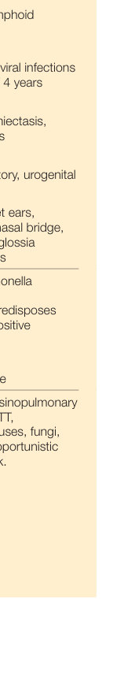

Unmatched source image; PDF page 1561. Consult the original caption.

## PDF page 1562 | printed page 1563

NK cells present Similar to Omenn syndrome. Radiation

neutropenia and thrombocytopenia.

increased IgE, diarrhea in newborns

plus neutropenia Infections characteristic of SCID, plus

May have rib cage anomalies and

Hypereosinophilia, erythroderma,

NK cells present If partial deficiency of RAG1 and

with abscesses, autoimmune

RAG2, it will result in Omenn

Can present in early infancy

Osteochondral dysplasia

cytopenias, hepatoma

syndrome (see below)

Same as X-linked SCID

Same as X-linked SCID

Same as X-linked SCID

NK cells present Same as X-linked SCID

Deafness reported.

sensitivity

Normal B cells Milder form

X-linked hyper IgM TNFSF5 Normal T-cell number, but low

Reticular dysgenesis Unknown Likely AR T-cell and B-cell lymphopenia

IgG, IgA, IgE and high IgM

ADA AR T-cell and B-cell lymphopenia

(RAG) deficiency RAG1/2 AR T-cell and B-cell lymphopenia

Artemis deficiency DCCRE1C AR T-cell and B-cell lymphopenia

present but nonfunctional,

present but nonfunctional,

present but nonfunctional,

B cells low, hypogamma

hypogammaglobulinemia

hypogammaglobulinemia

hypogammaglobulinemia

JAK3 AR T-cell lymphopenia, B cells

CD3δ deficiency CD3D AR T-cell lymphopenia, B cells

CD45 deficiency PTPRC AR T-cell lymphopenia, B cells

2, TAPBP AR Low CD8, CD4 preserved

Omenn syndrome RAG1/2 AR T-cell oligoclonal,

Normal γδ T cells

globulinemia

neutropenia

MHC I deficiencies TAP-1, TAP-

Recombinase activating gene

Adenosine deaminase

Janus kinase-3 (Jak3)

cerebellar ataxia, bronchopulmonary

AD, Autosomal dominant; AR, autosomal recessive; BCG, bacillus Calmette-Guerin; CVID, common variable immune deficiency; FTT, failure to thrive; GVHD, graft versus host disease; HSV, herpes simplex virus; Ig,

More severe than MCH I deficiencies

infections, sensitivity to ionizing

radiation and susceptibility to

immunoglobulin production Oculocutaneous telangiectasia,

cancer

immunoglobulin; IL, interleukin; IL2RG, interleukin-2 receptor gamma; MHC, major histocompatibility complex; NK, natural killer; SCID, severe combined immunodeficiency.

normal but dysfunctional CD4

ZAP70 causes low CD8 and

AR Very low CD4 count, CD8

Adapted from Kumar A, Teuber SS, Gershwin ME. Current perspectives on primary immunodeficiency diseases. Clin Dev Immunol. 2006;13(2–4):223–259.

Ataxia-telangiectasia ATM AR Impaired T cells and

Normal B cells

preserved

MHC II deficiencies RFX5, RFXAP,

RFXANK,

ZAP70,

p46Lck

CIIA,

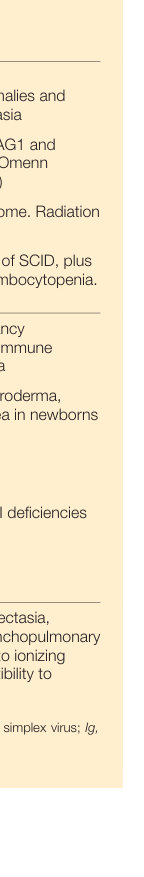

Unmatched source image; PDF page 1562. Consult the original caption.

## PDF page 1563

Omenn Syndrome (Leaky SCID)

Caused by partial deficiency of RAG1 or RAG2, this CID is characterized by splenomegaly, diarrhea, hypereosinophilia, erythroderma, and increased IgE in newborns.

### Innate Immune Defects Wart Hypogammaglobulinemia Immunodeficiency Syndrome

This autosomal dominantly inherited syndrome of bcl-x overexpression is characterized by severe neutropenia with myeloid hyperplasia and degraded precursor cells (myelokathexis) in the bone marrow, recurrent warts, hypogammaglobulinemia, and recurrent infections.6

### IRAK 4 Mutation

Defective expression of the interleukin-1 receptor-associated kinase 4 (IRAK-4) gene results in impaired innate immunity caused by defective IRAK-4. Staphylococcal and pneumococcal infections are especially common with moderate neutropenia, which may normalize during infection. Inheritance is autosomal recessive.6

### Nonmalignant Disorders of Histiocytes

### Dendritic Cell Disorders: Langerhans Cell Histiocytosis

Langerhans cell histiocytosis (LCH), the most common disorder of dendritic cells, is defined by accumulation of dendritic cells similar to Langerhans cells in various organs. The disease may be unifocal or multiorgan in involvement. Any organ can be affected, most commonly skeleton, skin, and pituitary. BRAF mutations have been identified in more than half of LCH cases. Diagnosis is made by biopsy of involved tissues and demonstration of Birbeck granules, as well as positivity for S-100, CD1a, and Langerin (CD207). LCH can occur in the perinatal period. The incidence of LCH in neonates is 15.3 per million41 and is more frequent in persons of Hispanic origin. LCH may present at birth or anytime in the neonatal period, most often with skin rashes (100%), hepatomegaly (16%), splenomegaly (13%), lymphadenopathy (10%),

Key Points

• Neutropenia is a common finding in the NICU, par-

ticularly during the first week of life and in lower birth weight and ill infants, but persistent neutropenia, particularly in an infant with dysmorphic features, should be investigated.

### References

1. Mikkola HK, Orkin SH. The journey of developing hematopoi-

etic stem cells. Development. 2006;133(19):3733–3744.

diarrhea (8%), and respiratory distress (7%).42 The extent of treatment (from observation to systemic chemotherapy) depends on disease status and should be risk adapted according to LCH guidelines.43

### Congenital Self-Healing Reticulohistiocytosis With Spontaneous Regression

This variant of LCH typically appears at birth or in the neonatal period as multiple crusted papular skin lesions. These lesions tend to resolve spontaneously within weeks to a few months leaving residual hypo- or hyperpigmentation. Extracutaneous presentation is rare. This is diagnosed by performing histology of skin lesions.44

### Hemophagocytic Lymphohistiocytosis

Hemophagocytic lymphohistiocytosis (HLH) is a condition characterized by persistent fever, cytopenias, splenomegaly, hypertriglyceridemia and/or hypofibrinogenemia, elevated serum ferritin, hemophagocytosis, low NK cell activity, and elevation in the soluble IL-2 receptor (sCD25/sIL-2R). HLH in the neonatal period is extremely rare. The incidence of neonatal HLH is not confirmed and may range from 1 in 50,000 to 150,000.45 Familial HLH, a form of primary HLH, is an autosomal recessive disorder that most often presents in infancy. Familial HLH has five subtypes described based on genes involved: one to five correspond to defects in HPLH1, PRF1, UNC13D, STX11, and STXBP2 genes, respectively.46 Demonstration of a genetic defect is diagnostic but often lags behind fulfillment of clinical criteria and the need to initiate treatment. Management of primary HLH consists of immunomodulatory therapy followed by HSC transplantation. SCID-associated HLH in neonates has been described. Neonates can also succumb to herpes simplex virus–associated HLH; therefore prompt initiation of acyclovir is needed.47

### Acknowledgments

The authors would like to acknowledge the contributions of Drs. Yaser Diab and Lori Luchtman-Jones, who were authors of this chapter in previous editions, portions of which remain unchanged.

• About 10% of infants who have Down syndrome develop

a transient clonal myeloproliferative disorder now called transient abnormal myelopoiesis (TAM). • An infant with recurrent infections and an absolute lym-

phocyte count less than 3000/μL should warrant immediate referral and further testing of the immune system.

2. Manroe B, et al. The neonatal blood count in health and disease. I.

Reference values for neutrophilic cells. J Pediatr. 1979;95(1):89–98. 3. Mouzinho A, et al. Revised reference ranges for circulat-

ing neutrophils in very-low-birth-weight neonates. Pediatrics. 1994;94(1):76–82.

## PDF page 1564 | printed page 1565

4. Maheshwari A. Neutropenia in the newborn. Curr Opin Hema-

tol. 2014;21(1):43–49. 5. Nittala S, Subbarao GC, Maheshwari A. Evaluation of neutrope-

nia and neutrophilia in preterm infants. J Matern Fetal Neonatal Med. 2012;25(suppl 5):100–103. 6. Donadieu J, et al. Congenital neutropenia: diagnosis, molecular

bases and patient management. Orphanet J Rare Dis. 2011;6:26. 7. Funke A, et al. Frequency, natural course, and outcome of neona-

tal neutropenia. Pediatrics. 2000;106(1 Pt 1):45–51. 8. Beaulieu E, Masse E, Dallaire F. Cord blood neutrope-

nia is an independent predictor of early sepsis. J Perinatol. 2017;37(11):1204–1209. 9. Shah J, et al. Leukopenia and neutropenia at birth and sepsis

in preterm neonates of <32 weeks’ gestation. Am J Perinatol. 2022;39(9):965–972. 10. Agueda S, et al. Neonatal alloimmune neutropenia: still a diag-

nostic and therapeutical challenge. J Pediatr Hematol Oncol. 2012;34(7):497–499. 11. Bux J, et al. Serological and clinical aspects of granulocyte anti-

bodies leading to alloimmune neonatal neutropenia. Transfus Med. 1992;2(2):143–149. 12. Williams BA, Fung YL. Alloimmune neonatal neutropenia: can

we afford the consequences of a missed diagnosis? J Paediatr Child Health. 2006;42(1–2):59–61. 13. Flesch BK, et al. Update on the nomenclature of human neutro-

phil antigens and alleles. Transfusion. 2016;56(6):1477–1479. 14. Porcelijn L, de Haas M. Neonatal alloimmune neutropenia.

Transfus Med Hemother. 2018;45(5):311–316. 15. Farruggia P. Immune neutropenias of infancy and childhood.

World J Pediatr. 2016;12(2):142–148. 16. Maheshwari A, Christensen RD, Calhoun DA. Immune neutro-

penia in the neonate. Adv Pediatr. 2002;49:317–339. 17. Zuppa AA, et al. Neonatal lupus: follow-up in infants with anti-

SSA/Ro antibodies and review of the literature. Autoimmun Rev. 2017;16(4):427–432. 18. La Nasa M, Gaughan J, Cardonick E. Incidence of neonatal neu-

tropenia and leukopenia after in utero exposure to chemotherapy for maternal cancer. Am J Clin Oncol. 2019;42(4):351–354. 19. Gessler P, et al. Serum concentrations of granulocyte colony-

stimulating factor in healthy term and preterm neonates and in those with various diseases including bacterial infections. Blood. 1993;82(10):3177–3182. 20. Marlow N, et al. A randomised trial of granulocyte-macrophage

colony-stimulating factor for neonatal sepsis: childhood outcomes at 5 years. Arch Dis Child Fetal Neonatal Ed. 2015;100(4):F320–F326. 21. Carr R, Modi N, Dore C. G-CSF and GM-CSF for treating

or preventing neonatal infections. Cochrane Database Syst Rev. 2003;(3):CD003066. 22. Silvinato A, et al. Neonatal sepsis with neutropenia: granulo-

cytecolony stimulating factor (G-CSF). Rev Assoc Med Bras. 2020;66(4):400. 23. Dale DC. How I manage children with neutropenia. Br J Haema-

tol. 2017;178(3):351–363. 24. Christensen RD. Medicinal uses of hematopoietic growth factors

in neonatal medicine. Handb Exp Pharmacol. 2020;261:257–283. 25. Walkovich K, Connelly JA. Congenital neutropenia and rare

functional phagocyte disorders in children. Hematol Oncol Clin North Am. 2019;33(3):533–551. 26. Burroughs L, Woolfrey A, Shimamura A. Shwachman-Diamond

syndrome: a review of the clinical presentation, molecular pathogenesis, diagnosis, and treatment. Hematol Oncol Clin North Am. 2009;23(2):233–248.

27. Michniacki TF, et al. Neutropenia is an underrecognized finding

in pediatric primary immunodeficiency diseases: an analysis of the United States Immunodeficiency Network Registry. J Pediatr Hematol Oncol. 2020;42(7):e601–e605. 28. Roy A, Roberts I, Vyas P. Biology and management of transient

abnormal myelopoiesis (TAM) in children with Down syndrome. Semin Fetal Neonatal Med. 2012;17(4):196–201. 29. Dixon N, Kishnani PS, Zimmerman S. Clinical manifestations of

hematologic and oncologic disorders in patients with Down syndrome. Am J Med Genet C Semin Med Genet. 2006;142C(3):149–157. 30. Watanabe K. Recent advances in the understanding of tran-

sient abnormal myelopoiesis in Down syndrome. Pediatr Int. 2019;61(3):222–229. 31. Bhatnagar N, et al. Transient abnormal myelopoiesis and AML

in Down syndrome: an update. Curr Hematol Malig Rep. 2016;11(5):333–341. 32. Miladinovic M, et al. Case report: symptomatic chronic gran-

ulomatous disease in the newborn. Front Immunol. 2021;12: 663883. 33. Marzollo A, et al. Neonatal manifestations of chronic granulomatous

disease: MAS/HLH and necrotizing pneumonia as unusual phenotypes and review of the literature. J Clin Immunol. 2022;42(2):299–311. 34. Segal BH, et al. Regulation of innate immunity by NADPH oxi-

dase. Free Radic Biol Med. 2012;53(1):72–80. 35. Dinauer MC. Primary immune deficiencies with defects in neu-

trophil function. Hematology Am Soc Hematol Educ Program. 2016;2016(1):43–50. 36. Kwan A, Puck JM. History and current status of newborn screen-

ing for severe combined immunodeficiency. Semin Perinatol. 2015;39(3):194–205. 37. Kumar A, Teuber SS, Gershwin ME. Current perspectives on pri-

mary immunodeficiency diseases. Clin Dev Immunol. 2006;13(2– 4):223–259. 38. McWilliams LM, Dell Railey M, Buckley RH. Positive family

history, infection, low absolute lymphocyte count (ALC), and absent thymic shadow: diagnostic clues for all molecular forms of severe combined immunodeficiency (SCID). J Allergy Clin Immunol Pract. 2015;3(4):585–591. 39. Kraft MT, et al. Identification of 22 novel BTK gene variants in

B cell deficiency with hypogammaglobulinemia. Clin Immunol. 2021;229:108788. 40. Castagnoli R, et al. Hematopoietic stem cell transplantation in

primary immunodeficiency diseases: current status and future perspectives. Front Pediatr. 2019;7:295. 41. Guyot-Goubin A, et al. Descriptive epidemiology of childhood

Langerhans cell histiocytosis in France, 2000-2004. Pediatr Blood Cancer. 2008;51(1):71–75. 42. McClain K. Histiocytic diseases of neonates: Langerhans cell

histiocytosis, Rosai-Dorfman disease, and juvenile xanthogranuloma. Clin Perinatol. 2021;48(1):167–179. 43. Haupt R, et al. Langerhans cell histiocytosis (LCH): guidelines

for diagnosis, clinical work-up, and treatment for patients till the age of 18 years. Pediatr Blood Cancer. 2013;60(2):175–184. 44. Parimi LR, et al. Congenital self-healing reticulohistiocytosis with

spontaneous regression. An Bras Dermatol. 2017;92(4):553–555. 45. McLean J, et al. Neonatal hemophagocytic lymphohistiocytosis.

NeoReviews. 2019;20(6):e316–e325. 46. Ishii E. Hemophagocytic lymphohistiocytosis in children: patho-

genesis and treatment. Front Pediatr. 2016;4:47. 47. Suzuki N, et al. Characteristics of hemophagocytic lymphohis-

tiocytosis in neonates: a nationwide survey in Japan. J Pediatr. 2009;155(2):235–238.e1.

<!-- SOURCE_LAYOUT_VIEWS -->

## Original layout views and recovered diagrams

Automatic extraction can flatten tables and superscripts. Check the original layout for numeric data, footnotes and image credits. [Source review notes](../../SOURCE_REVIEW_NOTES.md).

### Original source page 1552

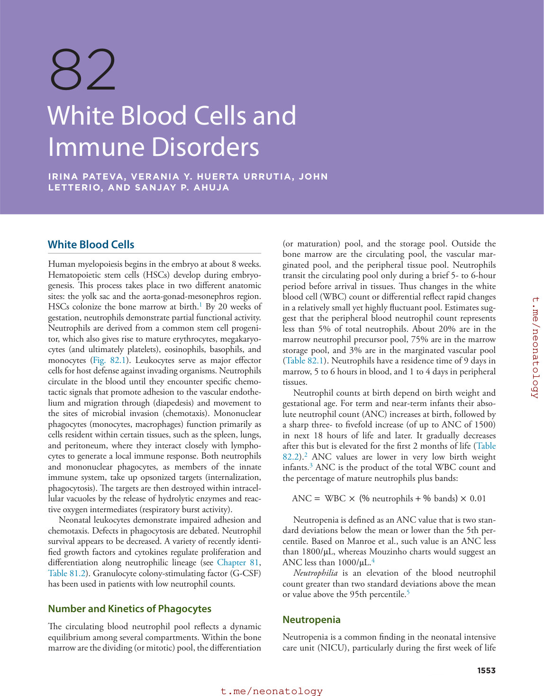

### Original source page 1553

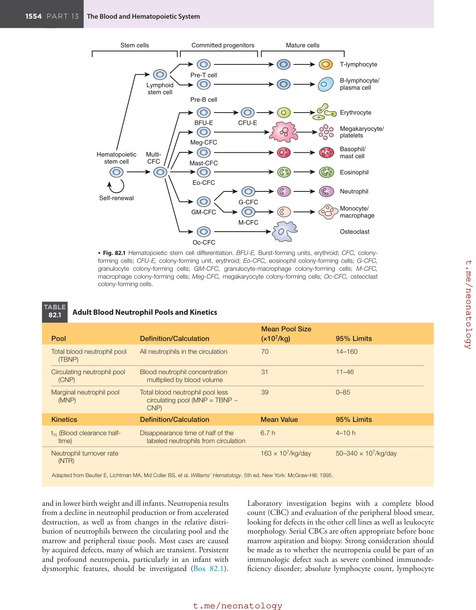

### Original source page 1554

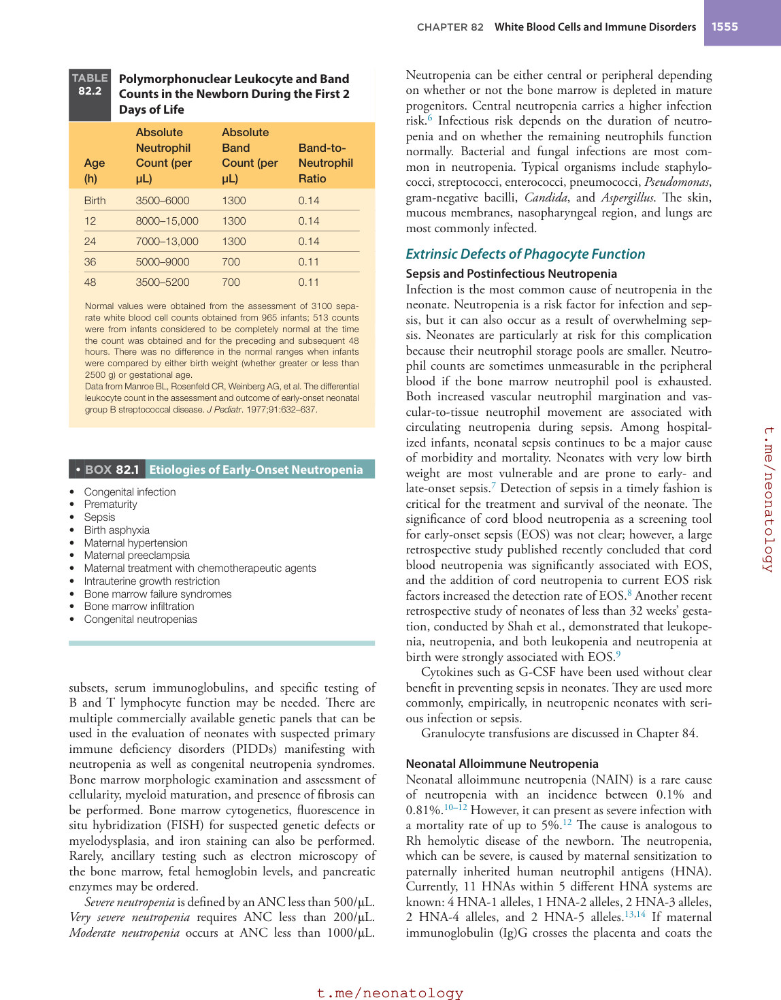

### Original source page 1558

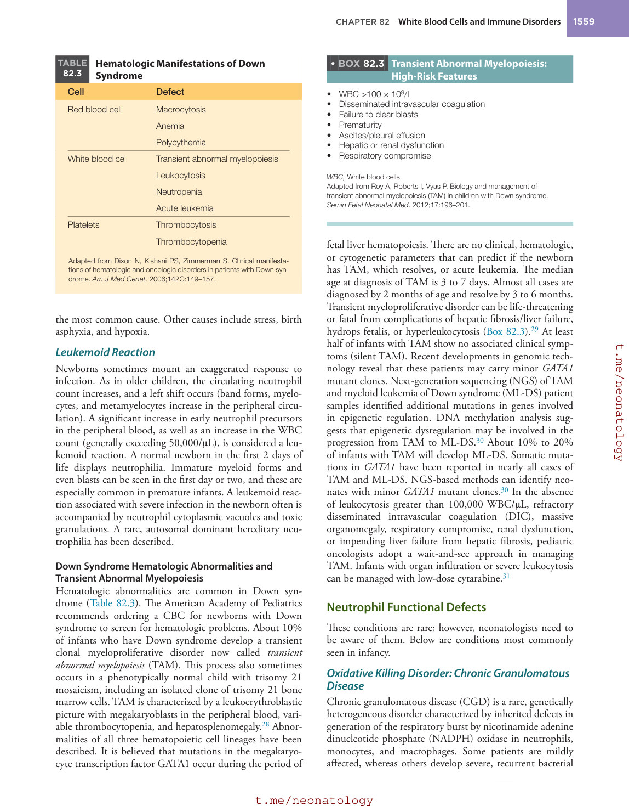

### Original source page 1559

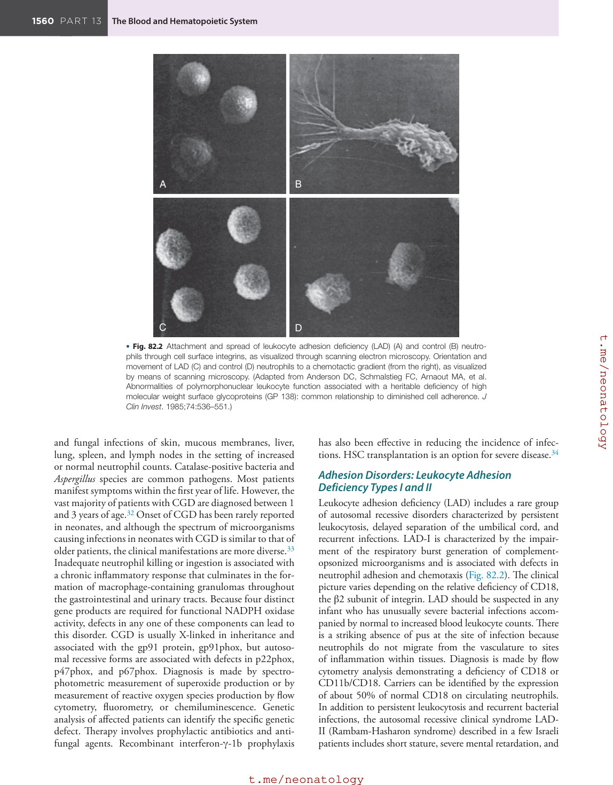

### Original source page 1560

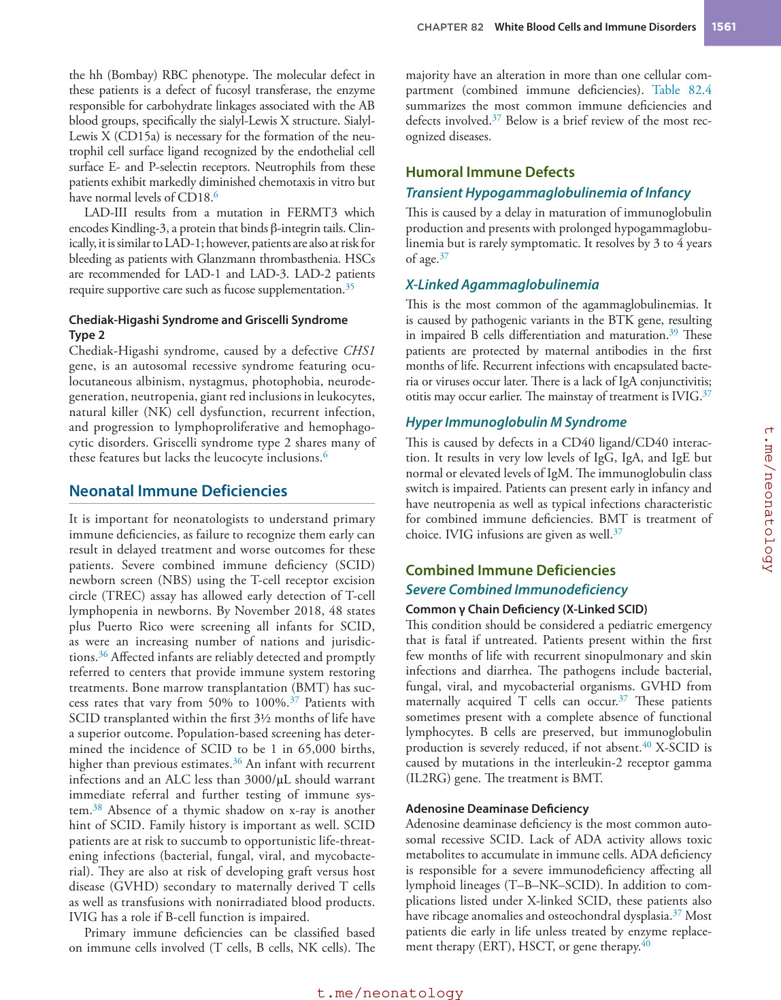

### Original source page 1561

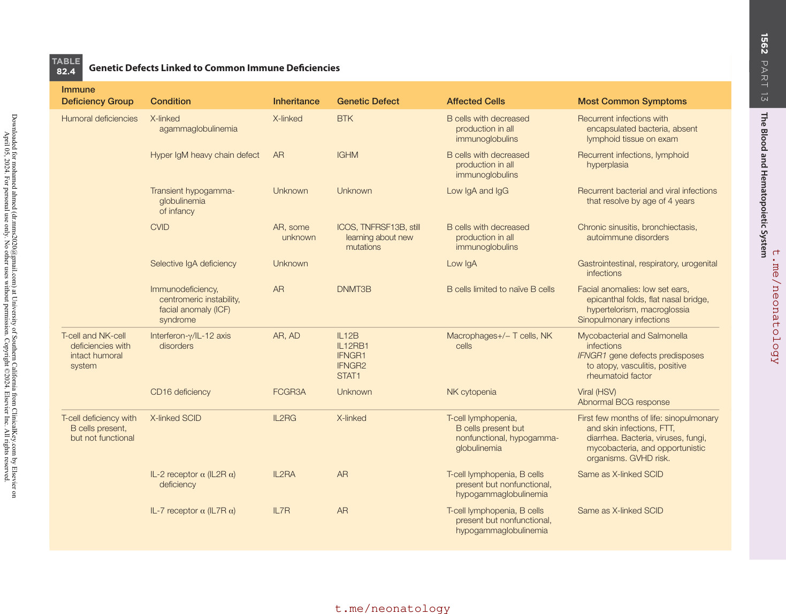

### Original source page 1562

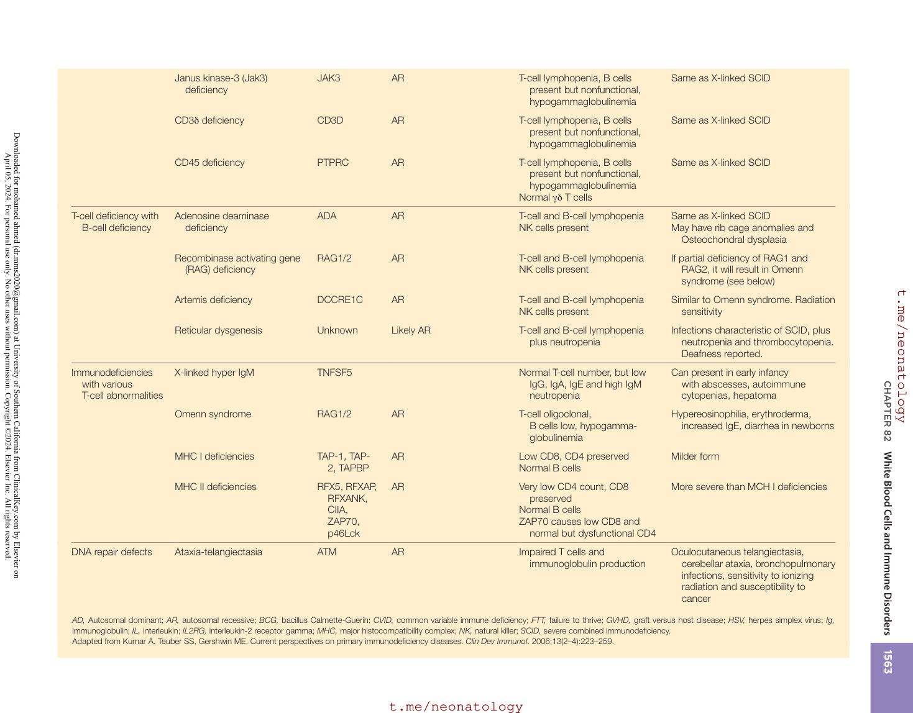

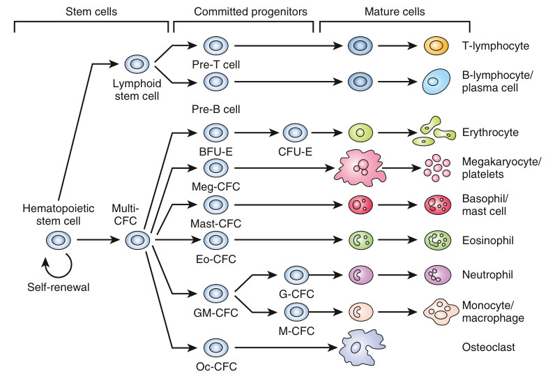

• Fig. 82.1 Hematopoietic stem cell differentiation. BFU-E, Burst-forming units, erythroid; CFC, colonyforming cells; CFU-E, colony-forming unit, erythroid; Eo-CFC, eosinophil colony-forming cells; G-CFC, granulocyte colony-forming cells; GM-CFC, granulocyte-macrophage colony-forming cells; M-CFC, macrophage colony-forming cells; Meg-CFC, megakaryocyte colony-forming cells; Oc-CFC, osteoclast colony-forming cells.

PDF p. 1553
