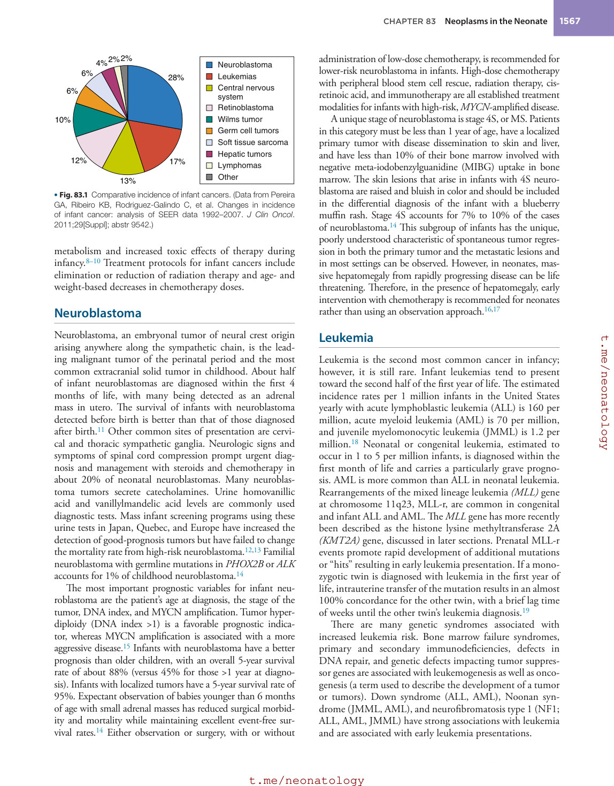
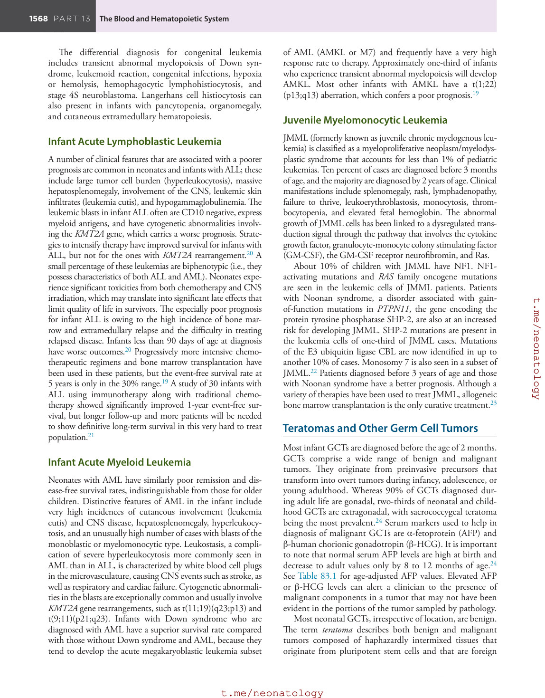
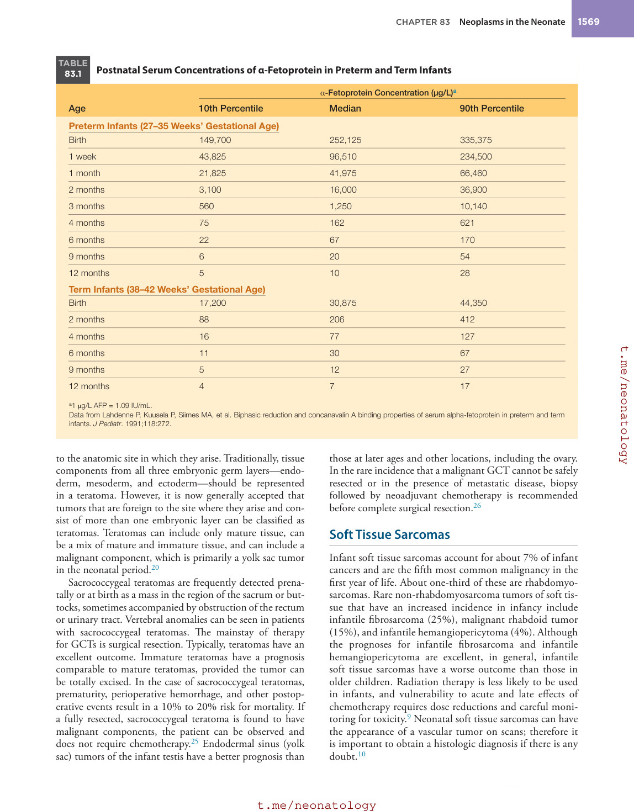
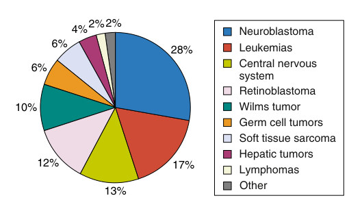

# 83. Neoplasms in the Neonate
> Source attribution: [Source credits](../../SOURCE_CREDITS.md).

## PDF page 1565 | printed page 1566

83 Neoplasms in the Neonate

### KRISTEN VANHEYST, JOHN LETTERIO, AND RACHEL EGLER

### Infant Cancer

The annual incidence of cancer in the first year of life, 236 per million infants, is the highest for all of childhood (<15 years of age) according to the National Cancer Institute’s Surveillance, Epidemiology, and End Results (SEER) statistics for the years 1992–2014. This represents 10% of all childhood malignancies. The first year of life is the only period in childhood when the incidence of cancer is not higher in males than females.1,2 Neonatal tumors comprise 2% of all childhood malignancies.3 The majority of neonatal tumors are solid and can be picked up by a perinatal ultrasound. Teratoma, a germ cell tumor (GCT) presenting most often on prenatal ultrasound in the sacrococcygeal area, is the most common neoplasm in infancy but is usually surgically excised as a nonmalignant (i.e., noncancerous) tumor. Fig. 83.1 provides a graphic summary of infant cancer incidence by common types.

In adults, cancer is thought to occur after a long interplay between environmental triggers and genetic predisposition. In infancy, especially in the neonatal period, the normal, genetically programmed protections against unregulated growth of cells fail very early. Consequently, embryonal tumors such as neuroblastoma, Wilms tumor, medulloblastoma, hepatoblastoma, and retinoblastoma are more common during this time period when compared with older ages.

It is thought that about 10% of childhood cancers are associated with a known cancer predisposition gene.4 In neonates, cancer predisposition syndromes can manifest in three ways. First among these is the identification of a tumor that has a level of association with germline cancer predisposition genes. One example of this is adrenal cortical carcinoma, which when found in the perinatal period has a probability of association with TP53 gene mutations of up to 80%.5,6 Similarly, 100% of bilateral retinoblastomas are associated with a germline RB1 gene mutation, regardless of family history. Other tumors that occur in this period with known associations with germ line mutations include rhabdoid tumors (60% have SMARCB1 mutation), pleuropulmonary blastoma (70% have DICER1 mutation), and medulloblastoma with desmoplastic or extensive nodularity subtypes (50% have SUFU mutation).

1566

The second way that a cancer predisposition may manifest during infancy is through the association with an identified syndrome with developmental defects that conveys a higher risk of cancer. An example of this would be Beckwith-Wiedemann, an overgrowth syndrome presenting with hemihypertrophy, macroglossia, omphalocele, and neonatal hypoglycemia. These patients have abnormal imprinting in the 11p15 telomeric region and are at risk for hepatoblastoma, adrenal cortical carcinoma, and Wilms tumor. Similarly, children with WAGR syndrome (Wilms tumor, aniridia, genitourinary abnormalities, mental retardation) have an 11q13 deletion and carry a 50% risk for Wilms tumor in infancy. Congenital central hypoventilation syndrome is caused by the PHOX2B gene mutation, and children with this abnormality have a 3% risk of neuroblastoma during infancy. Trisomy 21, Down syndrome, has a 4% to 10% risk of transient abnormal myelopoiesis as well as a risk of acute megakaryoblastic leukemia during infancy.

Finally, a known familial cancer predisposition syndrome may be present, either elicited through a careful family history or known from prior genetic testing, and so the practitioner should be on alert for possible tumor development. Examples of these include familial RB1 gene mutations, which manifest as retinoblastoma, TP53 mutations, or Li- Fraumeni syndrome, for which adrenal cortical carcinoma is the most common tumor of infancy, and ALK gene mutations, which are associated with familial neuroblastoma. In this setting, consultation with an experienced geneticist is crucial and may have occurred before birth or should be undertaken shortly thereafter. Unique screening protocols are available for many inherited syndromes, because each one confers a risk for distinct tumors at different developmental stages in the patient’s life.4

Historically, the 5-year overall survival rate for all neonates affected by cancer (age <1 month) is 60.3%. Neonates with extracranial solid tumors had the highest 5-year overall survival (71.2%), followed by leukemia (39.1%) and central nervous system (CNS) tumors (15%). Except for neuroblastoma, all of the neonatal tumors are known to have significantly inferior outcomes compared with those that can be achieved in older patients.7 The inferior survival rates for similar histologic tumors are likely attributable both to differences in the tumor biology and to altered drug

## PDF page 1566 | printed page 1567

6% 4%2%2%

Neuroblastoma Leukemias Central nervous system Retinoblastoma Wilms tumor Germ cell tumors Soft tissue sarcoma Hepatic tumors Lymphomas Other

28%

6%

10%

12%

17%

13%

• Fig. 83.1 Comparative incidence of infant cancers. (Data from Pereira GA, Ribeiro KB, Rodriguez-Galindo C, et al. Changes in incidence of infant cancer: analysis of SEER data 1992–2007. J Clin Oncol. 2011;29[Suppl]; abstr 9542.)

metabolism and increased toxic effects of therapy during infancy.8–10 Treatment protocols for infant cancers include elimination or reduction of radiation therapy and age- and weight-based decreases in chemotherapy doses.

### Neuroblastoma

Neuroblastoma, an embryonal tumor of neural crest origin arising anywhere along the sympathetic chain, is the leading malignant tumor of the perinatal period and the most common extracranial solid tumor in childhood. About half of infant neuroblastomas are diagnosed within the first 4 months of life, with many being detected as an adrenal mass in utero. The survival of infants with neuroblastoma detected before birth is better than that of those diagnosed after birth.11 Other common sites of presentation are cervical and thoracic sympathetic ganglia. Neurologic signs and symptoms of spinal cord compression prompt urgent diagnosis and management with steroids and chemotherapy in about 20% of neonatal neuroblastomas. Many neuroblastoma tumors secrete catecholamines. Urine homovanillic acid and vanillylmandelic acid levels are commonly used diagnostic tests. Mass infant screening programs using these urine tests in Japan, Quebec, and Europe have increased the detection of good-prognosis tumors but have failed to change the mortality rate from high-risk neuroblastoma.12,13 Familial neuroblastoma with germline mutations in PHOX2B or ALK accounts for 1% of childhood neuroblastoma.14

The most important prognostic variables for infant neuroblastoma are the patient’s age at diagnosis, the stage of the tumor, DNA index, and MYCN amplification. Tumor hyperdiploidy (DNA index >1) is a favorable prognostic indicator, whereas MYCN amplification is associated with a more aggressive disease.15 Infants with neuroblastoma have a better prognosis than older children, with an overall 5-year survival rate of about 88% (versus 45% for those >1 year at diagnosis). Infants with localized tumors have a 5-year survival rate of 95%. Expectant observation of babies younger than 6 months of age with small adrenal masses has reduced surgical morbidity and mortality while maintaining excellent event-free survival rates.14 Either observation or surgery, with or without

administration of low-dose chemotherapy, is recommended for lower-risk neuroblastoma in infants. High-dose chemotherapy with peripheral blood stem cell rescue, radiation therapy, cisretinoic acid, and immunotherapy are all established treatment modalities for infants with high-risk, MYCN-amplified disease.

A unique stage of neuroblastoma is stage 4S, or MS. Patients in this category must be less than 1 year of age, have a localized primary tumor with disease dissemination to skin and liver, and have less than 10% of their bone marrow involved with negative meta-iodobenzylguanidine (MIBG) uptake in bone marrow. The skin lesions that arise in infants with 4S neuroblastoma are raised and bluish in color and should be included in the differential diagnosis of the infant with a blueberry muffin rash. Stage 4S accounts for 7% to 10% of the cases of neuroblastoma.14 This subgroup of infants has the unique, poorly understood characteristic of spontaneous tumor regression in both the primary tumor and the metastatic lesions and in most settings can be observed. However, in neonates, massive hepatomegaly from rapidly progressing disease can be life threatening. Therefore, in the presence of hepatomegaly, early intervention with chemotherapy is recommended for neonates rather than using an observation approach.16,17

### Leukemia

Leukemia is the second most common cancer in infancy; however, it is still rare. Infant leukemias tend to present toward the second half of the first year of life. The estimated incidence rates per 1 million infants in the United States yearly with acute lymphoblastic leukemia (ALL) is 160 per million, acute myeloid leukemia (AML) is 70 per million, and juvenile myelomonocytic leukemia (JMML) is 1.2 per million.18 Neonatal or congenital leukemia, estimated to occur in 1 to 5 per million infants, is diagnosed within the first month of life and carries a particularly grave prognosis. AML is more common than ALL in neonatal leukemia. Rearrangements of the mixed lineage leukemia (MLL) gene at chromosome 11q23, MLL-r, are common in congenital and infant ALL and AML. The MLL gene has more recently been described as the histone lysine methyltransferase 2A (KMT2A) gene, discussed in later sections. Prenatal MLL-r events promote rapid development of additional mutations or “hits” resulting in early leukemia presentation. If a monozygotic twin is diagnosed with leukemia in the first year of life, intrauterine transfer of the mutation results in an almost 100% concordance for the other twin, with a brief lag time of weeks until the other twin’s leukemia diagnosis.19

There are many genetic syndromes associated with increased leukemia risk. Bone marrow failure syndromes, primary and secondary immunodeficiencies, defects in DNA repair, and genetic defects impacting tumor suppressor genes are associated with leukemogenesis as well as oncogenesis (a term used to describe the development of a tumor or tumors). Down syndrome (ALL, AML), Noonan syndrome (JMML, AML), and neurofibromatosis type 1 (NF1; ALL, AML, JMML) have strong associations with leukemia and are associated with early leukemia presentations.

## PDF page 1567

The differential diagnosis for congenital leukemia includes transient abnormal myelopoiesis of Down syndrome, leukemoid reaction, congenital infections, hypoxia or hemolysis, hemophagocytic lymphohistiocytosis, and stage 4S neuroblastoma. Langerhans cell histiocytosis can also present in infants with pancytopenia, organomegaly, and cutaneous extramedullary hematopoiesis.

### Infant Acute Lymphoblastic Leukemia

A number of clinical features that are associated with a poorer prognosis are common in neonates and infants with ALL; these include large tumor cell burden (hyperleukocytosis), massive hepatosplenomegaly, involvement of the CNS, leukemic skin infiltrates (leukemia cutis), and hypogammaglobulinemia. The leukemic blasts in infant ALL often are CD10 negative, express myeloid antigens, and have cytogenetic abnormalities involving the KMT2A gene, which carries a worse prognosis. Strategies to intensify therapy have improved survival for infants with ALL, but not for the ones with KMT2A rearrangement.20 A small percentage of these leukemias are biphenotypic (i.e., they possess characteristics of both ALL and AML). Neonates experience significant toxicities from both chemotherapy and CNS irradiation, which may translate into significant late effects that limit quality of life in survivors. The especially poor prognosis for infant ALL is owing to the high incidence of bone marrow and extramedullary relapse and the difficulty in treating relapsed disease. Infants less than 90 days of age at diagnosis have worse outcomes.20 Progressively more intensive chemotherapeutic regimens and bone marrow transplantation have been used in these patients, but the event-free survival rate at 5 years is only in the 30% range.19 A study of 30 infants with ALL using immunotherapy along with traditional chemotherapy showed significantly improved 1-year event-free survival, but longer follow-up and more patients will be needed to show definitive long-term survival in this very hard to treat population.21

### Infant Acute Myeloid Leukemia

Neonates with AML have similarly poor remission and disease-free survival rates, indistinguishable from those for older children. Distinctive features of AML in the infant include very high incidences of cutaneous involvement (leukemia cutis) and CNS disease, hepatosplenomegaly, hyperleukocytosis, and an unusually high number of cases with blasts of the monoblastic or myelomonocytic type. Leukostasis, a complication of severe hyperleukocytosis more commonly seen in AML than in ALL, is characterized by white blood cell plugs in the microvasculature, causing CNS events such as stroke, as well as respiratory and cardiac failure. Cytogenetic abnormalities in the blasts are exceptionally common and usually involve KMT2A gene rearrangements, such as t(11;19)(q23;p13) and t(9;11)(p21;q23). Infants with Down syndrome who are diagnosed with AML have a superior survival rate compared with those without Down syndrome and AML, because they tend to develop the acute megakaryoblastic leukemia subset

of AML (AMKL or M7) and frequently have a very high response rate to therapy. Approximately one-third of infants who experience transient abnormal myelopoiesis will develop AMKL. Most other infants with AMKL have a t(1;22) (p13;q13) aberration, which confers a poor prognosis.19

### Juvenile Myelomonocytic Leukemia

JMML (formerly known as juvenile chronic myelogenous leukemia) is classified as a myeloproliferative neoplasm/myelodysplastic syndrome that accounts for less than 1% of pediatric leukemias. Ten percent of cases are diagnosed before 3 months of age, and the majority are diagnosed by 2 years of age. Clinical manifestations include splenomegaly, rash, lymphadenopathy, failure to thrive, leukoerythroblastosis, monocytosis, thrombocytopenia, and elevated fetal hemoglobin. The abnormal growth of JMML cells has been linked to a dysregulated transduction signal through the pathway that involves the cytokine growth factor, granulocyte-monocyte colony stimulating factor (GM-CSF), the GM-CSF receptor neurofibromin, and Ras.

About 10% of children with JMML have NF1. NF1activating mutations and RAS family oncogene mutations are seen in the leukemic cells of JMML patients. Patients with Noonan syndrome, a disorder associated with gainof-function mutations in PTPN11, the gene encoding the protein tyrosine phosphatase SHP-2, are also at an increased risk for developing JMML. SHP-2 mutations are present in the leukemia cells of one-third of JMML cases. Mutations of the E3 ubiquitin ligase CBL are now identified in up to another 10% of cases. Monosomy 7 is also seen in a subset of JMML.22 Patients diagnosed before 3 years of age and those with Noonan syndrome have a better prognosis. Although a variety of therapies have been used to treat JMML, allogeneic bone marrow transplantation is the only curative treatment.23

### Teratomas and Other Germ Cell Tumors

Most infant GCTs are diagnosed before the age of 2 months. GCTs comprise a wide range of benign and malignant tumors. They originate from preinvasive precursors that transform into overt tumors during infancy, adolescence, or young adulthood. Whereas 90% of GCTs diagnosed during adult life are gonadal, two-thirds of neonatal and childhood GCTs are extragonadal, with sacrococcygeal teratoma being the most prevalent.24 Serum markers used to help in diagnosis of malignant GCTs are α-fetoprotein (AFP) and β-human chorionic gonadotropin (β-HCG). It is important to note that normal serum AFP levels are high at birth and decrease to adult values only by 8 to 12 months of age.24 See Table 83.1 for age-adjusted AFP values. Elevated AFP or β-HCG levels can alert a clinician to the presence of malignant components in a tumor that may not have been evident in the portions of the tumor sampled by pathology.

Most neonatal GCTs, irrespective of location, are benign. The term teratoma describes both benign and malignant tumors composed of haphazardly intermixed tissues that originate from pluripotent stem cells and that are foreign

## PDF page 1568 | printed page 1569

TABLE

Postnatal Serum Concentrations of α-Fetoprotein in Preterm and Term Infants

83.1

α-Fetoprotein Concentration (μg/L)a

Age 10th Percentile

Preterm Infants (27–35 Weeks’ Gestational Age)

Birth 149,700

1 week 43,825

1 month 21,825

2 months 3,100

3 months 560

4 months 75

6 months 22

9 months 6

12 months 5

Term Infants (38–42 Weeks’ Gestational Age)

Birth 17,200

2 months 88

4 months 16

6 months 11

9 months 5

12 months 4

a1 μg/L AFP = 1.09 IU/mL. Data from Lahdenne P, Kuusela P, Siimes MA, et al. Biphasic reduction and concanavalin A binding properties of serum alpha-fetoprotein in preterm and term infants. J Pediatr. 1991;118:272.

to the anatomic site in which they arise. Traditionally, tissue components from all three embryonic germ layers—endoderm, mesoderm, and ectoderm—should be represented in a teratoma. However, it is now generally accepted that tumors that are foreign to the site where they arise and consist of more than one embryonic layer can be classified as teratomas. Teratomas can include only mature tissue, can be a mix of mature and immature tissue, and can include a malignant component, which is primarily a yolk sac tumor in the neonatal period.20

Sacrococcygeal teratomas are frequently detected prenatally or at birth as a mass in the region of the sacrum or buttocks, sometimes accompanied by obstruction of the rectum or urinary tract. Vertebral anomalies can be seen in patients with sacrococcygeal teratomas. The mainstay of therapy for GCTs is surgical resection. Typically, teratomas have an excellent outcome. Immature teratomas have a prognosis comparable to mature teratomas, provided the tumor can be totally excised. In the case of sacrococcygeal teratomas, prematurity, perioperative hemorrhage, and other postoperative events result in a 10% to 20% risk for mortality. If a fully resected, sacrococcygeal teratoma is found to have malignant components, the patient can be observed and does not require chemotherapy.25 Endodermal sinus (yolk sac) tumors of the infant testis have a better prognosis than

Median 90th Percentile

252,125 335,375

96,510 234,500

41,975 66,460

16,000 36,900

1,250 10,140

162 621

67 170

20 54

10 28

30,875 44,350

206 412

77 127

30 67

12 27

7 17

those at later ages and other locations, including the ovary. In the rare incidence that a malignant GCT cannot be safely resected or in the presence of metastatic disease, biopsy followed by neoadjuvant chemotherapy is recommended before complete surgical resection.26

### Soft Tissue Sarcomas

Infant soft tissue sarcomas account for about 7% of infant cancers and are the fifth most common malignancy in the first year of life. About one-third of these are rhabdomyosarcomas. Rare non-rhabdomyosarcoma tumors of soft tissue that have an increased incidence in infancy include infantile fibrosarcoma (25%), malignant rhabdoid tumor (15%), and infantile hemangiopericytoma (4%). Although the prognoses for infantile fibrosarcoma and infantile hemangiopericytoma are excellent, in general, infantile soft tissue sarcomas have a worse outcome than those in older children. Radiation therapy is less likely to be used in infants, and vulnerability to acute and late effects of chemotherapy requires dose reductions and careful monitoring for toxicity.9 Neonatal soft tissue sarcomas can have the appearance of a vascular tumor on scans; therefore it is important to obtain a histologic diagnosis if there is any doubt.10

## PDF page 1569

### Rhabdomyosarcoma

Rhabdomyosarcoma is a tumor of striated muscle that accounts for about half of infant soft tissue sarcomas. One to 2% of all rhabdomyosarcomas present at birth; 5% to 10% are diagnosed in the first year of life.10 Neonatal rhabdomyosarcoma commonly occurs in the genitourinary area or trunk rather than appearing as masses in the head and neck region, as in older infants, or as masses in either the head and neck or extremities, as in older children. The prognosis depends on both the histologic type (embryonal or alveolar in best to worst order of prognosis) and the extent of tumor resection. Embryonal RMS accounts for 70% of cases. Both radiation therapy and chemotherapy are important adjuvants to surgical resection. Infants receive modified chemotherapy dosing because of poor tolerance historically, and they are less likely to receive radiation as part of local tumor therapy.9 Survival rates for neonates and infants with rhabdomyosarcoma are inferior to those of children 1 to 9 years of age, with estimated event-free survival ranging from 41% to 53% compared with 72%, an outcome that may in part be because of those modifications in therapy.10

### Infantile Fibrosarcoma

Infantile fibrosarcoma is a spindle-cell tumor of the soft tissues. It usually presents before the age of 2 years. Surgery is the mainstay of therapy, which, coupled with a good response to chemotherapy, invariably results in an excellent prognosis. A novel chromosomal translocation, t(12;15) (p13;q25), which gives rise to an ETV6-NTRK3 fusion transcript, is present in these tumors as well as in congenital mesoblastic nephroma.9 Recently TRK inhibitors have been shown to be an effective targeted therapy with a favorable toxicity profile for infantile fibrosarcoma in the relapse setting.6

### Neonatal Brain Tumors

The incidence of neonatal brain tumors is low, accounting for less than 1% of pediatric CNS malignancies. The histologic types of neonatal brain tumors differ from those found in older children and include teratomas, astrocytomas, embryonal tumors, gangliogliomas, etc. Teratomas are the most common of these tumors. Neonatal brain tumors can be diagnosed using antenatal ultrasonography, which may identify macrocephaly, hydrocephaly, or other changes suggestive of the presence of an intracranial tumor. Postnatal infants with brain tumors may present with increased head circumference, signs of increased intracranial pressure, bulging fontanelles, hypotonia, irritability, seizures, and neurologic deficits. Magnetic resonance imaging is the imaging modality of choice for postnatal diagnosis.27 For infants with suspected germ-cell tumors, checking the AFP and β-hCG values may help in diagnosis. Treatment is restricted to surgical resection and chemotherapy, if indicated. Radiation therapy should not be

used in infants because of the long-term side effects such as developmental retardation, neuroendocrine abnormalities, the risk of secondary CNS malignancies, and premature death.27 Survival in neonates with CNS tumors is poor because of the inability to perform aggressive resection, avoidance of radiation, and high-grade pathology. Also, these patients have a very high incidence of endocrine, neurologic, and cognitive deficits later in life.27

### References

1. Pereira GA, Ribeiro KB, Rodriguez-Galindo C, et al. Changes in

incidence of infant cancer: analysis of SEER data 1992-2007. J Clin Oncol. 2011;29(15 suppl):9542. 2. Wang H, Mejia MC, Gonzalez SL, et al. Cancer incidence and

survival trends among infants in the United States from 1975 to 2014. Pediatr Blood Cancer. 2021;68:e28917. 3. Moore SW, Satgé D, Sasco AJ, et al. The epidemiology of neo-

natal tumours. Report of an international working group. Pediatr Surg Int. 2003;19(7):509–519. 4. Brodeur GM, Nichols KE, Plon SE, et al. Pediatric cancer predis-

position and surveillance: an overview and a tribute to Alfred G. Knudson Jr. Clin Cancer Res. 2017;23(11):e1–e4. 5. Mitchell SG, Pencheva B, Westfall, et al. Cancer predisposition in

neonates and infants: recognition, tumor types and surveillance. Clin Perinatol. 2021;48:1–14. 6. Orbach D, Sparber-Sauer M, Laetsch TW. Spotlight on the treat-

ment of infantile fibrosarcoma in the era of neurotrophic tropomyosin receptor kinase inhibitors: international consensus and remaining controversies. Eur J Cancer. 2020;137:183–192. 7. Alfaar AS, Hassan WM, Bakry MS, Qaddoumi I. Neonates with

cancer and causes of death; lessons from 615 cases in the SEER databases. Cancer Med. 2017;6(7):1817–1826. 8. National Cancer Institute. Surveillance, Epidemiology, and End

Results (SEER) Program. http://seer.cancer.gov 9. Sultan I, Casanova M, Al-Jumaily U, et al. Soft tissue sarcomas in

the first year of life. Eur J Cancer. 2010;46(13):2449–2456. 10. Ferrari A, Orbach D, Sultan I, et al. Neonatal soft tissue sarco-

mas. Semin Fetal Neonatal Med. 2012;17:231–238. 11. Isaacs H. Fetal and neonatal neuroblastoma: retrospective review

of 271 cases. Fetal Pediatr Pathol. 2007;26(4):177–184. 12. Schilling FH, Spix C, Berthold F, et al. Neuroblastoma screening

at one year of age. N Engl J Med. 2002;346(14):1047–1052. 13. Woods WG, Gao R, Shuster J, et al. Screening of infants and mortal-

ity due to neuroblastoma. N Engl J Med. 2002;346(14):1041–1046. 14. Nuchtern JG, London WB, Barnewolt CE, et al. A prospective

study of expectant observation as primary therapy for neuroblastoma in young infants: a Children’s Oncology Group study. Ann Surg. 2012;256(4):573–580. 15. Cohn SL, Pearson AD, London WB, et al. The international neu-

roblastoma risk group (INRG) classification system: an INRG Task Force report. J Clin Oncol. 2009;27(2):289–297. 16. Schleiermacher G, Rubie H, Hartmann O, et al. Neuroblastoma

study group of the French Society of Paediatric Oncology. Treatment of stage 4s neuroblastoma—report of 10 years’ experience of the French Society of Paediatric Oncology (SFOP). Br J Cancer. 2003;89(3):470–476. 17. Nickerson HJ, Matthay KK, Seeger RC, et al. Favorable biology

and outcome of stage iv-s neuroblastoma with supportive care or minimal therapy: a Children’s Cancer Group study. J Clin Oncol. 2000;18(3):477–486.

## PDF page 1570 | printed page 1571

18. Gupta, Aditya K, et al. Juvenile myelomonocytic leukemia—A

comprehensive review and recent advances in management. Am J Blood Res. 2021;11:1–21. 19. van der Linden MH, Creemers S, Pieters R. Diagnosis and

management of neonatal leukaemia. Semin Fetal Neonatal Med. 2012;17(4):192–195. 20. Guest EM, Stam RW. Updates in the biology and therapy

for infant acute lymphoblastic leukemia. Curr Opin Pediatr. 2017;29(1):20–26. 21. van der Sluis I, de Lorenzo P, Kotecha R, et al. Blinatumomab

added to chemotherapy in infant lymphoblastic leukemia. N Engl J Med. 2023;388:1572–1581. 22. Niemeyer CM. JMML genomics and decisions. Hematology Am

Soc Hematol Educ Program. 2018;2018(1):307–312.

23. Locatelli F, Niemeyer CM. How I treat juvenile myelomonocytic

leukemia. Blood. 2015;125(7):1083–1090. 24. Sandoval JA, Williams RF. Neonatal germ cell tumors. Curr Pedi-

atr Rev. 2015;11(3):205–215. 25. Egler RA, Gosiengfiao Y, Russell H, et al. Is surgical resection

and observation sufficient for stage I and II sacrococcygeal germ cell tumors? A case series and review. Pediatr Blood Cancer. 2017;64:e26311. 26. Shah R, Weil BR, Weldon CB, et al. Neonatal malignant

disorders: germ cell tumors. Clin Perinatol. 2021;48(1):147– 165. 27. Bodeliwala S, Kumar V, Singh D. Neonatal brain tumors: a

review. J Neonatal Surg. 2017;6(2):30.

<!-- SOURCE_LAYOUT_VIEWS -->

## Original layout views and recovered diagrams

Automatic extraction can flatten tables and superscripts. Check the original layout for numeric data, footnotes and image credits. [Source review notes](../../SOURCE_REVIEW_NOTES.md).

### Original source page 1566

### Original source page 1567

### Original source page 1568

• Fig. 83.1 Comparative incidence of infant cancers. (Data from Pereira GA, Ribeiro KB, Rodriguez-Galindo C, et al. Changes in incidence of infant cancer: analysis of SEER data 1992–2007. J Clin Oncol. 2011;29[Suppl]; abstr 9542.)

PDF p. 1566
