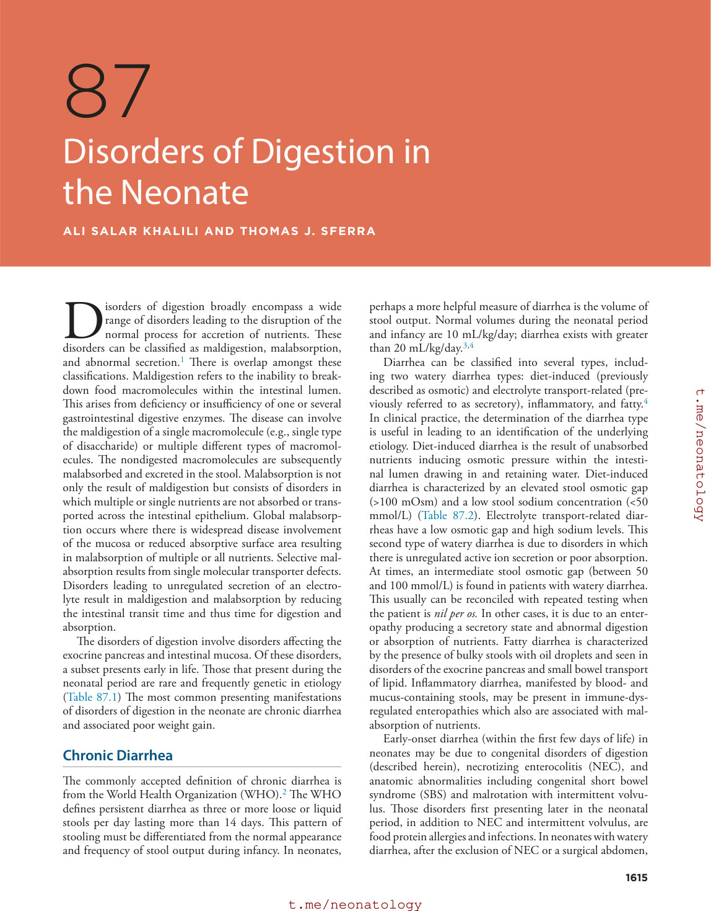
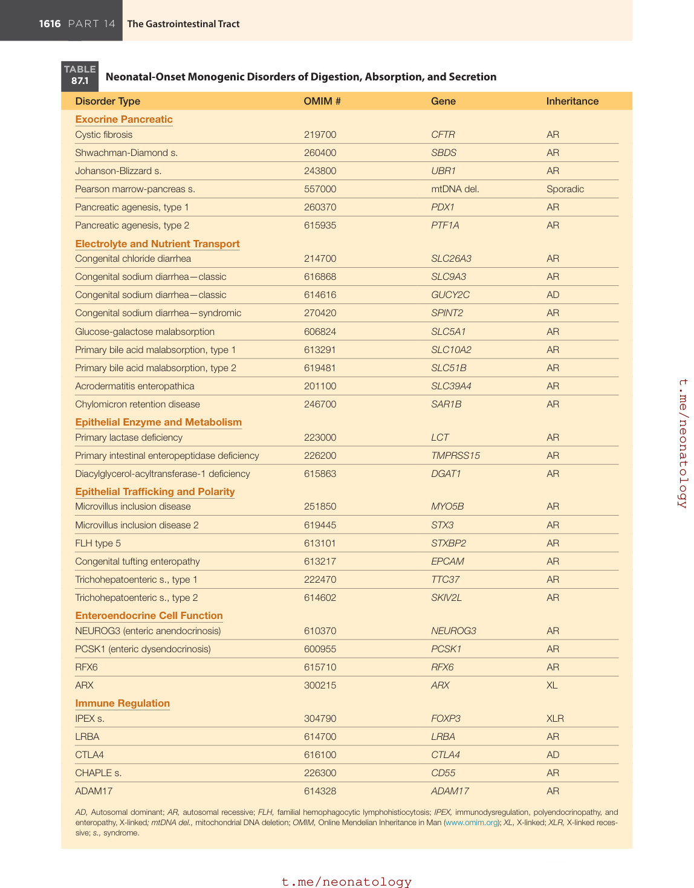
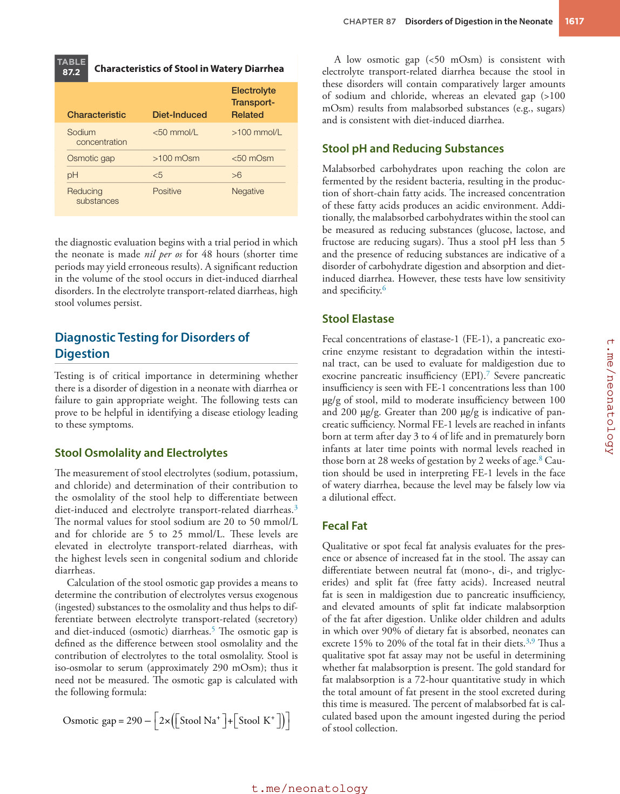

# 87. Disorders of Digestion in the Neonate
> Source attribution: [Source credits](../../SOURCE_CREDITS.md).

## PDF page 1613 | printed page 1615

87 Disorders of Digestion in the Neonate

### ALI SALAR KHALILI AND THOMAS J. SFERRA

Disorders of digestion broadly encompass a wide range of disorders leading to the disruption of the normal process for accretion of nutrients. These disorders can be classified as maldigestion, malabsorption, and abnormal secretion.1 There is overlap amongst these classifications. Maldigestion refers to the inability to breakdown food macromolecules within the intestinal lumen. This arises from deficiency or insufficiency of one or several gastrointestinal digestive enzymes. The disease can involve the maldigestion of a single macromolecule (e.g., single type of disaccharide) or multiple different types of macromolecules. The nondigested macromolecules are subsequently malabsorbed and excreted in the stool. Malabsorption is not only the result of maldigestion but consists of disorders in which multiple or single nutrients are not absorbed or transported across the intestinal epithelium. Global malabsorption occurs where there is widespread disease involvement of the mucosa or reduced absorptive surface area resulting in malabsorption of multiple or all nutrients. Selective malabsorption results from single molecular transporter defects. Disorders leading to unregulated secretion of an electrolyte result in maldigestion and malabsorption by reducing the intestinal transit time and thus time for digestion and absorption.

The disorders of digestion involve disorders affecting the exocrine pancreas and intestinal mucosa. Of these disorders, a subset presents early in life. Those that present during the neonatal period are rare and frequently genetic in etiology (Table 87.1) The most common presenting manifestations of disorders of digestion in the neonate are chronic diarrhea and associated poor weight gain.

### Chronic Diarrhea

The commonly accepted definition of chronic diarrhea is from the World Health Organization (WHO).2 The WHO defines persistent diarrhea as three or more loose or liquid stools per day lasting more than 14 days. This pattern of stooling must be differentiated from the normal appearance and frequency of stool output during infancy. In neonates,

perhaps a more helpful measure of diarrhea is the volume of stool output. Normal volumes during the neonatal period and infancy are 10 mL/kg/day; diarrhea exists with greater than 20 mL/kg/day.3,4

Diarrhea can be classified into several types, including two watery diarrhea types: diet-induced (previously described as osmotic) and electrolyte transport-related (previously referred to as secretory), inflammatory, and fatty.4 In clinical practice, the determination of the diarrhea type is useful in leading to an identification of the underlying etiology. Diet-induced diarrhea is the result of unabsorbed nutrients inducing osmotic pressure within the intestinal lumen drawing in and retaining water. Diet-induced diarrhea is characterized by an elevated stool osmotic gap (>100 mOsm) and a low stool sodium concentration (<50 mmol/L) (Table 87.2). Electrolyte transport-related diarrheas have a low osmotic gap and high sodium levels. This second type of watery diarrhea is due to disorders in which there is unregulated active ion secretion or poor absorption. At times, an intermediate stool osmotic gap (between 50 and 100 mmol/L) is found in patients with watery diarrhea. This usually can be reconciled with repeated testing when the patient is nil per os. In other cases, it is due to an enteropathy producing a secretory state and abnormal digestion or absorption of nutrients. Fatty diarrhea is characterized by the presence of bulky stools with oil droplets and seen in disorders of the exocrine pancreas and small bowel transport of lipid. Inflammatory diarrhea, manifested by blood- and mucus-containing stools, may be present in immune-dysregulated enteropathies which also are associated with malabsorption of nutrients.

Early-onset diarrhea (within the first few days of life) in neonates may be due to congenital disorders of digestion (described herein), necrotizing enterocolitis (NEC), and anatomic abnormalities including congenital short bowel syndrome (SBS) and malrotation with intermittent volvulus. Those disorders first presenting later in the neonatal period, in addition to NEC and intermittent volvulus, are food protein allergies and infections. In neonates with watery diarrhea, after the exclusion of NEC or a surgical abdomen,

1615

## PDF page 1614

TABLE

### Neonatal-Onset Monogenic Disorders of Digestion, Absorption, and Secretion

87.1

Disorder Type OMIM #

Exocrine Pancreatic

Cystic fibrosis 219700

Shwachman-Diamond s. 260400

Johanson-Blizzard s. 243800

Pearson marrow-pancreas s. 557000

Pancreatic agenesis, type 1 260370

Pancreatic agenesis, type 2 615935

Electrolyte and Nutrient Transport

Congenital chloride diarrhea 214700

Congenital sodium diarrhea—classic 616868

Congenital sodium diarrhea—classic 614616

Congenital sodium diarrhea—syndromic 270420

Glucose-galactose malabsorption 606824

Primary bile acid malabsorption, type 1 613291

Primary bile acid malabsorption, type 2 619481

Acrodermatitis enteropathica 201100

Chylomicron retention disease 246700

Epithelial Enzyme and Metabolism

Primary lactase deficiency 223000

Primary intestinal enteropeptidase deficiency 226200

Diacylglycerol-acyltransferase-1 deficiency 615863

Epithelial Trafficking and Polarity

Microvillus inclusion disease 251850

Microvillus inclusion disease 2 619445

FLH type 5 613101

Congenital tufting enteropathy 613217

Trichohepatoenteric s., type 1 222470

Trichohepatoenteric s., type 2 614602

Enteroendocrine Cell Function

NEUROG3 (enteric anendocrinosis) 610370

PCSK1 (enteric dysendocrinosis) 600955

RFX6 615710

ARX 300215

Immune Regulation

IPEX s. 304790

LRBA 614700

CTLA4 616100

CHAPLE s. 226300

ADAM17 614328

AD, Autosomal dominant; AR, autosomal recessive; FLH, familial hemophagocytic lymphohistiocytosis; IPEX, immunodysregulation, polyendocrinopathy, and enteropathy, X-linked; mtDNA del., mitochondrial DNA deletion; OMIM, Online Mendelian Inheritance in Man (www.omim.org); XL, X-linked; XLR, X-linked recessive; s., syndrome.

Gene Inheritance

CFTR AR

SBDS AR

UBR1 AR

mtDNA del. Sporadic

PDX1 AR

PTF1A AR

SLC26A3 AR

SLC9A3 AR

GUCY2C AD

SPINT2 AR

SLC5A1 AR

SLC10A2 AR

SLC51B AR

SLC39A4 AR

SAR1B AR

LCT AR

TMPRSS15 AR

DGAT1 AR

MYO5B AR

STX3 AR

STXBP2 AR

EPCAM AR

TTC37 AR

SKIV2L AR

NEUROG3 AR

PCSK1 AR

RFX6 AR

ARX XL

FOXP3 XLR

LRBA AR

CTLA4 AD

CD55 AR

ADAM17 AR

## PDF page 1615 | printed page 1617

TABLE

Characteristics of Stool in Watery Diarrhea

87.2

Electrolyte Transport- Related

Characteristic Diet-Induced

Sodium

<50 mmol/L >100 mmol/L

concentration

Osmotic gap >100 mOsm <50 mOsm

pH <5 >6

Reducing

Positive Negative

substances

the diagnostic evaluation begins with a trial period in which the neonate is made nil per os for 48 hours (shorter time periods may yield erroneous results). A significant reduction in the volume of the stool occurs in diet-induced diarrheal disorders. In the electrolyte transport-related diarrheas, high stool volumes persist.

### Diagnostic Testing for Disorders of Digestion

Testing is of critical importance in determining whether there is a disorder of digestion in a neonate with diarrhea or failure to gain appropriate weight. The following tests can prove to be helpful in identifying a disease etiology leading to these symptoms.

### Stool Osmolality and Electrolytes

The measurement of stool electrolytes (sodium, potassium, and chloride) and determination of their contribution to the osmolality of the stool help to differentiate between diet-induced and electrolyte transport-related diarrheas.3 The normal values for stool sodium are 20 to 50 mmol/L and for chloride are 5 to 25 mmol/L. These levels are elevated in electrolyte transport-related diarrheas, with the highest levels seen in congenital sodium and chloride diarrheas.

Calculation of the stool osmotic gap provides a means to determine the contribution of electrolytes versus exogenous (ingested) substances to the osmolality and thus helps to differentiate between electrolyte transport-related (secretory) and diet-induced (osmotic) diarrheas.5 The osmotic gap is defined as the difference between stool osmolality and the contribution of electrolytes to the total osmolality. Stool is iso-osmolar to serum (approximately 290 mOsm); thus it need not be measured. The osmotic gap is calculated with the following formula:

           

+ +

Osmotic gap 290 2 Stool Na Stool K = – × +

A low osmotic gap (<50 mOsm) is consistent with electrolyte transport-related diarrhea because the stool in these disorders will contain comparatively larger amounts of sodium and chloride, whereas an elevated gap (>100 mOsm) results from malabsorbed substances (e.g., sugars) and is consistent with diet-induced diarrhea.

### Stool pH and Reducing Substances

Malabsorbed carbohydrates upon reaching the colon are fermented by the resident bacteria, resulting in the production of short-chain fatty acids. The increased concentration of these fatty acids produces an acidic environment. Additionally, the malabsorbed carbohydrates within the stool can be measured as reducing substances (glucose, lactose, and fructose are reducing sugars). Thus a stool pH less than 5 and the presence of reducing substances are indicative of a disorder of carbohydrate digestion and absorption and dietinduced diarrhea. However, these tests have low sensitivity and specificity.6

### Stool Elastase

Fecal concentrations of elastase-1 (FE-1), a pancreatic exocrine enzyme resistant to degradation within the intestinal tract, can be used to evaluate for maldigestion due to exocrine pancreatic insufficiency (EPI).7 Severe pancreatic insufficiency is seen with FE-1 concentrations less than 100 μg/g of stool, mild to moderate insufficiency between 100 and 200 μg/g. Greater than 200 μg/g is indicative of pancreatic sufficiency. Normal FE-1 levels are reached in infants born at term after day 3 to 4 of life and in prematurely born infants at later time points with normal levels reached in those born at 28 weeks of gestation by 2 weeks of age.8 Caution should be used in interpreting FE-1 levels in the face of watery diarrhea, because the level may be falsely low via a dilutional effect.

### Fecal Fat

Qualitative or spot fecal fat analysis evaluates for the presence or absence of increased fat in the stool. The assay can differentiate between neutral fat (mono-, di-, and triglycerides) and split fat (free fatty acids). Increased neutral fat is seen in maldigestion due to pancreatic insufficiency, and elevated amounts of split fat indicate malabsorption of the fat after digestion. Unlike older children and adults in which over 90% of dietary fat is absorbed, neonates can excrete 15% to 20% of the total fat in their diets.3,9 Thus a qualitative spot fat assay may not be useful in determining whether fat malabsorption is present. The gold standard for fat malabsorption is a 72-hour quantitative study in which the total amount of fat present in the stool excreted during this time is measured. The percent of malabsorbed fat is calculated based upon the amount ingested during the period of stool collection.

## PDF page 1616

### α1-antitrypsin

Protein-losing enteropathies include abnormal intestinal lymphatics (e.g., lymphangiectasia) and disorders of the intestinal mucosal barrier. These disorders may manifest as chronic diarrhea with poor weight gain and be confused with disorders of digestion and absorption.10 A characteristic of these disorders is hypoproteinemia with protein loss within the intestines. This protein loss can be detected through the measurement of fecal α1-antitrypsin (A1-AT) levels.11 A1-AT is a serum protein produced by the liver. It is not excreted and is only present if there are abnormal gastrointestinal losses of protein.

### Inflammatory Markers

Fecal calprotectin and lactoferrin levels correlate with the degree of inflammation within the gastrointestinal tract. Determination of the fecal calprotectin concentration has become the more commonly used assay.12,13 The baseline level of this leukocytic cytoplasmic protein within the feces during infancy is higher than that seen in older children and adults. The normal levels in preterm and full term neonates have not been established. In a similar manner, lactoferrin levels are higher in neonatal stool. Moreover, lactoferrin is present in human milk and transits through the gastrointestinal tract unchanged.14 Thus the results of tests for fecal inflammatory markers during the neonatal period should be interpreted with caution.

### Endoscopy

Endoscopic evaluation of the upper gastrointestinal tract and colon with mucosal biopsy is uncommonly performed in neonates and may be delayed until the child is older. However, in select instances, especially those with diarrhea that is not diet-induced and have persistent, severe manifestations, these procedures are essential in arriving at a diagnosis and instituting appropriate therapy. If performed, mucosal tissue should be examined by light and electron microscopy for evidence of inflammation, an autoimmune disorder, and cellular structural abnormalities. In those with a suspected diet-induced diarrhea due to sugar malabsorption or pancreatic insufficiency, small intestinal biopsy can be performed and pancreatic fluid collected to analyze the activity of the epithelial disaccharidases and pancreatic enzymes, respectively. Although, as stated, this testing can be delayed and performed outside of the neonatal period.

### Genetic Testing

The diagnosis of many of the congenital disorders of digestion can be made or confirmed with genetic analysis. Although targeted testing for specific disorders or groups of disorders (panel DNA mutation analyses) are available for some of the disorders causing digestive abnormalities, many patients will require exome or whole genome sequencing.

### Serum Immunoreactive Trypsinogen

Serum immunoreactive trypsinogen is the basis of most neonatal screening protocols for cystic fibrosis (CF).15 The blood concentration of this protein is increased during states of pancreatic inflammation as present during infancy in most patients with CF and below normal levels in disorders with reduced pancreatic acinar cell mass (e.g., pancreatic agenesis).

### Sweat Chloride

The sweat chloride measurement by quantitative pilocarpine iontophoresis is a confirmatory test for the diagnosis of CF and is performed in infants with abnormal newborn screen for CF.16 In addition, it has a role in excluding CF in the diagnostic evaluation of patients with congenital pancreatic insufficiency who may have a falsely negative newborn screen.

### Disorders of Digestion, Absorption, and Secretion

### Exocrine Pancreatic Disorders

Monogenetic disorders resulting in EPI due to insufficient acinar pancreatic enzyme or tubular bicarbonate secretion may present early in the neonatal period with diet-induced diarrhea and poor weight gain. These are the prototypic examples of disorders of digestion (maldigestion). The stool characteristically contains excess fat and low levels of pancreatic elastase-1 (FE-1). Overall, these disorders, except for CF, are rare. In a study of over 2 million newborns in the United States, CF was found in approximately 1:2500 White and 1:6000 Black individuals.17 The next two most common disorders are Shwachman-Diamond syndrome (SDS; estimated incidence of 1:76,000) and Johanson-Blizzard syndrome (JBS) (incidence of 1:250,000).18,19 Other disorders presenting early in life with maldigestion due to EPI include pancreatic agenesis, isolated enzyme deficiency, and Pearson marrow-pancreas syndrome.20,21 The syndromic EPI disorders have characteristic physical features which may help lead to a diagnosis. The management of CF and the syndromic congenital pancreatic insufficiency disorders is complex because multiple organ systems are affected. However, treatment of the neonate with maldigestion resulting from the EPI applies to each disorder and includes pancreatic enzyme replacement therapy, elemental formula, assurance of adequate caloric intake for growth, and supplementation of fat-soluble vitamins.

### Cystic Fibrosis

Cystic fibrosis (CF) is an autosomal recessive disorder due to mutations in the CF transmembrane conductance regulator (CFTR) gene.22 More than 2000 genetic variants have been described with approximately 400 confirmed CF-disease causing mutations.23 The c.1521_1523delCTT

## PDF page 1617 | printed page 1619

(p.Phe508del) mutation is the most frequent and found on at least one allele in the majority of patients. CFTR is a multifunctional protein with a predominant role as an ATP-gated chloride channel within the epithelia of multiple organs.24 The disease can be diagnosed in neonatal screening programs using the measurement of immunoreactive trypsinogen within dried blood spots and confirmatory CFTR sequencing and sweat chloride determination.16 CF is characterized by progressive lung disease and pancreatic insufficiency. Approximately 60% of patients have pancreatic insufficiency at birth.25 Overall, 80% to 85% of patients with CF develop pancreatic insufficiency. At birth, a frequent manifestation is obstruction of the distal ileum by a thick meconium plug known as meconium ileus. Meconium ileus may lead to intestinal perforation and peritonitis. Other presentations include failure to gain weight and diarrhea (most commonly fatty). Some neonates develop conjugated hyperbilirubinemia due to inspissated biliary secretions.

### Shwachman-Diamond Syndrome

SDS is an autosomal recessive disorder associated with mutations in the Shwachman-Bodian-Diamond syndrome (SBDS) gene.26 The majority of individuals (90%) have identified biallelic mutations in the SBDS gene. The SBDS gene is involved in the regulation of ribosomal biogenesis. The clinical features include hematologic abnormalities (bone marrow failure, myelodysplasia, and acute leukemia), skeletal abnormalities, and EPI.27 Neonates may present with diet-induced diarrhea containing excess fat and growth failure. However, presentation is most frequently during late infancy with neutropenia, steatorrhea, and failure to thrive. The diagnosis is suggested by low levels of pancreatic elastase-1 in the stool (FE-1) and abdominal imaging demonstrating fatty replacement (lipomatosis) of the pancreas. Confirmation of the diagnosis is with genetic analysis.

### Johanson-Blizzard Syndrome

JBS is an autosomal recessive disorder associated with mutations in the UBR1 gene that encodes one of the E3 ubiquitin ligases of the N-end rule pathway.19,28 Patients with this disorder most frequently manifest severe congenital EPI due to intrauterine lipomatous replacement of the exocrine pancreas (islet cells are relatively preserved). Patients characteristically have hypoplasia or aplasia of the nasal alae. Other physical features include cutis aplasia of the scalp, dental abnormalities, sensorineural healing loss, hypothyroidism, imperforate anus, genitourinary malformation, cardiac defects, and developmental delay.29

### Epithelial Electrolyte and Nutrient Transport Disorders

The most common causes of congenital diarrhea associated with maldigestion and malabsorption are those involving epithelial proteins regulating the transport of specific electrolytes and nutrients. Included in this disease category

are autosomal recessive (except for one form of congenital sodium diarrhea that is autosomal dominant), monogenic disorders with abnormalities in the transport of sodium, chloride, zinc, fat, and bile acids. There are several other nutrient transport disorders that do not first present during the neonatal period. These include Hartnup disease (defect in intestinal and renal transport of neutral α-amino acids), lysinuric protein intolerance (deficient intestinal and renal transport of basic amino acids), and disorders of fat absorption (hypobetalipoproteinemia, abetalipoproteinemia).

### Congenital Chloride Diarrhea

Congenital chloride diarrhea is due to mutations in the solute carrier family 26, member 3 (SLC26A3) gene. This Cl−/ HCO3− exchange transporter is expressed within the distal small bowel and colon, and in conjunction with Na+/H+ exchangers is required for electroneutral sodium absorption.30 Thus chloride and sodium are lost in the stool. This disorder occurs more frequently in Finnish, Polish, and Arab populations.31,32 The disease begins in utero and manifests as polyhydramnios. Watery diarrhea is present at birth. The lack of functional Cl−/HCO3− exchange leads to hypochloremic hypokalemic metabolic alkalosis with intravascular volume contraction.33 The diarrhea persists when the neonate is made nil per os and the stool contains high chloride levels (>90 mmol/L) and low pH. Treatment in the neonatal period requires intravenous replacement of fluid and electrolytes with the goal of eventually transitioning to oral replacement. Oral butyrate has been used with variable success in the treatment of congenital chloride diarrhea.34 The efficacy of this treatment may be dependent on the particular SLC26A3 mutation and the profile of other chloride regulating genes.35

### Congenital Sodium Diarrhea

Two forms of congenital sodium diarrhea have been described: classic and syndromic. The classic or nonsyndromic form is associated with alterations in the sodium-hydrogen exchanger 3 (NHE3) (sodium-hydrogen antiporter 3, SLC9A3) gene or the guanylate cyclase 2C (GUCY2C) gene.36,37 Up to 40% of patients have no identified pathogenic genetic abnormalities. The diseases caused by mutations in SLC9A3 and GUCY2C are inherited in an autosomal recessive and autosomal dominant fashion, respectively. Disordered function of NHE3 leads to decreased absorption of sodium from the gut lumen and increased fecal sodium levels. Loss of function of guanylate cyclase 2C leads an increase in intracellular levels of cGMP and a secondary inhibition of NHE3 function. The syndromic form of congenital sodium diarrhea is associated with mutations in the SPINT2 gene which encodes a serine protease inhibitor.38 The absence of this inhibitor leads to loss of activation of ENaC, a sodium reabsorption channel, within the colon.

The classic and syndromic forms of congenital sodium diarrhea present with early-onset large volume, watery diarrhea, hyponatremia, and metabolic acidosis. The stool

## PDF page 1618

contains high concentrations of sodium (>70 mmol/L) and has an alkaline pH.39 Treatment includes replacement of fluid and electrolytes via parenteral or enteral routes. The classic form of disease is associated with the development of inflammatory bowel disease.40 The syndromic form is associated with variable physical abnormalities consisting of choanal atresia, hypertelorism, keratitis, corneal erosions, cleft palate, anomalies of the fingers and thumbs, and imperforate anus.38 Additionally, unlike the classic form, the intestinal epithelial cells in the syndromic form have abnormal tufting on their apical surface.41

### Glucose-Galactose Malabsorption

The solute carrier family 5, member 1 (encoded by the SGLT1 or SLC5A1 gene), also known as the sodium/glucose cotransporter, is expressed within the small intestine and is primarily responsible for the absorption of the monosaccharides glucose and galactose from the intestinal lumen. Biallelic loss-of-function mutations in SLC5A1 lead to glucose-galactose malabsorption.42 This disorder presents as a severe form of diet-induced diarrhea. Neonates develop diarrhea once feedings are introduced. Lactose (present in breast milk) is hydrolyzed to glucose and galactose before being absorbed. Thus feedings of breast milk or lactose- and glucose-containing formulas will cause diarrhea. This disorder must be differentiated from congenital lactase deficiency.

At presentation, the neonate may have dehydration, hypoglycemia, and hypernatremia.43 The stool contains reducing substances and has an acidic pH and a large osmotic gap. The diarrhea ceases with removal of glucose and galactose from the diet. An oral glucose tolerance test results in a flat serum glucose curve. Patients with glucosegalactose malabsorption do well when placed on a fructosecontaining formula. Some degree of tolerance to glucose and galactose occurs over time.44

### Primary Bile Acid Malabsorption

Primary bile acid malabsorption is caused by mutations in one of two genes: the ileal sodium-dependent bile acid transporter gene (SLC10A2)45 or the gene encoding the β subunit heteromeric organic solute transporter alpha-beta (SLC51B).46 These disorders are characterized by the interruption of the enterohepatic circulation of bile salts. Neonates with these rare autosomal recessive disorders develop a watery diarrhea due to bile salt stimulation of chloride secretion within the colon. Additionally, there is malabsorption of fat and fat-soluble vitamins. The use of bile acid sequestrants can improve the diarrhea. Ileal atresia or surgical resection of the ileum during the neonatal period can lead to similar symptomology.

### Acrodermatitis Enteropathica

Acrodermatitis enteropathica is caused by defective intestinal absorption of zinc.47 It is due to mutations in SLC39A4 and is inherited in an autosomal recessive manner.48,49 SLC39A4 encodes for a zinc transporter protein that is expressed in the proximal small bowel. It is a disease

of malabsorption of a micronutrient. Zinc is an essential cofactor for the appropriate function of specific metalloenzymes. Acrodermatitis enteropathica is characterized by severe zinc deficiency which may manifest during the first months of life as diarrhea and a characteristic scaly, erythematous perioral and perianal exanthem. Later in life, growth restriction, abnormal brittle hair, anemia, corneal opacites, hypogonadism, and neuropsychiatric problems develop. Zinc supplementation rapidly improves symptoms and is required lifelong.50,51

### Chylomicron Retention Disease

Chylomicron retention disease (or Anderson disease) is a disorder of fat malabsorption. This autosomal recessive disease is due to biallelic mutations in the SAR1B.52,53 This gene codes for secretin-associated RAS-related GTPase 1B (Sar1b), which is a member of a family of proteins that regulate intracellular trafficking of proteins. Sar1b is involved in the transport of immature chylomicrons to the Golgi apparatus. Thus defects in this protein prevent chylomicron secretion from enterocytes.54 Soon after birth, patients with chylomicron retention disease develop fatty diarrhea and failure to thrive. The malabsorption of fat leads to deficiencies of fat-soluble vitamins. The diagnosis can be made with an oral fat challenge and resultant lack of an increase in circulating triglycerides. Upon endoscopic evaluation, the duodenal mucosa has a white appearance due to retention of fat within the enterocytes. Treatment includes a low-fat diet and supplementation with essential fatty acids, medium-chain triglycerides, and fat-soluble vitamins.55 Intravenous lipid infusions may be required.

### Epithelial Enzyme and Metabolism Disorders

The intestinal epithelial cell, in addition to regulating absorption and secretion of nutrients and electrolytes, is critical for nutrient digestion.1 Contained within the brush-border of these cells are multiple enzymes involved in carbohydrate digestion (lactase, sucrase-isomaltase, and maltase-glucoamylase) and protein digestion (enteropeptidase). Additionally, diacylgycerol-acyltransferase-1 is an intracellular enzyme involved in triglyceride formation. Deficiencies of these enzymes lead to maldigestion and malabsorption with diet-induced diarrhea. Sucrase-isomaltase deficiency is the most common of these disorders occurring in up to 10% of the Greenland Inuit population, 3% to 7% of Canadians, and 1/500-2000 in North America and Europe.56 Sucrase-isomaltase deficiency and maltase-glucoamylase deficiency present outside of the neonatal period when foods containing sucrose and starch are introduced into the diet.

### Primary Lactase Deficiency

Primary or congenital lactase deficiency is a rare disorder that is distinct from the late childhood-adult-onset hypolactasia. Primary lactase deficiency (alactasia) is the

## PDF page 1619 | printed page 1621

result of biallelic mutations in LCT which encodes a protein with lactase and phlorizin hydrolase activities.57 This congenital disorder of digestion presents with severe diarrhea with the introduction of the first feedings with breast milk or lactose-containing formula. The stools are watery, acidic, and have a large osmotic gap. Measurement of lactase activity within duodenal mucosal biopsies can support the diagnosis. Treatment is the elimination of lactose from the diet.

### Primary Intestinal Enteropeptidase Deficiency

The serine protease intestinal enteropeptidase (also termed enterokinase), although intimately involved in digestion, does not function directly in the digestion of nutrients. This enzyme cleaves trypsinogen to the active form trypsin.58 Trypsin, a serine protease, in turn hydrolyzes to active forms multiple pancreatic digestive enzymes including trypsinogen (self-cleavage), chymotrypsinogen, proelastase, procarboxypeptidase, prolipase, and procolipase. Along with these enzymes, trypsin participates in the digestion of ingested proteins. Enteropeptidase deficiency is a rare autosomal recessive disorder resulting from mutation in the serine protease-7 (PRSS7 or TMPRSS15) gene.59 This disorder results in maldigestion of protein and fat. Patients present in the early neonatal period with severe diet-induced diarrhea, failure to gain weight, and hypoalbuminemia.60 The diagnosis is made through assay of the enteropeptidase activity within the intestinal mucosal biopsies and gene sequencing. Treatment includes provision of an amino acid-based formula and supplementation with pancreatic enzymes. There is improvement in symptoms later in life.

### Diacylglycerol-acyltransferase-1 Deficiency

Diacylglycerol-acyltransferase-1 (DGAT1) deficiency due to biallelic mutations in DGAT1 was recently first described in 2012.61,62 Although not strictly a disorder of digestion, it presents during the neonatal period as a diet-induced diarrhea. DGAT1 is an enzyme within the intestinal epithelial cell that catalyzes the conversion of diacylglycerol and fatty acyl-CoA to triacylglycerol.63 Within the enterocyte triacylglycerol is packaged into chylomicrons. Deficiency of this enzyme leads to a dietary fatinduced protein-losing enteropathy.64,63 Severely affected neonates have intestinal failure (IF) requiring parenteral nutrition (PN).

### Epithelial Trafficking and Polarity Disorders

Disorders of global malabsorption and maldigestion presenting during the first months of life may involve abnormalities of epithelial cell trafficking and polarity. These disorders are characterized by small intestine villous atrophy and distinct intestinal histologic features (i.e., structural abnormalities of the enterocyte). Each of these rare disorders are autosomal recessive. They present soon after birth as a secretory diarrhea that worsens with feedings.

Unlike the disorders of electrolyte transport (e.g., congenital sodium and chloride diarrheas), most are not associated with polyhydramnios. The three most characteristic of these disorders are microvillus inclusion disease (MVID), congenital tufting enteropathy (CTE), and trichohepatoenteric syndrome. A rare and less well characterized disease results from mutations in the tetratricopeptide repeat domain-containing protein 7A (TTC7A) gene, whose protein product is involved in regulating enterocyte polarity.65 In addition to abnormalities in digestion and absorption, manifestations of this disease include a combined immunodeficiency, intestinal atresia, and intestinal inflammation.66

### Microvillus Inclusion Disease

MVID results from inactivating mutations in myosin- 5b (MYO5B), a cytoskeletal motor protein that regulates apical membrane recycling through interaction with Rab GTPases.67 The resulting characteristic histologic features of MVID consist of villous atrophy and a decrease or loss of microvilli on the surface of enterocytes. Anti-CD10 immunostaining manifests as an abnormally widened intracytoplasmic linear band along the cellular brush border.68 Electron microscopy also is helpful in diagnosis, showing decreased or absent microvilli and pathognomonic intracellular microvillus inclusions (vacuoles) located in the apical cytoplasm of the enterocytes.

MVID has been identified in different ethnic populations worldwide with several clusters reported in Middle Eastern and Navajo Native American populations.69 This disease is clinically characterized by chronic, intractable, life-threatening secretory diarrhea, and malabsorption.70 It presents soon after birth and leads to electrolyte abnormalities, dehydration, and failure to thrive. In the more common earlyonset form, affected infants present in the first few days after birth, whereas in the late-onset form, clinical manifestations appear at approximately 2 to 3 months of age.70,71 MVID is associated with the development of chronic cholestatic liver disease either as a complication of prolonged PN or related directed to the MYO5B mutations.72,73 Patients with MVID require lifelong PN and have a shortened life span without small intestinal or combined liver-small intestinal transplantation.

Similar, but milder phenotypes to MYO5B-associated MVID are seen with loss of function of syntaxin 3 (STX3)74 and syntaxin-binding protein 2 (STXBP2).75,76 These proteins are involved in vesicular cargo trafficking. Patients with STXBP2 mutations also develop familial hemophagocytic lymphohistiocytosis (FLH) type 5, requiring bone marrow transplantation (BMT).

### Congenital Tufting Enteropathy

CTE is the result of biallelic mutations in the epithelial cellular adhesion molecule (EpCAM) gene. EpCAM is expressed within enterocytes and colonocytes and participates in the regulation of cell proliferation and adhesion.77,78 Comparable to MVID, patients present in the

## PDF page 1620

neonatal period with a secretory, sodium-losing diarrhea that is worsened with feedings.79 This diagnosis is supported by the histologic findings of atrophy of the small bowel villi and tufting (teardrop-like extensions) of the apical membranes of the epithelial cells of the small bowel and colon. Therapy rests upon provision of PN and fluid replacement. Some authors include SPINT2-associated congenital sodium diarrhea (discussed earlier in this chapter) as a syndromic form of CTE.41

### Trichohepatoenteric Syndrome

Trichohepatoenteric syndrome, previously referred to as syndromic diarrhea, is caused by biallelic mutations in either the TTC37 or SKIV2L gene. TTC37 mutations are identified in approximately 70% of patients.80 The proteins TTC37 and SKIV2L form a heterotetrameric (Ski) complex which is a co-factor of the RNA exosome involved in RNA degradation.81 In addition to intractable diarrhea, patients typically have intrauterine growth restriction.82,83 Other clinical characteristics include woolly, brittle hair (trichorrhexis nodosa); persistent growth failure; café au lait spots; cardiac defects; dysmorphic facies; low immunoglobulin levels; and progressive liver fibrosis. The small bowel histology demonstrates various degrees of villous atrophy and a mononuclear cell infiltration.

### Enteroendocrine Cell Function Disorders

These rare disorders classified as enteric endocrinopathies result from either a loss of enteroendocrine cells (EECs) or generalized defects in processing of enteric hormones. The genetic abnormalities in these disorders that have been described to date involve NEUROG3, PCSK1, RFX6, and ARX.84–87 Overall, these disorders result in generalized malabsorption and diet-induced diarrhea that requires PN for the first several years of life, although diarrheal symptoms persist perhaps indefinitely. Each disorder is also associated with a unique set of systemic endocrinopathies.

The first described disorder in this group results from loss-of-function mutations of neurogenin-3, a transcription factor encoded by NEUROG3, which is required for enteroendocrine and pancreatic β-cell development.87 Neonates with this disorder (enteric anendocrinosis) present with a primarily diet-induced diarrhea that is not specific to any single nutrient, and their intestinal biopsies are characterized by the absence of EECs. A second disorder in this group, characteristic of the enteric dysendocrinoses, is an autosomal recessive disorder resulting from loss-of-function mutations of proprotein convertase, subtilisin/kexin-type 1 (PCSK1).84 This enzyme is involved in the conversion of hormone precursors to their mature forms. Infants present with diarrhea that is phenotypically similar to NEUROG3 mutations but associated with a wider range of systemic endocrinopathies affecting the adrenal, thyroid, and pituitary glands.

### Immune Dysregulation–Associated Enteropathies

The group of disorders known as immune dysregulation– associated enteropathies consist of several monogenic disorders, which are due to immunologic abnormalities that lead to early-onset diarrhea and present with growth failure. Many of these disorders are classified as very-earlyonset inflammatory bowel disease and primarily present outside of the neonatal period with inflammatory diarrhea.88 Another group of diseases may present earlier in life with diet-induced diarrhea due to autoimmune-type intestinal abnormalities including villous atrophy and enterocyte apoptosis without intestinal ulceration.4 These include mutations in FOXP3 (immunodysregulation, polyendocrinopathy, and enteropathy, X-linked; IPEX syndrome), LRBA, CTLA4, CD55 (CHAPLE syndrome), and ADAM17.3

### IPEX Syndrome

IPEX syndrome is an X-linked recessive disorder due to mutations in the FOXP3, which codes for a fork-winged helix transcription factor required for maintenance of thymus-derived regulatory T cells (tTreg).89 Males who exclusively develop this disorder present within the first months of life with diet-induced diarrhea and malabsorption of a broad range of nutrients due to enteropathy, eczematous dermatitis, and type 1 diabetes mellitus.90 Other manifestations include hypothyroidism, autoimmune hematologic disorders, and tubular nephropathy. The diagnosis is suspected based upon the triad of autoimmune enteropathy, autoimmune endocrinopathy, and dermatitis. The definitive diagnosis is achieved by sequence analysis of the FOXP3 gene. Infants may present with a clinical picture similar to IPEX syndrome but do not have pathologic mutations of FOXP3. This IPEX-like syndrome is caused by germline mutations in up to 27 different genes involved in immune regulation.91 Hematopoietic stem cell transplantation (HSCT) is curative in IPEX syndrome.92 Following HSCT, there is an overall survival rate approaching 75%. Chronic immunosuppression can induce remission with a risk of disease recurrence.

### Intestinal Failure

IF is the inability of the intestine to digest and absorb sufficient nutrients to support life and growth, resulting in the need for long-term PN.93 Although the most frequent cause of pediatric IF is SBS, severe disorders of digestion and absorption manifest this condition.94 The management of patients with IF requires a comprehensive multidisciplinary approach to assure that fluid and nutritional requirements are met while reducing the complications of PN (e.g., IF-associated liver disease, micronutrient deficiencies) and central venous catheters (e.g., catheter-related bloodstream infections, venous thrombosis). Ongoing

## PDF page 1621 | printed page 1623

assessments as to whether enteral tolerance of nutrition is possible is necessary because many patients with maldigestion or malabsorption improve over time. Intestinal transplantation is an option for patients with irreversible

Key Points

### • Disorders of digestion in the neonate broadly include

multiple diseases leading to the failure to normally digest and absorb nutrients.

### • Diarrhea and growth failure are common early symp-

toms in neonates with maldigestion, malabsorption, and abnormal intestinal secretion.

### References

1. Peretti N, Mas E. Congenital disorders of intestinal digestion and

absorption (sugars, proteins, lipids, ions). Best Pract Res Clin Gastroenterol. 2022;56–57:101785. 2. World Health Organization (WHO) Diarrhoea. Accessed August

14, 2023. www.who.int/health-topics/diarrhoea#tab=tab_1 3. Elkadri AA. Congenital diarrheal syndromes. Clin Perinatol.

2020;47:87–104. 4. Thiagarajah JR, Kamin DS, Acra S, et al. Advances in evaluation

of chronic diarrhea in infants. Gastroenterology. 2018;154:2045– 2059.e6. 5. Parakh R, Greene DN, Mathias PC, Block DR, Ranjitkar P.

Laboratory utilization and analytical validation of fecal electrolyte tests. J Appl Lab Med. 2017;1:668–677. 6. Erickson JA, Case K, Neider C, Johnson LM. Stool reducing

sugars and stool pH are poor screening tests for intestinal disaccharidase deficiencies in children. J Appl Lab Med. 2020;5:257– 262. 7. Wyness SP, Nelson HA, Jensen R, et al. Clinical and analytical

characterization of the DiaSorin and ScheBo fecal pancreatic elastase 1 assays. Pancreas. 2022;51:243–249. 8. Kori M, Maayan-Metzger A, Shamir R, Sirota L, Dinari G. Fae-

cal elastase 1 levels in premature and full term infants. Arch Dis Child Fetal Neonatal. 2003;88:F106–F108. 9. Bashaw H, Brownell JN, Schall JI, Stallings VA. Measures of

dietary fat and energy absorption in healthy adults. Pancreas. 2020;49:845–854. 10. Braamskamp MJ, Dolman KM, Tabbers MM. Clinical prac-

tice. Protein-losing enteropathy in children. Eur J Pediatr. 2010;169:1179–1185. 11. Cummins G, Yung DE, Cox BF, Koulaouzidis A, Desmulliez

MPY, Cochran S. Luminally expressed gastrointestinal biomarkers. Expert Rev Gastroenterol Hepatol. 2017;11:1119–1134. 12. Borkowska A, Liberek A, Łuczak G, et al. Fecal lactoferrin, a

marker of intestinal inflammation in children with inflammatory bowel disease. Acta Biochim Pol. 2015;62:541–545. 13. Koninckx CR, Donat E, Benninga MA, et al. The use of fecal

calprotectin testing in paediatric disorders: a position paper of the European Society for Paediatric Gastroenterology and Nutrition Gastroenterology Committee. J Pediatr Gastroenterol Nutr. 2021;72:617–640. 14. Carr LE, Virmani MD, Rosa F, et al. Role of human milk bio-

actives on infants’ gut and immune health. Front Immunol. 2021;12:604080.

IF.95 Although the survival of transplant recipients has improved markedly in the past decades, the requirement for significant immunosuppression and the risk of graft rejection remain challenging issues.

### • Fecal analyses, intestinal biopsies, and gene sequencing

are critical diagnostic tools.

### • Rare monogenic disorders are the primary causes of mal-

digestion in the neonate.

### • Fluid and electrolyte replacement, parenteral nutrition,

and pancreatic enzyme replacement play important roles in the treatment of these disorders.

15. Schmidt M, Werbrouck A, Verhaeghe N, et al. Strategies for new-

born screening for cystic fibrosis: a systematic review of health economic evaluations. J Cyst Fibros. 2018;17:306–315. 16. Davis PB. Cystic fibrosis since 1938. Am J Respir Crit Care Med.

2006;173:475–482. 17. Feuchtbaum L, Carter J, Dowray S, Currier RJ, Lorey F. Birth

prevalence of disorders detectable through newborn screening by race/ethnicity. Genet Med. 2012;14:937–945. 18. Goobie S, Popovic M, Morrison J, et al. Shwachman-Diamond

syndrome with exocrine pancreatic dysfunction and bone marrow failure maps to the centromeric region of chromosome 7. Am J Hum Genet. 2001;68:1048–1054. 19. Zenker M, Mayerle J, Lerch MM, et al. Deficiency of UBR1,

a ubiquitin ligase of the N-end rule pathway, causes pancreatic dysfunction, malformations and mental retardation (Johanson- Blizzard syndrome). Nat Genet. 2005;37:1345–1350. 20. Scheers I, Berardis S. Congenital etiologies of exocrine pancreatic

insufficiency. Front Pediatr. 2022;10:909925. 21. Son JS, Seo GH, Kim YM, et al. Clinical and genetic features

of four patients with Pearson syndrome: an observational study. Medicine (Baltim). 2022;101:e28793. 22. Kerem B, Rommens JM, Buchanan JA, et al. Identifica-

tion of the cystic fibrosis gene: genetic analysis. Science. 1989;245:1073–1080. 23. CFTR2 (Clinical and Functional Translation of CFTR). Accessed

August 14, 2023. www.cftr2.org 24. Hanssens LS, Duchateau J, Casimir GJ. CFTR protein: not just

a chloride channel. Cells. 2021;10:2844. 25. Waters DL, Dorney SF, Gaskin KJ, Gruca MA, O’Halloran M,

Wilcken B. Pancreatic function in infants identified as having cystic fibrosis in a neonatal screening program. N Engl J Med. 1990;322:303–308. 26. Nelson AS, Myers KC. Diagnosis, treatment, and molecular

pathology of Shwachman-Diamond syndrome. Hematol Oncol Clin North Am. 2018;32:687–700. 27. Myers KC, Bolyard AA, Otto B, et al. Variable clinical presenta-

tion of Shwachman-Diamond syndrome: update from the North American Shwachman-Diamond Syndrome Registry. J Pediatr. 2014;164:866–870. 28. Sukalo M, Schäflein E, Schanze I, et al. Expanding the muta-

tional spectrum in Johanson-Blizzard syndrome: identification of whole exon deletions and duplications in the UBR1 gene by multiplex ligation-dependent probe amplification analysis. Mol Genet Genomic Med. 2017;5:774–780.

## PDF page 1622

29. Sukalo M, Fiedler A, Guzmán C, et al. Mutations in the human

UBR1 gene and the associated phenotypic spectrum. Hum Mutat. 2014;35:521–531. 30. Seidler U, Nikolovska K. Slc26 family of anion transporters in

the gastrointestinal tract: expression, function, regulation, and role in disease. Compr Physiol. 2019;9:839–872. 31. Höglund P, Auranen M, Socha J, et al. Genetic background of

congenital chloride diarrhea in high-incidence populations: Finland, Poland, and Saudi Arabia and Kuwait. Am J Hum Genet. 1998;63:760–768. 32. Höglund P, Sormaala M, Haila S, et al. Identification of seven

novel mutations including the first two genomic rearrangements in SLC26A3 mutated in congenital chloride diarrhea. Hum Mutat. 2001;18:233–242. 33. Ben-David Y, Halevy R, Sakran W, Zehavi Y, Spiegel R. The

utility of next generation sequencing in the correct diagnosis of congenital hypochloremic hypokalemic metabolic alkalosis. Eur J Med Genet. 2019;62:103728. 34. Di Meglio L, Grimaldi G, Esposito F, et al. Step-up approach for

sodium butyrate treatment in children with congenital chloride diarrhea. Front Pediatr. 2021;9:810765. 35. Canani RB, Terrin G, Elce A, et al. Genotype-dependency of

butyrate efficacy in children with congenital chloride diarrhea. Orphanet J Rare Dis. 2013;8:194. 36. Janecke AR, Heinz-Erian P, Yin J, et al. Reduced sodium/pro-

ton exchanger NHE3 activity causes congenital sodium diarrhea. Hum Mol Genet. 2015;24:6614–6623. 37. Müller T, Rasool I, Heinz-Erian P, et al. Congenital secretory

diarrhoea caused by activating germline mutations in GUCY2C. Gut. 2016;65:1306–1313. 38. Heinz-Erian P, Müller T, Krabichler B, et al. Mutations in

SPINT2 cause a syndromic form of congenital sodium diarrhea. Am J Hum Genet. 2009;84:188–196. 39. Müller T, Wijmenga C, Phillips AD, et al. Congenital sodium

diarrhea is an autosomal recessive disorder of sodium/proton exchange but unrelated to known candidate genes. Gastroenterology. 2000;119:1506–1513. 40. Janecke AR, Heinz-Erian P, Müller T. Congenital sodium diar-

rhea: a form of intractable diarrhea, with a link to inflammatory bowel disease. J Pediatr Gastroenterol Nutr. 2016;63:170–176. 41. Salomon J, Goulet O, Canioni D, et al. Genetic characterization

of congenital tufting enteropathy: epcam associated phenotype and involvement of SPINT2 in the syndromic form. Hum Genet. 2014;133:299–310. 42. Martín MG, Turk E, Lostao MP, Kerner C, Wright EM. Defects

in Na+/glucose cotransporter (SGLT1) trafficking and function cause glucose-galactose malabsorption. Nat Genet. 1996;12:216– 220. 43. Wang W, Wang L, Ma M. Literature review on congenital

glucose-galactose malabsorption from 2001 to 2019. J Paediatr Child Health. 2020;56:1779–1784. 44. Chan AP, Namjoshi SS, Jardack PM, et al. Long-term dietary

changes in subjects with glucose galactose malabsorption secondary to biallelic mutations of SLC5A1. Dig Dis Sci. 2021;66:4414– 4422. 45. Oelkers P, Kirby LC, Heubi JE, Dawson PA. Primary bile

acid malabsorption caused by mutations in the ileal sodiumdependent bile acid transporter gene (SLC10A2). J Clin Invest. 1997;99:1880–1887. 46. Sultan M, Rao A, Elpeleg O, et al. Organic solute transporter-β

(SLC51B) deficiency in two brothers with congenital diarrhea and features of cholestasis. Hepatology. 2018;68:590–598.

47. Kambe T, Fukue K, Ishida R, Miyazaki S. Overview of inher-

ited zinc deficiency in infants and children. J Nutr Sci Vitaminol (Tokyo). 2015;61(Suppl):S44–S46. 48. Küry S, Dréno B, Bézieau S, et al. Identification of SLC39A4,

a gene involved in acrodermatitis enteropathica. Nat Genet. 2002;31:239–240. 49. Wang K, Zhou B, Kuo YM, Zemansky J, Gitschier J. A novel

member of a zinc transporter family is defective in acrodermatitis enteropathica. Am J Hum Genet. 2002;71:66–73. 50. Kharfi M, El Fékih N, Aounallah-Skhiri H, et al. Acrodermati-

tis enteropathica: a review of 29 Tunisian cases. Int J Dermatol. 2010;49:1038–1044. 51. Ranugha P, Sethi P, Shastry V. Acrodermatitis enteropathica:

the need for sustained high dose zinc supplementation. Dermatol Online J. 2018;24:13030/qt1w9002sr. 52. Charcosset M, Sassolas A, Peretti N, et al. Anderson or chylo-

micron retention disease: molecular impact of five mutations in the SAR1B gene on the structure and the functionality of Sar1b protein. Mol Genet Metab. 2008;93:74–84. 53. Levy E, Poinsot P, Spahis S. Chylomicron retention disease:

genetics, biochemistry, and clinical spectrum. Curr Opin Lipidol. 2019;30:134–139. 54. Levy E, Beaulieu JF, Spahis S. From congenital disorders of fat

malabsorption to understanding intra-enterocyte mechanisms behind chylomicron assembly and secretion. Front Physiol. 2021;12:629222. 55. Peretti N, Sassolas A, Roy CC, et al. Guidelines for the diag-

nosis and management of chylomicron retention disease based on a review of the literature and the experience of two centers. Orphanet J Rare Dis. 2010;5:24. 56. Treem WR. Clinical aspects and treatment of congenital

sucrase-isomaltase deficiency. J Pediatr Gastroenterol Nutr. 2012;55:S7–S13. 57. Kuokkanen M, Kokkonen J, Enattah NS, et al. Mutations in the

translated region of the lactase gene (LCT) underlie congenital lactase deficiency. Am J Hum Genet. 2006;78:339–344. 58. Zheng XL, Kitamoto Y, Sadler JE. Enteropeptidase, a type

II transmembrane serine protease. Front Biosci (Elite Ed). 2009;1:242–249. 59. Holzinger A, Maier EM, Bück C, et al. Mutations in the proen-

teropeptidase gene are the molecular cause of congenital enteropeptidase deficiency. Am J Hum Genet. 2002;70:20–25. 60. Ghishan FK, Lee PC, Lebenthal E, Johnson P, Bradley CA,

Greene HL. Isolated congenital enterokinase deficiency. Recent findings and review of the literature. Gastroenterology. 1983;85:727–731. 61. Gluchowski NL, Chitraju C, Picoraro JA, et al. Identification

and characterization of a novel DGAT1 missense mutation associated with congenital diarrhea. J Lipid Res. 2017;58:1230–1237. 62. Haas JT, Winter HS, Lim E, et al. DGAT1 mutation is

linked to a congenital diarrheal disorder. J Clin Invest. 2012;122:4680–4684. 63. van Rijn JM, Ardy RC, Kuloğlu Z, et al. Intestinal failure and

aberrant lipid metabolism in patients with DGAT1 deficiency. Gastroenterology. 2018;155:130–143.e15. 64. Stephen J, Vilboux T, Haberman Y, et al. Congenital protein

losing enteropathy: an inborn error of lipid metabolism due to DGAT1 mutations. Eur J Hum Genet. 2016;24:1268–1273. 65. Samuels ME, Majewski J, Alirezaie N, et al. Exome sequencing

identifies mutations in the gene TTC7A in French-Canadian cases with hereditary multiple intestinal atresia. J Med Genet. 2013;50:324–329.

## PDF page 1623 | printed page 1625

66. Dannheim K, Ouahed J, Field M, et al. Pediatric gastrointes-

tinal histopathology in patients with tetratricopeptide repeat domain 7A (TTC7A) germline mutations: a rare condition leading to multiple Intestinal atresias, severe combined immunodeficiency, and congenital enteropathy. Am J Surg Pathol. 2022;46:846–853. 67. Jayawardena D, Alrefai WA, Dudeja PK, Gill RK. Recent

advances in understanding and managing malabsorption: focus on microvillus inclusion disease. F1000Res. 2019;8:F1000 Faculty Rev-2061. 68. Ruemmele FM, Schmitz J, Goulet O. Microvillous inclusion dis-

ease (microvillous atrophy). Orphanet J Rare Dis. 2006;1:22. 69. van der Velde KJ, Dhekne HS, Swertz MA, et al. An overview and

online registry of microvillus inclusion disease patients and their MYO5B mutations. Hum Mutat. 2013;34:1597–1605. 70. Badawy A, Elfadul M, Aziabi M, Ageel HI, Aqeel A. Chal-

lenges of microvillus inclusion disease in the NICU. Neoreviews. 2020;21:e600–e604. 71. Cutz E, Rhoads JM, Drumm B, Sherman PM, Durie PR,

Forstner GG. Microvillus inclusion disease: an inherited defect of brush-border assembly and differentiation. N Engl J Med. 1989;320:646–651. 72. Aldrian D, Vogel GF, Frey TK, et al. Congenital diarrhea and

cholestatic liver disease: phenotypic spectrum associated with MYO5B mutations. J Clin Med. 2021;10:481. 73. Girard M, Lacaille F, Verkarre V, et al. MYO5B and bile salt

export pump contribute to cholestatic liver disorder in microvillous inclusion disease. Hepatology. 2014;60:301–310. 74. Wiegerinck CL, Janecke AR, Schneeberger K, et al. Loss of syn-

taxin 3 causes variant microvillus inclusion disease. Gastroenterology. 2014;147:65–68.e10. 75. Dhekne HS, Pylypenko O, Overeem AW, et al. MYO5B, STX3,

and STXBP2 mutations reveal a common disease mechanism that unifies a subset of congenital diarrheal disorders: a mutation update. Hum Mutat. 2018;39:333–344. 76. Stepensky P, Bartram J, Barth TF, et al. Persistent defective mem-

brane trafficking in epithelial cells of patients with familial hemophagocytic lymphohistiocytosis type 5 due to STXBP2/MUNC18-2 mutations. Pediatr Blood Cancer. 2013;60:1215–1222. 77. Das B, Sivagnanam M. Congenital tufting enteropathy: biology,

pathogenesis and mechanisms. J Clin Med. 2020;10:E19. 78. Wu CJ, Feng X, Lu M, et al. Matriptase-mediated cleavage of

EpCAM destabilizes claudins and dysregulates intestinal epithelial homeostasis. J Clin Invest. 2017;127:623–634. 79. Cai C, Chen Y, Chen X, Ji F. Tufting enteropathy: a review of

clinical and histological presentation, etiology, management, and outcome. Gastroenterol Res Pract. 2020;2020:5608069. 80. Fabre A, Bourgeois P, Chaix C, Bertaux K, Goulet O, Badens

C. Trichohepatoenteric syndrome. In: Adam MP, Ardinger HH, Pagon RA, et al., eds. GeneReviews[Internet]. Seattle (WA): University of Washington, Seattle; 2018.

81. Fabre A, Badens C. Human Mendelian diseases related to abnor-

malities of the RNA exosome or its cofactors. Intractable Rare Dis Res. 2014;3:8–11. 82. Bourgeois P, Esteve C, Chaix C, et al. Tricho-Hepato-Enteric

Syndrome mutation update: mutations spectrum of TTC37 and SKIV2L, clinical analysis and future prospects. Hum Mutat. 2018;39:774–789. 83. Fabre A, Breton A, Coste ME, et al. Syndromic (phenotypic)

diarrhoea of infancy/tricho-hepato-enteric syndrome. Arch Dis Child. 2014;99:35–38. 84. Martín MG, Lindberg I, Solorzano-Vargas RS, et al. Congenital

proprotein convertase 1/3 deficiency causes malabsorptive diarrhea and other endocrinopathies in a pediatric cohort. Gastroenterology. 2013;145:138–148. 85. Smith SB, Qu HQ, Taleb N, et al. Rfx6 directs islet forma-

tion and insulin production in mice and humans. Nature. 2010;463:775–780. 86. Terry NA, Lee RA, Walp ER, Kaestner KH, Lee May C. Dys-

genesis of enteroendocrine cells in Aristaless-Related Homeobox polyalanine expansion mutations. J Pediatr Gastroenterol Nutr. 2015;60:192–199. 87. Wang J, Cortina G, Wu SV, et al. Mutant neurogenin-3 in con-

genital malabsorptive diarrhea. N Engl J Med. 2006;355:270–280. 88. Nambu R, Warner N, Mulder DJ, et al. A systematic review of

monogenic inflammatory bowel disease. Clin Gastroenterol Hepatol. 2021:S1542-3565(21)00331. 89. Bacchetta R, Barzaghi F, Roncarolo MG. From IPEX syndrome

to FOXP3 mutation: a lesson on immune dysregulation. Ann N Y Acad Sci. 2018;1417:5–22. 90. Park JH, Lee KH, Jeon B, et al. Immune dysregulation, polyen-

docrinopathy, enteropathy, X-linked (IPEX) syndrome: a systematic review. Autoimmun Rev. 2020;19:102526. 91. Baxter SK, Walsh T, Casadei S, et al. Molecular diagnosis of

childhood immune dysregulation, polyendocrinopathy, and enteropathy, and implications for clinical management. J Allergy Clin Immunol. 2022;149:327–339. 92. Barzaghi F, Amaya Hernandez LC, Neven B, et al. Long-term

follow-up of IPEX syndrome patients after different therapeutic strategies: an international multicenter retrospective study. J Allergy Clin Immunol. 2018;141:1036–1049.e5. 93. Merritt RJ, Cohran V, Raphael BP, et al. Intestinal rehabilita-

tion programs in the management of pediatric intestinal failure and short bowel syndrome. J Pediatr Gastroenterol Nutr. 2017;65:588–596. 94. Lezo A, Diamanti A, Marinier EM, et al. Chronic intestinal fail-

ure in children: an international multicenter cross-sectional survey. Nutrients. 2022;14:1889. 95. Lee EJ, Mazariegos GV, Bond GJ. Pediatric intestinal transplan-

tation. Semin Pediatr Surg. 2022;31:151181.

<!-- SOURCE_LAYOUT_VIEWS -->

## Original layout views and recovered diagrams

Automatic extraction can flatten tables and superscripts. Check the original layout for numeric data, footnotes and image credits. [Source review notes](../../SOURCE_REVIEW_NOTES.md).

### Original source page 1613

### Original source page 1614

### Original source page 1615

