# 92. Thyroid Disorders in the Neonate
> Source attribution: [Source credits](../../SOURCE_CREDITS.md).

## PDF page 1724 | printed page 1728

92 Thyroid Disorders in the

Neonate

### IRIS GUTMARK-LITTLE AND JANET CHUANG

Thyroid hormone is critical for growth and maturation of thyroid-dependent tissues, including the brain. Many physiologic factors influence fetal and neonatal thyroid function, including fetal-maternal relationships and the dynamic alteration of thyroid function with birth. Understanding the action of thyroid hormones, the synthesis and transport of these hormones, and mechanisms regulating thyroid function is important in the evaluation and management of thyroid disorders. Thyroid hormone abbreviations are defined in Box 92.1. This chapter will review thyroid physiology and embryology and then discuss the evaluation, diagnosis, and treatment of thyroid disorders seen in neonates.

### Physiologic Action of Thyroid Hormones

### Functions of the Thyroid Gland

The principal functions of the thyroid gland are to synthesize, store, and release the thyroid hormones thyroxine (T4) and triiodothyronine (T3) into circulation. The major secretory product of the thyroid is T4. Thyroidal secretion of T3 accounts for only about 20% of its production. The remaining 80% is derived from peripheral deiodination of T4. Therefore T4 acts as a prohormone for T3 because T4 has negligible intrinsic metabolic activity in most tissues. Most of the physiologic effects of thyroid hormone are mediated by T3 through its interaction with the nuclear thyroid hormone receptors that influence gene expression by binding thyroid response elements on DNA.

### Neurologic Effects

Prenatal and postnatal maturation of the brain, retina, and cochlea is thyroid hormone dependent. Thyroid hormone modulates the expression of thyroid hormone–responsive target genes at precise times during development, controlled by an interplay of deiodinases, thyroid receptor expression, transporters, cofactors, and transcription factors. T3 promotes the neural differentiation of embryonic

1728

stem cells at the dendritic level, and both T3 and T4 impact cerebral vascular development, neuronal migration, and myelination.

As normal levels of thyroid hormone are essential for fetal brain development, congenital thyroid hormone deficiency results in severe mental retardation if not treated. This effect is prevented by thyroid hormone replacement early in life. Early detection of congenital hypothyroidism occurs through newborn screening, which was initiated in the 1970s. Intellectual development is normal in children with congenital hypothyroidism who are treated early and aggressively.1,2 The degree of mental retardation is related to the severity and duration of the hypothyroid state of the infant. The central nervous system is most susceptible to a lack of thyroid hormone during developmental stages in the first several years of life as it undergoes rapid growth and maturation.

### Basal Metabolic Rate

Thyroid hormone stimulates basal metabolic rate primarily by increasing ATP production for metabolic processes and by maintaining ion gradients (Na/K+ and Ca2+) that consumes ATP. Thyroid hormone is a key driver of thermogenesis. It uncouples oxidative phosphorylation in mitochondria and reduces the activity of shuttle molecules that transfer reducing equivalents into the mitochondria. Thyroid hormone also increases sensitivity to catecholamine effect which is required for the maintenance of core body temperature. Clinically, the calorigenic action of thyroid hormone affects circulation by increasing heart rate, stroke volume, and cardiac output. The pulse pressure is widened mainly by a decrease in the diastolic pressure and by some elevation in the systolic pressure. Circulation time is also reduced.

### Lipid, Carbohydrate, and Calcium Metabolism

Thyroid hormone stimulates the expression of low-density lipoprotein (LDL) receptors and in hypothyroidism, the

## PDF page 1725 | printed page 1729

• BOX 92.1 Abbreviations Related to Thyroid

Hormones

• ACTH, adrenocorticotropic hormone • DIT, diiodothyronine (diiodotyrosine) • fT4, free T4 • fT3, free T3 • GH, growth hormone • IGF-1, insulin-like growth factor 1 • IQ, intelligence quotient • KI, potassium iodide • LDL, low-density lipoprotein • MIT, monoiodothyronine (monoiodotyrosine) • MTZ, methimazole • PTU, propylthiouracil • rT3, reverse T3 (3,3′,5′-l-triiodothyronine) • SGA, small for gestational age (at birth) • T4, thyroxine (tetraiodothyronine) • T3, triiodothyronine (3,5,3′-l-triiodothyronine) • TBG, thyroid (thyroxine)-binding globulin • TBII, TSH-binding/inhibiting immunoglobulins • TG, thyroglobulin • TGAb, thyroglobulin antibodies • TPOAb, thyroid peroxidase (formerly microsomal)

antibodies • TRAb, TSH-receptor antibodies • TRH, thyrotropin-releasing hormone, TSH-releasing

hormone (l-pyroglutamyl-l-histidyl-l-proline amide) • TSH, thyrotropin; thyroid-stimulating hormone • TSI, TSH receptor–stimulating immunoglobulins • TTR, transthyretin (formerly T4-binding prealbumin)

number of hepatic LDL receptors is reduced, leading to the decreased clearance of circulating LDL. Hypothyroidism results in increased serum total cholesterol and LDL cholesterol, apolipoprotein B, and lipoprotein (a). Carbohydrate metabolism is impacted by thyroid hormone through stimulation of gluconeogenesis, reduction in insulin sensitivity, and increase in insulin metabolism. Calcium balance is also influenced by thyroid hormones. In hyperthyroidism, calcium balance tends to be negative. Urinary and fecal calcium excretion is enhanced. Demineralization of bone also occurs through an increase in osteoclast-mediated bone resorption. The efflux of calcium from the bones leads to higher plasma ionized calcium and phosphate and lower circulating 1,25(OH)2D3, which in turn results in decreased calcium absorption from the intestine.

### Liver and Renal Function

Hypothyroidism leads to decreased biliary output and cholestasis; the glucuronic acid conjugation mechanism of the liver may also be impaired. In infants, congenital hypothyroidism is associated with either conjugated or unconjugated hyperbilirubinemia and can present as prolonged neonatal jaundice. Renal function is influenced by thyroid hormone through pre-renal effects on the cardiovascular system/renal blood flow and through direct effects on the glomerular filtration rate. Hypothyroidism causes

• Fig. 92.1 Epiphyseal dysgenesis of the distal femoral center.

a reduction in the glomerular filtration rate and impaired free water clearance.3

### Growth and Skeletal Development

A principal action of thyroid hormone is its effect on growth and skeletal development. These effects may be tissue-specific and synergistic with other hormones. Prenatal growth is highly dependent on nutrition and insulin secretion. Postnatal linear growth is dependent on thyroid hormone and growth hormone (GH), which are mediated through insulin-like growth factor type 1 and its receptor. Similar synergistic effects between thyroid hormone and GH can be observed in skeletal maturation. When primary hypothyroidism occurs, dental eruption, linear growth, and skeletal maturation are retarded. Retardation of skeletal maturation may be severe and is associated with immature skeletal proportions and facial contours, which contribute to the characteristic body configuration of hypothyroidism (long torso compared to the short length of arms and legs). Ossification of cartilage is also disturbed in hypothyroidism, leading to epiphyseal dysgenesis in radiographs of the ossifying epiphyseal centers (Fig. 92.1). Growth rate and adult height are normal in children with congenital hypothyroidism who are diagnosed in early infancy by newborn screening and treated appropriately.4,5

### Synthesis, Release, Transport, and Metabolism of Thyroid Hormones

The biologically active thyroid hormones are T4 and T3. Their synthesis starts within the follicular cells.

### Iodine Metabolism

Iodine is supplied to the body mainly through dietary intake. Although some organic iodine compounds, including T4 and T3, can be absorbed unchanged from the gastrointestinal tract, most are reduced and absorbed as inorganic iodide. One-fourth to one-third of ingested iodide is taken up by

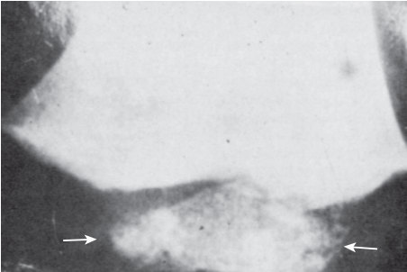

• Fig. 92.1 Epiphyseal dysgenesis of the distal femoral center.

## PDF page 1726

the thyroid. Iodine can be absorbed readily from the skin, lungs, and mucous membranes. The application of iodinecontaining ointment or lotion to the skin, common during procedures with premature or sick infants, causes very high levels of iodide in the circulation and promptly blocks thyroid hormone release from the thyroid gland. Iodide-trapping involves an active transport process through a sodium/iodide symporter that requires oxidative phosphorylation and is a major rate-limiting step in thyroid hormone synthesis. The sodium/iodide symporter is present at the basolateral plasma membrane of follicular cells. At the apical cell surface, there is transport of iodide through the anion transporter pendrin and likely other yet unidentified transport systems into the follicular lumen. The normal thyroid gland can maintain intrathyroidal iodide concentration at a 20- to 50-fold higher level than that of serum. Some anions—bromide (Br2−), nitrate (NO22−), thiocyanate (SCN2−), perchlorate (ClO42−), and technetium pertechnetate (TcO42−)—are capable of competitively inhibiting iodide transport.

Iodide is immediately oxidized for the iodination of thyroglobulin (TG), a process that requires hydrogen peroxide, which is synthesized at the apical border. Thyroglobulin (TG), a glycoprotein, is synthesized by the ribosomes of the follicular cells. Iodination of TG (organification) is catalyzed by thyroid peroxidase (TPO). Almost all the iodine taken up by the thyroid is rapidly incorporated into the three and five positions of the many tyrosyl residues of TG to form monoiodothyronine (MIT) and diiodothyronine (DIT). Once it is organically bound to tyrosyl residues, iodine can no longer be readily released from the thyroid. Defects in iodide uptake, oxidation, or organification can be seen in several types of goitrous congenital hypothyroidism.6

### Synthesis of Triiodothyronine and Thyroxine

The synthesis of T3 requires the coupling of an MIT and a DIT molecule; T4 is formed by the coupling of two DIT molecules. These reactions occur within the structure of TG and involve oxidative processes, probably catalyzed by thyroid peroxidase as well.

### Secretion of Triiodothyronine and Thyroxine

TG molecules pass from the lumen of the follicles into the follicular cells by endocytosis. They are ingested by lysosomes and undergo proteolysis, releasing T4 and T3 into the circulation. Nonhormonal iodine is retrieved by iodotyrosine deiodinase, and the liberated iodide is made available for intrathyroidal recycling. Congenital hypothyroidism can result from both abnormal TG synthesis or defect in the deiodination of freed iodotyrosines, which results in iodine depletion through urinary losses.6

### Serum Protein Binding and Transport

The thyroid is the only source of T4, and its blood concentration is 50 to 100 times greater than that of T3. T4

and T3 secreted into the circulation are transported by loose attachment, through noncovalent bonds, to three plasma proteins which include thyroxine-binding globulin (TBG), transthyretin (TTR), and albumin. TBG has the highest affinity for thyroid hormone and carries about 70% of T4 in plasma. TTR and albumin have lower affinity than TBG, but together they still provide significant binding capacity because of their higher plasma concentration.7 The free T4 (fT4) concentration more accurately indicates the metabolic status of the individual than total T4 or T3 does because only the free hormones can enter the cells to exert their effects. If the capacity of thyroid-binding proteins is increased or decreased, a concurrent change in the concentration of total hormones will follow, but the concentration of free hormones will be maintained.

### Monodeiodination of Thyroxine

T3 is the iodothyronine that mediates the metabolic effects of thyroid hormone. The relative serum levels of T4 and T3 do not reflect the intracellular proportions of the hormones, and tissue distribution of T3 may differ greatly from that of T4 from tissue to tissue. The plasma half-life of T3 is less than 24 hours, compared with 6.9 days for T4. The metabolic effects of T3 are mediated through binding to specific receptors in the DNA response element that regulates transcription. T3 also interacts with membranous, mitochondrial, and cytosolic binding sites.

In euthyroid individuals, the conversion of peripheral T4 to T3 accounts for 80% of all the T3 produced and is catalyzed by type I and type II deiodinase via outer (5′)-ring deiodination of T4. Type 1 deiodinase is found in peripheral tissues such as the liver and kidney. Neural tissue requires T4 (and does not bind T3). Thyroid hormone availability to neurons mainly takes place through astrocytic delivery. T4 is taken up by astrocytes at the blood-brain barrier and T4 is converted to T3 by astrocytic type II deiodinase; T3 is then transported to neurons by transmembrane transporters.8 Type II deiodinase is therefore critical in T4-mediated negative feedback at the hypothalamic and pituitary levels, whereby T4 inhibits thyrotropin (TSH) and thyrotropinreleasing hormone (TRH) expression.9

Type III deiodinase, or 5-deiodinase, regulates peripheral deiodination of T4 at the inner (5)-ring position on the thyronine molecule instead of 5′ and generates reverse T3 (rT3). ReverseT3 is metabolically inactive. Serum rT3 concentration parallels that of T3 in normal circumstances but not in fetal life, starvation, or patients with severe nonthyroidal illnesses (e.g., euthyroid sick syndrome, nonthyroidal illness syndrome).

### Regulation of Thyroid Function

Control of thyroid hormone secretion is centered in the hypothalamic-pituitary-thyroid axis. Basophilic cells of the anterior pituitary gland synthesize and store the glycoprotein thyrotropin (TSH). TSH release from the pituitary

## PDF page 1727 | printed page 1731

causes an increased uptake of iodine by the thyroid, accelerates iodothyronine synthesis and release, and increases the size and vascularity of the thyroid. These changes are mediated by the binding of TSH to the TSH receptor, which then stimulates the secondary messengers adenylate cyclase and inositol phosphate. Human chorionic gonadotropin (hCG) weakly competes with TSH for receptors on thyroid follicular cells. Hyperthyroidism seen in patients with choriocarcinoma can be explained by this mechanism. Similarly, certain immunoglobulins—TSH-binding/inhibiting immunoglobulins (TBII) and TSH receptor-stimulating immunoglobulins (TSI) found in autoimmune thyroid diseases like Graves disease—compete with TSH for binding to TSH receptors.

Secretion and plasma levels of TSH are inversely related to circulating levels of fT3 and fT4. The inhibitory feedback action of fT3 and fT4 involves a direct action of these hormones on the pituitary gland and the hypothalamus. The hypothalamus secretes TRH that enters the portal system to reach the pituitary and stimulates the synthesis and release of TSH from thyrotrophs. TRH is under negative feedback control by thyroid hormone, but other factors like nutritional status and external temperature, regulate TRH independently of thyroid hormone level.10 Secretion of TSH is also regulated directly by the ambient intrapituitary T3 concentration and intrapituitary deiodination of T4 to T3 by type II monodeiodinase activity. TSH secretion is also partly controlled by the central circadian pacemaker in the suprachiasmatic nuclei of the anterior hypothalamus. TSH concentrations begin to rise in the late afternoon or early evening before sleep onset and reach maximal levels during the early part of the night. Following the nighttime peak in TSH, plasma TSH concentration then declines during the rest of the sleep period until reaching lower daytime levels.11 This nocturnal TSH surge is blunted or absent in central (secondary or tertiary) hypothyroidism but maintained in primary hypothyroidism. The circadian pattern of TSH is not yet present in neonates but has been noted to be present in infants as young as 4 months of age. In addition to hypothalamic-pituitary regulation, the thyroid is under autoregulatory control that adjusts the degree of iodide trapping, thyroid hormone production, and release in response to changes in iodine exposure. This helps to maintain a euthyroid state despite fluctuations in dietary iodine intake.

### Laboratory Tests Used to Assess Thyroid Function

### Thyroxine

The plasma pool of T4 constitutes a large protein-bound reservoir; this pool turns over slowly. Therefore T4 measurement usually reflects the adequacy of the hormonal supply. The normal level of T4 is age dependent in infancy and childhood. T4 reaches a peak concentration shortly after birth and declines slowly, gradually approaching the adult normal range in puberty.12 The range of normal levels for each age

group is also wide (Fig. 92.2). However, it should be kept in mind that more than 99% of circulating T4 is bound to serum thyroid hormone–binding proteins. Any change or abnormality in the concentration of these proteins, particularly TBG, can affect the T4 level. Several clinical situations and pharmacologic agents can alter the levels of TBG or TTR. Certain anticonvulsants not only bind competitively to TBG but also interfere with T4 assays without greatly influencing the TSH level in a person with an otherwise normal thyroid reserve. These drugs include phenytoin, valproate, primidone, and carbamazepine. Other drugs, such as furosemide, salicylate, and L-asparaginase, compete with thyroid hormone for binding with plasma proteins and can alter the levels of T4, T3, fT4, and fT3.

### Triiodothyronine

When TSH becomes elevated, the percentage of T3 produced by the thyroid gland is increased. The serum concentration of T3 can vary from day to day. Because of the overall small quantity of T3 in serum, its level may not fall below the normal range until T4 is critically low. Therefore serum T3 is not very useful in evaluation of patients for possible hypothyroidism. T3 is physiologically low in the fetus and cord blood but rises promptly after birth to levels greater than those in older children and adults.

### Reverse Triiodothyronine

Hormonally inactive rT3 is derived primarily from the deiodination of T4. Serum half-life is very short, less than onehalf that of T3. The concentration of rT3 usually parallels that of T3. However, rT3 is disproportionately high in the fetus, in the early neonatal period, and in severe nonthyroidal illness, probably reflecting altered tissue metabolism of T4.

### Free Hormones

Because concentrations of T4 and T3 are affected by those of thyroid hormone–binding proteins and the degree of their saturation at the binding site, the simplest approach to determine thyroid hormone levels is to measure free T4 (fT4) and not measure T4 at all. In clinical settings, fT4 does not depend on the T4-binding capacity because a change in such a capacity is soon compensated for by a change in the amount of T4 released from the thyroid. The gold standard for measuring fT4 in serum is by direct dialysis. Serum is placed in a dialysis cell on one side of a semipermeable dialysis membrane, with a buffer solution on the other side. T4 equilibrates across the membrane and bound T4 remains with serum. Unbound fT4 that crosses the dialysis membrane can then be measured by radioimmunoassay or tandem mass spectrometry. Labeled analog or antibody methods are also available to measure fT4. They can be performed more rapidly and are less expensive than the measurement of free hormones by direct dialysis. The principle

## PDF page 1728

35.00

30.00

25.00

fT4 (pmoI/L) TSH (mU/L)

20.00

15.00

10.00

5.00 0−1 months 1−12 months 6−10 years 1−5 years

Age

20.00

18.00

16.00

14.00

12.00

10.00

8.00

6.00

4.00

2.00

0.00 0−1 months 1−12 months 1−5 years

Age

### • Fig. 92.2 Age-related reference values for thyrotropin (TSH) and free T4 (fT4). The central 95% range

(2.5th, 25th, 50th, 75th, and 97.5th percentiles) is shown. Because of resolution reasons, lines start at zero, although no samples were taken within the first hours after birth. (From Kapelari K, Kirchlechner C, Högler W, et al. Pediatric reference intervals for thyroid hormone levels from birth to adulthood: a retrospective study. BMC Endocr Disord. 2008;8:15.)

of labeled analog or antibody methods is that the rate of binding of labeled hormones to antibodies depends on the fT4 concentration during a timed incubation. They are acceptable for routine testing in children. However, these methods may not provide an accurate assessment of fT4 at

11−14 years 15−18 years

6−10 years 11−14 years 15−18 years

extremes of thyroid hormone binding capacity or with significant changes in T4 binding protein affinity.13

Measurement of fT3 is not currently part of standard care. In the future, fT3 measurements may be shown to be useful in assessing hypothyroidism. Currently, fT3 may

## PDF page 1729 | printed page 1733

be useful when the diagnosis of thyrotoxicosis is suspected and TSH is suppressed but values for T4, T3, or both are normal.

### Thyroxine-Binding Globulin

Serum TBG is determined by radioimmunoassay in commercial laboratories, and its measurement is useful in the quantitation of abnormal levels of TBG. As most T4 is bound to TBG, these measurements give a good approximation of the T4-binding protein capacity. Increased TBG levels may be because of pregnancy, hypothyroidism, liver disease, acute intermittent porphyria, or human immunodeficiency virus. Pharmacologic agents that increase TBG levels include estrogens, methadone, and heroin. The concentration of TBG may be decreased in preterm infants, acute illness, nephrotic syndrome, kidney failure, severe liver disease, malnutrition, hyperthyroidism, and acromegaly. Drugs that decrease TBG levels include androgens, danazol, glucocorticoids, and l-asparaginase.

### Thyrotropin

Measurements of TSH and fT4 are the most important tools for screening thyroid function. Serum TSH is measured by specific competitive-binding isotopic and nonisotopic methods. TSH is the most sensitive test for primary hypothyroidism at any age and is used in many neonatal thyroid screening programs. Serum TSH is also an indicator of the adequacy of thyroid hormone replacement therapy and is used in the assessment of the hypothalamic-pituitarythyroid axis. TSH is elevated in primary hypothyroidism. A surge of TSH release occurs at parturition and reaches a peak within 2 hours after birth. TSH in the cord serum and a term infant’s serum after the first day of postnatal life is usually less than 20 mU/L. Therefore TSH is the most important test to screen for primary congenital hypothyroidism. The target range for TSH during thyroid hormone therapy for primary hypothyroidism is 0.5 to 2 mU/L.

### Thyroid Autoantibodies

Numerous methods have been used for the detection of a variety of thyroid antibodies. Assays for thyroglobulin antibodies (TGAb) and thyroperoxidase (microsomal) antibodies (TPOAb) are widely available. These antibodies are found in Hashimoto thyroiditis and about 2% of the adult population. TSH receptor stimulating and blocking antibodies may be detected in the sera of patients with autoimmune thyroid diseases and are known as TSH receptor antibodies (TRAb). TRAb that are stimulatory are found in the sera of patients with active Graves disease and are known as thyroid-stimulating immunoglobulins (TSI); TRAb that are inhibitory are called TSH-binding/inhibiting immunoglobulins (TBII).

Mothers with primary hypothyroidism and Hashimoto thyroiditis may have circulating serum TBII or antibodies

that block the TSH receptor. These mothers give birth to children with a transient form of congenital hypothyroidism as a result of the transplacental transfer of TBII. The half-life of immunoglobulins in the neonate is about 2 weeks, and TRAb usually disappears from the serum of affected infants by 6 to 8 weeks of age. The disease may recur in infants of subsequent pregnancies if the high-affinity antibody persists in the mother’s circulation.

Mothers with Graves hyperthyroidism may have TBII but more commonly have TSI. These mothers can give birth to children with a transient form of hyperthyroidism. Hyperthyroidism in the affected infant may persist for 2 to 6 months. Again, subsequent pregnancies may be affected if maternal antibodies are still present.

### Thyroglobulin

Small amounts of TG are co-secreted with T4 and T3 and are detectable in the serum with levels roughly correlating with thyroid size and TSH level. In complete thyroid aplasia, TG is not detectable. Therefore the TG level is helpful to determine if thyroid tissue is present. In autoimmune congenital hypothyroidism caused by antibodies that block the TSH receptor, TG may be detectable even when the radioactive iodine scan suggests an absent thyroid gland; ultrasound should then identify the thyroid gland. TG levels may be elevated when the thyroid gland is hyperactive, as in endemic goiter, subacute thyroiditis, toxic nodular goiter, and Graves disease. TG cannot be reliably measured when there are TGAb present as these antibodies interfere with the immunometric assays and often lead to falsely low results.

### Thyroid Imaging

Ultrasonography of the thyroid gland is useful for the visualization of eutopic thyroid glands and can provide information on size, homogeneity/heterogeneity, vascularity, and the presence of nodules. Ultrasonography can also identify dysgenetic thyroid glands but does not appear to be as sensitive for detecting ectopic thyroid tissue as a radioiodine uptake scan. Ultrasonography should be used as the first imaging tool, with a scan performed to distinguish agenesis from ectopia.14 When a scan is necessary, 123I or 99mTc should be used to reduce radiation exposure to the child. 123I or 99mTc do not emit beta particles gamma radiation and their half-lives are much shorter compared to 131I.

Radioiodine uptake studies are invaluable for diagnosing certain inborn errors of thyroid hormone synthesis, such as defects in iodide-trapping, iodide oxidation, and organification. In addition to the thyroid gland, the salivary glands, gastric mucosa, small intestine, mammary glands, and placenta are capable of concentrating iodine. In patients with goitrous congenital hypothyroidism, the inability of salivary glands to trap iodide can help identify defects in the sodium/ iodide symporter. The perchlorate discharge test can also be

## PDF page 1730

performed during the radioiodine uptake test to detect the presence of a defect in iodide oxidation or organification.14

### Embryogenesis

Factors such as FOXE1, NKX2-1, PAX8, TBX1, HOXA3, FGF10, and HHEX are involved in stem cell differentiation into thyroid follicular cells (Table 92.1).15,16 Activin A, insulin, and IGF-1 are among the hormones required for the generation of thyroid cells.17 The major portion of the human thyroid originates from the median anlage, the tissue that arises from the pharyngeal floor (toward the back of the future tongue) and is identifiable in the 17-day-old embryo.16 The median anlage is initially in close contact with the endothelial tubes of the embryonic heart. With the descent of the heart, the rapidly growing median thyroid is progressively pulled caudally until it reaches its final

TABLE

Inherited Disorders of Thyroid Metabolism

92.1

Hypothalamic-Pituitary Development Gene

Combined pituitary hormone deficiency Mutations of LHX3, LHX4, HESX1, PROP1, POU1F1

Isolated TSH deficiency TRH, TSH beta-subunit, TRHR mutations

TSHR Loss-of-function TSHR mutation Resistance to TSH with normal TSHR Gain-of-function TSHR mutation GNAS1 mutations

Thyroid Gland Development Mutations of NKX2 (prior TTF1), FOXE1 (prior TTF2), PAX8,

TBX1, HOXA2, HHEX, BCL2, SHH

Organification

Iodide transport, Pendred syndrome PDS or Iodide symporter NIS SLC26A4

TPO TPO mutations

Thyroid NADPH oxidase DUOX1 and DUOX2 mutations

TG TG mutations

Iodide cycling Defect not known

Deiodinase DEHAL1

Thyroid Hormone Transport

TBG TBG deficiency, partial or complete X-linked recessive TBG excess

TTR TTR mutations

Albumin Albumin mutations

Thyroid Hormone Action THR-beta MCT8 SECISBP2

Generalized Thyroid Hormone Resistance

THR mutations THR-beta

AD, Autosomal dominant; AR, autosomal recessive; GNAS, gene encoding Gs-protein alpha subunit; NADPH, reduced nicotinamide-adenine dinucleotide phosphate; TBG, thyroxine-binding globulin; TG, thyroglobulin; THR, thyroid hormone receptor; TPO, thyroid peroxidase; TRHR, thyrotropin-releasing hormone receptor; TSH, thyrotropin; TSHR, TSH receptor; TTR, transthyretin.31

position in front of the second to the sixth tracheal ring by day 45 to 50 of gestation. Abnormal descent leads to an ectopic location of the thyroid gland. The pharyngeal region contracts to become a narrow stalk called the thyroglossal duct, which subsequently atrophies. The median anlage usually grows caudally so that no lumen is left in the tract of its descent. An ectopic thyroid gland or persistent thyroglossal duct or cyst results from abnormalities of thyroid descent. The lateral parts of the descending median anlage expand to form the thyroid lobes and the isthmus.

The second source of thyroid tissue is composed of a pair of ultimobranchial bodies arising from the caudal extension of the fourth pharyngeal pouch. These bodies are initially connected to the pharynx by the pharyngobranchial duct. The pharyngeal connection is subsequently lost, and the ductal lumen becomes obliterated. The ultimobranchial bodies are incorporated into the expanding lateral lobes of

Inheritance

AR or AD

AR

AR or AD AD AD

AR or AD

AR

AR

AR or AD

?AR

AR

X-linked recessive X-linked recessive

AD

AD

AD X-linked AR

AD

## PDF page 1731 | printed page 1735

the median anlage. They contribute little to the future size of the thyroid, and their differentiation appears to require the influence of the median anlage. Parafollicular or C cells arise from the ultimobranchial bodies in mammals and are the source of calcitonin.

By the latter part of the 10th week of gestation, the histogenesis of the thyroid is virtually complete, although the follicles do not contain colloids. A single layer of endothelial cells surrounds the follicular lumen. By the beginning of the second trimester, the fetal thyroid is capable of trapping and oxidizing iodide. Therefore the fetal thyroid begins to secrete thyroid hormone and contributes to the fetal circulation of thyroid hormone.

At the same time as the development of the thyroid gland, the fetal pituitary and hypothalamus are also forming and beginning to function. The anterior pituitary gland is derived from the Rathke pouch, which originates at the roof of the pharynx. Histologic differentiation of pituitary cells can be observed by 7 to 10 weeks of gestation, and TSH can be detected in fetal blood by 10 to 12 weeks. The hypothalamus develops from the ventral portion of the diencephalon. Thyrotropin-releasing hormone has been found in the hypothalamus by 9 weeks of gestation. As a result of maturation of the HPT axis, fetal hypothalamic expression of TRH and production of TSH and T4 progressively rise from mid-gestation to peak during the month before term. TSH then remains higher than maternal levels, possibly reflecting a higher set-point for feedback.18 T3 levels in fetal blood remain low until 26 to 30 weeks of gestation, a consequence of high levels of type III deiodinase activity (which converts T4 to inactive rT3) in peripheral fetal and placental tissues.19

### Thyroid Function: Fetal-Maternal Relationship

In considering the fetal-maternal relationship, the placenta is of major importance. Thyroid-stimulating hormone does not cross the placental barrier, whereas TRH does. Maternal-to-fetal transport of T4 is highest in the first trimester. Rapid placental deiodination of T4 into biologically inactive rT3 and DIT limits the transfer of maternal T4 during the later stages of pregnancy. However, maternally derived thyroid hormone continues to be important even in the third trimester. This third-trimester T4 placental transfer to a fetus with a total inability to synthesize T4 results in a fetal T4 concentration that is 25% to 50% of that found in normal neonates.20 Therefore, in a mother with normal thyroid function, the hypothyroid fetus is somewhat protected. It has been well-documented that overt maternal hypothyroidism poses risk to the maternal-fetal unit. Untreated maternal hypothyroidism not only results in a negative impact on neurocognitive development in offspring,21 but there is also an increased risk for gestational hypertension, premature birth, low birth weight, and pregnancy loss.22,23 To prevent significant untreated maternal hypothyroidism, it is now recommended that upon confirmation of pregnancy, certain high-risk groups will be screened.24

Maternal dietary iodine deficiency results in impaired maternal and fetal thyroid hormone synthesis. Consequent maternal and fetal hypothyroidism can lead to increased TSH and goiter in both the mother and fetus and also adverse neurocognitive development in the fetus.25 Iodine requirements increase more than 50% during pregnancy, and it is recommended that all pregnant women ingest about 250 μg of iodine daily.24 Maternal iodine excess can also cause fetal goiter and hypothyroidism. Iodides and iodine, when given in large quantities, produce a transient inhibition of T4 synthesis through an auto-regulatory mechanism known as the Wolff-Chaikoff effect. Following several days of continued high exposure to iodine, there is an escape from the Wolff-Chaikoff effect because of decreased active transport of iodine into the thyroid gland, and thyroid hormone production resumes. The fetal thyroid appears to be more susceptible to this inhibitory effect of iodine and has decreased ability to escape.26 Maternal administration of medications containing iodides (expectorants, topical antiseptics, amiodarone) can cause neonatal goitrous hypothyroidism. Sustained iodine intake should not exceed 500 μg daily to avoid the potential for fetal thyroid dysfunction.24

Other clinically important compounds that can affect fetal thyroid function by crossing the placenta from the mother to the fetus are antithyroid drugs, environmental goitrogens, endocrine disruptors, and thyroid antibodies. Antithyroid drugs include propylthiouracil and methimazole. Transplacental transfer of these drugs can result in fetal goiter with or without hypothyroidism.

Shortly after birth, transient but marked hyperactivity occurs in the thyroid function of neonates (Fig. 92.3). Within the first minutes of life, there is a dramatic release of TSH, reaching a peak level of about 100 mU/L at 30 minutes of age. This hypersecretion of TSH persists during the next 6 to 24 hours. This acute rise in TSH may be stimulated at least partially by a drop in the body temperature of the fetus with birth. In response to the postnatal TSH surge, T4, fT4, and T3 increase progressively during the first hours of extrauterine life, reaching a peak at about 48 hours of age. Concentrations of thyroid hormone remain elevated during the first 2 weeks of life and fall gradually thereafter, with fT4 reaching high-normal adult values by 4 to 6 weeks of age.

The postnatal TSH surge occurs even in preterm infants and those who are small for gestational age (SGA), although the changes in TSH and iodothyronines are less than those in healthy full-term infants. In preterm infants, T4 concentrations may decline for a week and then gradually rise, remaining lower than those of full-term infants during the first weeks of life. Thyroid-stimulating hormone returns to normal adult values after 3 to 10 days of postnatal life regardless of gestational age (see Fig. 92.2).

### Congenital Hypothyroidism

Congenital hypothyroidism is a deficiency in thyroid hormone present at or before birth. It is one of the most common preventable causes of intellectual disability, occurring

## PDF page 1732

T4

fT4

14

3.0

12

2.5

10

T4 ug/dL T3 ng/dL

fT4 ng/dL rT3 ng/dL

2.0

8

6

1.5

4

1.0

Cord Day 7 Day 28 Day 14 Cord Day 7

Postnatal age Postnatal age

T3

rT3

200

400

150

300

100

200

50

100

Cord Day 7 Day 28 Day 14 Cord Day 7

Postnatal age Postnatal age

• Fig. 92.3 Postnatal changes in T4, free T4 (fT4), thyroxine-binding globulin (TBG), T3, reverse T3 (rT3), and thyrotropin (TSH) according to gestational age. Note the increase in T4, free T4, and TBG in the fullterm infant in the first week of life. T3 also rises strikingly, whereas rT3 and TSH decline. The increase in T4 and free T4 is blunted in infants less than 35 weeks and not seen at all in very premature infants, in whom thyroid hormone levels may decline. (Republished with permission from Disorders of the Thyroid Gland in Infancy, Childhood, and Adolescence, by Maria Segni, MD, in http://www.thyroidmanager.org/, the free online Thyroid Web-book, version April 4, 2017, published by Endocrine Education, Inc., South Dartmouth, MA.)

in 1 in 2000 to 4000 newborns. Prompt diagnosis is critical because a delay in treatment can lead to irreversible brain damage, and even with timely therapy, severely affected infants may still have reduced IQ or other neurologic manifestations. However, overt signs of hypothyroidism are rarely present at birth, and 95% of affected babies are asymptomatic. Additionally, the majority of cases are sporadic and therefore not anticipated. Therefore newborn screening for hypothyroidism was established in the 1970s to permit early identification of infants at risk and allow prompt institution of thyroid hormone replacement therapy.

### Etiology and Pathogenesis

The etiologic classification of congenital hypothyroidism: 1. Primary hypothyroidism

TBG

35

30

TBG mg/L

25

20

Cord Day 7 Day 28 Day 14 15

Day 28 Day 14

Postnatal age

TSH

>37 wks 31–34 wks 28–30 wks 23–27 wks

8

6

TSH uU/mL

4

2

Day 28 Day 14 Cord Day 7 Day 28 Day 14

Postnatal age

a. Defective embryogenesis of thyroid i. Agenesis (athyreosis) ii. Dysgenesis (a) Thyroid remnant in the normal location

(hypoplasia) (b) Maldescent or ectopic thyroid gland b. Inborn error of hormone synthesis or metabolism

(familial dyshormonogenesis) i. Iodide-trapping defect ii. Iodide organification (oxidation) defect (a) Without deafness (b) With deafness (Pendred syndrome) iii. Deiodination defect (a) Generalized (b) Limited to the thyroid gland (c) Limited to peripheral tissues

## PDF page 1733 | printed page 1737

iv. Thyroglobulin synthetic defect v. Peripheral tissue resistance to thyroid hormone 2. Central hypothyroidism a. Genetic mutation or deletion (see Table 92.1) i. Isolated deficiency of TSH alpha-subunit ii. Abnormality of hypothalamic-pituitary develop-

ment, with multiple pituitary hormone deficiencies b. Midline congenital defect (septo-optic dysplasia,

holoprosencephaly, ectopic posterior pituitary gland, cleft lip, single central incisor) c. Acquired birth injury (usually hypothalamic TRH

deficiency; birth injury, hemorrhage, hydrocephalus, meningitis, trauma, nonaccidental injury)

### Defective Embryogenesis of the Thyroid

The relative incidences of each type of congenital hypothyroidism vary widely in different geographic locations, but overall, congenital hypothyroidism occurs in 1:2000 to 4000 newborns. Although a gender difference is noted in the incidence of congenital hypothyroidism, where the femaleto-male ratio is about 2:1 (in North America), it is less pronounced than in thyroid disorders during childhood and adult life.27 In iodine-sufficient regions, defective embryogenesis of the thyroid gland accounts for 80% to 90% of nonendemic congenital hypothyroidism. Failure in the anatomic development of the thyroid gland may be complete or partial. Residual thyroid tissue in the normal position or an ectopic location is detected in the majority (∼2/3) of infants and children with hypothyroidism. Ectopic thyroid is usually composed of a remnant of undescended thyroid tissue that is typically situated in the midline. Undescended thyroid is located at the base of the tongue in about half of the cases, between the tongue and the hyoid bone in about one-fourth, and between the hyoid bone and the normal location in the remaining one-fourth. Ectopic tissue is often capable of undergoing compensatory hypertrophy when hormone production becomes inadequate and thus may be found as a midline mass. Most cases of thyroid dysgenesis are sporadic, but there is evidence of a familial or genetic component in certain patients. Loss-of-function mutations of the TSH receptor gene lead to hypoplasia of the thyroid gland and TSH elevation (see Table 92.1).28,29 Mutations in transcription factors (e.g., PAX8, FOXE1, NKX2-1, NKX2-5) may be responsible for some cases of congenital hypothyroidism.

### Familial Dyshormonogenesis

Genetically determined errors of T4 synthesis or metabolism involve a deficiency of one or more enzymes necessary at various stages of the biosynthetic and metabolic pathways. These occur in approximately 10% of cases of congenital hypothyroidism. Impaired secretion of T4 and T3 results in hypersecretion of TSH, usually leading to compensatory hyperplasia of the thyroid. The familial forms of congenital hypothyroidism are usually referred to as familial

dyshormonogenesis. Hypothyroidism, goiter, or both may be present in the newborn and infant, depending on the degree and time of onset of the hormonal deficiency.

Hypothyroidism caused by a defect in the trapping of iodide is because of a mutation in SLC5A5, the sodiumiodide symporter. SLC5A5 mutations are inherited in an autosomal recessive manner. Infants will typically have a normal-size or enlarged thyroid gland as determined by ultrasonography and elevated serum thyroglobulin levels. Patients with iodide trapping defects can be confused with athyreosis because of the failure of administered radioiodine to be concentrated in the neck; however, there will also be a lack of another physiologic iodine uptake (i.e., in the salivary glands, gastric mucosa, nasopharynx). The severity of hypothyroidism is variable and may depend on the amount of dietary iodine present.29

There are specific types of defects in the oxidation or organification of iodide. Among them, thyroid peroxidase enzyme deficiency (because of mutations in the thyroperoxidase gene) is the most frequent cause of dyshormonogenesis. Thyroperoxidase mutations are inherited in an autosomal recessive manner and can result in severe hypothyroidism with large goiter. Another form of congenital hypothyroidism results from impairment of the normal generation of hydrogen peroxide because of mutations in DUOX1 and DUOX2. Hydrogen peroxide is a substrate for thyroid peroxidase in the oxidation of iodide. DUOX gene mutations demonstrate variable phenotypes ranging from mild or transient hypothyroidism to severe hypothyroidism with large goiters capable of airway obstruction. DUOX2 mutations are the most common form of congenital hypothyroidism in certain populations (Japanese and Chinese).30

In Pendred syndrome, patients have congenital sensorineural hearing loss and goiter, which typically develops later in childhood or adolescence. The incidence of this disorder is estimated to be about 1.5 to 3 per 100,000 schoolchildren. Affected individuals are either euthyroid or have mild hypothyroidism. Many will have an abnormal radioiodide discharge from the thyroid after perchlorate administration, indicative of defective iodide organification. Pendred syndrome is caused by a biallelic inactivating mutation of the SLC26A4 gene, located on chromosome 7 (7q31). The SLC26A4 gene encodes the protein pendrin, which is expressed in the apical membrane of the thyroid and facilitates passive iodide efflux into the lumen. Pendrin is also expressed in the inner ear and is important for maintaining normal acid-base homeostasis of the endolymphatic fluid. The thyroid phenotype in Pendred syndrome is affected by nutritional iodide intake. With adequate dietary iodide, about 90% of patients remain clinically and biochemically euthyroid; in the other 10%, TSH is elevated and goiter is present.31

Patients with iodothyronine defects (DEHAL1 gene) do not technically have dyshormonogenesis, as the primary cause of their hypothyroidism is a rapid turnover of thyroid iodine and wasting of iodotyrosines into the urine.

## PDF page 1734

The defect may be generalized, or it may be limited to intrathyroidal or peripheral deiodination. The onset of goiter and hypothyroidism in these patients is variable and may be because of dietary iodine intake and the presence of partial activity of protein. Patients have been reported to have been rendered euthyroid with supplemental iodide.29

Defects in thyroglobulin synthesis can result in moderate to severe congenital hypothyroidism with goiter. These patients will have low or absent TG levels and abnormal iodoproteins in their sera. Mutations in the TG gene (8q24, stopping synthesis or causing conformational changes in the molecule) have been reported in these patients.29

Finally, there are rare defects described in the transport of thyroid hormone to the intracellular space at target organs. MCT8 is one such transporter in which defects result in the X-linked Allen-Herndon-Dudley syndrome. T3 transport into neurons is impaired, resulting in intellectual disability. The biochemical profile has been described with TSH and T3 elevations, and reductions in T4.32

### Defects in TSH or Thyroid Hormone Action

Resistance to thyroid hormone is because of mutations in thyroid hormone receptors, primarily point mutations in the thyroid hormone receptor-β. It is rare, with an incidence of about 1:40,000. Patients have high serum T4, fT4, and T3 with normal or mildly elevated serum TSH. In childhood, there may be a development of tachycardia, failure to thrive, and attention deficit disorder. The severity of hormone resistance varies among tissues because of differences in relative expression of the two thyroid hormone receptors (β and α), with some tissues such as cardiac exhibiting a more hyperthyroid state because of predominant expression of the α isoform of the thyroid hormone receptor.33

A lack of responsiveness of the thyroid gland to TSH has been reported in some children with congenital hypothyroidism without goiter. Serum TSH was elevated, and exogenous TSH stimulation caused no increased radioiodine uptake or serum iodothyronine levels. Loss-of-function germline mutations of both alleles of the gene for the TSH receptor have been reported to cause this resistance to the action of TSH and the resultant hypothyroidism. The mutations are located in the extracellular, TSH-binding domain of the TSH receptor. The TSH receptor is coupled to the protein that binds to guanine nucleotide, or G-protein. In these mutations, the TSH receptor does not activate G-protein, and the effector adenylate cyclase (cAMP) signaling pathway remains inactive (GNAS mutations).33

### Iodine Deficiency

Endemic goiter and cretinism are still prevalent in large geographic areas where dietary iodine is deficient. Iodide deficiency results in decreased thyroid hormone production in both the mother and fetus. Iodine deficiency also causes preferential production of T3 relative to T4. Reduced maternal T4 levels early in gestation may deprive the developing

fetal brain of T4, which is likely the essential iodothyronine for early brain maturation. Severe iodine deficiency that remains untreated can result in two severe types of endemic cretinism: myxedematous cretinism with metabolic symptoms of hypothyroidism and neurologic cretinism with dominant neurologic disorders (severe mental deficiency, deaf-mutism, and motor spasticity).34

Significant progress has been made to reduce iodine deficiency through programs of universal salt iodization. About 70% of households worldwide have access to iodized salt, but thirty countries have a mild or moderate iodine deficiency. There are recent data that U.S. women are mildly iodine-deficient. Iodine deficiency has re-emerged in parts of the developed world and may be related to initiatives to lower population sodium consumption. Iodine supplementation before or during pregnancy improves thyroid function in the mother and newborn. The recommended daily iodine intake for all pregnant women is 250 μg.35

### Central Hypothyroidism

Secondary (pituitary) and tertiary (hypothalamic) hypothyroidism are less common forms of thyroid hormone deficiency in neonates. In the United States, the combined incidence of secondary and tertiary hypothyroidism is about 1 in 80,000 to 100,000 births. Infants with central hypothyroidism can be detected through neonatal thyroid screening programs when T4 measurements are included with TSH. However, when TSH alone is measured, infants with central hypothyroidism may have normal or mildly elevated TSH levels and are missed until they are older. A low T4 by direct dialysis is the confirmatory test that determines the need for starting treatment when the diagnosis is suspected on the basis of initial tests.

Overall, the prevalence of central congenital hypothyroidism is reported to be higher than previously thought (1 in 13,000–30,000).36 Autosomal recessive disorders that cause severe hypothyroidism as a result of congenital central hypothyroidism have been reported. Mutations have been identified in the β-subunit of TSH, the TRH gene, and the TRH receptor gene. Multiple pituitary hormone deficiencies may suggest a genetic defect in the signaling cascade leading to fetal pituitary formation, such as PROP1, LHX3, or POU1F1. When present, pituitary aplasia may be associated with anencephaly or other severe malformations of the brain.

Midline facial, cranial, or intracranial defects may also indicate the possibility of hypopituitarism. Septo-optic dysplasia, often associated with pituitary hormone deficiencies, can be manifested as secondary or (more commonly) tertiary hypothyroidism. A genetic mutation in HESX1 has been described in septo-optic dysplasia. Clinical symptoms include hypopituitarism, such as neonatal hypoglycemia (from growth hormone and ACTH deficiencies), polyuria (from antidiuretic hormone deficiency), or a small phallus in boys (from gonadotropin and/or growth hormone deficiencies). Often these are accompanied by blindness, congenital

## PDF page 1735 | printed page 1739

nystagmus, or midline defects of the brain. These findings should alert the physician to suspect septo-optic dysplasia.

### Other Conditions Associated With Congenital Hypothyroidism or Abnormal Thyroid Function Testing in the Neonate

The incidence of true congenital hypothyroidism (including dyshormonogenesis) is greatly increased in Down syndrome. Obvious congenital hypothyroidism occurs in about 2% of those with Down syndrome, and thyroid hormone replacement should be implemented in those individuals, followed by prudent and selective reassessment of the need for replacement at an older age (typically >3 years of age). Many additional children with Down syndrome have mildly elevated TSH (5 to 15 mU/L). The underlying etiology of this observation is unclear, although thyroid-stimulating hormone bioactivity appears to be normal. It has been suggested that this may be reflective of a nonpathologic shift in the normal range of TSH, although this notion, as well as whether these individuals warrant intervention, is unclear. In a single randomized controlled study of infants and toddlers with Down syndrome, early replacement therapy resulted in modest growth and developmental benefits. However, these differences did not clearly persist in the follow-up of this population at age 10 years.37

Screening programs that measure T4 also identify infants with thyroxine-binding globulin (TBG) deficiency. TBG deficiency has no clinical importance and therefore requires no intervention, but leads to abnormal laboratory tests. T4 concentrations are low, in the context of normal TSH and fT4 concentrations. Diagnosis can be confirmed by low TBG concentration on specific radioimmunoassay. This condition is discussed in greater detail elsewhere in this chapter.

### Neonatal Screening for Hypothyroidism

Every state in the United States and every province in Canada has legislatively mandated the screening of newborns for congenital hypothyroidism. CH guidelines screening programs have also been established in Western Europe, parts of Eastern Europe, Japan, Australia, and parts of Asia, South America, and Central America. However, many countries still do not have a nationwide program for neonatal thyroid screening, despite clear evidence that early detection and treatment of congenital hypothyroidism prevents neurodevelopmental disability.27

Most programs currently use the filter paper spot technique. Capillary blood specimens from a heel stick are typically obtained at 24 to 48 hours of age, and some programs routinely obtain a second sample at 1 to 3 weeks of age. Most programs throughout the world screen for primary hypothyroidism with the measurement of TSH only. In some US states and some Canadian provinces, initial screening primarily measures T4 with a reflex to test TSH in those

samples that fall below the lowest 10th percentile. These methods effectively screen for congenital hypothyroidism for the following reasons: (1) they are easily incorporated into the existing metabolic-genetic screening programs (e.g., phenylketonuria screening); (2) primary T4 with confirmatory TSH screening (T4 + TSH) also rapidly identifies those infants with central hypothyroidism or TBG deficiency; (3) selectivity is high because TSH measurements discriminate between affected and nonaffected infants, with a low recall rate (0.3%–1%); (4) cases of mild congenital hypothyroidism are identified by primary TSH screening, and most cases are also identified by T4 + TSH screening.

Both methods of screening (primary TSH and primary T4 with reflex to TSH) appear to be capable of detecting almost all infants with primary congenital hypothyroidism, which carries a high risk for mental retardation if not detected early and treated adequately. Although a TSH level of greater than 40 mU/L is highly suggestive of congenital hypothyroidism, some affected infants have TSH values between 25 and 40 mU/L. These infants require prompt serum confirmation testing because many will be shown to have primary congenital hypothyroidism. Additionally, infants with high hematocrit may have falsely lower TSH values, which may therefore falsely reassure against hypothyroidism. The practice of early hospital discharge (before 48 hours of age) has led to a higher rate of indeterminate results. Infants screened before 48 hours of age require a recheck of the newborn screen by the primary care physician at 2 weeks. Infants who are preterm, of low and very low birth weight, ill, the result of multiple gestations (particularly same sex), or have had samples collection done within the first 24 hours of life should have a second specimen collected and analyzed at 2 weeks of age or 2 weeks after initial sample collection. These infants may be categorized incorrectly based on initial screening because of multiple factors.

### Clinical Manifestations of Congenital Hypothyroidism

Even in athyreotic infants, classic clinical features of congenital hypothyroidism are usually absent at birth, resultant from maternal T4 crossing the placenta, with umbilical cord levels of T4 reaching 25% to 50% of those of normal newborns. Length and weight at birth are generally normal, and manifestations appear gradually over several weeks in infants who do not receive thyroid hormone replacement. These manifestations include lethargy, inactivity, hypotonia, periorbital edema, large anterior and posterior fontanelles, feeding difficulty including needing to be awakened to feed, respiratory distress, pallor, prolonged jaundice, perioral cyanosis, mottled skin, poor or hoarse crying, constipation, and hypothermia. Respiratory distress associated with myxedema of the airway is characterized by noisy breathing, nasal stuffiness, and intermittent cyanosis, especially in the perioral area. After the first week of life, prolonged physiologic jaundice may be an indication of hypothyroidism. In primary hypothyroidism, indirect hyperbilirubinemia

## PDF page 1736

predominates, whereas, in central hypothyroidism, there is a mixture of indirect and direct hyperbilirubinemia. Serum creatinine may be elevated. In patients with a functional remnant of thyroid tissue and those with familial dyshormonogenesis, clinical manifestations may be delayed several months or years, depending on the functional state of the thyroid.

Classic features of congenital hypothyroidism in the infant usually become apparent after about 6 weeks of age (Fig. 92.4). They include typical facies, characterized by a depressed nasal bridge, a relatively narrow forehead, puffy eyelids, dry and cold skin, long and abundant coarse hair, large tongue, abdominal distention, umbilical hernia, hyporeflexia, bradycardia, hypotension with narrow pulse pressure, anemia, and widely patent cranial sutures.

Lingual thyroid tissue can occasionally be seen in infants and children as a discrete round mass at the base of the tongue (Fig. 92.5). The base of the tongue must be firmly depressed to visualize the lingual thyroid. Because ectopic thyroid tissue may function normally at birth, the ectopic gland of a child may not be detected by newborn screening and may present during childhood or adolescence with a lingual mass associated with speech and feeding problems. In some instances, the sublingual thyroid is palpable as a round midline mass deep under the mandible or is visualized by ultrasonography.

Neonatal goiters may be extremely large, asymmetric, and confused with hygroma or other cervical masses (see Fig. 92.6). Alternatively, the goiter may be quite small and escape notice. The thyroid can be palpated in infants by placing them in the prone position, gently hyperextending the neck, identifying the thyroid cartilage, and palpating inferiorly and laterally for the thyroid isthmus and lobes. The normal size of each thyroid lobe is about equal to the volume of the distal segment of the patient’s thumb.

In infants with central hypothyroidism, there is no thyroid enlargement. The onset of symptoms tends to be gradual because some T4 production continues. As a result, the prognosis for mental development remains good. However, signs of other pituitary hormone deficiencies, congenital midbrain defects, or both are typically present. These signs may include neonatal hypoglycemia, a small penis, hypospadias, undescended testes, wandering nystagmus, cleft lip or palate, and combined direct and indirect hyperbilirubinemia. Growth failure gradually becomes evident in these patients. Infants with congenital hypothyroidism are at higher (roughly four-fold) risk to have certain co-morbid congenital malformations, including cardiac (such as septal defects), gastrointestinal, skeletal, renal, or urologic anomalies, and a careful clinical evaluation of these infants should be done.

### Laboratory Manifestations

When the diagnosis of congenital hypothyroidism is suspected, thyroid function tests should be performed (see Box 92.2). It is advisable to assess fT4 and TSH, and in selected

• Fig. 92.4 Three-month-old male with features of hypothyroidism. (Republished with permission from Disorders of the Thyroid Gland in Infancy, Childhood, and Adolescence, by Maria Segni, MD, in http://www.thyroidmanager.org/, the free online Thyroid Web-book, version April 4, 2017, published by Endocrine Education, Inc., South Dartmouth, MA.)

• Fig. 92.5 Visualization of lingual thyroid.

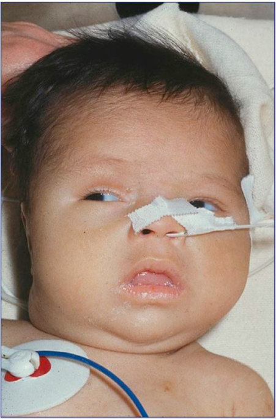

• Fig. 92.4 Three-month-old male with features of hypothyroidism. (Republished with permission from Disorders of the Thyroid Gland in Infancy, Childhood, and Adolescence, by Maria Segni, MD, in http://www.thyroidmanager.org/, the free online Thyroid Web-book, version April 4, 2017, published by Endocrine Education, Inc., South Dartmouth, MA.)

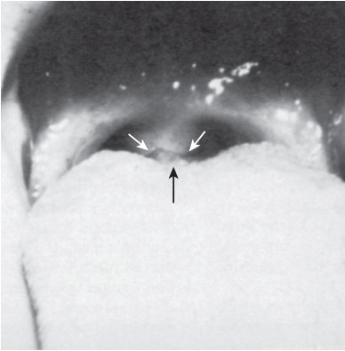

• Fig. 92.5 Visualization of lingual thyroid.

## PDF page 1737 | printed page 1741

• Fig. 92.6 Iodine-induced goiter in a neonate. The lateral bulging of the neck is caused by enlarged lateral lobes of the thyroid.

• BOX 92.2 Laboratory Tests Used for the

Diagnosis of Thyroid Disorders and Assessment of Thyroid Function in Infancy and Childhood

Serum Tests

• Thyrotropin (TSH) • Thyroid hormones: thyroxine (T4), free T4 (fT4) by analog

methods (initial screen), and direct dialysis (definitive method), triiodothyronine (T3) • Thyroid hormone–binding protein: thyroxine-binding

globulin (TBG) • Thyroid autoantibodies: thyroglobulin antibodies (TGAb),

thyroperoxidase (microsomal) antibodies (TPOAb), TSHreceptor antibodies (TRAb) by TBII or TSI methods • Thyroglobulin (TG)

Imaging Tests

• Thyroid scan with 99mTc-pertechnetate or 123I-iodide • Thyroid ultrasound

Miscellaneous Tests

• Assessment of skeletal maturation • Thyrotropin-releasing hormone (TRH) stimulation test • Urinary iodine excretion

patients, TG levels. The initial measurement of T3, rT3, fT3, and T3U is not currently indicated. Elevated serum TSH value is the most sensitive and specific test to confirm the diagnosis of primary hypothyroidism. The normal value for TSH in cord blood is higher than that at any other age (see

Fig. 92.3). The physiologic TSH surge occurs during the first 6 hours of life, as noted earlier, and the concentration of TSH may remain higher than 10 mU/L during the first 24 to 48 hours of life. Infants whose specimens were collected before 24 hours of life and who have mildly elevated TSH values very likely will have normal thyroid function tests on repeated testing.

The typical laboratory findings for primary hypothyroidism are an elevated TSH, with T4 and fT4 values in the low or low-normal range. Occasionally, TG may be used as an adjunct to distinguish between etiologies of primary hypothyroidism if imaging is equivocal. A low or undetectable TG concentration with TSH elevation confirms a dysgenetic or absent thyroid gland, whereas a high TG with TSH elevation suggests an organification defect. In central hypothyroidism, TSH can be normal, mildly high, or low; T4 is low or low/normal; and fT4 is low or low/normal. Confirmation of suspected central hypothyroidism requires interrogation of the remainder of pituitary function and anomalies in pituitary anatomy.

In infants with acute or chronic illness, the euthyroid sick syndrome or nonthyroidal illness syndrome may be present and affect thyroid function test results but does not result in functional hypothyroidism. Typical laboratory findings in nonthyroidal illness are low or normal serum T4, normal fT4 by direct dialysis, and normal TSH. Total T3 can be very low, and rT3 is elevated.

Another testing that could be considered depending on the clinical scenario includes thyroid autoantibodies in neonates born to a mother with autoimmune thyroid disease. This testing could aid in the differentiation of permanent versus transient hypothyroidism in the child. Measurement of urinary iodine concentration could be considered with suspicion of either iodine excess or deficiency. Finally, genetic testing may be sought in cases where hypothyroidism is familial or in the context of a suspected syndrome.

### Utilization and Interpretation of Imaging Results

For the majority of patients with clear biochemical testing, ultrasonography may not be necessary. However, in patients with equivocal results, those suspected to have transient hypothyroidism, or those with a goiter, ultrasound can provide helpful data that could potentially alter the course of therapy. An enlarged, lingual, or dysgenetic thyroid may be identifiable by ultrasound; however, it is highly user-dependent and also limited in its ability to detect lingual and sublingual ectopy. If an ectopic thyroid is detected, typically additional imaging (i.e., radionucleotide uptake scan) is generally not necessary. Goiters found on ultrasonography may suggest dyshormonogenesis in an infant with laboratory findings consistent with congenital hypothyroidism.

The use of 123I or 99mTc-pertechnetate is recommended, when practical, to distinguish dysgenesis from ectopia, as well as to detect a large gland or one with high levels of uptake. Tracer uptake is decreased or absent in hypoplastic

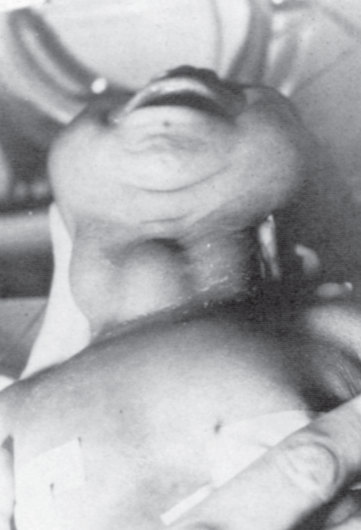

• Fig. 92.6 Iodine-induced goiter in a neonate. The lateral bulging of the neck is caused by enlarged lateral lobes of the thyroid.

## PDF page 1738

or aplastic thyroid glands. A decrease in uptake may also be indicative of maternal blocking antibodies or acute iodine excess (including from iodine-containing contrast agents or cleansing agents applied to open body cavities). Avid or high uptake is suggestive of iodine deficiency, or certain forms of dyshormonogenesis with defects downstream of iodine uptake or trapping (e.g., defects in thyroid peroxidase, dual oxidase 2, thyroglobulin, pendrin, or dehalogenase).

A perchlorate discharge test, which assesses the discharge of 123I following the administration of perchlorate, may aid in the diagnosis of an organification defect. When rapid oxidation and organification of inorganic iodide fails to take place in the thyroid (i.e., a lack of conversion to iodine), an anion such as perchlorate can competitively inhibit the iodide accumulation, leading to a net loss of iodide from the gland. 123I-iodide uptake is measured at 2 hours, immediately after which sodium or potassium perchlorate is given orally in doses of 10 mg/kg of body weight. Thyroid uptake is measured every 15 to 30 minutes for 2 hours. If the uptake decreases by more than 10% of the initial value, a defect in iodide oxidation or organification is confirmed.

Imaging should never delay the initiation of treatment in infants with suspected congenital hypothyroidism. Scintigraphy can be performed within 7 days of starting levothyroxine. Patients can also be treated for a few years, with a definitive study undertaken at a later date. Ultimately, the findings of imaging studies can help to further guide diagnostic evaluation (i.e., molecular genetic testing) to confirm the presence of true congenital hypothyroidism and the underlying etiology.

Retardation of bone maturation is present in about half of the newborns with primary hypothyroidism and may suggest the fetal age at which a deficiency developed in the delivery of thyroid hormone to responsive tissues. This assessment has been reported as a predictive indicator of persistent developmental delays, even in the setting of early intervention. Retardation of bone maturation in neonates is best assessed by radiographs of the knee and can be used as an additional proxy of intrauterine disease severity and onset. Ossification of the cartilage of the epiphyses is also disturbed in hypothyroidism, and normally begins from the center of the cartilage and extends peripherally in an orderly manner. In hypothyroidism, calcification of epiphyseal centers starts from multiple irregular foci scattered within the developing cartilage. The irregular calcification pattern appears on the radiograph as stippled or fragmented ossification centers and is referred to as epiphyseal dysgenesis, a finding that is highly characteristic of hypothyroidism (see Fig. 92.1). Stippled epiphyses may also occur in thyroid hormone resistance, as well as in multiple epiphyseal dysplasias, although thyroid function is normal in this familial disease.

### Differential Diagnosis

Errors in diagnosis of congenital hypothyroidism usually result from a failure of the newborn screening program (no

specimen collected or a laboratory error), from a clinical failure to suspect the condition, or from the misdiagnosis of other disorders such as hypothyroidism. These errors typically arise when the diagnosis is based on a few suggestive clinical features and laboratory data are incorrectly interpreted. It is necessary to perform newborn screening even in sick newborns so that clear-cut abnormalities cannot be missed. Repeated screening is then indicated as the illness resolves.

During the early neonatal period, respiratory difficulty, pallor, and cyanosis in hypothyroid infants must be differentiated from other common causes of respiratory distress and from congenital heart disease. Lethargy, inactivity, hypotonia, and feeding difficulty may be mistaken for manifestations of sepsis or brain damage from a variety of causes. Prolonged jaundice in hypothyroidism may be confused with icterus caused by hemolytic anemia, septicemia, or hepatic disease. The coarse facial features, macroglossia, and dry skin of hypothyroidism can mislead one to suspect Hurler syndrome, chondrodystrophy, or Down syndrome. A large goiter must not be confused with a hygroma, cyst, or tumor of the neck. A lingual thyroid, when visible or obstructing the airway, may be mistaken for a tumor of the pharyngeal area (see Fig. 92.5). Although epiphyseal dysgenesis may resemble osteochondritis deformans in its radiographic appearance, the latter does not occur during the neonatal period.

### Transient Disorders of Thyroid Function

The prevalence of transient neonatal hypothyroidism differs by geographic location, related to variability in iodine intake. In areas with an adequate iodine supply, most infants with transient hypothyroidism were born to mothers who received goitrogens during pregnancy. Some cases result from placental transmission of maternal blocking antibodies or from exposure of the fetus or newborn to high doses of iodine (e.g., amiodarone, iodine-containing contrast, or topical absorption of iodine-containing antiseptic compounds).38

Transient neonatal thyroid dysfunction must be distinguished from permanent disorders of thyroid function. The results of neonatal screening tests from these patients may mimic those found in permanent hypothyroidism and may lead to an erroneous diagnosis and prolonged treatment. About 24% to 36% of children diagnosed with congenital hypothyroidism by newborn screening are later determined to have transient hypothyroidism.

In mothers with Graves disease, the transplacental passage of antithyroid drugs may cause transient hypothyroidism with goiter in the neonate. These drugs are rapidly cleared from the neonate within days.

Transplacental transfer of maternal inhibiting TSHreceptor antibodies (TRAb) can rarely result in transient neonatal primary hypothyroidism (1:180,000 newborns). These antibodies may persist in the infant’s circulation for up to 6 months, although 3 months is more typical. No

## PDF page 1739 | printed page 1743

goiter is present, and absent or decreased uptake is seen on thyroid scintigraphy, although thyroid tissue can be seen on an ultrasonogram.

Neonates with large hepatic hemangiomas are at risk for consumptive hypothyroidism because of excessive production of type 3 deiodinase. High-dose levothyroxine may be required. Once these anomalies are treated or self-resolve, hypothyroidism should improve.39

Premature neonates have many aberrations in thyroid status, including a delay and blunting of their postnatal TSH surge. In some very preterm infants (<31 weeks), T4 concentrations do not rise and may fall within the first 1 to 2 weeks, termed transient hypothyroxinemia of prematurity. fT4 levels tend to be less affected, and the laboratory profile reflects abnormal protein binding or decreased TBG levels (affecting infants <30 weeks of gestation). Many other factors are thought to affect thyroid status in premature neonates, including immaturity of the hypothalamic-pituitary axis. Iatrogenic iodine overload may cause transient hypothyroidism even in term infants, but premature infants appear to be more susceptible to iodine-induced transient hypothyroidism. Radiocontrast agents or the excessive application of iodine-containing antiseptics to mucous membranes (e.g., omphalocele) or intact skin can be sources of excessive iodine exposure. In addition, given the prevalent neonatal morbidities in premature infants, laboratory anomalies consistent with euthyroid sick syndrome are common. It is recommended that thyroid screening in preterm infants be repeated at 2 weeks of age or 2 weeks after the initial screening was done.

The incidence of transient primary hypothyroidism is higher in geographic areas where the dietary supply of iodine is insufficient. Premature infants are more susceptible, with incidence increasing with decreasing gestational age. Low urinary iodine concentration suggests this as the causative factor, and iodine supplementation may successfully correct hypothyroidism and goiter in these infants.

Heterozygous or homozygous DUOX2 mutations, impacting enzymes involved in iodine oxidation, may result in transient primary hypothyroidism in the neonate.

Neonates whose mothers had uncontrolled hyperthyroidism during pregnancy may also be transiently centrally hypothyroid.

Finally, if the mother was taking anti-thyroid drugs during pregnancy, namely propylthiouracil or methimazole, both are known to cross the placenta and result in transient neonatal hypothyroidism.

### Euthyroid Sick Syndrome

Acutely ill patients, including neonates, commonly have alterations in thyroid function testing. The current hypothesis is that these alterations occur as an adaptive response to decrease basal metabolic rates in severely ill patients. The syndrome has been recognized in sick infants and children, with both acute and/or chronic illness.40

In the neonatal period, preterm infants with respiratory distress syndrome are the most frequently encountered patients with the euthyroid sick syndrome. An alteration in T4 metabolism favors the production of rT3 over T3. The prevalence and severity of euthyroid sick syndrome increase with decreasing gestational age. The consistent finding is a low serum T3 level, often accompanied by an increase in the rT3 level. Serum T4, TBG, and TSH may both be low or normal, whereas fT4 is generally normal. Abnormal thyroid function gradually reverts to normal function as the patient’s primary illness improves. During recovery, TSH may be transiently elevated (up to 15 mU/L). Treatment with thyroid hormone is not indicated in these patients. However, preterm infants at risk should be monitored by serial determinations of fT4 and TSH, and T4 treatment should be considered if there is a progressive increase in serum TSH and a decrease in fT4.

### Treatment of Hypothyroidism

Transplacental transfer of maternal T4 during gestation initially offers some protection for brain development in the hypothyroid neonate. Serum T4 concentrations at term in athyreotic babies are 25% to 50% of those found in normal neonates. However, the half-life of serum T4, including T4 acquired from the mother, is short in infants (3–4 days) compared with adults (about 6 days), and within 1 to 2 weeks the infant’s serum T4 level will have dropped significantly. A delay in the initiation of thyroid hormone therapy can result in a decrease in IQ score, and replacement is recommended within the first 2 weeks of life. Thyroid hormone replacement therapy for neonatal congenital hypothyroidism must be started as soon as the blood is collected for serum confirmation tests. Therefore all hypothyroid infants, with or without goiter, should be rendered euthyroid as promptly as possible with replacement therapy. Those with mild TSH elevation and normal fT4 may be monitored with serial TSH and fT4 tests and not treated for up to 4 weeks. However, if TSH remains elevated, thyroid hormone therapy should be started. In rare instances in which the diagnosis of a congenital hypothyroidism cannot be established expeditiously because of confounding laboratory results, the safest course is to fully treat the infant, with consideration of withdrawal of therapy at an older age.

Asymptomatic infants and those with minimal clinical manifestations of congenital hypothyroidism can be given sodium-l-thyroxine, 10 to 15 μg/kg/day (administered orally once per day), beginning as soon as the diagnosis is established. The higher end of this dosing spectrum is recommended for more severely affected infants to more rapidly correct hypothyroidism. There is no evidence that sole or combination therapy with l-T3 is superior to therapy with l-T4 alone and therefore is not recommended. The bioavailability of brand l-T4 may be different than generic; however, either may be used. Importantly, when brands (even between generic manufacturers) are changed, repeat thyroid function testing should be done 4 to 6 weeks later.

## PDF page 1740

The pill should be crushed and suspended in a small amount of formula, breast milk, or water (not the whole bottle). Human breast milk does not contain enough T4 to alter thyroid hormone levels in the infant, and therefore breastfeeding can continue with the appropriate replacement of l-T4. This mixture can be provided by way of a cross-cut nipple and followed later by feeding. The crushed tablet can also be mixed into a smaller amount (∼1/2–1 ounce) of formula and fed, with the remainder of the formula fed from the same bottle in an attempt to administer as much as possible of the crushed tablet remnants which may have adhered to the sides of the bottle. Administration can be either before or with feedings, although the routine should be the same with every dose. Although absorption of levothyroxine is reduced when given with feeds, the dose can be titrated to normalize thyroid function from serum, and the dose may therefore need to be slightly higher than if it were given fasting. However, separation from intake of soy, iron, antacids (aluminum hydroxide), simethicone, or calcium is advised because these can reduce absorption to a greater degree. There are commercial liquid formulations of levothyroxine available in the United States, although data regarding their use in congenital hypothyroidism are scarce. Compounded preparations are not recommended at all because of inconsistent concentrations and dosing.

TSH and fT4 values should be initially rechecked 1 to 2 weeks after initiation of therapy, and then at 2-week intervals until normalization of TSH. Because the initiated dose of levothyroxine is generous with the goal of the rapid normalization of thyroid function, it is not infrequent that the dose of thyroid hormone will require reduction. This is typically done if fT4 is high (age normative range), TSH suppression occurs, or clinical symptoms of thyrotoxicosis develop. For infants with primary congenital hypothyroidism, the target for TSH concentrations should be in the normal range (ideally lower half of normal range) for age during thyroid hormone replacement therapy, with fT4 levels in the upper half of normal for age. For infants with central hypothyroidism, dose adjustments are driven by fT4. Age-appropriate levels in children differ from those in adults (see Fig. 92.2). Caution should be taken when interpreting TSH levels following initiation of treatment, because often infants with congenital hypothyroidism show a laboratory pattern consistent with some degree of thyroid hormone resistance. This is evident when TSH levels remain elevated despite fT4 levels in the normal or high range and may be the result of intrauterine hypothyroidism and abnormal development of pituitary-thyroid feedback. This can be transient but also may persist. In these situations, therapy decisions may need to be driven by fT4 rather than primarily by TSH.

During the first years of life, patients should be monitored frequently—at least every 2 months during the first 6 months of life, every 3 to 4 months during the next 2 years, and then twice a year—to assess clinical progress and adjust levothyroxine to maintain fT4 and TSH in the target range. Thyroid hormone requirement based on weight (μg/kg/day) will gradually decrease from a dose of 8 to 10 μg/kg/day at age

3 to 6 months to 2 to 3 μg/kg/day in adolescents. In adults, the thyroid hormone requirement is approximately 1.7 μg/ kg/day.27 In children with transient hypothyroidism, treatment initiation, and duration are determined by the underlying etiology. Maternal blocking antibodies, as previously discussed, are typically cleared by the infant between 6 weeks and 6 months of age. During this time, replacement therapy is implemented, with consideration of discontinuation at the end of this time frame, although withdrawal of therapy can also be delayed until 2 or 3 years of age out of abundance of caution. Iodine excess occasionally requires replacement therapy, although the understanding that normal thyroid function recovers after a few weeks drives the duration of treatment. Iodine deficiency requires replacement. Consumptive hypothyroidism in the context of hemangiomas may endure for months to a year until involution, and during this time, high doses of levothyroxine are required.38

Given altered thyroid hormone physiology in preterm infants, the diagnosis of hypothyroidism and the determination of appropriate therapy can be difficult. In infants with neonatal transient hypothyroxinemia, a transient process characterized by low fT4 or total T4 levels with low or normal TSH values, the efficacy of thyroid hormone therapy has also not been established, although data are mixed.40 An association between hypothyroxinemia in preterm infants and neurodevelopmental problems and intellectual disability has been documented; however, these were observational studies that did not establish causality. If primary or central hypothyroidism is suspected or confirmed, replacement therapy should be initiated and trialed off later. When initiating replacement therapy in preterm infants, the same starting dose of T4 (10–15 μg/kg/day) is recommended to promptly increase T4 to normal. The dose may need to be decreased, as previously described, once free or total T4 values reach the desired normal level.

In treatment of infants with severe myxedema with fluid retention, possible complications should be kept in mind. Cardiac insufficiency caused by pericardial effusions or overloading of the myxedematous heart through too rapid a mobilization of the myxedema fluid into the circulation is well known in the adult. This complication in older children and adults is prevented by administering a small dose of thyroid hormone at first and gradually increasing the dosage. However, infants generally tolerate a rapid restoration to the euthyroid state better than adults, and a prompt restoration of T4 to a normal value is important for the preservation of brain development and maturation. Nevertheless, excessive thyroid hormone therapy must be avoided, and the dose must be adjusted judiciously (starting at ∼50% of the target dose, increasing gradually after 2 weeks) if there is evidence of severe myxedema, particularly of the heart. Aspiration of feeds can occur in cases of severe myxedema resulting from impairment in swallowing (caused by myxedema of the pharyngeal area), compounded by an increased appetite as the euthyroid state is restored. Therefore, when myxedema is severe, the infant should be fed carefully and slowly during the early phase of treatment.

## PDF page 1741 | printed page 1745

Congenital hypothyroidism caused by the maternal ingestion of goitrogens is a self-limited condition. The blocking effect of antithyroid drugs usually disappears several days after birth. Therefore, if the goiter is small, TSH is not elevated, and the patient is euthyroid, no treatment is required. However, if the patient is hypothyroid and TSH is elevated or if the goiter is large, it is safer to treat the infant until the age of 3 years, as described previously. In nursing mothers with Graves disease, both propylthiouracil and methimazole are secreted in breast milk in small concentrations. However, studies of breastfed infants of mothers taking these medications have demonstrated normal thyroid function and intellectual development.41

Prenatal diagnosis and intrauterine treatment of congenital hypothyroidism have been successful in only a few cases. Optimal methods for monitoring fetal thyroid state still need to be established. Imaging studies alone are not sufficient to determine appropriate therapy because a goiter can result from either hypo- or hyperthyroid states. Measurement of accurate TSH levels (compared to gestational age norms) is done by cordocentesis, but this increases the risk of fetal loss and should therefore only be done when intervention is contemplated. In utero treatment with intra-amniotic l-thyroxine injection is effective for reducing fetal goiter size, which may be considered for a fetus with progressive hydramnios, a risk for premature delivery, and/or concerns for tracheal obstruction. However, there are no clear recommendations for dosing regimens or outcome data to show neurodevelopmental benefits from therapy because the number of cases treated in utero is small. Prenatal diagnosis and treatment of congenital hypothyroidism await further developments.

### Prognosis for Congenital Hypothyroidism

Shortly after adequate substitution therapy is instituted, clinical manifestations of hypothyroidism resolve. If growth restriction was present before treatment, accelerated linear growth occurs. After a period of catch-up growth, an optimal rate of growth is maintained. Goiter or a hypertrophied ectopic thyroid gradually shrinks in size when the patient is properly treated. If there was a delay in skeletal maturation at diagnosis, treatment is associated with acceleration in bone maturation after a latent period of a few months, with subsequent osseous development that parallels chronologic age. Overtreatment should be avoided because this can result in rapid epiphyseal closure and craniosynostosis.

The age of initiation of thyroid hormone therapy is a major determinant of neurodevelopmental outcomes. Comparisons of an earlier age of treatment (day of life 12–30) versus later age (>30 days of life) found that infants started at the earlier age averaged more than 15 IQ points higher. The initial starting dose of levothyroxine is also important. The majority of studies have found that children started on doses of 10 to 15 μg/kg/day had the best IQ outcome. The severity of hypothyroidism was also thought to contribute to poor outcomes in prior studies, although studies do not consistently support this finding. Last, good compliance

with thyroid hormone therapy during infancy and childhood is vital; recurrent episodes in childhood of insufficiently managed TSH are associated with school delay.

Overall, if infants are treated early and with sufficient dosing, the neurologic function is generally normal. However, there are additional neurologic sequelae for which patients are at risk, even in the context of normal IQ. Residual defects may include visual-spatial processing, sensorimotor defects, attention problems, speech deficits, and selective memory. There are only minor differences in intelligence, school achievement, and neuropsychological test scores in affected congenital hypothyroidism adults treated early with thyroid hormone compared with control groups of classmates and siblings. Poor attention can also be seen in patients who have been overtreated. Overall, the intellectual and neurologic prognosis for patients with congenital hypothyroidism has greatly improved since the advent of newborn screening. We may still expect further improvement in the future because thyroid hormone treatment regimens used today are more aggressive in targeting the early correction of TSH than the regimens used 30+ years ago.

Sensorineural hearing loss has also been reported with greater frequency in individuals with congenital hypothyroidism, although it seems to be concentrated in those with athyreosis rather than those with ectopia. As previously discussed, hearing can also be associated with congenital hypothyroidism in the case of Pendred syndrome, and these patients will have a normally placed gland on imaging. The prevalence of hearing loss seems to have been higher before widespread newborn screening programs, but the risk still remains higher than in the general population after early detection. Therefore routine hearing screening should be done in these individuals.27

### Neonatal Graves Disease

### Etiology and Pathogenesis

Maternal Graves disease is the most common cause of neonatal hyperthyroidism, and it results from transplacental transfer of stimulating TSH-receptor antibodies (TRAb) from the mother to fetus in the second half of gestation when the fetal TSH receptors become physiologically responsive to TSH and TRAb. The disease can occur in the neonate of a mother known to have active Graves disease and in mothers with a history of Graves disease previously treated with thyroidectomy or radioiodine ablation. Neonatal Graves disease occurs in 1% to 5% of at-risk pregnant mothers. There is an increased likelihood of neonatal Graves hyperthyroidism if there is higher maternal stimulatory TRAb concentration during the third trimester. The highest risk occurs when maternal TSI is greater than 5 index units (above three times the upper limit of normal for the assay).24

### Clinical Manifestations

Clinical manifestations of fetal hyperthyroidism can be seen in utero. If a pregnant woman has uncontrolled

## PDF page 1742

hyperthyroidism or elevated TRAb greater than three times the upper limit of normal, serial fetal ultrasounds should be performed.24 Ultrasound can detect fetal tachycardia, rapid bone maturation, and goiter, which indicate a fetal hyperthyroid state. Postnatally, hyperthyroidism may become apparent within the first 24 hours of life. Infants may be born prematurely from such a mother. Clinical features that may be seen include hyperkinesis, diarrhea, poor weight gain, hepatosplenomegaly, jaundice, thrombocytopenia, craniosynostosis, tachycardia, exophthalmos, and goiter. Although a goiter is inevitably present in neonatal thyrotoxicosis, its size varies considerably; it may be small and escape notice on a cursory examination, or it may be large enough to cause tracheal compression. Exophthalmos is usually mild when present. In severe neonatal thyrotoxicosis, hyperthermia, arrhythmia, and high-output cardiac failure may occur. If the condition remains untreated, death may result. In most cases, the course of neonatal hyperthyroidism is self-limited because of the gradual depletion of transplacentally acquired stimulating TRAb. The signs and symptoms subside spontaneously after 3 weeks to 6 months; rapid resolution of symptoms occurs when the initial titer of serum-stimulating TRAb in the neonate is lower. However, the goiter may persist for some time after all signs of hyperthyroidism disappear. The thyroid gradually returns to its normal size. In rare instances, neonatal thyrotoxicosis may not be a transient disorder and may persist for years, usually indicating the presence of activating mutations of the TSH receptor.

In the infant born to a mother who received antithyroid medications for the treatment of Graves disease during the latter part of pregnancy, the onset of clinical manifestations may be modified by the transplacental acquisition of the antithyroid agent as well as stimulating TRAb. At birth, the infant may be euthyroid or even hypothyroid, and the presence of a goiter may be the only abnormal feature. Because the plasma half-life of antithyroid agents is short compared with the half-life of stimulating TRAb, the typical manifestations of neonatal thyrotoxicosis may appear several days to 2 weeks after birth. Although neonatal Graves disease is a disease mediated by monoclonal antibodies, polyclonal antibodies are sometimes produced by the mother and cause atypical disease in the infant. Hyperthyroidism may not develop until 1 to 2 months of age if a high-affinity TSH-binding/inhibiting immunoglobulin (TBII) in low concentrations initially predominates; once it is metabolized, a second population of stimulating TRAb prevails to cause late-onset hyperthyroidism.

### Diagnosis and Differential Diagnosis

Maternal history of Graves disease before or during pregnancy is important to identify infants at risk for neonatal Graves disease. Information concerning both prior and current treatment of maternal hyperthyroidism and maternal TRAb levels must also be obtained. If maternal TRAb levels from the second or third trimester are negative, no specific

neonatal follow-up is necessary; if unavailable or positive, consider the newborn as “at risk” for the development of hyperthyroidism. Determine levels of TSH-receptor antibodies in cord blood, or as soon as possible thereafter, so that newborns with negative antibodies can be discharged from follow-up. In “at risk” infants, perform fT4 and TSH levels at days 3 to 5 of life, repeat at days 10 to 14 of life, and follow clinically until 2 to 3 months of life.42 The infant should be examined sequentially for signs of thyrotoxicosis, and the neck should be palpated carefully to detect a goiter. Most cases of neonatal Graves are diagnosed in 2 weeks, but there are rare cases of later presentation.

In the euthyroid or hypothyroid neonate born to a mother who received antithyroid medication during the latter part of pregnancy, it is almost impossible to predict whether thyrotoxicosis will ensue. Therefore serial examinations of the infant must be undertaken during the first 2 weeks of life. Although neonatal thyrotoxicosis can be confused with various neurologic disorders, narcotic withdrawal in the infant of an addicted mother, congenital heart disease, or sepsis, a positive maternal history of Graves disease and the presence of goiter should readily alert the physician to the correct diagnosis. In normal neonates and infants, the thyroid gland is difficult to palpate. Therefore an easily palpable thyroid in such an infant should generally be regarded as a goiter.

More rarely, neonatal hyperthyroidism may result from defects in the TSH receptor or the downstream mediators, and unlike neonatal Graves disease, these forms of hyperthyroidism are persistent and are not mediated by TRAb. These germline mutations demonstrate autosomal dominant inheritance (see Table 92.1) and occur in the transmembrane domains of the receptor or affect receptor coupling to stimulatory G protein, which leads to constitutive activation of the adenylate cyclase.43 Because of disease severity and frequent relapse, definitive therapy with surgery or radioactive iodine is eventually indicated when the patient is older.

### Treatment

Prenatal therapy is possible with the use of oral maternal antithyroid drugs and adjustment of the dose to normalize fetal TSH and cardiac function. If fetal hypothyroidism results from maternal overtreatment with antithyroid drugs, serial fetal ultrasound can be helpful to determine if subsequent dose reduction of the antithyroid drug is sufficient. Invasive examinations such as cordocentesis or amniotic fluid sampling should only be used when the diagnosis is unclear or intra-amniotic thyroxine injection is required to treat a persistent fetal hypothyroid state secondary to ATD administration.

The treatment of thyrotoxicosis in a neonate is similar to treatment in an older child and involves the use of antithyroid drugs. Care should be exercised not to induce hypothyroidism with excessive medication. Methimazole (MTZ) can be given in doses of 0.2 to 0.5 mg/kg/day divided into two

## PDF page 1743 | printed page 1747

doses. Propylthiouracil (PTU) is no longer recommended for use in children because of its association with liver failure.44 Iodine (Lugol solution) can also be given in more severe cases. Lugol solution can be given at a dose of one drop three times daily. Although iodine rapidly inhibits the release of T4 from the thyroid, its effects tend to disappear after several weeks. Iodine should be given at least 1 hour after methimazole to avoid exacerbating hyperthyroidism acutely. Most symptoms of hyperthyroidism are closely related to increased adrenergic response. Therefore beta-adrenergic blocking drugs can alleviate many of the potentially life-threatening manifestations of neonatal thyrotoxicosis. In contrast to antithyroid drugs, these agents can rapidly diminish the severity of thyrotoxicosis, and their effects are evident within a few hours. Propranolol, together with iodine and MTZ, may be used in the treatment of severe neonatal thyrotoxicosis. Propranolol is given orally in a dose of 2 mg/kg/day divided into two doses. In critically ill newborns, a short course of pharmacologic glucocorticoids which inhibits thyroid hormone secretion and impairs the peripheral conversion of T4 to T3 may be needed to help stabilize the infant (prednisolone 2 mg/kg/day in 1–2 divided doses).42

Circulating T4 has a half-life of 3 to 4 days in neonates and about 6 days in adults. Therefore little or no clinical response to antithyroid drugs can be expected during the first few days of therapy. The TSH response to a hypothyroid state induced by the excessive treatment of thyrotoxicosis may be diminished for several months or longer in these infants. Therefore lack of TSH elevation cannot be relied on to indicate the excessive treatment of thyrotoxicosis. It is recommended that thyroid function be measured weekly until fT4 concentrations are stable and then every 2 weeks. MTZ should be decreased and eventually discontinued when fT4 concentrations have normalized. Monitoring of TRAb titers may facilitate decision-making about when to discontinue therapy as well. Depending on the initial TRAb titers, neonatal Graves typically resolves by 6 months of age; treatment duration usually last about 1 to 2 months.

The hypothyroid infant born to a mother who received antithyroid medications during pregnancy should be managed as described in the section on congenital hypothyroidism. If the infant has already received thyroid hormone, such therapy should be decreased as soon as thyrotoxic manifestations occur, and the appropriate management of hyperthyroidism must be initiated.

### Prognosis

Most infants diagnosed promptly and treated appropriately for neonatal Graves will improve quickly. However, it has been reported that some patients on long-term follow-up are found to have lower IQs. Craniosynostosis, hyperactivity, and other behavioral problems have also been seen.45 There have also been cases described associating neonatal Graves and/or poorly controlled maternal hyperthyroidism with the development of central hypothyroidism in the infant. It seems as if fetal or neonatal exposure to high thyroid

hormone concentrations can impair neurodevelopment and specifically the maturation of the hypothalamic-pituitarythyroid axis. These findings highlight the importance of close monitoring of both maternal and neonatal thyroid function and drug management.

### Familial Abnormalities of Thyroxine- Binding Proteins

Genetic disorders resulting in either increased or decreased levels of T4-binding proteins have been reported. Affected individuals are healthy and asymptomatic because a change in the level of T4-binding proteins does not lead to an alteration of fT4. The disorders are usually discovered fortuitously by the measurement of T4, which reveals unexpectedly high or low values. Therefore the only clinical significance of these conditions lies in the abnormal T4 level, possibly leading to an erroneous diagnosis. The TSH levels are normal in these individuals.

### Thyroxine-Binding Globulin Defects

TBG is one of the major serum transport proteins for thyroid hormone. TBG is encoded by 1 gene copy on the long arm of the X chromosome (Xp22.2). Inherited TBG defects typically follow an X-linked pattern. Complete TBG deficiency occurs in 1/15,000 newborns and partial deficiency in 1/4000 newborns. Males with complete deficiency have undetectable TBG and heterozygous females typically have half the normal TBG concentration. Mutations that cause TBG excess result in TBG concentrations 2 to 4× the normal level in affected males. Inherited TBG excess is more rare and occurs in 1:25,000 newborns. Carrier females have levels slightly above half of affected males. TBG excess and deficiency are usually diagnosed incidentally with lab work demonstrating abnormal T4 and/or T3 with normal free T4.46

### Increased Transthyretin

Families with increased levels of TTR have been reported and specific gene mutations identified. Serum T4 is elevated, but fT4 is normal. Only a small amount of T4 is bound to TTR; therefore T4 level is only significantly elevated in variants with much higher binding affinity for thyroid hormone.46

### Familial Dysalbuminemic Hyperthyroxinemia

Familial dysalbuminemic hyperthyroxinemia is caused by the gain of function mutations in the human serum albumin gene resulting in enhanced binding of T4 by abnormal serum albumin. Its prevalence can be as high as 1:50 individuals among Hispanics, and in non-Hispanic Whites it is estimated to be 1:1000. Affected individuals typically have elevated T4 or T3, depending on the specific mutation. Free T4 concentration measured by direct dialysis is normal, but if analog methods are used, there may be interference from abnormal albumin, resulting in falsely elevated levels.46

## PDF page 1744

Key Points

### • Maintenance of normal thyroid hormone levels is impor-

tant for metabolism, linear growth, and brain development during infancy and childhood.

### • The hypothalamic-pituitary axis along with iodine

metabolism exerts primary control over thyroid hormone production.

### • In-utero, maternal and fetal relationships have a signifi-

cant impact on thyroid hormone adequacy in the fetus.

### • Early detection of congenital hypothyroidism by new-

born screening has dramatically improved outcomes

### References

1. Selva KA, Harper A, Downs A, Blasco PA, Lafranchi SH. Neu-

rodevelopmental outcomes in congenital hypothyroidism: comparison of initial T4 dose and time to reach target T4 and TSH. J Pediatr. 2005;147(6):775–780. https://doi.org/10.1016/j. jpeds.2005.07.024. 2. Bongers-Schokking JJ, de Muinck Keizer-Schrama SM. Influ-

ence of timing and dose of thyroid hormone replacement on mental, psychomotor, and behavioral development in children with congenital hypothyroidism. J Pediatr. 2005;147(6):768– 774. https://doi.org/10.1016/j.jpeds.2005.09.031. 3. Basu G, Mohapatra A. Interactions between thyroid disorders

and kidney disease. Indian J Endocrinol Metab. 2012;16(2):204– 213. https://doi.org/10.4103/2230-8210.93737. 4. Salerno M, Micillo M, Di Maio S, et al. Longitudinal growth,

sexual maturation and final height in patients with congenital hypothyroidism detected by neonatal screening. Eur J Endocrinol. 2001;145(4):377–383. https://doi.org/10.1530/ eje.0.1450377. 5. Dickerman Z, De Vries L. Prepubertal and pubertal growth, tim-

ing and duration of puberty and attained adult height in patients with congenital hypothyroidism (CH) detected by the neonatal screening programme for CH--a longitudinal study. Clin Endocrinol. 1997;47(6):649–654. https://doi.org/10.1046/j.1365- 2265.1997.3181148.x. 6. Szinnai G. Clinical genetics of congenital hypothyroidism. Endocr

Dev. 2014;26:60–78. https://doi.org/10.1159/000363156. 7. Schweizer U, Towell H, Vit A, Rodriguez-Ruiz A, Steegborn C.

Structural aspects of thyroid hormone binding to proteins and competitive interactions with natural and synthetic compounds. Mol Cell Endocrinol. 2017;458:57–67. https://doi.org/10.1016/j. mce.2017.01.026. 8. Wirth EK, Meyer F. Neuronal effects of thyroid hormone metab-

olites. Mol Cell Endocrinol. 2017;458:136–142. https://doi. org/10.1016/j.mce.2017.01.007. 9. Arrojo EDR, Fonseca TL, Werneck-de-Castro JP, Bianco AC. Role

of the type 2 iodothyronine deiodinase (D2) in the control of thyroid hormone signaling. Biochim Biophys Acta. 2013;1830(7):3956– 3964. https://doi.org/10.1016/j.bbagen.2012.08.019. 10. Joseph-Bravo P, Jaimes-Hoy L, Uribe RM, Charli JL. 60 years of

neuroendocrinology: TRH, the first hypophysiotropic releasing hormone isolated: control of the pituitary-thyroid axis. J Endocrinol. 2015;226(2):T85–T100. https://doi.org/10.1530/JOE-15-0124. 11. Ikegami K, Refetoff S, Van Cauter E, Yoshimura T. Intercon-

nection between circadian clocks and thyroid function. Nat Rev Endocrinol. 2019;15(10):590–600. https://doi.org/10.1038/ s41574-019-0237-z.

and reduced the negative impact of hypothyroidism on neurocognitive development.

### • Neonatal Graves disease is the most common cause of

neonatal hyperthyroidism; even mothers who have already been treated for their Graves disease are at risk of having offspring with neonatal Graves.

### • Clinical awareness of abnormalities in thyroxine-binding

proteins is important to avoid an erroneous diagnosis of hypo- or hyperthyroidism.

12. Elmlinger MW, Kuhnel W, Lambrecht HG, Ranke MB. Ref-

erence intervals from birth to adulthood for serum thyroxine (T4), triiodothyronine (T3), free T3, free T4, thyroxine binding globulin (TBG) and thyrotropin (TSH). Clin Chem Lab Med. 2001;39(10):973–979. https://doi.org/10.1515/ CCLM.2001.158. 13. Choudhary A, Sriphrapradang C, Refetoff S, Antal Z. Familial dys-

albuminemic hyperthyroxinemia in a 4-year-old girl with hyperactivity, palpitations and advanced dental age: how gold standard assays may be misleading. J Pediatr Endocrinol Metab. 2015;28(1– 2):241–245. https://doi.org/10.1515/jpem-2014-0019. 14. Clerc J. Imaging the thyroid in children. Best Pract Res Clin Endo-

crinol Metab. 2014;28(2):203–220. https://doi.org/10.1016/j. beem.2013.04.011. 15. Antonica F, Kasprzyk DF, Opitz R, et al. Generation of functional

thyroid from embryonic stem cells. Nature. 2012;491(7422):66– 71. https://doi.org/10.1038/nature11525. 16. Fagman H, Nilsson M. Morphogenetics of early thyroid develop-

ment. J Mol Endocrinol. 2011;46(1):R33–R42. 17. Davies TF, Latif R, Minsky NC, Ma R. Clinical review: the

emerging cell biology of thyroid stem cells. J Clin Endocrinol Metab. 2011;96(9):2692–2702. https://doi.org/10.1210/ jc.2011-1047. 18. Kratzsch J, Pulzer F. Thyroid gland development and defects. Best

Pract Res Clin Endocrinol Metab. 2008;22(1):57–75. https://doi. org/10.1016/j.beem.2007.08.006. 19. Patel J, Landers K, Li H, Mortimer RH, Richard K. Thyroid

hormones and fetal neurological development. J Endocrinol. 2011;209(1):1–8. https://doi.org/10.1530/JOE-10-0444. 20. Vulsma T, Gons MH, de Vijlder JJ. Maternal-fetal transfer of

thyroxine in congenital hypothyroidism due to a total organification defect or thyroid agenesis. N Engl J Med. 1989;321(1):13– 16. https://doi.org/10.1056/NEJM198907063210103. 21. Haddow JE, Palomaki GE, Allan WC, et al. Maternal thyroid

deficiency during pregnancy and subsequent neuropsychological development of the child. N Engl J Med. 1999;341(8):549–555. https://doi.org/10.1056/NEJM199908193410801. 22. Leung AS, Millar LK, Koonings PP, Montoro M, Mestman JH.

Perinatal outcome in hypothyroid pregnancies. Obstet Gynecol. 1993;81(3):349–353. 23. Allan WC, Haddow JE, Palomaki GE, et al. Maternal thyroid

deficiency and pregnancy complications: implications for population screening. J Med Screen. 2000;7(3):127–130. https://doi. org/10.1136/jms.7.3.127. 24. Alexander EK, Pearce EN, Brent GA, et al. 2017 guidelines of the

American thyroid association for the diagnosis and management of thyroid disease during pregnancy and the Postpartum. Thyroid. 2017;27(3):315–389. https://doi.org/10.1089/thy.2016.0457.

## PDF page 1745 | printed page 1749

25. Costeira MJ, Oliveira P, Santos NC, et al. Psychomotor

development of children from an iodine-deficient region. J Pediatr. 2011;159(3):447–453. https://doi.org/10.1016/j. jpeds.2011.02.034. 26. Fisher DA, Klein AH. Thyroid development and disorders of thy-

roid function in the newborn. N Engl J Med. 1981;304(12):702– 712. https://doi.org/10.1056/NEJM198103193041205. 27. van Trotsenburg P, Stoupa A, Leger J, et al. Congenital hypothy-

roidism: a 2020-2021 consensus guidelines update—an ENDO- European reference network initiative endorsed by the European Society for Pediatric Endocrinology and the European Society for Endocrinology. Thyroid. 2021;31(3):387–419. https://doi. org/10.1089/thy.2020.0333. 28. Boelen A, van Trotsenburg ASP, Fliers E. Congenital isolated

central hypothyroidism: novel mutations and their functional implications. Handb Clin Neurol. 2021;180:161–169. https:// doi.org/10.1016/B978-0-12-820107-7.00010-0. 29. Kostopoulou E, Miliordos K, Spiliotis B. Genetics of primary

congenital hypothyroidism—a review. Hormones (Athens). 2021;20(2):225–236. https://doi.org/10.1007/s42000-020- 00267-x. 30. Wang F, Xiaole L, Ma R, Zhao D, Liu S. Dual oxidase system

genes defects in children with congenital hypothyroidism. Endocrinology. 2021;162(8):bqab043. https://doi.org/10.1210/endocr/ bqab043. 31. Cortes JMR, Zeron HM. Genetics of thyroid disorders. Folia

Med (Plovdiv). 2019;61(2):172–179. https://doi.org/10.2478/ folmed-2018-0078. 32. Grijota-Martinez C, Barez-Lopez S, Gomez-Andres D, Gua-

dano-Ferraz A. MCT8 deficiency: the road to therapies for a rare disease. Front Neurosci. 2020;14:380. https://doi.org/10.3389/ fnins.2020.00380. 33. Pappa T, Refetoff S. Resistance to thyroid hormone beta: a

focused review. Front Endocrinol (Lausanne). 2021;12:656551. https://doi.org/10.3389/fendo.2021.656551. 34. Toloza FJK, Motahari H, Maraka S. Consequences of severe

iodine deficiency in pregnancy: evidence in humans. Front Endocrinol (Lausanne). 2020;11:409. https://doi.org/10.3389/ fendo.2020.00409. 35. Zimmermann MB, Andersson M. Global endocrinology: global

perspectives in endocrinology: coverage of iodized salt programs and iodine status in 2020. Eur J Endocrinol. 2021;185(1):R13– R21. https://doi.org/10.1530/EJE-21-0171.

36. Lauffer P, Zwaveling-Soonawala N, Naafs JC, et al. Diagnosis and

management of central congenital hypothyroidism. Front Endocrinol (Lausanne). 2021;12:686317. https://doi.org/10.3389/ fendo.2021.686317. 37. Marchal JP, Maurice-Stam H, Ikelaar NA, et al. Effects of early

thyroxine treatment on development and growth at age 10.7 years: follow-up of a randomized placebo-controlled trial in children with Down’s syndrome. J Clin Endocrinol Metab. 2014;99(12):E2722– E2729. https://doi.org/10.1210/jc.2014-2849. 38. Kanike N, Davis A, Shekhawat PS. Transient hypothyroid-

ism in the newborn: to treat or not to treat. Transl Pediatr. 2017;6(4):349–358. https://doi.org/10.21037/tp.2017.09.07. 39. Valdebran M, Wine Lee L. Hemangioma-related syndromes.

Curr Opin Pediatr. Aug. 2020;32(4):498–505. https://doi. org/10.1097/MOP.0000000000000925. 40. Tan LO, Tan MG, Poon WB. Lack of association between hypo-

thyroxinemia of prematurity and transient thyroid abnormalities with adverse long term neurodevelopmental outcome in very low birth weight infants. PLoS One. 2019;14(9):e0222018. https:// doi.org/10.1371/journal.pone.0222018. 41. van Trotsenburg ASP. Management of neonates born to mothers

with thyroid dysfunction, and points for attention during pregnancy. Best Pract Res Clin Endocrinol Metab. 2020;34(4):101437. https://doi.org/10.1016/j.beem.2020.101437. 42. van der Kaay DC, Wasserman JD, Palmert MR. Management

of neonates born to mothers with Graves’ disease. Pediatrics. 2016;137(4):e20151878. https://doi.org/10.1542/peds.2015- 1878. 43. Polak M. Hyperthyroidism in early infancy: pathogenesis, clinical

features and diagnosis with a focus on neonatal hyperthyroidism. Thyroid. 1998;8(12):1171–1177. https://doi.org/10.1089/ thy.1998.8.1171. 44. Rivkees SA, Mattison DR. Propylthiouracil (PTU) Hepatoxic-

ity in children and recommendations for discontinuation of use. Int J Pediatr Endocrinol. 2009;2009:132041. https://doi. org/10.1155/2009/132041. 45. Daneman D, Howard NJ. Neonatal thyrotoxicosis: intellec-

tual impairment and craniosynostosis in later years. J Pediatr. 1980;97(2):257–259. 46. Mimoto MS, Refetoff S. Clinical recognition and evaluation of

patients with inherited serum thyroid hormone-binding protein mutations. J Endocrinol Invest. 2020;43(1):31–41. https://doi. org/10.1007/s40618-019-01084-9.

<!-- SOURCE_LAYOUT_VIEWS -->

## Original layout views and recovered diagrams

Automatic extraction can flatten tables and superscripts. Check the original layout for numeric data, footnotes and image credits. [Source review notes](../../SOURCE_REVIEW_NOTES.md).

### Original source page 1725

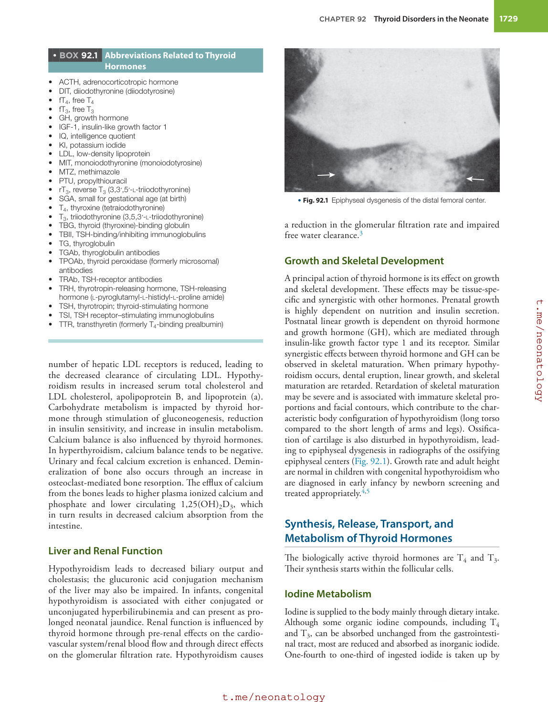

### Original source page 1728

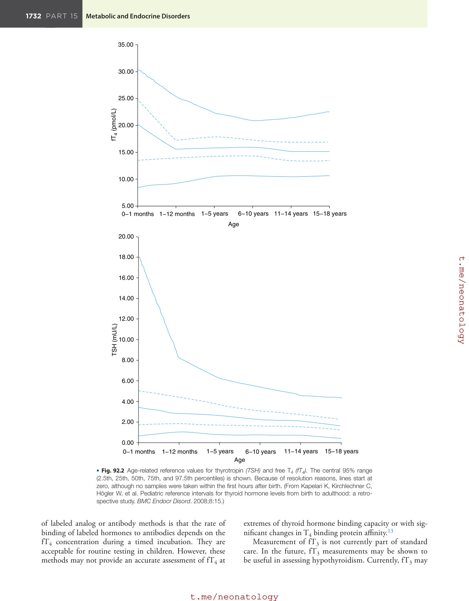

### Original source page 1730

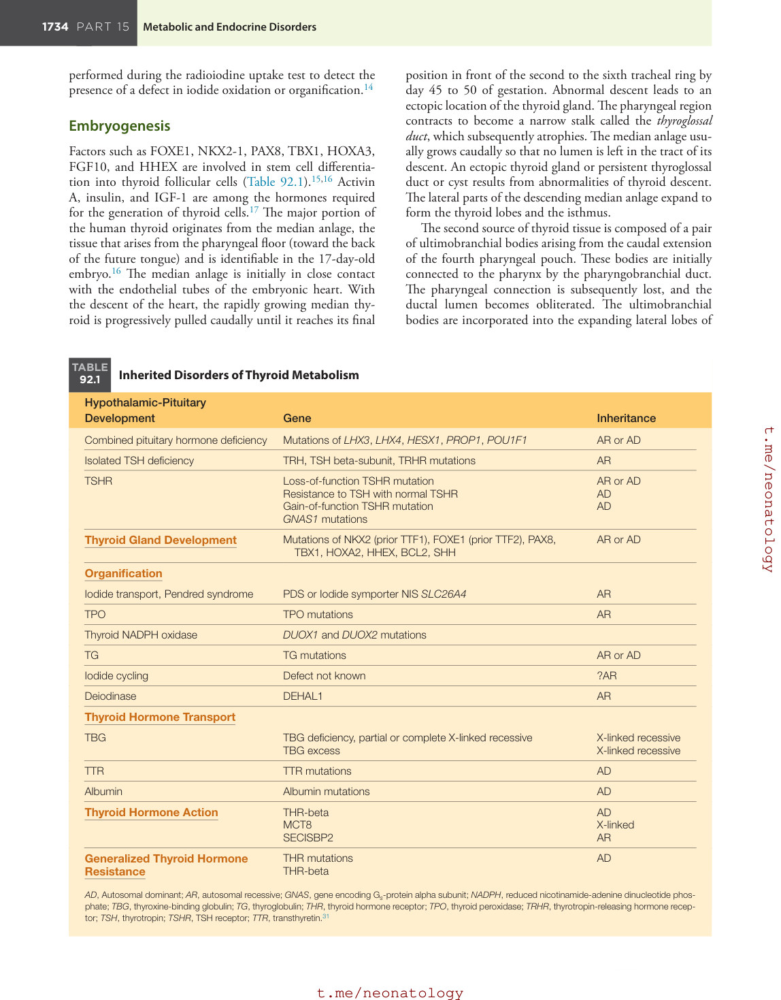

### Original source page 1732

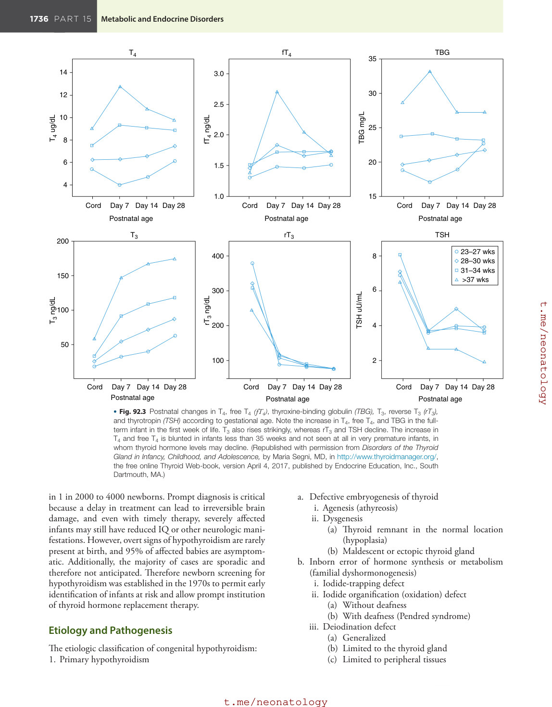

### Original source page 1733

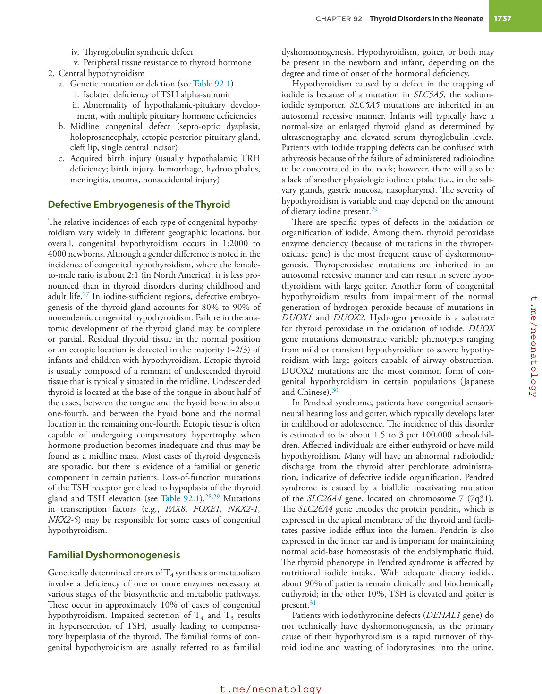

### Original source page 1736

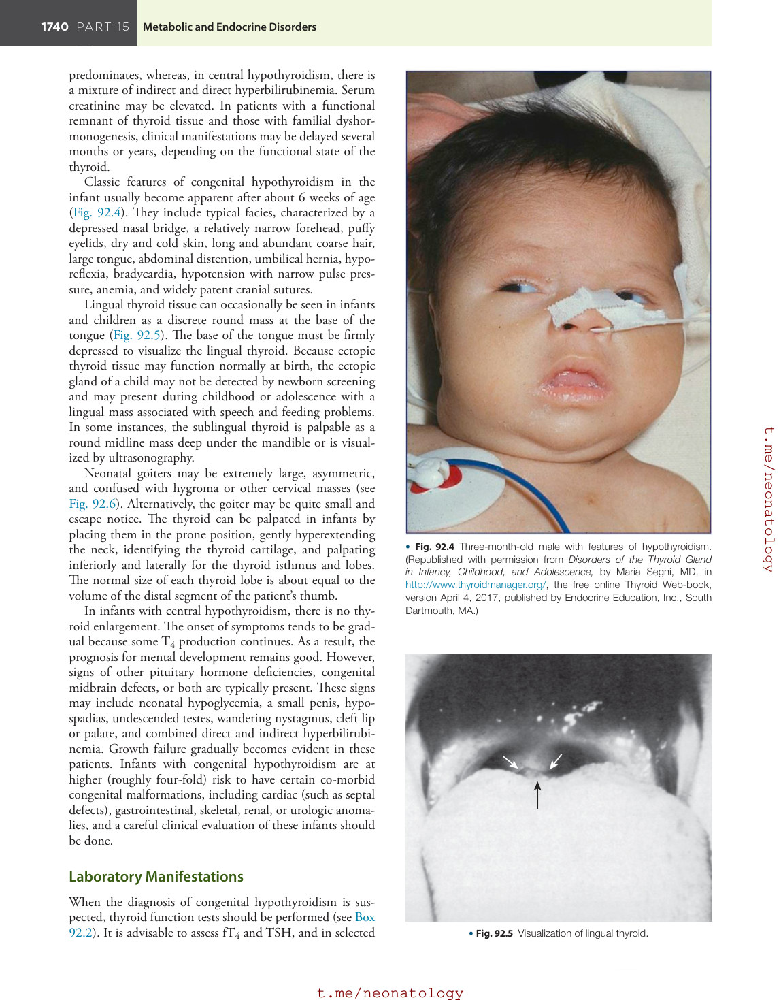

### Original source page 1737

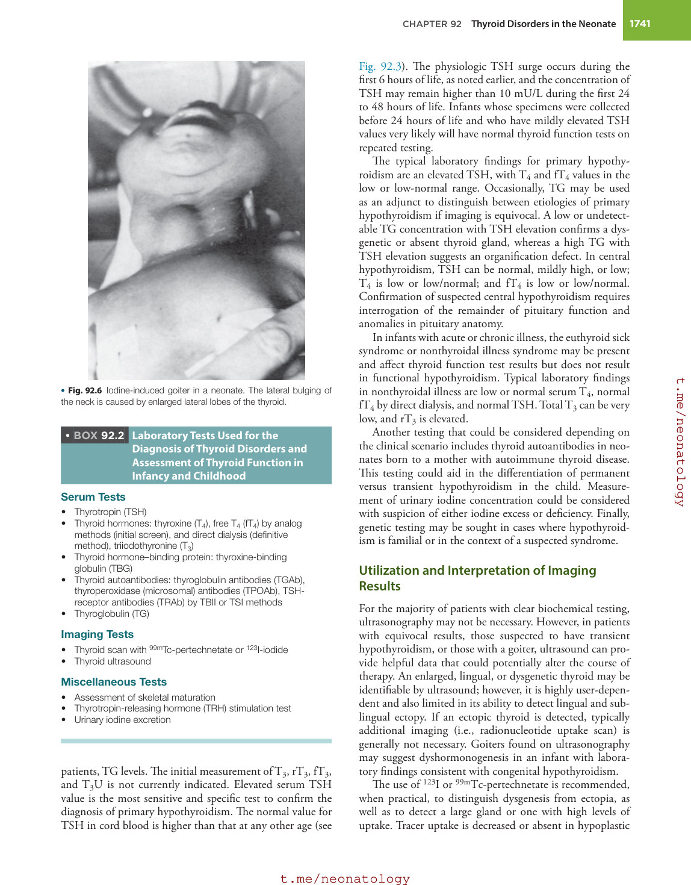

### Original source page 1742

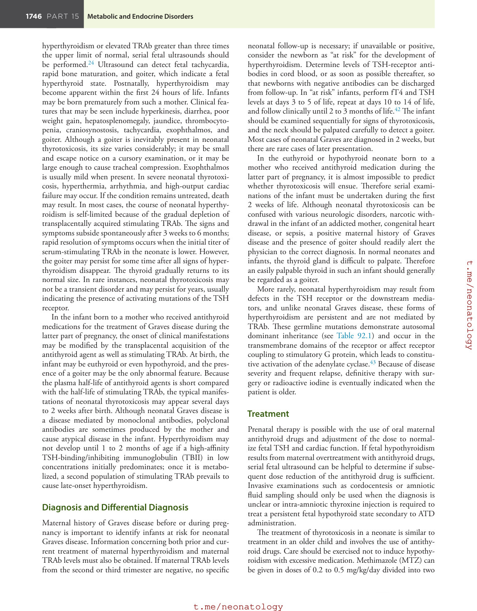

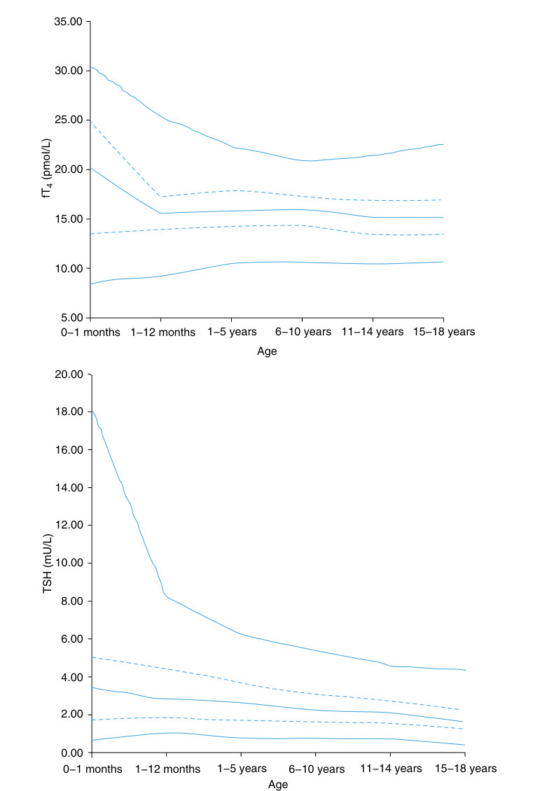

• Fig. 92.2 Age-related reference values for thyrotropin (TSH) and free T4 (fT4). The central 95% range (2.5th, 25th, 50th, 75th, and 97.5th percentiles) is shown. Because of resolution reasons, lines start at zero, although no samples were taken within the first hours after birth. (From Kapelari K, Kirchlechner C, Högler W, et al. Pediatric reference intervals for thyroid hormone levels from birth to adulthood: a retrospective study. BMC Endocr Disord. 2008;8:15.)

PDF p. 1728

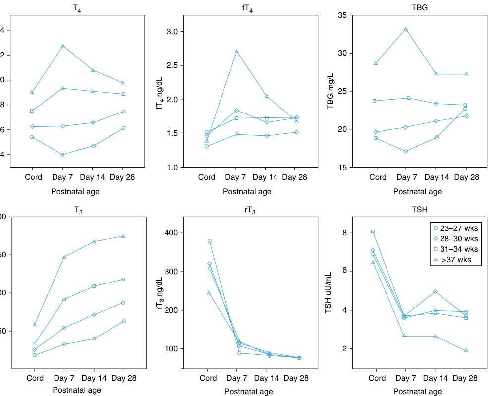

• Fig. 92.3 Postnatal changes in T4, free T4 (fT4), thyroxine-binding globulin (TBG), T3, reverse T3 (rT3), and thyrotropin (TSH) according to gestational age. Note the increase in T4, free T4, and TBG in the fullterm infant in the first week of life. T3 also rises strikingly, whereas rT3 and TSH decline. The increase in T4 and free T4 is blunted in infants less than 35 weeks and not seen at all in very premature infants, in whom thyroid hormone levels may decline. (Republished with permission from Disorders of the Thyroid Gland in Infancy, Childhood, and Adolescence, by Maria Segni, MD, in http://www.thyroidmanager.org/, the free online Thyroid Web-book, version April 4, 2017, published by Endocrine Education, Inc., South Dartmouth, MA.)

PDF p. 1732
