# 96. Fluid, Electrolytes, and Acid-Base Homeostasis
> Source attribution: [Source credits](../../SOURCE_CREDITS.md).

## PDF page 1942 | printed page 1948

96 Fluid, Electrolytes, and Acid-Base Homeostasis

### SEAN N. CURTIS

Fluid, electrolyte, and acid-base management are critical elements involved in the care of newborns, especially those deemed high risk. This is particularly the case for very low birth weight (VLBW) and extremely low birth weight (ELBW) neonates. This population is frequently exposed to parenteral nutrition, the composition of which may be highly variable. Additionally, premature neonates experience important developmental limitations in renal homeostatic mechanisms and thus are particularly susceptible to significant morbidity related to fluid, electrolyte, and acid-base imbalances.

### Fluid and Electrolyte Management

In this section, basic renal mechanisms for maintaining fluid and electrolyte homeostasis are reviewed, and factors that govern fluid and electrolyte requirements for term and preterm infants are outlined. Methods for monitoring fluid and electrolyte balance and potential complications and treatments of fluid and electrolyte disorders are discussed. Finally, considerations for specific high-risk neonates will be addressed.

### Body Fluid Composition in Fetuses and Newborns

Water is the primary component of the neonatal body. Total body water (TBW) is inclusive of extracellular (interstitial and plasma) and intracellular compartments. Early in fetal development, TBW represents almost 95% of the total body weight. As the fetus grows, there is a decrease in the proportion of body weight represented by water (Fig. 96.1).1 At birth, TBW is approximately 75% of body weight in a full-term infant. The progressive decrease in TBW is caused primarily by decreases in the extracellular water compartment. The TBW percentage in premature infants therefore is higher than that of term infants and is proportional to gestational age.2 For instance, at 32 weeks, the infant’s TBW is approximately 85% of the body weight, whereas that of a 23-week infant approaches 90%.3

1948

During the first week of life, all healthy neonates experience a reduction in body weight. The major cause of this physiologic weight loss is an isotonic contraction of extracellular water.4 In the first 24 to 48 hours after birth, infants have decreased urine output, followed by a robust diuresis, resulting in urinary losses of water and sodium in the first week of life and subsequent weight loss.5 This process is thought to be part of normal postnatal adaptation mediated in part through the release of atrial natriuretic peptide.6 In term infants, this weight loss can be up to 10%. In very premature infants, weight loss can be up to 15%.7 Perturbations in this normal transitional physiology can lead to imbalances in sodium and water homeostasis, and in preterm infants, it may increase the risk of downstream pathology, including patent ductus arteriosus, necrotizing enterocolitis, and bronchopulmonary dysplasia.8,9

### Sodium Balance in Newborns

Sodium is the major electrolyte of the extracellular fluid (ECF) volume and plasma volume. The total sodium content (not the serum sodium concentration, which reflects only the relative relationship between salt and water) determines the volume of the ECF. Renal sodium handling is crucial in maintaining sodium balance and protecting against volume depletion or overload. Sodium is freely filtered by the glomerulus, and the bulk of the filtered sodium is reabsorbed in the proximal tubule. Additional sodium reabsorption occurs in the loop of Henle via the Na+-K+- 2Cl− cotransporter, which is the therapeutic target of loop diuretics. In the distal convoluted tubule, sodium is further reabsorbed via the sodium chloride cotransporter, the therapeutic target of thiazide diuretics. The major site of fine regulation of sodium reabsorption is the collecting tubule, wherein aldosterone acts on the principal cells to promote reabsorption through sodium channels located on the luminal membrane.

Healthy term neonates have basal sodium handling similar to that of adults, with a fractional excretion of sodium (FENA) of less than 1%, although a transient increase in

## PDF page 1943 | printed page 1949

100

90

80

Total body water (TBW)

70

% body weight

60

Intracellular fluid (ICF)

50

40

Extracellular fluid (ECF)

30

20

10

2 4 6 8

6 mo

12 mo

3 yr

6 yr

9 yr

12 yr

15 yr

Adult

Birth

Age

• Fig. 96.1 Change with age in total body water and its major subdivisions. (From Friis-Hansen B. Body water compartments in children: changes during growth and related changes in body composition. Pediatrics. 1961;28:169. Used with permission of American Academy of Pediatrics.)

FENA occurs during the diuretic phase on the second and third days of life.5 In premature infants, however, renal sodium losses are inversely proportional to gestational age, with FENA equaling 5% to 6% in infants born at 28 weeks’ gestation (Fig. 96.2).10 As a result, many preterm infants may display negative sodium balance and hyponatremia during the initial 2 to 3 weeks of life because of high renal sodium losses and inefficient intestinal sodium absorption.11 In the extremely preterm infant, this negative sodium balance may persist even longer, potentially as long as the first 6 weeks of life.12 The mechanisms responsible for increased urinary sodium losses in preterm infants are multifactorial. The immature kidney exhibits glomerulotubular imbalance, a physiologic state that is present when the glomerular filtration rate (GFR) exceeds the reabsorptive capacity of the renal tubules. This imbalance is attributable to numerous factors, including a preponderance of glomeruli compared with tubular structures, renal tubular immaturity, large extracellular volume, and reduced oxygen availability.13 Decreased responsiveness to aldosterone is also characteristic of fetal and postnatal kidneys compared with adult kidneys and results in a decrease in sodium reabsorption.

Urinary sodium losses in preterm and term neonates may be increased in certain conditions, including hypoxia, respiratory distress, hyperbilirubinemia, acute tubular necrosis, and polycythemia. Pharmacologic agents such as dopamine, beta blockers, angiotensin-converting enzyme inhibitors, and diuretics may also increase urinary sodium losses in neonates. Renal prostaglandins, which are natriuretic and excreted at significantly higher levels in preterm infants than in term infants, have not been demonstrated to have a significant effect on renal tubular sodium handling.14 The abnormalities in sodium and water balance seen in premature infants are attenuated, to some degree, by prenatal steroid administration. Prenatal steroid treatment is associated

10.0

5.0 4.0 3.0 2.0

r = 0.755 p < 0.001

1.0

0.8

Filtered Na (%)

0.6

0.4

0.2

26 28 30 32 34 36 38 40

Gestation (weeks)

• Fig. 96.2 Scattergram showing the inverse correlation between fractional sodium excretion and gestational age. (From Siegel SR, Oh W. Renal function as a marker of human renal maturation. Acta Paediatr Scand. 1976;65:481.)

with decreased insensible water loss, a decreased incidence of hypernatremia, and an earlier diuresis and natriuresis.15 This beneficial effect on water and sodium balance in infants with extremely low birth weight is thought to be mediated by maturation of the renal epithelial transport systems controlling fluid and electrolyte homeostasis.

### Water Balance in Newborns

Water balance is controlled primarily by antidiuretic hormone (ADH), which controls water absorption in the collecting duct. ADH secretion is regulated by hypothalamic osmoreceptors that monitor serum osmolarity and baroreceptors of the carotid sinus and left atrium that monitor intravascular blood volume. Stimulation of ADH secretion occurs when serum osmolarity increases to greater than 285 mOsm/kg or when effective blood volume is significantly diminished. Intravascular volume has a greater influence on ADH secretion than serum osmolarity. Patients with hyponatremia and concomitant volume depletion are unable to suppress ADH in response to the decrease in serum osmolarity.

At baseline, when the serum osmolarity and effective blood volume status are normal, the collecting duct is impermeable to water. In response to an increase in serum osmolarity or significant volume contraction, antidiuretic hormone (ADH) produced in the hypothalamus binds to

## PDF page 1944

its receptor, arginine-vasopressin V2 receptor, located on the basolateral membrane of principal and inner medullary collecting duct cells. Receptor activation results in elevated levels of intracellular cyclic adenosine monophosphate. Downstream signaling pathways promote the movement of preformed vesicles containing aquaporin 2 (AQ2) water channels to the apical surface. The presence of these water channels on the watertight apical membranes renders them permeable to water. Withdrawal of ADH stimulates endocytosis of AQ2-containing vesicles, which restores the collecting duct cells to a state of water impermeability.

This system may not be as straightforward as previously believed, however, because vasopressin V2 receptors have been shown to be expressed in nephron segments other than the collecting duct, notably the loop of Henle.16 This study and others support the emerging concept of crosstalk between the ADH/vasopressin V2 receptor system (classically considered a regulator of water homeostasis only) and the renin-angiotensin system (classically considered a sodium regulator only), which may modulate renal handling of salt and water further.

Maximal renal concentration and dilution require structural maturity, well-developed tubular transport mechanisms, and an intact hypothalamic-renal vasopressin axis. In adults and older children, decreased water intake or increased water losses activate a highly efficient renal concentrating mechanism that can produce maximally concentrated urine with an osmolarity of 1500 mOsm/kg, resulting in fluid conservation. Conversely, excessive fluid intake triggers the diluting mechanism of the kidney, which can produce maximally dilute urine with an osmolarity of 50 mOsm/kg, resulting in free water excretion.

In contrast to adults and older children, the urinary concentrating ability is diminished in neonatal kidneys, particularly those of premature infants.17 When challenged, term newborns can concentrate urine to an osmolarity of 800 mOsm/kg; preterm infants can concentrate urine to an osmolarity of only 600 mOsm/kg.17 This diminished urinary concentrating ability, particularly in preterm infants, may limit a neonate’s ability to adjust to fluid perturbations—notably perturbations that result in increased free water losses. Multiple factors limit renal concentrating capacity in preterm infants. Structural immaturity of the renal medulla limits sodium, chloride, and urea movement to the interstitium. Preferential blood flow through the vasa recta limits generation of a medullary gradient. Diminished urea-generated osmotic gradient in the renal medulla limits production and maintenance of the countercurrent mechanisms that are essential in producing maximally concentrated urine. Finally, tubular responsiveness to vasopressin is diminished because of decreased transcription and protein synthesis of aquaporin 2 water channels.18

Urinary dilution capability, in contrast, is normal in term neonates but diminished in preterm neonates. When challenged with a water load, term infants can produce dilute urine with an osmolarity of 50 mOsm/kg, similar to that of an older child or adult. The kidneys of preterm infants,

however, may be capable of diluting the urine to an osmolarity of only 70 mOsm/kg.19

The diminished urinary diluting and concentrating capacities of neonates have important implications for their care. Excessive fluid restriction places newborns, particularly preterm neonates, at risk for dehydration, hypernatremia, or both. Conversely, generous fluid intake poses the risk of intravascular volume overload or hyponatremia. High fluid intake has also been associated with an increased risk of symptomatic patent ductus arteriosus and necrotizing enterocolitis.8,20,21

These facts underscore the importance of careful calculation of fluid and electrolyte requirements and close monitoring of fluid balance in high-risk neonates.

### Calculation of Fluid and Electrolyte Requirements

The calculation of fluid and electrolyte requirements in newborns is based on maintenance needs, deficits, and ongoing losses. Crucial factors that determine these fluid requirements include gestational age, renal function, ambient air temperature and humidity, ventilator dependence, presence of drainage tubes, and gastrointestinal losses.22

### Maintenance Fluids and Electrolytes

Maintenance fluid requirements represent the water required to maintain a newborn in neutral water balance. The total amount of maintenance fluid required is equal to urine production plus insensible losses. Table 96.1 summarizes maintenance fluid requirements during the first month of life for full-term and preterm infants. The numbers presented in Table 96.1 are only guidelines; they are to be used as a starting point for prescribing maintenance fluid for infants with low birth weight during the first week of life. Further adjustments must be based on the clinical situation. In particular, close attention to the patient’s volume status and assessment of factors that may increase or decrease the baseline fluid requirements are essential to the appropriate management of these infants.

### Insensible Losses

Insensible water losses are primarily evaporative losses via the skin and respiratory tract. In newborns, one-third of insensible water loss occurs through the respiratory tract, and the remaining two-thirds occurs through the skin. Numerous physiologic, environmental, and therapeutic factors can influence insensible water loss, making it the most variable component of the maintenance fluid requirements in newborns. Table 96.2 summarizes the effect of various factors on the degree of insensible water loss in newborns. Trans epidermal water loss contributes significantly to increased insensible losses of premature infants (Fig. 96.3).23 There is an inverse relationship between body weight and insensible water loss in a neutral thermal environment with moderately high relative humidity.24 Factors that contribute to these increased losses in preterm versus term infants include

## PDF page 1945 | printed page 1951

TABLE

### Maintenance Fluid (Water) Requirements During the First Month of Life

96.1

Insensible Water Loss (mL/kg/day)

Day 1–2

Birth Weight (g)

<750 100+ 100–200

750–1000 60–70 80–150

1001–1500 30–65 60–100

>1500 15–30 60–80

Adapted from data from Veille JC. AGA infants in a thermoneutral environment during the first week of life. Clin Perinatol. 1988;15:863; Taeusch W, Ballard RA, eds. Schaffer and Avery’s Diseases of the Newborn. 6th ed. Philadelphia: Saunders; 1991; and Lorenz J, Kleinman LI, Ahmed G, et al. Phases of fluid and electrolyte homeostasis in the extremely low birth weight infant. Pediatrics. 1995;96:48.

### Factors Affecting Insensible Water Loss in

TABLE

96.2

### Newborns

Effect on Insensible Water Loss

Factor

Level of maturity Inversely proportional to birth

weight and gestational age (see Fig. 96.3)

Environmental

Increased in proportion to

temperature above neutral thermal zone

increment in temperature

Elevated body

Increased by up to 300% at

temperature

rectal temperature >37.2° C

High ambient or inspired

Reduced by 30% if ambient

humidity

or respiratory vapor pressure equals skin or respiratory tract vapor pressure

Skin breakdown (e.g.,

Increased; magnitude

burn)

depends on extent of lesion

Congenital skin

Increased; magnitude

defects (e.g., large omphalocele)

depends on size of defects

Radiant warmer Increased by about 50%

above values obtained in incubator setting with moderate relative humidity and neutral thermal environment

Phototherapy Increased by up to 25%,

depending on technique

Double-walled incubator

Reduced by 10%–30%

or plastic heat shield

greater water permeability through a relatively immature epithelial layer of skin, a higher surface-area-to-body-weight ratio, and increased skin vascularity. Although prenatal glucocorticoids promote maturation of the renal tubules, they do not have a similar effect on skin maturation.25 Infants who have conditions associated with skin breakdown, such

Total Water Requirements by Age (mL/kg/day)

Day 3–7 Day 8–30

120–200 120–180

100–150 120–180

80–150 120–180

100–150 120–180

120

110

100

90

Transepidermal water loss (g/m2/hr)

80

70

60

50

40

30

20

10

0

24 26 28 30 34 32 36 38 40 42

Gestation (weeks)

### • Fig. 96.3 Effects of gestation on transepidermal water loss.

Measurements were made from abdominal skin and carried out in the first few days of life. (From Hammarlund K, Sedin G. Transepidermal water loss in newborn infants. III. Relation to gestational age. Acta Paediatr Scand. 1979;68:795.)

as epidermolysis bullosa or large skin defects (such as gastroschisis or omphalocele), also have increased transepidermal water loss. Historically, phototherapy has been reported to increase insensible water losses by significant amounts, especially in premature infants.26,27 However, with newer phototherapy techniques, this number may be less than previous.28

## PDF page 1946

Ambient temperature and relative humidity play an important role in influencing transepidermal water loss.26,29,30 An increase in ambient temperature results in increased insensible water loss. A decrease in ambient temperature has no effect on insensible water loss, however, despite the fact that it increases energy expenditure on the basis of cold stress. When ambient temperature is held constant, a lower ambient humidity increases skin water losses because of increased vapor pressure on the skin surface compared with the ambient vapor pressure; this is particularly true for very premature infants. A decrease in humidity from 60% to 20% results in an increased water loss of 100% in infants of less than 26 weeks’ gestation.31 The use of newer humidified incubators has been reported to result in significant decreases in insensible fluid losses and fluid requirements in premature infants.32 Alternatively, in the presence of high relative humidity, water evaporation is less. For example, infants on mechanical ventilation, which provides a humidified oxygen delivery system, have reduced water evaporation from the respiratory tract.

The quantity of water required for the formation of urine depends on two major factors: the degree of renal function and the renal solute load. Under normal conditions, a major determinant of renal water requirement is renal solute load. Renal solute load is derived from exogenous and endogenous sources. During the first 1 to 2 days of life, the exogenous solute load of infants with low birth weight may be low. Because these infants may not be fed enterally, caloric delivery by intravenous glucose-containing solutions does not meet basal energy needs. In the first 1 to 2 days of life, the basal energy requirement for infants with low birth weight is approximately 50 kcal/kg body weight. Currently, many infants are started on total parenteral nutrition (TPN) on day 1 to 2. If they are started at 70 to 90 mL/ kg/day of a 10% glucose solution, the caloric intake is 35 kcal/kg/day. These infants must derive the remaining mandatory energy requirement from an endogenous source (i.e., catabolism). This catabolic state produces approximately 6 mOsm/kg/day of endogenous solute load presented to the kidney. Assuming the infant can produce a maximal urinary concentration of 600 mOsm/kg, a minimum of 10 mL/kg/ day of free water is required to excrete this solute load.

As the infant ages, the exogenous intake from parenteral or enteral sources increases, resulting in increased caloric intake. The result is that the exogenous solute load increases, whereas catabolism decreases, resulting in a decreased endogenous solute load. It estimated that by 2 or 3 weeks of age, an infant consuming 80 to 120 kcal/kg/day has a total solute load of approximately 15 to 20 mOsm/kg/day. Assuming that the infant can produce a maximal urinary concentration of 800 mOsm/kg by this age, 20 to 25 mL/ kg/day of free water is required to excrete the solute load.

### Other Fluid Losses

Water loss through the gastrointestinal tract from stool output is minimal during the first few days of life, particularly in infants with low birth weight. When enteral feeds begin,

the water loss in the stool is 5 to 10 mL/kg/day. In a growing infant, the amount of water required for new tissue formation should be considered in the calculation of maintenance fluid requirements. Because infants grow at the rate of 10 to 20 g/kg/day, and new tissue contains 70% water, the maintenance fluid required should provide a net water balance of 10 to 15 mL/kg/day.

### Electrolyte Requirements

Maintenance sodium and chloride should not be provided in the first 1 to 2 days of life because of the relatively volume-expanded state of the newborn. Avoidance of sodium supplementation is particularly important in very premature infants, who have increased water losses and for whom early administration of sodium supplementation is associated with an increased risk of hypernatremia.33 In contrast, sodium supplementation initiated after the first few days of life in premature infants is associated with improved somatic growth in the neonatal period and improved neurodevelopmental outcomes.34,35

Potassium is not provided in parenteral fluid until urinary flow has been established, a normal renal function is ensured, and a normal serum potassium is confirmed. From postnatal days 3 to 7, maintenance sodium, potassium, and chloride requirements are approximately 1 to 2 mEq/kg/ day. Beyond the first week of life, 2 to 3 mEq/kg/day or more of sodium and chloride are required to maintain the positive electrolyte balance that is necessary for the formation of new tissue. Because of high urinary sodium losses, premature infants may require 4 or 5 mEq/kg of sodium per day during the first few weeks of life.

### Pathogenic Losses and Deficit Replacement

Many clinical situations require careful estimates of ongoing pathogenic losses and replacement of deficits. Commonly encountered conditions include diarrhea with dehydration, chest tube drainage, surgical wound drainage, and excessive urinary losses from osmotic diuresis. The important guiding principle in managing patients with these conditions is to measure the volume and composition of the pathogenic losses accurately. Electrolyte losses can be calculated by multiplying the volume of fluid loss by the electrolyte content of the respective body fluids (Table 96.3).

TABLE

Electrolyte Content of Body Fluids

96.3

Sodium (mmol/L)

Potassium (mmol/L)

Chloride (mmol/L)

Fluid Source

Stomach 20–80 5–20 100–150

Small intestine 100–140 5–15 90–120

Bile 120–140 5–15 90–120

Ileostomy 45–135 3–15 20–120

Diarrheal stool 10–90 10–80 10–110

## PDF page 1947 | printed page 1953

Estimating replacement for pathogenic fluid and electrolyte losses can be difficult, particularly in infants who accumulate fluid and electrolytes in static body fluid compartments. This phenomenon, commonly referred to as “third spacing,” occurs in several conditions, including sepsis, hydrops fetalis, hypoalbuminemia, intra-abdominal infections, and after abdominal or cardiac surgery. An infant with necrotizing enterocolitis often accumulates fluid in the mucosal and submucosal tissues of the small and large intestines and in the peritoneal cavity. Under these circumstances, large amounts of fluid, electrolytes, and protein may leak into the interstitial tissue and cannot be accurately quantitated. Because fluid lost into these tissue spaces does not contribute to effective arterial blood volume and circulatory balance in these patients, they may appear edematous even though their intravascular volume is decreased. The most appropriate strategic approach in the management of these infants is to replenish the intravascular fluid compartments with colloid and crystalloid, as able.

### Fluid and Electrolyte Balance

Interpretation of key clinical feedback is a crucial part of successful fluid and electrolyte management strategies in newborns. Fluid and electrolyte balance can be achieved by using a meticulous and organized system that obtains pertinent data and applies the physiologic principles outlined in the beginning of this chapter. A careful assessment of clinical indicators of volume status, including heart rate, blood pressure, skin turgor, capillary refill, oral mucosa integrity, and fullness of the anterior fontanelle, is essential. Other pertinent data that must be monitored include body weight, fluid intake, urine and stool output, serum electrolytes, and urine osmolarity or specific gravity.

During the first few days of life, appropriate fluid and electrolyte balance is reflected by a urine output of approximately 1 to 3 mL/kg/h, a urine specific gravity of approximately 1.008 to 1.012, and an approximate weight loss of 5% in term infants and 15% in premature infants with very low birth weight. Microsampling of serum electrolytes can be done at 8- to 24-hour intervals, depending on illness severity, gestational age, and fluid-electrolyte balance. Extracellular volume depletion is manifested by excessive weight loss, dry oral mucosa, sunken anterior fontanelle, capillary refill greater than 3 seconds, diminished skin turgor, increased heart rate, low blood pressure, elevated blood urea nitrogen, or metabolic acidosis. Serum sodium, which reflects sodium concentration but not sodium content, may be normal, decreased, or increased in states of volume depletion. Bedside monitoring of weight gain, as an indicator of volume status and growth, is essential for monitoring the adequacy of fluid and caloric intake in sick neonates. Beyond the first week of life, infants should gain approximately 20 to 30 g/day.

### Hyponatremia and Hypernatremia

Hyponatremia and/or hypernatremia are extremely common in premature infants as well as in term infants with

significant medical issues (such as perinatal asphyxia or septic shock). Hyponatremia, defined as a serum sodium less than 130 mmol/L, occurs in up to 30% of very low birth weight infants in the first week of life and 25% to 65% after the first week.36 Hypernatremia, defined as a serum sodium greater than 150 mmol/L, may occur in up to 40% of preterm infants born at less than 29 weeks’ gestation.37 Both hyponatremia and hypernatremia have been associated with significant complications. Large changes in serum sodium (either an increase or decrease) in the first month of life in premature infants have been associated with adverse long-term neurologic outcomes.36 The very presence of hypernatremia, rather than rapid changes in sodium (up to 15 mmol/L/day), has been identified as an independent risk factor for intraventricular hemorrhage.38 Whether these long- and short-term poor outcomes are caused by the serum sodium changes themselves or instead reflect the severity of the infant’s clinical situation has yet to be established. However, given the potential risks, it is prudent to try to maintain serum sodium levels within the normal range and avoid large fluctuations.

Hyponatremia

Hyponatremia is caused by one of three general mechanisms: (1) an inability to excrete a water load; (2) excessive sodium losses; or (3) inadequate sodium intake. Most commonly, sick newborns are unable to excrete a water load because of a decreased effective arterial blood volume preventing the suppression of ADH secretion. Hyponatremia may also occur because of decreased fluid delivery to the distal nephron diluting segments. Two common etiologies of this decreased delivery are decreased GFR caused by acute kidney injury (AKI) and increased proximal tubular fluid and sodium reabsorption associated with volume depletion. Defects in sodium chloride transport in the cortical and medullary ascending limb of the loop of Henle, which is essential in producing an osmotic gradient for distal water absorption via the countercurrent multiplier, also limit the diluting capacity of the nephron. The treatment for hyponatremia varies depending on the underlying etiology. A patient with hyponatremia and volume depletion should receive increased fluids, whereas a patient with an oliguric AKI should have fluids restricted. These examples highlight the importance of assessing the neonate’s volume status when determining therapy.

It must be mentioned that accurate sodium measurement in the neonate may be subject to technical hurdles. In many modern laboratories, serum sodium is measured indirectly using an ion-selective electrode. In this method, it is assumed that water comprised 93% of plasma volume, but this assumption fails in plasma samples with atypical protein or lipid content. In the case of premature neonates, plasma samples frequently have relatively low protein and lipid content, leading to an overestimation of the plasma sodium concentration. The end result is pseudonormonatremia or pseudohypernatremia for these infants. Most pointof-care analyzers in the neonatal intensive care unit measure

## PDF page 1948

sodium directly and are thus more likely to be accurate in samples with abnormal protein or lipid content, compared with samples sent to the lab.39

Hyponatremia in the newborn has historically been delineated as early onset (occurring in the first week of life) or late onset (occurring in the latter half of the first month of life). Given the broad spectrum of gestational ages, underlying diseases, and clinical courses of neonates cared for in modern neonatal intensive care units, these distinctions may be less relevant. Assessing the individual neonate’s clinical status is more important in determining the causes and appropriate interventions for hyponatremia. Increased free water load may be caused by one or more factors, such as increased maternal free water intake during labor,40 excess free water administration in the postnatal period, or perinatal nonosmotic release of vasopressin. This latter phenomenon may be seen in conditions such as perinatal asphyxia, respiratory distress, bilateral pneumothoraces, and intraventricular hemorrhage, or with various medications, including morphine, barbiturates, or carbamazepine. Impaired free water clearance attributed to excessive vasopressin release has been reported in very low birth weight infants and may contribute to the development of chronic lung disease in those children.41 Antagonists for the type 2 vasopressin receptor (AVRP2) have been used to treat some adult and pediatric patients with hyponatremia secondary to vasopressin excess; however, no efficacy data for neonates exists.42 Oliguric AKI or edematous disorders may also contribute to impaired ability to handle a water load. Alternatively, hyponatremia may be caused by negative sodium balance. This condition may occur from either inadequate sodium intake or excessive renal losses because of a high fractional excretion of sodium, particularly in preterm infants of less than 28 weeks’ gestation.10

Less common conditions, all of which result in pathologic urinary sodium losses, can cause hyponatremia in neonates and young infants. These conditions may be caused by inherited tubulopathies such as Bartter syndrome, or disorders of aldosterone production or responsiveness, respectively, including congenital adrenal hyperplasia and pseudohypoaldosteronism. Aldosterone is a steroid hormone produced in the adrenal cortex that has a crucial role in maintaining sodium and potassium homeostasis in the kidney. It is produced in response to either volume depletion, via the renin-angiotensin-aldosterone axis, or an increase in serum potassium. Under the influence of aldosterone, apical epithelial sodium channels are inserted on the luminal (urinary) surface, allowing sodium to be reabsorbed down its concentration gradient. Potassium, as the primary intracellular cation, is excreted in return. This process is facilitated further by aldosterone-mediated increase in the activity of basolateral Na+, K+-ATPase.43 Aldosterone also has a role in acid-base homeostasis and promotes hydrogen secretion (see Acid-Base Management section) via actions on H+-ATPase located on the luminal surface of adjacent intercalated cells. Abnormalities in either the production of, or the renal responsiveness to, aldosterone can result in

variable degrees of renal sodium wasting, hyperkalemia, and metabolic acidosis.

Congenital adrenal hyperplasia is an inherited disorder of cortisol synthesis that results in diminished aldosterone production.44 The most common form is complete absence of 21-hydroxylase activity, a key enzyme in the production of aldosterone. Affected females have ambiguous genitalia at birth because of excess adrenal androgens. Patients typically present with shock and severe hyponatremia, hyperkalemia, and metabolic acidosis at 1 to 3 weeks of age as the result of a salt-losing crisis. Additional laboratory abnormalities typically seen with this disorder include elevated plasma levels of renin, adrenocorticotropic hormone, 17-hydroxyprogesterone, progesterone, androstenedione, and urinary 17-ketosteroids. Serum cortisol and aldosterone levels may be undetectable. Initial treatment is directed at correcting volume and electrolyte abnormalities, including fluid resuscitation and management of life-threatening hyperkalemia. Long-term glucocorticoid and mineralocorticoid replacement therapy should be instituted to facilitate normalization of serum electrolytes and to treat the underlying disease. Sodium supplements may be necessary for a prolonged period.

Pseudohypoaldosteronism (PHA) refers to a group of disorders characterized by renal tubular unresponsiveness to aldosterone as evidenced by hyperkalemia, metabolic acidosis, and variable degrees of renal sodium wasting. PHA can be primary (genetic) or secondary (acquired). The two subtypes of primary PHA include type I, which usually manifests in infancy with hypotension, severe sodium wasting, and hyperkalemia, and type II (Gordon syndrome), which typically presents later in childhood. Autosomal dominant type I PHA, previously designated the “renal” type I, is the most common type I PHA. Patients with this form usually present during early infancy with failure to thrive, weight loss, vomiting, dehydration, or shock. Sweat and salivary electrolytes are normal in this form of type I PHA. Although it is inherited as an autosomal dominant trait, expression may be variable. Treatment involves administration of large quantities of sodium chloride (10–15 mEq/ kg/day). Autosomal recessive type I PHA, previously designated “multiple target organ defects” type I PHA, is a severe, life-threatening systemic disease that affects sodium and potassium handling in the kidney, sweat glands, salivary glands, nasal mucosa, and colon.45 Patients with this disorder usually present in the newborn period with severe salt wasting and life-threatening hyperkalemia. They also have increased sweat chloride, which may mimic the presentation of cystic fibrosis. Sodium chloride supplementation alone often is inadequate in controlling hyperkalemia and metabolic acidosis in these patients. Dietary restriction of potassium intake and the use of rectal sodium polystyrene sulfonate resin (kayexalate), a sodium-potassium exchange resin, are often required. Indomethacin or hydrochlorothiazide may be necessary to control hyperkalemia and acidosis. Mutations in multiple different genes have been implicated in the pathogenesis of PHA type 1, including

## PDF page 1949 | printed page 1955

those encoding components or regulators of the mineralocorticoid receptor, epithelial sodium channels, and thiazidesensitive sodium chloride co-transporter.46 Secondary forms of PHA occur more commonly than primary forms and are typically caused by injury to the collecting tubules, the primary segment responsible for potassium balance. Causes of secondary PHA in the newborn period include unilateral renal vein thrombosis, neonatal medullary necrosis, urinary tract malformations, pyelonephritis, or other tubulointerstitial diseases. Patients with congenital obstructive uropathies such as posterior urethral valves are particularly prone to exhibiting aldosterone resistance, manifesting as a hyperkalemic metabolic acidosis, even in the face of relatively intact renal function.

Hypernatremia

Hypernatremia occurs as the result of increased insensible or urinary water losses, inadequate water intake, or excess sodium administration. Hypernatremia occurring in the first week of life is typically caused by increased insensible water losses, often coupled with the excess parenteral sodium intake. Many other medications can contribute to large “inadvertent” sodium loads, particularly in sick premature infants, including calcium gluconate, gentamicin, dopamine, dobutamine, heparin, and intravenous fluids used to maintain arterial or venous vascular lines.22 Onset of hypernatremia later in the first month of life usually is attributable to either excess sodium supplementation or inadequate free water intake.

Excess urinary losses can occur as the result of diabetes insipidus (DI), which is characterized by severe urinary water losses reflecting an inability to produce concentrated urine. DI results from either low level of circulating ADH (central DI) or impaired renal response to ADH (nephrogenic DI). Newborns with this disorder present with hypernatremia, polyuria, polydipsia, chronic dehydration, irritability, fever, poor feeding, and growth failure.

Nephrogenic DI can be inherited (congenital) or occur as the secondary result of processes that cause renal tubular damage. The most common inherited form of nephrogenic DI is caused by mutations in the gene encoding the vasopressin receptor V2R and is inherited as an X-linked recessive disease.47 Causes of secondary nephrogenic DI include congenital structural disorders such as obstructive uropathy or nephronophthisis, chronic kidney disease, hypercalcemia, and hypokalemia. Treatment of nephrogenic DI includes placement on a low sodium formula to reduce solute intake and resultant obligate water loss associated with solute excretion. Thiazide diuretics are also used to reduce extracellular sodium content, which enhances sodium reabsorption in the proximal tubule and diminishes sodium and water delivery to the distal nephron. Amiloride may also be necessary to reduce urinary potassium losses that may occur with the use of thiazide diuretics. Although prostaglandin inhibitors have been successfully used to treat nephrogenic DI, long-term use of these agents is not recommended because of gastrointestinal, hematopoietic, and renal complications.

Central DI may be caused by midline central nervous system malformations, anoxic encephalopathy, cerebral edema, or trauma.48 Although some ADH secretion may be present in central DI, levels are insufficient to promote appropriate water absorption in the distal nephron. Desmopressin acetate (DDAVP) is generally an effective therapy for this condition, and DDAVP responsiveness can help distinguish central versus nephrogenic causes when the underlying etiology is unclear.

### Fluid and Electrolyte Therapy in Common Neonatal Conditions Perinatal Asphyxia

Renal parenchymal injury from perinatal asphyxia frequently results in acute tubular necrosis, which is commonly accompanied by oliguria or anuria. In the presence of AKI, fluid restriction to amounts equal to urine output plus insensible losses is crucial to avoid volume excess. In a term infant, insensible water losses are approximately 20 to 25 mL/kg/day, and stool loss is minimal. Fluid requirements during the first day of life in an anuric term infant are approximately 30 mL/kg/day. Insensible losses for an anuric premature infant may be as high as 80 mL/kg/day, depending on gestational age. Fluid restriction is often difficult to accomplish when relatively large volumes of intravenous medications are necessary or when the absence of central venous access limits the concentration of dextrosecontaining fluid that can be delivered. High-caloric-density parenteral nutrition, delivered in as small a volume as possible, is often necessary when fluid restriction is undertaken to avoid fluid overload and water intoxication. When urine production normalizes, fluid intake can be liberalized to reflect urine output and insensible losses.

If the cause of oliguria or anuria is unclear and the infant is believed to be intravascularly depleted, a test dose of 10 mL/kg body weight of normal saline can be given. During the oliguric or anuric phase of acute tubular necrosis, potassium should not be given to avoid hyperkalemia. During the recovery phase of acute tubular necrosis, small infants may experience large urinary sodium and potassium losses, which should be quantitated and replaced.

In severe perinatal asphyxia, the renal parenchymal injury may be severe enough to produce AKI lasting for several days to weeks or may be permanent in cases with cortical necrosis. In the presence of hyperkalemia, defined as serum potassium greater than 7 mEq/L, the cardiac rhythm of the infant should be monitored by continuous electrocardiogram to detect any cardiac arrhythmia. Treatment options for hyperkalemia include insulin given with glucose; sodium polystyrene sulfonate resin (kayexalate); sodium bicarbonate if metabolic acidosis is present; and peritoneal dialysis. If a significant arrhythmia is present, calcium chloride or calcium gluconate infusion is also indicated to antagonize the toxic effects of hyperkalemia on the cardiac membrane.

In addition to acute kidney injury, other factors may influence fluid management in patients with severe perinatal

## PDF page 1950

asphyxia. Fluid restriction has been advocated by some for infants with perinatal asphyxia even in the absence of AKI. However, no systematic randomized studies have determined whether this practice alters the long-term outcome for these patients. Over the past decade, the use of hypothermia as a treatment for preventing mortality and neurologic sequelae of severe perinatal asphyxia has become common practice, although optimal duration and degree of hypothermia remains a subject of research.49,50 To date, guidelines for fluid administration during hypothermia protocols have not been well delineated. However, hyponatremia has been reported as a complication of therapeutic hypothermia and has been associated with positive fluid balance, possibly related to decreased insensible losses from skin vasoconstriction.51

### Hyperbilirubinemia

Severe hyperbilirubinemia (bilirubin >20 mg/dL after 72 hours of life) is not uncommon, occurring in approximately 1% of term neonates. Phototherapy is the mainstay of therapy28; however, several studies have also highlighted the importance of fluid therapy as an adjunct to phototherapy. A significant proportion of neonates with severe hyperbilirubinemia exhibit dehydration on admission.52 In addition, intravenous fluids have been shown to accelerate the rate of decline in serum bilirubin and decrease the need for exchange transfusions in severely affected infants.53 A meta-analysis, however, was unable to find evidence that intravenous fluids improve long-term neurologic outcomes in otherwise healthy term infants.54 It is still possible that intravenous fluids may prove to be beneficial to certain high-risk populations, including infants with dehydration or preterm infants because these groups have been less well studied in this regard. Clinicians must keep in mind that phototherapy itself may increase insensible fluid losses in neonates based on historical data. More recent evidence, however, suggests that newer light-emitting diode (LED) phototherapy techniques are likely to significantly attenuate these fluid losses.

### Symptomatic Patent Ductus Arteriosus

Patent ductus arteriosus (PDA) with left-to-right shunt and pulmonary edema is a common cause of morbidity in preterm infants, particularly infants with respiratory distress syndrome in the first few days of life. Fluid overload during this period has been associated with an increased incidence of symptomatic PDA,20 possibly caused by the lack of isotonic contraction of body fluids in this group of infants. Fluid restriction, however, may not convey beneficial effects on pulmonary or systemic hemodynamics55 and could increase the risk of AKI, especially in infants receiving medical therapy for the PDA with indocin or ibuprofen. Diuretic therapy should only be initiated in the setting of pulmonary edema or left ventricular failure. Postligation cardiac syndrome secondary to left ventricular dysfunction is a relatively common complication of PDA surgical ligation. In this setting, fluid administration should be thoughtful to

minimize cardiac overload and optimize pulmonary and systemic perfusion.56

### Bronchopulmonary Dysplasia

Infants with bronchopulmonary dysplasia present complex challenges in fluid and electrolyte management. Because of higher basal metabolic rates and increased caloric requirements, the caloric density or volume, or both, of parenteral or enteral feedings needs to be maximized. Care must be taken to provide optimal fluid and nutrient intake without incurring volume overload and worsening pulmonary disease. In addition, therapies used to treat the underlying lung disease—most notably, diuretics—may have significant effects on fluid and electrolyte balance.57

Furosemide, a potent loop diuretic, causes a marked increase in urinary sodium, potassium, and hydrogen ion excretion, leading to hypokalemic metabolic alkalosis. Long-term use of this diuretic may also result in enhanced urinary excretion of calcium leading to osteopenia of prematurity, urolithiasis, or nephrocalcinosis. Furosemide should be used with caution in neonates, particularly premature infants with AKI and infants receiving concomitant aminoglycoside therapy, to avoid complications of ototoxicity. Chlorothiazide, a less potent thiazide diuretic that acts at the distal tubule, also causes a hypokalemic metabolic alkalosis. In contrast to loop diuretics, thiazides decrease urinary calcium excretion. Treatment with spironolactone, a potassium-sparing aldosterone inhibitor, may be associated with hyperkalemia. Strategies used to avoid complications of diuretic use include minimizing diuretic dosages, obtaining serum electrolyte measurements to detect electrolyte imbalance, monitoring urinary calcium excretion (when applicable), and supplementing calcium to prevent osteopenia of prematurity. Sodium supplementation should be judicious because it may further contribute to hypervolemia and/or hypertension if present.

### Abdominal Wall Defects

Abdominal wall defects, particularly gastroschisis, are frequently associated with increased insensible water loss. For this reason, they predispose neonates to significant freewater deficit and associated hypovolemic hypernatremia. There is sparse evidence-based literature to guide the perioperative fluid management of these patients. Many guidelines suggest initiation of two to three times the normal maintenance volumes of intravenous fluids; however, this practice is based on relatively old data.58 Therefore it is prudent to approach each neonate individually, based on frequent assessment of fluid status through an exam and microsampling of electrolytes.

### Acid-Base Management

In this section, normal acid-base homeostasis in neonates is reviewed, and how these processes are influenced during the stages of nephron development is discussed. The

## PDF page 1951 | printed page 1957

diagnostic and therapeutic approach to acid-base disorders is presented, and common acid-base disorders are discussed.

### Acid-Base Homeostasis in Neonates

Normal neonatal metabolism occurs within a tightly controlled extracellular pH ranging from 7.35 to 7.43. Normal growth and development critically depend on this homeostasis, which is threatened in ill term newborns or premature infants. The maintenance of serum pH (i.e., hydrogen ion concentration) within the physiologic range requires two major processes: (1) acute compensation, which is accomplished by rapid acid or base buffering by intracellular and extracellular buffers in response to acute decreases or increases in serum pH, and (2) long-term compensation, which is accomplished by renal excretion of acid or base, including an obligate daily acid load of approximately 1 to 2 mEq/kg/day. Renal and extrarenal homeostatic mechanisms contribute to the maintenance of acid-base balance.

### Acute Compensation: Body Buffer Systems

After an acute change in serum pH caused by losses or gains of acid or base to the body, intracellular and extracellular buffering mechanisms respond rapidly to return the serum pH to a physiologic level. In response to a decrease in pH, H+ enters the cell in exchange for K+ by way of an H+/K+ exchanger. H+ is buffered by intracellular buffers, including hemoglobin, organic phosphates, and bone hydroxyapatite. Conversely, when serum pH increases, H+ leaves the cell in exchange for K+. Acute acidosis often results in hyperkalemia, whereas alkalosis is associated with hypokalemia. Intracellular buffering accounts for about 47% of an acute acid load and can reach even higher levels during more prolonged episodes of acidosis. Much of this buffering capacity is in the bones. In disorders characterized by chronic acidosis, increased bone resorption and loss of bone sodium, potassium, calcium, and carbonate occur. These effects on bone partially explain the invariable association of growth failure, a potentially significant issue for premature infants, with acidosis.

The major buffering mechanism in the extracellular fluid is mediated by the carbonic anhydrase system, as reflected in the following formula:

H+ + HCO3

−CA

↔H2CO3

CA

↔H2O + CO2

Regulation of carbon dioxide (CO2) excretion by the respiratory system markedly improves the efficiency of this buffering system at physiologic pH. In the presence of carbonic anhydrase (CA), carbonic acid (H2CO3) is in equilibrium with CO2. Additional or increased production of acid results in consumption of bicarbonate (HCO3−) and increased H2CO3 and CO2. CO2 then crosses the bloodbrain barrier, resulting in a decrease in pH. This action stimulates central nervous system chemoreceptors, leading to increased respiration and resultant decrease in CO2 concentration within 12 to 24 hours. Similar respiratory

compensation occurs in response to an alkali load, which leads to increased HCO3− concentration, resulting in hypoventilation and accumulation of CO2.

Two formulas are particularly useful in understanding and evaluating acid-base disorders. The Henderson–Hasselbalch equation expresses the relationship of pH, PCO2, and HCO3−:

pH = 6.1 + log [ HCO3 −/ (0.03 −PCO2)

]

where 6.1 is the pKa of this equation.

The Winters formula59 can be used to predict the appropriate respiratory response (i.e., decrease in PCO2) to a primary metabolic acidosis:

( 1.5×HCO3 −) + 8±2

PCO2 =

Respiratory compensation in response to either metabolic acidosis or metabolic alkalosis does not completely normalize the pH. The Winters formula predicts that a decrease in HCO3− to 10 mmol/L would result in a decrease in PCO2 to 21 to 25 mm Hg. By the Henderson-Hasselbalch equation, the resulting serum pH is 7.22 to 7.29. This is markedly better than the serum pH of 7.02 that would be seen if no respiratory compensation occurred, but it is still not within the normal range. With “simple” metabolic acidosis or alkalosis, the respiratory compensation does not fully correct the serum pH. If serum pH is found to be in the normal range (or higher or lower than predicted), a mixed acid-base disorder, with an added primary respiratory abnormality, should be considered.

### Long-Term Maintenance of Acid-Base Balance

Long-term maintenance of a normal serum pH depends on the balance between the production or intake of acid and base and their metabolism or excretion. Dietary intake accounts for a small amount of preformed acid, but most of the daily acid load is a product of obligatory metabolic functions. A large proportion consists of CO2, which is carried to the lung as bicarbonate and carbamino groups bound to hemoglobin and ultimately excreted through respiration. This is termed volatile acid. Hypoventilation or hyperventilation leads to either retention or enhanced excretion of CO2 and results in acidosis or alkalosis. Metabolic activity also produces an obligate nonvolatile acid “load” of approximately 1 to 2 mEq/kg/day. Most of this acid load is sulfuric acid, which results from metabolism of the sulfur-containing amino acids, methionine, and cysteine. The remainder consists primarily of incompletely oxidized organic acids, phosphoric acid, and hydrochloric acid. Successful maintenance of acid-base balance depends on renal excretion of this daily acid load.

The kidney plays an essential role in maintaining acidbase homeostasis by three major mechanisms: 1. Reabsorption of filtered bicarbonate and excretion of

excessive bicarbonate in response to metabolic alkalosis 2. Excretion of the obligate daily acid load and any addi-

tional acid load from pathogenic processes, such as lactic

## PDF page 1952

acidosis related to sepsis or bicarbonate loss from diarrhea 3. Compensation for changes in serum pH that result from

primary respiratory disorders Bicarbonate reabsorption occurs primarily in the proximal tubule, wherein 60% to 80% of the filtered bicarbonate load is reabsorbed. Bicarbonate is not reabsorbed via a specific transporter. Instead, it is reabsorbed via an indirect mechanism. Bicarbonate present in the lumen is first buffered by H+ that is secreted in exchange for sodium via a Na+/H+ exchanger located on the luminal membrane of proximal tubular cells (Fig. 96.4). Through the actions of carbonic anhydrase, CO2 and H2O are produced. CO2 and H2O diffuse into the cell, wherein HCO3− is regenerated and reabsorbed across the basal cell membrane in exchange for chloride. H+ is also regenerated, making it available again for buffering of additional filtered bicarbonate. The net effect is that for every H+ secreted, one molecule of filtered bicarbonate is reabsorbed.

Although proximal tubule bicarbonate reabsorption is essential in preventing bicarbonate wasting, no net H+ excretion occurs in this process. Instead, excretion of the daily acid load is accomplished by two mechanisms: ammoniagenesis and production of titratable acids. Ammoniagenesis occurs in the proximal tubule (see Fig. 96.4) via the metabolic processing of glutamine produced in the liver. In the proximal tubule cell, glutamine is converted to ammonium (NH4+), which is secreted into the lumen in exchange for Na+. Deamination of glutamine also produces a-ketoglutarate, which buffers H+. Through the actions of the intracellular carbonic anhydrase system, this process eventually results in the production of intracellular HCO3−, which can be reabsorbed across the basal membrane of the cell with Na+. NH4+ secretion is the metabolic equivalent to H+ excretion.

The remainder of acid secretion occurs in the cortical and medullary collecting tubules. H+ is secreted into the collecting tubule against its pH gradient by H+-ATPases located on the luminal membrane. This process is influenced by the luminal and peritubular pH, distal sodium delivery, and aldosterone. Secreted H+ titrates filtered anions, including phosphates and sulfates, producing titratable acids (Fig. 96.5). The collecting tubule also secretes ammonia from the

Proximal tubule cell LUMEN BLOOD

H2O+CO2 H2O+CO2

CA CA

Na+

Na+

H2CO3 H2CO3

H+

HCO3– HCO3– + H+

Na+

Glutamine

a-Ketoglutarate

NH4+

• Fig. 96.4 Schematic drawing of proximal tubular HCO3− reabsorption and ammoniagenesis. See text for explanation. CA, Carbonic anhydrase.

medullary interstitium, where it is buffered by H+ to produce NH4+. Titratable acid formation and ammonia buffering require an acidic environment for protonation to occur. In addition to providing a source of H+ for buffering, distal H+ secretion is important in maintaining acidic urine (pH of 4.5–5.0).

The net acid excretion by the kidney is equal to the sum of titratable acids plus ammonium minus any filtered bicarbonate that is not reabsorbed. During steady-state, total acid secretion equals the production of acid from diet and metabolism. In response to an acid load, ammoniagenesis can increase dramatically because of enhanced production of glutamine by the liver. Ammoniagenesis is stimulated by hypokalemia and inhibited by hyperkalemia. In contrast, titratable acids are relatively fixed in their production except in instances of diabetic ketoacidosis, in which the ketone bodies themselves can form titratable acids. Alternatively, the kidney has the capacity to alter HCO3− reabsorption in response to changes in the filtered load of bicarbonate, further minimizing changes in pH.

### Developmental Aspects of Acid-Base Physiology

Although nephron formation is complete by 34 to 36 weeks of gestation, maturation and functional changes of the nephron continue during the first year of life. The relative immaturity of the kidney, which is more pronounced in preterm infants, affects basal acid-base status and the response to additional acid and alkali loads.60 During the initial 24 to 48 hours of life, acid-base balance is influenced by the degree of perinatal stress and environmental factors such as temperature and diet.61 In the first 2 weeks of life, neonates are in a state of mild metabolic acidosis. In some infants, blood pH may decrease to less than 7.25 or base deficit may exceed 8 mEq/L. In extremely low birth weight infants, that deficit is even higher, averaging closer to 10.6 mEq/L.62

The causes of this metabolic acidosis in neonates are multifactorial. The threshold for bicarbonate reabsorption in the proximal tubule is lower in neonates, especially

Collecting tubule cell LUMEN BLOOD

H2O+CO2

CA

HPO4– + H+

CI–

H2CO3

ATPase HCO3–

H2PO4

H+

NH3

NH3 + H+

NH4+

• Fig. 96.5 Schematic drawing of distal urinary acidification mechanisms. CA, Carbonic anhydrase.

## PDF page 1953 | printed page 1959

premature infants, compared with adults, so that neonates tend to “waste” bicarbonate at a lower blood HCO3− concentration (15–21 mEq/L). Thus the normal bicarbonate level in a healthy neonate is lower than that of older children or adults. Low GFRs, particularly in premature or stressed neonates, decrease the availability of phosphates and other buffers, decreasing the formation and excretion of titratable acids. Tubular immaturity results in reduced tubular secretory surface for organic acid secretion, diminished number of organic acid transport sites per unit area of renal tubular surface, and diminished energy available for organic acid transport. Premature infants are also unable to acidify their urine maximally at birth, exhibiting a minimal urine pH of 6, in contrast to full-term neonates and adults, whose urine pH may reach 4.5. The ability of premature infants to acidify their urine maximally and to excrete an acid load correlates with gestational age. By 6 weeks of age, the capacity of premature and term infants to excrete hydrogen ions matures to permit maximal acidification. Premature infants, particularly extremely low birth weight infants, demonstrate impaired ammoniagenesis.63 As noted previously, this is an important compensatory mechanism for excreting an acute acid load. The impairment in both bicarbonate conservation and net acid excretion related to tubular immaturity significantly limits the ability of premature infants to respond to additional stresses associated with acute acid loading such as sepsis-induced lactic acidosis.

### Diagnostic Approach to Disorders of Acid- Base Balance

In generating a differential diagnosis of an acid-base abnormality, it is helpful to ask the following three questions: 1. What is the primary abnormality? 2. What is the secondary compensation? 3. Is the compensation appropriate?

The acid-base abnormality alone does not indicate if it is the primary disorder or a response to the primary disorder. A low serum bicarbonate level indicating metabolic acidosis could be caused by a primary metabolic acidosis or could represent metabolic compensation for a primary respiratory alkalosis. Conversely, elevated serum bicarbonate could be a reflection of a primary metabolic alkalosis or a response to a primary respiratory acidosis. To distinguish the primary process from the secondary compensation, it is necessary to know the plasma pH, serum bicarbonate level, and CO2 level. In addition to simple respiratory or metabolic acidbase disorders, “mixed” (combined) disorders may be seen, in which more than one primary process is present. Mixed disorders should be considered when the expected compensation falls out of the expected range.

The nomogram presented in Fig. 96.6 can aid in the diagnosis of simple and mixed acid-base disorders. It shows the 95% confidence limits of the expected compensatory response to a primary metabolic or respiratory acidosis or alkalosis. If the compensatory change in either PCO2 or HCO3− falls beyond these limits (i.e., outside of the shaded

region for each disorder), a combined disorder is present. Consider a newborn with pH of 7.17, PCO2 of 34 mm Hg, and HCO3− of 12 mEq/L. The acidic pH and low serum HCO3− suggest a primary metabolic acidosis. When the values for pH, HCO3−, and PCO2 are plotted on the nomogram, however, the convergence point falls out of the range for a simple metabolic acidosis, suggesting the possibility of a superimposed respiratory acidosis. To delineate this further, one can estimate the expected compensation (i.e., a respiratory alkalosis) based on the values presented in Table 96.4 or, alternatively, the Winters formula. With a decrease in serum HCO3− from 22 to 12 mEq/L, PCO2 should decrease by 12.5 mm Hg. The estimated compensation would result in a PCO2 of 27 mm Hg. Similarly, the Winters formula predicts a compensatory PCO2 of 24 to 28 mm Hg. The higher-than-expected PCO2 confirms the presence of a superimposed primary respiratory acidosis.

### Basic Principles of Therapy Metabolic Acidosis

Metabolic acidosis is a common problem in critically ill neonates that results from either excess acid production or increased loss of base. Box 96.1 lists the common causes of metabolic acidosis in neonates. Calculation of the anion gap allows differentiation into two groups. Increased anion gap metabolic acidosis is caused by the addition of exogenous acids (e.g., salicylates) or increased production of endogenous acids (e.g., lactic acid). In neonates, an increased anion gap is usually caused by increased production of endogenous acids, such as lactic acidosis in patients with sepsis or toxic metabolites in patients with inborn errors of metabolism. Increased anion gap metabolic acidosis is associated with normal serum chloride.

In contrast, a normal anion gap metabolic acidosis is attributable to either bicarbonate loss in the urine (proximal renal tubular acidosis [RTA]) or the stool, or the inability to excrete acid because of a defect in distal

7 7.1 7.2 7.3 7.4 7.5 7.6 7.7 7.8 0 4 8 12 16 20 24 28 32 36 40 44 48 52 56 60

120 110 100 90 80 70 60 50 40

Arterial plasma bicarbonate (mmol/L)

35

Metabolic alkalosis Chronic respiratory acidosis

30

25

Acute respiratory acidosis

20

Normal

Acute respiratory alkalosis

15

10

Chronic respiratory alkalosis

Metabolic acidosis

PCO2 (mm Hg)

Arterial blood pH

• Fig. 96.6 Acid-base map showing 95% of confidence limits for compensatory responses. (From Cogan MG, et al. In: Brenner BM, et al., eds. The Kidney. Philadelphia: Saunders; 1986:462.)

### Automatic table extraction — verify rendered original

|Col1|120 100 90 80 70 60 50 40 110 35 Metabolic Chronic alkalosis 30 respiratory acidosis 25 Acute 20 respiratory acidosis Normal Acute 15 respiratory alkalosis Chronic 10 M ae ct ida ob so il sic re as lkp air loa sto isry PCO2 (|
|---|---|
|||
|||
|||
|||
|||
|||
|||
|||
|||
|||
|||
|||
|||
|||

[Original table](../../tables/ch096_p1953_1.jpg)

## PDF page 1954

Expected Compensation in Acid-Base

TABLE

96.4

Disorders

Primary Abnormality Compensation

ΔPCO2 ΔHCO3−

Respiratory

Acute acidosis ↑ 1 mm Hg ↑ 0.1 mEq/L

Acute alkalosis ↓ 1 mm Hg ↓ 0.25 mEq/L

Chronic acidosis ↑ 1 mm Hg ↑ 0.5 mEq/L

Chronic alkalosis ↓ 1 mm Hg ↓ 0.5 mEq/L

Metabolic ΔHCO3− ΔPCO2

Acidosis ↓ 1 mEq/L ↓ 1.25 mm Hg

Alkalosis ↑ 1 mEq/L ↑ 0.2–0.9 mm Hg

• BOX 96.1 Common Causes of Metabolic Acidosis

in Neonates

Increased Anion Gap Lactic Acidosis • Hypoxemia, shock, sepsis • Inborn errors of carbohydrate or pyruvate metabolism • Pyruvate dehydrogenase deficiency • Pyruvate carboxylase deficiency • Mitochondrial respiratory chain defects • Chronic kidney disease

Ketoacidosis • Glycogen storage disease (type I) • Inborn errors of amino acid or organic acid metabolism

Normal Anion Gap

• Bicarbonate loss: acute diarrhea; drainage from small

bowel, biliary, or pancreatic tube; fistula drainage; bowel augmentation cystoplasty; ureteral diversion with bowel • Renal tubular acidosis • Mineralocorticoid deficiency • Administration of Cl-containing compounds: arginine HCl,

HCl, CaCl2, MgCl2, NH4Cl parenteral alimentation, highprotein formula • Carbonic anhydrase inhibitors • Dilution of extracellular fluid compartment

Adapted from Brewer E. Disorders of acid-base balance. Pediatr Clin North Am. 1990;37:429.

nephron function (distal RTA). In this disorder, the serum chloride is elevated. Correction of the underlying cause is the most important therapeutic measure in the management of metabolic acidosis. The dose of alkali required to treat metabolic acidosis in newborns ranges from 1 mEq/ kg/day for mild base deficits to 5 to 8 mEq/kg/day for more severe base deficits, such as those seen in proximal RTA. Dialysis may be required when acid production is severe, such as in lactic acidosis, AKI, or severe inborn errors of metabolism.

• BOX 96.2 Common Causes of Metabolic

Alkalosis in Neonates

• Acid loss: vomiting (e.g., pyloric stenosis), nasogastric

suction • Diuretics • Chloride deficiency: chronic chloride-losing diarrhea,

Bartter syndrome, low-chloride formula, loss via skin secondary to cystic fibrosis • Administration of alkali: bicarbonate, lactate, acetate,

citrate

Administration of alkali, such as bicarbonate, has several potential adverse effects, including volume overload, hypernatremia, decreased oxygen delivery to the brain secondary to shifts in the hemoglobin dissociation curve, increased PCO2, and a paradoxical intracellular acidosis as CO2 diffuses into cells.64 Bicarbonate administration should be used with caution in most neonates.65 The notable exception is cases of suspected RTA (primary or secondary to chronic kidney disease), in which bicarbonate supplementation has an important role in growth and maintenance of bone health and lean muscle mass.66

### Metabolic Alkalosis

Metabolic alkalosis is generated by one of three general mechanisms: (1) loss of acid, such as hydrochloric acid loss with vomiting; (2) ingestion of base, such as sodium bicarbonate administration during resuscitation; or (3) contraction of the extracellular volume, with loss of fluid containing more chloride than bicarbonate. Box 96.2 lists the common causes of metabolic alkalosis in neonates.20

Although the kidney is usually very effective in excreting excess alkali, several conditions maintain metabolic alkalosis when it is generated. Extracellular volume depletion limits bicarbonate excretion by several mechanisms. The decrease in GFR reduces the filtered load of bicarbonate, and the bicarbonate that is filtered is rapidly reabsorbed in the proximal tubule as a result of avid sodium reabsorption. Volume depletion also stimulates renin-angiotensin systemmediated release of aldosterone, which leads to an increase in distal renal tubular absorption of sodium and excretion of H+ and potassium. Other states of hyperaldosteronism, such as excess production of endogenous mineralocorticoids or administration of exogenous steroids, lead to enhanced distal renal tubular excretion of H+ and potassium. Potassium depletion also maintains metabolic alkalosis by stimulating renal ammoniagenesis and inhibiting movement of H+ out of the cell. Chloride depletion or respiratory acidosis, as evidenced by an elevated PCO2, can also maintain metabolic alkalosis.

Therapy for metabolic alkalosis consists of correction of the underlying disorder. Alkalosis resulting from volume depletion typically improves with saline administration and potassium repletion. The use of agents such as ammonium hydrochloride may be associated with life-threatening

## PDF page 1955 | printed page 1961

complications such as severe acidosis or a paradoxical intracellular alkalosis and is not supported by the literature. Acetazolamide has been used safely in patients with chronic contraction alkalosis associated with congenital heart disease.67 However, no randomized studies have addressed the use of this agent in neonates or infants with chronic lung disease or other disorders requiring long-term diuretic therapy. As an alternative, aggressive repletion of potassium and chloride alone may facilitate correction of the hypokalemic metabolic alkalosis. Both oral and intravenous potassium supplementation may be required to correct significant total body potassium deficits. Although the long-term complications of chronic metabolic alkalosis are unknown, prolonged pH levels greater than 7.6 may increase the risk for sensorineural hearing loss.68

### Respiratory Acidosis and Alkalosis

Respiratory acidosis results from any disorder with decreased alveolar ventilation resulting in the retention of CO2. In neonates, this condition is usually caused by respiratory distress syndrome, meconium aspiration syndrome, pulmonary infections, congenital pulmonary anomalies, or restrictive lung disease. Correction of the underlying cause of respiratory acidosis is essential and frequently requires the use of assisted ventilation to increase excretion of volatile acid (CO2). Administration of alkali to correct acidemia caused by a primary respiratory acidosis is generally inappropriate. The resultant increase in serum bicarbonate levels (and serum pH) promotes hypoventilation and a further increase in PCO2, exacerbating the respiratory acidosis. In instances in which a mixed acid-base disorder is present (i.e., a primary respiratory acidosis and a primary metabolic acidosis), bicarbonate administration should be used with caution, and assisted ventilation is typically required.

Respiratory alkalosis is rare in neonates; however, it may occur during excessive assisted ventilation or during central hyperventilation secondary to serious central nervous system disease. Patients with respiratory alkalosis who are dependent on ventilators are treated easily by adjusting the assisted ventilation settings. A search for underlying causes of central hyperventilation is necessary in other patients.

### Specific Acid-Base Disorders That May Manifest in the Neonatal Period Renal Tubular Acidosis

Renal tubular acidosis is a disorder characterized by a normal anion gap metabolic acidosis and is the sequela of either impaired reabsorption of bicarbonate or impaired urinary acidification/H+ ion excretion. It may be the result of an inherited defect in the renal handling of H+ ion or bicarbonate.69

More commonly, it is secondary to tubular damage from various causes, such as medications or obstructive uropathy. There are three main forms of renal tubular acidosis (RTA):

• BOX 96.3 Classification of Renal Tubular

Acidosis

Type I (Distal)

• Primary (autosomal dominant or recessive; sporadic) • Secondary, associated with other renal disorders • Obstructive uropathy • Hypercalciuria/nephrocalcinosis • Secondary, associated with acquired or other hereditary

diseases • Osteopetrosis • Sickle cell anemia • Hereditary elliptocytosis • Marfan syndrome • Primary biliary cirrhosis • Secondary, associated with drugs or toxins (e.g.,

amphotericin B)

Type II (Proximal)

• Primary (familial or sporadic) • Fanconi syndrome • Primary • Cystinosis • Tyrosinemia • Oculocerebral renal syndrome (Lowe syndrome) • Hereditary fructose intolerance • Wilson disease

Type IV (Hyperkalemic)

• Pseudohypoaldosteronism • Renal immaturity • Obstructive uropathy • Potassium-sparing diuretics • Chloride shunt • Hyporenin hypoaldosteronism • Medications (e.g., cyclosporine)

Adapted from Brewer E. Disorders of acid-base balance. Pediatr Clin North Am. 1990;37:429.

type I (distal), type II (proximal), and type IV (hyperkalemic) (Box 96.3). Each form of RTA has a distinct pathophysiology and characteristic serum and urinary laboratory findings.

Type I (distal) RTA results from diminished distal H+ secretion. Patients with distal RTA often present in the newborn period or during early infancy with lethargy, polyuria, vomiting, dehydration, and failure to thrive. Distal RTA is usually accompanied by hypokalemia because potassium is secreted in lieu of H+ to maintain electronegativity. Concomitant hypercalciuria and hypocitraturia predispose patients to the development of nephrocalcinosis and nephrolithiasis.

Distal RTA can occur as a sporadic form, although several well-characterized inherited forms have been described. In each instance, the genetic defect results in impairment of a specific component of the distal acidification mechanisms (see Fig. 96.5). Autosomal recessive and autosomal dominant forms have been described.69 Acquired forms of type I RTA also can occur as the result of tubular injury. Certain

## PDF page 1956

medications cause damage to the distal nephron and result in back-leak of H+ from the lumen. Amphotericin toxicity is a classic example of this “gradient defect” form of acquired distal RTA. In addition, congenital lesions, most notably obstructive uropathies, may cause secondary RTA because of tubular damage from obstruction or infection.

The diagnosis of suspected distal RTA should be considered in any infant with a urinary pH that is greater than 6.5 in the presence of a nonanion gap metabolic acidosis. Conversely, a urine pH of 5.5 or less indicates that distal acidification mechanisms are intact, which effectively rules out distal RTA. The urine anion gap (= Na+ + K+ − Cl−) indirectly assesses the amount of urine ammonium and can be helpful in distinguishing distal and proximal RTA. A positive value suggests a defect in urine ammonium excretion and deficient urinary acidification consistent with a distal RTA.70

Although primary distal RTA is a permanent defect, the prognosis for growth and the prevention of renal insufficiency is satisfactory when the condition is correctly treated. Therapy for distal RTA in infancy consists of the administration of alkali, usually in the form of an alkali-containing liquid such as Bicitra. The typical dose is 2 to 3 mEq/kg/ day. Maintenance of normal blood pH and serum bicarbonate maximizes the opportunity for normal growth.

Type II (proximal) RTA is caused by a decrease in the threshold tubular maximum for HCO3− reabsorption in the proximal tubule, resulting in HCO3− wastage. The tubular maximum is decreased to approximately 15 mEq/L, so reabsorption of bicarbonate does not occur until the serum levels decrease to less than this value. The loss of HCO3− is often large because 60% to 80% of the filtered HCO3− is normally reabsorbed in the proximal tubule. Distal urinary acidification is normal, and patients can appropriately acidify the urine (pH ≤5.5) when plasma HCO3− levels are less than 14 to 15 mEq/L. An increase in plasma HCO3− beyond the capacity of the proximal tubule results in HCO3− wastage and an alkaline urine pH of 7.6 or greater. Isolated inherited forms of proximal RTA occur rarely and can be inherited as an autosomal recessive (with ocular abnormalities) or autosomal dominant trait.69 More commonly, proximal RTA is a component of Fanconi syndrome, a disorder of global proximal tubule dysfunction. In addition to bicarbonate wasting, patients with Fanconi syndrome exhibit tubular wasting of sodium, potassium, glucose, phosphorus, and amino acids. Fanconi syndrome is seen in many inherited metabolic disorders, including Lowe syndrome, galactosemia, tyrosinemia, and hereditary fructose intolerance. Patients with proximal RTA typically require larger amounts of bicarbonate supplementation than patients with distal RTA. Dosages of 10 mEq/kg or more per day may be required because of excessive HCO3− wastage.

As previously discussed, neonates display a mild degree of proximal RTA because of an altered threshold for proximal tubular HCO3− reabsorption, with maintenance of plasma HCO3− in the range of 15 to 21 mEq/L. Over the first year

of life, the tubular maximum for HCO3− increases to adult levels as the proximal tubule elongates and transport function matures. Type IV (hyperkalemic) RTA is characterized by impaired ammoniagenesis as the result of hyperkalemia. Hyperkalemia results from abnormalities in aldosterone production or from altered tubular sensitivity to aldosterone. Disorders associated with abnormalities in mineralocorticoid production (e.g., congenital adrenal hyperplasia) or responsiveness (i.e., inherited or acquired pseudohypoaldosteronism) have been discussed earlier in this chapter. The symptoms of type IV RTA in infancy include dehydration and symptoms related to hyperkalemia. Laboratory abnormalities include a nonanion gap metabolic acidosis, hyperkalemia, elevated urine sodium, and diminished urine potassium. Therapy for type IV RTA consists of mineralocorticoid supplementation in conditions characterized by a deficiency of aldosterone. Treatment of hyperkalemia may reverse many of the abnormalities; however, alkali supplementation is generally required in patients with end-organ resistance to aldosterone, such as those with congenital obstructive uropathies. The need for such supplementation may decrease in the first few years of life, likely related to further maturation of the kidney.

### Neonatal Bartter Syndrome

Bartter syndrome is a heterogeneous group of inherited tubular disorders characterized by hypokalemia, hypochloremia, and metabolic alkalosis. Typically, it is manifest as obligate and uncontrolled renal losses of sodium, potassium, and chloride. In the past, three clinically and genetically distinct variants of this syndrome were recognized: antenatal Bartter syndrome, “classic” Bartter syndrome, and Gitelman syndrome. However, mutations in other tubular transporter-associated genes have been identified in patients with “Bartter-like” or “pseudo-Bartter” phenotypes, including antenatal presentations.71,72

The antenatal variant is typically the most severe form and manifests in the neonatal period with polyuria (leading to dehydration, hyponatremia, and hypokalemia). Urinary sodium and potassium losses can be massive. A history of polyhydramnios is also typical. Some patients will manifest characteristic dysmorphic facies, including triangular facies, protruding ears, strabismus, and a drooping mouth, but this is not invariant. Additional laboratory findings include markedly elevated plasma renin levels, normal serum magnesium levels, and elevated urine calcium excretion. Nephrocalcinosis may be evident on ultrasonography. This type of Bartter syndrome is inherited as an autosomal recessive trait and is often associated with mutations in genes encoding the rectifying potassium channel or the Na+-K+-2Cl− cotransporter, which are both important for sodium and chloride reabsorption in the loop of Henle. Treatment includes the use of indomethacin to inhibit prostaglandin and aldosterone production, sodium and potassium supplementation, and maintenance of adequate intravascular volume.

## PDF page 1957 | printed page 1963

Key Points

### • Neonates, especially premature neonates, are at increased

risk of developing fluid, electrolyte, and acid-base disorders because of developmental differences in body water compensation and tubular immaturity compared with children and adults.

### • Fluid and electrolyte therapy need to be tailored to the

individual patient’s clinical situation, taking into account gestational age, volume status, respiratory status, hemodynamic stability, and the presence of additional conditions, such as perinatal asphyxia or mechanical devices such as ventilators or phototherapy devices.

### • Total body sodium determines overall volume status.

Serum sodium is a reflection of the relationship between sodium and water but is generally not a reliable indicator of hyper- or hypovolemia.

### • Hyponatremia is the result of an inability to excrete a

water (fluid) load or renal tubular sodium wasting, which

### References

1. Friis-Hansen B. Body water compartments in children: changes

during growth and related changes in body composition. Pediatrics. 1961;28:169–181. 2. Young A, Brown L, Ennis S, et al. Total body water in full-term

and preterm newborns: systematic review and meta-analysis. Arch Dis Child Fetal Neonatal Ed. 2021;106(5):542–548. 3. Oh W, Poindexter BB, Perrit R. Association between fluid intake

and weight loss during the first ten days of life and risk of bronchopulmonary dysplasia in extremely low birth weight infants. J Pediatr. 2005;147(6):786–790. 4. Shaffer SG, Bradt SK, Meade VM, et al. Extracellular fluid vol-

ume changes in very low birth weight infants during first 2 postnatal months. J Pediatr. 1987;111:124–128. 5. Lorenz JM, Kleinman LI, Ahmed G, et al. Phases of fluid and

electrolyte homeostasis in the extremely low birth weight infant. Pediatrics. 1995;96:484–489. 6. Modi N, Bétrémieux P, Midgley J, Hartnoll G. Postnatal weight

loss and contraction of the extracellular compartment is triggered by atrial natriuretic peptide. Early Hum Dev. 2000;59:201–208. 7. O’Brien FO, Walker IA. Fluid homeostasis in the neonate. Paedi-

atr Anaesth. 2014;24:49–59. 8. Bell EF, Acarregui MJ. Restricted versus liberal water intake for

preventing morbidity and mortality in preterm infants. Cochrane Database Syst Rev. 2014;12:CD000503. 9. Wadhawan R, Oh W, Perrit R. Association between early post-

natal weight loss and death or BPD in small and appropriate for gestational age extremely low-birth-weight infants. J Perinatol. 2007;27(6):259–364. 10. Siegel SR, Oh W. Renal function as a marker of human fetal

maturation. Acta Paediatr Scand. 1976;65:481–485. 11. Wilkins BH. Renal function in sick very low birthweight infants:

3. Sodium, potassium, and water excretion. Arch Dis Child. 1992;67:1154–1161. 12. Segar JL, Grobe C, Grobe JL. Maturational changes in sodium

metabolism in periviable infants. Pediatr Nephrol. 2021;36:3693– 3698.

have different treatments. Assessment of overall volume status is an important consideration when assessing hyponatremia. Administration of sodium to treat hyponatremia in a patient suspected of having hypervolemia should be avoided.

### • Premature neonates have impaired urinary acidification

mechanisms, including impaired bicarbonate reabsorption, ammoniagenesis, and hydrogen ion secretion, all of which may contribute to the development or persistence of acidosis, especially in the face of increased acid load.

### • Rare inherited tubular disorders may present in the neo-

natal period with abnormalities in serum sodium, potassium, and/or bicarbonate and should be considered in the differential diagnosis of neonates with persistent electrolyte or acid-base disorders without a clear etiology.

13. Robillard JE, Segar JL, Smith FG, et al. Regulation of sodium

metabolism and extracellular fluid volume during development. Clin Perinatol. 1992;19:15–31. 14. Segar JL. Renal adaptive changes and sodium handling in

the fetal-to-newborn transition. Semin Fetal Neonat Med. 2017;22:76–82. 15. Omar SA, DeCristofaro JD, Agarwal BI, et al. Effects of prenatal

steroids on water and sodium homeostasis in extremely low birth weight neonates. Pediatrics. 1999;104:482–488. 16. Mutig K, Paliege A, Kahl T, et al. Vasopressin V2 receptor

expression along rat, mouse, and human renal epithelia with focus on TAL. Am J Physiol Renal Physiol. 2007;293:F1166– F1177. 17. Calcagno PL, Rubin MI, Weintraub DH. Studies on the renal

concentrating and diluting mechanisms in the premature infant. J Clin Invest. 1954;33:91–96. 18. Yamamoto T, Sasaki S, Fushimi K, et al. Expression of AQP

family in rat kidneys during development and maturation. Am J Physiol. 1997;272:F198–F204. 19. Rodriguez-Soriano J, Vallo A, Castillo G, et al. Renal handling

of water and sodium in infancy and childhood: a study using clearance methods during hypotonic saline diuresis. Kidney Int. 1981;20:700–704. 20. Bell EF, Warburton D, Stonestreet BS, et al. Effect of fluid

administration on the development of symptomatic patent ductus arteriosus and congestive heart failure in premature infants. N Engl J Med. 1980;302:598–604. 21. Bell EF, Warburton D, Stonestreet BS, et al. High-volume fluid

intake predisposes premature infants to necrotising enterocolitis. Lancet. 1979;2:90. 22. Bhatia J. Fluid and electrolyte management in the very low birth

weight neonate. J Perinatol. 2006;26(suppl 1):S19–S21. 23. Hammarlund K, Sedin G. Transepidermal water loss in new-

born infants. III. Relation to gestational age. Acta Paediatr Scand. 1979;68:795–801. 24. Wu PY, Hodgman JE. Insensible water loss in preterm infants:

changes with postnatal development and non-ionizing radiant energy. Pediatrics. 1974;54:704–712.

## PDF page 1958

25. Jain A, Rutter N, Cartlidge PH. Influence of antenatal steroids

and sex on maturation of the epidermal barrier in the preterm infant. Arch Dis Child Fetal Neonatal Ed. 2000;83:F112– F116. 26. Grunhagen D, De Boer M, De Beaufort A, Walther F. Transepi-

dermal water loss during halogen spotlight phototherapy in preterm infants. Pediatr Res. 2002;51:402–405. 27. Maayan-Metzger A, Yosipovitch G, Hadad E, et al. Transepider-

mal water loss and skin hydration in preterm infants during phototherapy. Am J Perinatol. 2001;18:393–396. 28. Maisels MJ, McDonagh AF. Phototherapy for neonatal jaundice.

N Engl J Med. 2008;358:920–928. 29. Bell EF, Gray JC, Weinstein MR, et al. The effects of thermal

environment on heat balance and insensible water loss in lowbirth-weight infants. J Pediatr. 1980;96:452–459. 30. Bell EF, Neidich GA, Cashore WJ, et al. Combined effect of radi-

ant warmer and phototherapy on insensible water loss in lowbirth-weight infants. J Pediatr. 1979;94:810–813. 31. Agren J, Sjors G, Sedin G. Transepidermal water loss in

infants born at 24 and 25 weeks of gestation. Acta Paediatr. 1998;87:1185–1190. 32. Kim SM, Lee EY, Chen J, et al. Improved care and growth out-

comes by using hybrid humidified incubators in very preterm infants. Pediatrics. 2010;125:e137–e145. 33. Shaffer SG, Meade VM. Sodium balance and extracellular vol-

ume regulation in very low birth weight infants. J Pediatr. 1989;115:285–290. 34. Al-Dahhan J, Jannoun L, Haycock GB. Effect of salt supplemen-

tation of newborn premature infants on neurodevelopmental outcome at 10-13 years of age. Arch Dis Child Fetal Neonatal Ed. 2002;86:F120–F123. 35. Isemann B, Mueller EW, Narendran V, Akinbi H. Impact of

early sodium supplementation on hyponatremia and growth in premature infants: a randomized controlled trial. JPEN J Parenter Enteral Nutr. 2016;40(3):342–349. 36. Baraton L, Ancel PY, Flamant C, et al. Impact of changes in

serum sodium levels on 2-year neurologic outcomes for very preterm neonates. Pediatrics. 2009;124:e655–e661. 37. Harkavy KL, Scanlon JW. Hypernatremia in the very low birth-

weight infant. Int J Pediatr Nephrol. 1983;4:75–78. 38. Dalton J, Dechert RE, Sarkar S. Assessment of association

between rapid fluctuations in serum sodium and intraventricular hemorrhage in hypernatremic preterm infants. Am J Perinatol. 2015;32:795–802. 39. King RI, Mackay RJ, Florkowski CM, et al. Electrolytes in sick

neonates – which sodium is the right answer? Arch Dis Child Fetal neonatal. 2013;98(1):f74–f76. 40. Johansson S, Lindow S, Kapadia H, et al. Perinatal water intoxi-

cation due to excessive oral intake during labour. Acta Paediatr. 2002;91:811–814. 41. Vuohelainen T, Ojala R, Virtanen A, et al. Decreased free water

clearance is associated with worse respiratory outcomes in premature infants. PLoS One. 2011;6(2):e16. 42. Lemmens-Gruber R, Kamyar M. Vasopressin antagonists. Cell

Mol Life Sci. 2006;63(15):1766–1779. 43. Rodriguez-Soriano J. Potassium homeostasis and its disturbances

in children. Pediatr Nephrol. 1995;9:364–374. 44. Speiser PW, White PC. Congenital adrenal hyperplasia. N Engl J

Med. 2003;349:776–788. 45. Hanukoglu A. Type I pseudohypoaldosteronism includes two clin-

ically and genetically distinct entities with either renal or multiple target organ defects. J Clin Endocrinol Metab. 1991;73:936–944.

46. Root AW. Disorders of aldosterone synthesis, secretion, and cel-

lular function. Curr Opin Pediatr. 2014;26:480–486. 47. Wesche D, Deen PM, Knoers NV. Congenital nephrogenic

diabetes insipidus: the current state of affairs. Pediatr Nephrol. 2012;27:2183–2204. 48. Chaudhary H, Bhakhri BK, Datta V. Central diabetes insipidus

in newborns: unique challenges in management. Pediatr Endocrinol Rev. 2011;9:476–478. 49. Martinello K, Hart AR, Yap S, et al. Management and investiga-

tion of neonatal encephalopathy: 2017 update. Arch Dis Child Fetal Neonatal Ed. 2017;102:F346–F358. 50. Shankaran S, Laptook AR, Ehrenkranz RA, et al. Whole-body

hypothermia for neonates with hypoxic-ischemic encephalopathy. N Engl J Med. 2005;353:1574–1584. 51. Prempunpong C, Efanov I, Sant’Anna G. The effect of the implemen-

tation of therapeutic hypothermia on fluid balance and incidence of hyponatremia in neonates with moderate or severe hypoxic-ischaemic encephalopathy. Acta Paediatr. 2013;102:e507–e513. 52. Mehta S, Kumar P, Narang A. A randomized controlled trial of

fluid supplementation in term neonates with severe hyperbilirubinemia. J Pediatr. 2005;147:781–785. 53. Balasubramanian K, Kumar P, Saini SS, et al. Isotonic versus

hypotonic fluid supplementation in term neonates with severe hyperbilirubinemia—a double-blind, randomized, controlled trial. Acta Paediatr. 2012;101:236–241. 54. Lai NM, Ahmad Kamar A, Choo YM, et al. Fluid supplemen-

tation for neonatal unconjugated hyperbilirubinaemia. Cochrane Database Syst Rev. 2017;8:CD011891. 55. De Buyst J, Rakza T, Pennaforte T, et al. Hemodynamic effects of

fluid restriction in preterm infants with significant patent ductus arteriosus. J Pediatr. 2012;161:404–408. 56. Teixeira LS, McNamara PJ. Enhanced intensive care for the neo-

natal ductus arteriosus. Acta Paediatr. 2006;95:394–403. 57. Kao LC, Warburton D, Cheng MH, et al. Effect of oral diuretics

on pulmonary mechanics in infants with chronic bronchopulmonary dysplasia: results of a double-blind crossover sequential trial. Pediatrics. 1984;74:37–44. 58. Philippart TG, Canty TG, Filler RM. Acute fluid volume require-

ments in infants with anterior abdominal wall defects. J Pediatr Surg. 1972;7(5):553–558. 59. Albert MS, Dell RB, Winters RW. Quantitative displacement

of acid-base equilibrium in metabolic acidosis. Ann Intern Med. 1967;66:312–322. 60. Lindquist B, Svenningsen NW. Acid-base homeostasis of low-

birth-weight and full-term infants in early life. J Pediatr Gastroenterol Nutr. 1983;2:S99–S107. 61. Sulyok E, Heim T, Soltesz G, et al. The influence of maturity

on renal control of acidosis in newborn infants. Biol Neonate. 1972;21:418–435. 62. Bourchier D, Weston PJ. Metabolic acidosis in the first 14 days

of life in infants of gestation less than 26 weeks. Eur J Pediatr. 2015;174:49–54. 63. Sato T, Takahashi N, Komatsu Y, et al. Urinary acidification in

extremely low birthweight infants. Early Hum Dev. 2002;70:15– 24. 64. Ritter JM, Doktor HS, Benjamin N. Paradoxical effect of bicar-

bonate on cytoplasmic pH. Lancet. 1990;335:1243–1246. 65. Aschner JL, Poland RL. Sodium bicarbonate: basically useless

therapy. Pediatrics. 2008;122:831–835. 66. Foster BJ, McCauley L, Mak RH. Nutrition in infants and very

young children with chronic kidney disease. Pediatr Nephrol. 2012;27:1427–1439.

## PDF page 1959 | printed page 1965

67. Moffett BS, Moffett TI, Dickerson HA. Acetazolamide therapy

for hypochloremic metabolic alkalosis in pediatric patients with heart disease. Am J Ther. 2007;14:331–335. 68. Leslie GI, Kalaw MB, Bowen JR, et al. Risk factors for senso-

rineural hearing loss in extremely premature infants. J Paediatr Child Health. 1995;31:312–316. 69. Rodriguez-Soriano J. New insights into the pathogenesis of renal

tubular acidosis—from functional to molecular studies. Pediatr Nephrol. 2000;14:1121–1136.

70. Kim GH, Han JS, Kim YS, et al. Evaluation of urine acidification

by urine anion gap and urine osmolal gap in chronic metabolic acidosis. Am J Kidney Dis. 1996;27:42–47. 71. Brochard K, Boyer O, Blanchard A, et al. Phenotype-genotype

correlation in antenatal and neonatal variants of Bartter syndrome. Nephrol Dial Transplant. 2009;24:1455–1464. 72. Seyberth HW, Schlingmann KP. Bartter- and Gitelman-like

syndromes: salt-losing tubulopathies with loop or DCT defects. Pediatr Nephrol. 2011;26:1789–1802.

<!-- SOURCE_LAYOUT_VIEWS -->

## Original layout views and recovered diagrams

Automatic extraction can flatten tables and superscripts. Check the original layout for numeric data, footnotes and image credits. [Source review notes](../../SOURCE_REVIEW_NOTES.md).

### Original source page 1943

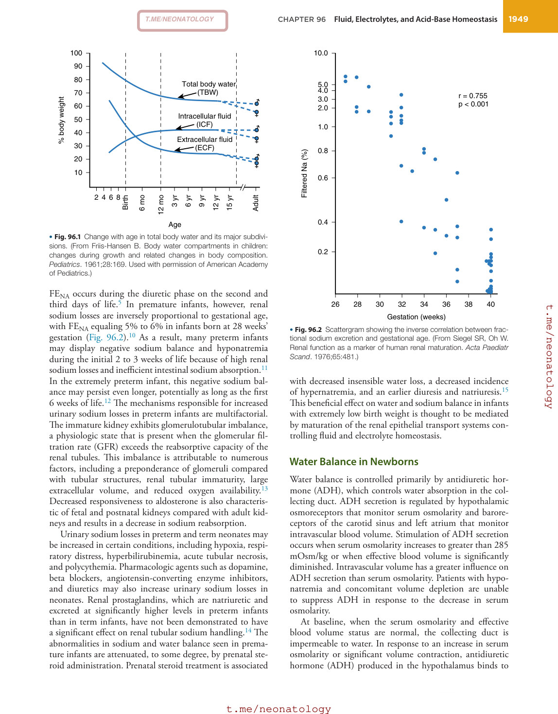

### Original source page 1944

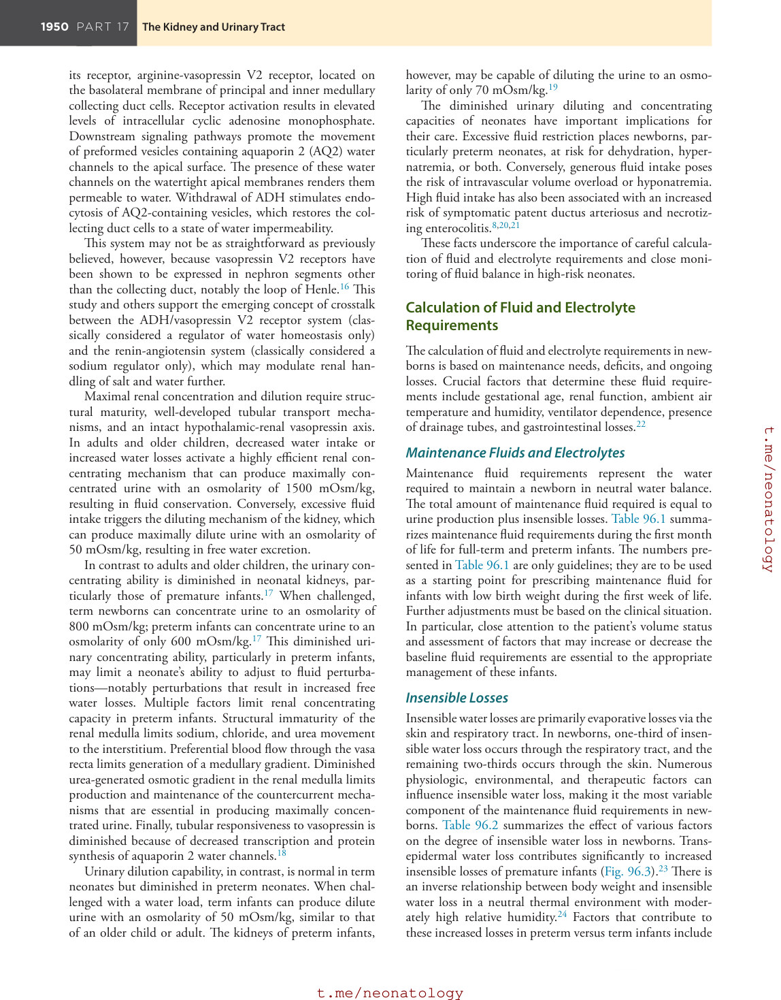

### Original source page 1945

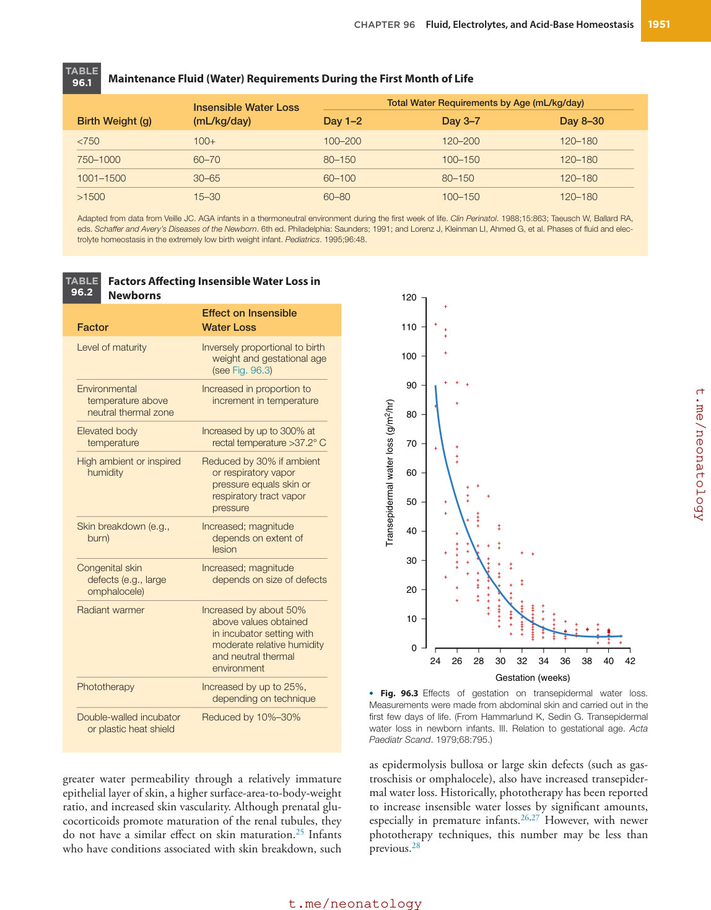

### Original source page 1946

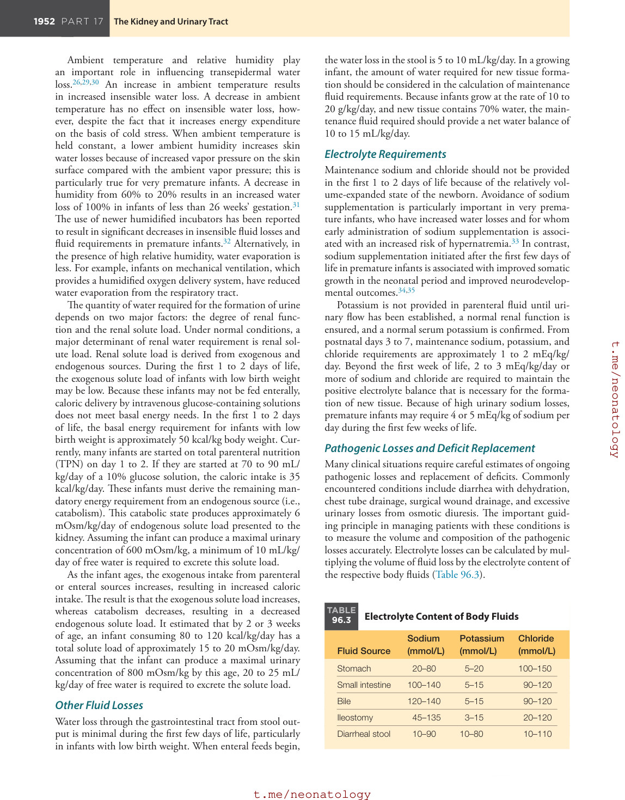

### Original source page 1952

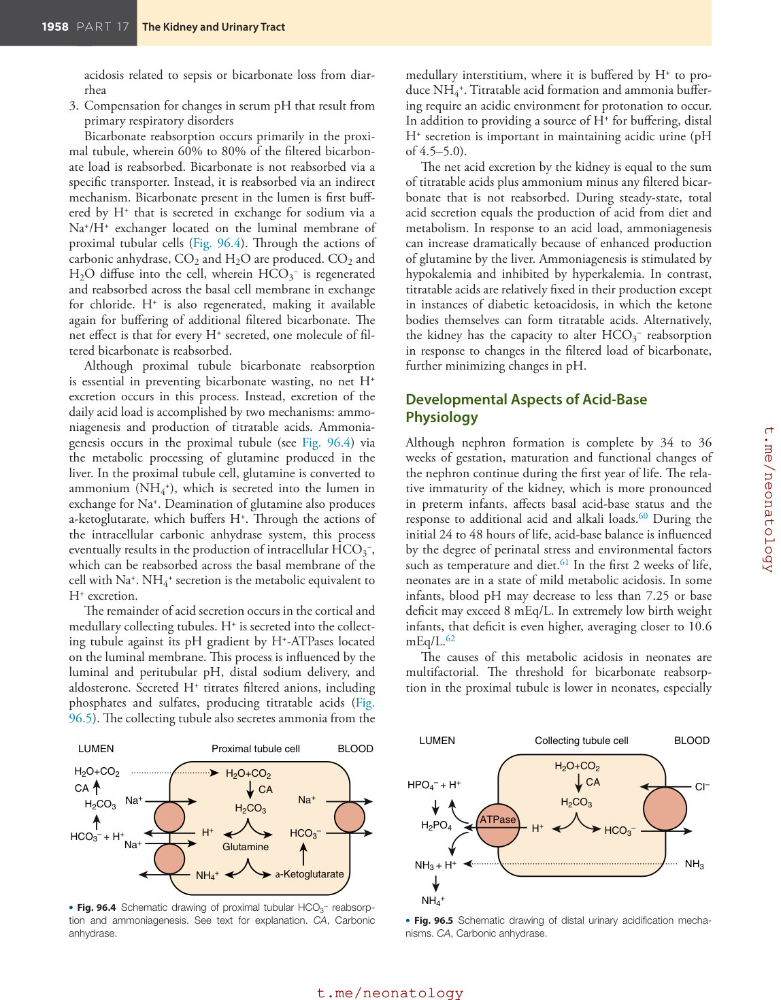

### Original source page 1953

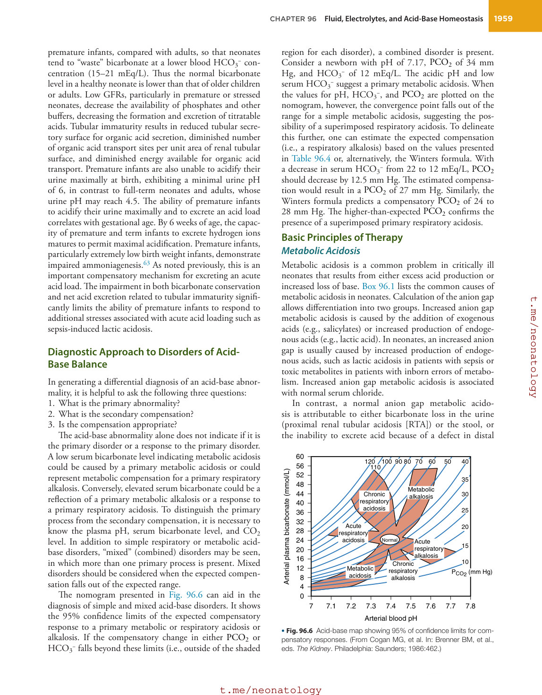

### Original source page 1954

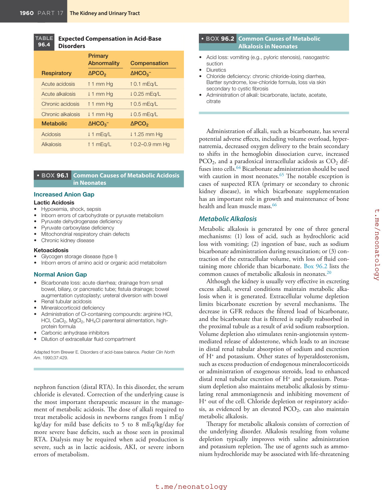

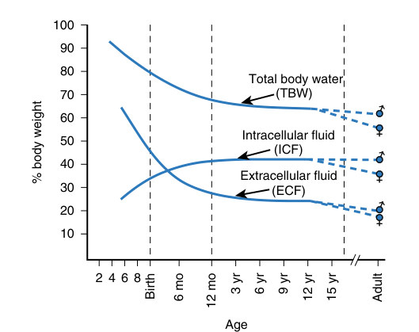

• Fig. 96.1 Change with age in total body water and its major subdivisions. (From Friis-Hansen B. Body water compartments in children: changes during growth and related changes in body composition. Pediatrics. 1961;28:169. Used with permission of American Academy of Pediatrics.)

PDF p. 1943

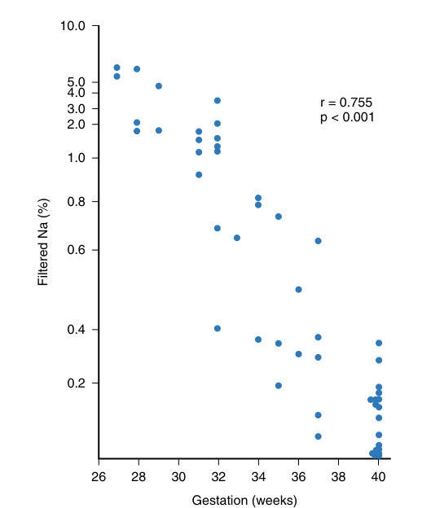

• Fig. 96.2 Scattergram showing the inverse correlation between fractional sodium excretion and gestational age. (From Siegel SR, Oh W. Renal function as a marker of human renal maturation. Acta Paediatr Scand. 1976;65:481.)

PDF p. 1943

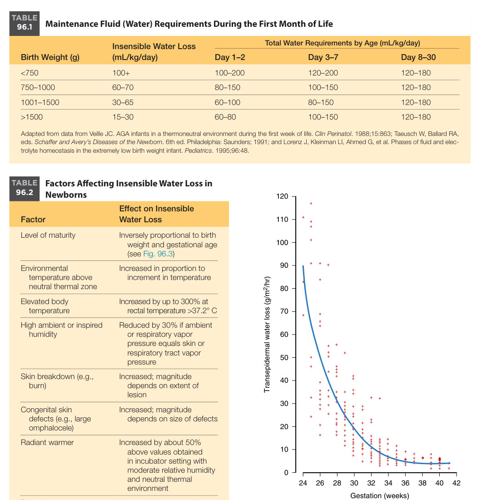

• Fig. 96.3 Effects of gestation on transepidermal water loss. Measurements were made from abdominal skin and carried out in the first few days of life. (From Hammarlund K, Sedin G. Transepidermal water loss in newborn infants. III. Relation to gestational age. Acta Paediatr Scand. 1979;68:795.)

PDF p. 1945

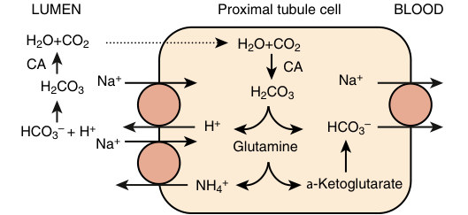

• Fig. 96.4 Schematic drawing of proximal tubular HCO3− reabsorption and ammoniagenesis. See text for explanation. CA, Carbonic anhydrase.

PDF p. 1952

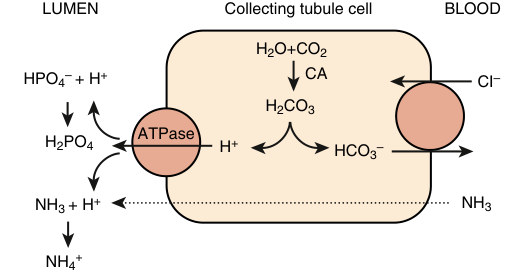

• Fig. 96.5 Schematic drawing of distal urinary acidification mechanisms. CA, Carbonic anhydrase.

PDF p. 1952

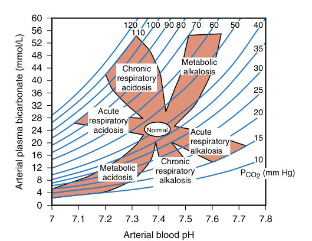

• Fig. 96.6 Acid-base map showing 95% of confidence limits for compensatory responses. (From Cogan MG, et al. In: Brenner BM, et al., eds. The Kidney. Philadelphia: Saunders; 1986:462.)

PDF p. 1953
