# 99. Examination and Common Problems in the Neonatal Eye
> Source attribution: [Source credits](../../SOURCE_CREDITS.md).

## PDF page 2019 | printed page 2028

99 Examination and Common Problems in the Neonatal Eye

### FARUK H. ÖRGE AND ZEINA M. SALEM

“T

he eyes reveal what the tongue can never express, as the eyes have their own vocabulary; what a beautiful and a universal language to learn!”

Clinicians should develop the ability to recognize the signs and symptoms of serious eye diseases or complications of diseases early in their course to prevent visual loss and, in some cases, preserve life. For example, early detection and treatment of congenital cataracts and congenital glaucoma are critical for visual rehabilitation. Malignant orbital tumors and intraocular tumors such as retinoblastoma are life threatening.

Ocular findings can also assist in the diagnosis of a systemic illness such as type 1 neurofibromatosis (NF1) and CHARGE syndrome (coloboma, heart anomaly, atresia choanae, retardation, genital anomaly, ear anomaly).1

The visual system is not completely developed at birth but progressively matures during the neonatal period.2 The neonatologist must recognize normal ocular findings during different stages of the infant’s growth to understand what is abnormal. Some ocular and visual milestones are shown in Table 99.1.

A screening eye examination should be performed during the newborn physical examination and during routine wellbaby checkups. The screening examination should include the assessments3 listed in Box 99.1. Fortunately, the screening examination identifies most problems such as glaucoma, cataract, infection, or tumor. However, if abnormalities are suspected because of the history, presence of systemic anomalies, or abnormal result of the screening examination, a more detailed ocular evaluation is mandatory, preferably by a pediatric ophthalmologist.4

### Neonatal Eye Examination

A screening ocular examination begins with a careful history, especially of ocular diseases in the family.3 For example, a family history of retinoblastoma necessitates a comprehensive ocular examination of the fundus shortly after birth. Information about maternal diseases (e.g., rubella), injuries, medications, or use of drugs or alcohol during the prenatal period should be obtained. It is also important to document

2028

the duration and abnormalities of pregnancy, labor, and delivery. Premature birth suggests potential retinopathy of prematurity (ROP), and difficult delivery with obstetric forceps can result in direct ocular trauma.

The examination should be done under comfortable circumstances and with the proper equipment (Fig. 99.1). Much can be learned if the examiner takes a few moments initially to observe the infant for facial anomalies, the external ocular appearance, and ocular motility while taking the history. The examination is most easily performed with the baby in a parent’s arms; the more difficult parts of an examination often can be accomplished while a baby is nursing or sucking on a bottle or pacifier. It is well documented that an oral sucrose solution can calm the baby significantly to allow easier examination. The screening eye examination should include an evaluation of visual function, preferably one eye at a time. For infants less than 4 to 6 weeks of age, visual function is assessed by withdrawal or blinking to light, or pupil constriction to light.3

Maintenance of the eyes on an object is called fixation. The infant’s ability to fixate and follow a target can be an approximate guide to the amount of visual function present. Beyond 4 to 6 weeks of age, visual function is assessed in terms of the quality of the fixation and following. By experience, the clinician must develop an age-appropriate scale that assesses this quality of fixation and following, paying attention to the intensiveness, steadiness, and maintenance of the fixation and the smoothness and duration of the following.

Visual acuity refers to the subjective response from the patient of the ability to discern images of set sizes, such as the tumbling “E” or Snellen letters. Most normally developing children can participate in some form of visual acuity testing by the age of 30 months. If additional information regarding visual function is desired, some ancillary visual tests are available and used in indicated situations. (1) Optokinetic nystagmus describes a reflex ocular response to a moving target. As a target moves across the visual field, a pursuit motion occurs, followed by a rapid return motion in the opposite direction to regain fixation. We experience this response when telephone poles or fence posts are watched from a fast-moving vehicle. With an optokinetic drum, which consists of black and white

## PDF page 2020 | printed page 2029

TABLE

### Visual System Milestones

99.1

Description Age

Pupillary light reaction present 30 weeks’ gestation

Pupillary light reaction well

1 month

developed

Lid closure in response to bright

30 weeks’ gestation

light

Blink response to visual threat 2–5 months

Visual fixation present Birth

Fixation well developed 2 months

Visual following well developed 3 months

Accommodation well developed 4 months

Visual evoked potential acuity at

6 months

adult level

Grating acuity preferential looking

2 years

at adult level

Snellen letter acuity at adult level 2 years

Color vision present 2 months

Color vision at adult level 6 months

Stereopsis developed 6 months

Stereoacuity at adult level 7 years

End of critical period for

10 years

monocular visual deprivation

Conjugate horizontal gaze well

Birth

developed

Conjugate vertical gaze well

2 months

developed

Vestibular (doll’s eye) rotations

34 weeks’ gestation

well developed

Optokinetic nystagmus well

Birth

developed

Ocular alignment stable 4 months

Fusional convergence well

6 months

developed

Eyeball 70% of adult diameter Birth

Eyeball 95% of adult diameter 3 years

Cornea 80% of adult diameter Birth

Cornea 95% of adult diameter 1 year

Differentiation of fovea completed 4 months

Myelination of optic nerve

7 months to 2 years

completed

Iris stromal pigmentation well

6 months

developed

From Edward DP, Kaufman LM. Anatomy, development, and physiology of the visual system. Pediatr Clin N Am. 2003;50:1–23.

### • BOX 99.1 Screening Assessments

• Reaction to light or visual stimuli to estimate visual function • Craniofacial dysmorphism • Orbits • Eyelids • Lashes • Ocular motility • Globes • Conjunctiva • Sclera • Cornea • Iris • Pupils • Red reflex test

### • Fig. 99.1 Basic equipment for ocular examination: various types of

eyelid specula to keep the eyelids open, scleral depressor to gently move the eye around, cyclomydril eye drops for dilation (1.25% phenylephrine [ophthalmic], 0.25% cyclopentolate [ophthalmic]), and a 20 or 28 diopter magnifying lens.

stripes on a spinning cylinder, if the examiner can elicit optokinetic nystagmus in the infant, this establishes that the child has enough visual function to discern the stripes. The stripe widths can be calibrated so as to yield a visual acuity equivalent. Optokinetic nystagmus can be evident in term newborns.5 (2) Another quantitative technique to measure a visual acuity equivalent in the infant older than 3 months is forced preferential looking.6 An infant prefers to look at black and white stripes instead of a uniformly gray target. For the test, infants are quickly shown a card that has stripes on one end and a gray target on the opposite end. The examiner watches the infant’s eyes to see whether the baby looks right or left to

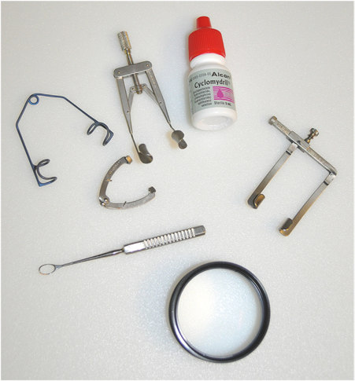

• Fig. 99.1 Basic equipment for ocular examination: various types of eyelid specula to keep the eyelids open, scleral depressor to gently move the eye around, cyclomydril eye drops for dilation (1.25% phenylephrine [ophthalmic], 0.25% cyclopentolate [ophthalmic]), and a 20 or 28 diopter magnifying lens.

## PDF page 2021

• Fig. 99.2 Marcus Gunn jaw wink phenomenon: left upper lid ptosis seen in the first picture while the left lid raises up as patient sucks from the bottle.

find the stripes. If the infant’s visual function is high enough to distinguish the stripes from the gray target, the infant will look consistently toward the stripes. If the infant’s visual function is less than the ability to distinguish the stripes from the gray target, the infant will look randomly right or left. By varying the size of the stripes, the examiner can grade the visual acuity equivalent. The disadvantages of this procedure include the number of people necessary to administer the test, the time involved, and the need for the cooperation of an alert infant. (3) Unfortunately, most estimations of an acuity equivalent in the infant rely heavily on adequate motor responses as part of the visual evaluation. Immature or underdeveloped motor systems can reduce or interfere with eye or head movements and decrease the estimation of the visual acuity equivalent. Visual evoked potentials, which measure the electrical cortical responses to a visual stimulus, eliminate the need for patient cooperation or motor control.7 Electrodes are placed over the occipital cortex to monitor activity in the brain as the eyes are visually stimulated with graded stripes or checkerboard patterns, and a computer-averaged tracing is made.

Continuing with the screening eye examination, the general facial configuration and the structure of the orbits are inspected next. Note any facial dysmorphism that could affect ocular health or be part of an ocular syndrome, such as clefts or abnormal head shape. Facial symmetry is assessed by visualizing two horizontal lines, the first intersecting the lateral canthi of both eyes, and the other intersecting both angles of the mouth. Normally, these imaginary lines should be parallel. If they do not appear to be so, facial asymmetry is said to be present, and further assessment is therefore required. Facial asymmetry can be a result of a long-standing abnormal head posture as a compensatory mechanism for an ocular misalignment, a musculoskeletal abnormality, or a part of an ocular syndrome, such as Goldenhar (oculo-auriculo-vertebral spectrum).

The orbits should be proportional and symmetric compared with the overall craniofacial configuration. Palpation is performed to examine the orbital margin, the contents of the upper and lower lids, and the round contour of the globes. The orbital rims should be sharply outlined. In the newborn infant, the rims are initially round and increase in vertical diameter with normal growth. The area of the lacrimal sac is palpated for abnormal masses or increased

size by pressing the sac against the bones of the nose and medial orbital wall. Mucopurulent material expressed from the lacrimal puncta is a symptom of obstruction of the nasolacrimal system. The eyelids are examined grossly and are compared for symmetry of horizontal and vertical placement. Spontaneous opening and closing of the lids should be observed. The lid margins should be inspected for regularity of contour, apposition to the globe, and the presence of lacrimal puncta. The punctum, the proximal opening into the nasolacrimal drainage system, is a minute hole in each lid margin a short distance from the inner corner of the eye. A rapid up-and-down movement of the lid during nursing indicates a jaw-winking phenomenon (Fig. 99.2).8

The examiner should view the lashes, which normally are directed outward in an orderly row. Abnormalities include distichiasis and trichiasis and are discussed later in this chapter. Lid position abnormalities should be checked (i.e., epiblepharon).

The ocular motor system is evaluated with a motility examination. This includes ocular alignment, conjugate ocular movements, and range of movement. Infants younger than 4 months may show small physiologic misalignments of the eyes. Misaligned eyes beyond the age of 4 months should be considered pathologic.4

Alignment is tested with the corneal light reflex test (Hirschberg test). The examiner shines a well-focused light at the patient’s eyes and notes the spot on the cornea where the light is reflected back. If the patient is properly fixating, the light reflex should appear in the same location on each cornea, slightly nasal to the anatomic center of the cornea. If the light reflex is centered in one eye and deviated laterally in the fellow eye, esotropia is present. If the light reflex is centered in one eye and deviated nasally in the fellow eye, exotropia is present.

A positive cover-uncover test will support the impression of strabismus. If the patient does not appear to move the eyes well enough into the periphery, either spontaneously or by following an object, these movements can be driven by the doll’s head maneuver (vestibulo-ocular reflex [VOR]). The reflex is tested by turning the infant’s head to one shoulder, producing an opposite movement of the eyes (Fig. 99.3). The eyes appear stationary as the head turns. This reflex may be reduced in severely brain-damaged infants but normal in blind infants.9

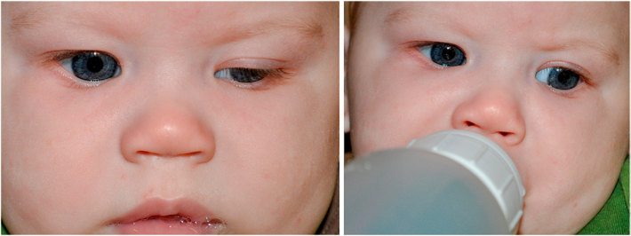

• Fig. 99.2 Marcus Gunn jaw wink phenomenon: left upper lid ptosis seen in the first picture while the left lid raises up as patient sucks from the bottle.

## PDF page 2022 | printed page 2031

• Fig. 99.3 Doll’s head rotation: as the head is turned toward the shoulder, a tonic neck muscle reflex produces corresponding ocular rotation in the opposite direction as though the eyes were remaining in their original position as the head moves.

• Fig. 99.4 Rotational nystagmus: the infant’s head is inclined slightly forward with eyes open. With rotation, the eyes move in the opposite direction as in a doll’s eye rotation. When rotation stops, the recovery movement occurs in the reverse direction.

Another rotational reflex is elicited by holding the infant vertically and rotating the infant in an arc around the examiner (Fig. 99.4). The infant’s eyes will then tonically rotate in the direction of the spin, with short quick movements (saccades) in the direction opposite the spin. This ocular reflex may be a form of optokinetic nystagmus and is reduced in

infants with major defects of the vestibular system, lower motor pathways to the extraocular muscles, visual system, or central nervous system (CNS).9

Examination of the globes may be difficult owing to the inability of the examiner to open the neonates’ eyelids sufficiently. Various pediatric eye speculums, such as an Alfonso

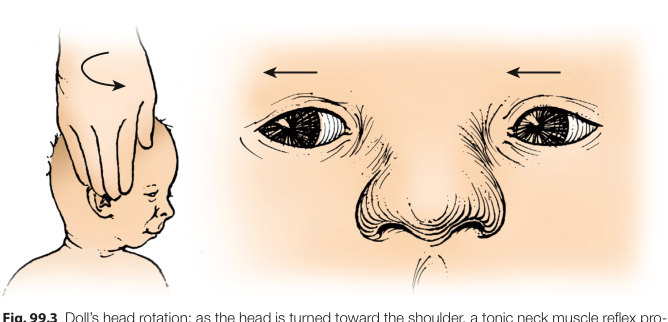

• Fig. 99.3 Doll’s head rotation: as the head is turned toward the shoulder, a tonic neck muscle reflex produces corresponding ocular rotation in the opposite direction as though the eyes were remaining in their original position as the head moves.

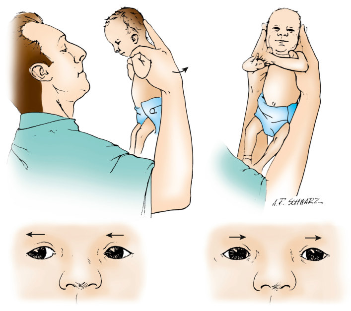

• Fig. 99.4 Rotational nystagmus: the infant’s head is inclined slightly forward with eyes open. With rotation, the eyes move in the opposite direction as in a doll’s eye rotation. When rotation stops, the recovery movement occurs in the reverse direction.

## PDF page 2023

speculum (Bausch and Lomb, STORZ, San Dimas, CA), can be used to maintain the lids open and allow for adequate inspection of the ocular surface, anterior segment, or posterior segment. Before placing the eye speculum, topical ocular anesthesia can be achieved with a drop of tetracaine 0.5% eye drops. Oral sucrose can also relieve some of the discomfort of an ocular speculum.10 The conjunctiva is inspected after the lids are separated, with the use of a pediatric ocular speculum or fingers. The bulbar and palpebral conjunctivae are normally moist and pinkish. Redness or exudate is abnormal and can indicate infection. The conjunctivae of the lids overlying the tarsal plates should be examined after the lids are everted. Eversion is usually simple to perform with the examiner’s fingers, particularly if the infant is attempting to squeeze the lids shut. The normally white sclera is evaluated for changes in color. A bluish coloration, however, is present in premature infants and in other small babies because of their very thin sclera.

The cornea is inspected with a penlight, paying attention to corneal size, shape, clarity, and luster. Magnification with loupes or an ophthalmoscope with the 20-diopter lens in place may be used. During the first few days of life, premature and term infants might demonstrate a slightly hazy cornea, which is thought to be the result of corneal edema. Thereafter, the surface of the cornea should have good luster and be absolutely transparent even to the extreme periphery. Any opacity or translucency is abnormal after the first few days of life, and referral to an ophthalmologist is indicated. Changes in transparency or opacification in the peripheral cornea may be associated with a local mesenchymal abnormality or glaucoma (Fig. 99.5).

• Fig. 99.5 Congenital glaucoma: left eye larger than the right eye with grayish discoloration secondary to corneal edema in the left eye.

A B

• Fig. 99.6 (A) Congenital Horner syndrome affecting the left side: note the smaller left pupil, the mild left upper lid ptosis, the left lower lid reverse ptosis and heterochromia (left eye lighter brown while right eye dark brown). (B) Horner syndrome affecting right side: note right pupil smaller than the left and mildly droopy right upper lid.

The irides are usually similar in appearance. Although normally incomplete for the first 6 months of life, pigmentation of both irides develops simultaneously. In a normal infant, the iris is often blue or blue-gray for the first few weeks or months of life. However, darkly pigmented babies can show pigmentation at birth or within the first week. Heterochromia (dissimilarity in pigmentation between the two eyes or within one eye) can indicate a normal hereditary pattern, congenital Horner syndrome (Fig. 99.6A and B), or one of several syndromes (e.g., Waardenburg) discussed later in this chapter. These syndromes might not become apparent until the end of the neonatal period or even later in life when the iris is fully pigmented.

The pupils should be central, round, and equal in diameter. The pupillary space should be uniformly black. Any amount of a white reflection is abnormal and could indicate an abnormality within the lens, vitreous, or retina. The neonate’s pupils are typically miotic in ambient light, perhaps related to prolonged sleep.11 A penlight or a transilluminator is used to shine a light at each pupil. Beyond a corrected gestational age of 30 weeks, pupils should constrict to both direct and contralateral stimulation.11 First, the reaction of the illuminated pupil is observed. It should constrict briskly (although the response in the neonate may be slower than in an older child) and should remain constricted as long as the illumination is maintained. If a poor response is observed, the contralateral pupil’s reaction is studied. If the contralateral pupil constricts, the directly illuminated eye must have intact photoreceptors and optic nerve pathways. Failure of constriction in the directly illuminated eye in this instance could result from abnormalities in the iris. If neither pupil constricts on direct illumination to one eye, the first eye may be severely deficient in vision. The swinging flashlight test is used to check for a relative afferent pupillary defect. Normally, if the light is quickly shifted from one eye to the other, the newly illuminated eye’s pupil should show an initial small constriction movement. If illumination is maintained on the eye, small rhythmic constriction and dilation movements may follow—called hippus, a normal phenomenon. If, however, the shift of light is followed by dilation of the newly stimulated eye, a Marcus Gunn (or relative afferent pupillary defect) is present. This result indicates decreased vision caused by optic nerve or extensive retinal disease in the eye that is inappropriately dilated. Pupillary reflexes should be completely normal in patients with central (cortical) visual impairment and are

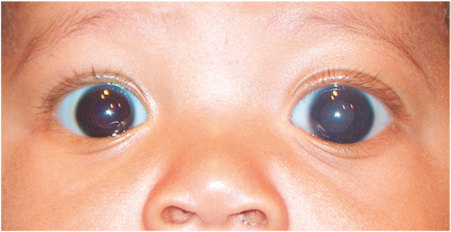

• Fig. 99.5 Congenital glaucoma: left eye larger than the right eye with grayish discoloration secondary to corneal edema in the left eye.

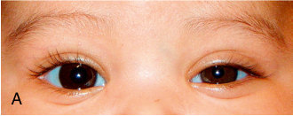

• Fig. 99.6 (A) Congenital Horner syndrome affecting the left side: note the smaller left pupil, the mild left upper lid ptosis, the left lower lid reverse ptosis and heterochromia (left eye lighter brown while right eye dark brown). (B) Horner syndrome affecting right side: note right pupil smaller than the left and mildly droopy right upper lid.

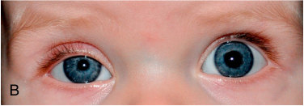

Unmatched source image; PDF page 2023. Consult the original caption.

## PDF page 2024 | printed page 2033

• Fig. 99.7 Red reflex: normal red reflex in the left eye and a white reflex in the right eye. This patient was later diagnosed with retinoblastoma in the right eye.

not affected by opacities in the visual axis (cornea, lens) or errors of refraction.

The red reflex test is an essential part of the infant screening eye examination.12 Examination starts with a “0” diopter setting in the direct ophthalmoscope, and the child is examined at arm’s length, with both pupils illuminated (Fig. 99.7). The red reflex of each eye should be clearly distinct, with no shadows or alterations. Look for any asymmetry in the intensity of the red reflex within each pupil and between the two pupils. If a red reflex cannot be seen, the pupils can be dilated with cyclomydril eye drops13 (Alcon Laboratories), and if a clear and equal red reflex is still not seen, the baby should be referred to an ophthalmologist.4

Precise viewing of the anterior chamber and crystalline lens requires a slit-lamp examination, instrumentation that is usually not available to the neonatologist or primary care physician. An indirect assessment of the clarity of the cornea, anterior chamber, lens, and vitreous is performed during the red reflex test, which measures the ability of light to enter the eye and reflect back out of the eye off the retina. Similarly, the red reflex test indirectly assesses the intactness of the retina. The adventurous neonatologist or primary care physician can attempt direct viewing of the infant’s retina with a direct ophthalmoscope or a panoptic (Fig. 99.8). Viewing the retina of the infant’s undilated eye with a direct ophthalmoscope is a challenge, even to the pediatric ophthalmologist, but a panfundoscope can provide adequate examination with more ease. If a view of the retina is required, such as for ROP screening, the consulting ophthalmologist would dilate the infant’s eyes and use more sophisticated examination instrumentation such as the indirect ophthalmoscope.

Certainly, the use of the direct ophthalmoscope to view the retina is not considered part of the screening eye examination in infants. However, if a direct ophthalmoscope examination is attempted, attention should be directed to the clarity of the vitreous cavity and the appearance of the optic disc, major retinal vessels, the macula, and the surrounding retina.

Mydriasis (or pupillary dilation) is rarely needed in the primary care setting unless the neonatologist wishes to obtain a better red reflex evaluation. About 80% of the topically applied medication will pass through the lacrimal drainage system and reach the systemic circulation via the nasal mucosa. Systemic absorption of these medications is associated with the risk of potentially serious—and

• Fig. 99.8 Panoptic, indirect, and direct ophthalmoscope.

maybe even life threatening—side effects. These include cardiovascular (bradycardia, tachycardia, hypotension, arrhythmia, cardiac arrest), CNS (seizures), respiratory (respiratory depression, apnea, desaturation), and gastrointestinal (necrotizing enterocolitis, ileus) side effects. It is for that reason that pharmacologic dilation is generally reserved for pediatric ophthalmology and neurology specialists’ use. In the ophthalmology setting, the lowest effective dose is usually used; that is, phenylephrine 1% and cyclopentolate 0.2%. Application of gentle pressure on the medial canthus for 1 to 3 minutes after instillation of the drop, to occlude the punctum and minimize systemic absorption, is a safe practice, especially in premature babies and full-term neonates. Washing the eye with saline or artificial tears after mydriatic instillation is an additional protective step as well. Close observation of the infant and prompt management of side effects if and when they arise is extremely important.

### Normal Ocular Findings

The eye of the newborn infant differs from the adult eye primarily in function, although structural differences also exist.

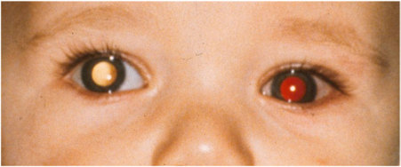

• Fig. 99.7 Red reflex: normal red reflex in the left eye and a white reflex in the right eye. This patient was later diagnosed with retinoblastoma in the right eye.

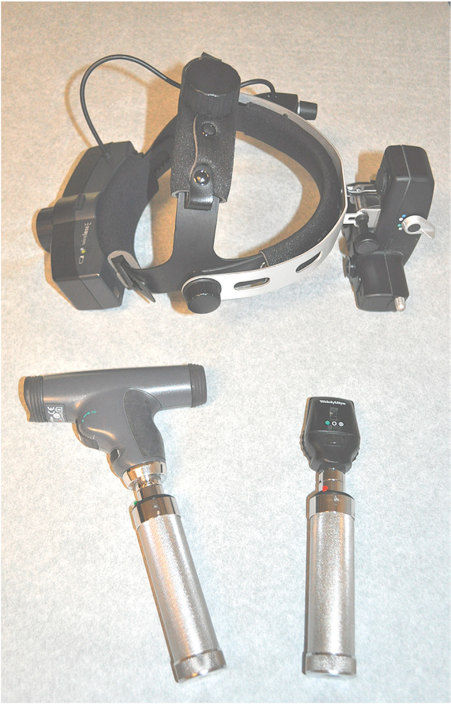

• Fig. 99.8 Panoptic, indirect, and direct ophthalmoscope.

## PDF page 2025

TABLE

Normal Ocular Measurements

99.2

Term Neonate Prematurea

Intermediate

18–22 12–16

canthal distance, mm

Medial canthus to

17–27 12–16

lateral canthus, mm

Anteroposterior

16 10–16

diameter of eye at birth, mm

Horizontal diameter

10 (average), 9

7.5–8 (lower

of cornea, mm

(lower limits)

limits)

aNeonates weighing 1000–1300 g.

The growth of the eye, which parallels that of the brain, continues at a rapid rate for the first 3 years of life, especially during the first year. The anteroposterior dimension of the eye at birth is about 16.5 mm and grows to about 23 mm in adulthood. Normal values in the neonate fall within a very wide range. Suspected abnormalities in size often are substantiated only by comparison with measured values in the fellow eye or by ultrasound, computed tomography (CT), or magnetic resonance imaging (MRI). The horizontal and vertical diameters of the cornea of the newborn are about 9 to 10 mm. Enlarged corneas suggest the diagnosis of congenital glaucoma.

The lid fissures of the term infant are usually narrow and often widely separated horizontally by prominent epicanthal folds. Normal horizontal measurement of the lid fissures in the newborn can range from 17 to 27 mm (Table 99.2). These measurements should be symmetric. The term telecanthus indicates a disproportionate increase in the distance between the medial canthal angles. It is particularly noticeable in fetal alcohol syndrome and Waardenburg syndrome. Measurements between the two medial canthi in the term newborn vary from 18 to 22 mm. Hypertelorism is defined as an increase in distance between the orbits, observed clinically as a large interpupillary distance, which is often seen in many craniofacial syndromes. A secondary telecanthus is observed in patients with hypertelorism.

Reflex tearing to irritants is evident shortly after birth. However, emotional tearing begins at about 3 weeks of age and is developed at 2 to 3 months. The newborn infant possesses a strong blink reflex in response to light and to stimulation of the lids, lashes, or cornea. The reflex response to a threatening gesture does not appear until 7 or 8 weeks of age in the term infant. Repetitive eye opening is evident at birth.14

After birth, the eyes should appear straight for the most part, although erratic, purposeless, and independent movements can be observed during the first few months of life. Any constant strabismus beyond the age of 4 months requires further evaluation.15 Conjugate horizontal gaze should be evident in the newborn; vertical conjugate gaze

develops by 2 months of age. Convergence spasms are a normal transient phenomenon of infancy.

The ability to maintain a steady gaze or to fixate and follow an object is only weakly initiated at 4 to 6 weeks of age. At first, the eyes pursue a moving visual stimulus with short saccades. By 3 months of age, the infant can fixate and follow in both vertical and horizontal directions. At about 4 months of age, central fixation is associated with the motor activity of grasping. Binocular vision is present at about 6 months of age.

### Prematurity

The ocular findings of the premature infant differ from those of the term neonate. At 28 weeks of gestation, the globe is only 10 to 14 mm in diameter. The anterior and posterior hyaloid vascular systems are usually present to some degree, although their involution continues for the next several months. Remnants of this system may be seen in the form of persistent blood vessels or fibrous strands anterior and posterior to the lens. The main hyaloid artery coursing from the optic disc to the posterior lens surface may be patent or appears as a white strand in the vitreous. A moderate amount of vitreous haze is often present at this time, interfering with visualization of the fundus. Vascularization of the retina begins with the ophthalmic artery entering the eye through the posterior edge of the eye’s embryonic fissure at 4 months of gestation. Retinal vessels then grow anteriorly to vascularize the peripheral retina, a process that is not complete until near term. Thus premature infants have incomplete retinal vascularization, creating the basis for ROP (see also Chapter 100).

Pupil constriction to light is not seen until 30 weeks of gestational age.11 Lack of pupil response to light should not be considered abnormal until at least 32 weeks after conception. Premature infants have a higher incidence of myopia, amblyopia, and strabismus in childhood. Careful follow-up of all children born prematurely is advisable to ensure early detection of these ocular conditions.

### Requesting Ophthalmologic Consultations

Routine ophthalmologic consultation for all infants in the nursery is not warranted.4 Pathologic ocular findings in normal neonates are sufficiently unusual that evaluation should be requested only after a screening ocular examination indicates the presence of an abnormality or for those at increased risk for ocular problems. Indications for ophthalmologic consultation include a family history of congenital cataracts, retinoblastoma, congenital glaucoma, or other serious ocular diseases. Intrauterine infectious diseases such as rubella, toxoplasmosis, or cytomegalovirus necessitate a thorough eye evaluation. For preterm infants, ophthalmologic consultation is necessary to exclude ROP.

### Orbital Abnormalities

The contents of the orbit are confined to a conical shape by its bony walls. At the posterior apex of the orbit, the

## PDF page 2026 | printed page 2035

• BOX 99.2 Syndromes Associated With Abnormal

Orbits

Hypotelorism

• Cebocephaly • Oculodentodigital dysplasia • Trisomy 13 • Scaphocephaly

Hypertelorism

• Cerebral gigantism • Cerebrohepatorenal syndrome • Chromosome deletions • Craniosynostosis • Frontonasal dysplasia and median cleft face syndrome • Infantile hypercalcemia • Smith-Lemli-Opitz syndrome • Isolated finding

extraocular muscles originate, and the vascular and nerve structures enter the orbit. The bone structures of the lateral wall do not protect the orbital contents as far anteriorly as do the remaining sides of the orbit, which leaves the eye more susceptible to trauma on its lateral side. In the neonate, the orbital rims form a circular outline at the anterior base of the cone.

Box 99.2 lists systemic syndromes associated with abnormal orbits.

The terms proptosis, exophthalmos, and exorbitism are often used interchangeably to describe forwardly displaced eyes. In the strictest sense, proptosis results from an increase in orbital contents within a normal bony orbit, exophthalmos from Graves disease, and exorbitism from shallow bony orbits.

### Proptosis

The diagnosis of proptosis can be confirmed if the examiner observes the infant’s eyes and lids from above, over the prominence of the eyebrows. A more anterior protrusion of the orbital content is observed in comparison with the opposite side. In proptosis, the eye frequently also has a widened palpebral fissure.

Masses within the orbital cavity can expand most easily anteriorly, producing proptosis. Those located within the cone of extraocular muscles produce a symmetric anterior displacement, whereas tumors located outside the cone of extraocular muscles displace the eye outward and away from the area of origin of the tumor. A tumor in the inferior portion of the orbit displaces the eye upward and forward, whereas one located medially displaces the eye laterally and forward. A diffuse, extensive tumor can produce sufficient changes to affect the eye’s movement, whereas a localized tumor often does not interfere with rotation of the eye. If a tumor is located anterior to the equator of the globe, it can extend anteriorly into the lids without producing proptosis.

An orbital encephalocele or meningocele-producing proptosis may be evident at birth or may be delayed until later years. This abnormality results from a defect in the wall between the cranial cavity and the orbit, usually located at the suture lines. Pressure within the cranium causes herniation of brain tissue, meninges, or both into the orbit, most often at the inner angle of the orbit at the root of the nose.

Diagnosis is made by identifying the bone defect in association with the area of the orbital cyst. Clinically, an encephalocele is suggested by the presence of a pulsating, fluctuant cyst that can be reduced somewhat with digital pressure or that increases with coughing or crying. Excessive manipulation of the encephalocele can cause pulse and respirations to slow or can cause convulsions. Neurosurgical consultation and intervention are necessary.

Proptosis also can occur from venous engorgement of the orbital cavity such as that produced by a carotid-cavernous fistula. A cephalic bruit is often heard in the infant but is not pathognomonic of a carotid-cavernous sinus fistula. A false diagnosis of proptosis might be made when there is a slight ptosis of one eye, which gives the opposite, normal eye an appearance of a wide palpebral fissure. Marked enlargement of the eye, as in congenital glaucoma or high myopia, makes the eye appear proptotic because of the increased size of the globe. Facial abnormalities that produce shallow orbits, as in Crouzon disease, simulate proptosis because the normal amount of orbital structure appears to protrude in an abnormally shallow orbit.

### Hyperthyroid Exophthalmos

Hyperthyroid exophthalmos, a rare neonatal sequela of hyperthyroidism, can occur as the result of maternal Graves disease during the last trimester of pregnancy. The infant is born with classic hyperthyroidism, including exophthalmos, upper lid retraction, and extraocular muscle involvement. Symptoms usually subside during the first 2 months of life.16

### Enophthalmos

Enophthalmos refers to eyes that look sunken into the orbit. Causes in infants include orbital asymmetry, microphthalmos, trauma resulting in an orbital blow-out fracture, congenital fibrosis of the extraocular muscles, and congenital Horner syndrome.17 Numerous syndromes, and many infants with unclassifiable facial dysmorphisms, feature deep-set eyes, such as Lowe syndrome, Cockayne syndrome, and Cornelia de Lange syndrome.

### Ocular Hypotelorism or Hypertelorism

Abnormal spatial relationships between the two orbits create excessively wide or excessively narrow intraorbital distances. These abnormalities are caused by a variety of related cranial abnormalities involving the disproportionate growth or lack of development of the body and lesser wing of the sphenoid

## PDF page 2027

and ethmoid sinuses and of the maxillary processes. Hypotelorism (narrowing of the intraorbital distance) may be associated with CNS malformation.

Ocular hypertelorism is a term indicating increased separation between the bony orbits, usually greater than two standard deviations above the mean. It is an anatomic description rather than a diagnostic entity and is noted with varying severity in many syndromes such as the craniosynostosis syndromes. One condition with marked hypertelorism is frontonasal dysplasia (median facial cleft syndrome), which may be the result of morphokinetic arrest during embryogenesis.

Characteristic findings of frontonasal dysplasia are medial cleft nose, lip, and palate; widow’s peak; and cranium bifidum occultum. Common other ocular abnormalities include exotropia, dacryostenosis, epibulbar dermoids, palpebral fissure changes, and optic atrophy.18 A phenotypically similar but probably distinct clinical entity within the frontonasal dysplasia spectrum has been reported with the features of facial midline defects, basal encephalocele, callosal agenesis, endocrine dwarfism, and morning glory disc anomaly.19

### Eyelid Abnormalities

### Colobomas

Colobomas of the lids are partial-thickness or complete defects that can range from a small notching of the lid borders to involvement of the entire length of the lid. Most lid colobomas occur in the medial aspect of the upper lid. When the lower lid is involved, the defect is more often in its lateral aspects. The cause of lid colobomas is often unknown unless associated with a craniofacial syndrome. It has been suggested that these isolated colobomas arise from the localized failure of adhesion of the lid folds that results in a lag of growth or from mechanical effects of amniotic bands. Syndromes with associated lower lid colobomas are mandibulofacial dysostosis (Treacher Collins syndrome), Goldenhar syndrome (more often upper lid), amniotic band syndrome, and Burn-McKeown syndrome.

The treatment of lid colobomas is important when the lid defect prevents adequate lid closure and allows exposure of the cornea. Subsequent thickening, opacification, infection, ulceration, or perforation of the unprotected cornea can occur. Vision can be degraded by the amblyopia that develops. Early surgical correction is often required when the coloboma is greater than one-third of the eyelid margin.20

### Congenital Blepharophimosis

The term blepharophimosis describes eyelids that are too narrow horizontally and vertically. There is usually an associated ptosis, and strabismus is frequently present. Lid fissure measurements commonly are reduced to about two-thirds of normal, whereas the space between the medial canthi is considerably widened. Surgical repair to widen the medial and lateral canthal angles, elevate the upper lid, and correct the strabismus is available.21

Blepharophimosis can occur in isolation, as a feature of BPES (blepharophimosis, ptosis, and epicanthus inversus syndrome), or in multiple systemic syndromes such as fetal alcohol syndrome, Saethre-Chotzen syndrome, and van den Ende-Gupta syndrome. BPES has been mapped to the FOXL2 gene encoding a fork head transcription factor. BPES is divided into type 1 and type 2, with and without premature ovarian failure, respectively.22

### Epicanthus

Epicanthus is the most commonly encountered lid abnormality. A skinfold originating in the upper lid extends over the medial end of the upper lid, the medial canthus, and the caruncle, and ends in the skin of the lower lid. It gradually disappears with the growth of the bridge of the nose as the child loses its baby face. Epicanthal folds can give a false appearance of crossed eyes (pseudostrabismus). Epicanthus inversus is similar except that the predominance of the skinfold arises in the lower lid and runs diagonally upward toward the root of the nose to overlie the medial canthus. These folds are benign and generally do not require treatment.

### Congenital Ectropion, Entropion, and Epiblepharon

Congenital ectropion is an eversion of the lid margin, most commonly of the lower lid. It may be associated with other eye abnormalities or syndromes such as Duane syndrome. If the ectropion is mild, no treatment is necessary. A more severely everted lid might require surgical correction. The integrity of the cornea requires monitoring and will determine the treatment.

Often associated with other lid or ocular abnormalities, congenital entropion is an in-turning of the lid margin, most often of the lower lid. If the lashes on the lid margin rub the cornea and cause corneal abrasions, surgery is necessary.

Epiblepharon is an extra fold of skin along the lower lid that can cause lashes to turn inward. This condition usually requires no treatment and is most often seen in infants of Asian ancestry. This condition usually improves spontaneously during the first 2 years of life, but if it persists, consideration should be given to surgical correction. As the lashes are soft when the child is younger, lashes rubbing against the cornea tend not to produce symptoms. But beyond 1 year of age, as the lashes get thicker and harder, corneal irritation leading to abrasion and even ulceration not controlled with simple lubrication with ointments warrants earlier surgical intervention.20

### Blepharoptosis

Ptosis is asymmetry in upper lid height or symmetrical lowering of both upper lids. Although both upper and lower eyelids may be ptotic, the terms blepharoptosis or ptosis generally refer to the upper lids unless otherwise specified (Fig. 99.9). The condition could be idiopathic or inherited, unilateral or bilateral, congenital or acquired. When looking

## PDF page 2028 | printed page 2037

• Fig. 99.9 Congenital ptosis of the left upper lid.

straight ahead, the normal lid should elevate to a point at least midway between the pupil and the upper margin of the cornea. Neonates may have a transient self-limited droopy or closed lid as a result of facial edema or lid trauma during normal vaginal delivery. A temporary, simulated ptosis (protective ptosis or guarding) can result from irritation or infection of the cornea or conjunctiva.

Congenital ptosis most often results from the dysfunction of the levator palpebrae muscle, mostly seen as an idiopathic or familial disorder. Although occlusion of the pupil is rare, the ptotic lid can induce a corneal astigmatism and refractive amblyopia. Occlusive patching and glasses may be needed. Mild, unilateral ptosis should prompt a comparison of pupil size to evaluate for Horner syndrome. Congenital Horner syndrome (ipsilateral ptosis, miosis, anhydrosis [see Fig. 99.6A and B]) is often a result of trauma at birth, although it may be associated with mediastinal disease or neuroblastoma. The involved iris may be hypopigmented.

Ptosis also may be associated with a Marcus-Gunn jawwinking phenomenon. This syndrome is caused by anomalous motor innervation of the levator palpebrae muscle from nerve twigs to the pterygoid, masseter, or lingual muscles. The affected patient has an up-and-down rhythmic movement of the upper lid during nursing activity (see Fig. 99.2). The jawwinking portion of the syndrome is thought to decrease or disappear in early adulthood, but the ptosis remains. Many surgical procedures have been designed to mitigate the ptosis.

Two forms of myasthenia gravis can produce ptosis in the neonatal period. In about 15% of neonates born to mothers with myasthenia gravis, a transient form of myasthenia occurs shortly after birth.22 Affected children have a weak cry and poor suck and can develop weakness in all muscle groups. Ocular symptoms are rare and most commonly involve ptosis. A variety of congenital myasthenia syndromes linked to genetic disorders of the neuromuscular junction or acetylcholine production can display ptosis and ophthalmoparesis, which are often variable and related to the level of fatigue. Pseudoptosis, or false ptosis, may be apparent when the globes are of different sizes or if enophthalmos or proptosis is present.

Microphthalmia (small eye) is a common congenital defect that can be mildly expressed. In such situations, the lid will look drooped even if it is functioning properly (Fig. 99.10). A unilateral large globe caused by monocular

• Fig. 99.10 Microphthalmos: patient with microphthalmic right eye also has significant choroidal coloboma in the same eye.

• Fig. 99.11 Ankyloblepharon: persistent adhesion between upper and lower lid.

myopia can produce a relative ptosis in the contralateral normal eye.

### Ankyloblepharon

The upper and the lower lids may be fused at birth or through an inflammatory process (Fig. 99.11). The term ankyloblepharon is used to designate this condition, which may be dominantly inherited. Simple excision of the bridging tissues between the eyelids is all that is required to separate the lids.

### Eyelid Lesions

### Nevi

Nevi may occur anywhere on the lid margin, skin, or conjunctiva. Often a congenital nevus will not be noticed until puberty when pigment begins to accumulate and the lesion is thought to be growing (Fig. 99.12). Observation for change in size, shape, depth, or pigmentation is recommended.

### Hemangioma

Hemangiomata are quite common and affect up to 10% of newborns. They may virtually occur in any body location including the upper or lower lids and orbit. In infants, the hemangioma usually is not well encapsulated and frequently

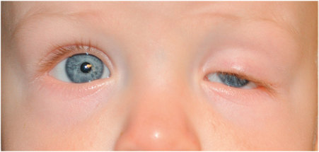

• Fig. 99.9 Congenital ptosis of the left upper lid.

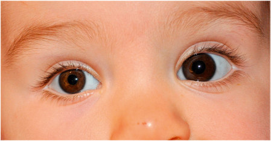

• Fig. 99.10 Microphthalmos: patient with microphthalmic right eye also has significant choroidal coloboma in the same eye.

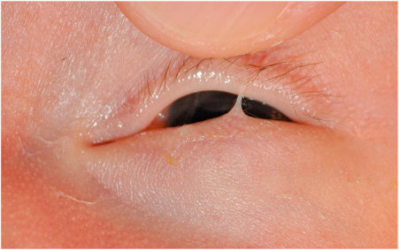

• Fig. 99.11 Ankyloblepharon: persistent adhesion between upper and lower lid.

## PDF page 2029

periorbital, and orbital lesions will occur in association with similar lesions elsewhere on the body.

Although observation of lid involvement assists in making the diagnosis, a biopsy might be required to exclude other orbital tumors if the hemangioma lacks a superficial component. Crying or straining by the infant often causes the mass to increase in size and assume a bluish coloration. Digital pressure on the superficial portion of the tumor produces blanching that is rapidly reversed, demonstrating the high flow of capillary hemangioma. When a hemangioma

• Fig. 99.12 Nevus of Ota: hyper-pigmented nevus affecting the left temple, forehead, and periorbital; also associated with scleral melanosis.

A

• Fig. 99.13 (A) Diffuse capillary hemangioma affecting the left side of the face and orbit. (B) Resolved hemangioma with oral propranolol treatment.

involves the eyelids, amblyopia can develop. Amblyopia may be secondary to the hemangioma’s obstruction of the visual axis or from pressure on the cornea that subsequently induces astigmatism and anisometropic amblyopia.

Congenital capillary hemangiomata are inconsequential at birth but grow rapidly during the first 6 months of life. Spontaneous involution occurs at about age 2 to 4 years. The natural history of hemangiomas is that they will regress over several years even without treatment, but local soft tissue and occasional bone deformities may remain and are common around the eye.

When threatening the sight via amblyopiogenic properties, treatment is warranted. Until recently, treatment was oral use or intralesional injections of steroids, subcutaneous interferon, or excision of the lesion. Although these modalities are still valid, they are not free of side effects. Oral propranolol or topical timolol are effective ways of treating these tumors (Fig. 99.13A and B).23 In the past, treatment involved systemic, injectable, or topical corticosteroids with potential side effects over months of treatment. Central artery occlusion is a rare but well-described complication of steroid injection with permanent vision loss.24 Occasionally, surgery is indicated for well-defined, easily accessible tumors to avoid side effects of medical treatment.24 Oral use of propranolol (2 mg/kg/day) is found to be very effective in the hemangioma treatment. However, its use, although relatively uncommon, necessitates that side effects such as hypotension and hypoglycemia have to be monitored closely. Also, an MRI of the brain to rule out associated intracranial vascular abnormalities will prevent cerebrovascular injuries secondary to the blood flow and tension changes caused by this medication.

Port wine stain (also known as nevus flammeus) is a dark red or purplish vascular birthmark made of dilated capillaries. It typically presents on the face along the distribution of the ophthalmic division of the trigeminal nerve. It can be unilateral or bilateral and tends to darken as the

B

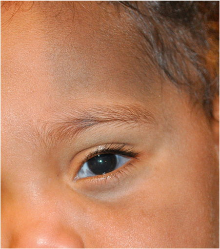

• Fig. 99.12 Nevus of Ota: hyper-pigmented nevus affecting the left temple, forehead, and periorbital; also associated with scleral melanosis.

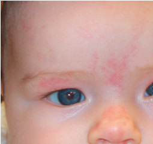

• Fig. 99.13 (A) Diffuse capillary hemangioma affecting the left side of the face and orbit. (B) Resolved hemangioma with oral propranolol treatment.

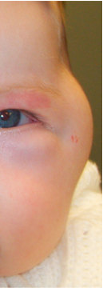

Unmatched source image; PDF page 2029. Consult the original caption.

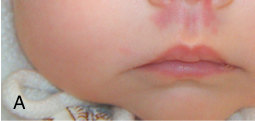

• Fig. 99.13 (A) Diffuse capillary hemangioma affecting the left side of the face and orbit. (B) Resolved hemangioma with oral propranolol treatment.

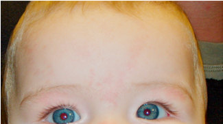

Unmatched source image; PDF page 2029. Consult the original caption.

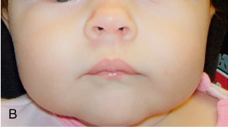

Unmatched source image; PDF page 2029. Consult the original caption.

## PDF page 2030 | printed page 2039

child grows. It usually starts flat but can become raised because of soft tissue hypertrophy and the development of vascular nodules, which may bleed. Unlike strawberry hemangioma, port wine stain does not go away with time, unless treated.

Port wine stain can be an isolated benign occurrence or, less commonly, be a part of a syndrome, the most common being Sturge Weber (discussed later in this chapter). Other associated syndromes include CLOVES syndrome, Proteus syndrome, and Parkes-Weber syndrome. Both isolated and syndromic port wine stains associated with Sturge Weber syndrome are caused by a sporadic mutation in the GNAQ gene. A suspicion of syndromic port wine stain (coexisting skin, visceral, skeletal, or vascular anomalies) should warrant a thorough investigation, including radiologic imaging, to establish the diagnosis, exclude complications, and commence appropriate treatment accordingly.

Salmon patches (or stork bites) are very common (30%–50% of newborns) benign birthmarks that typically occur on the eyelids, forehead, back of the neck, or anywhere on the face. They consist of locally dilated capillaries. They do not present any danger and will fade away by the baby’s first birthday. Juvenile xanthogranuloma—as the name implies—constitutes benign, yellowish, solitary or multiple papules or nodules that typically affect infants and young children (20% of patients will have the lesion at birth). The most common locations are the face, neck, or trunk. Although rare, ocular involvement can occur, and the iris is the commonest intraocular site, carrying a risk of hyphema and glaucoma. Early referral for evaluation by a pediatric ophthalmology specialist is very important in this case.

Other eyelid lesions include but are not limited to plexiform neuromas secondary to neurofibromatosis type-1, amyloid depositions, and inclusion cysts.

### Dermoid Cysts

Dermoid cysts are tumors that appear at the suture lines, most commonly at the superotemporal brow or in the superior medial central area of the brow (Fig. 99.14). Occasionally they appear to be free in the orbit or lid without demonstrable direct connection to a suture line. They are benign choristomata that grow slowly but will thin out the adjacent bone. They should be removed surgically without rupturing the cyst (Fig. 99.15). If a dermoid cyst is ruptured by accidental trauma or surgery, severe local inflammation can result if the extruded contents are not irrigated from the wound.

### Eyelash Abnormalities

Lashes may be redundant, absent, misdirected, or discolored. The condition may be inherited or acquired through mucous membrane diseases of the conjunctival sacs, infectious process, or trauma. Trichiasis is a lash that grows from a normal location but is misdirected toward the ocular

Dermoid Cyst

• Fig. 99.14 Dermoid cyst in right temporal anterior orbit: firm, nontender, oval mass palpated.

• Fig. 99.15 Dermoid cyst removed in total; pathology confirmed diagnosis of dermoid cyst.

surface. Congenital trichiasis patients should be examined for Down syndrome or signs of ectodermal dysplasia. If a second row of lashes is present in the area of the meibomian glands (metaplasia), the condition is referred to as distichiasis. This condition usually results in contact of the lashes with the cornea, producing corneal irritation and abrasions. True distichiasis is rare but can easily be distinguished from trichiasis, entropion, and epiblepharon (Fig. 99.16), all of which may be seen together. Excessive eyelash growth can result as a side effect from multiple medications, including topical prostaglandin analogues and epidermal growth factor receptor inhibitors.25

### Hypertrichosis

Excessive hair on the lids and forehead can occur as a dominant characteristic in male infants and, on occasion, may be extreme. Hypertrichosis involving the eyebrows, forehead, and upper lid appears in Cornelia de Lange syndrome, a pathologic dwarfism associated with multiple congenital anomalies. Hypertrichosis lanuginosa is transmitted as an

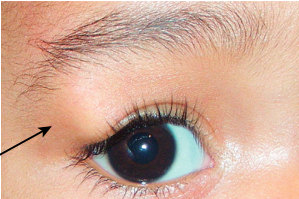

• Fig. 99.14 Dermoid cyst in right temporal anterior orbit: firm, nontender, oval mass palpated.

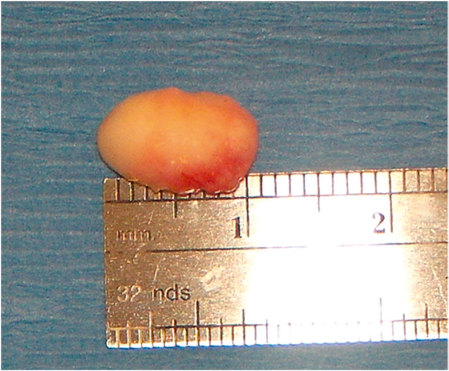

• Fig. 99.15 Dermoid cyst removed in total; pathology confirmed diagnosis of dermoid cyst.

## PDF page 2031

autosomal dominant condition. The fetal lanugo persists into adult life, creating an abundant covering of hair on the eyebrows, forehead, eyelids, and other areas of the body.

### Lacrimal Abnormalities

### Watery Eye

Epiphora (excess tearing) usually does not occur until after the first 3 weeks of life, when the major portion of the lacrimal gland has become functional. Although the usual cause of epiphora is a blockage of the nasolacrimal ducts (dacryostenosis), the possibility of congenital glaucoma is the most important consideration in the differential diagnosis. Less commonly, tearing can result from an obstruction of the common canaliculus, from congenital absence of the lid puncta, or from dacryocystitis. Congenital absence of the entire lacrimal drainage apparatus is extremely rare. Reflex tearing may be produced by any stimulation of the fifth cranial nerve. Epiphora can occur as the result of corneal abrasion, corneal foreign body, or nasal and facial lesions that irritate the fifth cranial nerve. Chronic nasal congestion also may produce epiphora by mechanically blocking the nasolacrimal duct. Dacryostenosis may be present in up to 7% of neonates and creates a stagnant pooling of tears in the lacrimal sac that contributes to chronic or recurrent dacryocystitis. The inflammation is

• Fig. 99.16 Epiblepharon: right lower lid lashes turned in toward the cornea, abrading the front surface of the eye.

A B

• Fig. 99.17 (A) Dacryocystocele: bluish-colored, firm, nonmobile cyst seen below the medial canthal tendon. (B) Dacryocystocele: after decompression with tear duct probing.

marked by a purulent exudate in the medial canthal area of the conjunctiva. Severe dacryocystitis can produce swelling and induration of the lacrimal sac medial and inferior to the medial canthus. Treatment of mild nasolacrimal infection consists of topical antibiotic drops or ointment. If surrounding cellulitis is suspected, systemic administration of medication and locally applied heat may be required. Repeated massage of the lacrimal sac at the medial canthal area serves to flush out the stagnant tears, decrease the risk for infection, and “pop” open the nasolacrimal obstruction. If the epiphora continues, a lacrimal probe passed through the nasolacrimal duct to the nose usually creates an adequate opening. Probing between 6 and 12 months of age is sometimes performed in an office setting under topical anesthesia with the baby swaddled in a sheet. In more than 90% of children with congenital dacryostenosis, the obstructions spontaneously correct during the first year of life. If persistent, treatment is then offered but requires general anesthesia because these children are too big to swaddle for an office probing. Surgical options include simple probing, silicone tube intubation, or balloon dilation of the lacrimal system.26

### Dacryocystocele

A congenital dacryocystocele presents within the first week of life as a bluish mass adjacent to but lower than the medial canthus. Similar lesions found higher than the medial canthus should be suspected to be encephalocele. The distended lacrimal sac is filled with clear fluid, feels firm or fluctuant to palpation, and does not pulsate like a frontal encephalocele.27 Initiating oral antibiotics is recommended as soon as a dacryocystocele is identified to prevent infection of the dacryocystocele, which can occur in up to twothirds of these patients. If the patient presents with signs of a dacryocele infection, admission to a pediatric intensive care unit for intravenous antibiotics and monitoring for risk of respiratory distress because of nasal obstruction is required. Surgical treatment with a nasolacrimal probing should be considered within the next 2 to 4 days (Fig. 99.17A and B).

### Dry Eye

The normal newborn will have moist eyes from basal secretion of tears. Reflex tearing from ocular irritation or

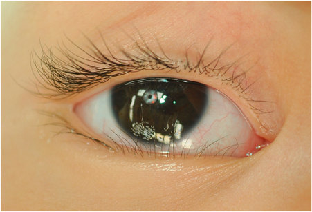

• Fig. 99.17 (A) Dacryocystocele: bluish-colored, firm, nonmobile cyst seen below the medial canthal tendon. (B) Dacryocystocele: after decompression with tear duct probing.

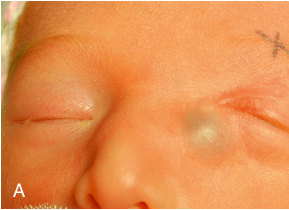

• Fig. 99.17 (A) Dacryocystocele: bluish-colored, firm, nonmobile cyst seen below the medial canthal tendon. (B) Dacryocystocele: after decompression with tear duct probing.

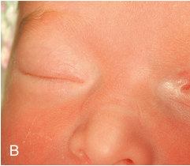

Unmatched source image; PDF page 2031. Consult the original caption.

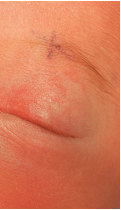

Unmatched source image; PDF page 2031. Consult the original caption.

## PDF page 2032 | printed page 2041

psychogenic (emotional) tearing may not develop for weeks to months after birth. Infants do not usually have symptoms from dry eyes unless in rare conditions such as alacrima from a congenital lack of tear glands or Riley-Day syndrome. Recognition of alacrima in the infant is important in preventing corneal abrasions, infections, and perforations, the inevitable sequelae of dry eye. During the first month of life, an infant with alacrima from any cause might not appear different from the normal infant, because tear production is minimal during this period. The usual time of discovery is at 6 to 12 months of age after the lack of tears has produced changes such as scarring or ulceration of the cornea. At 1 to 2 months of age, early symptoms of dry eye are conjunctival hyperemia and photophobia. Instead of the ample tears expected with conjunctival irritation, a sticky mucoid secretion is produced, and the cornea shows punctate staining with fluorescein solution application. Treatment includes frequent use of artificial tears (as often as every 15–30 minutes), punctal occlusion, or tarsorrhaphy (partial or complete temporary or permanent suturing of the upper and the lower lid together to decrease the exposed ocular surface area).

Isolated congenital lack of tears, usually bilateral, is a rare anomaly. The cause is unknown, but it has been suggested to result from hypoplasia of the lacrimal gland or from an absence of innervation of the lacrimal gland structures. The ocular findings in familial dysautonomia (Riley-Day syndrome) are characteristic and can produce the initial criteria for diagnosis. They include alacrima and corneal anesthesia. These ocular changes and constriction of the pupil by instillation of 0.125% or 0.0625% pilocarpine should establish the diagnosis. The onset of major systemic symptoms occurs when the child is about 2 years old. An abnormal swallowing mechanism, inappropriate blood pressure and respiratory control, decreased sensitivity to pain, deficient taste perception, and abnormal ocular findings in this syndrome are the result of sympathetic, parasympathetic, and sensory neuronal abnormalities. Additional ocular findings are myopia, anisometropia (significantly different refractive error in the two eyes), exotropia, tortuosity of the retinal vessels, and occasionally ptosis. Familial dysautonomia results from a mutation in the IKBKAP gene encoding elongation protein 1, resulting in defective splicing.28

### Globe Abnormalities

### Anophthalmia

Anophthalmia is a rare sporadic phenomenon in which there is total absence or a minute rudiment of the globe, and it can present either unilaterally or bilaterally (Fig. 99.18). It occurs as a developmental failure of the optic vesicle. It is often accompanied by other congenital anomalies, such as CNS defects and mental retardation, and has been observed in isolation, in genetic defects (e.g., SOX2, STRA6, PAX6 genes), and in chromosomal syndromes (e.g., trisomy 13).29 Because lid formation does not depend on ocular formation,

• Fig. 99.18 Anophthalmia: Goldenhar syndrome, with maldeveloped right side of the face and anophthalmia.

the lids are fully formed. However, the lids remain closed and can be partially fused, and they are smaller and sunken without the support of the eye. Treatment involves reconstruction of the orbit to improve the appearance of the face. Plastic molds of the conjunctival sac of gradually enlarging sizes are used to stretch the lids and sac sufficiently to hold an ocular prosthesis. In unilateral situations, orbital reconstruction using tissue expanders can dramatically improve the overall facial appearance.

### Cryptophthalmia

In cryptophthalmia, the eyelids fail to cleave, and uninterrupted skin runs from the forehead to the malar area. The eyelids and eyelashes usually are absent; however, the eye can be palpated beneath the skin and might even be observed to move with the stimulation of a strong light.

The anterior segment of the eye is invariably disorganized into fibrovascular tissue adherent to the subcuticular tissue of the lids. Because the conjunctival sac is absent or small, attempts to separate the lids from the ocular structures are usually unsuccessful, and surgical correction is not advisable in most circumstances. Although a globe is present, only rarely is vision obtainable.

Cryptophthalmia is frequently associated with systemic abnormalities such as urogenital malformations (Fraser syndrome) linked to defects of the FRAS1 and FREM2 genes, and a thorough genetic evaluation is indicated.30

### Microphthalmia

Microphthalmia describes a variety of conditions in which the axial length of the neonatal eye is less than two-thirds of the normal 16 mm. Causes include familial, syndromic, and chromosomal abnormalities and environmental influences during gestation. Simple microphthalmia is a condition in which there is an abnormally small eye but with intact internal organization. It may be associated with other ocular features of importance: a high degree of hypermetropia, retinal folds, a tendency for choroidal effusions, and the late occurrence of glaucoma.31

Complex microphthalmia describes small eyes with internal disorganization, such as anterior segment dysgenesis,

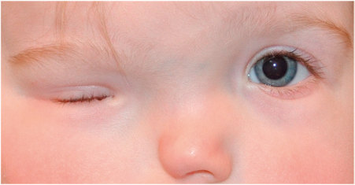

• Fig. 99.18 Anophthalmia: Goldenhar syndrome, with maldeveloped right side of the face and anophthalmia.

## PDF page 2033

cataract, coloboma, or persistent fetal vasculature. Colobomatous microphthalmia occurs when the embryonic cleft of the optic vesicle fails to close. Typically, this form is associated with other ocular anomalies such as colobomas of the iris, ciliary body, fundus, or optic nerve, or colobomatous orbital cysts (see Fig. 99.19).

Microphthalmia can also be associated with other ocular and systemic syndromes, including intrauterine infections such as rubella and cytomegalovirus, craniofacial anomalies, anterior segment dysgenesis syndromes, or chromosomal abnormalities. Because of the heterogenicity of associated findings, infants with microphthalmia should be evaluated by both an ophthalmologist and geneticist.

### Large Eye

An abnormally enlarged eye in the neonatal period is rare but is extremely important to recognize. An apparently enlarged eye may be caused by colobomatous microphthalmia with an associated large cyst, congenital megalocornea (see later), or congenital glaucoma (see later). Colobomatous microphthalmia results when the embryonic optic vesicle fails to close. Tissue that originally should have become intraocular is encased in a cystic structure outside the eye in the orbit. If the cyst becomes sufficiently large that proptosis occurs, the microphthalmic eye simulates an enlarged eye.

### Scleral Abnormalities

The normal term neonate has a glistening white sclera. The overlying conjunctiva and the conjunctival vessels superimpose a filmy, vascular pattern. A generalized bluish discoloration of the underdeveloped sclera is normal in premature infants. Rarely, a congenital weakness in a small area of the

• Fig. 99.19 Choroidal coloboma.

sclera produces a bluish bulge called a staphyloma. The light blue color is caused by thinness of the sclera that transmits the darker color of the underlying uveal tissue. Osteogenesis imperfecta may be associated with a similar bluish discoloration of the sclera in the term neonate because of inadequately developed scleral collagen. Blue sclera may also be seen in other systemic diseases such as Marfan syndrome, Ehlers-Danlos syndrome, and Crouzon syndrome.

Pigmentation of the conjunctiva and sclera is common in darkly pigmented people. Intrascleral nerve loops appear as darkly pigmented dots about 3 to 4 mm from the limbus. Congenital ocular melanosis and oculodermal melanosis (nevus of Ota [see Fig. 99.12]) occur as a unilateral slateblue pigmentation in infancy.

### Corneal Abnormalities

### Cloudy Cornea

The normal premature infant might have a slightly hazy cornea for the first few weeks of life, caused by temporary excess hydration of the cornea. In the normal term infant, a similar appearance may be seen for the first 48 hours after delivery.

A persistently hazy or cloudy cornea suggests congenital glaucoma or birth injury. Anterior segment dysgenesis syndromes, corneal dystrophies, infection, or systemic disease should also be considered (Fig. 99.20).

### Enlarged Cornea

Most newborn infants have a corneal diameter of about 9 to 10 mm. If this measurement exceeds 12 mm, congenital glaucoma must be considered, especially if corneal haze, tearing, and photophobia are present. Megalocornea is an enlarged cornea exceeding 13 mm in diameter. The cornea is usually clear, with distinct margins and thin corneal stroma.

• Fig. 99.20 Cloudy cornea: this patient is a 30-week-gestation premature child with Peters anomaly.

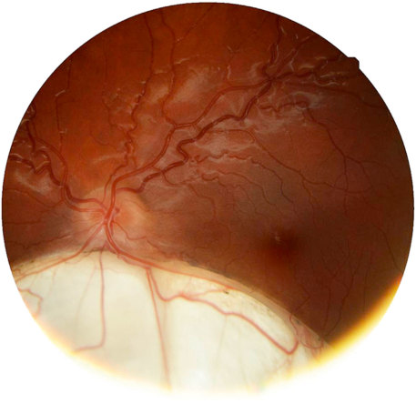

• Fig. 99.19 Choroidal coloboma.

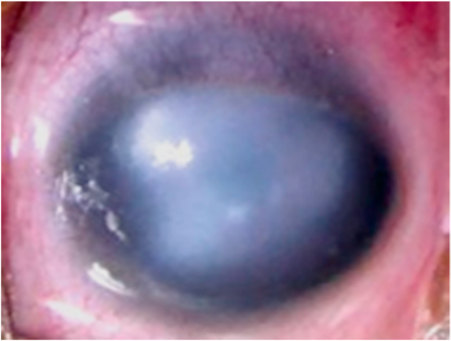

• Fig. 99.20 Cloudy cornea: this patient is a 30-week-gestation premature child with Peters anomaly.

## PDF page 2034 | printed page 2043

There are no other features of congenital glaucomas, such as elevated intraocular pressure, tearing, photophobia, or conjunctival injection. Megalocornea as an isolated finding is usually inherited in an autosomal dominant manner. Megalophthalmia, which is commonly inherited as an X-linked recessive trait, is characterized by deep anterior chambers, subluxation of the lens, hypoplastic iris, and cataract formation in early adult life. A corneal diameter of less than 10 mm may be an isolated finding or may be associated with other ocular anomalies. Cases of autosomal dominant and recessive inheritance of microcornea have been described.

### Anterior Segment Dysgenesis Syndromes

A wide spectrum of clinical findings is observed in the anterior segment dysgenesis syndromes, including abnormalities of the cornea, anterior chamber, iris, and lens. Corneal opacities, adhesions of the iris, and glaucoma can occur. Although a continuous spectrum of findings can be evident in a family pedigree, or between the two eyes of one patient, eyes are often assigned into the distinct subgroups of posterior embryotoxon, Axenfeld anomaly, Rieger anomaly, or Peters anomaly.

### Axenfeld-Rieger Anomaly

Previously classified into Axenfeld anomaly, Rieger anomaly, Axenfeld syndrome, and Rieger syndrome, these overlapping conditions are now believed to be a spectrum rather than separate entities. Axenfeld-Rieger anomaly is an anterior segment dysgenesis caused by abnormal neural crest migration during early embryogenesis. This spectrum constitutes a set of ocular abnormalities that include posterior embryotoxon (an anteriorly displaced and prominent Schwalbe line), iris hypoplasia, corectopia, and polycoria. Axenfeld-Rieger syndrome is said to be present when systemic manifestations accompany the ocular features of the disorder. These include dental (hypodontia), cardiac, and periumbilical abnormalities. Approximately 50% of these patients will develop glaucoma.

### Peters Anomaly

Similar to Axenfeld-Rieger, Peters anomaly is an anterior segment dysgenesis caused by abnormal migration of neural crest cells. There are two types of Peters anomaly depending on what tissues are affected. Type I Peters anomaly presents with a congenital central corneal opacity with a defective Descemet membrane and iridolenticular adhesions. In type II, the lens is also affected, usually in the form of cataract or lenticular adhesions. Because of the accompanying trabeculodysgenesis, glaucoma is a very common (50%–70%) association in Peters anomaly. Treatment is usually directed towards surgical correction of the corneal opacity, cataract, and glaucoma.

### Corneal Dystrophies

Most corneal dystrophies become apparent in adolescence or early adult life. However, congenital hereditary endothelial

dystrophy may be present at birth. This condition is characterized by bilateral cloudy corneas, normal corneal diameter, and normal intraocular pressure. Early cornea transplantation may be helpful, but the prognosis is guarded.

### Corneal Manifestations of Systemic Disease

Corneal opacities and haze can occur because of inborn errors of metabolism. Most are not associated with corneal opacities in the neonatal period. Systemic diseases that cause corneal opacities include mucopolysaccharidoses, mucolipidoses, Fabry disease, hypophosphatasia, cystinosis, and Wilson disease.

### Congenital Glaucoma

Although congenital glaucoma is uncommon, the devastating effects of uncontrolled ocular pressure are sufficiently important to keep this disease uppermost in the mind of the examining physician. The classic symptoms of congenital glaucoma include tearing, light sensitivity, and blepharospasm. As the disease progresses, the increased intraocular pressure produces stretching of the eye, creating an increased corneal diameter greater than 12 mm (buphthalmos, Fig. 99.5), cloudy cornea, progressive myopia, and loss of vision. Symptoms can be apparent at birth or weeks to months later.

Acute hydrops which constitutes a rupture of the Descemet membrane followed by sudden influx of fluid into the corneal stroma, may occur, and presents with acute diminution of vision and corneal edema. It usually resolves leaving horizontal lines in the Descemet membrane (Haab’s striae), which are a sure sign of resolved hydrops.

Congenital glaucoma can occur as a primary disease or secondary to numerous other ocular conditions or systemic syndromes. A list of diseases associated with congenital glaucoma is shown in Box 99.3. In addition to visual

• BOX 99.3 Conditions Associated With Glaucoma

Seen in Isolated (Congenital) Conditions

• Aniridia • Rubella syndrome • Hallermann-Streiff syndrome • Lowe syndrome • Axenfeld or Rieger syndrome • Sturge-Weber syndrome

Uncommonly Seen in These Conditions

• Chromosome abnormalities • Down syndrome • Homocystinuria • Marfan syndrome • Neurofibromatosis • Ocular-dental-digital syndrome • Persistent hyperplastic primary vitreous • Rubinstein-Taybi syndrome • Weill-Marchesani syndrome

## PDF page 2035

impairment from glaucomatous damage, amblyopia from visual deprivation or anisometropia can prevent a successful visual outcome. The prognosis depends on the age of onset, time to diagnosis, and associated ocular and systemic conditions. Unlike the glaucoma in adults, the treatment is surgical in the vast majority of cases, and medical management is only used for temporizing the condition or better visualization for various surgical procedures.

### Iris Abnormalities

### Aniridia

Aniridia (absence of the iris) is a rare congenital anomaly, usually bilateral, that is almost invariably associated with poor vision and nystagmus. A small rudimentary cuff of the peripheral iris can be observed grossly or microscopically (Fig. 99.21). Associated ocular findings include glaucoma, corneal pannus, cataract, abnormal optic discs, and foveal hypoplasia. Because the fovea sub serves our best vision, its maldevelopment causes the nystagmus and poor visual acuity.

Aniridia is caused by a defect in the PAX6 gene on chromosome 11 at 11p13. WAGR syndrome, a contiguous gene syndrome, results from a larger deletion in the area that involves the Wilms tumor gene (WT1) and includes Wilms tumor, aniridia, genitourinary abnormalities, and mental retardation. All infants with nonfamilial aniridia should undergo chromosomal analysis to detect small deletions; if a deletion exists, the infant should be carefully monitored for early detection of Wilms tumor.32

### Coloboma

Iris coloboma is one of the most common congenital abnormalities of the eye. It can occur as an isolated ocular finding,

• Fig. 99.21 Aniridia: this patient has a remnant of the iris tissue that appears like a significantly dilated pupil. Sometimes the iris remnant cannot be visualized with direct observation.

have a Mendelian mode of inheritance, be associated with a chromosomal abnormality, or be associated with other malformation syndromes (Box 99.4). Typical colobomas occur in the inferonasal quadrant, where the embryonic fissure closes. Because typical iris colobomas result from an abnormal closure of the embryonic fissure, they also may be associated with a coloboma of the ciliary body, fundus, or optic nerve. Associated microphthalmia is common. When the optic nerve or macula is involved in the coloboma, visual difficulty occurs. It is always wise to evaluate the fundus for a pathologic condition when an iris coloboma is detected. Atypical iris colobomas occur away from the inferonasal quadrant. Atypical colobomas, which vary from a small notch in the pupil to the absence of an entire segment of the iris, are not usually associated with visual difficulties. Coloboma of the iris, uvea, or retina, with or without microphthalmia, is a feature of CHARGE association (Fig. 99.19).

### Iris Heterochromia

Heterochromia indicates a difference in pigmentation in the irides. For example, one eye may have a blue iris, and the other iris may be brown; or one iris may have a wedge of lighter or darker pigmentation. The heterochromia itself does not affect ocular health or vision but may secondarily result from other pathologic ocular conditions, such as trauma or inflammations. Heterochromia can occur as an isolated autosomal dominant trait. It also is associated with several syndromes such as Waardenburg syndrome. Congenital Horner syndrome produces heterochromia, usually after the neonatal period, resulting from the failure of normal pigmentation to develop in the iris on the sympathetically denervated side. Aganglionic megacolon (Hirschsprung disease) can also be associated with iris heterochromia.

### Pupil Abnormalities

### Abnormal Red Reflex

This is one of the most important abnormalities that requires immediate evaluation. The term leukocoria is used

• BOX 99.4 Syndromes Associated With Iris

Colobomas

• Congenital colobomatous microphthalmia • CHARGE association • Trisomy 13 • Trisomy 18 • Rieger syndrome • Iris coloboma and anal atresia syndrome • Lowe syndrome (infrequent) • Rubinstein-Taybi syndrome (uncommon) • Multiple chromosome anomalies

CHARGE, Coloboma, heart anomaly, choanal atresia, retardation, genital anomaly, ear anomaly.

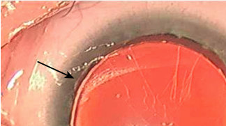

• Fig. 99.21 Aniridia: this patient has a remnant of the iris tissue that appears like a significantly dilated pupil. Sometimes the iris remnant cannot be visualized with direct observation.

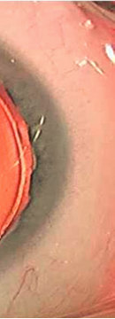

Unmatched source image; PDF page 2035. Consult the original caption.

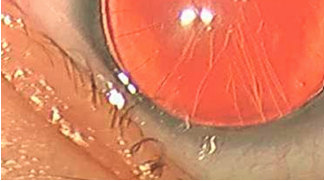

• Fig. 99.21 Aniridia: this patient has a remnant of the iris tissue that appears like a significantly dilated pupil. Sometimes the iris remnant cannot be visualized with direct observation.

## PDF page 2036 | printed page 2045

to describe a white pupil seen by the naked eye or during the red reflex test. Leukocoria is not a diagnosis but rather a description of an observation. Because the infant sleeps much of the time and because the pupils are small, a white pupil often is not noticed until the infant becomes more alert and active. False positive red reflex test results are commonly because of small pupils, shifting gaze, limited patient cooperation, poor illumination from the ophthalmoscope, and examiner inexperience. Regardless, these patients should be over-referred to the ophthalmologist to ascertain the true-positive results.

Causes of leukocoria in infants include opacities of the cornea, lens, and vitreous, as well as retinal diseases such as retinoblastoma, chorioretinal coloboma, persistent hyperplastic primary vitreous, endophthalmitis, Coats disease, congenital retinal fold, retinoschisis, or scarring from ROP. Abnormal red reflexes can also result from a misaligned eye or from high or asymmetric refractive errors.

### Persistent Pupillary Membrane

Persistent pupillary membranes are common in the neonate, particularly in the premature infant. The membranes are remnants of the anterior fetal vascular supply of the lens that failed to atrophy in the 7th month of gestation. If these persistent vessels adhere to the lens, a localized cataract can form.

### Anisocoria

Anisocoria is a term used to describe pupils of unequal size (aniso = unequal, kore = pupil). This can be physiological, pharmacologic, or pathologic in etiology. Physiologic anisocoria is quite common in infants and children. The difference between pupillary diameters is usually not more than 1 mm, and both pupils are equally reactive to light, both directly and consensually. A pharmacologically dilated pupil is usually nonreactive and accompanied by a history of medication application. The most common cause of pathologic anisocoria in infants is congenital Horner syndrome (discussed separately in this chapter), where the affected eye is miotic and typically accompanied by ipsilateral ptosis. Other causes of pathologic anisocoria include amaurotic pupil (in congenital optic nerve atrophy) where the affected side is dilated and nonreactive, corectopia in anterior segment dysgenesis (discussed separately in this chapter), and maternal substance abuse.

### Lens Abnormalities

### Cataract

The lens helps images focus on the retina and is designed to be transparent. The lens grows continuously during life, laying down new lens fibers on its external surface much as an onion does. The lens is preserved in capsules (anterior and posterior) and has a nuclear core and surrounding cortical

portion. Any opacity or abnormality within these structures is defined as cataract. Childhood cataracts can be classified as congenital, infantile, or juvenile depending on the age of onset. Congenital cataracts are present at birth but may go unnoticed until an effect on the child’s visual function is noticed or a white pupil reflex develops. Congenital and infantile cataracts are responsible for about 5% to 20% of all blindness worldwide.33

It is important to consider the origin of a cataract. The etiology of pediatric cataracts can be broadly classified and summarized as hereditary, metabolic (galactosemia, Fabry disease, hemolytic jaundice, etc.), traumatic, secondary (maternal infection, inflammation, steroid use, etc.), seen with chromosomal abnormalities (Lowe, Alport, Marfan, Hallerman Strieff, and other syndromes), iatrogenic, and idiopathic. Furthermore, cataracts can be classified according to their morphology as diffuse/total, anterior polar, lamellar, nuclear, posterior polar, posterior lentiglobus, posterior (and anterior) subcapsular, persistent hyperplastic primary vitreous, and traumatic.

The size and shape of a cataract depend on the area of the lens that is being formed at the time the damage or developmental defects occur. Damage that occurs in the early embryonic period produces opacifications in the center of the lens. Such nuclear cataracts have clear layers in the periphery of the lens. Later periods of damage produce ringlike opacifications surrounded by central and peripheral clear areas (zonular cataracts). Recent damage produces peripheral opacifications near the surface of the lens (cortical cataracts). Dense opacities near the central axis cause greater visual disturbance, especially if they are located in the central visual axis. However, most congenital cataracts are genetic or isolated and idiopathic. A list of causes of neonatal cataracts is shown in Table 99.3.

Genetically determined cataracts often are isolated abnormalities and bilateral. Many genetic loci have been mapped.34 The primary mode of transmission is autosomal dominant. Recessive transmission and X-linked transmission have been recorded. Because there is variable expressivity, parents should be examined for mild cataracts.

The rubella embryopathy syndrome is rare in the era of rubella vaccination but is still seen in developing countries. The syndrome comprises multiple congenital anomalies that result from maternal viremia during the first trimester of pregnancy. Cataracts are present in about 20% of children with the congenital rubella syndrome (Fig. 99.22). The rubella virus may remain dormant in lens material in the offspring for as long as several years. Microphthalmia, pupil abnormalities, congenital glaucoma, and anterior uveitis also may result. A cloudy, edematous, or white cornea may be found with normal intraocular pressure as part of the rubella embryopathy. Rubella retinopathy is a pigmentary disturbance of the retina without demonstrable effect on visual function. A TORCH (toxoplasmosis, other agents, rubella, cytomegalovirus, herpes simplex) titer should be obtained from all infants with nongenetic congenital cataracts.

## PDF page 2037

### Neonatal Cataracts

TABLE 99.3

Type Incidence

Genetic

Dominant N/A

Recessive N/A

X-linked recessive N/A

Sporadic 1/3 of all congenital

cataracts

Viral

Rubella Frequent

Toxoplasmosis, varicella, herpes

Infrequent

simplex, measles, mumps, vaccinia, cytomegalovirus

Inborn Errors of Metabolism

Galactosemia Frequent

Galactokinase deficiency Frequent

Hypocalcemia Infrequent

Congenital hemolytic jaundice Infrequent

Mannosidosis Frequent

Refsum disease Infrequent

Fabry disease Frequent

Myotonic dystrophy Frequent

Hereditary spherocytosis Infrequent

Lowe syndrome Frequent

Trauma

Birth trauma Infrequent

Blunt trauma Frequent

Perforating injuries Frequent

High-voltage electric shock Frequent

Battered child syndrome Infrequent

Endocrine

Congenital hypoparathyroidism Frequent

Albright hereditary osteodystrophy Infrequent

N/A, Not available. Modified from Arkin M, Azar D, Fraioli A. Infantile cataracts. Int Ophthalmol Clin. 1992;32(1):110–111.

Galactosemia is a hereditary inborn error of metabolism with deficiency of the enzymes responsible for galactose metabolism: galactose-1-phosphate uridyltransferase, galactokinase, or uridine diphosphategalactose-4-epimerase. The affected neonate may appear normal at birth. Cataracts usually develop during the first 2 months of life. The cataracts may be zonular or may appear as vacuoles (classically described as “drop of oil”) in the center of the lens owing to an accumulation of galactose and galactitol. Early diagnosis and a regimen of a galactose-free diet can prevent

Type Incidence

Neurologic

Marinesco-Sjögren syndrome Infrequent

Smith-Lemli-Opitz syndrome Rare

Sjögren syndrome Infrequent

Laurence-Moon-Bardet-Biedel

Frequent

syndrome

Miscellaneous

Aniridia (sporadic or associated

Infrequent

with Wilms tumor)

Treacher Collins syndrome Infrequent

Pierre Robin syndrome Infrequent

Rubinstein-Taybi syndrome Infrequent

Hallermann-Streiff syndrome Frequent

Conradi syndrome Presence of

cataract indicates worse prognosis

Chromosome Anomalies

Trisomy 13 Infrequent

Trisomy 18 Infrequent

Trisomy 21 Infrequent

Patau syndrome Infrequent

Turner syndrome Infrequent

Associated With Other Eye Malformations

Microphthalmia Frequent

Rieger anomaly Infrequent

Persistence of fetal vasculature Frequent

Retinitis pigmentosa Infrequent

Norrie disease Infrequent

Colobomas Frequent

Lenticonus Frequent

development or further progression of cataracts. All congenital forms of infantile cataracts require a prompt evaluation by an ophthalmologist. Dense cataracts are treated surgically to prevent irreversible amblyopia and strabismus. Removal of the lens, followed by optical correction and amblyopia therapy, provides the best hope of restoring vision.

The prognosis for vision is poorer in the involved eye when the cataract is monocular. Intraocular lens implantation, especially in older infants, is often used to restore the focusing ability of the eye.35 Long-term follow-up is

### Automatic table extraction — verify rendered original

|Type Incidence Genetic Dominant N/A Recessive N/A X-linked recessive N/A Sporadic 1/3 of all congenital cataracts Viral Rubella Frequent Toxoplasmosis, varicella, herpes Infrequent simplex, measles, mumps, vaccinia, cytomegalovirus Inborn Errors of Metabolism Galactosemia Frequent Galactokinase deficiency Frequent Hypocalcemia Infrequent Congenital hemolytic jaundice Infrequent Mannosidosis Frequent Refsum disease Infrequent Fabry disease Frequent Myotonic dystrophy Frequent Hereditary spherocytosis Infrequent Lowe syndrome Frequent Trauma Birth trauma Infrequent Blunt trauma Frequent Perforating injuries Frequent High-voltage electric shock Frequent Battered child syndrome Infrequent Endocrine Congenital hypoparathyroidism Frequent Albright hereditary osteodystrophy Infrequent|Type Incidence Neurologic Marinesco-Sjögren syndrome Infrequent Smith-Lemli-Opitz syndrome Rare Sjögren syndrome Infrequent Laurence-Moon-Bardet-Biedel Frequent syndrome Miscellaneous Aniridia (sporadic or associated Infrequent with Wilms tumor) Treacher Collins syndrome Infrequent Pierre Robin syndrome Infrequent Rubinstein-Taybi syndrome Infrequent Hallermann-Streiff syndrome Frequent Conradi syndrome Presence of cataract indicates worse prognosis Chromosome Anomalies Trisomy 13 Infrequent Trisomy 18 Infrequent Trisomy 21 Infrequent Patau syndrome Infrequent Turner syndrome Infrequent Associated With Other Eye Malformations Microphthalmia Frequent Rieger anomaly Infrequent Persistence of fetal vasculature Frequent Retinitis pigmentosa Infrequent Norrie disease Infrequent Colobomas Frequent Lenticonus Frequent|
|---|---|
|||

[Original table](../../tables/ch099_p2037_1.jpg)

## PDF page 2038 | printed page 2047

• Fig. 99.22 Infantile cataract: white opacification seen in the center of the visual axis. This is a posterior lenticonus type cataract.

necessary to monitor vision development, treat strabismus and amblyopia, and detect glaucoma.

### Subluxed Lens

The discovery of a subluxed lens (ectopia lentis) in an eye helps in identifying systemic disease processes associated with this abnormality. Although lens dislocation may be present during the neonatal period, it typically develops in the first or second decade of life. Therefore other causes such as blunt trauma should be suspected, especially if is seen with other signs of ocular, peri-ocular, and/or systemic signs of trauma (i.e., shaken baby syndrome). Marfan syndrome is the most common cause, but homocystinuria, sulfite oxidase deficiency, hyperlysinemia, Ehlers-Danlos syndrome, Weill-Marchesani syndrome, and trauma can also produce this finding. There is also an isolated genetic form. The dislocation results from a laxity, absence, or defect of the zonular attachments that suspend the lens from the ciliary body. A subluxed lens usually is not treated during the neonatal period unless there is the complication of cataract formation or glaucoma.

By dilating the pupil, the examiner can visualize the edge of a dislocated lens in the pupillary space. Ectopia lentis may also be suggested by iridodonesis (shaking of the iris), which occurs when the posterior surface of the iris lacks the normal support of the lens. A dislocated lens is one of the toughest surgical problems in pediatric ophthalmology.

### Retina and Vitreous Diseases

During the neonatal period, nonvascular structures of the fundus are nearly transparent because uveal pigmentation is not fully developed. The neonatal retina does have sheen to its inner surface, but the macular region appears flattened. Retinal transparency is disturbed when abnormalities are present. The retina resembles a pale, ghostlike sheet when it is detached. Retinal edema gives a slightly raised, opalescent appearance. Infection obscures the underlying structures with a fuzzy, white thickening of the retinal tissue. In pathologic processes characterized by a lack or an excess of pigment, retinal abnormalities may become evident only after the first few

months of life. The choroid is the deepest layer normally visible with the ophthalmoscope. Pathologic processes that prevent its development or that destroy areas of choroid expose areas of bare sclera, which appear glistening white.

### Retinal Dysplasia

Many of the heritable retinal disorders tend to be noticed far beyond the neonatal period. Although these are genetic problems obviously present at birth, it takes years or sometimes decades to manifest its effects and debilitating visual effects. Retinal dysplasia is rare and is a usually bilateral, congenital anomaly of term infants showing congenital retinal folds and retinal detachments. Histopathologically, the retina shows disorganization and dysplasia. The retinal detachments may clinically resemble a mass and should be considered in the differential diagnosis of retinoblastoma. Rather than a distinct clinical entity, retinal dysplasia may represent a common final pathway of many different developmental disorders of retinal differentiation and organization. Retinal dysplasia can occur as part of a group of congenital anomalies—including defects of the CNS, cardiovascular system, and skeletal system—that are sufficiently severe to produce early death of the infant. Specific conditions that result in retinal dysplasia include trisomy 13, Norrie disease, and Walker-Warburg syndrome.

### Norrie Disease

A rare genetic disorder transmitted as an X-linked recessive trait, Norrie disease is characterized by the presence of bilateral total retinal detachments that result in a white pupil. Organization of the retinal detachment can disrupt the lens, producing cataract, or can affect the anterior chamber angle, producing congenital glaucoma. The usual result is atrophy of the globe. Norrie disease maps to the NDP gene on chromosome Xp11.4, most commonly caused by mutations of the cysteine-knot motif.36 Patients with Norrie disease may also develop progressive mental disorders, often with psychotic features, and about one-third of patients develop sensorineural deafness.

Mutations of the NDP gene away from the cysteine-knot motif often result not in Norrie disease but in a clinically distinct entity termed familial exudative vitreoretinopathy (FEVR). FEVR is characterized by avascularity of the peripheral retina, abnormal retinal neovascularization, retinal traction, and detachment. FEVR is actually a genetically diverse disorder, having been also mapped to the FZD4 and LRP5 genes, both of which encode for receptors for the NDP gene product.37

### X-Linked Juvenile Retinoschisis

Juvenile X-linked retinoschisis is transmitted as an X-linked recessive trait, occurring almost exclusively in males, and invariably bilateral. It is a progressive, degenerative disorder. Although relatively rare worldwide, it is the most common X chromosome disorder in Finland. Retinoschisis is a splitting of the nerve fiber layer (the most superficial layer of

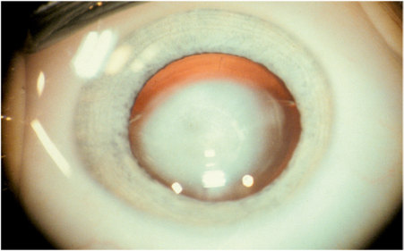

• Fig. 99.22 Infantile cataract: white opacification seen in the center of the visual axis. This is a posterior lenticonus type cataract.

## PDF page 2039

• Fig. 99.23 Shaken baby syndrome.

the retina) with ballooning of the inner layer into the vitreous. This splitting creates a veil-like appearance in front of the retina. Visual function is absent in the affected tissue. Macular changes and vitreous hemorrhages can occur as associated findings. Both lead to loss of vision. Early diagnosis offers a better chance of improving prognosis. It has no known systemic manifestations.

Retinoschisis can also be seen in trauma, and especially is pathognomonic for shaken baby syndrome when seen with retinal hemorrhages affecting multiple layers of the retina (Fig. 99.23).

### Leber Congenital Amaurosis

Leber congenital amaurosis (LCA), first described by Theodore Leber in 1869, is an autosomal recessive condition that presents before age 1 year with severely affected vision (majority light perception), nystagmus, and poor pupillary reactions. Although retinal examination can be normal, non-recordable electroretinography (ERG)—a diagnostic test that measures the electrical responses of the photoreceptors to light stimulation—is associated with this condition. Children with this disorder sometimes rub or poke their eyes excessively, called “blindism behavior.” Nystagmus usually appears after a few months. LCA that has no other associated systemic manifestations is termed uncomplicated LCA. Today, LCA is recognized as a heterogeneous group of disorders that together are estimated to account for approximately 5% of all retinal dystrophies and approximately 10% to 18% of all cases of congenital blindness. To date, seven genes have been implicated in the pathophysiology of LCA and together account for almost 40% of patients presenting with this condition. Ground-breaking gene therapy work has made significant advancement in the potential cure of these diseases for RPE65-associated LCA.38

### Albinism

Albinism refers to the absence or reduction in the amount of melanin in the skin, eye, or both. Diseases featuring

albinism are genetically determined and involve defects of melanogenesis.

Albinism can be divided into ocular (X-linked recessive) and oculocutaneous (autosomal recessive) albinism. Melanin loss can be partial or complete. In complete (tyrosinase negative) albinism, the infant is born with clinical features of the disease (white skin and hair and blue irises), whereas the incomplete subtype (tyrosinase positive) presents with variable amounts of pigmentation that may continue to decrease over life. Unfortunately, both subtypes present with foveal hypoplasia, nystagmus, strabismus, and errors of refraction.

Hermansky-Pudlack, Chediak-Higashi, and Waardenburg syndrome (discussed later in this chapter) are syndromic variants of tyrosinase-positive oculocutaneous albinism, characterized by platelet dysfunction, vesicular infections, and deafness, respectively.

The diagnosis of albinism in the neonatal period is difficult to substantiate because the uveal pigment is underdeveloped during this period. The diagnosis may be suggested when pigmentation of the skin, hair, and irises fails to progress during the first several months in comparison with that of parents and siblings. Lack of pigmentation is more apparent earlier in darker races. The fundus remains blonde and choroidal vessels are prominent. Photophobia, nystagmus, and abnormal transillumination of the irides are characteristic features of albinism. Moderately to severely reduced vision is characteristic as a result of foveal hypoplasia and the consequent nystagmus.

### Abnormal Macula

Several of the lysosomal storage diseases alter the appearance of the macula, a fact that may be useful in detecting these disorders (Table 99.4). The stored material accumulates in the ganglion cells of the retina, which decreases the transparency of the retina except at the very center of the macula, where no ganglion cells exist. The center of the macula retains its normal cherry-red appearance, in sharp contrast to the surrounding grayish involved fundus.

Sphingolipidoses that may produce a cherry-red spot are Tay-Sachs disease, in which a cherry-red spot may be present shortly after birth or may develop during the first year, and Niemann-Pick disease (infantile), in which about 50% of patients have a cherry-red spot in the macula during the neonatal period. Of the lipidoses, Farber disease shows a grayish discoloration of the macula at 6 to 8 weeks of age, and GM1-gangliosidosis demonstrates a cherry-red spot in the macula in about 30% of patients before 2 months of age. The mucopolysaccharidoses are characterized by the abnormal deposition of mucopolysaccharides in the cornea, but the macula appears normal.

### Congenital Disc Anomalies

### Optic Nerve Hypoplasia

Optic nerve hypoplasia is the most common congenital disc anomaly and is a common cause of congenital blindness.

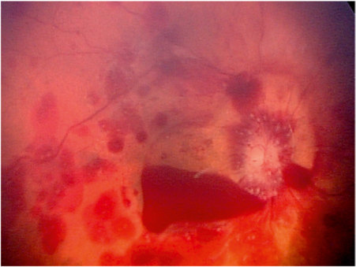

• Fig. 99.23 Shaken baby syndrome.

## PDF page 2040 | printed page 2049

TABLE

Neonatal Macular Changes

99.4

Condition Defect

Tay-Sachs disease Cherry-red spot

Niemann-Pick disease Cherry-red spot

GM1 gangliosidosis Cherry-red spot

Neuraminidase deficiency Cherry-red spot and corneal

clouding

Farber disease Gray macula

Best vitelliform

Cystic macula (rare)

degeneration

Toxoplasmosis Chorioretinal scar

Coloboma Absence of retina and

choroids

It can be associated with the alcohol and drug abuse of the mother. It may be unilateral or bilateral (80%) and may occur with or without any associated neurologic or ocular abnormalities.

It is an abnormally small optic nerve head that may appear gray or pale because of a decreased number of optic nerve axons with normal glial tissue. A yellowish peripapillary ring of sclera and an outer concentric ring of hyper- or hypopigmentation, known as the “double ring” sign, surround the optic disc. The surrounding large retinal veins are usually tortuous (Fig. 99.24).39

The diagnosis of optic nerve hypoplasia is based upon small optic discs, decreased or normal vision, and visual field defects with corresponding nerve fiber bundle defects. Visual acuity ranges from 20/20 to no light perception. Localized defects with peripheral constriction are common. Visual acuity is determined mainly by the integrity of the papillomacular bundle and does not correlate with the size of the optic disc.

Unilateral or bilateral optic nerve hypoplasia may be associated with CNS malformations, especially forebrain malformations and endocrinologic abnormalities, as in septo-optic dysplasia (de Morsier syndrome). Focal thinning or absence of the side of the chiasm corresponding to the hypoplastic optic disc can be seen on MRI. In bilateral optic nerve hypoplasia, the optic chiasm is atrophied. The prechiasmatic intracranial optic nerve corresponding to the hypoplastic disc is thinned. The diagnosis of optic nerve hypoplasia may be presumed based upon diminished intracranial optic nerves with other neuroradiologic features of septo-optic dysplasia.41

Other CNS malformations associated with optic nerve hypoplasia include abnormalities in the cerebral hemispheres and the pituitary infundibulum.39 Hemispheric migration abnormalities, such as schizencephaly and cortical heterotopia, and hemispheric injury, such as periventricular leukomalacia and encephalomalacia, may occur in 45% of patients with optic nerve hypoplasia.

Border of the nerve sheath: black portion (could be white or gray) is the empty sheath not entirely filled with the nerve.

Actual border of the optic nerve: nerve seen as the central pink tissue.

• Fig. 99.24 Optic nerve hypoplasia: “Double ring sign”; first ring shows the border of the nerve sheath, and the second ring is formed by the actual border of the optic nerve tissue edge.

Fifteen percent of patients with optic nerve hypoplasia may have perinatal injury of the pituitary infundibulum leading to necrosis. This brain abnormality is seen as posterior pituitary ectopia on MRI. This is associated with antidiuretic hormone deficiency. Growth hormone deficiency is most often associated with optic nerve hypoplasia. Hypothyroidism, hypocortisolism, panhypopituitarism, diabetes insipidus, and hyperprolactinemia may also occur. Cerebral hemispheric abnormalities that are often associated with thinning or agenesis of the corpus callosum are predictive of neurodevelopmental defects.40

### Optic Disc Atrophy

Optic disc atrophy indicates loss of nerve fiber layers forming the optic disc. Clinically, it is subjectively graded on a scale of 1 to 4 (grade 1 atrophy mild pallor of the disc, grade 4 severe atrophy as the optic nerve appears white), but newer technology such as optical coherence tomography (OCT) allows clinicians to objectively quantify the actual nerve fiber amount and consecutive loss. Causes of childhood optic atrophy are listed in Box 99.5.

### Segmental Optic Nerve Hypoplasia

Superior segmental optic nerve hypoplasia may occur in children of insulin-dependent diabetic mothers. These children have no other systemic anomalies and may be found via incidental inferior visual field defects.

### Megalopapilla

Megalopapilla refers to an enlarged optic disc with no other structural abnormalities. More commonly, it is bilateral. Visual acuity is generally normal. Differential diagnosis

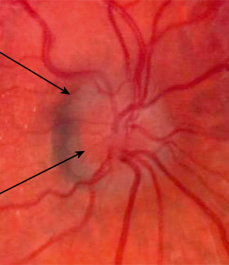

• Fig. 99.24 Optic nerve hypoplasia: “Double ring sign”; first ring shows the border of the nerve sheath, and the second ring is formed by the actual border of the optic nerve tissue edge.

## PDF page 2041

• BOX 99.5 Causes of Childhood Optic Atrophy

Compressive intracranial lesions Compressive bony disorders • Craniosynostosis • Fibrous dysplasia Hydrocephalus Post-papilledema optic atrophy Infections Hereditary • Leber hereditary optic neuropathy • Dominant optic atrophy (Kjer) • Recessive optic atrophy • Behr optic atrophy • DIDMOAD (diabetes insipidus, diabetes mellitus, optic

atrophy, deafness) (Wolfram) optic atrophy Toxic or nutritional optic neuropathy Hypoxia Trauma Postoptic neuritis Radiation optic neuropathy Paraneoplastic syndromes Neurodegenerative disorders with optic atrophy • Krabbe disease • Canavan disease • Leigh disease • Mitochondrial encephalomyopathy, lactic acidosis, and

stroke-like (MELAS) episodes • Neonatal adrenoleukodystrophy • Metachromatic leukodystrophy • Riley-Day syndrome • Lactic acidosis • Spinocerebellar degeneration • Mucopolysaccharidosis Ocular disorders • Glaucoma • Retinal disease • Vascular disease • Uveitis • Optic nerve hypoplasia

should include glaucoma, optic disc coloboma, and orbital optic glioma.

### Morning Glory Disc Anomaly

This condition consists of an optic nerve coloboma associated with retinal vascular abnormalities, glial proliferation, metaplasia, and pigment changes around the head of the nerve. The embryologic origin and hereditary factors are unclear. It usually occurs unilaterally in females and rarely in African Americans.40a

The enlarged optic disc is orange-pink and is located centrally within a funnel-shaped excavation around the nerve head. White glial proliferative tissue lies over the center. Anomalous blood vessels emanate radially from the disc (Fig. 99.25A and B). The macula may occasionally be incorporated into the excavation.41

Visual acuity is often poor, ranging from 20/200 to a finger counting. The most common complication is retinal detachment, which can lead to further vision loss.41 Systemically, it can be associated with trans-sphenoidal

encephalocele, hypoplasia of the ipsilateral intracranial vasculature, Moyamoya syndrome, and PHACES (posterior fossa malformations, large facial hemangioma, arterial anomalies, cardiac anomalies and aortic coarctation; eye anomalies; and sternal abnormalities). MRI and MR angiography should be performed to rule out these conditions.

### Optic Disc and Choroidal Coloboma

Coloboma may occur in one or both eyes with equal frequency. The inheritance pattern may be sporadic or autosomal dominant.41 It has been linked to a mutation of the PAX6 gene.

A coloboma of the fundus is visible as a defect in the retinal and choroidal layers through which the underlying sclera is visible (see Fig. 99.19). Leukocoria may result. Typical coloboma occurs inferonasally, which is the site of the closure of the embryonic fissure. The fissure usually begins to close at the globe’s equator and then extends posteriorly toward the optic disc and anteriorly toward the periphery. Any part or this entire region may be involved in the colobomatous defect. The visual prognosis depends on how much of the macula or optic disc is involved. If the defect extends inferiorly to involve the adjacent retina and choroid, then microphthalmia and iris and ciliary colobomas may form.

Colobomas may be associated with other multisystemic congenital syndromes such as CHARGE, Walker-Warburg syndrome, Goltz focal dermal hypoplasia, Aicardi syndrome, Goldenhar syndrome, and linear sebaceous nevus syndrome.41 Orbital cysts may also be rarely seen with optic disc colobomas.1 Box 99.6 lists systemic abnormalities that may be associated with optic disc changes.

In CHARGE syndrome, at least three of the following features must be present for the condition: heart defect, choanal atresia, restricted growth, genital anomalies, and ear anomalies or deafness.

### Optic Disc Pit

Optic disc pit is a congenital oval or round depression in the optic nerve head. Its incidence is 1 in 11,000, and it usually occurs sporadically. Most occur unilaterally. In unilateral cases, the affected disc is slightly larger than the normal one. Optic pits may appear gray, white, or yellowish. They average about 0.3 disc-diameters in width and are often located temporally. Visual acuity is usually normal, but approximately 50% of patients with optic disc pits have visual field defects. This condition may lead to retinal detachment and macular edema or hole.42

### Optic Disc Drusen

Drusen are an accumulation of substances (calcium, mucopolysaccharides, amino acid, ribonucleic acids, deoxyribonucleic acid, and iron)43 buried within the optic disc, causing disc elevation. It is important to distinguish this relatively common (0.4%–3.7% of the population) condition from other causes of disc elevation, primarily papilledema (Fig. 99.26). The vast

## PDF page 2042 | printed page 2051

A

• Fig. 99.25 (A) Morning glory disc anomaly: the defect looks like a fully opened morning glory flower. (B) Normal appearance of scaled fundus photography.

• BOX 99.6 Systemic Abnormalities That May Be

Associated With Optic Disc Changes

With Central Nervous System Abnormalities

Dandy Walker cyst Arhinencephaly Anencephaly Agenesis of corpus callosum Sphenoidal encephalocele

With Chromosomal Abnormalities

Trisomy 13 (Patau syndrome) Trisomy 18 (Edward syndrome)

With Congenital Syndromes

Meckel-Gruber syndrome (autosomal recessive) Goltz syndrome (X-linked dominant) Lenz microphthalmia syndrome (X-linked recessive)

CHARGE Association: With at Least Three of the Following Features

Coloboma Heart defects Atresia of the choanae Retardation of growth and development Genital hypoplasia Ear abnormalities and/or hearing loss

majority is seen bilaterally. It is inherited as an irregularly autosomal dominant disorder. Most are asymptomatic. Although very rare, significant visual field defects and visual acuity decrease may be seen.43 These changes are generally slowly progressive.

The accumulated substances can be buried in the disc (the most common appearance in newborns) or may be visible when they are superficial. Therefore direct visualization could be diagnostic, and B-scan ultrasonography is able to detect the calcium in the drusen. Although fundus autofluorescence is a very sensitive (93%) tool in delineating superficial optic disc drusen, it falls short with buried drusen (15%). Fundus fluorescein angiography may be useful in demonstrating drusenassociated pathology and ruling out other differential diagnoses of the condition. Until recently, B-scan ultrasonography used

B

Small disc hemorrhage

Yellow exudate accumulated in the macula (center of vision)

Swollen optic nerve/disc

• Fig. 99.26 Papilledema: left optic nerve significantly swollen with no visible distinct disc margins, tortuous veins, macular exudate accumulation, and small hemorrhages at disc margins.

to be the gold standard test by detecting the calcium in the drusen, but buried uncalcified drusen were often missed. OCT is particularly useful is demonstrating both superficial and deep disc drusen and evaluating the retinal nerve fiber layer thickness, and it has therefore replaced B-scan ultrasonography as the gold standard diagnostic modality in recent years.43 Treatment is often not needed, but monitoring for elevated intraocular pressure and vascular complications along with other possible associated disorders (retinitis pigmentosa, pseudoxanthoma elasticum)43 is recommended.

### Hyaloid System Remnants

The hyaloid vascular system and the glial sheath of Bergmeister should normally atrophy spontaneously by the end of the gestation. The embryonic vitreous system develops as a complex network of vessels that grows anteriorly from the disc to surround the developing lens and normally involutes during the third trimester. The persistence and proliferation of these normally transient vessels of the primary vitreous, especially the posterior tunica vasculosa lentis (vascular remnant behind the lens), lead to the formation of persistent hyperplastic primary vitreous (PHPV), also known as primary fetal vasculature (PFV). PFV causes a white pupillary reflex that must be distinguished from retinoblastoma. Disc abnormalities are determined by the extent of persistence of glial and/or vascular components.

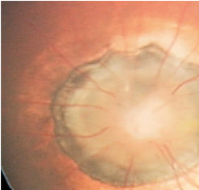

• Fig. 99.25 (A) Morning glory disc anomaly: the defect looks like a fully opened morning glory flower. (B) Normal appearance of scaled fundus photography.

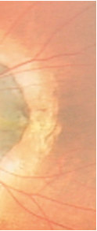

• Fig. 99.26 Papilledema: left optic nerve significantly swollen with no visible distinct disc margins, tortuous veins, macular exudate accumulation, and small hemorrhages at disc margins.

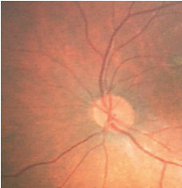

• Fig. 99.26 Papilledema: left optic nerve significantly swollen with no visible distinct disc margins, tortuous veins, macular exudate accumulation, and small hemorrhages at disc margins.

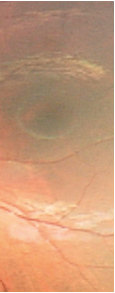

Unmatched source image; PDF page 2042. Consult the original caption.

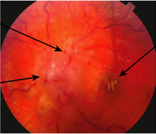

• Fig. 99.26 Papilledema: left optic nerve significantly swollen with no visible distinct disc margins, tortuous veins, macular exudate accumulation, and small hemorrhages at disc margins.

## PDF page 2043

At birth, PFV may appear as a strand or plaque of white tissue immediately behind a clear lens. Vessels are frequently seen to radiate from the plaque’s center, and the retrolental mass may therefore be pinkish-white. When the pupil is dilated, the ciliary processes are often drawn centrally along the posterior surface of the lens toward the central mass. Almost always unilateral, PFV occurs in term infants without a history of oxygen therapy. The involved eye is commonly microphthalmic. PFV should be suspected in the neonate with a rapidly progressive unilateral cataract. Differentiation of PFV from ROP is usually possible because of the unilateral involvement and occurrence of PFV in a term infant. Differentiation from retinoblastoma is important. The absence of calcification within the eye, as occurs in retinoblastoma, is a critical finding. A persistent embryonic iris vessel or one that notches the pupil suggests the presence of PFV, even when an opaque lens obscures its presence. Ophthalmic ultrasonography can help in the diagnosis of difficult cases. Surgical removal of the lens and vitreous with optical correction and amblyopia treatment must be attempted very early to achieve any degree of success in recovering vision.

### Myelinated Nerve Fibers

During fetal development at 5 months’ gestation, myelination progresses from the lateral geniculate body to the optic tracts, then the optic chiasm, and last to the optic nerve by 8 months of gestation.44 Normally, the optic nerve loses its myelin sheath as it penetrates the globe at the lamina cribrosa. Anomalous myelinated nerve fibers occur when myelination extends beyond the posterior portion and into the disc and peripapillary areas. The myelinated areas have a whitish, feathery appearance and are usually continuous with the disc at the upper or lower poles (Fig. 99.27). The process may progress after birth but does not usually extend into the macula. And because myelin blocks light transmission to the photoreceptors, some patients may exhibit enlargement of the blind spot and/or other vision changes. Those with an extensive presentation are at particular risk of developing symptoms and may even present with leukocoria, which requires an immediate ophthalmologic assessment.

In the general population, it is seen at a frequency of 0.3% to 1%.44 It is inherited as an autosomal dominant disorder and occurs unilaterally in 80% of patients.44 It may be associated with systemic disorders such as Gorlin syndrome44 (multiple basal cell nevi), which is an autosomal dominant disorder that may present in children with cutaneous lesions (small pits in the hands and feet, jaw cysts, and other bony abnormalities).

### Intraocular Tumors

### Retinoblastoma

Retinoblastoma is the most frequent malignant intraocular tumor in the pediatric population, including neonates.

• Fig. 99.27 Myelinated nerve fiber layer: just above and nasal to the optic nerve head, the white, feathery appearance of the myelinated nerve fibers is seen. These myelinations will be above the vessels. These are benign findings and rarely progress.

The tumor arises sporadically or may be hereditary. Retinoblastoma occurs in about 1 in 15,000 to 18,000 live births, with no predilection for race or sex. Up to 75% of cases are unilateral.

Only 10% of retinoblastoma patients will have a family history of the disease—this is termed “hereditary retinoblastoma” and is transmitted in an autosomal dominant manner with incomplete penetrance. The average age of presentation in unilateral cases is 2 years and is 9 months earlier in bilateral cases.45 About 75% of cases of retinoblastoma include calcium deposits, which can be detected with B-scan ultrasonography and computerized tomography. MRI of the brain may detect a pinealoblastoma (trilateral disease).45

In the United States, clinical presentation is leukocoria in 60% or strabismus in 20% with other presentations (red eye, glaucoma, and screening by pediatrician or ophthalmologist) in the minority (Fig. 99.28). Leukocoria is detected more often by a parent or family member than a medical professional despite the routine screening with red reflex.45 The eye with leukocoria has relatively advanced disease. Screening the red reflex after dilation might be a way to detect retinoblastoma in an early stage with improved visual prognosis and ocular survival.

The genetic basis for retinoblastoma has been widely studied. The gene, located on the q14 band of chromosome 13, is a tumor suppressor gene. Mutation or inactivation of both alleles in a vulnerable retina cell results in transformation of the cell into retinoblastoma.45 The tumor originates in the retina and grows anteriorly into the vitreous or posteriorly into the choroid. If the tumor disrupts vision, a sensory strabismus may result. Hence all infants with strabismus require a fundus examination with dilated pupils to exclude retinoblastoma. With further enlargement, the tumor produces secondary glaucoma, which may be associated with pain and photophobia or

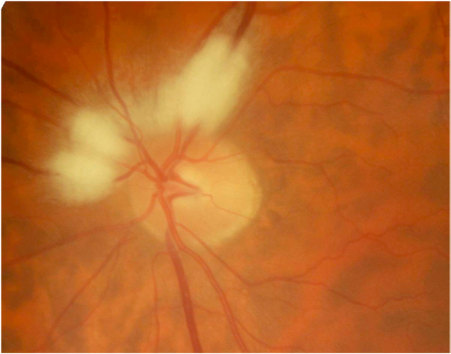

• Fig. 99.27 Myelinated nerve fiber layer: just above and nasal to the optic nerve head, the white, feathery appearance of the myelinated nerve fibers is seen. These myelinations will be above the vessels. These are benign findings and rarely progress.

## PDF page 2044 | printed page 2053

• Fig. 99.28 Retinoblastoma: white, calcific retinoblastoma filling the eye, the retinal vessels seen over the lesion; the retina has detached completely secondary to the tumor.

symptoms identical to those of congenital glaucoma. With extension into the anterior chamber, an opaque layer of leukocytes (pseudo-hypopyon) or spontaneous bleeding (hyphema) can occur. With exophytic growth, retinal detachment can be the presenting sign. Proptosis is a late finding. Massive necrosis of the tumor can cause a picture mistaken for orbital cellulitis. Hence a fundus examination should be part of any work-up of orbital cellulitis. The diagnosis of retinoblastoma is made noninvasively by exam under anesthesia with ophthalmoscopy, orbital ultrasound, and fluorescein angiography. Calcification identified within the eye on CT scan, ultrasound, and MRI findings helps to confirm the diagnosis.45 The differential diagnosis may be exceedingly difficult if the tumor is advanced or atypical, and enucleation may be required for histologic study and positive identification. Other lesions that rarely can simulate retinoblastoma in neonates are coloboma of the fundus, congenital retinal fold, retinal dysplasia, persistent hyperplastic primary vitreous, retinoschisis, retinal detachment, organized vitreous hemorrhage, or scarring from ROP.

The treatment of retinoblastoma is determined by its size and location. Treatment of retinoblastoma involves a team approach between pediatric oncologists, radiologists, and ophthalmologists. The most significant factor in the prognosis is the stage of disease when treatment is instituted. When retinoblastoma is limited to the eye, 98% of patients can expect a 5-year, disease-free survival.45 If the retinoblastoma remains in the optic nerve anterior to the lamina scleralis, the prognosis is good. Extraocular involvement, including trilateral retinoblastoma, hematogenous spread to the liver and bone, or direct spread to the optic nerve, indicates a very poor prognosis.

Local treatment modalities for early, small tumors include photocoagulation, plaque radiotherapy, trans-pupillary thermotherapy, and cryotherapy. For more advanced tumors, primary systemic chemotherapy is followed by local consolidation with the same treatment modalities as above (photocoagulation,

etc.). Enucleation continues to be a treatment modality that is often used in unilateral advanced retinoblastoma to avoid chemotherapy. Selective intra-arterial chemotherapy is a novel therapeutic approach that has become widely used in recent years, as an enucleation-sparing procedure. Long-term sequelae of this technique are yet to be studied.45 With extension beyond the globe, the cure rate is reduced. Chemotherapy is used in this case to prevent metastatic disease. Patients with the familial form of retinoblastoma also are at risk for developing secondary malignancies.45 The most common secondary malignancy is osteogenic sarcoma, usually occurring in the second decade. Pinealoblastoma forms the third part of what is called trilateral retinoblastoma. This malignancy usually occurs during the first 4 years of life.

### Astrocytic Hamartoma

Astrocytic hamartomas can be found infiltrating the optic nerve or in the retina. They occur in 50% of patients with tuberous sclerosis and are bilateral in 30% of those.46 The most common type appears as a smooth, flat, salmon-colored lesion that is either round or oval shaped. It is semitransparent and located in the superficial posterior pole of the retina. Astrocytic hamartomas consist of astrocytes, calcium, and amorphous material. They may demonstrate auto-fluorescence in angiography. Visual function is often normal unless the optic disc or the macula is affected. As they typically do not grow or affect vision, treatment is not needed. They may be an isolated phenomenon in 30% of cases. Calcified hamartomas may be seen in the basal ganglia and ventricles on MRI. Larger tubers may be seen in the cortical gray matter. The diagnosis of tuberous sclerosis is based on clinical criteria and can be confirmed with molecular gene testing for chromosome 9q34 and chromosome 16p13. Astrocytic hamartomas can also be associated with neurofibromatosis type 1.

### Racemose Hemangioma

Racemose hemangiomas are rare arteriovenous anastomoses consisting of engorged retinal vessels entering the optic disc, then into the peripheral retina, and finally out of the optic disc. They are thought to be congenital abnormalities, but remodeling may occur over the years.47 About one-third are associated with Wyburn-Mason syndrome (arteriovenous malformations in the midbrain that are ipsilateral to a separate retinal lesion). Growth into the orbit can cause diplopia, proptosis that is usually nonpulsatile, orbital bruit, and conjunctival vascular dilatation.47 They are usually stable.

### Neuromuscular Abnormalities

### Strabismus

Strabismus or misalignment of the eyes is approached based on etiology.48 Horizontal deviations are the most frequent type of strabismus and can be further classified in esodeviations, eye deviated inward, and exodeviations (Fig. 99.29),

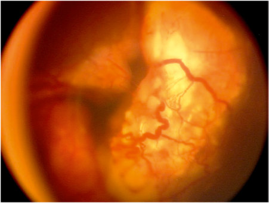

• Fig. 99.28 Retinoblastoma: white, calcific retinoblastoma filling the eye, the retinal vessels seen over the lesion; the retina has detached completely secondary to the tumor.

## PDF page 2045

• Fig. 99.29 Exotropia. The patient is fixing with the left eye while the right eye is drifting outward. It can also be easily identified via the corneal reflex, which is seen in the center of the pupil in the left eye while also seen in the nasal aspect of the iris in the right eye.

eye deviated outward. Vertical deviations are rare, and even more so in infancy. Both horizontal and vertical deviations could be comitant or incomitant. Comitant strabismus has the same amount of deviation in all gazes. In infancy, infantile exotropia and early intermittent exotropia are the most frequent types of comitant exodeviation. Congenital/infantile esotropia, early accommodative esotropia, esotropia associated with neurologic conditions or prematurity, and sensory esotropia are frequent forms of comitant esodeviation in infancy. Accommodative esotropia is secondary to exaggerated accommodative efforts in significant hyperopia or with vision directed at a near target. The oculomotor system requires a certain level of vision in both eyes to maintain ocular alignment. Therefore loss of vision in one or both eyes can result in a type of ocular misalignment known as sensory strabismus. If vision is lost in one or both eyes, an ocular misalignment may follow. Unilateral vision loss in the pediatric age group more often results in esodeviation, whereas exodeviation is the more frequently presenting type of strabismus in the adult population. It is paramount therefore to visualize the macula in evaluation of esotropia in infants. Retinoblastoma can manifest with sensory esotropia.

Incomitant deviations demonstrate variable angle amounts on various gaze positions and result from impairment of the globe movements secondary to muscular restrictions or muscular weaknesses. Fractures with entrapment of muscles or orbital tumors can cause restrictive strabismus. Cranial nerve palsies and congenital myasthenia gravis are the main causes for nonrestrictive incomitant strabismus in infants. In 4th cranial nerve palsy, compensatory head position to the opposite side along with incomitant vertical strabismus can be noticed as early as a few months of life. This condition needs to be differentiated from more common muscular torticollis, as strabismus surgery done in a timely fashion is the correct treatment in 4th cranial nerve palsy and resolves compensatory head tilt. Other forms of incomitant strabismus—alphabet patterns, Duane syndrome, or Brown syndrome—are likely present at this age group but hard to diagnose given the low degree of cooperation.

To further complicate the evaluation of strabismus in infancy, there are two conditions that can be confused with

true strabismus. The first is a normally occurring small angle misalignment that lasts until the establishment of firm foveal fixation. This condition resolves with development of foveal fixation and binocularity and establishment of firm control of the eye movements; this type of misalignment leaves no long-term consequences. The second is pseudostrabismus, which can be either pseudoesotropia or pseudoexotropia. In pseudoesotropia, the large nasal bridge, prominent epicanthal folds, or other configurations of the face in the infant can create an appearance of inward deviation of one or both eyes. Symmetric red reflexes and corneal light reflexes with no eye shift at the cover–uncover test differentiate pseudoesotropia from true esotropia. It is important to remember that epicanthal folds may exist with true esotropia, and if there is an intermittent esotropia, the eye may be straight on one examination. Infants with severe ROP causing a dragging of the macula may appear to have strabismus when the dystopic maculae are aligned. Pseudoexotropia is seen in orthotropic eyes with hypertelorism (wide-set eyes) or positive angle kappa, as in high myopia, temporally displaced macula or macular dragging (seen in advanced ROP and toxocariasis). Again, no shift in cover-uncover test is elicited in these cases. Treatment of strabismus is done by a pediatric ophthalmology specialist after a complete eye examination, including careful cycloplegic refraction and dilated fundus exam. Surgery is the main treatment in infantile esotropia and is performed after correction of significant refractive errors and treatment of associated amblyopia. This approach maximizes the chance of stable surgical alignments of the eye. Surgery should be undertaken early to increase the chance of binocular cooperation (between 4 and 6 months in healthy infants).

### Nystagmus

Nystagmus consists of rhythmic oscillations of the eyes. Nystagmus can be unilateral or bilateral; it can be horizontal, vertical, torsional, or a combination of the above. In jerk nystagmus, one direction of the ocular excursion is faster than the other, whereas pendular nystagmus manifests equal speed in both directions. Nystagmus is said to be infantile (infantile nystagmus syndrome, INS) if onset is before 6 months of age and acquired after that. Documenting the direction (horizontal, vertical, or torsional), frequency (mild, moderate, or fast), amplitude (small, moderate, or large), laterality (one or both eyes), and associated head positioning is useful to help guide the possible underlying cause of the nystagmus and guide the treatment. In infancy, nystagmus can be divided into nystagmus secondary to poor vision, nystagmus associated with neurologic anomalies, and various types of congenital/infantile nystagmus. Optic nerve atrophy, hypoplasia, or severe optic nerve anomalies along with early-onset retinal dystrophies or macular scars are the main causes for nystagmus associated with poor vision in infancy, and generally pendular type nystagmus is seen with these conditions. ERG or brain imaging using MRI are required for further characterization of these

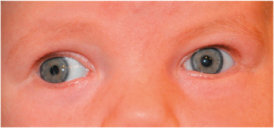

• Fig. 99.29 Exotropia. The patient is fixing with the left eye while the right eye is drifting outward. It can also be easily identified via the corneal reflex, which is seen in the center of the pupil in the left eye while also seen in the nasal aspect of the iris in the right eye.

## PDF page 2046 | printed page 2055

conditions. Brain imaging is also necessary in nystagmus associated with neurologic findings. Infantile nystagmus syndrome (INS) is diagnosed based on clinical characteristics, seemingly unaffected vision, and absence of other neurologic signs. No brain imaging is necessary if a diagnosis of INS is established. However, in spasmus nutans (triad of unilateral nystagmus, head nodding, and torticollis) brain imaging is mandatory. Both nystagmus of spasmus nutans and that caused by a chiasmal glioma share similar characteristics—both display a seesaw pattern with a torsional component. Hence the benign nature of spasmus nutans can be demonstrated only retrospectively after disappearance (usually within 2 years).49

### Opsoclonus

Opsoclonus is a striking ocular motility disorder characterized by involuntary, chaotic bursts of multidirectional, high-amplitude saccades without an inter-saccadic interval. When the oscillations are clinically horizontal, they are termed ocular flutter. Hoyt et al. have reported that opsoclonus may occur as a transient phenomenon in healthy neonates. In this case, this phenomenon disappears by 6 months of age.

The major diagnostic consideration for opsoclonus in the first several years of life is a neural crest tumor such as neuroblastoma. Neuroblastoma is found in approximately half of cases with opsoclonus in this age range. Opsoclonus also occurs commonly as a part of a “benign” encephalitis (Kinsbourne myoclonic encephalopathy, dancing eyes, and dancing feet).50

### Amblyopia

Amblyopia represents an uncorrectable-with-glasses decrease in vision in one or both eyes with no apparent structural abnormality of the eye to explain it. It is a consequence of various organic processes that interfere with development of vision during a critical young age. Amblyopia can develop at any time during the “sensitive period” of visual development, usually during the first 7 years in humans, and can be treated if discovered within this same time frame of plasticity. When a diagnosis of amblyopia is made, other organic causes need to be excluded. Even if organic causes are present, the amblyopia might still be partially responsive for the decrease in vision and is important to treat in a timely manner for a better success rate. The main causes are strabismus, refraction, occlusion, and visual deprivation.

Strabismic amblyopia occurs in children who first develop strabismus and then favor one eye. The constantly deviated eye will then develop amblyopia; hence, strabismic amblyopia is always unilateral. Refractive amblyopia results from large refractive errors that create significant blurry vision. This can be a bilateral or unilateral process.

Deprivation amblyopia is caused by opacities in the visual axes, such as cataracts or corneal scars or macular and optic nerve conditions. If the visual obstruction is not cleared by

3 or 4 months of age, the amblyopia becomes very dense and unresponsive to treatment—hence the urgency to identify and treat congenital cataracts.

Treatment of underlying causes of amblyopia is important for the success of therapy. Various methods of visual penalization are applied to the good-seeing eye in the treatment of monocular amblyopia. Patching is the oldest and most often used method in all forms of monocular amblyopia. Topical application of atropine eye drops on a daily basis can be used as first-line therapy in monocular moderate amblyopia or as a second-line treatment in patch failure. Other methods of penalization are described and available. If bilateral amblyopia is present because of high refractive error, glasses are prescribed.

### The Blind Infant

The definitions of blindness that are used in literate children (legal blindness: Snellen visual acuity <20/200 or visual field <20 degrees) are not applicable to infants. Also, vision in this age is normally very low and changing rapidly. The majority of tests used to estimate vision in infants give, at the most, 20/400 vision at birth and vision less than 20/40 by 1 year of age. For these reasons, a more appropriate term at this age is apparent blindness. This is suggested by history and examination clues: absence of any light reaction including no pupillary reaction, absent eye movements, nystagmus early in life, searching eye movements, oculodigital sign, paradoxical pupillary reaction (dilation with light), staring at bright lights, and waving of hands between the eyes and a light source. Important medical history details include a history of prematurity, perinatal hypoxia, and a family history of blindness at a young age. Three major causes for blindness at this young age are obvious eye malformations, anterior visual pathways disease (retina, optic nerve, chiasm) that can be subtle, and cerebral visual impairment. An external abnormal eye is occasionally a quick diagnosis when microphthalmos, bilateral white cataract, corneal opacities, advanced ROP, persistent fetal vasculature, or retinoblastoma are present. For the subtler cases of anterior visual pathway disease versus cerebral visual impairment, nystagmus can be the distinguishing factor, because it is normally present in the former and absent in the latter. Optic nerve conditions require further MRI of the brain to characterize. Nystagmus and no optic nerve pathology indicate ERG to demonstrate the presence of retinal dystrophy. The possibility of cerebral visual impairment suggested by normal structure of the eye and no nystagmus can be confirmed with normal vestibulo-ocular response (VOR) with prolonged “after” nystagmus. History of prematurity in this scenario suggests a form of cerebral visual impairment, namely periventricular leukomalacia that can be confirmed with MRI of the brain. Absence of VOR and nystagmus suggests the presence of congenital motor apraxia, bilateral Duane syndrome, or Möbius syndrome, when the baby cannot move the eye but vision may still be good. Likewise, after a generalized seizure, the movements of the eye or reaction to

## PDF page 2047

visual stimuli can be suppressed and simulate blindness with recovery after the postictal period.51

### Eye Findings in Chromosomal Syndromes

Chromosomal anomalies involve significant alteration of genetic materials with multiple genes being affected simultaneously. However, genes that control the development and function of the eye are spread on multiple chromosomes. Therefore it is not surprising that the majority of chromosomal anomalies involve the eye in some form. Following is a selection of eye features that are important, given the frequency or severity.

### Trisomy 21

Ocular findings associated with Down syndrome are extensive. Because of this, children with Down syndrome should be examined by an ophthalmologist during infancy and periodically after that. From front to back, the eye findings are as follows: significant refractive errors, amblyopia, nystagmus, strabismus, nasolacrimal duct obstruction, epicanthus, telecanthus, upward slant of palpebral fissures, blepharitis, keratoconus, glaucoma, iris nodules (Brushfield spots), cataract, and optic nerve swelling. Caution should be exercised when using dilating drops in these children, because they can have an exaggerated systemic reaction to atropine, and atlanto-axial instability can induce a risk in case of neck hyperextension.

### Trisomy 13

Ocular findings are present in 90% of Patau syndrome subjects.52 Intraocular cartilage found at histopathology is virtually pathognomonic for trisomy 13.52 Typical inferonasal iris coloboma with sectoral cataract in the same location is highly suggestive of this syndrome. Other eye features in this syndrome are microphthalmia, cyclopia, short/slanted palpebral fissures, ptosis, hypertelorism, corneal opacities, luxation of the lens, coloboma of the lens, persistent tunica vasculosalentis, persistent fetal vasculature (formerly known as persistent hyperplastic primary vitreous), typical coloboma of the choroid, and retinal dysplasia.52

### Trisomy 18

The most common eye anomalies in Edwards syndrome include epicanthus, hypertelorism, and hypoplastic supraorbital ridges. Ankyloblepharon filiforme adnatum (strands joining the upper and lower lids together) is very suggestive of trisomy 18. Less frequently, strabismus, cyclopia, colobomatous microphthalmia, microcornea, corneal opacities, congenital glaucoma, posterior subcapsular cataract, and retinal depigmentation are present in this syndrome.

### 11p Abnormalities

The PAX6 gene on the short arm of chromosome 11 is the master regulator of the development of the eye. Any defect in the PAX6

gene can therefore result in a range of ocular dysgenesis conditions, the most common of which is aniridia. The adjacent WT1 gene on the 11p13 locus may be simultaneously affected by the mutation affecting PAX6, which results in WAGR syndrome (aniridia, Wilms tumor, genitourinary abnormalities, and mental retardation).32 PAX6 mutation can be sporadic (occurring de novo), autosomal dominant, or autosomal recessive. Autosomal dominant mutations are the most common (85%), with complete penetrance and variable expressivity, clinically presenting as variable degrees of aniridia among members of the same family. Sporadic mutations are less common (13%–33%) and are associated with WAGR syndrome. Ophthalmic examination of family members is therefore extremely important. Genetic testing of a child with aniridia, especially if no other family members are affected, is essential. Periodic long-term evaluation for Wilms tumor with abdominal ultrasound is a must for those with sporadic mutations.

### 13q Abnormalities

The most important possible finding that requires a comprehensive retinal examination is retinoblastoma. The retinoblastoma gene is a tumor suppressor gene that is lost in 13q deletion. That creates a situation in which cells throughout the body have only one copy of the tumor suppressor gene and are vulnerable to lose that copy and start developing tumors, among them retinoblastoma, which tends to be bilateral and start at a young age. Other ocular abnormalities are almost always present and severe, including microphthalmia, iris and choroidal colobomas, ptosis, cataracts, and down-slanting palpebral apertures and epicanthus.

### Turner Syndrome

Strabismus, ptosis, congenital cataracts, and occasionally corneal nebulae and blue sclerae in the neonatal period have been described as being associated with Turner syndrome.

### Eye Findings in Craniofacial Syndromes

Eye abnormalities can be associated with congenital anomalies of the face, skull, or head in both craniosynostotic and nonsynostotic forms.

### Craniosynostosis Syndromes

There is well-defined eye involvement in craniosynostosis syndromes that requires careful follow-up and management. Proptosis is secondary to maldeveloped, small orbits and can further be complicated by lagophthalmos, exposure keratopathy, or globe subluxation. Globe subluxation, when the globe protrudes anteriorly to the eyelids, is an ocular emergency that needs to be treated by the caregiver or medical personnel immediately to avoid optic nerve ischemic damage with permanent vision loss. One approach for globe subluxation is to place a finger on the visible conjunctiva in the interpalpebral area and apply firm pressure until the globe

## PDF page 2048 | printed page 2057

is behind the eyelids. This approach avoids damage to the cornea. Lagophthalmos with exposure keratopathy and a possible corneal scar is another cause of vision loss requiring an aggressive approach consisting of frequent lubrication, moist chamber, taping the eyelids closed at night, and tarsorrhaphy. The definitive treatment of lagophthalmos is orbital expansion. The optic nerve can develop edema or atrophy. Edema is secondary to increased intracranial pressure, secondary to difficult expansion of the cranium, and less often because of compressive optic neuropathy in a tight optic canal. Optic atrophy is the end result of longstanding optic nerve edema. Strabismus is a common occurrence in craniosynostosis, with V pattern exotropia and inferior oblique overaction seen as characteristic types.

Because of comparable cranial and orbital anomalies, eye findings can be similar in the other craniosynostosis syndromes such as Crouzon syndrome, Apert syndrome,53 Saethre-Chotzen syndrome, and Pfeiffer syndrome.

### Hemifacial Microsomia

Ocular manifestations can range from clinical anophthalmia to minor fissure asymmetry. Goldenhar syndrome is probably a variant of this group, with characteristic limbal dermoids and orbital lipodermoids. Limbal dermoids are reported more frequently than lipodermoids and are occasionally bilateral. Another common finding is an upper eyelid coloboma, almost always on the more affected side. Less frequent findings are Duane syndrome and microphthalmia.54

### Terminal Transverse Defects With Orofacial Malformations and Oromandibular-Limb Hypogenesis

These are a heterogeneous collection of syndromes with a wide variety of facial and limb anomalies; they include Möbius syndrome. The minimal findings of this syndrome are abduction weakness (cranial nerve 6 palsy) and facial nerve palsy, with frequent limb and tongue anomalies.

### Pierre Robin Sequence

The Pierre Robin sequence is characterized by micrognathia, glossoptosis, and cleft palate. Pierre Robin sequence can occur in isolation or be part of a syndrome. About 10% of patients with Pierre Robin sequence have Stickler syndrome as well, with the additional features of high myopia, propensity for retinal detachment, cataracts, deafness, and arthritis.55

### Waardenburg Syndrome

Waardenburg syndrome is transmitted as an autosomal dominant trait and has been divided into four types based on clinical attributes. The most common is Waardenburg syndrome type 1. It is associated with lateral displacement of the medial canthi (i.e., telecanthus), abnormal position of the lacrimal puncta, coalescing of eyebrows (i.e., synophrys),

white forelock, heterochromia irides, retinal pigmentary changes, and sensorineural deafness.

### Cornelia de Lange Syndrome

The typical facial appearance in infants with Cornelia de Lange syndrome is a low hairline, synophrys, long eyelashes, and a small upturned nose. Eye disorders, which are less frequently encountered, include hypertelorism and downslanting palpebral fissures, dacryostenosis, strabismus, nystagmus, ptosis, severe myopia, and pupillary abnormalities.56

### CHARGE Association

This heterogeneous group of anomalies (colobomas, (heart defects, choanal (atresia, (restricted growth, (genital hypoplasia, and (ear malformations) presents with typical coloboma of the optic nerve, choroid, or iris in the inferior nasal direction. Other eye involvements have been described: microphthalmia, refractive errors, and vertical strabismus.1

### Deformation Syndromes

Congenital deformations resulting from intrauterine restraints are common and may involve craniofacial structures. Congenital torticollis is one of the deformation syndromes that can have ophthalmic implications, because it may be confused with superior oblique palsy with compensatory head posture.

### Eye Findings in Neurocutaneous Disorders (Phakomatoses)

Eye findings are important manifestations in phakomatoses, which are a group of disorders featuring discrete hamartomas in multiple organ systems including the skin and the brain. Four disorders have been designated as classic phakomatoses with other conditions sometime included as well. From the four classic phakomatoses—neurofibromatosis, tuberous sclerosis, encephalotrigeminal angiomatosis, and retinal angiomatosis— only the first three are active in infancy or early childhood.

### Neurofibromatosis

Neurofibromatosis (NF) is described in two types. Both NF type 1 and 2 are autosomal dominant genetic conditions with high penetrance and high spontaneous mutation rates. NF1 (von Recklinghausen disease) is characterized by melanocytic and glial cell lesions distributed in the brain, skin, and eye. The occurrence of these lesions is highly age dependent, with some features that present early in life with stabilization or regression, and other features that start late with subsequent progression throughout life. Overall, NF1 is rarely diagnosed in neonates. Early ophthalmic manifestations of NF1 are plexiform neurofibroma of the upper eyelid, glaucoma, optic nerve glioma, and sphenoid dysplasia. Neuroimaging should be obtained in patients with ocular pulsations, neurofibromas of the eyelid,

## PDF page 2049

afferent pupillary defect, or optic nerve swelling. Plexiform neurofibroma in the area suggests a 50% risk for glaucoma. Progressive enlargement of the globe or buphthalmos is seen if glaucoma with high intraocular pressure is present before 2 years of life. Optic nerve glioma, although rare with a rate of up to 5%, is an important cause of morbidity and mortality in NF1. Iris Lisch nodules that are often sought to help in early diagnosis are rarely seen in infants and in only a 25% minority by 2 years with presence in 90% by puberty.57 Despite this, Lisch nodules are valuable features as they have a tendency to be present before the hallmark lesion of NF1, nodular neurofibromas of the skin. NF2 is less common than NF1 and has the hallmark lesion of bilateral eighth nerve tumors, hence the name of central NF. Early-onset posterior subcapsular or wedge-shape cataracts have been described in NF2.

### Encephalofacial Angiomatosis (Sturge-Weber Syndrome)

As the name implies, this condition encompasses angiomas of the facial skin with ipsilateral leptomeningeal vascular malformation. There is no apparent hereditary pattern. Ocular complications of Sturge-Weber syndrome include glaucoma, which affects 30% to 75% of patients, and chorioretinal angioma. Glaucoma can present in two types, one of them resembling congenital glaucoma, with enlargement of the globe, high myopia, and amblyopia. The associated choroidal angioma is usually indistinct and difficult to visualize without indirect ophthalmoscopy. If present, it may lead to macular edema and decreased visual acuity.

### Tuberous Sclerosis (Bourneville Disease)

Hamartomas of the brain that cause seizures and mental retardation associated with hamartomas in the eyes, kidney, heart, lungs, and skin are the hallmarks of this autosomal condition. The spontaneous rate of mutation is very high, similar to that with NF. Retinal lesions, called astrocytic hamartomas (or phakomas), have one of two distinct appearances. Phakoma type 1 is seen at a very young age and has the appearance of gray-white nodules with a smooth, flat surface and indistinct borders. Consequently, these lesions are difficult to visualize, and special techniques are used on indirect ophthalmoscopy to avoid missing the early lesions.

### Ocular Trauma

Two types of eye trauma are seen only in this age group: birth trauma and shaken baby syndrome. Accidental contusions and lacerations may occur as well but are much less common in infancy than later in life because of decreased mobility.

### Birth Trauma

Birth trauma to the eyes is associated with the duration of labor and difficulty of delivery. Lid petechiae and

hemorrhages, observed more often with face presentations than with vertex presentations, usually resolve rapidly without treatment. Subconjunctival hemorrhages are also common and require no treatment. Such findings, however, should increase the suspicion of associated intraocular injuries.

Retinal hemorrhages are common after delivery, occurring in 78% of newborns after vacuum delivery, 30% after normal vaginal delivery or with forceps assists, and only 8% after cesarean delivery.58 These retinal hemorrhages are usually small, multiple, and scattered throughout the retina; they may persist for months and must be considered in the differential diagnosis of suspected nonaccidental trauma (shaken baby syndrome).58 Bleeding into the orbital contents (retrobulbar hemorrhage) can result from birth trauma. This bleeding produces a unilateral proptosis that tends to increase gradually in size during the first 3 or 4 hours after birth. Ecchymosis of the lids can be associated findings immediately or 1 to 2 days later. The differential diagnosis includes dermoid cysts, teratomas, and other congenital tumors of the orbit. The hematoma usually absorbs spontaneously over 1 to 2 weeks. It is important during this time to ensure that the cornea is not dry from exposure or abraded and that the retinal circulation is not compromised. A detailed fundoscopic exam is indicated, and if it shows impairment of arterial or venous circulation, immediate surgical decompression of the orbit is required. Forceps deliveries, particularly when associated with improper application, can produce bruises and lacerations of the lid or globe. A forceps mark or lid laceration requires a careful and complete examination of the orbit and globe for associated injuries. Forceps application can produce a rupture in the cornea’s endothelial basement membrane (Descemet membrane). Seen with magnification, these ruptures appear as vertical lines in the posterior portion of the cornea. They can lead to rapid corneal edema (hydrops) because of compromised water pump mechanism of the endothelium, with a cloudy appearance that must be differentiated from other congenital corneal opacities. Children with Descemet membrane ruptures can develop astigmatism and dense amblyopia. Traumatic forceps delivery has been known to cause a variety of other ocular injuries, including Purtscher retinopathy, choroid ruptures, and traumatic optic neuropathy. Ocular injury in the newborn has also been reported as a result of fetal monitors, surgical instruments, phototherapy lights, prenatal maternal injury, and amniocentesis.

### Shaken Baby Syndrome

Forceful, repeated back and forth movement of the head can result in devastating and blinding ocular injuries. Characteristic hemorrhages involve preretinal, intraretinal, and subretinal spaces; are numerous; and extend in the far periphery of the fundus.

## PDF page 2050 | printed page 2059

Dome-shaped hemorrhagic lesions with white borders represent hemorrhagic retinoschisis and when associated with characteristic hemorrhages are said to be diagnostic of shaken baby syndrome. The retina can even be folded in a circumferential manner along the vascular arcades surrounding the macula, another finding highly suggestive of shaken baby syndrome. Retinal hemorrhages may resolve without sequelae, but involvement of the optic nerve, macula, or occipital cortex can produce profound lifelong visual loss.59 The extent and type of retinal hemorrhages that occur in shaken baby syndrome can be pathognomonic of the syndrome and may support the legal prosecution of the offender (see Fig. 99.23).59 Accidental head trauma and cardiopulmonary resuscitation in infants do not result in the type and extent of retinal hemorrhage seen in shaken baby syndrome.59

### Neonatal Ocular Infections

### Neonatal Conjunctivitis (Ophthalmia Neonatorum)

Neonatal conjunctivitis represents inflammation or infection of the conjunctiva in the neonatal period. What makes an otherwise benign condition a public health concern requiring prophylaxis at birth in all neonates is the possibility of long-term vision loss and systemic associated conditions. Neonatal conjunctivitis is the most common infection in the first month of life with incidence from 1% to 24%.60 The four categories of neonatal conjunctivitis are chemical, bacterial, chlamydial, and viral. Conjunctival injection, chemosis, discharge, and eyelid edema can occur with all subtypes of neonatal conjunctivitis. Clinical history, most importantly prenatal history, and clinical elements such as character of the discharge, presence of chemosis and membranes, or skin vesicles can suggest the specific etiology and direct laboratory testing.

Chemical conjunctivitis occurs 1 to 2 days after instillation of silver nitrate 1% or other antibiotics for prophylaxis at birth. Typical chemical conjunctivitis is bilateral and has a low amount of purulence; the Gram stain shows no organisms, and it resolves spontaneously within 2 days. Alternative treatments for neonatal prophylaxis other than silver nitrate 1% include erythromycin ointment 0.5%, povidone iodine 2.5%, and tetracycline ointment 1%.

Chlamydial conjunctivitis is now a common infection in the neonatal period with higher rates in absent prenatal care. The infection is typically acquired from the mother as the child passes through the birth canal, although it can occur after cesarean section. This type of conjunctivitis develops typically in the second week of life with unilateral or bilateral mucopurulent discharge with possible pseudomembranes. Evolution is chronic with disappearance of discharge after weeks or months, but with the possibility of scarring of the conjunctiva or cornea and possibility of systemic spread and complications. The usual cultures and

Gram staining are unhelpful in the diagnosis of chlamydia because it is an obligate intracellular organism. Cell culture is the gold standard because of high specificity but is expensive. Diagnosis can be made more conveniently by Giemsa staining of a conjunctival scraping or by a variety of commercially available antibody or PCR tests. Chlamydial conjunctivitis is treated with erythromycin ointment three times a day for 2 to 3 weeks. Systemic antibiotics are necessary because chlamydia can cause pneumonia, otitis, or nasal congestion.60

Neisseria gonorrhoeae is an acute, severe, purulent conjunctivitis with an incubation period of 2 to 5 days. If N. gonorrhoeae is the cause of the conjunctivitis, immediate treatment with systemic and topical antibiotics is necessary. In cases of infection with organisms resistant to penicillin, a third-generation cephalosporin is indicated.

Ophthalmia neonatorum also can result from other common pathogens such as staphylococci, pneumococci, streptococci, or gram-negative bacteria. These bacterial infections usually appear several days after birth. Most respond well to topical antibiotics or ointment.

Older infants with chronic or recurrent mucous or purulent discharge usually have a blocked nasolacrimal duct as the underlying cause. The duct frequently opens spontaneously during the first year of life. Treatment with topical antibiotics and massage of the lacrimal sac can help resolve the problem.

### Ocular Manifestations of Intrauterine Infections

A number of intrauterine infections have important ophthalmic manifestations. These congenital infections are known by the acronym TORCH. These infections include toxoplasmosis, “other infections,” rubella, cytomegalovirus, and herpes simplex. The “other” designation is used for syphilis and varicella, as well as lymphocytic choriomeningitis virus. Some infections result from maternal infections that either cross the placental barrier or are transmitted during passage through the birth canal. Congenital toxoplasmosis manifests with necrotizing retinochoroiditis with associated vitritis and retinal vasculitis. These lesions result in chorioretinal scars characterized by white areas of exposed sclera circumscribed by well-defined darkly pigmented borders. Retinochoroiditis in toxoplasmosis is a recurrent condition; new lesions develop topically at the border of a scar, although it can develop in areas devoid of scar or in the other eye. Serologic confirmation of congenital infection is done by elevated IgM and IgA titers.61 Syphilis can affect most structures of the eye ranging from eyelid skin rash, orbital inflammation, interstitial keratitis, and various types of intraocular inflammation to cranial nerve involvement and central visual pathway involvement, including optic nerve atrophy and pupillomotor disturbances. The interstitial keratitis associated with congenital syphilis is a late finding, not apparent until after the age of 5 years.

## PDF page 2051

Treatment with penicillin in the neonatal period does not prevent later development of interstitial keratitis. The most common eye finding in lymphocytic choriomeningitis virus infection is generalized chorioretinal scars.61 Neonatal herpes infection is most often acquired during passage through the birth canal and can cause typical herpetic eye disease such as blepharoconjunctivitis, keratitis, iritis, or chorioretinitis. Ocular involvement with either congenital cytomegalovirus disease or varicella is unusual but can result in chorioretinitis, keratitis, or cataract. Timely treatment with systemic and topical antiviral agents (acyclovir IV 45 mg/kg/day plus vidarabine 3% ointment 5×/day for 14–21 days) is very important to avoid dissemination to the CNS and resultant encephalitis. Ocular involvement in congenital rubella is common, including microphthalmia, corneal haze, cataract, glaucoma, uveitis, and retinopathy. The characteristic “salt and pepper” retinopathy is the most common occurrence, but cataract is responsible for the greatest visual loss. The incidence of children with congenital human immunodeficiency virus (HIV) is decreasing dramatically with the advent of new drugs. Chorioretinitis secondary to various other infectious agents including herpes, CMV, and toxoplasma were described in this population.

### Preseptal and Orbital Cellulitis

The diagnosis of infective orbital cellulitis requires urgent evaluation and treatment to prevent rapid worsening with cavernous sinus thrombosis, cerebral abscess, osteomyelitis, and septicemia. Orbital cellulitis is the most common cause of proptosis in older children but is fortunately rare in neonates. Bacterial spread from paranasal sinuses is the main etiology with hematogenous or direct inoculation very infrequent at this age. The disease is characterized by the rapid onset of progressive proptosis, often with erythema of the lids, chemosis of the conjunctiva, limited motility, and systemic signs of toxicity and hyperpyrexia. Rapid loss of vision caused by compression of the orbital structures can occur and persist as a sequela if compression is not reversed in a timely manner. Afferent pupillary defect is a sign of compression in this setting. Diagnosis is made by clinical appearance and radiologic evaluation of the orbits and sinuses. Treatment includes admission to a hospital, CT scan of the orbits, intravenous administration of antibiotics, application of warm compresses, and surgical drainage of persistent orbital abscesses if necessary.62 At this early age, the subperiosteal fluid collection in the orbit has high likelihood of being devoid of bacteria and resolves with intravenous antibiotics only.62

In preseptal cellulitis, the infection is limited to the lids and does not extend past the orbital septum to involve the orbital contents. It is usually caused by streptococcal and staphylococcal bacteria. In older children, it can be treated on an outpatient basis with oral antibiotics, but in

infants, admission to the hospital for intravenous antibiotics is indicated. Widespread vaccination has dramatically decreased Haemophilus-associated orbital and preseptal cellulitis.

### Other Ocular Tumors in Infants

### Lymphatic Malformation (Lymphangioma)

Lymphatic malformations are slowly progressive, diffuse, soft tumors composed of thin-walled vascular channels that can involve the orbit, conjunctiva, and lids. They may be present at birth or develop during the first several years of life and cease growing by early adulthood. An upper respiratory tract infection and spontaneous hemorrhage may increase the size of the lesion and cause rapid proptosis. The tumors can also cause ptosis, strabismus, or anisometropia. Amblyopia is common and must be aggressively treated. MRI can be exceedingly helpful in diagnosing a lymphatic malformation. The lesion itself is difficult to treat because it does not regress spontaneously or respond to radiation or corticosteroid therapy. Surgery is rarely used, because results are not always satisfactory. Reports on using percutaneous sclerotherapy using interventional radiology techniques show promise in this difficult-to-treat tumor.63

### Teratoma

Teratoma is a primary orbital tumor composed of the three embryonic cell layers. It can differentiate into a variety of tissues containing cartilage, connective tissue, skin, hair, and sebaceous glands, or into endodermal epithelium. Bone is a common component and can be identified by CT. Orbital teratomas that are present at birth produce a striking massive proptosis. Treatment is early excision of the teratoma. Malignant transformation can occur but is rare in the orbit.

### Rhabdomyosarcoma

Rhabdomyosarcoma is the most common malignant tumor of the orbit in children although is rare in infants. Rhabdomyosarcoma develops in the orbit more often than elsewhere in the body. Orbital involvement produces proptosis that develops over a few weeks. Diagnosis is made by biopsy. Treatment involves chemotherapy and radiation therapy.

### Ocular Manifestations of Maternal Substance Abuse

An increasing number of infants are born bearing the physical, mental, and social consequences of maternal drug and alcohol abuse. Miller and colleagues described many of the ocular findings of fetal alcohol syndrome, including refractive errors, strabismus, anterior segment abnormalities,

## PDF page 2052 | printed page 2061

cataract, ptosis, long eyelashes, telecanthus, and optic nerve hypoplasia.64

Maternal ingestion of cocaine can result in optic nerve abnormalities, delayed visual maturation, and prolonged eyelid edema.65

Key Points

### • Ocular problems are very common in the neonatal

period, so a thorough examination with at least a simple pen light should be performed on every child.

### • Ocular findings can be the precursor of systemic find-

ings, and some specific ocular findings can lead to definitive diagnosis for many vague systemic findings. Ophthalmology consultation should be initiated for such guidance and possible ocular involvement.

### References

1. Aldakhil S. CHARGE syndrome associated with ocular abnor-

malities: a case report with treatment of amblyopia and refractive correction. Clin Optom (Auckl). 2021;13:303–307. https://doi. org/10.2147/OPTO.S335805. PMID: 34729028; PMCID: PMC8556721. 2. Edward DP, Kaufman LM. Anatomy, development, and physi-

ology of the visual system. Pediatr Clin North Am. 2003;50:1. 3. Curnyn KM, Kaufman LM. The eye examination in the pedia-

trician’s office. Pediatr Clin North Am. 2003;50:25. 4. Friedman LS, Kaufman LM. Guidelines for pediatrician

referrals to the ophthalmologist. Pediatr Clin North Am. 2003;50:41. 5. Papanagnu E, Brodsky MC. Is there a role for optokinetic nys-

tagmus testing in contemporary orthoptic practice? Old tricks and new perspectives. Am Orthopt J. 2014;64:1–10. https://doi. org/10.3368/aoj.64.1.1. 25313104. 6. Hagihara H, Ienaga N, Terayama K, et al. Looking represents

choosing in toddlers: exploring the equivalence between multimodal measures in forced-choice tasks. Infancy. 2021;26(1):148– 167. https://doi.org/10.1111/infa.12377. Epub 2020 Dec 19 33341103. 7. Fulton AB, et al. Development of rod function in term born and

former preterm subjects. Optom Vis Sci. 2009;86:E653. 8. Senthilkumar VA, Tripathy K. Marcus Gunn Jaw Winking Syn-

drome. [Updated 2022 Feb 21]. In: StatPearls [Internet]. Treasure Island (FL): StatPearls Publishing; 2022. https://www.ncbi. nlm.nih.gov/books/NBK559058/ 9. Osborne D, Theodorou M, Lee H, et al. Supranuclear eye

movements and nystagmus in children: a review of the literature and guide to clinical examination, interpretation of findings and age-appropriate norms. Eye (Lond). 2019;33(2):261–273. https://doi.org/10.1038/s41433-018-0216-y. Epub 2018 Oct 23. PMID: 30353137; PMCID: PMC6367391. 10. Gal P, et al. Efficacy of sucrose to reduce pain in premature

infants during eye examinations for retinopathy of prematurity. Ann Pharmacother. 2005;39:1029. 11. Isenberg SJ, et al. The pupils of term and preterm infants. Am J

Ophthalmol. 1989;15:75. 12. American Academy of Pediatrics; Section on Ophthalmology;

American Association for Pediatric Ophthalmology and

Maternal cigarette smoking has been identified as a risk factor for strabismus.66 As more information is gathered, additional evidence of the teratogenicity of various illicit drugs may be obtained.

### • Nystagmus, copious discharge that is refractory to broad-

spectrum topical antibiotics, poor red reflex, cloudy corneas, droopy eyelids, constant large misalignment of the eyes, and frank anatomic abnormalities of the eyes and the orbit require prompt pediatric ophthalmology consultation.

Strabismus; American Academy of Ophthalmology; American Association of Certified Orthoptists. Red reflex examination in neonates, infants, and children. Pediatrics. 2008;122:1401. Erratum in: Pediatrics. 2009;123:1254. 13. Alpay A, Canturk Ugurbas S, Aydemir C. Efficiency and

safety of phenylephrine and tropicamide used in premature retinopathy: a prospective observational study. BMC Pediatr. 2019;19(1):415. https://doi.org/10.1186/s12887-019-1757-3. PMID: 31690284; PMCID: PMC6833165. 14. Hentschel J, et al. Neonatal facial movements in the first min-

utes of life-eye opening and tongue thrust: an observational study. Am J Perinatol. 2007;24:611. 15. Kanukollu VM, Sood G. Strabismus. [Updated 2022 Feb 17].

In: StatPearls [Internet]. Treasure Island (FL): StatPearls Publishing; 2022. https://www.ncbi.nlm.nih.gov/books/NBK560782/ 16. Illouz F, Luton D, Polak M, et al. Graves’ disease and preg-

nancy. Ann Endocrinol (Paris). 2018;79(6):636–646. https:// doi.org/10.1016/j.ando.2018.08.004. Epub 2018 Aug 16 30224035. 17. Cline RA, Rootman J. Enophthalmos: a clinical review. Oph-

thalmology. 1984;91:229. 18. Lehalle D, Altunoglu U, Bruel AL, et al. Clinical delineation of

a subtype of frontonasal dysplasia with creased nasal ridge and upper limb anomalies: report of six unrelated patients. Am J Med Genet A. 2017;173(12):3136–3142. https://doi.org/10.1002/ ajmg.a.38490. 29136349. 19. Richieri-Costa A, Guion-Almeida ML. The syndrome of fron-

tonasal dysplasia, callosal agenesis, basal encephalocele, and eye anomalies—phenotypic and aetiological considerations. Int J Med Sci. 2004;1:34. 20. Lin LK, Martin J. State of the art in congenital eyelid defor-

mity management. Facial Plast Surg. 2016;32(2):142–149. https://doi.org/10.1055/s-0036-1581049. Epub 2016 Apr 20 27097135. 21. Méjécase C, Nigam C, Moosajee M, Bladen JC. The genetic and

clinical features of foxl2-related blepharophimosis, ptosis and epicanthus inversus syndrome. Genes (Basel). 2021;12(3):364. https://doi.org/10.3390/genes12030364. PMID: 33806295; PMCID: PMC7998575. 22. Eymard B, Hantaï D, Estournet B. Congenital myasthenic syn-

dromes. Handb Clin Neurol. 2013;113:1469–1480. https://doi. org/10.1016/B978-0-444-59565-2.00016-2. 23622369.

## PDF page 2053

23. Tran AQ, Choi CJ, Wester ST. Beta blockers in the treatment

of periocular infantile hemangiomas: a review. Intern Med Rev (Wash D C). 2016;2(9):221. https://doi.org/10.18103/imr. v2i9.221. PMID: 32318646; PMCID: PMC7172575. 24. Kim JH, Lam JM. Paediatrics: how to manage infantile hae-

mangioma. Drugs Context. 2021;10. https://doi.org/10.7573/ dic.2020-12-6. 2020-12-6. PMID: 33889196; PMCID: PMC8029639. 25. Inoue K, Shiokawa M, Higa R, et al. Adverse periocu-

lar reactions to five types of prostaglandin analogs. Eye (Lond). 2012;26(11):1465–1472. https://doi.org/10.1038/ eye.2012.195. Epub 2012 Oct 5. PMID: 23037910; PMCID: PMC3496108. 26. Vagge A, Ferro Desideri L, Nucci P, et al. Congenital nasolacrimal

duct obstruction (CNLDO): a review. Diseases. 2018;6(4):96. https://doi.org/10.3390/diseases6040096. PMID: 30360371; PMCID: PMC6313586. 27. Davies R, Watkins WJ, Kotecha S, Watts P. The presentation,

clinical features, complications, and treatment of congenital dacryocystocele. Eye (Lond). 2018;32(3):522–526. https:// doi.org/10.1038/eye.2017.235. Epub 2017 Oct 27. PMID: 29075016; PMCID: PMC5848278. 28. Bar-Aluma BE. Familial Dysautonomia[Updated 2021 Nov 4]

In: Adam MP, Ardinger HH, Pagon RA, et al., eds. GeneReviews® [Internet]. Seattle (WA): University of Washington, Seattle; 2003:1993–2022. https://www.ncbi.nlm.nih.gov/books/ NBK1180/ 29. Chassaing N, Causse A, Vigouroux A, et al. Molecular findings

and clinical data in a cohort of 150 patients with anophthalmia/ microphthalmia. Clin Genet. 2014;86(4):326–334. https://doi. org/10.1111/cge.12275. Epub 2013 Oct 7 24033328. 30. Saleh GM, Hussain B, Verity DH, Collin JR. A surgical strategy

for the correction of Fraser syndrome cryptophthalmos. Ophthalmology. 2009;116(9):1707–1712.e1. https://doi.org/10.1016/j. ophtha.2009.05.018. Epub 2009 Jul 29 19643480. 31. Yang N, Zhao LL, Liu J, et al. Nanophthalmos: an update on

the biological parameters and fundus abnormalities. J Ophthalmol. 2021:8853811. https://doi.org/10.1155/2021/8853811. Mar 11;2021. PMID: 33777447; PMCID: PMC7972840. 32. Tripathy K, Salini B. Aniridia. [Updated 2022 Feb 21]. In: Stat-

Pearls [Internet]. Treasure Island (FL): StatPearls Publishing; 2022. https://www.ncbi.nlm.nih.gov/books/NBK538133/ 33. Sheeladevi S, Lawrenson JG, Fielder AR, Suttle CM. Global

prevalence of childhood cataract: a systematic review. Eye (Lond). 2016;30(9):1160–1169. https://doi.org/10.1038/ eye.2016.156. Epub 2016 Aug 12. PMID: 27518543; PMCID: PMC5023808. 34. Zhu H, Zhang Z. Emerging trends and research foci in cata-

ract genes: a bibliometric and visualized study. Front Genet. 2021;12:610728. https://doi.org/10.3389/fgene.2021.610728. PMID: 34434212; PMCID: PMC8381374. 35. Maia NC, Lima AL, Baikoff G. Avaliação da eficácia da facecto-

mia com implante de lente intra-ocular na infância [Efficacy of pediatric cataract extraction with intraocular lens implantation]. Arq Bras Oftalmol. 2005;68(6):735–741. Portuguese 17344972. 36. Wu WC, et al. Retinal phenotype-genotype correlation of pedi-

atric patients expressing mutations in the Norrie disease gene. Arch Ophthalmol. 2007;125:225. 37. Gilmour DF. Familial exudative vitreoretinopathy and

related retinopathies. Eye (Lond). 2015;29(1):1–14. https:// doi.org/10.1038/eye.2014.70. Epub 2014 Oct 17. PMID: 25323851; PMCID: PMC4289842.

38. Takkar B, Bansal P, Venkatesh P. Leber’s congenital amauro-

sis and gene therapy. Indian J Pediatr. 2018;85(3):237–242. https://doi.org/10.1007/s12098-017-2394-1. Epub 2017 Jul 7 28685406. 39. Ryabets-Lienhard A, Stewart C, Borchert M, Geffner ME. The

optic nerve hypoplasia spectrum: review of the literature and clinical guidelines. Adv Pediatr. 2016;63(1):127–146. https:// doi.org/10.1016/j.yapd.2016.04.009. 27426898. 40. Ward DJ, Connolly DJA, Griffiths PD. Review of the MRI brain

findings of septo-optic dysplasia. Clin Radiol. 2021;76(2):160. e1–160.e14. https://doi.org/10.1016/j.crad.2020.09.007. Epub 2020 Oct 2 33019967. 40a. Sevgi DD, Orge FH. Contractile morning glory disk anom-

aly: analysis of the cyclic contractions and literature review. J AAPOS. 2020;24(2):99.e91–99.e96. https://doi.org/10.1016/j. jaapos.2020.01.009. PMID: 32224283. 41. Lingam G, Sen AC, Lingam V, et al. Ocular coloboma—

a comprehensive review for the clinician. Eye (Lond). 2021;35(8):2086–2109. https://doi.org/10.1038/s41433-021- 01501-5. Epub 2021 Mar 21. PMID: 33746210; PMCID: PMC8302742. 42. Kalogeropoulos D, Ch’ng SW, Lee R, et al. Optic disc pit macu-

lopathy: a review. Asia Pac J Ophthalmol (Phila). 2019;8(3):247– 255. https://doi.org/10.22608/APO.2018473. 31179667. 43. Allegrini D, Pagano L, Ferrara M, et al. Optic disc drusen: a

systematic review: up-to-date and future perspective. Int Ophthalmol. 2020;40(8):2119–2127. https://doi.org/10.1007/ s10792-020-01365-w. Epub 2020 May 7 32383130. 44. Kera J, Fasiuddin AF. Ocular findings associated with myelin-

ated retinal nerve fibers. Cureus. 2021;13(4):e14552. https:// doi.org/10.7759/cureus.14552. PMID: 34017666; PMCID: PMC8130640. 45. Ortiz MV, Dunkel IJ. Retinoblastoma. J Child Neurol. 2016;

31(2):227–236. https://doi.org/10.1177/0883073815587943. Epub 2015 May 28. PMID: 26023180. 46. Zhang C, Xu K, Long Q, et al. Clinical features and optical

coherence tomography findings of retinal astrocytic hamartomas in Chinese patients with tuberous sclerosis complex. Graefes Arch Clin Exp Ophthalmol. 2020;258(4):887–892. https://doi. org/10.1007/s00417-019-04476-y. Epub 2020 Jan 2 31897702. 47. Ahmad Tarmizi NN, Bastion MC, Abdul Aziz RA, et al. Retinal

racemose hemangioma with optic neuropathy in a child. Cureus. 2021;13(8):e17620. https://doi.org/10.7759/cureus.17620. PMID: 34646671; PMCID: PMC8483998. 48. Hoyt CS, Taylor D. Pediatric Ophthalmology and Strabismus. 6th

ed. St Louis: Elsevier; 2022. 49. Papageorgiou E, McLean RJ, Gottlob I. Nystagmus in childhood.

Pediatr Neonatol. 2014;55(5):341–351. https://doi.org/10.1016/j. pedneo.2014.02.007. Epub 2014 Jul 31 25086850. 50. Blaes F, Dharmalingam B. Childhood opsoclonus-myoclonus

syndrome: diagnosis and treatment. Expert Rev Neurother. 2016;16(6):641–648. https://doi.org/10.1080/14737175.201 6.1176914. Epub 2016 Apr 27 27095464. 51. Brodsky MC, Marshall M. Parks memorial lecture: ocular

motor misbehavior in children: where neuro-ophthalmology meets strabismus. Ophthalmology. 2017;124(6):835–842. 52. Siliaeva NF. Eye developmental defects in Pataus syndrome (tri-

somy 13). Oftalmol Zh. 1990;7:423–426 ([in Russian]). 53. Ko JM. Genetic syndromes associated with craniosynosto-

sis. J Korean Neurosurg Soc. 2016;59(3):187–191. https://doi. org/10.3340/jkns.2016.59.3.187. Epub 2016 May 10. PMID: 27226847; PMCID: PMC4877538.

## PDF page 2054 | printed page 2063

54. Schmitzer S, Burcel M, Dăscălescu D, Popteanu IC. Gold-

enhar Syndrome - ophthalmologist’s perspective. Rom J Ophthalmol. 2018;62(2):96–104. PMID: 30206552; PMCID: PMC6117527. 55. Hsieh ST, Woo AS. Pierre Robin sequence. Clin Plast

Surg. 2019;46(2):249–259. https://doi.org/10.1016/j. cps.2018.11.010. Epub 2019 Feb 8. PMID: 30851756. 56. Shi A, Levin AV. Ophthalmologic findings in the Cornelia de

Lange syndrome. Ophthalmic Genet. 2019;40(1):1–6. https:// doi.org/10.1080/13816810.2019.1571617. Epub 2019 Feb 15. PMID: 30767692. 57. Cassiman C, Legius E, Spileers W, Casteels I. Ophthalmologi-

cal assessment of children with neurofibromatosis type 1. Eur J Pediatr. 2013;172(10):1327–1333. https://doi.org/10.1007/ s00431-013-2035-2. Epub 2013 May 25 23708214. 58. Hughes LA, et al. Incidence, distribution, and duration of birth-

related retinal hemorrhages: a prospective study. J AAPOS. 2006;10:102. 59. Reith W, Yilmaz U, Kraus C. Shaken-baby-syndrome [Shaken

baby syndrome]. Radiologe. 2016;56(5):424–431. https://doi. org/10.1007/s00117-016-0106-x. German 27118366. 60. Makker K, Nassar GN, Kaufman EJ. Neonatal conjunctivitis.

In: StatPearls [Internet]. Treasure Island (FL: StatPearls Publishing; 2021. 28722870.

61. Mets MB, Chhabra MS. Eye manifestations of intrauterine

infections and their impact on childhood blindness. Surv Ophthalmol. 2008;53(2):95–111. 62. Wong SJ, Levi J. Management of pediatric orbital cellulitis: a

systematic review. Int J Pediatr Otorhinolaryngol. 2018;110:123– 129. https://doi.org/10.1016/j.ijporl.2018.05.006. Epub 2018 May 8 29859573. 63. Cahill AM, et al. Percutaneous sclerotherapy in neonatal and

infant head and neck lymphatic malformations: a single center experience. J Pediatr Surg. 2011;46(11):2083–2095. 64. Miller MT, et al. Anterior segment anomalies associated with

fetal alcohol syndrome. J Pediatr Ophthalmol Strabismus. 1984;21:8. 65. Auger N, Rhéaume MA, Low N, et al. Impact of prenatal

exposure to opioids, cocaine, and cannabis on eye disorders in children. J Addict Med. 2020;14(6):459–466. https://doi. org/10.1097/ADM.0000000000000621. 31917733. 66. Yang Y, Wang C, Gan Y, et al. Maternal smoking during

pregnancy and the risk of strabismus in offspring: a metaanalysis. Acta Ophthalmol. 2019;97(4):353–363. https://doi. org/10.1111/aos.13953. Epub 2018 Nov 6 30402966.

<!-- SOURCE_LAYOUT_VIEWS -->

## Original layout views and recovered diagrams

Automatic extraction can flatten tables and superscripts. Check the original layout for numeric data, footnotes and image credits. [Source review notes](../../SOURCE_REVIEW_NOTES.md).

### Original source page 2019

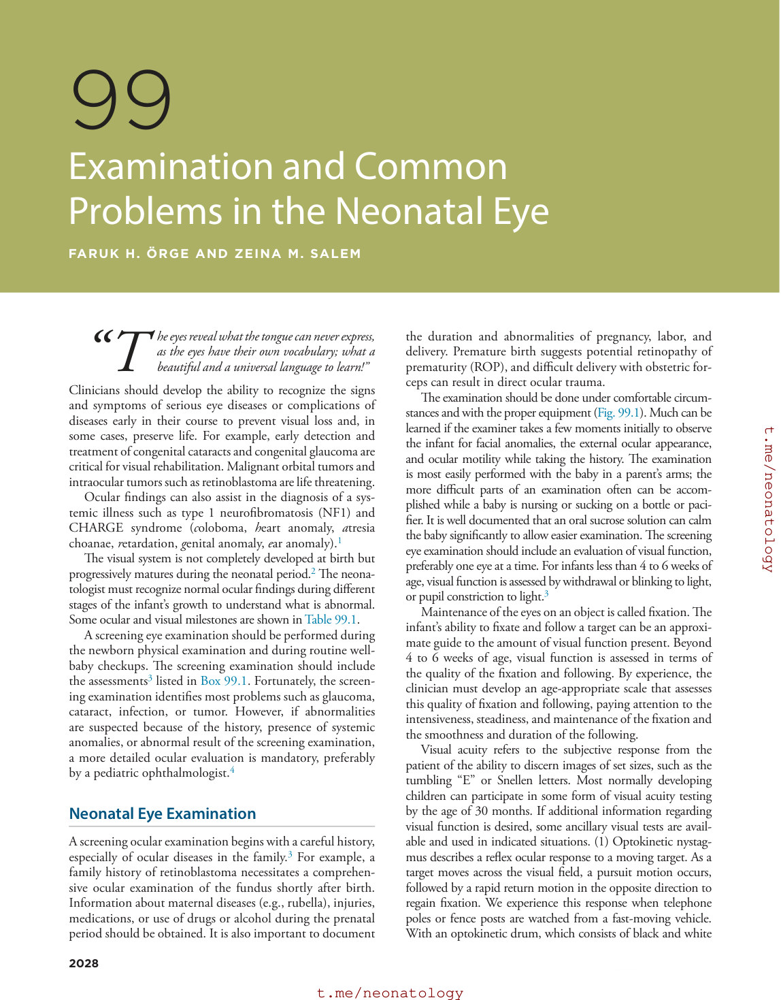

### Original source page 2020

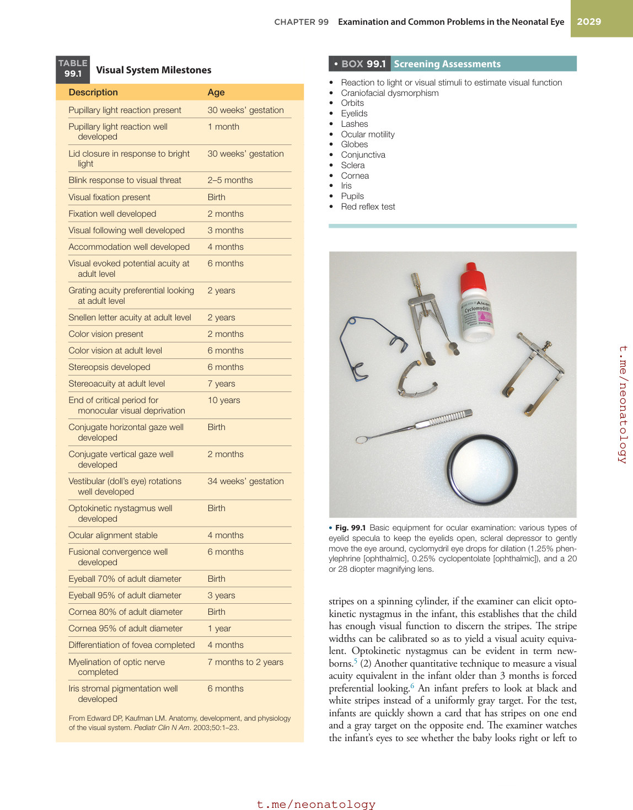

### Original source page 2021

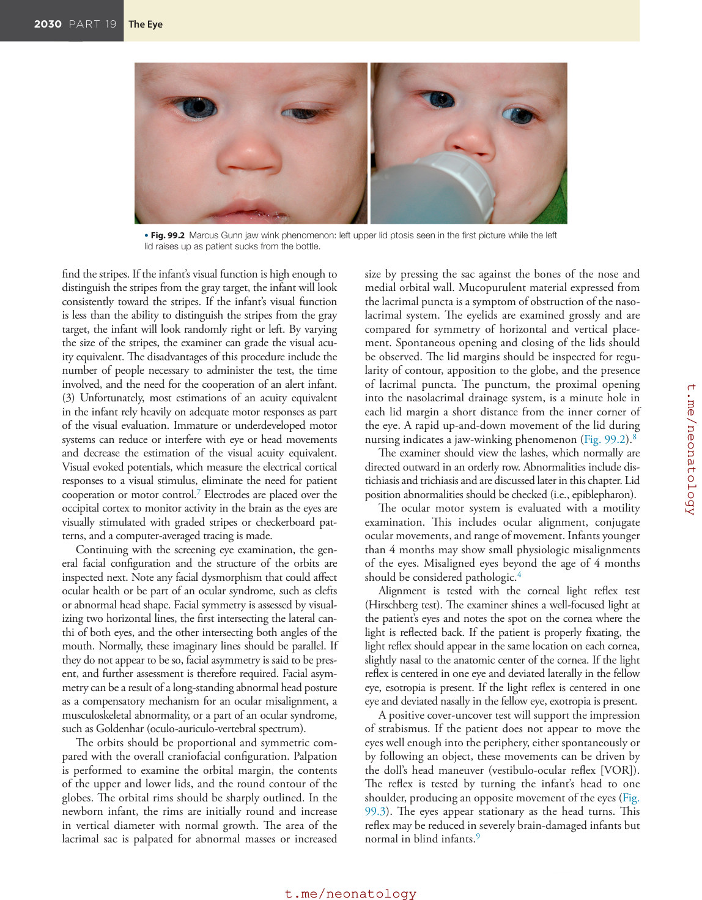

### Original source page 2022

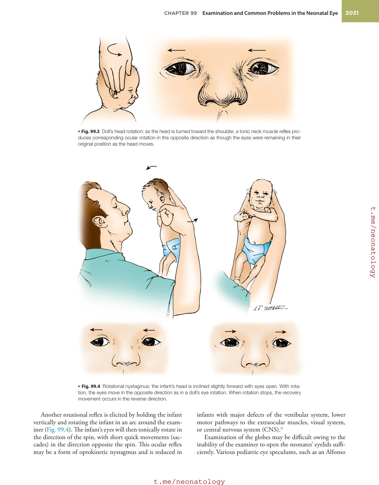

### Original source page 2023

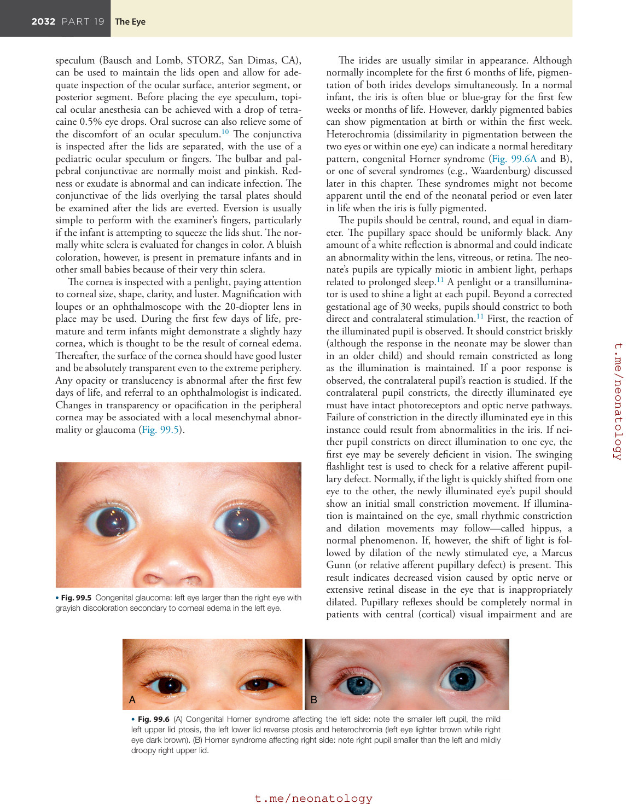

### Original source page 2024

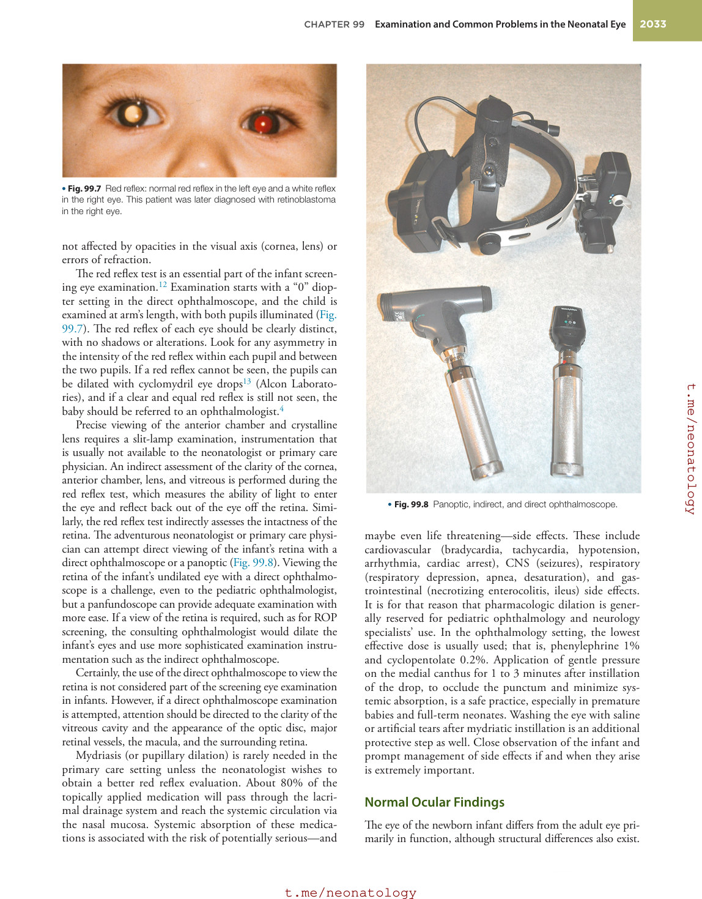

### Original source page 2025

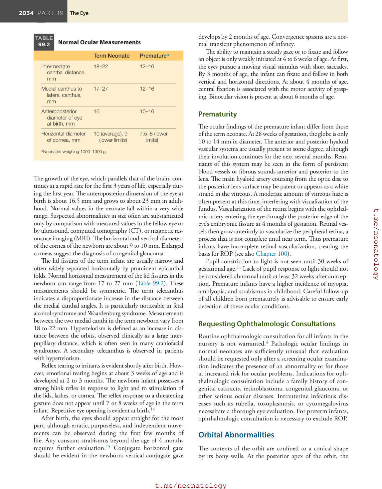

### Original source page 2028

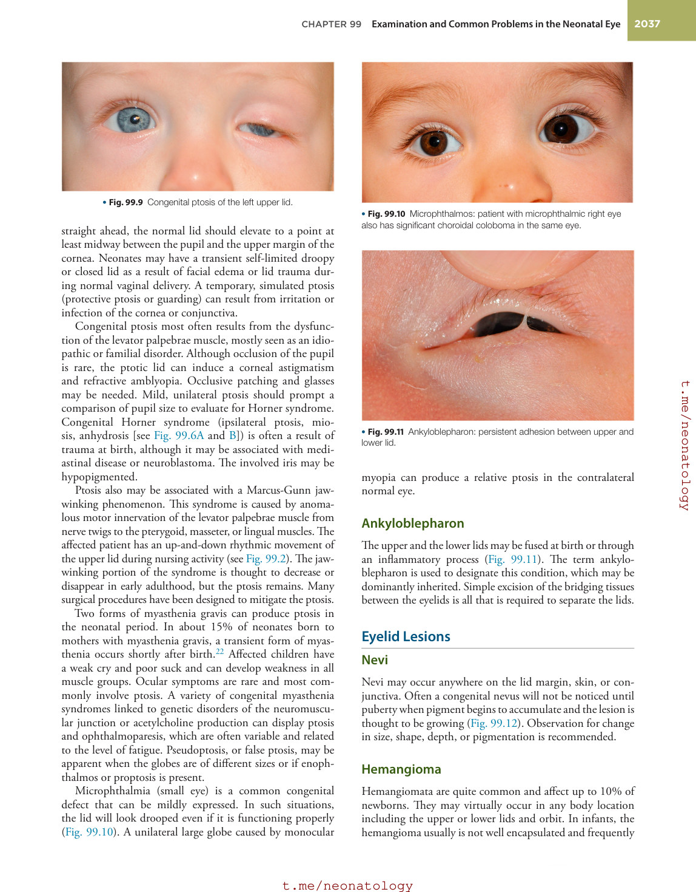

### Original source page 2029

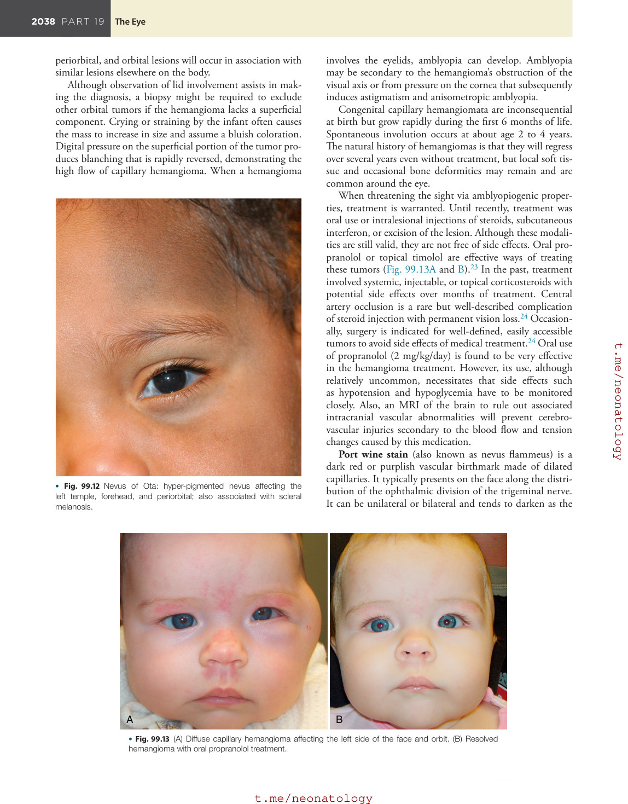

### Original source page 2030

### Original source page 2031

### Original source page 2032

### Original source page 2033

### Original source page 2035

### Original source page 2036

### Original source page 2037

### Original source page 2038

### Original source page 2039

### Original source page 2040

### Original source page 2042

### Original source page 2043

### Original source page 2044

### Original source page 2045

