# 102. Bone and Joint Infections in Neonates
> Source attribution: [Source credits](../../SOURCE_CREDITS.md).

## PDF page 2072 | printed page 2082

102 Bone and Joint Infections in Neonates

### ALLISON GILMORE AND R. JUSTIN MISTOVICH

Bacterial infections of the neonatal skeletal system are potentially disabling because of damage to the articular cartilage and epiphysis. Prompt diagnosis and treatment are imperative to prevent adverse sequelae.1,2 Unfortunately, neonates with skeletal infections do not usually have the classic symptoms or laboratory findings of sepsis early on because of their immature immune systems. Feeding intolerance, reduced movement, and/or irritability may be the only early signs of infection. Diagnosis requires a high index of suspicion and appropriate evaluation. When infections involve bone, the disease process is called osteomyelitis. When the synovium (the membrane lining of the joint) is the primary site of infection, the process is called septic arthritis (see Part 9: The Immune System).3

### Osteomyelitis

### Pathology and Etiology

Bone infection, or osteomyelitis, occurs by three mechanisms: bacteremia or hematogenous spread; direct inoculation from a puncture wound, such as a heel or femoral vein stick; and a contiguous spread from an adjacent nidus of infection. In neonates, as in infants and children, most bone infections are hematogenous in origin. The most common site of osteomyelitis is the metaphysis, the region of the bone immediately adjacent to the physis or growth plate. The anatomic arrangement of metaphyseal vessels and the dynamics of blood flow in this region permit bacteria to lodge and proliferate. The nutrient artery ascends to the metaphysis from a central location within the bone. When the arterioles reach the physis, they make 180-degree turns and empty into the venous sinusoids. This process creates an area of sluggish blood flow and an opportunity for bacteria to become trapped and proliferate. A separate set of vessels nourishes the epiphysis.

In childhood, there is no connection between the epiphyseal and metaphyseal blood supply. The physis creates a barrier that is seldom penetrated by the spread of infection from the metaphysis to the epiphysis or from the epiphysis to

2082

the metaphysis. However, during the first 12 to 18 months of life, this barrier to the spread of infection does not exist, because there are vessels passing through the physis that connect the epiphyseal and metaphyseal circulations.1,4,5 These vessels allow infections to cross the physis, which may account for the increased incidence of physeal damage seen in neonatal osteomyelitis when compared with childhood osteomyelitis.1–3 Peters and associates observed the late onset of growth disturbances after neonatal osteomyelitis and recommended that the affected neonates be followed to skeletal maturity to monitor for growth disturbances.2

When bacteria lodge in the metaphyseal vessels and begin to proliferate, inflammation followed by abscess formation occurs. The pressure from the purulent material causes extrusion of the pus through the haversian canals to the cortex and subsequently into the subperiosteal space. The continued subperiosteal accumulation of purulent material strips the periosteum from the bone. Because the periosteum supplies blood to the cortex, this stripping process interrupts cortical blood flow. As a result, large areas of cortical bone may become devascularized. This dead bone, or sequestrum, can serve as a site for chronic infection, which is isolated from limited neonatal defense mechanisms and antibiotics.4 The elevated periosteum produces new bone in an attempt to repair the injured bone. This process in turn produces the involucrum, which surrounds the sequestrum.

Draining cutaneous sinuses may arise when pus ruptures through the periosteum, adjacent soft tissues, and skin. Infection may occasionally spread into an adjacent joint space, causing secondary septic arthritis. The destruction of the epiphysis may occur through the direct spread of infection into it. This process can result in subsequent shortening, angular deformity, or both, of the involved extremity.2 In neonates, complete physeal closure can occur, resulting in shortening.1 Damage to the articular surface of the joint may result in the loss of motion and ultimately degenerative osteoarthritis.

The etiologic organisms responsible for neonatal osteomyelitis are variable. Staphylococcus aureus has traditionally been the most common causative organism.1

## PDF page 2073 | printed page 2083

Methicillin-resistant S. aureus (MRSA) has been reported in neonates, which is especially destructive.6 Group B streptococcus (Streptococcus agalactiae) and gram-negative organisms (E. coli and Klebsiella pneumonia) are all seen in the neonatal period.7 Candida albicans can also cause osteomyelitis in those neonates at high risk for infection.

### Diagnosis

The clinical manifestations of osteomyelitis in children vary with age. In previously healthy neonates, it usually occurs during the first 2 weeks of life. Limitation of spontaneous movement with pseudoparalysis of the involved extremity is the most common sign. Localized tenderness, erythema, increased warmth, and swelling may occur. Associated septic arthritis with accompanying joint effusion and increased warmth occurs in many cases. Term neonates usually appear less ill than would be expected because of the persistence of maternal antibodies. They have less fever, leukocytosis, and elevation of the C-reactive protein and erythrocyte sedimentation rate than older children with similar infections.1 Less commonly, neonatal osteomyelitis presents as septicemia. The presentation and course of osteomyelitis are strongly correlated with the health of the infant before presentation. Infants with multiple sites of infection are usually ill before its onset and have an increased history of placement of umbilical catheters or other lines. They are also more ill than those neonates presenting with only one site of infection.1

Some neonates are at increased risk for osteomyelitis; they also have a more severe course of the disease. Bergdahl and colleagues identified the following risk factors in a study of 40 neonates with osteomyelitis: a birth weight of less than 2500 g or gestational age of less than 37 weeks, emergency cesarean delivery, a congenital malformation requiring neonatal surgery, respiratory distress syndrome, hyperbilirubinemia, large vessel (usually umbilical) catheterization, perinatal asphyxia, scalp laceration after vacuum extraction, and renal vein thrombosis.1 Twenty-one neonates were found to have risk factors but 19 did not. Of the 21, most had multiple sites of infection; 13 of the 21 (62%) neonates with risk factors had serious skeletal sequelae. In the remaining 19 neonates, multiple sites of infection were uncommon, and serious skeletal sequelae occurred in less than 20%.

The early diagnosis of osteomyelitis is based on obtaining purulent material, blood, or both for cultures and antibiotic sensitivities. Early in the course of the disease, radiographs may be normal; however, an early MRI may be diagnostic.8,9 Bone aspiration is usually positive. The cultures of subperiosteal metaphyseal pus yield a pathogen in about 70% of cases. The point of maximal swelling, bone tenderness, and fluctuation on physical examination is the most appropriate location for needle aspiration. The skin overlying the affected region should be prepared with an antiseptic solution and draped with sterile towels. After infiltration of the area with local anesthetic, an 18-gauge spinal needle, with the stylet in place, is passed through the skin to the bone. The subperiosteal space is aspirated first. If the tap

is dry, the needle with the stylet should be gently twisted through the bone cortex into the metaphysis, which is then aspirated. The aspirated fluid or blood should be immediately Gram-stained and cultured. The organism may also be recovered from other sources. Blood cultures are positive in 60% of children with osteomyelitis. When osteomyelitis complicates meningitis, the organism may be recovered from cultures of the cerebrospinal fluid.

### Imaging

See Chapter 38. A diagnosis cannot be easily made by bone aspiration during the inflammatory phase before abscess formation. At this point, imaging can be helpful. Plain radiographs of the suspected bone are often a valuable procedure. Within a few days of the onset of infection, deep edema, joint effusion, and sometimes bone destruction can be detected.1 The edema is visible sooner in neonates than in children, because the neonate has very porous bones and a loosely attached periosteum (Fig. 102.1), which permits the earlier collection of subperiosteal abscesses in neonates than in children. This fact also accounts for the relatively favorable results of diagnostic aspiration in neonates.

If radiographs are nondiagnostic, ultrasound can be useful in localizing the areas of deep edema (subperiosteal fluid collection or abscess) and joint effusion, as well as periosteal thickening or elevation.10 Magnetic resonance imaging, the current study of choice, is very sensitive for early detection of osteomyelitis and will show details of bone involvement, abscess formation, and septic arthritis. A retrospective analysis of neonatal osteomyelitis, while limited in case volume, nevertheless found MRI to have 100% sensitivity in diagnosing true positive cases.11 Limitations include possible need for sedation and patient stability to transfer to the MRI unit.12 Technetium bone scanning is currently used less often; however, it may be helpful in neonates with suspected multifocal infection.12 There is some controversy over the merits of bone scanning in neonates because of their decreased inflammatory response and the large amount of isotope uptake from the very active adjacent epiphysis. The bone scan, if negative, does not exclude osteomyelitis.

### Treatment

Treatment must not be delayed for neonates with suspected osteomyelitis. Antimicrobial therapy should be initiated, usually with a combination of agents, as soon as a presumptive diagnosis is made and appropriate material for cultures has been obtained. Treatment can later be appropriately altered according to culture results and antibiotic sensitivities. For neonates, optimal coverage is provided by penicillinase-resistant penicillin coupled with an aminoglycoside. The new third-generation cephalosporins have been successfully used in the treatment of a form of osteomyelitis caused by enteric bacilli. However, these agents should not be used alone as the initial treatment because their activity against group B streptococci is inadequate. When these drugs are

## PDF page 2074

A

B

C

• Fig. 102.1 Radiologic changes in neonatal osteomyelitis. (A) Early proximal humeral osteomyelitis. Soft tissue has become swollen around the affected bone. (B) Periosteal elevation is manifested by subperiosteal bone formation. (C) Massive subperiosteal new bone formation. The humeral shaft has become surrounded by new bone.

used as part of the initial therapeutic regimen, penicillinaseresistant penicillin should be used concomitant with them. After an organism is isolated, focused antibiotic treatment is possible. The duration of treatment should be at least 3 weeks and probably not more than 6 weeks for acute hematogenous osteomyelitis. Nelson suggests a clinical approach to antibiotic management.13 (See Chapter 50 on Postnatal Bacterial Infections for clinical decision making about the choice and duration of antimicrobial therapy.) After local inflammation subsides and measures of inflammation such as CRP and erythrocyte sedimentation rate return to normal, he recommends 14 more days of antibiotics for group A streptococci and encapsulated bacteria such as pneumococci and 21 more days for staphylococcal infection. Historically, neonates were treated solely with intravenous antibiotics. Literature may suggest treating neonates with osteomyelitis with sequential intravenous–oral antibiotic therapy. A Dutch neonatal ward successfully treated proven methicillin-susceptible S. aureus osteomyelitis with 2 to 3

weeks of intravenous antibiotics followed by oral clindamycin for 3 weeks without relapse or sequelae. This could theoretically decrease morbidity from intravenous access as well as associated costs.14

Primary surgical treatment depends on the results of bone aspiration. If grossly purulent material is recovered from the subperiosteal space or the metaphysis, an abscess has formed. In these cases, surgical drainage is necessary to decompress the abscess. This procedure facilitates blood flow and the subsequent delivery of antibiotics. Surgical drainage also allows the removal of the bone sequestrum. When pus is not recovered at the time of initial aspiration, the patient’s infection is in the cellulitic or inflammatory phase. The aspirated blood is used to obtain blood cultures, and antibiotic therapy is initiated. It is assumed that the bone blood flow is still adequate in the cellulitic phase to deliver antibiotics to the site of infection, because there is no pus under pressure. The affected limb should be immobilized with a splint. Neonates must be carefully followed during the early phases of treatment. Surgical intervention may become necessary if an adequate clinical response is not obtained within 48 hours of initial antimicrobial therapy.15 An inadequate response implies that an abscess is forming. Reassessment, including repeated aspiration, is indicated. If an abscess is identified, surgical drainage will be necessary.

La Mont and co-workers reviewed 69 children (including 15 neonates) retrospectively and 44 children (including 4 neonates) prospectively, all with acute hematogenous osteomyelitis.15 They concluded that surgery was seldom necessary because most of the prospective group improved clinically after 48 hours of appropriate intravenous antibiotics, and few of them had abscesses aspirated. In their study, surgery was infrequently used, and the results were excellent. It was their impression that the aspiration of pus from the bone was an indication for surgery but was seldom encountered. Drainage was also recommended for an extraosseous abscess.

It is believed that the surgical decompression of long bones such as the femur, tibia, humerus, radius, and ulna is necessary if pus is aspirated from bone or the subperiosteal space.1 Decompression consists of drilling a hole in the metaphysis or removing a small cortical window. The wound is then closed loosely to allow it to drain. If a drain is placed, it is removed 24 to 48 hours later. Surgical decompression is also necessary if there is not a good clinical response to antibiotics within 48 to 72 hours, even if no pus is aspirated from the bone.

If osteomyelitis is localized to flat bones, such as the pelvis or vertebrae, the administration of antibiotics without surgical decompression is usually sufficient treatment. However, caution is necessary because Bergdahl and associates reported one death and one case of tetraparesis resulting from neonatal vertebral osteomyelitis.1

### Septic Arthritis

### Pathology and Etiology

The mechanisms responsible for joint or synovial infections in neonates and children parallel those for osteomyelitis:

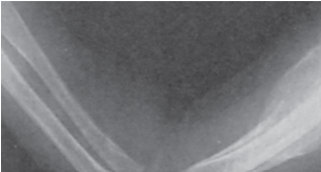

• Fig. 102.1 Radiologic changes in neonatal osteomyelitis. (A) Early proximal humeral osteomyelitis. Soft tissue has become swollen around the affected bone. (B) Periosteal elevation is manifested by subperiosteal bone formation. (C) Massive subperiosteal new bone formation. The humeral shaft has become surrounded by new bone.

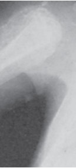

Unmatched source image; PDF page 2074. Consult the original caption.

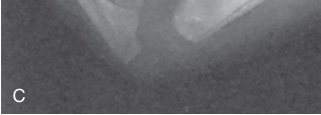

• Fig. 102.1 Radiologic changes in neonatal osteomyelitis. (A) Early proximal humeral osteomyelitis. Soft tissue has become swollen around the affected bone. (B) Periosteal elevation is manifested by subperiosteal bone formation. (C) Massive subperiosteal new bone formation. The humeral shaft has become surrounded by new bone.

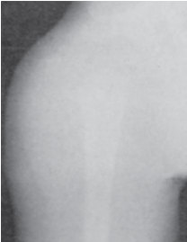

• Fig. 102.1 Radiologic changes in neonatal osteomyelitis. (A) Early proximal humeral osteomyelitis. Soft tissue has become swollen around the affected bone. (B) Periosteal elevation is manifested by subperiosteal bone formation. (C) Massive subperiosteal new bone formation. The humeral shaft has become surrounded by new bone.

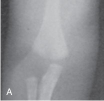

• Fig. 102.1 Radiologic changes in neonatal osteomyelitis. (A) Early proximal humeral osteomyelitis. Soft tissue has become swollen around the affected bone. (B) Periosteal elevation is manifested by subperiosteal bone formation. (C) Massive subperiosteal new bone formation. The humeral shaft has become surrounded by new bone.

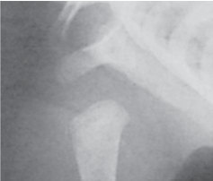

Unmatched source image; PDF page 2074. Consult the original caption.

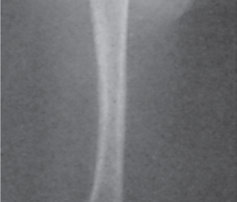

Unmatched source image; PDF page 2074. Consult the original caption.

## PDF page 2075 | printed page 2085

septicemia, contiguous spread from an adjacent focus of infection, and traumatic penetration of the joint space. Osteomyelitis in the proximal femur (hip), proximal radius (elbow), proximal humerus (shoulder), and distal tibia (ankle) in neonates may progress to a septic joint, because the metaphyses of these bones are intra-articular. The risk factors include prematurity, umbilical catheterization, perinatal asphyxia, and a difficult birth.16 Regardless of the source, the ensuing inflammatory response results in synovial hypertrophy and altered capillary permeability. Purulent material accumulates within the joint, and fibrinous clots may coat the joint surfaces. The diffusion of nutrients across the articular cartilage of the joint is interrupted, and the normal lubrication processes are altered. Lysosomal enzymes, which are released in neutrophil degeneration, attack the mucopolysaccharide components of articular cartilage. Hypertrophic granulation tissue forms a pannus that can erode articular cartilage and may allow the extension of infection to subchondral bone. Fibrous ankylosis of the joint may develop, with a permanent loss of motion.17 Increased intra-articular pressure may occlude the vessels that supply the epiphyses and the physis, resulting in epiphyseal death or avascular necrosis. This process is especially applicable to the hip. The rupture of pus through the synovial membrane and into the surrounding tissues produces soft tissue abscesses that may later develop into draining sinuses.

Neonatal septic arthritis often results from osseous infection, and the bacterial agents responsible for the joint infections are similar to those previously described for neonatal osteomyelitis: S. aureus, streptococci, and enteric bacilli. Septic arthritis occurs less frequently as a primary entity; the Enterobacteriaceae family, the species of Pseudomonas, and Neisseria gonorrhoeae may be isolated in these cases. Fink and Nelson reported septic arthritis from Haemophilus influenzae in neonates as young as 3 days of age.18 About 25% of the neonates with H. influenzae septic arthritis also have meningitis.

### Diagnosis

The clinical presentation of neonatal septic arthritis is similar to that described for neonatal osteomyelitis. Joint effusion, increased warmth, and limited motion are often observed on physical examination. Often, early diagnosis is delayed because physical findings may be subtle.

The definitive diagnosis of septic arthritis requires aspiration of the affected joint. The causative agent can be recovered in about 60% of cases. The procedure should be performed under sterile conditions by an experienced physician, because repeated attempts to penetrate the joint may further damage the joint surface and the underlying bone. After culture and Gram staining of the fluid, determinations of the cellular count as well as glucose and protein concentrations should be obtained. Infected synovial fluid typically contains more than 50,000 white blood cells per cubic millimeter (primarily polymorphonuclear leukocytes); a glucose concentration of less than 40 mg/dL, or less than 30% of the serum concentration; and an elevated protein concentration. Blood cultures should also be obtained.

A

B

• Fig. 102.2 (A) Anteroposterior pelvic radiograph of a 2-week-old boy who had been irritable during diaper changes for 1 week. There were no systemic symptoms, such as fever, although the child had been quite irritable and not feeding normally. The femoral heads are not visible, because they do not begin to ossify until 4 to 6 months of age. Observe the widening between the acetabulum and the ossified medial corner of the proximal femoral metaphysis, which indicates lateral displacement or subluxation of the femoral head. (B) Arthrocentesis revealed only a small amount of purulent material. An attempted arthrogram revealed gross distortion of the hip joint caused by inspissated purulent material. At the time of hip arthrotomy, clotted, purulent material was removed. This child subsequently developed avascular necrosis as a consequence of septic arthritis with subluxation. Fortunately, he made a satisfactory recovery and regained essentially normal hip function.

### Imaging

Neonatal septic arthritis has the same recommendations as those for osteomyelitis (Fig. 102.2). Ultrasound is especially useful in neonatal hip infection. An ultrasound of both hips should be performed. In some cases, ultrasound can differentiate between a septic and a sterile effusion. A difference between the affected joint and the contralateral of ≥2 mm, an effusion >5 mm, synovial capsule thickening, and a hypoechoic effusion all favor the diagnosis of septic arthritis.5 Magnetic resonance imaging may be difficult to obtain expeditiously, but can identify a joint effusion and subperiosteal abscess. Bone scans are used less often in neonates.

### Treatment

Neonatal septic arthritis requires prompt treatment. Irreversible joint damage may occur unless intra-articular pus is evacuated and effective antimicrobial therapy initiated.13,19 Neonates should be managed jointly by pediatricians and orthopedic surgeons.

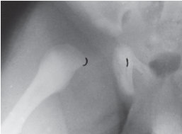

• Fig. 102.2 (A) Anteroposterior pelvic radiograph of a 2-week-old boy who had been irritable during diaper changes for 1 week. There were no systemic symptoms, such as fever, although the child had been quite irritable and not feeding normally. The femoral heads are not visible, because they do not begin to ossify until 4 to 6 months of age. Observe the widening between the acetabulum and the ossified medial corner of the proximal femoral metaphysis, which indicates lateral displacement or subluxation of the femoral head. (B) Arthrocentesis revealed only a small amount of purulent material. An attempted arthrogram revealed gross distortion of the hip joint caused by inspissated purulent material. At the time of hip arthrotomy, clotted, purulent material was removed. This child subsequently developed avascular necrosis as a consequence of septic arthritis with subluxation. Fortunately, he made a satisfactory recovery and regained essentially normal hip function.

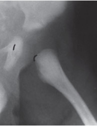

Unmatched source image; PDF page 2075. Consult the original caption.

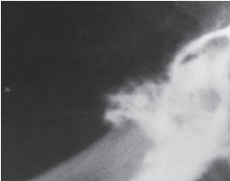

• Fig. 102.2 (A) Anteroposterior pelvic radiograph of a 2-week-old boy who had been irritable during diaper changes for 1 week. There were no systemic symptoms, such as fever, although the child had been quite irritable and not feeding normally. The femoral heads are not visible, because they do not begin to ossify until 4 to 6 months of age. Observe the widening between the acetabulum and the ossified medial corner of the proximal femoral metaphysis, which indicates lateral displacement or subluxation of the femoral head. (B) Arthrocentesis revealed only a small amount of purulent material. An attempted arthrogram revealed gross distortion of the hip joint caused by inspissated purulent material. At the time of hip arthrotomy, clotted, purulent material was removed. This child subsequently developed avascular necrosis as a consequence of septic arthritis with subluxation. Fortunately, he made a satisfactory recovery and regained essentially normal hip function.

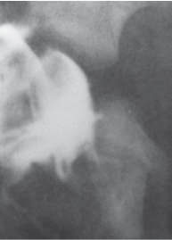

Unmatched source image; PDF page 2075. Consult the original caption.

## PDF page 2076

Combinations of antibiotics are selected to cover the most likely pathogens. A penicillinase-resistant penicillin and an aminoglycoside or cephalosporin usually provide adequate coverage pending the results of the cultures and antibiotic sensitivities (see Part 9: The Immune System).

Joint decompression is an essential component of successful therapy for pyogenic arthritis. However, opinions vary on the most effective method, specifically surgical drainage compared with repeated aspiration. Primary decompression is usually accomplished at the time of initial joint aspiration and may be sufficient in peripheral joints such as the knee, ankle, and elbow, which are easily aspirated and in which blood flow to intra-articular epiphyses is not at risk. Needle aspiration is not sufficient for decompression of the hip because increased intra-articular pressure may occlude blood flow to the femoral head, resulting in avascular necrosis. Immediate surgical drainage is mandatory for septic arthritis of the hip.20

The repeated aspiration of joints other than that of the hip may be appropriate. The morbidity for careful aspirations is less than that for arthrotomy, but persistent infection after repeated aspiration is probably more harmful than the risk for primary arthrotomy. Poorly executed needle aspiration may damage the articular surfaces and inoculate underlying bone with purulent fluid.

Key Points

• Neonatal skeletal infections are uncommon, but early

diagnosis and treatment is critically important to prevent complications. • Most skeletal infections are hematogenous (blood borne)

in origin. If bone is the primary focus, it is termed osteomyelitis; if the synovium of the joint is involved, it is septic arthritis.

### References

1. Bergdahl S, Ekengren K, Eriksson M. Neonatal hematogenous

osteomyelitis: risk factors for long-term sequelae. J Pediatr Orthop. 1985;5:564–568. 2. Peters W, Irving J, Letts M. Long-term effects of neonatal bone

and joint infection on adjacent growth plates. J Pediatr Orthop. 1992;12:806–810. 3. Green NE, Edwards K. Bone and joint infections in children.

Orthop Clin North Am. 1987;18:555–576. 4. Ogden JA, Lister G. The pathology of neonatal osteomyelitis.

Pediatrics. 1975;55:474–478. 5. Erkilinc M, Gilmore A, Weber M, Mistovich RJ. Current

concepts in pediatric septic arthritis. J Am Acad Orthop Surg. 2021;29:196–206. 6. Korakaki E, Aligizakis A, Manoura A, et al. Methicillin-resistant

Staphylococcus aureus osteomyelitis and septic arthritis in neonates: diagnosis and management. Jpn J Infect Dis. 2007;60:129– 131. 7. Castellazzi L, Mantero M, Esposito S. Update on the manage-

ment of pediatric acute osteomyelitis and septic arthritis. Int J Mol Sci. 2016;17.

Like the therapy for osteomyelitis, effective antimicrobial therapy for pyogenic arthritis is a function of the agent, route, and duration of drug administration. After the pathogen has been isolated and antibiotic sensitivities are known, a single agent may be used. Intra-articular antibiotic instillation is unnecessary, because adequate drug concentrations are achieved in synovial fluid by the intravenous and parenteral routes.

Joint infections caused by H. influenzae require 2 to 3 weeks of therapy, whereas infections caused by other agents or those complicated by osteomyelitis may require up to 6 weeks of therapy. The treatment of neonatal gonococcal arthritis differs significantly from that of arthritis caused by other pathogens. Penicillin G, ampicillin, amoxicillin, tetracycline, and erythromycin have all been used successfully in therapy for gonococcal arthritis in 7- to 10-day courses. Other than diagnostic arthrocentesis, no surgical intervention is necessary for this disease.

### Acknowledgments

The author and editors acknowledge the important contributions of Daniel R. Cooperman and George H. Thompson to the previous editions of this chapter, portions of which remain unchanged.

• Evaluation and diagnosis are primarily clinical, although

plain radiographs and specialized imaging studies can be useful. Hematologic studies other than bone/joint aspirates and blood cultures and sensitivities are less helpful. • Treatment is either by antibiotics, surgical drainage of

abscess, or both, depending on the location, radiographic findings, and initial response to antibiotic therapy alone.

8. Demopulos GA, Bleck EE, McDougall IR. Role of radionuclide

imaging in the diagnosis of acute osteomyelitis. J Pediatr Orthop. 1988;8:558–565. 9. Ash JM, Gilday DL. The futility of bone scanning in neo-

natal osteomyelitis: concise communication. J Nucl Med. 1980;21:417–420. 10. Lee SW, Irwin GJ, Huntley JS. Neonatal hip septic arthritis:

ultrasound should not influence decision to aspirate. Scott Med J. 2013;58:e18–e21. 11. Zhan C, Zhou B, Du J, Chen L. Clinical analysis of 17 cases

of neonatal osteomyelitis: a retrospective study. Medicine (Baltimore). 2019;98:e14129. 12. Fisher R. Neonatal osteomyelitis. NeoReviews. 2011;12. 13. Nelson JD. Bugs, drugs, and bones: a pediatric infectious disease

specialist reflects on management of musculoskeletal infections. J Pediatr Orthop. 1999;19:141–142. 14. Ecury-Goosssen GM, Huysman MA, Verhallen-Dantuma JC,

Man P. Sequential intravenous-oral antibiotic therapy for neonatal osteomyelitis. Pediatr Infect Dis J. 2009;28:72–73. 15. LaMont RL, Anderson PA, Dajani AS, Thirumoorthi MC.

Acute hematogenous osteomyelitis in children. J Pediatr Orthop. 1987;7:579–583.

## PDF page 2077 | printed page 2087

16. Kabak S, Halici M, Akcakus M, et al. Septic arthritis in

patients followed-up in neonatal intensive care unit. Pediatr Int. 2002;44:652–657. 17. Regev E, Koplewitz BZ, Nitzan DW, Bar-Ziv J. Ankylosis of the

temporomandibular joint as a sequela of septic arthritis and neonatal sepsis. Pediatr Infect Dis J. 2003;22:99–101.

18. Fink CW, Nelson JD. Septic arthritis and osteomyelitis in chil-

dren. Clin Rheum Dis. 1986;12:423–435. 19. Strong M, Lejman T, Michno P. Septic arthritis of the wrist in

infancy. J Pediatr Orthop. 1995;15:152–156. 20. Samora JB, Klingele K. Septic arthritis of the neonatal hip: acute

management and late reconstruction. J Am Acad Orthopaed Surg. 2013;21:632–641.

<!-- SOURCE_LAYOUT_VIEWS -->

## Original layout views and recovered diagrams

Automatic extraction can flatten tables and superscripts. Check the original layout for numeric data, footnotes and image credits. [Source review notes](../../SOURCE_REVIEW_NOTES.md).

### Original source page 2074

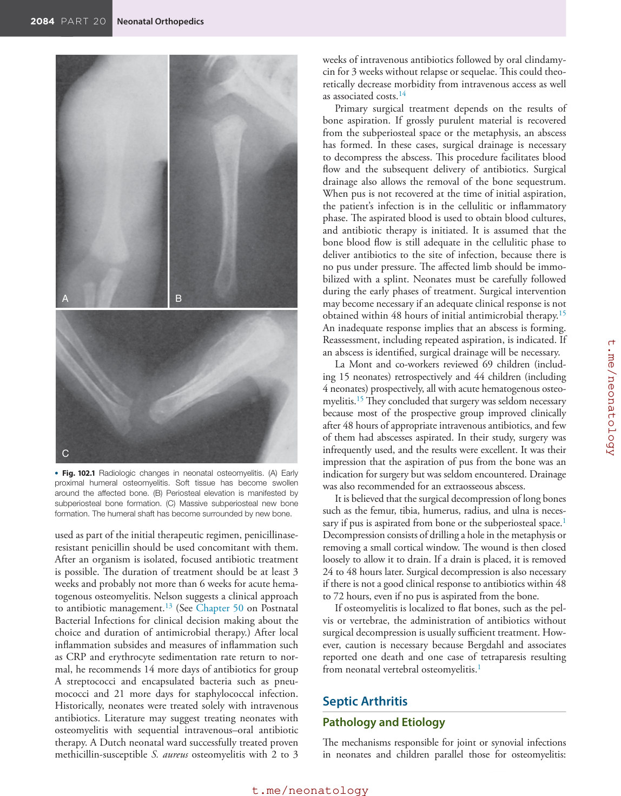

### Original source page 2075

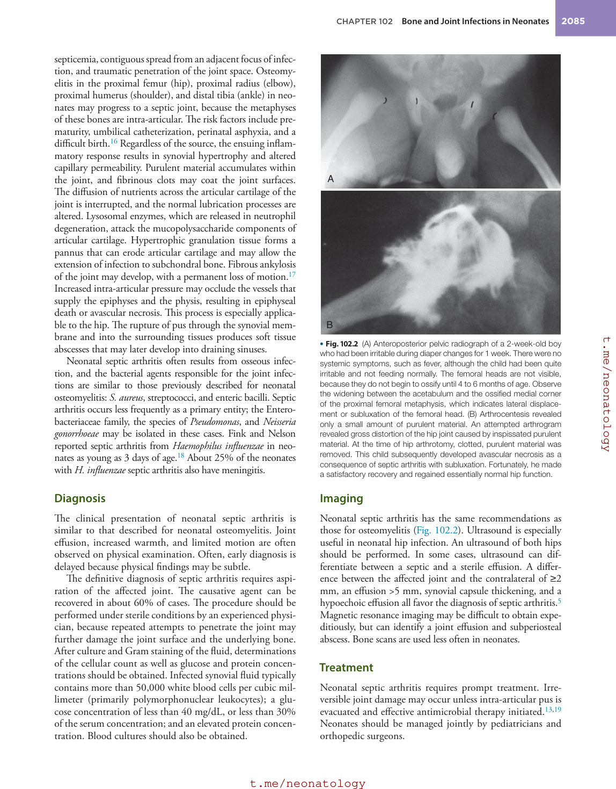
