# 103. Congenital Abnormalities of the Upper and Lower Extremities and Spine
> Source attribution: [Source credits](../../SOURCE_CREDITS.md).

## PDF page 2078 | printed page 2088

103 Congenital Abnormalities of the Upper and Lower Extremities and Spine

### JOCHEN P. SON-HING AND CHRISTINA K. HARDESTY

### Upper Extremities

Congenital abnormalities of the upper extremities are those that occur during the embryonic period. Developmental deformities are those that occur primarily in the fetal or neonatal period. Because a developmental deformity may have a prenatal association, such as in utero positioning, it could be misinterpreted as a congenital abnormality. Congenital and developmental disorders of the upper extremities are less common than those affecting the lower extremities.

### Shoulder

The failure of the scapula and the upper extremities to descend to their normal locations is called Sprengel deformity, which can vary from mild to severe. In this condition, the scapula is typically abnormally elevated with respect to the child’s neck and thorax, producing webbing of the skin at the base of the neck and a low posterior hairline. In the severe form, an accessory bone (the omovertebral bone) may connect the scapula to the spinous processes of the cervical spine and allow virtually no scapulothoracic motion. Severe forms are more likely than the mild forms to be diagnosed in the neonate. Associated muscle contractures that further limit the strength and stability of the shoulder girdle may also be present. In the mild form, the scapula is slightly elevated, with less than normal motion. There may be an association with congenital cervicovertebral abnormalities, particularly Klippel-Feil syndrome, and this association suggests the possibility of other congenital abnormalities, such as those in the cardiovascular and genitourinary systems as well as rib anomalies.1 When Sprengel deformity is diagnosed, abnormalities in these other systems must be suspected.

Treatment is usually delayed until middle childhood (optimal results are usually seen when the child has surgery before age 8) and depends on the function of the child’s shoulder and extremity. For severe deformity, surgical

2088

repositioning and occasionally partial resection of the scapula may be necessary to improve range of motion and cosmetic appearance.2

### Elbow

Congenital radioulnar synostosis is an uncommon disorder that represents a failure of separation, or congenital fusion, between the proximal radius and ulna. It occurs from the fifth to the eighth week of gestation, when there is separation of the humerus, radius, and ulna from a common block of cartilage in the limb bud. This disorder is bilateral in approximately 50% of all patients and limits forearm pronation and supination. It is rarely recognized during the neonatal period, because there is no obvious deformity, only a loss of forearm rotation. In most cases, the forearm is in a physiologic position of 45 to 60 degrees of pronation. Only if there is extreme supination or pronation may the disorder be recognized in the neonatal period. The diagnosis of this disorder, which is confirmed radiographically, should be suspected in any neonate with restricted forearm pronation or supination.

Treatment is rarely indicated unless there is an abnormal position of the forearm that interferes with the function of the hand. The method of treatment, a rotational osteotomy through the synostosis, is usually delayed until middle childhood so that an adequate assessment of function can be determined. Attempts at restoring forearm pronation and supination by excising the synostosis have been unsuccessful.

### Forearm and Wrist Radial Hypoplasia and Clubhand

Hypoplasia of the radius is a commonly discussed and infrequently encountered entity, occurring in 1 in 100,000 live births. It is bilateral in 50% of cases. The deformity can vary from mild shortening of the radius to its complete absence (e.g., radial clubhand). As the radius shortens, the deformity

## PDF page 2079 | printed page 2089

• Fig. 103.1 Clinical photograph of a 1-year-old boy with a right radial clubhand and hypoplastic index finger.

becomes more apparent. In complete absence of the radius, the hand is radially angulated 90 degrees to the long axis of the forearm, the ulna is markedly bowed, and the ulna and humerus can be one-half the length of the opposite normal side by maturity. As the deformity becomes profound, so does thumb involvement (e.g., an absent first ray, thumb hypoplasia) (Fig. 103.1).

The entire extremity may be involved, including the scapula and clavicle. Radial clubhand is not simply a bony defect. The radially based muscles of the forearm are also hypoplastic or absent. There is hypoplasia or absence of the radial artery, leaving the ulnar artery as the main blood supply to the hand. There is no radial nerve innervation to the skin distal to the elbow, leaving the median and ulnar nerve to anastomose to provide dorsal sensation.

The most frequently associated abnormalities are blood dyscrasias and heart defects. Fanconi syndrome is a pancytopenia seen in some children with radial clubhand. Thrombocytopenia with an absent radius (TAR) syndrome is also seen. Holt-Oram syndrome, in which the primary manifestation is an absent thumb with atrioseptal defects, has a well-recognized association with radial clubhand.

Radial hypoplasia alone is inherited sporadically. There is no definitively identifiable inheritance pattern; the careful scrutiny of relatives seldom yields another affected individual. However, radial hypoplasia as part of a syndrome frequently has a defined inheritance pattern. Holt-Oram syndrome is inherited in a dominant pattern and Fanconi syndrome is inherited in a recessive pattern.

Treatment comprises both operative and nonoperative options and is recommended for cosmetic and functional reasons. The treatment begins with stretching. During the first 6 months of life, casts and splints are used to stretch the radially deviated hand to conform to a more neutral alignment. If the deformity is corrected, the patient wears

a splint full-time for the first 6 years of life and then only at night after that. If the deformity is not corrected, the hand is centralized onto the ulna. At surgery, the carpus is fused to the ulna after an osteotomy to straighten the ulna. Sometimes carpal bones are removed to relieve the tension on the ligament balance of the wrist. Correction can be done slowly with an Ilizarov device, as well.3 If the patient has a nonfunctional thumb, the index finger occasionally undergoes pollicization—in essence, it is turned into a thumb. The surgery is frequently performed when the patient is between 6 months and 1 year of age. After surgery, bracing is maintained full-time for the first 6 years of life. In bilateral cases, the surgery is staged, with one hand operated on at 6 months and the other hand at about 3 years of age. Fingers are often stiff before and after surgery, and a straight wrist can further limit finger function, so goals should be considered carefully before operating.4

The contraindications to surgery are a serious blood dyscrasia, heart problems, and profound muscle imbalance. If the elbow flexors are overpowered by the elbow extensors such that a child cannot touch the hand to the face even after physical therapy, surgery is not likely to provide a functionally useful hand.

### Constriction Bands

Congenital constriction bands or amniotic band syndrome, also known as Streeter dysplasia or annular bands, features defects of the skin that result in ringlike strictures about the limbs and occasionally the trunk (Fig. 103.2).5 It is seen in 1 in 15,000 live births, and multiple extremities are usually involved. The upper extremities, especially the hands, are involved more frequently than the lower extremities. The cause appears to be early amniotic rupture followed by temporary oligohydramnios; this may result in intrauterine compression and the subsequent constriction of fetal appendages by cords or bands of torn amnion.6

Diagnostic criteria for congenital constriction band syndrome include simple band constrictions; band constrictions accompanied by deformity of the distal part with or without lymphedema; band constrictions accompanied by fusions of distal parts ranging from fenestrated or terminal syndactyly (e.g., acrosyndactyly) to exogenous syndactyly; and intrauterine amputations. Other congenital abnormalities frequently occur, such as clubfoot (30%), pseudarthrosis, peripheral hand palsy, and lower extremity limb length discrepancies.

Rigid clubfoot distal to deep constriction bands may be difficult to correct.7 Treatment involves the surgical release of the bands if the distal aspect is swollen and has lymphedema. The surgery is usually performed in two stages.

### Thumb and Fingers of the Hand Congenital Amputations

Congenital amputation is the best example of a failure of formation. In general, the greater the loss of length, the rarer is the lesion. For instance, a child with congenital amputation at the forearm level is encountered in 1 in 20,000 live births, and one with a missing arm is encountered in 1 in 270,000 live births.

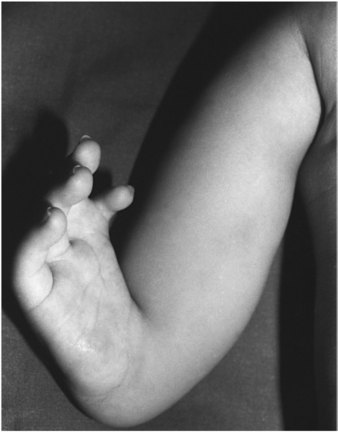

• Fig. 103.1 Clinical photograph of a 1-year-old boy with a right radial clubhand and hypoplastic index finger.

## PDF page 2080

B

A

C

• Fig. 103.2 Clinical photographs of a newborn female with multiple annular bands. (A) The right lower extremity demonstrates a band with complete transection of the skin and subcutaneous tissue. The associated talipes equinovarus (clubfoot) deformity has a duplication of the great toe. (B) A similar lesion is present in the right upper extremity, with a significant amount of distal edema from lymphatic and venous obstruction. (C) The left hand shows multiple bands with segmented edema and partial amputations.

When treating patients with congenital amputations of the upper extremities, it is necessary to define a goal for the patient. The arm serves as a positioning device for the hand. Consequently, treatment revolves around providing the patient with some sort of functional terminal end of the usable arm. In the earlier stages, as the child achieves sitting balance, a soft terminal device may be fitted. This device allows “two-handed” activities and is used to help pin objects against the normal hand. As the child reaches 2 to 3 years of age, prehension by means of a terminal device becomes possible. Early training allows children to become quite comfortable with these devices, if they choose to use them.

There is a growing interest in targeted muscle reinnervation (TMR) to improve functional control over a myoelectric prosthesis, but TMR has also been shown to decrease phantom limb and neuroma pain as well as prevent neuroma formation.8

### Syndactyly

Syndactyly is the most common form of congenital abnormality in the upper extremities and represents a failure of separation of two fingers (Fig. 103.3). This failure of separation occurs sometime between 5 and 8 weeks of gestation and is seen in 1 in 2250 live births. The abnormality appears to be sporadic in 80% of cases; the other 20% are the result of

• Fig. 103.3 Clinical photograph of a 3-month-old boy with complete syndactyly between the third and fourth fingers. There is hypoplasia of the distal phalanges of the index and small fingers.

genetic transmission. Because all forms of genetic transmission have been linked to syndactyly, genetic counseling is quite difficult. The classification of syndactyly is defined by the degree of interconnection between the fingers. In complete syndactyly, the webbing extends to the tips of the fingers; in incomplete

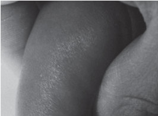

• Fig. 103.2 Clinical photographs of a newborn female with multiple annular bands. (A) The right lower extremity demonstrates a band with complete transection of the skin and subcutaneous tissue. The associated talipes equinovarus (clubfoot) deformity has a duplication of the great toe. (B) A similar lesion is present in the right upper extremity, with a significant amount of distal edema from lymphatic and venous obstruction. (C) The left hand shows multiple bands with segmented edema and partial amputations.

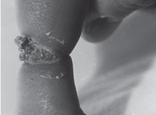

• Fig. 103.2 Clinical photographs of a newborn female with multiple annular bands. (A) The right lower extremity demonstrates a band with complete transection of the skin and subcutaneous tissue. The associated talipes equinovarus (clubfoot) deformity has a duplication of the great toe. (B) A similar lesion is present in the right upper extremity, with a significant amount of distal edema from lymphatic and venous obstruction. (C) The left hand shows multiple bands with segmented edema and partial amputations.

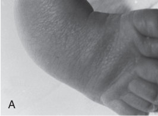

• Fig. 103.2 Clinical photographs of a newborn female with multiple annular bands. (A) The right lower extremity demonstrates a band with complete transection of the skin and subcutaneous tissue. The associated talipes equinovarus (clubfoot) deformity has a duplication of the great toe. (B) A similar lesion is present in the right upper extremity, with a significant amount of distal edema from lymphatic and venous obstruction. (C) The left hand shows multiple bands with segmented edema and partial amputations.

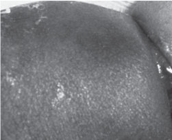

• Fig. 103.3 Clinical photograph of a 3-month-old boy with complete syndactyly between the third and fourth fingers. There is hypoplasia of the distal phalanges of the index and small fingers.

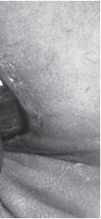

Unmatched source image; PDF page 2080. Consult the original caption.

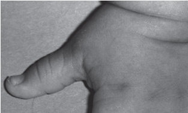

• Fig. 103.3 Clinical photograph of a 3-month-old boy with complete syndactyly between the third and fourth fingers. There is hypoplasia of the distal phalanges of the index and small fingers.

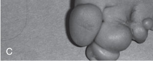

• Fig. 103.3 Clinical photograph of a 3-month-old boy with complete syndactyly between the third and fourth fingers. There is hypoplasia of the distal phalanges of the index and small fingers.

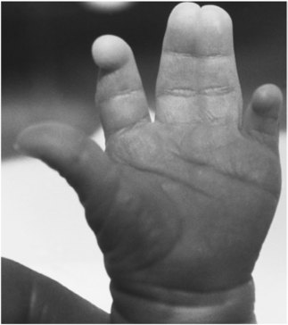

• Fig. 103.3 Clinical photograph of a 3-month-old boy with complete syndactyly between the third and fourth fingers. There is hypoplasia of the distal phalanges of the index and small fingers.

## PDF page 2081 | printed page 2091

syndactyly, it does not. Simple syndactyly involves only the skin, whereas complex syndactyly involves bony fusion. Abnormalities of the blood vessels, nerves, and tendons are also seen.

Treatment is aimed at separating the digits to improve function. The affected digits are usually separated early, particularly when they are of unequal length. If the thumb and index finger are syndactylized, the longer digit becomes tethered and deformed by the shorter digit.9 Surgery within the first year of life is suggested for cases of length discrepancy. When the digits are of nearly equal length, such as the long finger and the index finger, the surgery can wait until 2 or 3 years of age without difficulty.

### Polydactyly

Polydactyly is a common duplication abnormality of the hand (Fig. 103.4). It is seen in 1 in 300 African American

A

B

• Fig. 103.4 Clinical photograph (A) and radiograph (B) show congenital polydactyly, the most common digit duplication, with complete bones, tendons, and nerves. The recommended treatment is early ablation by amputation.

and 1 in 3000 Caucasian live births in the United States. The incidence of thumb polydactyly is identical in African Americans and Caucasians (0.8 in 1000 live births). Littlefinger polydactyly is common in African Americans and is usually seen without associated abnormalities. In Caucasian infants, little-finger polydactyly is infrequent and often associated with other skeletal abnormalities, including syndactyly, coalescence of carpal bones, radioulnar synostosis, hypoplasia and aplasia of the tibia and fibula, hemivertebrae, and dwarfism. Other disorders also seen are hydrocephalus, cleft lip, hypogonadism, kidney abnormalities, and imperforate anus.

The surgical approach to polydactyly is based on the vascular and bony anatomy of the digits and is individualized. The surgery is usually performed sometime after 6 months but before 18 months of age to minimize the anesthetic consequences.

### Macrodactyly

Macrodactyly of the hand, also known as idiopathic local gigantism, may involve one or more fingers and is bilateral in 5% of cases. All structures in the affected finger are enlarged, including the bone, blood vessels, nerves, and other soft tissues. True macrodactyly must be differentiated from other processes that create gigantism, because the treatment is different. Local enlargement of the hand occurs in neurofibromatosis, lymphedema, hemangioma, lymphangioma, arteriovenous fistulas, fibrous dysplasia, aneurysmal bone cysts, and lipomas. Macrodactyly is part of the PIK3CA-related overgrowth spectrum. The treatment for these disorders is individualized to the process. In typical macrodactyly, the child is followed carefully until the affected digit(s) is about adult size, which usually happens between 7 and 8 years of age. At this point, growth arrests of all the bones in the affected digit(s) are performed and soft tissues are debulked. Occasionally, the growth is uncontrollable, and cosmesis is so poor that the parents and child prefer amputation. In contrast, ray resection with soft tissue reduction is the method of choice for managing macrodactyly of the foot, especially when it affects only the lesser toes.10 Delayed healing and excessive scarring can occur with surgery, so it should be considered cautiously.11

### Spine

Spinal disorders are mostly congenital in origin. Some of them, such as myelodysplasia and sacral agenesis, are obvious on prenatal ultrasound or at birth, but others, such as congenital scoliosis and kyphosis, may not be recognized for months or years. Idiopathic spinal deformities can also occur but are rare.

### Infantile Idiopathic Scoliosis

Scoliosis without a clearly identifiable cause is called idiopathic scoliosis. Idiopathic spinal deformities are classified as infantile, with the onset between birth and 3 years of age;

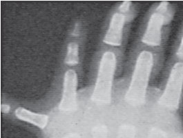

• Fig. 103.4 Clinical photograph (A) and radiograph (B) show congenital polydactyly, the most common digit duplication, with complete bones, tendons, and nerves. The recommended treatment is early ablation by amputation.

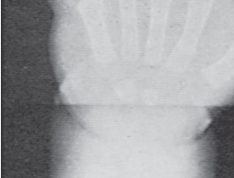

• Fig. 103.4 Clinical photograph (A) and radiograph (B) show congenital polydactyly, the most common digit duplication, with complete bones, tendons, and nerves. The recommended treatment is early ablation by amputation.

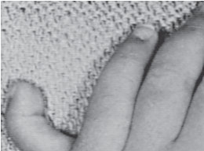

• Fig. 103.4 Clinical photograph (A) and radiograph (B) show congenital polydactyly, the most common digit duplication, with complete bones, tendons, and nerves. The recommended treatment is early ablation by amputation.

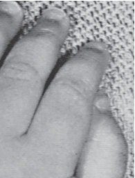

Unmatched source image; PDF page 2081. Consult the original caption.

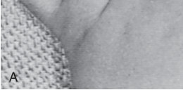

• Fig. 103.4 Clinical photograph (A) and radiograph (B) show congenital polydactyly, the most common digit duplication, with complete bones, tendons, and nerves. The recommended treatment is early ablation by amputation.

## PDF page 2082

juvenile, with the onset between 4 and 10 years of age; and adolescent, with the onset at 11 years of age or older. The adolescent type is the most common form of scoliosis, and the infantile type is the least common. The infantile type is more common in the United Kingdom than in North America, although the reason for this is unknown.

When a neonate or infant is found to have a spinal deformity, a very careful physical examination and radiographic assessment are necessary to determine if an underlying cause is present. A diagnosis of idiopathic scoliosis must be a diagnosis of exclusion. Physical examination includes evaluation of the spine for mobility and areas of tenderness. The skin should be inspected for cutaneous lesions that may indicate underlying spinal dysraphism. The lower extremities need to be evaluated carefully for symmetry and neurologic function.

Plain radiographs usually determine whether there is a spinal deformity. However, additional studies, such as magnetic resonance imaging (MRI), may be necessary to evaluate the spinal canal and spinal cord for possible lesions.

The treatment of infantile scoliosis is variable. Some curves may be observed and even improve spontaneously with growth or nonoperative treatment such as casting or bracing. However, others are progressive and require cast or orthotic management and possibly surgical intervention. It is important that all neonatal spinal abnormalities be referred to an orthopedic surgeon experienced in the management of pediatric spinal deformities.

### Congenital Spinal Deformities

Abnormalities of vertebral formation can result in structural deformities of the spine that may be evident in the neonate or become more obvious during the first year of life. Deformities in the coronal plane produce congenital scoliosis, whereas those in the sagittal plane produce congenital kyphosis. The total or partial failure of formation of the sacrum is called sacral agenesis, typically associated with infants of diabetic mothers. If the lower lumbar spine is also absent, it is called lumbosacral agenesis.

### Congenital Scoliosis

Congenital scoliosis is classified as failure of formation (e.g., hemivertebrae), failure of segmentation (e.g., unsegmented bars), or mixed (Fig. 103.5). A failure of formation or segmentation can be partial or complete and may occur as a single abnormality or in combination with other bone, soft tissue, or neurologic abnormalities of the axial or appendicular skeleton.12 Congenital genitourinary malformations occur in 20% of children with congenital scoliosis. Unilateral renal agenesis is the most common abnormality. Most genitourinary abnormalities do not require treatment, but approximately 6% of the affected patients have a silent obstructive uropathy. Renal ultrasound should be performed on all neonates with congenital scoliosis to search for possible genitourinary abnormalities. Congenital heart disease (10% to 15%) and spinal dysraphism (20%) also occur in

• Fig. 103.5 Radiograph of congenital scoliosis in a 3-year-old girl. A hemivertebra at T12 produces a 40-degree curve over a short segment of the spine. The mixed formation and segmentation defects in the upper thoracic spine are balanced and have not produced a significant curve.

neonates with congenital scoliosis. Intraspinal abnormalities include tethered spinal cord, intradural lipoma, syringomyelia, and diastematomyelia (Fig. 103.6).13 They are frequently associated with cutaneous lesions of the back, such as hairy patches, skin dimples, and hemangiomas, and with abnormalities of the feet and lower extremities, such as cavus feet, calf atrophy, asymmetric foot size, and neurologic changes. Ultrasound examination and MRI can be useful in the evaluation of spinal dysraphism in a neonate with congenital scoliosis. Congenital scoliosis may also occur in association with syndromes such as Klippel-Feil and VACTERL (abnormalities involving vertebral, anorectal, cardiac, tracheal, esophageal, renal/genitourinary, and limb structures) and with spinal dysraphism, such as myelodysplasia.14

The risk for progression of congenital scoliosis depends on the growth potential of the malformed vertebra(e).15 Defects such as block vertebrae have little growth potential, whereas unilateral unsegmented bars invariably produce progressive deformities. Approximately 75% of children with congenital scoliosis demonstrate some progression that typically continues until skeletal growth stops. Approximately 50% require treatment. Rapid progression can be expected during periods of rapid growth, such as those between birth and 2 years of age and those after 10 years of age. Orthotic management is usually contraindicated because it poorly mitigates these more rigid disorders. When progression is aggressive or neurologic changes occur,

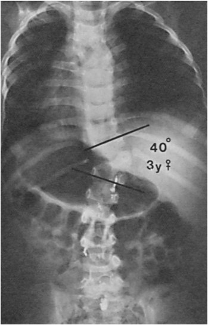

• Fig. 103.5 Radiograph of congenital scoliosis in a 3-year-old girl. A hemivertebra at T12 produces a 40-degree curve over a short segment of the spine. The mixed formation and segmentation defects in the upper thoracic spine are balanced and have not produced a significant curve.

## PDF page 2083 | printed page 2093

• Fig. 103.6 Metrizamide myelogram demonstrates cartilaginous diastematomyelia at L2 in a 3-year-old boy. Observe the midline filling defect and the increased widening or interpedicular distance in the middle lumbar region.

surgery is necessary. This may consist of combined anterior and posterior hemiepiphysiodesis on the convex side or possibly posteriorly approached osteotomies to halt progression and allow for some correction from growth on the concavity of the curvature.

### Congenital Kyphosis

Congenital kyphosis includes (1) failure of formation of all or part of the vertebral body with preservation of the posterior elements, and (2) failure of anterior segmentation of the spine (e.g., anterior unsegmented bar). The more severe deformities are usually recognized in the neonate and they rapidly progress thereafter. The less obvious deformities may not appear until several years later. After progression begins, it does not cease until the end of growth. The most important factor regarding congenital kyphosis is the possibility that a progressive deformity in the thoracic spine can result in paraplegia.16 This potential outcome is usually associated with failure of formation of the vertebral body. When necessary, the treatment of congenital kyphosis is operative.17

### Sacral Agenesis

Sacral agenesis comprises a group of disorders with partial or complete absence of the sacrum. If the lower lumbar spine is also involved, it is called lumbosacral agenesis.18,19 Motor function is typically lacking below the level of the

remaining spine; however, sensation tends to be present at a much more caudal level. The disorder can be classified by the amount of sacrum remaining and the articulation between the spine and pelvis. It is a rare disorder, occurring in approximately 1 in 25,000 live births, and the exact cause is unknown. The incidence is increased among the children of diabetic mothers.20

The presentations of neonates with sacral agenesis can vary considerably. In severe forms, there is a small pelvis with pterygia anteriorly at the hips and posteriorly at the knees, as well as bilateral foot deformities, typically clubfoot. There may be spinopelvic instability. Similar to myelomeningocele, the neurologic examination tends to show no motor function below the last existing vertebra or sacral segment. However, sensation can be more variable. Children with sacral agenesis also have other visceral abnormalities similar to those seen in congenital scoliosis.

The treatment of sacral agenesis is variable. Those patients with only partial agenesis and a stable spinopelvic articulation can be observed. Those who are unstable may require a spinopelvic fusion in childhood for stabilization. This operation can enhance sitting balance and improve the function of the upper extremities. The problems associated with the lower extremities may also require orthopedic intervention. If a child has the potential for ambulation, these problems need to be corrected to allow the child to assume an upright posture. Orthotics are usually necessary to support the extremities after they have been corrected.

### Lower Extremities

The most common neonatal congenital and developmental abnormalities of the lower extremities include torsional and angular deformities; developmental dysplasia of the hip (DDH); proximal femoral focal deficiency (PFFD); congenital hyperextension, subluxation, and dislocation of the knee; clubfoot; metatarsus adductus; vertical talus; calcaneovalgus foot; and toe deformities, such as syndactyly and polydactyly.

### Torsional and Angular Deformities Physiologic Bowleg

The lower extremities of typical neonates commonly have mild to moderate bowing (i.e., genu varum) and internal rotation of the lower leg because of in utero positioning. The bowed appearance is actually a torsional combination of the external rotation of the hip (i.e., tight posterior hip capsule) and internal tibial torsion from in utero positioning. With the onset of standing and independent walking, the bowing and torsion are spontaneously corrected over a 6- to 12-month period. Significant improvement does not occur during the neonatal period or the first year of life. The typical neonate has 15 degrees of genu varum, which decreases to approximately 10 degrees by 1 year of age. By 2 years of age, most children have straight or neutrally aligned lower extremities. Treatment is indicated for children older than 2 to 3 years of age who have had no documented

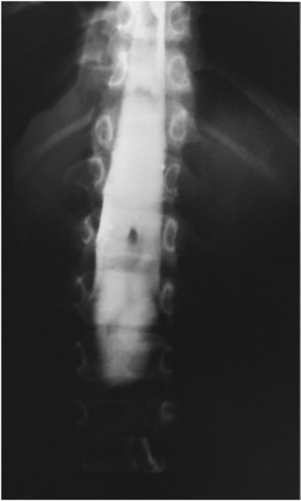

• Fig. 103.6 Metrizamide myelogram demonstrates cartilaginous diastematomyelia at L2 in a 3-year-old boy. Observe the midline filling defect and the increased widening or interpedicular distance in the middle lumbar region.

## PDF page 2084

improvement with growth or who have shown progressive worsening.

### Tibial Torsion

Torsional changes of the tibia may be internal or external, depending on in utero positioning. The degree of tibial torsion may be measured by the thigh-foot angle. With the child in the prone position, the knee is flexed to 90 degrees to neutralize the normal tibiofemoral rotation. The foot is placed in a neutral or simulated weight-bearing position. The long axis of the foot is compared with the long axis of the thigh. An inwardly rotated foot represents internal tibial torsion and is assigned a negative value. An outwardly rotated foot represents external tibial torsion and is assigned a positive value. It is important that the measurements be recorded on each visit to document the improvement. Radiographic evaluation is of no value in the assessment of tibial torsion.

Internal Tibial Torsion

Internal tibial torsion is the most common cause of intoeing from birth to 2 years of age. It is the major component of physiologic bowleg, or genu varum. Because this condition is physiologic, spontaneous resolution can be anticipated with normal growth and development. The persistence of internal tibial torsion in the older child or adolescent is uncommon.

External Tibial Torsion

External tibial torsion is a common deformity and is always associated with a calcaneovalgus foot. It is caused by a variation in the normal in utero position. The sole of the foot lies pressed against the wall of the uterus, forcing the limb into a hyper-dorsiflexed, everted position. This physiologic configuration produces the calcaneovalgus foot and, secondarily, the external tibial torsion. When these two conditions are combined with a normally externally rotated hip from a tight posterior hip capsule, they produce a very externally rotated or out-toed position. Because they are also physiologic in origin, both undergo spontaneous resolution and follow a clinical course similar to that of internal tibial torsion.

### Congenital Angular Deformities of the Tibia and Fibula

Congenital angular deformities of the tibia and fibula are uncommon neonatal problems. They are classified according to the direction of angulation—posteromedial, anterolateral, or anteromedial. Posteromedial angulation is less common but is characterized by spontaneous resolution with growth and development, although shortening tends to persist. Anterolateral angulation is more common and is typically associated with other underlying congenital abnormalities, such as congenital pseudarthrosis of the tibia (e.g., neurofibromatosis) and congenital absence of the tibia (e.g., tibial hemimelia). Anteromedial angulation is typically associated with fibular hemimelia.

A

B

• Fig. 103.7 (A) A 1-month-old boy with posteromedial angulation of the left tibia. This condition resembles a calcaneovalgus foot, because the dorsum of the foot comes in contact with the lower leg. However, there is posterior angulation of the tibia in this case. (B) The medial angulation is visible when viewed from the front.

Posteromedial Angulation

Posteromedial angulation has three associated clinical problems: angular deformity, the calcaneovalgus foot, and lower extremity limb length discrepancy. The angular deformity occurs at the junction of the middle and distal thirds of the shafts. The deformity is usually unilateral (Fig. 103.7). The neonates are normal and healthy and there is no increased incidence of other congenital abnormalities. The degree of angulation varies between 25 and 65 degrees and is equal in both posterior and medial directions. The foot is hyper-dorsiflexed and has a marked calcaneovalgus position. Radiographs are necessary to confirm the diagnosis. The cause of congenital posteromedial angulation in the tibia and fibula is unknown.

Posteromedial angulation resolves with growth, especially during the first 3 years of life. The posterior bowing tends to resolve more quickly than the medial bowing, which may not resolve until 5 years of age. However, the associated shortening of the tibia and fibula persists and progresses during growth. The fibula tends to be slightly shorter than the tibia. The appearance of the foot also improves, although a pes planovalgus appearance may persist.

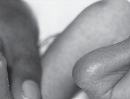

• Fig. 103.7 (A) A 1-month-old boy with posteromedial angulation of the left tibia. This condition resembles a calcaneovalgus foot, because the dorsum of the foot comes in contact with the lower leg. However, there is posterior angulation of the tibia in this case. (B) The medial angulation is visible when viewed from the front.

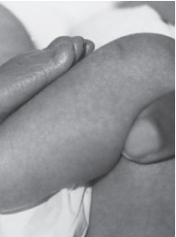

Unmatched source image; PDF page 2084. Consult the original caption.

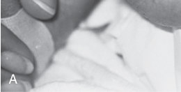

• Fig. 103.7 (A) A 1-month-old boy with posteromedial angulation of the left tibia. This condition resembles a calcaneovalgus foot, because the dorsum of the foot comes in contact with the lower leg. However, there is posterior angulation of the tibia in this case. (B) The medial angulation is visible when viewed from the front.

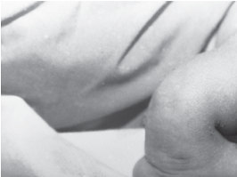

• Fig. 103.7 (A) A 1-month-old boy with posteromedial angulation of the left tibia. This condition resembles a calcaneovalgus foot, because the dorsum of the foot comes in contact with the lower leg. However, there is posterior angulation of the tibia in this case. (B) The medial angulation is visible when viewed from the front.

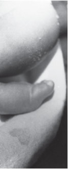

Unmatched source image; PDF page 2084. Consult the original caption.

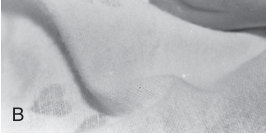

• Fig. 103.7 (A) A 1-month-old boy with posteromedial angulation of the left tibia. This condition resembles a calcaneovalgus foot, because the dorsum of the foot comes in contact with the lower leg. However, there is posterior angulation of the tibia in this case. (B) The medial angulation is visible when viewed from the front.

## PDF page 2085 | printed page 2095

Nonoperative treatment is indicated in the neonatal period. If the bowing does not resolve by 3 to 4 years of age, a tibial or fibular osteotomy may be necessary. The most common sequela of posteromedial angulation is a discrepancy in leg length. Most of these children have enough discrepancy to require equalization. An appropriately planned epiphysiodesis (physeal closure) of the longer limb is the most common procedure. Lengthening of the shorter limb may sometimes need to be considered.21,22 Children with valgus of greater than 30 degrees who have difficult ambulating can also be corrected with surgical intervention.23 For extensive deformity, an external fixator may be considered.24

Anterolateral Angulation

When anterolateral bowing is encountered, it is usually associated with a significant underlying pathologic disorder, such as congenital pseudarthrosis of the tibia or congenital longitudinal deficiency of the tibia. Careful clinical and radiographic evaluation is necessary to establish the correct diagnosis. Congenital pseudarthrosis of the tibia is typically associated with neurofibromatosis. Congenital pseudarthrosis can be quite challenging to manage because of the pathobiology involved in which bone healing is hindered. Successful techniques have included improving both the deformity and the biology at the site of the pseudarthrosis.25

Anteromedial Angulation

Anteromedial bowing is associated with fibular deficiency, also known as fibular hemimelia. Treatment depends on the degree of deficiency and can range from observation to operative management, depending on the severity of angulation and/or limb length discrepancy.

### Hip

The most common congenital hip abnormality is developmental dysplasia of the hip (DDH). Another congenital abnormality, although uncommon, is proximal femoral focal deficiency (PFFD).

### Developmental Dysplasia of the Hip

Developmental dysplasia of the hip (DDH) is the most common neonatal hip disorder.26 It was initially thought to be congenital in origin but is now recognized as developmental; hence the change in terminology from congenital dysplasia of the hip to DDH. At birth, an involved hip is rarely dislocated; instead, it is dislocatable. Whether the hip stabilizes, subluxates, or ultimately dislocates depends on postnatal factors. Most developmental dislocations are postnatal in origin; however, the exact time of their occurrence is controversial.

Neonatal hip dislocations are classified into two major groups: the typical, which is found in a neurologically normal infant, and the teratologic, which is found in an infant with an underlying neuromuscular disorder, such as myelodysplasia, arthrogryposis multiplex congenita, or a complex of syndromes. Teratologic dislocations occur in utero and

are therefore truly congenital in origin. This section concentrates on typical DDH, because it is the more common form.

Pathology and Etiology

The pathogenesis and causes of typical DDH are multifactorial: genetic, physiologic, and mechanical factors are involved. The genetic factors include a positive family history (20%) and generalized ligamentous laxity, an inherited trait. The physiologic factors include female predominance (ration of 9:1), maternal estrogen, and other hormones associated with pelvic relaxation during labor and delivery. The mechanical factors include primigravida status, breech presentation, and postnatal positioning. Positioning has a significant effect in determining which hip stabilizes and which may progress to dislocation.

The genetic and physiologic aspects are related etiologic factors. Most neonates with DDH have generalized ligamentous laxity, which can predispose to hip instability. The maternal estrogen and other hormones associated with pelvic relaxation at delivery cross the placenta and result in further, albeit temporary, relaxation of the newborn hip joint. Female infants have increased sensitivity to estrogen.

Approximately 60% of those children with typical DDH are first-born, and 30% to 50% develop it as a result of the breech position. In this position, there is extreme hip flexion and a limitation of hip motion that results in the stretching of an already lax hip capsule and ligamentum teres and in the posterior uncovering of the femoral head. Decreased hip motion results in the lack of normal stimulation for the growth and development of the cartilaginous acetabulum.27

Congenital muscular torticollis and metatarsus adductus can be associated with DDH. The presence of either of these conditions necessitates a careful examination of the hips.

Postnatal factors are important determinants in ultimate hip stability. Positioning an unstable hip in adduction and extension may lead to dislocation. These positions put the unstable hip under abnormal pressure as a result of the normal hip flexion and abduction contractures. Consequently, an unstable femoral head can be displaced from the acetabulum over several days or weeks.

Because the hips are not dislocated at birth, the components of the hip joints, excluding the hip capsule and ligamentum teres, are usually relatively normal. There may be some variation in the shape of the cartilaginous acetabulum. If a subluxation or dislocation is not recognized, it will lead to progressive acetabular dysplasia and maldirection, excessive femoral anteversion (e.g., torsion), and hip muscle contracture.28 It is critical that an early diagnosis be made and appropriate treatment instituted. The longer a dislocation continues, the more complex the treatment becomes.

Diagnosis

The physical findings in neonates with DDH include a positive Barlow test (i.e., dislocatable hip) or positive Ortolani test (i.e., dislocated hip), asymmetric thigh skin folds,

## PDF page 2086

• Fig. 103.8 Positioning of the hip in the newborn to perform two diagnostic tests. The Ortolani sign, or click of reduction, is elicited when abducting the hip in this manner. The reverse Ortolani, or Barlow, maneuver is performed by bringing the femur into adduction with flexion, causing a click of exit or dislocation.

uneven knee levels (i.e., Allis or Galeazzi sign), and the absence of normal knee flexion contractures.

The Barlow and Ortolani tests are the most sensitive for neonatal hip instability (Fig. 103.8). The Barlow test29 is a provocative means of diagnosing an unstable hip and is the most important maneuver in examining the neonatal hip. With the infant supine, this test is performed by stabilizing the pelvis with one hand, flexing and adducting each hip separately, and applying a posterior force with the other hand, while the fingers rest on the greater trochanter (Fig. 103.9). If a hip is dislocatable, it is usually felt as a “clunk.” After release of the posterior pressure, the hip usually spontaneously relocates. It has been estimated that approximately 1 in 100 newborns has a clinically unstable hip (i.e., subluxatable or dislocatable) and that 1 in 800 to 1000 infants eventually develop a true dislocation. A posteriorly dislocated hip may feel “stable” because it does not sublux in or out of the joint.

The Ortolani test30 is a procedure to reduce a recently dislocated hip (Fig. 103.10). It is most likely to be positive in infants who are 1 to 2 months of age because adequate time must have passed for true dislocation to occur. This test is performed concomitantly with the Barlow test. With the hip flexed, the thigh is abducted and the femoral head lifted anteriorly into the acetabulum. If a reduction occurs, it is felt as a “clunk.” Clunks should not be confused with hip “clicks,” which are common in neonates.31 A variety of normal factors produce a clicking sensation during examination of the hip, including the breaking of surface tension across the hip joint, the snapping of gluteal tendons, patellofemoral motion, and femorotibial (knee) rotation. These normal characteristics are commonly misinterpreted as a sign of instability. After 2 months of age, the Ortolani test usually becomes negative. It is no longer possible to relocate a dislocated hip because of the development of soft tissue contractures.

When the hip is dislocated, its abduction is limited by soft tissue contractures (Fig. 103.11). There are also an increased number of thigh skin folds on the involved side owing to redundant soft tissues, the appearance of a shortened extremity, and a positive Allis or Galeazzi sign. The

• Fig. 103.9 The Barlow test permits the early diagnosis of hip instability. It is a provocation test for dislocatability. The pelvis is steadied with one hand while the leg to be tested is grasped with the other. The thumb of the examiner’s hand should lie over the lesser trochanter and the tip of the middle finger over the greater trochanter. With the hip and knee in flexion, gentle pressure is exerted with the thumb over the lesser trochanter. Dislocatability is manifested by a sudden shift of the proximal femur. Dislocation may be reduced with the Ortolani test.

• Fig. 103.10 In the Ortolani test, the pelvis is held steady with one hand while the limb to be examined is grasped with the other. The hip and knee are flexed. While gently pulling the femur forward, the examiner abducts the limb under examination, using the greater trochanter as a fulcrum. Reduction of dislocation is manifested by a sudden shift in the position of the proximal femur, often accompanied by a palpable or audible clunk. There must be sufficient ligamentous laxity to permit relocation of the proximal femur into the acetabulum; therefore the test is useful primarily in the neonatal period.

latter sign is demonstrated by flexing the hips of the supine neonate together on the examining table and assessing the relative heights of the knees. An apparent shortening is observed on the involved side. With a proximal displacement of the femoral head, the quadriceps and hamstrings become relaxed. This effect can be demonstrated best by the so-called “hamstring” test. Both hips are flexed and abducted with the knees flexed. Attempts to extend the knee are resisted on the normal side because of increased tightness

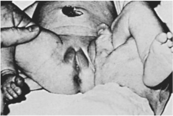

• Fig. 103.8 Positioning of the hip in the newborn to perform two diagnostic tests. The Ortolani sign, or click of reduction, is elicited when abducting the hip in this manner. The reverse Ortolani, or Barlow, maneuver is performed by bringing the femur into adduction with flexion, causing a click of exit or dislocation.

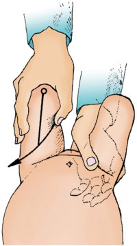

• Fig. 103.9 The Barlow test permits the early diagnosis of hip instability. It is a provocation test for dislocatability. The pelvis is steadied with one hand while the leg to be tested is grasped with the other. The thumb of the examiner’s hand should lie over the lesser trochanter and the tip of the middle finger over the greater trochanter. With the hip and knee in flexion, gentle pressure is exerted with the thumb over the lesser trochanter. Dislocatability is manifested by a sudden shift of the proximal femur. Dislocation may be reduced with the Ortolani test.

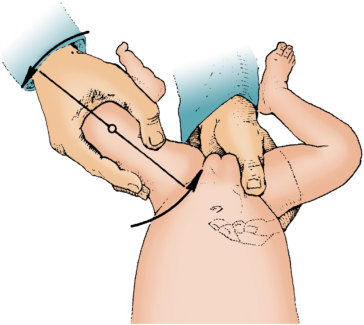

• Fig. 103.10 In the Ortolani test, the pelvis is held steady with one hand while the limb to be examined is grasped with the other. The hip and knee are flexed. While gently pulling the femur forward, the examiner abducts the limb under examination, using the greater trochanter as a fulcrum. Reduction of dislocation is manifested by a sudden shift in the position of the proximal femur, often accompanied by a palpable or audible clunk. There must be sufficient ligamentous laxity to permit relocation of the proximal femur into the acetabulum; therefore the test is useful primarily in the neonatal period.

## PDF page 2087 | printed page 2097

• Fig. 103.11 Clinical photograph showing the limitation of abduction of the thighs when the hips are flexed at 90 degrees.

in the hamstrings. If a dislocated hip is present, the knee can come into full extension because of the lack of proximal stability, which otherwise produces a fixed fulcrum for the hamstring muscles. As the child starts to walk, lumbar lordosis can be seen in those with bilaterally dislocated hips.

The presence of bilateral limitation of hip abduction in the young infant may be a normal variant and is an inaccurate clinical sign in the diagnosis of pathologic DDH. Limitation of hip abduction should be actively sought after 6 to 8 weeks of age and, if present, should be followed by a formal ultrasound or radiographic examination to confirm whether the hip is developing in a satisfactory manner.32

Imaging

The imaging of neonatal DDH is best accomplished with ultrasonography and plain radiographs. Ultrasonography33 has become an increasingly popular method for the evaluation and assessment of the neonatal hip because the femoral head does not ossify until 4 to 7 months of age. Hip stability and acetabular and femoral head development can be accurately assessed by an experienced ultrasonographer. Ultrasonography allows avoidance of the effects of ionizing radiation but is very user dependent. It is so sensitive that false-positive results are common. In large screening programs in which all births are screened, it is common to identify 7.5% of neonates with abnormal results.34 This percentage decreases to a more appropriate level of 0.4% by 6 weeks, but the expense, anxiety, and administrative stress of retesting can be considerable. At present, there is no agreement about the efficacy of routine screening for all infants.35–37 Some large centers suggest it, although others claim that selective ultrasonography is as effective as universal screening when it is accompanied by a good clinical screening program.38 Additionally, a stable, normal ultrasound does not assure normal hips after 6 months of age. Gwynne Jones has reported on seven developmental dislocations in five babies (age 6 to 22 months) in whom ultrasound demonstrated stable and reduced hips.39 The Pediatric Orthopedic Society of North America (POSNA) warns that late-onset dislocation can be expected in 1 in 5000 infants who are clinically stable in the newborn period.40 Anteroposterior and frog-lateral radiographs of the pelvis may also be obtained after 4 to 6 months of age. The

• Fig. 103.12 Anteroposterior pelvic radiograph of a 9-month-old girl with a complete dislocation of the left hip. Observe the hypoplasia of the proximal femur and ossific nucleus of the femoral head. The right hip is normal.

limitation of plain radiographs is owing to the lack of ossification of the femoral head, which may be further delayed in DDH (Fig. 103.12). Line measurements can be drawn to determine the development of the acetabulum and the relationship between the femoral head and acetabulum.

Treatment

The treatment of neonatal DDH is simple and effective. The most important factor in the treatment of this disorder is an early accurate diagnosis. When an unstable or dislocatable hip (Barlow positive) is recognized at birth, maintenance of the hip in the position of flexion and abduction is usually sufficient. This position maintains reduction of the femoral head in the acetabulum and allows the progressive tightening of the ligamentous structures as the child grows. It also stimulates the normal growth and development of the acetabulum. The methods that can be used to maintain the hip in this position include the Pavlik harness, the Frejka pillow splint, and a variety of abduction orthoses. Double or triple diapers, although controversial, are commonly used in early infancy because the harness, pillow splint, and abduction orthoses usually do not fit satisfactorily. Treatment is continued until there is clinical stability of the hip and the ultrasonographic or radiographic results are normal, both of which usually take place within 3 to 4 months.

There may also be a true dislocation (Ortolani positive) during the neonatal period. As a consequence, treatment is directed toward the reduction of the femoral head into the true acetabulum.

The Pavlik harness is the major mode of treatment in this age group (Fig. 103.13). The harness places the hips in an ideal position by flexing them more than 90 degrees (preferably 100 to 110 degrees) and maintaining relatively full but gentle abduction (50 to 70 degrees). This position redirects the femoral head toward the deep center of the acetabulum. A spontaneous reduction usually occurs within 3 to 4 weeks. The Pavlik harness is approximately 95% successful for Barlow-positive hips and 80% successful for Ortolanipositive hips. If true dislocations are initially irreducible, treatment with the Pavlik harness may not be effective. Lerman and co-workers reported on 93 DDH patients treated

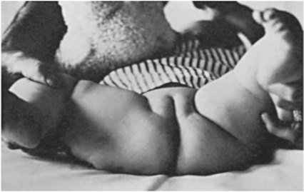

• Fig. 103.11 Clinical photograph showing the limitation of abduction of the thighs when the hips are flexed at 90 degrees.

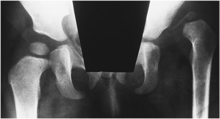

• Fig. 103.12 Anteroposterior pelvic radiograph of a 9-month-old girl with a complete dislocation of the left hip. Observe the hypoplasia of the proximal femur and ossific nucleus of the femoral head. The right hip is normal.

## PDF page 2088

• Fig. 103.13 The Pavlik harness is a safe, reliable means of treating hip instability and dislocation in the neonate.

with a Pavlik harness.41 There were 82% who were successfully treated. Six patients had initially irreducible hips and less than 20% ultrasound coverage; all six failed treatment with the Pavlik harness. If the reduction of a dislocated hip is achieved, treatment is continued until ultrasonography or the radiographic parameters have returned to normal. If a spontaneous reduction does not occur, closed reduction by surgery will be necessary. This approach sometimes consists of preliminary skin traction for 1 to 3 weeks to stretch the existing soft tissue contractures, followed by an examination under anesthesia, percutaneous hip adductor tenotomy, closed reduction, an arthrogram to assess the concentricity of the reduction, and the application of a hip spica cast in a flexed and abducted position. A post-reduction CT or MRI scan is obtained to confirm reduction. Treatment is continued until the radiographic parameters are within normal limits. The indications for an open reduction in the neonate up to the first 6 months of life are limited. Follow-up for at least 1 year is necessary, because dysplastic hips that improve with treatment can still subsequently deteriorate. If this deterioration occurs, further treatment is indicated.

The complications associated with treatment of neonatal DDH include failure of reduction and redislocation. Avascular necrosis of the capital femoral epiphysis, which is the most devastating complication of this disorder, develops in approximately 5% of infants, regardless of how careful initial management may have been.

### Proximal Femoral Focal Deficiency

Proximal femoral focal deficiency (PFFD) is a congenital abnormality affecting the development of the proximal end of the femur and possibly the acetabulum. There is considerable variation, ranging from a mildly shortened femur to severe shortening with an absence of the femoral head and acetabulum. It may be bilateral or unilateral; bilateral cases tend to have more severe involvement. The cause of PFFD is unknown, but it results from embryologically abnormal formation of the hip that occurs during limb bud formation.

• Fig. 103.14 Clinical photograph of a newborn boy with significant shortening of the right thigh caused by proximal femoral focal deficiency.

The clinical examination is usually diagnostic. The thigh is shortened, and the hip is held in flexion, abduction, and external rotation (Fig. 103.14). There are usually hip- and knee-flexion contractures. Because of the proximity of the entire lower limb to the trunk, the entire extremity appears similar to a funnel. There may also be abnormalities of the leg. Approximately 50% to 70% of affected neonates also have fibular hemimelia with or without the absence of the lateral portion of the foot.

Radiographs are necessary in the assessment of children with PFFD. However, the joint may not be fully visualized because of the lack of ossification. If an acetabulum is present, there will usually be a femoral head. MRI scans can be helpful in difficult cases to determine the shape of the proximal femur and acetabulum.

The most important therapeutic component of the treatment of neonatal PFFD is observation. It is important that a careful evaluation be performed to search for other associated congenital abnormalities. The ultimate treatment depends on the length of the extremity, the stability of the hip, the presence or absence of a functional foot, and a determination of whether the disorder is unilateral or bilateral. Possible treatment options include prosthetic fitting; knee fusion, Syme amputation, and prosthesis; surgical reconstruction; and lengthening of the femur. The lengthening of the femur is considered only if the hip and knee are relatively normal and the degree of predicted shortening is less than 15 to 20 cm at skeletal maturity.

### Knee Hyperextension, Subluxation, and Dislocation of the Knee

The congenital abnormality comprising hyperextension, subluxation, and dislocation of the knee is uncommon.

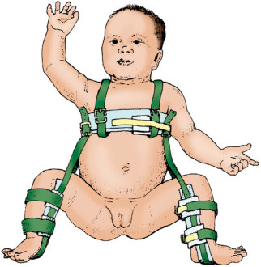

• Fig. 103.13 The Pavlik harness is a safe, reliable means of treating hip instability and dislocation in the neonate.

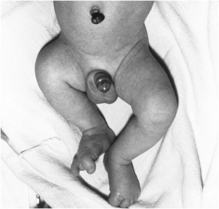

• Fig. 103.14 Clinical photograph of a newborn boy with significant shortening of the right thigh caused by proximal femoral focal deficiency.

## PDF page 2089 | printed page 2099

A B

• Fig. 103.15 (A) Clinical photograph of a newborn boy with bilateral congenital or developmental subluxation of the knees. The knees are hyperextended and have limited flexion. (B) Lateral radiograph demonstrating the hyperextension or subluxation of the right knee.

The tibia is displaced anterior to the femur, and the knee is hyperextended. The cause is multifactorial, with mechanical and genetic elements. Most cases are sporadic, with no particular predisposition; however, patients with inherited Larsen disease frequently demonstrate congenital subluxation and dislocation of the knee. Breech presentation is more frequently seen in children with congenital subluxation and dislocation of the knee, suggesting that mechanical factors are also important.

The pathologic picture is complex, and associated disorders are common. Studies have found a high association with congenital hip abnormalities.42,43 Seven patients had clubfoot and seven were thought to have arthrogryposis multiplex congenita. Fibrosis of the quadriceps muscle was found in all surgical cases. The quadriceps muscle effectively runs from the anteroinferior iliac spine to the tibial tubercle, and progressive fibrosis would thereby provide pressure for anterior subluxation of the tibia and hip deformity, as well as a tendency to hyperextend the knee.

The diagnosis is made on physical examination. Hyperextension at the knee sometimes approaches 90 degrees (Fig. 103.15). A lateral radiograph can demonstrate that the tibia is anterior to the femur. A line is drawn down the long axis of the tibia and the long axis of the femur; it does not meet at the normal axis of the knee joint.

In benign hyperextension of the knee, hyperextension of 15 to 30 degrees is common. Flexion is frequently limited to a few degrees. In this “packing deformity,” the radiographs demonstrate that the tibia is not anterior to the femur and that the center of rotation of the knee joint is normal, unlike congenital dislocation and subluxation of the knee. It is important to obtain the radiographs of knees that hyperextend considerably to determine whether an epiphyseal fracture is responsible for hyperextension of the knee. The results of treatment are very different when benign hyperextension of the knee is compared with congenital dislocation of the knee. In benign hyperextension of the knee and, to a certain extent, congenital subluxation of

the knee, manipulation and serial splinting or casting provide an adequate result. Early manipulation and casting are often successful in uncomplicated congenital dislocation of the knee if treatment is begun during the first few weeks of life. The prognosis is much worse when the knee dislocation is associated with Larsen disease or arthrogryposis multiplex congenita.44 Children with congenital dislocation of the knee who fail casting may benefit from traction delivered through skeletal pins in the tibia and femur. The goal of treatment is to achieve at least 100 to 110 degrees of knee flexion and full, stable knee extension before the child reaches walking age. If these objectives cannot be attained with casting, splinting, or traction, then surgery before the child reaches walking age is recommended.

### Foot and Toes

The most common foot and toe disorders include metatarsus adductus, the calcaneovalgus foot (pes calcaneovalgus), talipes equinovarus (clubfoot), congenital vertical talus, and syndactyly and polydactyly of the toes.

### Metatarsus Adductus

Metatarsus adductus, or forefoot adduction, is probably the most common neonatal foot problem. It results from in utero positioning, occurring equally in boys and girls, and is bilateral in approximately 50% of neonates. The disorder has hereditary tendencies and is more common in the first-born than subsequent children because of an increased molding effect from the primigravid uterus and abdominal wall. It can also be associated with DDH. Approximately 10% of children with metatarsus adductus have DDH; careful examination of the hips is necessary in any neonate with metatarsus adductus.45

Diagnosis

Clinically, the forefoot is adducted and occasionally supinated. The hindfoot and midfoot are normal. The lateral

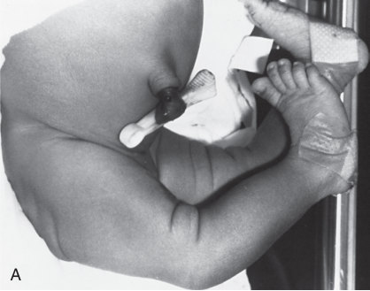

• Fig. 103.15 (A) Clinical photograph of a newborn boy with bilateral congenital or developmental subluxation of the knees. The knees are hyperextended and have limited flexion. (B) Lateral radiograph demonstrating the hyperextension or subluxation of the right knee.

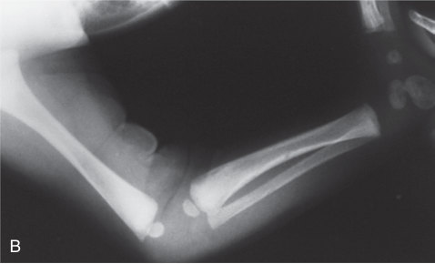

Unmatched source image; PDF page 2089. Consult the original caption.

## PDF page 2090

A B • Fig. 103.16 Bilateral metatarsus adductus. (A) Dorsomedial and dorsolateral views. The medial border of the foot is concave; the lateral border is convex. The medial arch may be accentuated. (B) Posterior view. A slightly valgus hindfoot may be present in the standing position.

border of the foot is convex, and the base of the fifth metatarsal appears to be prominent (Fig. 103.16). The medial border of the foot is concave. There is usually an increased interval between the first and second toes, with the great toe being held in a greater varus position. Ankle dorsiflexion and plantar flexion are normal. These characteristics distinguish metatarsus adductus from a congenital clubfoot. Forefoot flexibility is variable. Passive flexibility is assessed by stabilizing the hindfoot in a neutral position with one hand and applying pressure along the first metatarsal head with the other. Active flexibility is assessed by gently simulating the lateral border of the involved foot. This approach induces reflex activity in the peroneal muscles along the lateral aspect of the calf. The forefoot is typically classified as flexible, moderately flexible, or rigid. In flexible metatarsus adductus, the forefoot achieves an overcorrected position actively and passively. In moderately flexible metatarsus adductus, the forefoot can be corrected to the neutral position. In rigid metatarsus adductus, the forefoot cannot be corrected to the neutral position.

Imaging

Routine radiographs are unnecessary in the evaluation of metatarsus adductus. Radiographs do not demonstrate forefoot mobility; however, anteroposterior and lateral simulated weight-bearing radiographs of the foot are necessary to assist in the diagnosis of rigid deformities and those in which a diagnosis by other means is uncertain.

Treatment

Approximately 85% of neonatal metatarsus adductus deformities resolve spontaneously by 3 years of age46,47 and 95% resolve by 16 years of age.48 Treatment is seldom recommended for metatarsus adductus, because most patients develop normal foot position and mobility without treatment, and even those with some residual deformity generally have normal function. If surgical treatment is required, the abductor hallucis muscle can be released.

### Calcaneovalgus Foot

The calcaneovalgus foot is a common physiologic variant. It results from in utero positioning. This condition is

manifested by a hyper-dorsiflexed foot, with an abducted forefoot and valgus hindfoot. It is usually associated with external tibial torsion. It typically occurs unilaterally but also occasionally occurs bilaterally. In utero, the plantar surface of the foot lies against the uterine wall, forcing it into a hyper-dorsiflexed, abducted, and externally rotated position (Fig. 103.17). This position produces the calcaneovalgus foot and external tibial torsion. When these two conditions are combined with the normal, increased external rotation of the hip (e.g., tight posterior hip capsule) in the neonate, the result is a lower extremity that appears excessively externally rotated. Of note, it has been suggested that the calcaneovalgus foot may have an even higher association with DDH than metatarsus adductus.49

Diagnosis

The neonate typically presents with external rotation of the involved extremity and a calcaneovalgus foot. The forefoot is abducted, and the heel is in an everted (valgus) position. The foot can be hyper-dorsiflexed to bring its dorsal surface in contact with the anterior aspect of the lower leg. This condition should not be confused with the neonatal maturity classification of Dubowitz. External tibial torsion of 20 to 50 degrees is common. Ankle motion usually shows normal to nearly normal plantar flexion.

Three conditions must be distinguished from the benign calcaneovalgus foot: congenital vertical talus, posteromedial bowing of the tibia, and neuromuscular disorders that are associated with paralysis of the gastrocnemius muscles. This differentiation can usually be established by clinical examination.

Imaging

Routine imaging of a benign calcaneovalgus foot is unnecessary; it is predominantly a clinical diagnosis. However, in severe deformities or in those with limited mobility, anteroposterior and lateral simulated weight-bearing radiographs of the foot and possibly the leg are necessary. These radiographs allow the recognition of a congenital vertical talus or posteromedial bowing of the tibia.

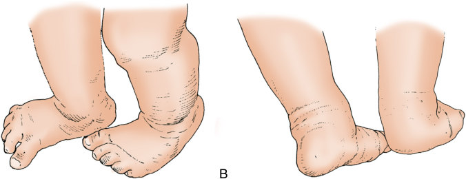

Unmatched source image; PDF page 2090. Consult the original caption.

## PDF page 2091 | printed page 2101

A

B

• Fig. 103.17 (A) A 3-month-old boy with a calcaneovalgus foot. The foot can be dorsiflexed to allow the dorsum to come in contact with the anterior aspect of the lower leg. (B) There is abduction of the forefoot and increased valgus alignment of the hindfoot. This condition is always associated with external tibial torsion.

Treatment

The benign calcaneovalgus foot does not require treatment other than gentle stretching. This deformity usually resolves during the first 6 months of life. However, external tibial torsion follows the same natural history as that of internal tibial torsion. Spontaneous improvement does not take place until the child begins to pull to stand and walk independently. It takes 6 to 12 months thereafter to achieve complete correction. Most neonates presenting with a benign calcaneovalgus foot and external tibial torsion have a normally aligned foot and lower extremity by 2 years of age.

### Talipes Equinovarus (Clubfoot)

A congenital clubfoot is one of the most common pathologic entities affecting the neonatal foot. It is a deformity of the foot and leg. It is classified as congenital, teratologic, or positional. The congenital clubfoot is usually an isolated abnormality, whereas the teratologic form is associated with an underlying neuromuscular disorder, such as myelodysplasia or arthrogryposis multiplex congenita. Positional clubfoot refers to a normal foot that has been held in an equinovarus position in utero.

The cause of congenital clubfoot is unknown. There are genetic factors that have been increasingly elucidated.50,51

• Fig. 103.18 Clinical photograph of a 9-month-old boy with bilateral talipes equinovarus (clubfoot) deformity.

It develops more commonly in boys (ratio of 2:1) and is bilateral in 50% of cases. The probability of the deformity occurring randomly is 1 in 1000 live births, but within affected families the probability is approximately 3% for subsequent siblings and 20% to 30% for the offspring of affected parents. Muscle biopsies of the extrinsic muscles, electromyographic studies of these muscles, and histologic analysis of the associated connective tissue have indicated a probable neuromuscular etiology.52,53 There are disproportionate fiber types and increased neuromuscular junctions within these muscles. These findings contrast with previous etiologic theories in which the deformity of the talus was thought to be the primary abnormality. These findings also suggest a reason as to why clubfoot is ubiquitous in syndromes and neuromuscular disorders; any child with a clubfoot deformity requires a careful musculoskeletal and neurologic evaluation to search for other abnormalities.

Diagnosis

A congenital clubfoot is characterized by equinovarus deformity of the foot and ankle; variable rigidity of the deformity; mild calf atrophy; and mild hypoplasia of the tibia, fibula, and bones of the foot (Fig. 103.18).

Imaging

Anteroposterior and lateral standing or simulated weightbearing radiographs tend not to be used as an adjunct to neonatal treatment. In older individuals with recalcitrant clubfeet, multiple different radiographic measurements can be made. The navicular bone, which is the primary site of the deformity, does not ossify until 3 years of age in girls and 4 years of age in boys. Line measurements are required to determine the position of the unossified navicular bone and the overall alignment of the foot.

Treatment

Both nonoperative and operative methods are used in the treatment of clubfoot deformities. Nonoperative methods include taping, malleable splints, and serial plaster casts. Taping and malleable splints are particularly useful in premature infants until they attain an appropriate size

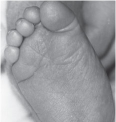

• Fig. 103.17 (A) A 3-month-old boy with a calcaneovalgus foot. The foot can be dorsiflexed to allow the dorsum to come in contact with the anterior aspect of the lower leg. (B) There is abduction of the forefoot and increased valgus alignment of the hindfoot. This condition is always associated with external tibial torsion.

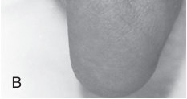

• Fig. 103.17 (A) A 3-month-old boy with a calcaneovalgus foot. The foot can be dorsiflexed to allow the dorsum to come in contact with the anterior aspect of the lower leg. (B) There is abduction of the forefoot and increased valgus alignment of the hindfoot. This condition is always associated with external tibial torsion.

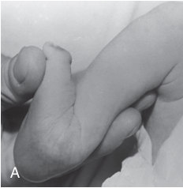

• Fig. 103.17 (A) A 3-month-old boy with a calcaneovalgus foot. The foot can be dorsiflexed to allow the dorsum to come in contact with the anterior aspect of the lower leg. (B) There is abduction of the forefoot and increased valgus alignment of the hindfoot. This condition is always associated with external tibial torsion.

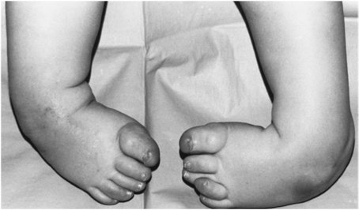

• Fig. 103.18 Clinical photograph of a 9-month-old boy with bilateral talipes equinovarus (clubfoot) deformity.

## PDF page 2092

for casting. Serial plaster casting, as described by Ponseti, is the primary nonoperative method of treatment. For each cast change, the foot is gently manipulated toward the corrected position. Casts are changed at 1- to 2-week intervals to allow for progressive correction. Achilles tenotomies are often required to complete this treatment method. The Ponseti casting technique and Achilles tenotomy are followed by a prolonged period of bracing, which lasts from 2 to 4 years. Strict adherence to the bracing protocol is mandatory for a positive outcome.54

Complete clinical and radiographic correction should be achieved by 3 months of age. The failure to achieve clinical and radiographic correction by 3 months of age is an indication for surgical treatment, because further attempts at casting may result in articular damage or a midfoot break (e.g., rocker-bottom deformity). Previously, primary operative treatment of congenital clubfoot often required a complete soft tissue release, usually performed between 6 and 12 months of age, and satisfactory long-term results were anticipated in 80% to 90% of cases. However, the aforementioned Ponseti method of serial casting (augmented with percutaneous Achilles tenotomy when necessary) has now become widely accepted as the standard of care.55 The Ponseti casting technique and Achilles tenotomy are followed by a prolonged period of bracing, which lasts until 2 to 4 years of age. Strict adherence to the bracing protocol is mandatory for a positive outcome.56 Arthrogryposis can be associated with a more complex clubfoot that requires some variation in treatment. A more complex or atypical type of clubfoot has also been described with a deeper crease in the midfoot. Modifications to the Ponseti method allow for similar treatment despite the increased complexity, but recurrence rates can be higher.57

### Congenital Vertical Talus

Congenital vertical talus is an uncommon neonatal foot deformity, but its etiology is similar to that of clubfoot.58,59 It must be distinguished from the benign calcaneovalgus foot, which is a much more common deformity. Congenital vertical talus typically presents as a rigid rocker-bottom deformity. Most of these deformities are associated with an underlying disorder such as teratologic malformation, myelodysplasia, arthrogryposis multiplex congenita, or a syndrome such as trisomy 18.

Diagnosis

The clinical characteristic of congenital vertical talus is a rocker-bottom foot (Fig. 103.19). There is an equinus hindfoot, a valgus hindfoot, a convex plantar surface, forefoot abduction and dorsiflexion, and rigidity. A careful musculoskeletal and neurologic examination must be performed on all neonates to search for associated disorders or syndromes.

Imaging

The radiographic evaluation of congenital vertical talus is similar to that of clubfoot. Anteroposterior and

A

B

• Fig. 103.19 (A) A newborn girl with congenital vertical talus. The dorsum of the foot also comes in contact with the anterior aspect of the lower leg. The foot has a rocker-bottom appearance. (B) An attempted plantar flexion shows the tightness of the anterior musculature and a persistent rocker-bottom appearance of the midfoot and hindfoot.

lateral simulated weight-bearing radiographs of the feet are obtained (Fig. 103.20) and typically reveal a vertically oriented talus, dorsal displacement of the midfoot on the hindfoot, and a valgus hindfoot. To identify a vertical talus, a lateral x-ray is taken with the foot and ankle in a plantarflexed position. The navicular will be seen out of alignment with the talus in a congenital vertical talus but will reduce in an oblique talus.

Treatment

As in clubfoot, nonoperative treatment is the initial method of management. Dobbs has advocated a program of serial casting beginning at birth.60 The forefoot is manipulated into an equinus position in an attempt to reduce the dorsally dislocated navicular bone onto the head of the talus. Once this is achieved, the talonavicular joint is surgically pinned and a percutaneous Achilles tenotomy then allows the ankle to be dorsiflexed without losing reduction at that joint. This technique has shown promise in decreasing the need for extensive initial soft tissue releases.

The goals for the treatment of congenital vertical talus are modest and include obtaining a plantigrade, painless foot on which a shoe can be worn. Orthotic management is frequently necessary postoperatively to maintain alignment and minimize the risk for recurrent deformity.

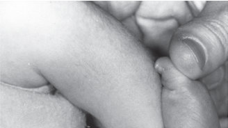

• Fig. 103.19 (A) A newborn girl with congenital vertical talus. The dorsum of the foot also comes in contact with the anterior aspect of the lower leg. The foot has a rocker-bottom appearance. (B) An attempted plantar flexion shows the tightness of the anterior musculature and a persistent rocker-bottom appearance of the midfoot and hindfoot.

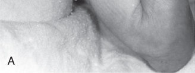

• Fig. 103.19 (A) A newborn girl with congenital vertical talus. The dorsum of the foot also comes in contact with the anterior aspect of the lower leg. The foot has a rocker-bottom appearance. (B) An attempted plantar flexion shows the tightness of the anterior musculature and a persistent rocker-bottom appearance of the midfoot and hindfoot.

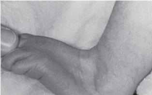

• Fig. 103.19 (A) A newborn girl with congenital vertical talus. The dorsum of the foot also comes in contact with the anterior aspect of the lower leg. The foot has a rocker-bottom appearance. (B) An attempted plantar flexion shows the tightness of the anterior musculature and a persistent rocker-bottom appearance of the midfoot and hindfoot.

## PDF page 2093 | printed page 2103

• Fig. 103.20 Radiograph of a 9-month-old infant showing the vertical alignment of the talus, equinus hindfoot, and dorsal angulation of the midfoot and forefoot.

### Syndactyly and Polydactyly of the Toes

Syndactyly and polydactyly are common disorders of the toes.61,62 Syndactyly of the toes is almost always asymptomatic and rarely requires treatment but may be associated with a positive family history. Syndactyly may be classified as zygodactyly (a complete or incomplete webbing usually involving the second and third toe) or polysyndactyly (polydactyly of the fifth toe and syndactyly between the duplicated toes). Zygodactyly does not interfere with wearing shoes or normal function and does not require treatment; polysyndactyly usually requires treatment.

Polydactyly of the toes can be preaxial (i.e., great toe), central, or postaxial (i.e., fifth toe). It occurs in approximately 2 of 1000 live births and is more common among African Americans than Caucasians. Postaxial deformities are the most common (80%) and can be subdivided into type A (articulated) and type B (rudimentary). Approximately 30% of neonates with polydactyly have a positive family history. It is usually an isolated disorder with autosomal dominant inheritance. Associated metatarsal deformities and concomitant polydactyly of the hands are common.

The goal of treatment is to restore a relatively normal contour to the forefoot to allow the appropriate fitting of shoes. Rudimentary digits can be ligated at birth, whereas articulated digits are removed at 9 to 12 months of age. The more central of the involved digits are usually preserved and the more peripheral ones amputated.

### Syndromes

### Skeletal Dysplasias

Skeletal dysplasias constitute a group of disorders that produce short stature. Antenatal ultrasound diagnosis usually occurs or is suspected. Many of these disorders are recognizable at birth, whereas others are manifested during growth and development. The defects can occur in the epiphysis or physis (growth plate) or as abnormalities of bone remodeling that may affect the metaphysis or diaphysis. The most

common skeletal dysplasia is achondroplasia, which produces short-limb dwarfism that is caused by a defect in a gene that encodes one of the fibroblast growth factor receptors (FGFR3). Diagnostic and prenatal testing is available. It is inherited as an autosomal dominant trait, but approximately 80% of cases are new mutations. It is caused by abnormal endochondral ossification of the physis. Achondroplasia produces a rhizomelic pattern of shortening, with the proximal segments (i.e., humerus and femur) more involved than the distal segments (i.e., radius and ulna or tibia and fibula). Periosteal and intramembranous ossification is normal.

The diagnosis is usually made at birth because of the characteristic features of the head, face, and short extremities. The head is typically enlarged and there are disproportionately short limbs with a normal trunk. Facial features include frontal bossing, flattening of the nasal bridge, midfacial hypoplasia, and prominence of the mandible. The trunk appears relatively normal, but the abdomen is usually protuberant. The hands characteristically have a space between the long and ring fingers, producing a “trident” hand. The thoracolumbar spine may show an acute kyphotic deformity (gibbus) before the onset of walking. The lower extremities are usually bowed and the musculature appears enlarged. It is important to make an early diagnosis so that genetic counseling can be performed.

Treatment is usually not indicated in the neonatal period or during the first year. The one possible exception is the presence of a gibbus deformity of the thoracolumbar spine, which may benefit from orthotic management. Growth hormone is considered in the treatment of some types of skeletal dysplasia, but the effects and timing of administration vary by diagnosis.63

### Osteogenesis Imperfecta

Osteogenesis imperfecta is an inherited disorder of connective tissues. It is caused by mutations in the COL1A1 and COL1A2 genes, which code for type I procollagen.64 More than 150 separate mutations have been identified. Because type I collagen is the primary matrix protein for bone, dentin, sclerae, and ligaments, there is a heterogeneous mix of phenotypes. All children with osteogenesis imperfecta have increased bone fragility and susceptibility to fracture. Some children also present with blue sclerae, defective dentinogenesis, growth restriction, presenile hearing loss, scoliosis and kyphosis, and multiple angular deformities of bone (Fig. 103.21). Osteogenesis imperfecta is uncommon, occurring in fewer than 1 in 20,000 children. In its mildest form, children have a few fractures, normal teeth, sclerae with a slightly blue tinge, minimal hearing loss, and somewhat short stature. In its most severe form, perinatal death occurs. These children have blue sclerae and their bones collapse in utero.

A comprehensive classification scheme of osteogenesis imperfecta has been adopted, based on genetic inheritance and clinical manifestations.65,66 In type I, patients have increased

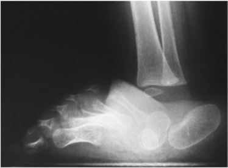

• Fig. 103.20 Radiograph of a 9-month-old infant showing the vertical alignment of the talus, equinus hindfoot, and dorsal angulation of the midfoot and forefoot.

## PDF page 2094

• Fig. 103.21 Clinical photograph of a newborn girl with severe congenital osteogenesis imperfecta. The child had multiple fractures at birth. Observe the severe shortening of the extremities and darkened (blue) sclera.

bone fragility, distinct blue sclerae, and presenile hearing loss. Some of these patients have defective dentinogenesis, although others do not. The inheritance pattern is autosomal dominant. In type II, the children are severely affected. Most of them die perinatally, because their bones collapse in utero. The inheritance pattern is autosomal recessive. At present, efforts to establish a relationship between genotype and phenotype are ongoing but complex. To say that osteogenesis imperfecta is heterogeneous would be an understatement.67 In type III, the bone fragility is quite marked but compatible with survival. These children are born with multiple fractures and have progressive bowing of bones throughout life. Early on, their sclerae are quite blue but become less so as they mature; by adolescence, the sclerae are essentially normal in appearance. The inheritance pattern is autosomal recessive. In type IV, the bone fragility is modest. These patients usually have white sclerae; some have defective dentinogenesis, although others do not. They have modest bowing of bones. Some of these children may be difficult to differentiate from the normal population early in life.

The goal of orthopedic treatment in osteogenesis imperfecta is to maximize comfort and function. In modestly affected children, this approach frequently focuses on the closed treatment of fractures. The management of fractures in such children is not dissimilar to that in the average population. Children with increased bone fragility frequently benefit from orthotics, which are used to protect their bones as they are mobilized. Intravenous pamidronate has shown promise for increasing bone density in children with moderate to severe osteogenesis imperfecta.

• Fig. 103.22 Clinical photograph of a 6-month-old boy with multiple café au lait spots resulting from neurofibromatosis.

Investigators have reported reduced bone pain, a decreased incidence of fracture, and improved ambulation.68–71 Children occasionally develop severe angular deformities from the poorly developed union of fractures or the insidious collapse of bones. As the deformities increase in magnitude, stress is concentrated at these angular deformities and children become increasingly susceptible to fracture. Osteotomies to straighten bones and intramedullary rods to maintain alignment may be helpful in assisting these children with their mobility. The rod provides internal support for the bone, and the elimination of angular deformities decreases stress within the bones.

Children with osteogenesis imperfecta do not necessarily have cognitive impairment. Every effort should be made to maximize their ability to attend school and interact with their peers.

### Neurofibromatosis

Neurofibromatosis is a relatively common disorder that may or may not be diagnosable in the neonatal period. The presence of multiple café au lait spots or anterolateral bowing of the tibia suggests neurofibromatosis (Fig. 103.22). The café au lait spots frequently do not appear until the child is at least 2 years of age. The criteria for diagnosis have been outlined by Crawford and Schorry72 and include at least two of the following: multiple café au lait spots; a positive family history; a definitive biopsy; and characteristic bony lesions such as pseudarthrosis of the tibia, hemihypertrophy, or short and angulated spinal curves. The café au lait spots

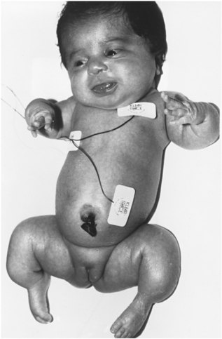

• Fig. 103.21 Clinical photograph of a newborn girl with severe congenital osteogenesis imperfecta. The child had multiple fractures at birth. Observe the severe shortening of the extremities and darkened (blue) sclera.

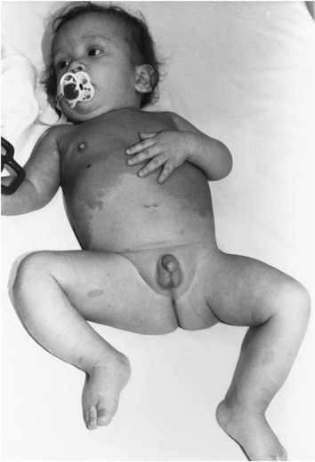

• Fig. 103.22 Clinical photograph of a 6-month-old boy with multiple café au lait spots resulting from neurofibromatosis.

## PDF page 2095 | printed page 2105

A

• Fig. 103.23 (A) A 1-month-old girl with arthrogryposis multiplex congenita involving the upper and lower extremities. The elbows are stiff in extension, whereas the wrist, fingers, and thumb are flexed. The hips are flexed and externally rotated. There are knee flexion contractures and bilateral talipes equinovarus clubfoot deformities. (B) Serial casting is initiated at birth to improve the alignment of the lower extremities. Occupational therapy and splinting are used at a later time on the upper extremities.

are typically smooth; the presence of at least five spots larger than 0.5 cm in diameter is considered diagnostic.

### Arthrogryposis Multiplex Congenita

Arthrogryposis multiplex congenita refers to a symptom complex (syndrome) characterized by multiple joint contractures that are present at birth. The involved muscles are replaced partially or completely by fat and fibrous tissue. However, it is not a single disease, because approximately 150 different syndromes are associated with multiple congenital contractures. The major form of arthrogryposis multiplex congenita is known as amyoplasia,73,74 which refers to the classic syndrome in which the upper and lower extremities are involved. It accounts for approximately 40% of all children with multiple congenital contractures. Its cause is unknown. Children with this disorder have a decreased number of anterior horn cells in their spinal cords, suggesting a neuropathic origin. The clinical features include adduction, internal rotation, and contractures of the shoulders; fixed flexion or extension contractures of the elbows; rigid volar flexion/ulnar deviation or dorsiflexion/radial deviation contractures of the wrists; thumb and palm deformities; rigid interphalangeal joints of the thumb and fingers; flexion, abduction, and external rotation contractures of the hips, with dislocation of one or both; fixed flexion or extension contractures of the knees; and severe, rigid,

Bbilateral clubfeet (Fig. 103.23). Radiographs of all involved joints are obtained to assess their development; specialized studies are ordered as necessary.

Treatment modalities during the neonatal period consist of physical therapy and serial casting. Occasionally, orthotics and surgical intervention may be necessary; however, surgery is usually delayed until early childhood.75 Recent studies show that many adults with arthrogryposis will remain ambulatory, but very few can live independently. Their function is limited by both upper and lower extremities contractures. Treatment should focus on maximizing joint position for function.76

### Fibrodysplasia Ossificans Progressiva

Fibrodysplasia ossificans progressiva (FOP) is a rare genetic disease (incidence about 1 in 1.6 million) characterized by skeletal malformations and episodic heterotopic bone formation leading to progressive loss of mobility. Although FOP was first described in the 17th century, most individuals with FOP are initially misdiagnosed and many suffer permanent disability from inappropriate diagnostic or therapeutic interventions. Two likely causes for these harmful diagnostic errors are the lack of teaching exposure to FOP in most medical schools and the lack of coverage of FOP in most medical textbooks.

The mode of inheritance of FOP is autosomal dominant with complete penetrance, but almost all cases result from

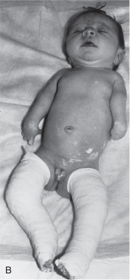

Unmatched source image; PDF page 2095. Consult the original caption.

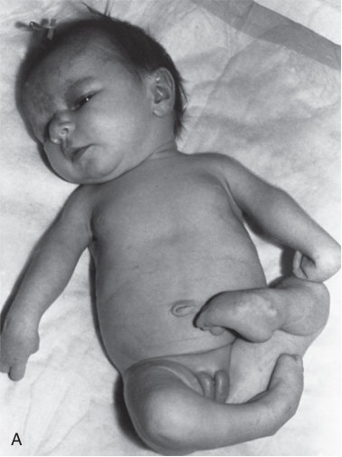

• Fig. 103.23 (A) A 1-month-old girl with arthrogryposis multiplex congenita involving the upper and lower extremities. The elbows are stiff in extension, whereas the wrist, fingers, and thumb are flexed. The hips are flexed and externally rotated. There are knee flexion contractures and bilateral talipes equinovarus clubfoot deformities. (B) Serial casting is initiated at birth to improve the alignment of the lower extremities. Occupational therapy and splinting are used at a later time on the upper extremities.

## PDF page 2096

A

• Fig. 103.24 (A) A photograph of the feet of an infant with fibrodysplasia ossificans progressiva (FOP) showing the characteristic findings of short great toes and hallux valgus. (B) A photograph of the back of a very young child with a tumor-like swelling on his back that represents an early FOP flare-up. Note the surgical scar from an unnecessary biopsy that exacerbated the disease process.

a spontaneous activating mutation in the gene encoding activin receptor IA/activin like kinase-2 (ACVR1/ALK2), a bone morphogenetic protein type I receptor. Only seven small multigenerational families are known worldwide.77–79

The two classic findings in FOP are distinctive malformations of the great toes and episodic “flare-ups” characterized by soft tissue tumor-like swellings that often result in heterotopic ossification at the lesional site. The invariant malformations of the great toes are caused by hypoplasia or agenesis of the proximal phalanges that result in short great toes with a valgus deformity (Fig. 103.24A). The toe malformations are present at birth and may be the only congenital sign of FOP. Flare-ups, especially in the occipital region, may commence in the neonatal period and are often mistaken for cephalohematomas. However, flare-ups are usually recognized later in the first decade and typically appear on the head, neck, back, or shoulders (see Fig. 103.24B). The onset of a tender soft tissue swelling often appears overnight, triggered by soft tissue trauma or viral illnesses or may occur spontaneously. The soft tissue swellings may resolve completely but most often result in heterotopic bone formation.

Microscopically, perivascular lymphocytic, mast cell, and macrophage infiltration occur in striated muscle, followed by widespread death of muscle cells. Subsequently, an angiogenic fibroproliferative lesion forms, evolving through a cartilage stage and finally into mature heterotopic bone through a characteristic endochondral mechanism. This process involves striated muscles, ligaments, tendons, and aponeuroses, but spares the diaphragm, tongue, extraocular muscles, and cardiac and smooth muscle.

Additional common findings may include short thumbs; short, broad femoral necks; proximal medial tibial osteochondromas; tall, narrow cervical vertebrae; and ankylosis of facet joints of the cervical spine. Findings later in life include hearing loss and atypical facies, which usually develop in the second decade of life and are caused by restricted mandibular movement.80

B

FOP can be diagnosed clinically and with great accuracy when the clinician recognizes the pathognomonic combination of great toe malformations with the presence of rapidly appearing soft tissue tumors in characteristic anatomic locations. In most cases, the swellings are misdiagnosed, most commonly as cancer or aggressive fibromatosis, often because the physician is unfamiliar with FOP. In newborns, FOP should be suspected when the typical malformations of the great toes are present. For suspected cases, diagnostic genetic testing is readily available from a simple blood test.

There is no effective treatment for FOP. The process of heterotopic ossification is often accelerated by trauma, including traumatic medical interventions. These include biopsies, intramuscular injections (including neonatal vitamin K), immunizations, and surgical procedures, all of which should be avoided. For flare-ups involving major joints or the airway, a brief (3- to 4-day) course of high-dose corticosteroids will reduce soft tissue swelling and may prevent ossification. Gentle activities and those that promote respiratory health can be helpful (singing or swimming) but activities that risk physical contract, injury, or overstretching of soft tissues must be avoided. Even biopsies or attempted removal of existing heterotopic ossification can promote the painful process of growing new bone.81

Episodic heterotopic bone formation in FOP leads to progressive immobilization of the joints and restrictive disease of the chest wall.82 Malnutrition is common if there is ossification of the jaw muscles leading to restricted mouth opening and swallowing. Average life expectancy is 40 years (range, 3 to 77 years).

### Acknowledgments

The authors acknowledge Dr. George H. Thompson for his contributions to this chapter and the field of pediatric orthopedics.

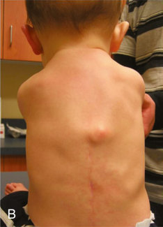

Unmatched source image; PDF page 2096. Consult the original caption.

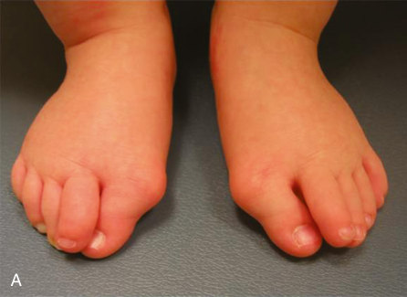

• Fig. 103.24 (A) A photograph of the feet of an infant with fibrodysplasia ossificans progressiva (FOP) showing the characteristic findings of short great toes and hallux valgus. (B) A photograph of the back of a very young child with a tumor-like swelling on his back that represents an early FOP flare-up. Note the surgical scar from an unnecessary biopsy that exacerbated the disease process.

## PDF page 2097 | printed page 2107

Key Points

### • Upper extremity malformations are much less common

than those involving the lower extremities or spine.

### • Common upper extremity congenital malformations

include Sprengel deformity of the scapula; proximal radius and ulna synostosis; radial dysplasia and clubhand; constriction bands; congenital amputations; and syndactyly, polydactyly, and macrodactyly of the fingers.

### • Congenital spinal abnormalities are predominantly sco-

liosis, kyphosis, and sacral agenesis.

### • Common lower extremity congenital malformations

include congenital angular deformities of the tibia and

### References

1. Oner A, et al. Sprengel deformity: comprehensive evaluation of

concomitant spinal and extraspinal anomalies in patients. Spine. 2020;45(18):E1150–E1157. 2. Zarantonello P, et al. Surgical treatment of Sprengel’s deformity: a

systematic review and meta-analysis. Children. 2021;8(12):1142. 3. Takagi T, et al. Current concepts in radial club hand. Open

Orthop J. 2017;11:369–377. 4. Ezaki M. Challenging the dogma: a straight wrist should be the

goal in radial dysplasia. J Hand Surg Eur. 2021;46(1):14–20. 5. Foulkes GD, Reinker K. Congenital constriction band syndrome:

a seventy-year experience. J Pediatr Orthop. 1994;14(2):242–248. 6. Kawamura K, Chung KC. Constriction band syndrome. Hand

Clin. 2009;25(2):257–264. 7. Shabani B, Bytyqi D, Bytyqi C. Clubfeet and congenital constric-

tion band syndrome. Eur J Med Res. 2021;16;26(1):21. 8. Pires GR, et al. Targeted muscle reinnervation in children: a case

report and brief overview of the literature. Plast Reconstr Surg Glob Open. 2021;9(12):e3986. 9. Wood VE. Congenital thumb deformities. Clin Orthop Relat Res.

1985;195:7–25. 10. Chang CH, Kumar SJ, Riddle EC, Glutting J. Macrodactyly of

the foot. J Bone Joint Surg Am. 2002;84(7):1189–1194. 11. Ezaki M, et al. Macrodactyly: decision-making and surgery tim-

ing. J Hand Surg Eur. 2019;44(1):32–42. 12. Hedequist D, Emans J. Congenital scoliosis: a review and update.

J Pediatr Orthop. 2007;27(1):106–116. 13. Wang X, Yu Y, Yang N, Xia L. Incidence of intraspinal abnormal-

ities in congenital scoliosis: a systematic review and meta-analysis. J Orthop Surg Res. 2020;15(1):485. 14. Winter RB, Moe JH, Lonstein JE. The incidence of Klippel-Feil

syndrome in patients with congenital scoliosis and kyphosis. Spine. 1984;9(4):363–366. 15. Karol LA. The natural history of early-onset scoliosis. J Pediatr

Orthop. 2019;39(6 Suppl):S38–S43. 16. Marks DS, Qaimkhani SA. The natural history of congenital sco-

liosis and kyphosis. Spine. 2009;34(17):1751–1755. 17. McMaster MJ, Singh H. Natural history of congenital kyphosis

and kyphoscoliosis. A study of one hundred and twelve patients. J Bone Joint Surg Am. 1999;81(10):1367–1383. 18. Andrish J, Kalamchi A, MacEwen GD. Sacral agenesis: a clinical

evaluation of its management, heredity, and associated anomalies. Clin Orthop Relat Res. 1979;139:52–57. 19. Guille JT, Benevides R, Cuevas DeAlba C, et al. Lumbosacral

agenesis: a new classification correlating spinal deformity and ambulatory potential. J Bone Joint Surg Am. 2002;84(1):32–38.

fibula; developmental dysplasia of the hip; proximal femoral focal deficiency; subluxation/dislocations of the knee; congenital talipes equinovarus deformities (clubfeet); congenital vertical tali; reduction anomalies and amputations of the lower leg; and syndactyly, polydactyly, and macrodactyly of the toes.

### • Syndromes can also be associated with congeni-

tal musculoskeletal malformations, especially spinal deformities.

20. Tinker SC, Gilboa SM, Moore CA, et al. Specific birth defects in

pregnancies of women with diabetes: national birth defects prevention study, 1997-2011. Am J Obstet Gynecol. 2020;222(2):176. e1–176.e11. 21. Sagade B, Jagani N, Chaudhary I, Chaudhary M. Congeni-

tal posteromedial bowing of tibia: comparison of early and late lengthening. J Pediatr Orthop. 2021;41(9):e816–e822. 22. Gordon JE, Schoenecker PL, Lewis TR, Miller ML. Limb length-

ening in the treatment of posteromedial bowing of the tibia. J Child Orthop. 2020;14(5):480–487. 23. Gordon JE. Limb lengthening in the treatment of posteromedial

bowing of the tibia. J Child Orthop. 2020;14(5):480–487. 24. Wright J, et al. Posteromedial bowing of the tibia: a benign

condition or a case for limb reconstruction? J Child Orthop. 2018;12(2):187–196. 25. Paley D. Congenital pseudoarthrosis of the tibia: biological and

biomechanical considerations to achieve union and prevent refracture. J Child Orthop. 2019;13(2):120–133. 26. Yang S, Zusman N, Lieberman E, Goldstein RY. Developmental

dysplasia of the hip. Pediatrics. 2019;143(1):e20181147. 27. Quan T, Kent AL, Carlisle H. Breech preterm infants are at risk

of developmental dysplasia of the hip. J Paediatr Child Health. 2013;49(8):658–663. 28. Cooperman D. What is the evidence to support acetabular dysplasia

as a cause of osteoarthritis? J Pediatr Orthop. 2013;33(suppl 1):S2–S7. 29. Barlow TG. Early diagnosis and treatment of congenital disloca-

tion of the hip. J Bone Joint Surg Br. 1962;44:292. 30. Mubarak SJ. In search of Ortolani: the man and the method. J

Pediatr Orthop. 2015;35(2):210–216. 31. McClure P, Podeszwa DA. Hip click in the neonate: should I be

concerned? Pediatr Ann. 2016;45(4):e122–e127. 32. Choudry Q, Goyal R, Paton RW. Is limitation of hip abduction

a useful clinical sign in the diagnosis of developmental dysplasia of the hip? Arch Dis Child. 2013;98(11):862–866. 33. Harcke HT, Kumar SJ. The role of ultrasound in the diagnosis

and management of congenital dislocation and dysplasia of the hip. J Bone Joint Surg Am. 1991;73(4):622–628. 34. Clegg J, Bache CE, Raut VV. Financial justification for routine

ultrasound screening of the neonatal hip. J Bone Joint Surg Br. 1999;81(5):852–857. 35. Kemper AR, Shorter D, Hong T, Osborn DA. Commentary on

‘Screening programmes for developmental dysplasia of the hip in newborn infants’ with response from review authors. Evid Based Child Health. 2013;8(1):55–56; discussion 56. 36. Shorter D, Hong T, Osborn DA. Screening programmes for

developmental dysplasia of the hip in newborn infants. Cochrane Database Syst Rev. 2011;(9):CD004595.

## PDF page 2098

37. Paton RW. Screening in developmental dysplasia of the hip

(DDH). Surgeon. 2017;(5):290–296. 38. Lewis K, Jones DA, Powell N. Ultrasound and neonatal hip

screening: the five-year results of a prospective study in high-risk babies. J Pediatr Orthop. 1999;19(6):760–762. 39. Gwynne Jones DP, Dunbar JD, Theis J-C. Late presenting

dislocation of sonographically stable hips. J Pediatr Orthop B. 2006;15(4):257–261. 40. Schwend RM, Schoenecker P, Richards BS, et al. Screening the

newborn for developmental dysplasia of the hip: now what do we do? J Pediatr Orthop. 2007;27(6):607–610. 41. Lerman JA, Emans JB, Millis MB, et al. Early failure of Pavlik

harness treatment for developmental hip dysplasia: clinical and ultrasound predictors. J Pediatr Orthop. 2001;21(3):348–353. 42. Curtis BH, Fisher RL. Congenital hyperextension with anterior

subluxation of the knee. Surgical treatment and long-term observations. J Bone Joint Surg Am. 1969;51(2):255–269. 43. Nogi J, MacEwen GD. Congenital dislocation of the knee. J

Pediatr Orthop. 1982;2(5):509–513. 44. Ko JY, Shih CH, Wenger DR. Congenital dislocation of the

knee. J Pediatr Orthop. 1999;19(2):252–259. 45. Kumar SJ, MacEwen GD. The incidence of hip dysplasia with

metatarsus adductus. Clin Orthop Relat Res. 1982;(164):234– 235. 46. Ponseti IV, Becker JR. Congenital metatarsus adductus: the

results of treatment. J Bone Joint Surg Am. 1966;48(4):702–711. 47. Rushforth GF. The natural history of hooked forefoot. J Bone

Joint Surg Br. 1978;60-B(4):530–532. 48. Widhe T. Foot deformities at birth: a longitudinal prospective

study over a 16-year period. J Pediatr Orthop. 1997;17(1):20–24. 49. Håberg Ø, Foss OA, Lian ØB, Holen KJ. Is foot deformity asso-

ciated with developmental dysplasia of the hip? Bone Joint Lett J. 2020;102-B(11):1582–1586. 50. Basit S, Khoshhal KI. Genetics of clubfoot; recent progress and

future perspectives. Eur J Med Genet. 2018;61(2):107–113. 51. Dobbs MB, Gurnett CA. Genetics of clubfoot. J Pediatr Orthop

B. 2012;21(1):7–9. 52. Feldbrin Z, Gilai AN, Ezra E, et al. Muscle imbalance in the

aetiology of idiopathic club foot. An electromyographic study. J Bone Joint Surg Br. 1995;77(4):596–601. 53. Ippolito E, Ponseti IV. Congenital club foot in the human fetus.

A histological study. J Bone Joint Surg Am. 1980;62(1):8–22. 54. Dobbs MB, et al. Early results of a new method of treatment for

idiopathic congenital vertical talus. J Bone Joint Surg. 2006;88A:6. 55. Recordon JAF, Halanski MA, Boocock MG, et al. A prospective,

median 15-year comparison of Ponseti casting and surgical treatment of clubfoot. J Bone Joint Surg Am. 2021;3;103(21):1986– 1995. 56. Alves CJ. Bracing in clubfoot: do we know enough? Child Orthop.

2019;13(3):258–264. 57. van Bosse HJP. Challenging clubfeet: the arthrogrypotic clubfoot

and the complex clubfoot. J Child Orthop. 2019;13(3):271–281. 58. Wirth T. Congenital vertical talus. Foot Ankle Clin.

2021;26(4):903–913. 59. Miller M, Dobbs MB. Congenital vertical talus: etiology and

management. J Am Acad Orthop Surg. 2015;23(10):604–611. 60. Dobbs MB, Purcell DB, Nunley R, Morcuende JA. Early results

of a new method of treatment for idiopathic congenital vertical talus. Surgical technique. J Bone Joint Surg Am. 2007;89(suppl 2 Pt.1):111–121.

61. Lee HS, Lee WC. Congenital lesser toe abnormalities. Foot Ankle

Clin. 2011;16(4):659–678. 62. Kelly DM, Mahmoud K, Mauck BM. Polydactyly of the foot: a

review. J Am Acad Orthop Surg. 2021;29(9):361–369. 63. Kochar IS, et al. Use of growth hormone treatment in skeletal

dysplasia – a review. Pediatr Endocrinol Rev. 2020;17(4):327–330. 64. Franzone JM, Shah SA, Wallace MJ, Kruse RW. Osteogenesis

imperfecta: a pediatric orthopedic perspective. Orthop Clin North Am. 2019;50(2):193–209. 65. Sillence DO, Rimoin DL. Classification of osteogenesis imper-

fecta. Lancet. 1978;1(8072):1041–1042. 66. Sillence D. Osteogenesis imperfecta: an expanding panorama of

variants. Clin Orthop Relat Res. 1981;159:11–25. 67. Bodian DL, Chan T-F, Poon A, et al. Mutation and polymor-

phism spectrum in osteogenesis imperfecta type II: implications for genotype-phenotype relationships. Hum Mol Genet. 2009;18(3):463–471. 68. Plotkin H, Rauch F, Bishop NJ, et al. Pamidronate treatment of

severe osteogenesis imperfecta in children under 3 years of age. J Clin Endocrinol Metab. 2000;85(5):1846–1850. 69. Rauch F, Plotkin H, Zeitlin L, Glorieux FH. Bone mass, size,

and density in children and adolescents with osteogenesis imperfecta: effect of intravenous pamidronate therapy. J Bone Miner Res. 2003;18(4):610–614. 70. Zeitlin L, Fassier F, Glorieux FH. Modern approach to children

with osteogenesis imperfecta. J Pediatr Orthop B. 2003;12(2):77– 87. 71. Dwan K, Phillipi CA, Steiner RD, Basel D. Bisphosphonate

therapy for osteogenesis imperfecta. Cochrane Database Syst Rev. 2016;10(10):CD005088. 72. Crawford AH, Schorry EK. Neurofibromatosis update. J Pediatr

Orthop. 2006;26(3):413–423. 73. Sarwark JF, MacEwen GD, Scott CI Jr. Amyoplasia (a common

form of arthrogryposis). J Bone Joint Surg Am. 1990;72(3):465–469. 74. Shapiro F, Specht L. The diagnosis and orthopaedic treatment

of childhood spinal muscular atrophy, peripheral neuropathy, Friedreich ataxia, and arthrogryposis. J Bone Joint Surg Am. 1993;75(11):1699–1714. 75. Smith DW, Drennan JC. Arthrogryposis wrist deformities: results

of infantile serial casting. J Pediatr Orthop. 2002;22(1):44–47. 76. van Bosse HJP. Orthopaedic care of the child with arthrogrypo-

sis: a 2020 overview. Curr Opin Pediatr. 2020;32(1):76–85. 77. Kaplan FS, Xu M, Glaser DL, et al. Early diagnosis of fibrodyspla-

sia ossificans progressiva. Pediatrics. 2008;121(5):e1295–e1300. 78. Kaplan FS, Zasloff MA, Kitterman JA, et al. Early mortality and

cardiorespiratory failure in patients with fibrodysplasia ossificans progressive. J Bone Joint Surg Am. 2010;92(3):686–691. 79. Shore EM, Xu M, Feldman GJ, et al. A recurrent mutation in the

BMP type I receptor ACVR1 causes inherited and sporadic fibrodysplasia ossificans progressiva. Nat Genet. 2006;38(5):525–527. 80. Okuno T, Suzuki H, Inoue A, Kusukawa J. Restricted mandibu-

lar movement attributed to ossification of mandibular depressors and medial pterygoid muscles in patients with fibrodysplasia ossificans progressiva: a report of 3 cases. J Oral Maxillofac Surg. 2017;75(9):1891–1898. 81. Kannu P, et al. Evolving management of fibrodysplasia ossificans

progressive. J Pediatr. 2021;232S:S9–S15. 82. Khan F, Yu X, Hsiao EC. Cardiopulmonary and neurologic dys-

functions in fibrodysplasia ossificans progressiva. Biomedicines. 2021;9(2):155.

<!-- SOURCE_LAYOUT_VIEWS -->

## Original layout views and recovered diagrams

Automatic extraction can flatten tables and superscripts. Check the original layout for numeric data, footnotes and image credits. [Source review notes](../../SOURCE_REVIEW_NOTES.md).

### Original source page 2079

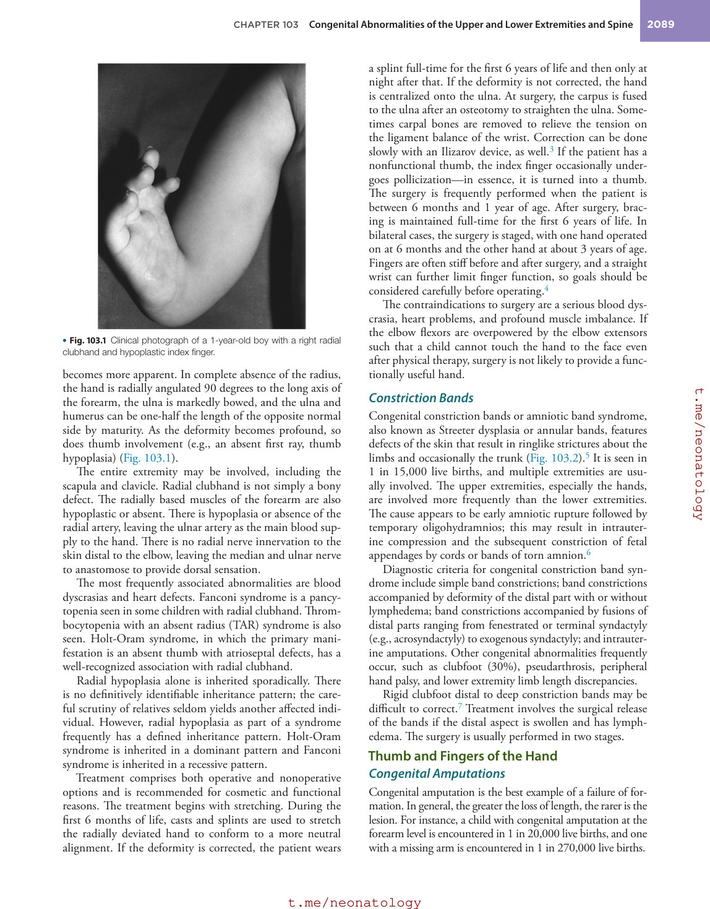

### Original source page 2080

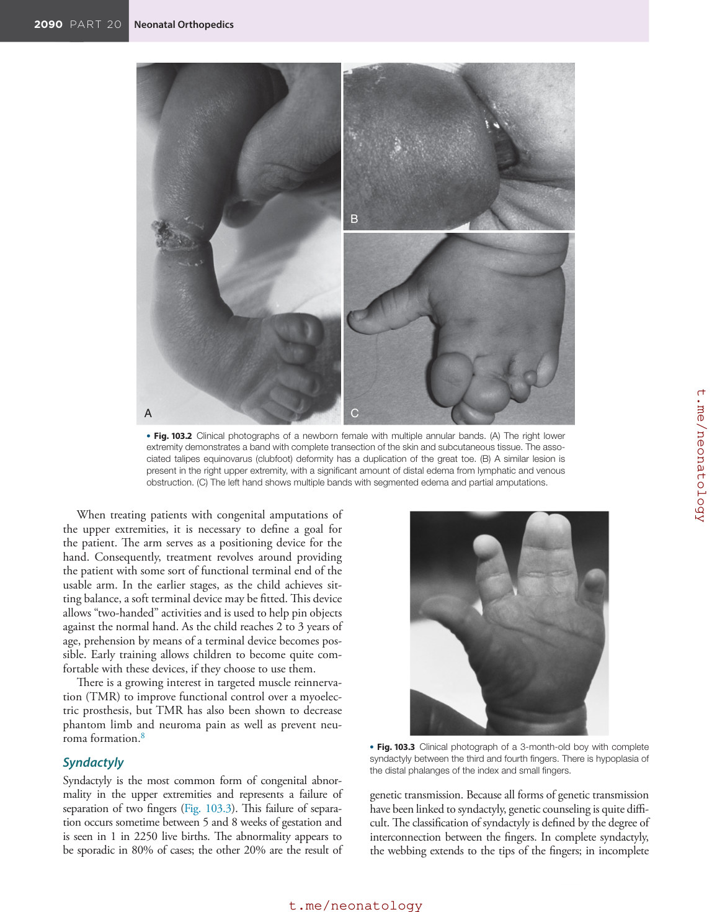

### Original source page 2081

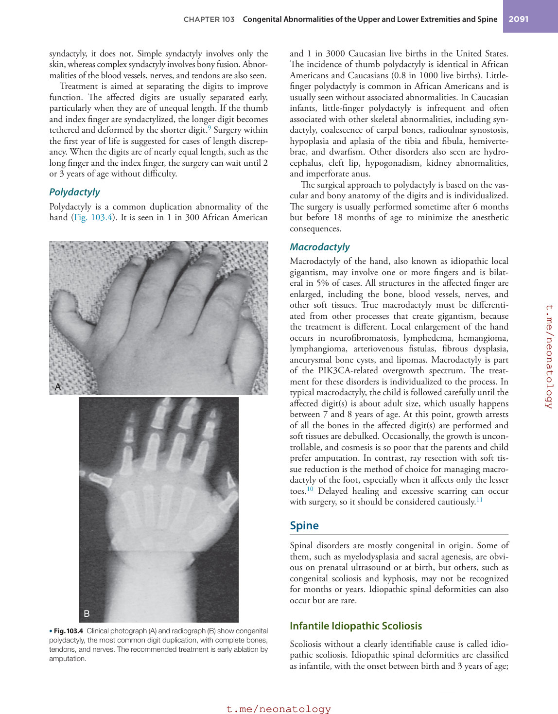

### Original source page 2082

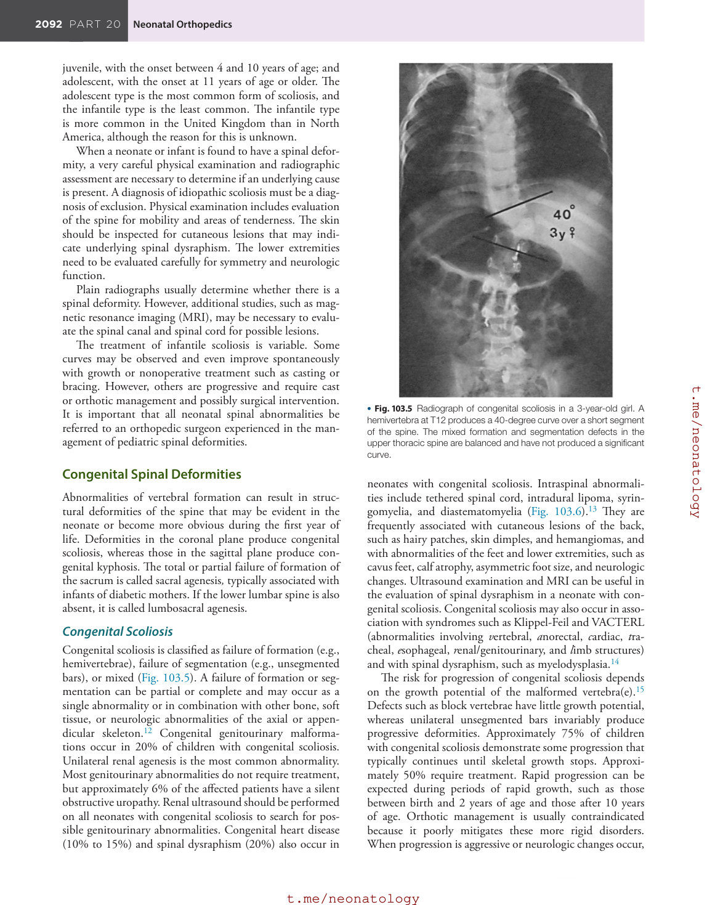

### Original source page 2083

### Original source page 2084

### Original source page 2086

### Original source page 2087

### Original source page 2088

### Original source page 2089

### Original source page 2091

### Original source page 2092

### Original source page 2093

### Original source page 2094

### Original source page 2095

### Original source page 2096

