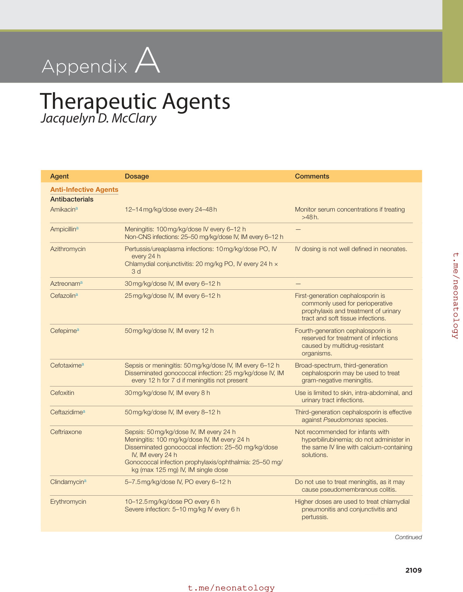
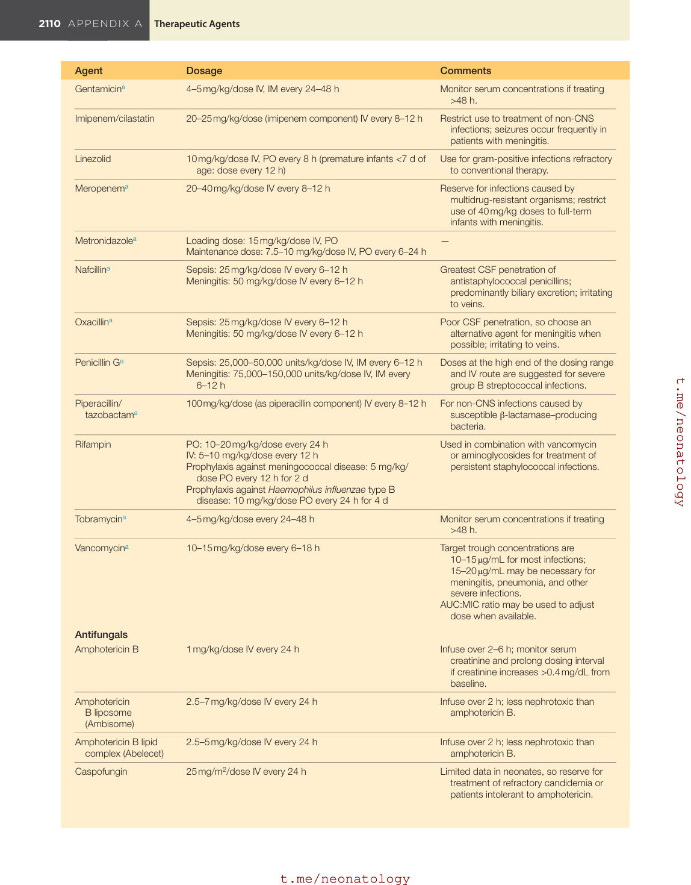
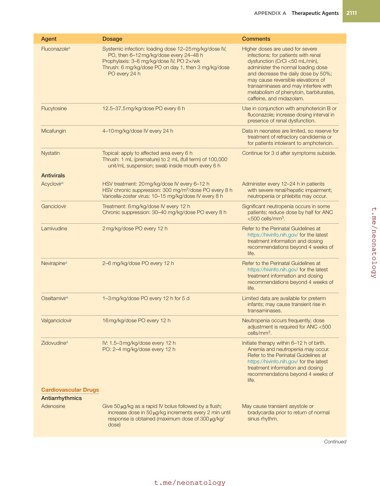
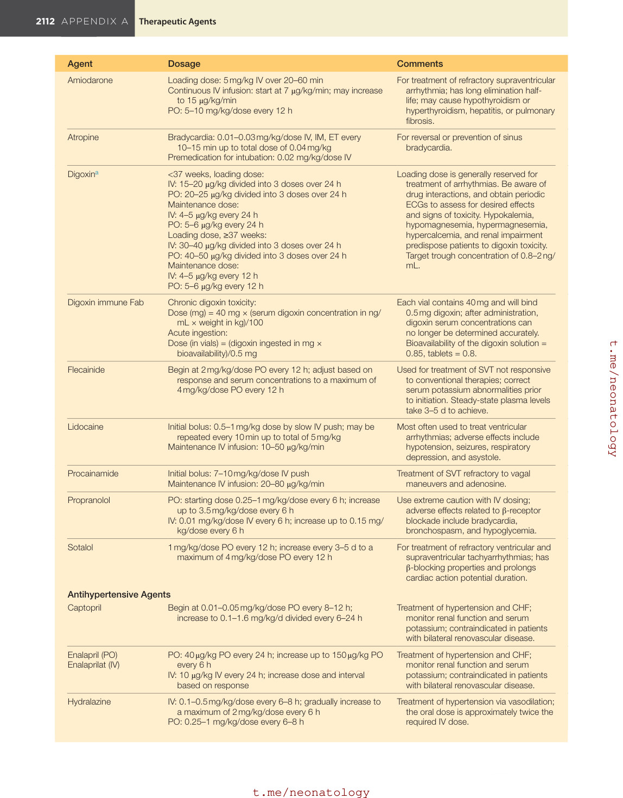
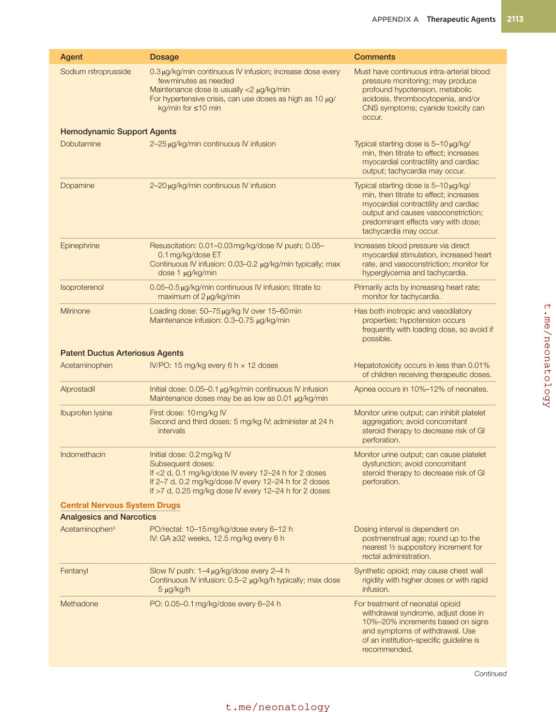
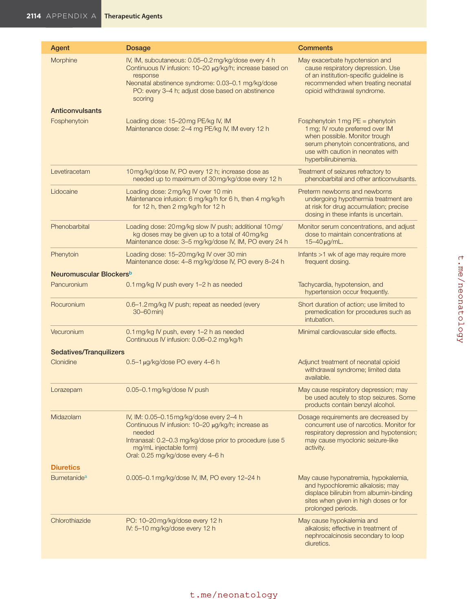
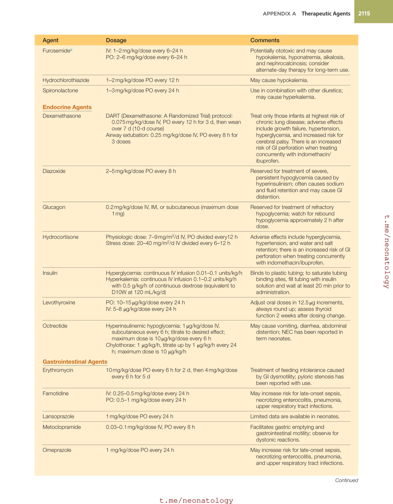
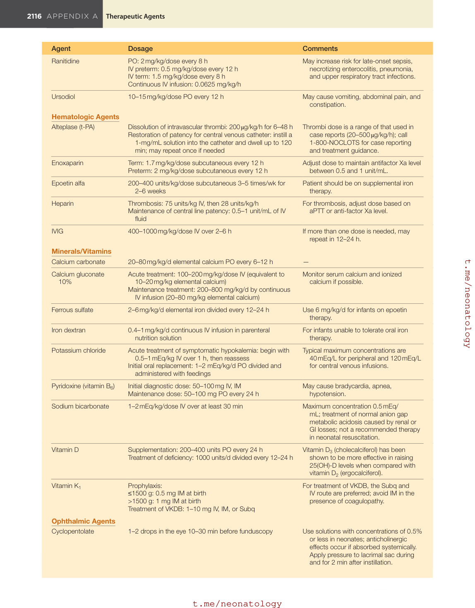
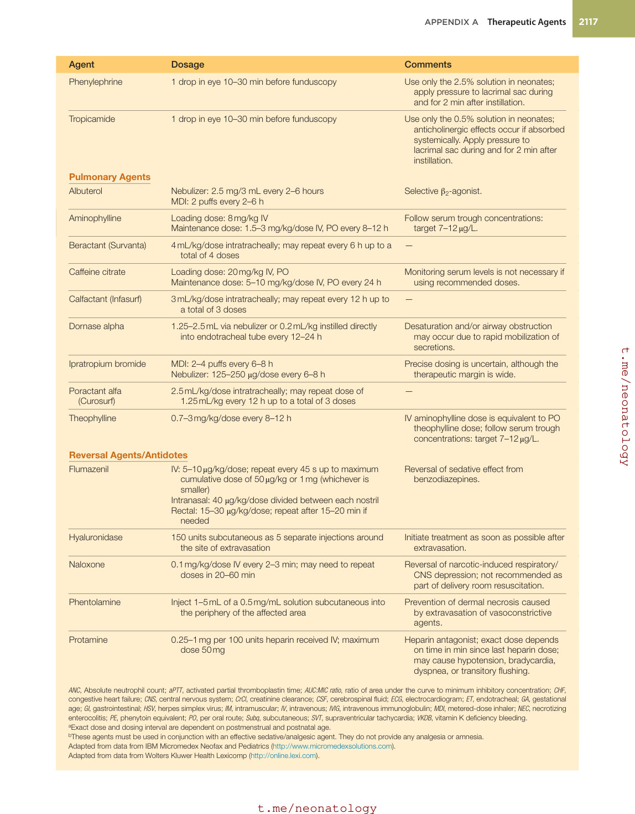

# Appendix A. Therapeutic Agents
> Source attribution: [Source credits](../../SOURCE_CREDITS.md).

## PDF page 2099 | printed page 2109

Appendix A

Jacquelyn D. McClary Therapeutic Agents

Agent Dosage

Anti-Infective Agents Antibacterials

Amikacina 12–14 mg/kg/dose every 24–48 h

Ampicillina Meningitis: 100 mg/kg/dose IV every 6–12 h Non-CNS infections: 25–50 mg/kg/dose IV, IM every 6–12 h

Azithromycin Pertussis/ureaplasma infections: 10 mg/kg/dose PO, IV

every 24 h Chlamydial conjunctivitis: 20 mg/kg PO, IV every 24 h ×

3 d

Aztreonama 30 mg/kg/dose IV, IM every 6–12 h

Cefazolina 25 mg/kg/dose IV, IM every 6–12 h

Cefepimea 50 mg/kg/dose IV, IM every 12 h

Cefotaximea Sepsis or meningitis: 50 mg/kg/dose IV, IM every 6–12 h Disseminated gonococcal infection: 25 mg/kg/dose IV, IM

every 12 h for 7 d if meningitis not present

Cefoxitin 30 mg/kg/dose IV, IM every 8 h

Ceftazidimea 50 mg/kg/dose IV, IM every 8–12 h

Ceftriaxone Sepsis: 50 mg/kg/dose IV, IM every 24 h Meningitis: 100 mg/kg/dose IV, IM every 24 h Disseminated gonococcal infection: 25–50 mg/kg/dose

IV, IM every 24 h Gonococcal infection prophylaxis/ophthalmia: 25–50 mg/

kg (max 125 mg) IV, IM single dose

Clindamycina 5–7.5 mg/kg/dose IV, PO every 6–12 h

Erythromycin 10–12.5 mg/kg/dose PO every 6 h Severe infection: 5–10 mg/kg IV every 6 h

Comments

Monitor serum concentrations if treating

>48 h.

—

IV dosing is not well defined in neonates.

—

First-generation cephalosporin is

commonly used for perioperative prophylaxis and treatment of urinary tract and soft tissue infections.

Fourth-generation cephalosporin is

reserved for treatment of infections caused by multidrug-resistant organisms.

Broad-spectrum, third-generation

cephalosporin may be used to treat gram-negative meningitis.

Use is limited to skin, intra-abdominal, and

urinary tract infections.

Third-generation cephalosporin is effective

against Pseudomonas species.

Not recommended for infants with

hyperbilirubinemia; do not administer in the same IV line with calcium-containing solutions.

Do not use to treat meningitis, as it may

cause pseudomembranous colitis.

Higher doses are used to treat chlamydial

pneumonitis and conjunctivitis and pertussis.

Continued

2109

## PDF page 2100

Agent Dosage

Gentamicina 4–5 mg/kg/dose IV, IM every 24–48 h

Imipenem/cilastatin 20–25 mg/kg/dose (imipenem component) IV every 8–12 h

Linezolid 10 mg/kg/dose IV, PO every 8 h (premature infants <7 d of

age: dose every 12 h)

Meropenema 20–40 mg/kg/dose IV every 8–12 h

Metronidazolea Loading dose: 15 mg/kg/dose IV, PO Maintenance dose: 7.5–10 mg/kg/dose IV, PO every 6–24 h

Nafcillina Sepsis: 25 mg/kg/dose IV every 6–12 h Meningitis: 50 mg/kg/dose IV every 6–12 h

Oxacillina Sepsis: 25 mg/kg/dose IV every 6–12 h Meningitis: 50 mg/kg/dose IV every 6–12 h

Penicillin Ga Sepsis: 25,000–50,000 units/kg/dose IV, IM every 6–12 h Meningitis: 75,000–150,000 units/kg/dose IV, IM every

6–12 h

Piperacillin/

100 mg/kg/dose (as piperacillin component) IV every 8–12 h

tazobactama

Rifampin PO: 10–20 mg/kg/dose every 24 h IV: 5–10 mg/kg/dose every 12 h Prophylaxis against meningococcal disease: 5 mg/kg/

dose PO every 12 h for 2 d Prophylaxis against Haemophilus influenzae type B

disease: 10 mg/kg/dose PO every 24 h for 4 d

Tobramycina 4–5 mg/kg/dose every 24–48 h

Vancomycina 10–15 mg/kg/dose every 6–18 h

Antifungals

Amphotericin B 1 mg/kg/dose IV every 24 h

Amphotericin

2.5–7 mg/kg/dose IV every 24 h

B liposome (Ambisome)

Amphotericin B lipid

2.5–5 mg/kg/dose IV every 24 h

complex (Abelecet)

Caspofungin 25 mg/m2/dose IV every 24 h

Comments

Monitor serum concentrations if treating

>48 h.

Restrict use to treatment of non-CNS

infections; seizures occur frequently in patients with meningitis.

Use for gram-positive infections refractory

to conventional therapy.

Reserve for infections caused by

multidrug-resistant organisms; restrict use of 40 mg/kg doses to full-term infants with meningitis.

—

Greatest CSF penetration of

antistaphylococcal penicillins; predominantly biliary excretion; irritating to veins.

Poor CSF penetration, so choose an

alternative agent for meningitis when possible; irritating to veins.

Doses at the high end of the dosing range

and IV route are suggested for severe group B streptococcal infections.

For non-CNS infections caused by

susceptible β-lactamase–producing bacteria.

Used in combination with vancomycin

or aminoglycosides for treatment of persistent staphylococcal infections.

Monitor serum concentrations if treating

>48 h.

Target trough concentrations are

10–15 μg/mL for most infections; 15–20 μg/mL may be necessary for meningitis, pneumonia, and other severe infections. AUC:MIC ratio may be used to adjust

dose when available.

Infuse over 2–6 h; monitor serum

creatinine and prolong dosing interval if creatinine increases >0.4 mg/dL from baseline.

Infuse over 2 h; less nephrotoxic than

amphotericin B.

Infuse over 2 h; less nephrotoxic than

amphotericin B.

Limited data in neonates, so reserve for

treatment of refractory candidemia or patients intolerant to amphotericin.

## PDF page 2101 | printed page 2111

Agent Dosage

Fluconazolea Systemic infection: loading dose 12–25 mg/kg/dose IV,

PO, then 6–12 mg/kg/dose every 24–48 h Prophylaxis: 3–6 mg/kg/dose IV, PO 2×/wk Thrush: 6 mg/kg/dose PO on day 1, then 3 mg/kg/dose

PO every 24 h

Flucytosine 12.5–37.5 mg/kg/dose PO every 6 h

Micafungin 4–10 mg/kg/dose IV every 24 h

Nystatin Topical: apply to affected area every 6 h Thrush: 1 mL (premature) to 2 mL (full term) of 100,000

unit/mL suspension; swab inside mouth every 6 h

Antivirals

Acyclovira HSV treatment: 20 mg/kg/dose IV every 6–12 h HSV chronic suppression: 300 mg/m2/dose PO every 8 h Varicella-zoster virus: 10–15 mg/kg/dose IV every 8 h

Ganciclovir Treatment: 6 mg/kg/dose IV every 12 h Chronic suppression: 30–40 mg/kg/dose PO every 8 h

Lamivudine 2 mg/kg/dose PO every 12 h

Nevirapinea 2–6 mg/kg/dose PO every 12 h

Oseltamivira 1–3 mg/kg/dose PO every 12 h for 5 d

Valganciclovir 16 mg/kg/dose PO every 12 h

Zidovudinea IV: 1.5–3 mg/kg/dose every 12 h PO: 2–4 mg/kg/dose every 12 h

Cardiovascular Drugs Antiarrhythmics

Adenosine Give 50 μg/kg as a rapid IV bolus followed by a flush;

increase dose in 50 μg/kg increments every 2 min until response is obtained (maximum dose of 300 μg/kg/ dose)

Comments

Higher doses are used for severe

infections; for patients with renal dysfunction (CrCl <50 mL/min), administer the normal loading dose and decrease the daily dose by 50%; may cause reversible elevations of transaminases and may interfere with metabolism of phenytoin, barbiturates, caffeine, and midazolam.

Use in conjunction with amphotericin B or

fluconazole; increase dosing interval in presence of renal dysfunction.

Data in neonates are limited, so reserve for

treatment of refractory candidemia or for patients intolerant to amphotericin.

Continue for 3 d after symptoms subside.

Administer every 12–24 h in patients

with severe renal/hepatic impairment; neutropenia or phlebitis may occur.

Significant neutropenia occurs in some

patients; reduce dose by half for ANC <500 cells/mm3.

Refer to the Perinatal Guidelines at

https://hivinfo.nih.gov/ for the latest treatment information and dosing recommendations beyond 4 weeks of life.

Refer to the Perinatal Guidelines at

https://hivinfo.nih.gov/ for the latest treatment information and dosing recommendations beyond 4 weeks of life.

Limited data are available for preterm

infants; may cause transient rise in transaminases.

Neutropenia occurs frequently; dose

adjustment is required for ANC <500 cells/mm3.

Initiate therapy within 6–12 h of birth.

Anemia and neutropenia may occur. Refer to the Perinatal Guidelines at https://hivinfo.nih.gov/ for the latest treatment information and dosing recommendations beyond 4 weeks of life.

May cause transient asystole or

bradycardia prior to return of normal sinus rhythm.

Continued

## PDF page 2102

Agent Dosage

Amiodarone Loading dose: 5 mg/kg IV over 20–60 min Continuous IV infusion: start at 7 μg/kg/min; may increase

to 15 μg/kg/min PO: 5–10 mg/kg/dose every 12 h

Atropine Bradycardia: 0.01–0.03 mg/kg/dose IV, IM, ET every

10–15 min up to total dose of 0.04 mg/kg Premedication for intubation: 0.02 mg/kg/dose IV

Digoxina <37 weeks, loading dose: IV: 15–20 μg/kg divided into 3 doses over 24 h PO: 20–25 μg/kg divided into 3 doses over 24 h Maintenance dose: IV: 4–5 μg/kg every 24 h PO: 5–6 μg/kg every 24 h Loading dose, ≥37 weeks: IV: 30–40 μg/kg divided into 3 doses over 24 h PO: 40–50 μg/kg divided into 3 doses over 24 h Maintenance dose: IV: 4–5 μg/kg every 12 h PO: 5–6 μg/kg every 12 h

Digoxin immune Fab Chronic digoxin toxicity: Dose (mg) = 40 mg × (serum digoxin concentration in ng/

mL × weight in kg)/100 Acute ingestion: Dose (in vials) = (digoxin ingested in mg ×

bioavailability)/0.5 mg

Flecainide Begin at 2 mg/kg/dose PO every 12 h; adjust based on

response and serum concentrations to a maximum of 4 mg/kg/dose PO every 12 h

Lidocaine Initial bolus: 0.5–1 mg/kg dose by slow IV push; may be

repeated every 10 min up to total of 5 mg/kg Maintenance IV infusion: 10–50 μg/kg/min

Procainamide Initial bolus: 7–10 mg/kg/dose IV push Maintenance IV infusion: 20–80 μg/kg/min

Propranolol PO: starting dose 0.25–1 mg/kg/dose every 6 h; increase

up to 3.5 mg/kg/dose every 6 h IV: 0.01 mg/kg/dose IV every 6 h; increase up to 0.15 mg/

kg/dose every 6 h

Sotalol 1 mg/kg/dose PO every 12 h; increase every 3–5 d to a

maximum of 4 mg/kg/dose PO every 12 h

Antihypertensive Agents

Captopril Begin at 0.01–0.05 mg/kg/dose PO every 8–12 h;

increase to 0.1–1.6 mg/kg/d divided every 6–24 h

PO: 40 μg/kg PO every 24 h; increase up to 150 μg/kg PO

Enalapril (PO) Enalaprilat (IV)

every 6 h IV: 10 μg/kg IV every 24 h; increase dose and interval

based on response

Hydralazine IV: 0.1–0.5 mg/kg/dose every 6–8 h; gradually increase to

a maximum of 2 mg/kg/dose every 6 h PO: 0.25–1 mg/kg/dose every 6–8 h

Comments

For treatment of refractory supraventricular

arrhythmia; has long elimination halflife; may cause hypothyroidism or hyperthyroidism, hepatitis, or pulmonary fibrosis.

For reversal or prevention of sinus

bradycardia.

Loading dose is generally reserved for

treatment of arrhythmias. Be aware of drug interactions, and obtain periodic ECGs to assess for desired effects and signs of toxicity. Hypokalemia, hypomagnesemia, hypermagnesemia, hypercalcemia, and renal impairment predispose patients to digoxin toxicity. Target trough concentration of 0.8–2 ng/ mL.

Each vial contains 40 mg and will bind

0.5 mg digoxin; after administration, digoxin serum concentrations can no longer be determined accurately. Bioavailability of the digoxin solution = 0.85, tablets = 0.8.

Used for treatment of SVT not responsive

to conventional therapies; correct serum potassium abnormalities prior to initiation. Steady-state plasma levels take 3–5 d to achieve.

Most often used to treat ventricular

arrhythmias; adverse effects include hypotension, seizures, respiratory depression, and asystole.

Treatment of SVT refractory to vagal

maneuvers and adenosine.

Use extreme caution with IV dosing;

adverse effects related to β-receptor blockade include bradycardia, bronchospasm, and hypoglycemia.

For treatment of refractory ventricular and

supraventricular tachyarrhythmias; has β-blocking properties and prolongs cardiac action potential duration.

Treatment of hypertension and CHF;

monitor renal function and serum potassium; contraindicated in patients with bilateral renovascular disease.

Treatment of hypertension and CHF;

monitor renal function and serum potassium; contraindicated in patients with bilateral renovascular disease.

Treatment of hypertension via vasodilation;

the oral dose is approximately twice the required IV dose.

## PDF page 2103 | printed page 2113

Agent Dosage

Sodium nitroprusside 0.3 μg/kg/min continuous IV infusion; increase dose every

few minutes as needed Maintenance dose is usually <2 μg/kg/min For hypertensive crisis, can use doses as high as 10 μg/

kg/min for ≤10 min

Hemodynamic Support Agents

Dobutamine 2–25 μg/kg/min continuous IV infusion

Dopamine 2–20 μg/kg/min continuous IV infusion

Epinephrine Resuscitation: 0.01–0.03 mg/kg/dose IV push; 0.05–

0.1 mg/kg/dose ET Continuous IV infusion: 0.03–0.2 μg/kg/min typically; max

dose 1 μg/kg/min

Isoproterenol 0.05–0.5 μg/kg/min continuous IV infusion; titrate to

maximum of 2 μg/kg/min

Milrinone Loading dose: 50–75 μg/kg IV over 15–60 min Maintenance infusion: 0.3–0.75 μg/kg/min

Patent Ductus Arteriosus Agents

Acetaminophen IV/PO: 15 mg/kg every 6 h × 12 doses

Alprostadil Initial dose: 0.05–0.1 μg/kg/min continuous IV infusion Maintenance doses may be as low as 0.01 μg/kg/min

Ibuprofen lysine First dose: 10 mg/kg IV Second and third doses: 5 mg/kg IV; administer at 24 h

intervals

Indomethacin Initial dose: 0.2 mg/kg IV Subsequent doses: If <2 d, 0.1 mg/kg/dose IV every 12–24 h for 2 doses If 2–7 d, 0.2 mg/kg/dose IV every 12–24 h for 2 doses If >7 d, 0.25 mg/kg dose IV every 12–24 h for 2 doses

Central Nervous System Drugs Analgesics and Narcotics

Acetaminophena PO/rectal: 10–15 mg/kg/dose every 6–12 h IV: GA ≥32 weeks, 12.5 mg/kg every 6 h

Fentanyl Slow IV push: 1–4 μg/kg/dose every 2–4 h Continuous IV infusion: 0.5–2 μg/kg/h typically; max dose

5 μg/kg/h

Methadone PO: 0.05–0.1 mg/kg/dose every 6–24 h

Comments

Must have continuous intra-arterial blood

pressure monitoring; may produce profound hypotension, metabolic acidosis, thrombocytopenia, and/or CNS symptoms; cyanide toxicity can occur.

Typical starting dose is 5–10 μg/kg/

min, then titrate to effect; increases myocardial contractility and cardiac output; tachycardia may occur.

Typical starting dose is 5–10 μg/kg/

min, then titrate to effect; increases myocardial contractility and cardiac output and causes vasoconstriction; predominant effects vary with dose; tachycardia may occur.

Increases blood pressure via direct

myocardial stimulation, increased heart rate, and vasoconstriction; monitor for hyperglycemia and tachycardia.

Primarily acts by increasing heart rate;

monitor for tachycardia.

Has both inotropic and vasodilatory

properties; hypotension occurs frequently with loading dose, so avoid if possible.

Hepatotoxicity occurs in less than 0.01%

of children receiving therapeutic doses.

Apnea occurs in 10%–12% of neonates.

Monitor urine output; can inhibit platelet

aggregation; avoid concomitant steroid therapy to decrease risk of GI perforation.

Monitor urine output; can cause platelet

dysfunction; avoid concomitant steroid therapy to decrease risk of GI perforation.

Dosing interval is dependent on

postmenstrual age; round up to the nearest 1⁄2 suppository increment for rectal administration.

Synthetic opioid; may cause chest wall

rigidity with higher doses or with rapid infusion.

For treatment of neonatal opioid

withdrawal syndrome, adjust dose in 10%–20% increments based on signs and symptoms of withdrawal. Use of an institution-specific guideline is recommended.

Continued

## PDF page 2104

Agent Dosage

Morphine IV, IM, subcutaneous: 0.05–0.2 mg/kg/dose every 4 h Continuous IV infusion: 10–20 μg/kg/h; increase based on

response Neonatal abstinence syndrome: 0.03–0.1 mg/kg/dose

PO: every 3–4 h; adjust dose based on abstinence scoring

Anticonvulsants

Fosphenytoin Loading dose: 15–20 mg PE/kg IV, IM Maintenance dose: 2–4 mg PE/kg IV, IM every 12 h

Levetiracetam 10 mg/kg/dose IV, PO every 12 h; increase dose as

needed up to maximum of 30 mg/kg/dose every 12 h

Lidocaine Loading dose: 2 mg/kg IV over 10 min Maintenance infusion: 6 mg/kg/h for 6 h, then 4 mg/kg/h

for 12 h, then 2 mg/kg/h for 12 h

Phenobarbital Loading dose: 20 mg/kg slow IV push; additional 10 mg/

kg doses may be given up to a total of 40 mg/kg Maintenance dose: 3–5 mg/kg/dose IV, IM, PO every 24 h

Phenytoin Loading dose: 15–20 mg/kg IV over 30 min Maintenance dose: 4–8 mg/kg/dose IV, PO every 8–24 h

Neuromuscular Blockersb

Pancuronium 0.1 mg/kg IV push every 1–2 h as needed

Rocuronium 0.6–1.2 mg/kg IV push; repeat as needed (every

30–60 min)

Vecuronium 0.1 mg/kg IV push, every 1–2 h as needed Continuous IV infusion: 0.06–0.2 mg/kg/h

Sedatives/Tranquilizers

Clonidine 0.5–1 μg/kg/dose PO every 4–6 h

Lorazepam 0.05–0.1 mg/kg/dose IV push

Midazolam IV, IM: 0.05–0.15 mg/kg/dose every 2–4 h Continuous IV infusion: 10–20 μg/kg/h; increase as

needed Intranasal: 0.2–0.3 mg/kg/dose prior to procedure (use 5

mg/mL injectable form) Oral: 0.25 mg/kg/dose every 4–6 h

Diuretics

Bumetanidea 0.005–0.1 mg/kg/dose IV, IM, PO every 12–24 h

Chlorothiazide PO: 10–20 mg/kg/dose every 12 h IV: 5–10 mg/kg/dose every 12 h

Comments

May exacerbate hypotension and

cause respiratory depression. Use of an institution-specific guideline is recommended when treating neonatal opioid withdrawal syndrome.

Fosphenytoin 1 mg PE = phenytoin

1 mg; IV route preferred over IM when possible. Monitor trough serum phenytoin concentrations, and use with caution in neonates with hyperbilirubinemia.

Treatment of seizures refractory to

phenobarbital and other anticonvulsants.

Preterm newborns and newborns

undergoing hypothermia treatment are at risk for drug accumulation; precise dosing in these infants is uncertain.

Monitor serum concentrations, and adjust

dose to maintain concentrations at 15–40 μg/mL.

Infants >1 wk of age may require more

frequent dosing.

Tachycardia, hypotension, and

hypertension occur frequently.

Short duration of action; use limited to

premedication for procedures such as intubation.

Minimal cardiovascular side effects.

Adjunct treatment of neonatal opioid

withdrawal syndrome; limited data available.

May cause respiratory depression; may

be used acutely to stop seizures. Some products contain benzyl alcohol.

Dosage requirements are decreased by

concurrent use of narcotics. Monitor for respiratory depression and hypotension; may cause myoclonic seizure-like activity.

May cause hyponatremia, hypokalemia,

and hypochloremic alkalosis; may displace bilirubin from albumin-binding sites when given in high doses or for prolonged periods.

May cause hypokalemia and

alkalosis; effective in treatment of nephrocalcinosis secondary to loop diuretics.

## PDF page 2105 | printed page 2115

Agent Dosage

Furosemidea IV: 1–2 mg/kg/dose every 6–24 h PO: 2–6 mg/kg/dose every 6–24 h

Hydrochlorothiazide 1–2 mg/kg/dose PO every 12 h

Spironolactone 1–3 mg/kg/dose PO every 24 h

Endocrine Agents

Dexamethasone DART (Dexamethasone: A Randomized Trial) protocol:

0.075 mg/kg/dose IV, PO every 12 h for 3 d, then wean over 7 d (10-d course) Airway extubation: 0.25 mg/kg/dose IV, PO every 8 h for

3 doses

Diazoxide 2–5 mg/kg/dose PO every 8 h

Glucagon 0.2 mg/kg/dose IV, IM, or subcutaneous (maximum dose

1 mg)

Hydrocortisone Physiologic dose: 7–9 mg/m2/d IV, PO divided every12 h Stress dose: 20–40 mg/m2/d IV divided every 6–12 h

Insulin Hyperglycemia: continuous IV infusion 0.01–0.1 units/kg/h Hyperkalemia: continuous IV infusion 0.1–0.2 units/kg/h

with 0.5 g/kg/h of continuous dextrose (equivalent to D10W at 120 mL/kg/d)

Levothyroxine PO: 10–15 μg/kg/dose every 24 h IV: 5–8 μg/kg/dose every 24 h

Octreotide Hyperinsulinemic hypoglycemia: 1 μg/kg/dose IV,

subcutaneous every 6 h; titrate to desired effect; maximum dose is 10 μg/kg/dose every 6 h Chylothorax: 1 μg/kg/h, titrate up by 1 μg/kg/h every 24

h; maximum dose is 10 μg/kg/h

Gastrointestinal Agents

Erythromycin 10 mg/kg/dose PO every 6 h for 2 d, then 4 mg/kg/dose

every 6 h for 5 d

Famotidine IV: 0.25–0.5 mg/kg/dose every 24 h PO: 0.5–1 mg/kg/dose every 24 h

Lansoprazole 1 mg/kg/dose PO every 24 h

Metoclopramide 0.03–0.1 mg/kg/dose IV, PO every 8 h

Omeprazole 1 mg/kg/dose PO every 24 h

Comments

Potentially ototoxic and may cause

hypokalemia, hyponatremia, alkalosis, and nephrocalcinosis; consider alternate-day therapy for long-term use.

May cause hypokalemia.

Use in combination with other diuretics;

may cause hyperkalemia.

Treat only those infants at highest risk of

chronic lung disease; adverse effects include growth failure, hypertension, hyperglycemia, and increased risk for cerebral palsy. There is an increased risk of GI perforation when treating concurrently with indomethacin/ ibuprofen.

Reserved for treatment of severe,

persistent hypoglycemia caused by hyperinsulinism; often causes sodium and fluid retention and may cause GI distention.

Reserved for treatment of refractory

hypoglycemia; watch for rebound hypoglycemia approximately 2 h after dose.

Adverse effects include hyperglycemia,

hypertension, and water and salt retention; there is an increased risk of GI perforation when treating concurrently with indomethacin/ibuprofen.

Binds to plastic tubing; to saturate tubing

binding sites, fill tubing with insulin solution and wait at least 20 min prior to administration.

Adjust oral doses in 12.5 μg increments,

always round up; assess thyroid function 2 weeks after dosing change.

May cause vomiting, diarrhea, abdominal

distention; NEC has been reported in term neonates.

Treatment of feeding intolerance caused

by GI dysmotility; pyloric stenosis has been reported with use.

May increase risk for late-onset sepsis,

necrotizing enterocolitis, pneumonia, upper respiratory tract infections.

Limited data are available in neonates.

Facilitates gastric emptying and

gastrointestinal motility; observe for dystonic reactions.

May increase risk for late-onset sepsis,

necrotizing enterocolitis, pneumonia, and upper respiratory tract infections.

Continued

## PDF page 2106

Agent Dosage

Ranitidine PO: 2 mg/kg/dose every 8 h IV preterm: 0.5 mg/kg/dose every 12 h IV term: 1.5 mg/kg/dose every 8 h Continuous IV infusion: 0.0625 mg/kg/h

Ursodiol 10–15 mg/kg/dose PO every 12 h

Hematologic Agents

Alteplase (t-PA) Dissolution of intravascular thrombi: 200 μg/kg/h for 6–48 h Restoration of patency for central venous catheter: instill a

1-mg/mL solution into the catheter and dwell up to 120 min; may repeat once if needed

Enoxaparin Term: 1.7 mg/kg/dose subcutaneous every 12 h Preterm: 2 mg/kg/dose subcutaneous every 12 h

Epoetin alfa 200–400 units/kg/dose subcutaneous 3–5 times/wk for

2–6 weeks

Heparin Thrombosis: 75 units/kg IV, then 28 units/kg/h Maintenance of central line patency: 0.5–1 unit/mL of IV

fluid

IVIG 400–1000 mg/kg/dose IV over 2–6 h

Minerals/Vitamins

Calcium carbonate 20–80 mg/kg/d elemental calcium PO every 6–12 h

Calcium gluconate

Acute treatment: 100–200 mg/kg/dose IV (equivalent to

10%

10–20 mg/kg elemental calcium) Maintenance treatment: 200–800 mg/kg/d by continuous

IV infusion (20–80 mg/kg elemental calcium)

Ferrous sulfate 2–6 mg/kg/d elemental iron divided every 12–24 h

Iron dextran 0.4–1 mg/kg/d continuous IV infusion in parenteral

nutrition solution

Potassium chloride Acute treatment of symptomatic hypokalemia: begin with

0.5–1 mEq/kg IV over 1 h, then reassess Initial oral replacement: 1–2 mEq/kg/d PO divided and

administered with feedings

Pyridoxine (vitamin B6) Initial diagnostic dose: 50–100 mg IV, IM Maintenance dose: 50–100 mg PO every 24 h

Sodium bicarbonate 1–2 mEq/kg/dose IV over at least 30 min

Vitamin D Supplementation: 200–400 units PO every 24 h Treatment of deficiency: 1000 units/d divided every 12–24 h

Vitamin K1 Prophylaxis: ≤1500 g: 0.5 mg IM at birth >1500 g: 1 mg IM at birth Treatment of VKDB: 1–10 mg IV, IM, or Subq

Ophthalmic Agents

Cyclopentolate 1–2 drops in the eye 10–30 min before funduscopy

Comments

May increase risk for late-onset sepsis,

necrotizing enterocolitis, pneumonia, and upper respiratory tract infections.

May cause vomiting, abdominal pain, and

constipation.

Thrombi dose is a range of that used in

case reports (20–500 μg/kg/h); call 1-800-NOCLOTS for case reporting and treatment guidance.

Adjust dose to maintain antifactor Xa level

between 0.5 and 1 unit/mL.

Patient should be on supplemental iron

therapy.

For thrombosis, adjust dose based on

aPTT or anti-factor Xa level.

If more than one dose is needed, may

repeat in 12–24 h.

—

Monitor serum calcium and ionized

calcium if possible.

Use 6 mg/kg/d for infants on epoetin

therapy.

For infants unable to tolerate oral iron

therapy.

Typical maximum concentrations are

40 mEq/L for peripheral and 120 mEq/L for central venous infusions.

May cause bradycardia, apnea,

hypotension.

Maximum concentration 0.5 mEq/

mL; treatment of normal anion gap metabolic acidosis caused by renal or GI losses; not a recommended therapy in neonatal resuscitation.

Vitamin D3 (cholecalciferol) has been

shown to be more effective in raising 25(OH)-D levels when compared with vitamin D2 (ergocalciferol).

For treatment of VKDB, the Subq and

IV route are preferred; avoid IM in the presence of coagulopathy.

Use solutions with concentrations of 0.5%

or less in neonates; anticholinergic effects occur if absorbed systemically. Apply pressure to lacrimal sac during and for 2 min after instillation.

## PDF page 2107 | printed page 2117

Agent Dosage

Phenylephrine 1 drop in eye 10–30 min before funduscopy

Tropicamide 1 drop in eye 10–30 min before funduscopy

Pulmonary Agents

Albuterol Nebulizer: 2.5 mg/3 mL every 2–6 hours MDI: 2 puffs every 2–6 h

Aminophylline Loading dose: 8 mg/kg IV Maintenance dose: 1.5–3 mg/kg/dose IV, PO every 8–12 h

Beractant (Survanta) 4 mL/kg/dose intratracheally; may repeat every 6 h up to a

total of 4 doses

Caffeine citrate Loading dose: 20 mg/kg IV, PO Maintenance dose: 5–10 mg/kg/dose IV, PO every 24 h

Calfactant (Infasurf) 3 mL/kg/dose intratracheally; may repeat every 12 h up to

a total of 3 doses

Dornase alpha 1.25–2.5 mL via nebulizer or 0.2 mL/kg instilled directly

into endotracheal tube every 12–24 h

Ipratropium bromide MDI: 2–4 puffs every 6–8 h Nebulizer: 125–250 μg/dose every 6–8 h

Poractant alfa

2.5 mL/kg/dose intratracheally; may repeat dose of

(Curosurf)

1.25 mL/kg every 12 h up to a total of 3 doses

Theophylline 0.7–3 mg/kg/dose every 8–12 h

Reversal Agents/Antidotes

Flumazenil IV: 5–10 μg/kg/dose; repeat every 45 s up to maximum

cumulative dose of 50 μg/kg or 1 mg (whichever is smaller) Intranasal: 40 μg/kg/dose divided between each nostril Rectal: 15–30 μg/kg/dose; repeat after 15–20 min if

needed

Hyaluronidase 150 units subcutaneous as 5 separate injections around

the site of extravasation

Naloxone 0.1 mg/kg/dose IV every 2–3 min; may need to repeat

doses in 20–60 min

Phentolamine Inject 1–5 mL of a 0.5 mg/mL solution subcutaneous into

the periphery of the affected area

Protamine 0.25–1 mg per 100 units heparin received IV; maximum

dose 50 mg

ANC, Absolute neutrophil count; aPTT, activated partial thromboplastin time; AUC:MIC ratio, ratio of area under the curve to minimum inhibitory concentration; CHF, congestive heart failure; CNS, central nervous system; CrCl, creatinine clearance; CSF, cerebrospinal fluid; ECG, electrocardiogram; ET, endotracheal; GA, gestational age; GI, gastrointestinal; HSV, herpes simplex virus; IM, intramuscular; IV, intravenous; IVIG, intravenous immunoglobulin; MDI, metered-dose inhaler; NEC, necrotizing enterocolitis; PE, phenytoin equivalent; PO, per oral route; Subq, subcutaneous; SVT, supraventricular tachycardia; VKDB, vitamin K deficiency bleeding. aExact dose and dosing interval are dependent on postmenstrual and postnatal age. bThese agents must be used in conjunction with an effective sedative/analgesic agent. They do not provide any analgesia or amnesia. Adapted from data from IBM Micromedex Neofax and Pediatrics (http://www.micromedexsolutions.com). Adapted from data from Wolters Kluwer Health Lexicomp (http://online.lexi.com).

Comments

Use only the 2.5% solution in neonates;

apply pressure to lacrimal sac during and for 2 min after instillation.

Use only the 0.5% solution in neonates;

anticholinergic effects occur if absorbed systemically. Apply pressure to lacrimal sac during and for 2 min after instillation.

Selective β2-agonist.

Follow serum trough concentrations:

target 7–12 μg/L.

—

Monitoring serum levels is not necessary if

using recommended doses.

—

Desaturation and/or airway obstruction

may occur due to rapid mobilization of secretions.

Precise dosing is uncertain, although the

therapeutic margin is wide.

—

IV aminophylline dose is equivalent to PO

theophylline dose; follow serum trough concentrations: target 7–12 μg/L.

Reversal of sedative effect from

benzodiazepines.

Initiate treatment as soon as possible after

extravasation.

Reversal of narcotic-induced respiratory/

CNS depression; not recommended as part of delivery room resuscitation.

Prevention of dermal necrosis caused

by extravasation of vasoconstrictive agents.

Heparin antagonist; exact dose depends

on time in min since last heparin dose; may cause hypotension, bradycardia, dyspnea, or transitory flushing.

<!-- SOURCE_LAYOUT_VIEWS -->

## Original layout views and recovered diagrams

Automatic extraction can flatten tables and superscripts. Check the original layout for numeric data, footnotes and image credits. [Source review notes](../../SOURCE_REVIEW_NOTES.md).

### Original source page 2099

### Original source page 2100

### Original source page 2101

### Original source page 2102

### Original source page 2103

### Original source page 2104

### Original source page 2105

### Original source page 2106

### Original source page 2107

