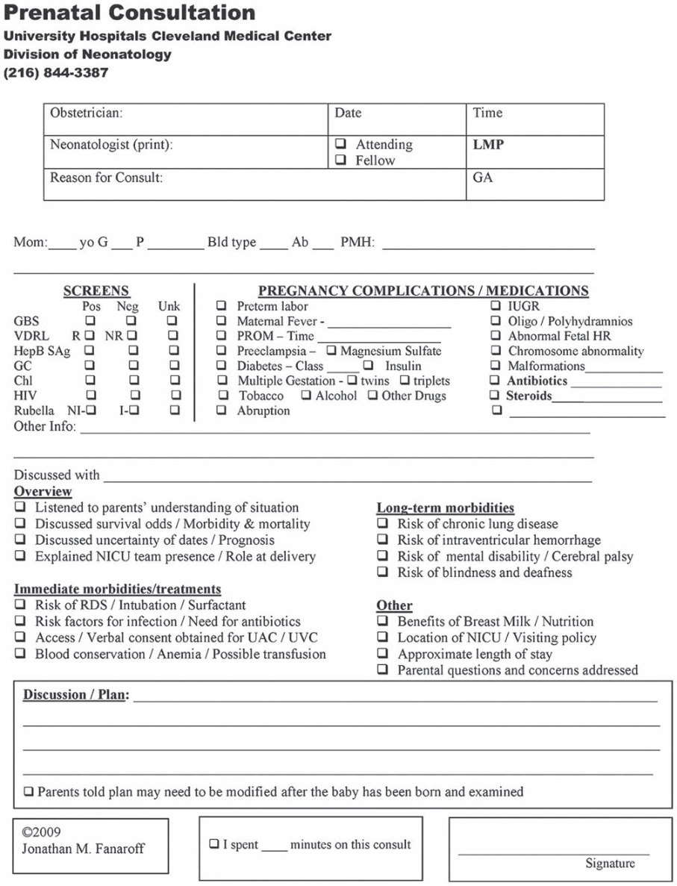
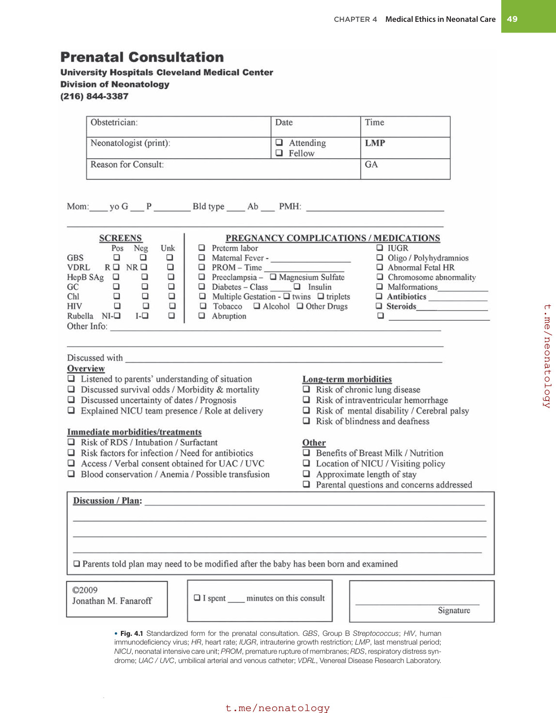
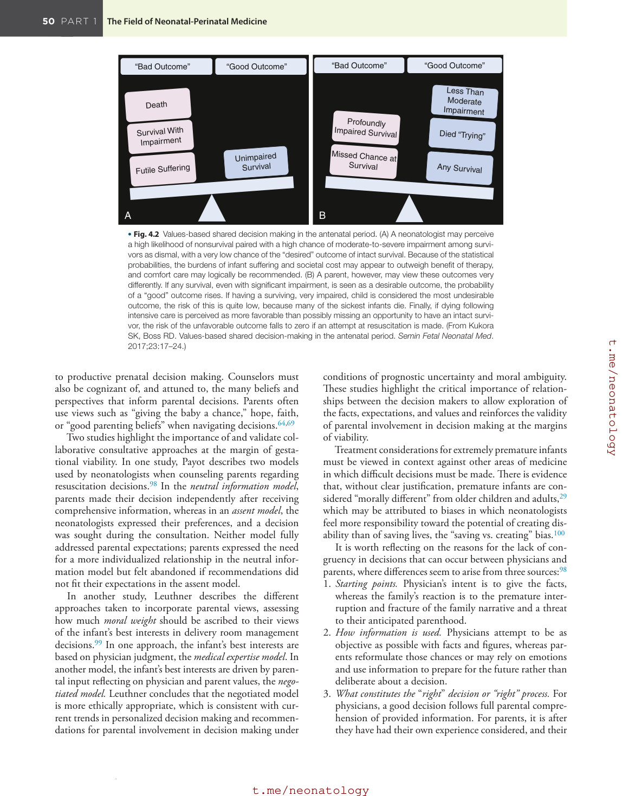
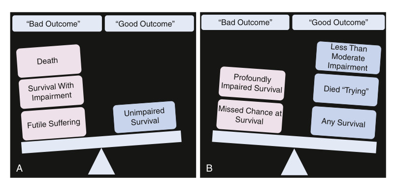

# 4. Medical Ethics in Neonatal Care
> [Source credits](../../SOURCE_CREDITS.md).

## Study pillars

### Ethical reasoning

Reasoned evaluation of benefits, burdens and values. Ethical reasoning evaluates and justifies action in pursuit of well-being, while recognizing uncertainty and differing values.

PDF p. 58

### Shared decisions

Partnership balancing parental authority and professional beneficence. The chapter describes a partnership through mutual consent, balancing parental authority with obligations to the infant.

PDF p. 62

### Emotion and context

Emotions and lived experience can shape how information is used. Parents may use affective and experience-based reasoning; understanding facts alone does not complete supportive communication.

PDF p. 62

### Viability and uncertainty

Physiologic possibility versus an explicit value judgment. The chapter separates physiologic maintenance of life from quality-of-life considerations that incorporate judgments about morbidity.

PDF p. 66

### Trust in the clinical relationship

A patient-parent-clinician relationship built on trust and the infant’s good. The chapter describes a relationship of mutual trust, clinical competence and moral discretion directed toward the newborn and family.

PDF p. 58

## Full source extraction

# 4. Medical Ethics in Neonatal Care
> Source attribution: [Source credits](../../SOURCE_CREDITS.md).

## PDF page 58 | printed page 39

4 Medical Ethics in Neonatal Care

### MARLYSE F. HAWARD, JONATHAN M. FANAROFF, AND NAOMI T. LAVENTHAL

### Introduction

This chapter explores the complexity of moral problem solving in neonatal medicine. First, principles of medical ethics and key terms and concepts are reviewed, followed by the application of these concepts in specific moral problems that arise (1) in the prenatal consultation at the limits of gestational viability, (2) when withholding and withdrawing life-sustaining medical treatment in the neonatal intensive care unit (NICU) is undertaken, and (3) in defining brain death and exploring organ donation. Ethical responsibilities and approaches for collaborative end-of-life decision making and conflict resolution, including impact on parents and team members, use of analgesic agents, and the conduct of clinical research will be presented. This chapter emphasizes the importance of the clinician-parent relationship for effective communication supporting affective and cognitive needs of parents while appreciating diversity in perspectives and values. This list is not an exhaustive representation of ethical challenges facing NICU clinicians but rather highlights some that are frequently encountered. The principles offered to address them are applicable to many other situations.

Three elements characterize the practice of medicine that are timeless, universal, and irrefutably true: (1) the fact of illness and the vulnerability it creates, (2) the act of the profession (the use of medical skills for the benefit of the patient), and (3) the practice of medicine itself—that which clinicians and patients do together in the clinical encounter, characterized by mutual intentionality.1 These three elements are well exemplified in the care of sick neonates, in which the vulnerability of anxious parents is manifest, the clinical competence and moral discretion of health professionals are used for the benefit of newborn patients and their parents, and the practice is carried out in a patient-parent-physician relationship characterized by mutual trust and pursuit of the neonatal patient’s and parents’ good.

Medical ethics involves the systematic, reasoned evaluation and justification of the “right” action in pursuit of human good or well-being in the context of medical practice. In the practice of neonatal intensive care, medical ethics has become a central focus because it contains all the elements of moral discourse but without clear-cut “right” answers expected in routine clinical practice. Numerous ethical issues arise as clinicians attempt to determine how best to use technology in pursuit of what benefits the patient, in consideration of the values parents place on different outcomes.

These issues are compounded by several limitations on NICU clinicians’ ability to elicit and understand parents’ values; these can be pragmatic, related to patient and professional time restrictions, or may result from limitations in the provider’s knowledge and expertise of how best to have these difficult conversations.2,3 Care is also complicated by the medical uncertainty surrounding accurate outcome prediction of potentially adverse findings and by the very nature of many decisions in which quality of life and life itself may be under consideration.4 All these issues make the NICU a challenging, highly scrutinized environment in how ethical issues are examined, reasoned, and justified, and raise fundamental questions about what the responsibilities of clinicians should be.

Ethical issues may be experienced as moral dilemmas, or moral distress. A moral dilemma is present when the clinician believes there is an obligation to pursue two (or more) conflicting courses of action. Because only one of these courses can be pursued, the clinician must make a valuebased choice that compromises one of these obligations. Conflict between respect for parental authority and professional duty to provide recommended medical care is a frequently encountered example of a moral dilemma.

Moral dilemmas may also arise when there is uncertainty in whether a course of action or resultant outcome is ethical. This is commonly manifest as uncertainty on the part

39

## PDF page 59

of parents who might struggle with a concomitant desire to prolong the life of their infant but wish to avoid burdensome procedures or a quality of life deemed worse than death. On the part of clinicians, moral uncertainty might appear when treatments are readily available, but with a low likelihood of success.

Moral distress arises when the decision maker feels certain about the morally right thing to do, but this perceived “right” course of action is constrained for numerous reasons, including the clinician’s lack of decision-making authority or institutional or financial constraints. This phenomenon was initially described among nurses5 but is also experienced by other NICU providers, including physicians, and involves a sense of powerlessness, frustration, physical symptoms, and ultimately professional “burnout.”6 Although unprocessed moral distress can result in maladaptive “moral residue,”7,8 contemporary explorations of this topic have focused on constructive approaches to building moral resilience8 and directing moral distress toward positive actions to improve patient care.9

### Principles in Medical Ethics

Ethical reasoning requires an understanding of the fundamental principles that define a domain (Box 4.1). Beauchamp and Childress10 have described four core bioethical principles: autonomy, beneficence, nonmaleficence, and justice. Consideration of a real-time ethical conflict or dilemma in the context of these principles can be a useful starting point and can be particularly helpful in articulating the ethical questions, uniting a struggling team by use of commonly held, noninflammatory language. However, a principles-based approach is less helpful when the problem revolves around a conflict between the principles themselves, as is often the case in the NICU. In many cases, a “principalis” paradigm may not do justice to the nature or complexity of the moral problem. In addition, in a purely principle-based approach, the role of the neonatal clinician as moral agent (i.e., someone with personal virtues and values and the opportunity to take action that comports with that judgment of morality) is de-emphasized. This chapter does not prescribe adherence to any particular ethical framework but aims to enhance appreciation of the language of ethical discourse to enable nuanced reflection, reasoning, and ethical decision making, and to underline the role of the clinician in these situations.

### Parental Authority

The principle of autonomy supports the right of competent patients to make their own health care choices. An individual who makes an autonomous choice acts intentionally, with understanding and without external controlling influences.10 An idealized expression of autonomy occurs when a competent adult chooses voluntarily and intelligently from among various options whose relative risks and benefits have been fully explained to them by the clinicians (i.e., via a truly informed consent process).

• BOX 4.1 Key Concepts Underlying Ethical Care in

the Neonatal Intensive Care Unit

• Respecting parental authority • Applying the best interests of the infant standard of

judgment • Minimizing harm to the newborn • Establishing and maintaining therapeutic alliance with

patients’ families • Empowering parents as advocates for their children • Applying family-centered care principles • Respecting parents’ values and cultural and religious

beliefs • Sharing decision making • Developing respectful interprofessional (moral) teamwork

The term parental autonomy is often used interchangeably with parental authority, although most argue that autonomy can strictly be used only when making decisions for oneself. Parental authority is the more correct term when referring to the role of parents in decision making for their newborn infants.

Neonatal clinicians should show respect for parental authority: 1. because of the presumption that parents will make deci-

sions that are in their child’s best interests (parents are often described as the “natural surrogate decision makers” for children)10 2. as a means of promoting shared decision making

Parents are not uniform in their desire to direct or even participate in medical decision making for their children.11,12 Clinicians must be conscious of the impact of their authority, the power that derives from expertise and confidence, as well as limitations in their own ability to determine how directive parents wish for them to be in preference-sensitive decisions.13

In the second half of the 20th century, there was a major shift away from a paternalistic “doctor knows best” approach of information sharing and medical decision making toward empowerment of the patient to make autonomous choices.14,15 This condemnation of paternalism has more recently been viewed as excessively burdening some patients with weighty decisions that they do not wish to make alone.16 There is a body of evidence that the prevailing bioethics emphasis on autonomy and self-determination can be overwhelming to parents.17 A more nuanced application of respect for parental authority can be satisfactorily achieved by including parents in decision making as true partners and team members, recognizing that decision making can exist on a continuum.15,18

Too rigid or simplistic an interpretation and application of respect for parental authority by clinicians is also problematic, such as when agreeing to a parental statement that “we want everything done.” Without exploring what underlies this declaration, clinicians may neglect the complexity of the situation and the underlying parental fear of “abandonment.” Finding the right balance between respect for

## PDF page 60 | printed page 41

parental authority and the clinician’s role and responsibility in any decision-making process requires insight, empathy, and great analytical and communication skills.

### Beneficence

Beneficence is the obligation to “do good,” that is, to promote patients’ best interests.10 In newborns, this obligation is embodied in the concept of the “best interests of the newborn.” This is a moral and legal standard of judgment that helps to establish the primacy of duties to infants, ensuring they be regarded as fully human individuals with interests, even when clearly unable to express their own value system. Pursuing a course of action in the best interests of an infant implies determining what treatment course has a more favorable benefit-to-harm ratio than other possible options. Interpretation of the meaning of “benefit” can vary between infants and between stakeholders (parents, relatives, clinicians) for the same infant. Interpretations of what it means for a treatment to be beneficial include improvement in the infant’s condition, stabilization of the infant’s condition, or delaying the onset of clinical deterioration. Amelioration of clinical symptoms, or avoidance of complications of treatment, might also be construed as benefit. Benefit can also be achieved by identifying a less restrictive or intrusive treatment.

Determination of best interests may involve discussions of the child’s potential quality of life. Quality-of-life considerations encompass the predicted cognitive and neurodevelopmental outcome, the potential for motor disability or other physical handicap (e.g., vision, hearing), and longerterm concerns such as behavioral and learning difficulties or school problems. It also considers the requirements for repeated or prolonged hospitalization, surgery, or medication; technology dependence; and the potential for pain and suffering to be endured. Quality-of-life considerations may also include less concrete medical states, such as the capacity for meaningful and potentially enjoyable interaction with other people and the environment. Some of the most ferocious disagreements between and within NICU teams relate to the inherently subjective nature of quality of life. Contemporary clinical ethicists have moved away from seemingly quantifiable assessments of quality of life, related to measurable outcomes, toward a more subjective interpretation, informed largely by the parents’ expressed values.2 Although well-intentioned clinicians might seek to “correct” parents’ interpretation of the quality of an anticipated outcome, recognition that some families might see more value in survival with neurodevelopmental disability or technology dependence than others is crucial to familycentered care and shared decision making. In addition, clinicians must be very cautious about judging the quality of life of others, viewing disability as a “harm,” and underestimating the ability of those with disabilities to have a wonderful, fulfilled, and meaningful life.19

The standard of best interests of the newborn acts as a threshold for judgment, yet the subjective nature of this

assessment and the fact that the assessment is being done by surrogate decision makers must always be recognized. In addition, it is imperative for clinicians to be aware of their limited powers of prognostication. Repeated studies by Meadow and colleagues have shown that when health care professionals predict that an infant will not survive to discharge, they are incorrect relatively frequently.20 However, there are circumstances in which the best interest standard can be very helpful to medical teams, such as when urgent decisions must be made in the absence of parental input or when parents refuse clearly life-saving interventions. For the latter, best interest serves as a standard for overriding parental decisions.

Diekema has suggested that the more conservative “harm” principle be applied in overriding parental wishes. By this principle, rather than determine the “best interests,” a harm threshold will be determined below which the parents’ decision will be overruled.21 Although invocation of the harm principle can be quite helpful, stakeholders for sick neonates must be careful to apply it in the context of illness severity, urgency, and maintenance of professional standards and integrity.16,22

Despite these definitional difficulties and suggested alternative standards such as the “harm” principle, “best interests of the newborn” is accepted as a guiding principle for decision makers because it unites different meanings under one standard and exhibits reasonableness, given the prevailing conditions.23 Properly understood, the concept can serve as a powerful tool in settling disputes about how to make good decisions for individuals who cannot decide for themselves.

### Nonmaleficence

The principle of nonmaleficence implies an obligation not to inflict harm on others. It has been closely associated with the maxim primum non nocere (first do no harm).10 Although beneficence incorporates preventing and removing harm as part of promoting “the good” of a patient, the injunction not to inflict harm remains a distinct principle and requires intentionally refraining from actions that cause harm. Such harm is generally interpreted as physical harm, especially pain, disability, or death. Nonmaleficence requires that no initiation or continuation of treatment be considered without consideration of whether the treatment is overly burdensome or harmful. This is especially relevant given a historical context in which attention to pain in neonates has been sorely disregarded, to the degree in which surgeries were performed without anesthesia. However, as for benefit, defining events and interventions that are harmful to the infant can be subjective. For some, harm is narrowly defined as pain or anxiety related to the condition or its treatment; assessment of this kind of harm can be aided by using bedside pain scores and other objective measures. For others, any intervention that does not change the ultimate outcome for the infant imparts undue burden. Clinicians and parents may differ about whether hospitalization in an

## PDF page 61

intensive care unit (ICU), without the promise of recovery or discharge home, is harmful to the infant.

### Justice

Justice is the dominant principle relating to social cooperation. Justice is the framework by which we determine how social benefits, such as health care, and burdens, such as research risks, are distributed. Although justice is regarded as a guiding principle for any health care system, no single, simple, ideal implementation adequately addresses the priorities of all relevant stakeholders. Generally, concepts of justice range from the broader utilitarian calculus to promote the greatest good for the greatest number in underwriting the distribution of resources (macroallocation) to a more narrowly focused equality of opportunity for each individual (microallocation). Justice in the distribution of resources requires that: 1. patients in similar situations have access to the same

health care 2. the level of health care available for one set of patients

considers the effect of such a use of resources on other patients Contemporary interpretations of resource allocation have focused on disparities,24 both on equality in access to care, upstream from provision of the medical intervention itself, and emphasized the principle of equity over equality. This distinction is important in emphasizing the equality of health outcome rather than equality in provision of any specific resource.

There is increasing attention paid to health care disparities in the NICU, along with improvements that must be made in the areas of diversity, equity, and inclusion. Unfortunately, there is significant evidence of “complex racial inequities and/or disparities in structure, process, and outcome measures, most often disadvantaging infants of color, especially African American infants.”25 In the United States, this involves evidence that infants of color are both more likely to receive care in quality-challenged hospitals as well as to face disparities within NICUs.25 Barfield, Cox, and Henderson have suggested five key actions that may begin to address NICU care for traditionally vulnerable neonates:26 1. Dispelling the myth of an inherent advantage by Black

premature infants 2. Approach quality improvement with a lens toward health

equity 3. Identify measures that provide a better understanding of

both the type and quality of care 4. To reduce mortality and disparities, ensure that all infants

receive care in risk-appropriate facilities 5. Use research to identify the drivers of disparities, as well

as solutions, to ensure health equity These are justice issues that must be addressed. As Barfield, Cox, and Henderson conclude, “[w]e owe the infants of this country consistent high-quality care, no matter their skin color, and...there is work to be done.”26

Although fairness in allocation of resources for the individual patient is an important consideration, it is not the

fundamental standard in this interaction. Microallocation issues are very rarely appropriate at the bedside; individual clinicians caring for individual patients are poorly suited to make decisions about whether one patient, or another, is more deserving of a limited resource, or to make ad hoc institutional-level decisions about how limited resources will be distributed. First, there is an inherent conflict of interest, in which the clinician might rightly prioritize the immediate needs of the patient she is caring for over larger, systems-level considerations. Second, rationing and allocation schemes depend on economic and public health expertise beyond that possessed by most clinicians. However, individual clinicians do have a moral obligation to judiciously use medical resources for individual patients and ought not use unnecessarily expensive treatments or treatments that will not effectively promote the patient’s health. The conventional ethical prohibition of bedside rationing is also complicated by daily realities of medical care in which time, ICU beds, and limited-quantity equipment are tacitly managed as a matter of routine.27

The COVID-19 pandemic required society as well as health care systems to rapidly consider the appropriate triage framework to use in the face of an overwhelming demand for care while constrained with a limited supply of ventilators, medications, equipment, and personnel. When supplies are scarce, the primary ethical considerations discussed in this chapter such as autonomy and best interests may be outweighed by utilitarian/justice considerations.27 Indeed, tensions during the pandemic highlighted conflicts between “public health ethics,” where the goal is to promote greater societal good, and “duty to care,” where clinician obligations focus on maximizing individual patient outcomes. Triage decision-makers, who should not be bedside clinicians, may have to allocate resources between a premature infant and a geriatric adult. Scoring systems, such as the Sequential Organ Failure System (SOFA) in adults and the National Institutes of Health Extremely Preterm Birth Outcomes Tool in premature neonates, have been proposed as a transparent and objective means for decision making.28 Some survey literature, however, suggests that newborn infants, particularly premature infants, may be “undervalued” compared to other age groups.29 Consequently, it is essential that advocates for neonatal patients are involved in both the development and implementation of any resource allocation strategies.

In every system and under non-pandemic “normal” circumstances, the provision of neonatal services requires guidelines to be developed for determining appropriate use of these costly and often limited resources. Priorities must be set and justified by organizational leaders. Any change in the way neonatal care is delivered needs to be fair and accessible, as well as open and challengeable. Disputes should be addressed based on the acceptance of objective measures and trust in the integrity and fairness of the process and the individuals responsible for management of the process. With greater attention being paid to escalating health care costs, there is little question that how resources for sick

## PDF page 62 | printed page 43

newborns are used and justified may become more critically and ethically questioned. However, neonatal intensive care has been shown via a number of approaches to be remarkably cost effective,30 particularly relative to the care of other patient populations.31

### Key Terms and Concepts

### Shared Decision Making and Personalized Decision Making

Shared decision-making paradigms encourage partnerships between clinicians and parents in making care decisions through mutual consent, balancing parental authority with professional obligations of beneficence toward the infant. Benefits of shared decision making for parents include decreased decisional conflict and regret, and improved long-term mental health.32–35 Although various models for shared decision making exist, in adult patient-physician relationships, the deliberative-interactive model is the ideal, wherein clinicians not only help the patient with clarification of their values, but also strive to make their own reasoning transparent for the patient to appreciate the many factors that inform their professional opinion.14 In neonatal care, despite intentions to follow similar interactive exchanges, practices often resemble informative models of shared decision making, wherein clinicians believe parents can make choices independently if provided sufficient information.36

Informative models assume parents follow rational, or cognitive-based deliberations in which they know and can apply their values to interpret complicated medical information without the influence of strong emotions. These models encourage clinicians to focus largely on communicating objective facts to equalize knowledge imbalances. Although this approach may work for some parents, for others, contextual features such as emotions or personal-lived experiences influence and guide deliberations, leading toward more heuristic approaches in decision making.37

Heuristic decision-making approaches (also known as “mental shortcuts” or “gut instincts”) are strategies to simplify complex information or decisions by using “nonrational” processes to guide choices and deliberations.38 For example, associations are made between related facts and similar, but not exact, past experiences. Some of these associations lead to imperfect assumptions, or cognitive biases, whereas others, such as emotions or sacred values, highlight salient features of the decision or outcome.38,39 For parents who follow heuristic decisional processes, a personalized approach rather than a standardized, informative model may be preferable.

Personalized decision making acknowledges parents’ variability in tolerance for risk, desire for decisional responsibility, and affective and cognitive needs.40 It allows flexibility for those parents who may want to assume decisional responsibility and for those who delegate decision making to clinicians. Some scholars have recommended nudges as a potential strategy for those who prefer to delegate

decisions.41 Nudges treat one option as appropriate, without making an explicit suggestion, allowing parents to overrule that assumption if they notice or feel that they want that authority.42 In these instances, clinicians adjust options based on knowledge of parental values, hopes, and beliefs. Although these approaches have been criticized as paternalistic, decreasing parental authority, scholars question whether how choices are presented, or choice architecture, can ever truly be neutral.41 Relational autonomy, another conceptualization of parental authority, unites emotions with reason, by recognizing that relationships can guide or influence decisions.43 For neonatal decision making, adhering to relational autonomy “establishes the beginnings of a trusting relationship with the health care team, which may last throughout the baby’s hospitalization and care, benefitting all parties involved.”44

Regardless of the decision-making model followed or the ultimate decision maker, clinicians should always support parents after choices have been made. As stated, “ ...support for surrogate decision makers is focused far too much on the details of medical intervention options and not nearly enough on assisting with the confusions, dilemmas, and self-recriminations inherent in trying to formulate a guiding personal duty to serve in the role of surrogate decision maker.”45 This can be accomplished by building strong parent-clinician relationships through personalized communication, empathy, and trust.

### Communication With Parents and the Clinician-Parent Relationship (Box 4.2)

A sound patient-physician relationship is a sine qua non of good medicine, for it is within this relationship that physicians exercise their humanity, understanding, and respect for the values of others. In neonatal medicine, the physician’s communication relationship is with the parents (or legal guardians) of the newborn, respecting parental authority and fulfilling the dual role of caring for the infant and the parents. Every communication interaction with parents, whether formal or informal, is an opportunity for relationship building—the core of risk communication and bioethics. Failures in communication often stem from inadequate parent-clinician relationships and can lead to bioethical conflict, emotional distress, and even undermine autonomy.3,46,47

Recent trends in communication approaches parallel those in neonatal bioethical decision making, away from outcomes toward process-driven analyses emphasizing therapeutic alliances.40,41,48 Overarching goals of communication for critically ill patients or their surrogates include establishing trusting relationships, providing emotional support and information, value exploration, and supporting personalized decision making (when applicable).49,50 This aligns with American Academy of Pediatrics recommendations, reaffirmed in 2017, that effective communication address both affective and cognitive needs.51 It is also supported by research in risk communication, where precise

## PDF page 63

• BOX 4.2 Guidelines for Respectful

Communication With Parents

• Create an environment for communication that encourages

parents’ participation and their becoming as fully informed as possible. • Identify and remove barriers that limit parents’ role in

communication (e.g., language, physical distance). • Communicate with parents: at the time of admission and

at any crisis point in their child’s NICU course, via periodic reviews of longer stay patients, and other unstructured opportunities. • Encourage parents to seek clarification of information at

any point by requesting an appointment with the child’s responsible physician. • Provide open, truthful communication always. • Provide information as accurately as possible and with as

much certainty of diagnosis and prognosis as is possible in each clinical situation. • Acknowledge medical uncertainty. • Use easily understandable language and pay attention to

health care “literacy” issues. • Assess family communication preferences and attempt to

communicate within those parameters. • Be pre-emptive in communication (i.e., foresee what

problems or issues may arise in the child’s course). • Be proactive in communication in any clinical situation in

which a poor outcome is predicted. • Convene meetings with both parents when important

decisions need to be made. • Keep parents informed of any special investigations/tests

that are planned. • Recognize the need for time to process and accept

information. • Promote consistency and continuity of communication in

the face of medical staff changes and handovers. • Practice open, honest, and timely disclosure regarding

medical error.

NICU, Neonatal intensive care unit.

numbers and lists of detailed facts do not necessarily correlate with an adequate understanding of risk, unless parents also have mental models that give intuitive meaning to their situation.52 Finding a balance between information that is sufficient to promote competence but not irrelevant to be burdensome requires insight into what outcomes matter most to parents.53 Some parents may need help understanding their thoughts, some may need coaching on how to parent, and some may want information to participate in decision making. This can be achieved through personalized communication and strong clinician-parent partnerships.

### Patient-Centered, Personalized Communication

Patient-centered communication, characterized by active listening, expressions of empathy, statements reaffirming non-abandonment, and support for decision making, has been associated with increased family satisfaction, a qualityof-care metric.50,54 Personalized communication, within a patient-centered approach, seeks to individualize cognitive

information while taking the time to understand the affective and psychosocial context of the parents’ experience.40,48 Parents’ lived experiences, psychological make-up, risk tolerance, and values reflect the multiple sociocultural facets that can influence perspectives.40 Personalized communications are not “one size fits all,” but rather seek to afford parents latitude in determining how they prefer to receive, absorb, and engage with complex information while building rapport with the parent. These approaches “titrate clinicians’ interactions with the parents’” reality, supporting them in ways they need it, at the time when they need it.48

Several frameworks exist to guide personalized communications with parents, consistent with best practice.50,55–57 Each framework begins with clinician self-reflection, and situational and environmental awareness. Physician-related factors, such as implicit biases58 which are subconscious, unintentional assumptions that shape perspectives or attitudes, or external pressures, such as time constraints from competing clinical, administrative, or academic obligations, can inadvertently impact how communication is delivered and received by parents. Parental concerns, emotions, and baseline understanding should be explored early during an interaction to understand parents’ perceptions of the clinical situation and/or correct misunderstandings that may anchor impressions. For example, cognitive biases such as the anchoring adjustment bias can lead parents to adjust insufficiently for the expected difference in outcomes with weeks of prematurity;38,59 addressing the parents’ emotional experience decreases parental stress more effectively than providing information alone.60

Any personalized communication with parents requires flexibility; some parents may prefer detailed information, whereas others prefer the general gist. Even when faced with decisions, the desired level of involvement and disclosure of medical versus non-medical information may vary based on the nature of the decision and the parents’ decisionmaking preferences, and may evolve with time during the infant’s hospitalization.12,48 How information is communicated influences not only parents’ understanding of the situation61 and their comfort in addressing moral issues and values openly, but also their ability to engage effectively in a decision-making process. Likewise, supplemental information should be guided by individualized preferences allowing parents to check their understanding of critical information. Decision aids can improve comprehension for some parents; however, aids may also increase, rather than lessen, decisional conflict by showing the options in sharp relief. Therefore they should not be used in lieu of a strong clinician-parent relationship.

### Empowering Parenthood and Good Parenting Beliefs

At a minimum, communication should always seek to empower parenthood, a key component in family integrated care.18,62 Feeling safe and respected in the clinician-parent relationship can promote parental characteristics, such as

## PDF page 64 | printed page 45

resilience, which have been linked to favorable projections of future quality of life for neurologically impaired infants regardless of illness severity.63 Remaining sensitive to barriers affecting daytime parental presence at the bedside, such as responsibilities to other children and family members, costs of transportation to and from the hospital, and the need for one or both parents to return to work, are important when offering care opportunities. Language such as “some parents want to be present on rounds, other parents prefer to speak with clinicians later” permits choices without pressuring parents to adhere to standards they may not be able to or want to achieve.62

Good parenting beliefs, described initially in the pediatric intensive care literature, represents approaches and ideas that parents use to help them cope with, define, and fulfill their roles as parents of critically ill children.64 For parents of neonates, developing good parenting beliefs and feeling empowered takes time: they must overcome feelings of guilt, feel like parents, and eventually feel like good parents as they begin their parenthood journey under surreal experiences in an intensive care unit.65 Communication strategies such as verbal statements of praise within the constructs of effective partnerships can encourage positive transformations.66

Communication pitfalls can also hinder empowerment. Medical jargon, terminology that implies value judgments (“poor prognosis”), or impersonal labels (“the hypoplast”) impact perceptions of quality of life.67 Dominating conversations with too much medical information can overwhelm a parent’s ability to absorb information.46 Studies of family conferences show correlation between the frequency of family speech and satisfaction.68 When given opportunities to talk, parents share emotions, hopes, and beliefs which can drive medical decision making and facilitate patient-centered communications.46,69,70 Barriers to communication become especially pronounced when cultural differences in beliefs, decisional roles, language, and communication preferences strain clinician-parent relationships.

### Cultural Sensitivity

Culture represents a complex multifaceted entity inclusive of a variety of elements related to socioeconomic, racial, ethnic identification, sexual orientation, gender, spirituality, educational attainment, and physical abilities. Cultural sensitivity has been described in the literature using various terminology (cultural humility, cross-cultural efficacy, cultural sensibility, cultural care, cultural safety, and critical cultural competence).71 Common to all is a consciousness of reflection and behavior on the part of the clinician in delivering patient care. Cultural sensitivity extends beyond an acknowledgement of different cultural norms and considers system-wide contributions to promote structural competence. Cultural sensitivity is central to patient-centered communication and has been shown to ameliorate (or perpetuate when absent) maternal morbidity and neonatal outcome disparities.24,72 Recognition of the child’s place within the family highlights the cultural, religious, and spiritual

dimensions of families’ lives and may bring to light significant diversity within these domains. In a pluralistic society, parents and physicians are unlikely to share the same values, cultural systems, personal histories, and experiences, and at times of stress these differences may present health care providers with significant challenges. Clinicians should recognize the dynamic nature of how families’ interests are shaped by these contexts; therefore it is important not to stereotype the members of specific social, cultural, ethnic, or religious groups. Individuals’ affiliations may not be predictive of their beliefs and values in the care of their infant, and the health care team should regard each patient and family as unique and attend carefully to their specific views and values.

When attentiveness to the views and values of families is difficult because of language barriers, professional interpreters should be used. Use of an interpreter is advisable for three reasons: 1. It ensures that parents’ views are available to the health

care team 2. It removes the burden on family members or friends for

the transfer of information 3. It limits the potential for miscommunication

In certain situations, a cultural interpreter not only can facilitate language comprehension but can also provide useful information about cultural norms and traditions that are unfamiliar to the health care team. Access to high-quality interpretation services is an essential component of ethically and culturally sensitive care that also satisfies a regulatory requirement and decreases medicolegal risk.

Religion and the more general concept of spirituality as a major determinant of culture, tradition, and family values often needs to be addressed with parents, particularly when end-of-life decision making is undertaken. A qualitative questionnaire study completed by parents after their child’s death revealed the emergence of four explicitly spiritual/religious themes: prayer, faith, access to and care from clergy, and belief in the transcendent quality of the parent-child relationship that endures beyond death.73 Other significant themes with a religious/spiritual dynamic include finding meaning, hope, trust, and love. In another study focused on the delivery room consultation, mothers stated that religion, spirituality, and hope were the major factors that guided their decision making.69 The implication of these studies is that health care teams need to consider whether they have or need to create an environment that is hospitable to, and supportive of, religious or spiritual practice; that clinical staff recognize parents’ spiritual needs and provide access to hospital chaplains and community clergy, and, on a deeper level, appreciate parents’ religious and spiritual perspectives in prenatal consultations and end-of-life discussions.

### Conditions of Uncertainty

As medicine advances, physicians and parents must sometimes struggle with information that is at the limits of medical knowledge and in which the implications of findings are

## PDF page 65

uncertain. The way medical uncertainty, specifically prognostic uncertainty, is (or is not) communicated is extremely important and influences subsequent decision making. “Message framing,” for example, whether the reported outcome is mortality or survival, has a major impact on decision making.74 Parents may also struggle with value uncertainty, as they try to infer preferences without previous experiential learning.

Neonatologists communicate uncertainty in different ways: some provide additional information, some acknowledge uncertainty to illustrate boundaries of medical evidence, and some use uncertainty to foster hope and humanize their relationship with parents.75 Experts recommend that clinicians should: 1. normalize uncertainty: “... we can never be certain about

the future. I wish I could be more certain” 2. address emotions: “it is tough not knowing what the

future will bring” 3. help parents refocus on the present: “what can we do to

help you now, since we are unsure of what the future will bring”76 For parents, hope, spirituality, and affective elements play a central role in mitigating uncertainty69—hope that clinicians are wrong or hope that favorable outcomes are still possible.75

Neonatology groups may use different strategies to operationalize prognostic uncertainty. Some examine outcome data and identify thresholds below which intensive care will not be offered because of unacceptably poor outcomes and thresholds above which intensive care is obligatory because of reasonably good outcomes. In isolation, this strategy has been criticized because: 1. one or more stakeholders cannot accept the possibility of

forgoing a chance of survival for statistical outliers 2. of limitations to available outcome data 3. statistical information is not viewed as helpful to deci-

sion making2,77 A wait-until-certainty approach78 initiates life-sustaining interventions for almost every infant with any chance of survival. Treatment continues unless severe, adverse medical findings become unequivocally evident. A problem with this strategy is the false promise that certainty will at some point exist, and it potentially relegates parents and other members of the health care team to the role of bystanders as the medical course unfolds.

A trial of therapy approach79 focuses on individualization within consistently and fairly applied institutional guidelines, in which available population-based epidemiology, individual factors not accounted for by large studies, and parental values are considered. This approach emphasizes remaining prognostic uncertainty, even for families who request full intervention, using moral responsibility as a guide for the continuation of life sustaining treatment.

### Delivering Bad News: Hope and Urgency

As prognoses become more unfavorable, disclosures are sometimes delayed because of worry that poor prognostic

information may extinguish hope. However, multiple hopes may coexist, and new hopes emerge after realistic and truthful information is shared.80 “I wish” statements can help acknowledge the parents’ primary hope while communicating realistic expectations: “I also wish the treatment would have worked,” or can be used as warning shots to prepare parents for difficult news to come: “I wish I had better news. What I have to share will be difficult to hear.”81 Emotive phrases such as “I’m worried” or “I’m concerned” can help open discussions describing outcomes and reinforce the clinician’s commitment to the physician-parent relationship.

Lizotte et al.82 recommended a stepwise approach for communication under urgent situations where a pre-existing clinician-parent relationship or a designated person for communication is absent. Preparation includes introductions and conveying the urgency and intensity of the pending clinical situation. During the event, managing expectations with brief updates regarding next steps and potential outcomes (“we will try this medication but if it does not work, he will die”) can prepare parents if interventions fail. Simple, straightforward language when death occurs (“he is dead”) is more helpful than metaphors. Meeting with parents after death can help validate decisions or experiences, answer questions, and support parents through grief.

### Follow-up Conversations

Ideally parents’ readiness to receive information and their coping resources should be ascertained so that appropriate information is shared with consideration of their adaptation to the medical setting. Follow-up conversations provide opportunities to support parents and give them time to absorb new information. Especially when bad news is shared, it is important to provide specific information about when a follow-up conversation will occur.81 In acute situations, if an urgent decision is required, the physician needs to move the relationship rapidly, however, from one of “moral strangers” to one in which moral issues can be openly discussed.

In some units, neonatal intensive care is provided by many clinicians with expertise in different fields and, though the nature of intensive care may require teams to change, ways to maintain continuity have been developed. Some NICUs identify a primary clinician to integrate all the important information and maintain a consistent relationship and pattern of communication with parents. However, minimizing fragmented or inconsistent information is the responsibility of all who care for the parents and the patient. This requires an understanding among the team members of different responsibilities in communication with parents, such as when conveying day-to-day quantifiable, objective information; when to communicate severe diagnoses; or when to be more speculative about prognostic significance of specific findings. Inter-specialty meetings, in which all the clinicians involved with the patient share their findings and perspectives, are crucial to ensuring consistent and coherent messaging. Peer-to-peer support programs can

## PDF page 66 | printed page 47

provide an additional and informal way to establish continuity and support parenting in the NICU.

### Informed Consent

Informed consent is enshrined as a foundational cornerstone of the ethical practice. Tenets of informed consent include (1) disclosure of information, (2) understanding, (3) competence or capacity, and (4) voluntariness or freedom to choose.10 Some authorities posit that obtaining formal, informed consent is necessary from parents for virtually every neonatal test or procedure as a means of maintaining a high standard of ethical care. Ensuring that parents are kept up to date and advised of treatment plans is important; however, information gathered from an ethnographic study showed that parents did not want to be asked to consent to every procedure.83 They often felt overwhelmed when asked to consent for routine and minor procedures and felt they were given the illusion that they could or should say stop when there was no real choice and no time to learn more about each procedure. Parents found it was easier to discuss questions and dilemmas when communication occurred remote from consent processes. When consent was required, parents emphasized the need for a two-way informed agreement between partners with established mutual trust and respect.

### Clinical Applications in Specific Moral Problems

### Refusal of Treatment During Pregnancy

When a pregnant patient acts in such a way as potentially to create a serious risk of harm for the developing fetus, either by declining a recommended intervention or by actively engaging in a behavior that is harmful to the fetus, some authorities argue that state intervention is morally justified to promote fetal health and well-being. However, the American College of Obstetricians and Gynecologists (ACOG) maintains that such intervention not only violates the pregnant person’s autonomy, integrity, and privacy, but also undermines the principle of reproductive freedom.84

Authorities who advocate for state intervention place some limits on the principle of reproductive freedom: whatever rights a pregnant woman may have to direct the course of the pregnancy, they do not include an unlimited right to harm the fetus. In practice, which parental behaviors lead to state intervention is generally determined by the legality rather than the inherent harmfulness of the intervention, leading, for example, to paradoxically harsher repercussions for occasional marijuana use than for heavy alcohol consumption, even though the harms to the fetus from the former are not nearly as well described as those from the latter.

Significantly, professional bodies have commonly resolved the moral dilemma between the pregnant person’s autonomy and the fetus’s well-being in favor of respecting the principle of autonomy. An ACOG Committee Opinion

on “Refusal of Medically Recommended Treatment During Pregnancy” states that “it is never acceptable for obstetrician-gynecologists to attempt to influence patients toward a clinical decision using coercion.”84 They note that this can include “threats” to involve the courts or child protective services to coerce a person to choose a particular medical decision. During these difficult situations, clinicians are encouraged to promote shared decision making, promote a team approach, and utilize ethics consultation.

### Gestational Viability and Clinical Guideline

Viability can have a physiologic definition, such as the point at which life can be maintained outside of the uterus, or be based on quality-of-life considerations in which there is an explicit value judgment regarding the degree of morbidity that is acceptable if such a life were to be maintained. Although no universally accepted definition of a viable fetus exists in clinical practice, guidelines from professional societies in several countries have defined gestational age ranges at which the benefit-to-burden ratio of aggressive obstetric or neonatal care becomes questionable.85,86 These gestational ages are also known as the “gray zone,” where prognostic uncertainty and moral ambiguity permit parental discretion for delivery room management.

Recently, neonatology teams have developed the capacity to maintain physiologic signs of life at extremely low gestational ages, resulting in survival possible after a gestation of 22 weeks with some neurologically intact survivors, shifting the lower border of marginal gestational viability from 23 to 22 weeks.86–88 Similarly, examination of the outcomes of infants born at or after 24 weeks suggests that the majority of these infants survive, and the majority of NICU graduates survive without moderate or severe neurodevelopmental impairment.88 Although some intensive care units continue to allow parents to forgo resuscitation until 26 weeks, resuscitation of infants born at or after 24 weeks should be pursued in the absence of major co-morbidities, such as extreme intrauterine growth restriction or major congenital anomalies.

Yet, using gestational age alone to guide decisions warrants caution. Gestational age decision thresholds can generate self-fulfilling prophecies: if life-sustaining care is not offered at a gestational age, there will be no survivors at that gestational age.89 Estimations of gestational age are also inherently flawed; first trimester ultrasounds used for dating can be imprecise ± 1 week and daily growth toward the end of the second trimester is exponential.85,89 In addition, factors other than gestational age impact prognoses.85,90 An “outcomes estimator” developed by Tyson and coworkers accounts for five factors (gestational age, estimated birth weight, singleton status, antenatal steroids, and gender) that impact prognosis and provides the likelihood of death or adverse neurodevelopmental outcome.90 The estimator is available without charge on the Internet,91 and although not perfect, it does seem to “promote treatment decisions that are less arbitrary, more individualized, more

## PDF page 67

transparent, and better justified than decisions based solely on gestational age thresholds.”90

The challenge facing the life-defining “resuscitate or not” issue for parents and the neonatal team in the “gray zone” is compounded by the “moral strangeness” between the participants, the vulnerability and unfamiliar physical and emotional context for parents, constraints of time, and the great degree of medical uncertainty in prognosticating outcome for individual infants. Nevertheless, the urgent context exerts its own demands, and the opportunity for prenatal consultation must be optimized, because it is considered more conducive to an exploration of parental and physician/team views than if this conversation occurs in the delivery room or in the NICU in the first few hours of the infant’s life.

### Antenatal Consultation at the Margin of Viability

The antenatal consultation at the margin of gestational viability has three primary aims: 1. To develop a relationship with parents to provide affec-

tive support and explore values 2. To provide individualized information on which deci-

sions can be based 3. To support personalized parental decision-making pro-

cesses about whether a trial of therapy will be undertaken in the delivery room Recent trends in antenatal consultation have highlighted personalized approaches which rely on strong clinicianparent relationships, the hallmark of communication and compassionate care. These consultations focus equally on the process of deliberation, attending to emotions and fostering trust, as on the outcomes, recognizing that parents differ in their experiences, preferences, and approaches to decision making.40,41,92

Consistent with practices to support effective communication, preparation for the consultation begins with a thorough medical record review, communication with the obstetrical team, and history taking. If possible, joint consultation with obstetrical colleagues is recommended by professional societies.93,94 After introductions and addressing the parents’ emotional crisis, next steps explore values and fears. Helping parents not only identify but also prioritize pertinent, and at times conflicting, values is an essential component of antenatal consultation which can help empower them when making decisions.

Recognizing that many parents want information from the antenatal consultation, the burden rests with the clinician to strike a balance between sufficiently informing parents without overwhelming them. Information can be used to guide decision making and/or prepare for potential futures, depending on the parents’ values and preferred approach to decision making. Parents who rely on emotions instead of data-driven risk assessments, or who prioritize quality of life over sanctity of life, may differ in their cognitive and affective needs.

Regardless of the exact content or intent, any data shared should be current, individualized to the baby, personalized to parental concerns and needs, and germane to the unit in which the patient is being cared for. Parents often desire information pertaining to chances of survival and information about the long-term outcomes—including quantitative and qualitative measures when available (functional abilities, learning, behavior, impact on family)—with recognition that parents may differ in their previous experiences with disability and chronic disease and the value they place on these outcomes. Even in the setting of a value-exploration approach, a standardized form (Fig. 4.1) may provide a reminder to the clinician of topics that could be covered while remaining mindful that some parents prefer details and others the general gist.95

Several scholars have called for increased parental participation in research to identify and investigate outcomes that matter most to parents, because the disability categories generated by experts may not align with parents’ perspectives.53 For example, the composite outcome of death and severe disability may represent two outcomes that are not valued equivalently by parents, whereas a behavioral disability may be extremely stressful for parents yet is not classified as a “severe disability” in research studies.53 Disability categories may also not adequately capture “big picture views” without considering the impact of societal accommodations or family environment on the child’s adaptation. Kukora and Boss have offered a conceptual model of parental characterization of a “good” or “bad” outcome (Fig. 4.2), which offers an explanation for why some parents pursue interventions in the face of a poor prognosis.2

However, irrespective of the consultative model and decision-making approach pursued, parents should never feel abandoned to make decisions without support, nor should they feel intimidated to make choices they believe are not in the best interests of their infant or inconsistent with their values. Both retrospective data11,33 and hypothetical survey data12,96 reveal that parents want involvement with resuscitation decisions, and those who perceive some level of participation in the process experience less decisional regret and conflict, and improved long-term mental health.32,34 Although joint decision making for infants is preferred by most parents, some delegate decision making to clinicians, emphasizing “one size does not fit all.”96 These delegations must be accepted as appropriate expressions of parental authority. An evolving body of science has focused on use of decision support tools and enhanced information to improve processes and support parents with sensitive decision making.97 However, it must be remembered that these tools should only be used within the constructs of a strong clinician-parent relationship.

Lastly, descriptions of gestational viability should always be sensitive to the parents’ identification of personhood of the fetus. Reduction of a future child, whose sex might be known, whose name is picked out, and whose bedroom is already decorated, to the status of a “nonviable fetus” has the potential to antagonize parents and present an obstacle

## PDF page 68 | printed page 49

### • Fig. 4.1 Standardized form for the prenatal consultation. GBS, Group B Streptococcus; HIV, human

immunodeficiency virus; HR, heart rate; IUGR, intrauterine growth restriction; LMP, last menstrual period; NICU, neonatal intensive care unit; PROM, premature rupture of membranes; RDS, respiratory distress syndrome; UAC / UVC, umbilical arterial and venous catheter; VDRL, Venereal Disease Research Laboratory.

• Fig. 4.1 Standardized form for the prenatal consultation. GBS, Group B Streptococcus; HIV, human immunodeficiency virus; HR, heart rate; IUGR, intrauterine growth restriction; LMP, last menstrual period; NICU, neonatal intensive care unit; PROM, premature rupture of membranes; RDS, respiratory distress syndrome; UAC / UVC, umbilical arterial and venous catheter; VDRL, Venereal Disease Research Laboratory.

## PDF page 69

“Bad Outcome” “Good Outcome”

Death

Survival With Impairment

Futile Suffering Unimpaired Survival

B A

• Fig. 4.2 Values-based shared decision making in the antenatal period. (A) A neonatologist may perceive a high likelihood of nonsurvival paired with a high chance of moderate-to-severe impairment among survivors as dismal, with a very low chance of the “desired” outcome of intact survival. Because of the statistical probabilities, the burdens of infant suffering and societal cost may appear to outweigh benefit of therapy, and comfort care may logically be recommended. (B) A parent, however, may view these outcomes very differently. If any survival, even with significant impairment, is seen as a desirable outcome, the probability of a “good” outcome rises. If having a surviving, very impaired, child is considered the most undesirable outcome, the risk of this is quite low, because many of the sickest infants die. Finally, if dying following intensive care is perceived as more favorable than possibly missing an opportunity to have an intact survivor, the risk of the unfavorable outcome falls to zero if an attempt at resuscitation is made. (From Kukora SK, Boss RD. Values-based shared decision-making in the antenatal period. Semin Fetal Neonatal Med. 2017;23:17–24.)

to productive prenatal decision making. Counselors must also be cognizant of, and attuned to, the many beliefs and perspectives that inform parental decisions. Parents often use views such as “giving the baby a chance,” hope, faith, or “good parenting beliefs” when navigating decisions.64,69

Two studies highlight the importance of and validate collaborative consultative approaches at the margin of gestational viability. In one study, Payot describes two models used by neonatologists when counseling parents regarding resuscitation decisions.98 In the neutral information model, parents made their decision independently after receiving comprehensive information, whereas in an assent model, the neonatologists expressed their preferences, and a decision was sought during the consultation. Neither model fully addressed parental expectations; parents expressed the need for a more individualized relationship in the neutral information model but felt abandoned if recommendations did not fit their expectations in the assent model.

In another study, Leuthner describes the different approaches taken to incorporate parental views, assessing how much moral weight should be ascribed to their views of the infant’s best interests in delivery room management decisions.99 In one approach, the infant’s best interests are based on physician judgment, the medical expertise model. In another model, the infant’s best interests are driven by parental input reflecting on physician and parent values, the negotiated model. Leuthner concludes that the negotiated model is more ethically appropriate, which is consistent with current trends in personalized decision making and recommendations for parental involvement in decision making under

“Bad Outcome” “Good Outcome”

Less Than Moderate Impairment

Profoundly Impaired Survival

Died “Trying”

Missed Chance at Survival

Any Survival

conditions of prognostic uncertainty and moral ambiguity. These studies highlight the critical importance of relationships between the decision makers to allow exploration of the facts, expectations, and values and reinforces the validity of parental involvement in decision making at the margins of viability.

Treatment considerations for extremely premature infants must be viewed in context against other areas of medicine in which difficult decisions must be made. There is evidence that, without clear justification, premature infants are considered “morally different” from older children and adults,29 which may be attributed to biases in which neonatologists feel more responsibility toward the potential of creating disability than of saving lives, the “saving vs. creating” bias.100

It is worth reflecting on the reasons for the lack of congruency in decisions that can occur between physicians and parents, where differences seem to arise from three sources:98 1. Starting points. Physician’s intent is to give the facts,

whereas the family’s reaction is to the premature interruption and fracture of the family narrative and a threat to their anticipated parenthood. 2. How information is used. Physicians attempt to be as

objective as possible with facts and figures, whereas parents reformulate those chances or may rely on emotions and use information to prepare for the future rather than deliberate about a decision. 3. What constitutes the “right” decision or “right” process. For

physicians, a good decision follows full parental comprehension of provided information. For parents, it is after they have had their own experience considered, and their

## PDF page 70 | printed page 51

decision is supported by a scientifically competent and humane medical team. Some parents will follow a rational choice model, whereas others use emotions or heuristic decision-making styles. Although populations of infants born with congenital anomalies and genetic disorders have not been as extensively studied, either in terms of short- and long-term outcomes or in terms of approaches to counseling and decision making, many of the principles that apply to antenatal consultation at the margin of gestational viability are also applicable to these other maternal and fetal complications. One notable exception is for infants with trisomies 13 and 18, where extensive literature has demonstrated variability in individual patient outcomes and parental perceptions of a meaningful life leading to an evolution in counseling and management options offered to parents.101

### Withholding and Withdrawing Life-Sustaining Medical Treatment in the Neonatal Intensive Care Unit

Withholding life-sustaining medical treatment involves a decision not to provide a form of treatment that is not considered beneficial, whereas withdrawal involves a decision to remove treatment that has not achieved its goal.102 Morally, there is no difference between these two acts: If it is morally right (or wrong) to withhold treatment deemed to be ineffective, it is equally right (or wrong) to withdraw this same treatment after it is started, should it later become clear that the treatment is ineffective. However, this concept is emotionally difficult to accept for many parents and for many health care providers. Supporting stakeholders struggling with the moral weight of withdrawing an ongoing therapy with reinforcement of the ethical equivalence of withdrawing and withholding is crucial to provision of endof-life care, particularly as many neonates die with stable physiology after decisions to discontinue life-prolonging care rather than with unstable physiology after a code.103 It is also important to avoid using phrases such as “withdraw support” or “withdraw care,” because these may reinforce fears that families may have of being abandoned by their medical providers once a decision has been made to prioritize palliative goals, or that they themselves have made a decision to abandon or “give up on” their baby. Withdrawal of life-sustaining medical treatment and redirection of care are more appropriate terms for these activities.

Criteria for decisions to withhold or withdraw life-sustaining medical treatment are usually based on one of three general criteria: 1. Inevitability of death. When infants are very likely to die

in the NICU, regardless of whether life-sustaining treatment is continued, life-sustaining treatments that serve only to delay the moment of death need not and, in fact, ought not be continued beyond the time necessary to support the parents as they assimilate information and prepare for the infant’s death. However, clinicians must

recognize the difficulty in predicting outcomes with certainty, because studies suggest that in many circumstances neither clinical intuition nor objective scoring systems are reliably able to predict mortality in critically ill neonates.104 In addition, although additional hours or days of survival might not ultimately change the outcome for the infant, this time might be highly valued by the family, either as a good unto itself or as an opportunity to gather friends and loved ones in anticipation of the infant’s death. 2. Ineffective treatment. Treatment that has not or is not

expected to meet the intended goals, particularly when the treatment that imparts pain and suffering to the infant without appreciable benefit is considered ineffective. 3. Poor quality of life. As previously described in this chap-

ter, despite the difficulty in determining the quality of a life with limited cognitive or relational capacity, mobility, or self-awareness, or a life of continued pain and suffering, poor quality of life is a valid consideration and ethically permissible reason to withdraw or withhold lifesustaining interventions. Some authors cite futility of medical treatment as a criterion for withholding or withdrawing medical treatment. It is difficult to know what follows from such claims, however, because there is considerable debate and diversity of opinion as to the meaning of futility.105 A strong and certain prediction that death is inevitable or exceedingly likely should not be conflated with risk of a poor neurologic outcome. In addition to the debate about the meaning of the term futility, arguments have emerged about the authority of the physician to determine when an intervention is futile. Some authors contend that futility is a medical decision to be made by the physician alone, whereas others believe that the decision is value-laden and that parents should be involved in this determination. When futility is determined solely on medical or physiologic factors (a rare occurrence unless death is imminent), unilateral decision making by the physician based on sound medical knowledge and expertise may be appropriate. When subjective elements form part of the determination, however, the physician has no unique claim to moral expertise. In consideration of these more value-laden and subjective determinations of futility, the term “potentially inappropriate” has been put forth as more encompassing of the complexities of these situations.106 The Society for Critical Care Medicine has published a seven-step process for an organizational approach to conflict resolution in consideration of potentially inappropriate treatments.107 These guidelines, which are not specific to neonates, do take into account the value of neurologic recovery to the point of being able to “perceive the benefits of treatment” and emphasize the role of individualization, time-limited trials of interventions, and careful attention to pain and suffering. The American Academy of Pediatrics offers specific guidance on forgoing life-sustaining medical treatment for children, which recognizes the role of parents

## PDF page 71

in decision making, communication, iterative examination of the child’s condition and prognosis, and reliance on other supportive hospital services, such as ethics committees, pastoral care, palliative care, and others.108

### End-of-Life Conversations

Following a structured approach and decision-making process helps to ensure that appropriate views and preferences are made explicit. As described previously, the clinician-parent relationship is central to ensuring collaborative decision making, as all the participants in the process may come to understand the reasons and values underlying a particular choice. The following procedural framework is an example of one approach emphasizing three phases: preparation, delivery, and follow up.81 1. Prepare for the meeting. Discussions with clinical team

members can share insights about coping strategies or concerns parents have communicated. Ensuring all team members are updated on the infant’s medical condition, prognosis, and care options can help deliver a coherent message in a supportive and sensitive manner to parents. Frameworks such as those proposed by Racine and colleagues for infants with neurologic injury considers potential differences in perceptions of disability among stakeholders, through the practice of reflective, self-examination using the mnemonic “ouR- HOPE”: Reflection, Humility, Open-mindedness, Partnership, and Engagement.56 2. Create an optimal environment for discussion. It is impor-

tant to create a quiet and uninterrupted environment in which ethical issues and values can be thoroughly explored, despite the demands on the time and energy of parents and staff. In the setting of a teaching hospital, the value of educational opportunities for students and trainees should be balanced with parent-centered goals of creating a comfortable and nonintimidating environment for parents. It is generally advisable to meet away from the infant’s bedside to help focus attention on the discussion, and to consider which other stakeholders should participate. The patient’s nurse should be given the opportunity to participate, and in NICUs that use a primary nurse model for continuity, the primary nurse’s availability should be considered. The parents should be given the opportunity to identify other individuals they wish to include, including family members, spiritual leaders, and medical staff. Whenever possible, participating clinicians should be relieved of other responsibilities to limit interruptions. 3. Address emotions and check in. After introductions are

made, addressing emotions helps to reinforce the clinical team’s role in supporting parents and sets the tone for a collaboration. Emotive phrases such as “I am concerned,” or “I wish” statements such as “I wish I had better news,” can help warn parents of forthcoming difficult news while conveying empathy.

4. Identify any ethical problems in which moral values con-

flict or moral uncertainty exists. Ethical deliberation is often complicated by communication problems and psychological issues. Approaches such as those described earlier in the chapter include exploring their perceptions and understanding of the clinical situation, at the same time remaining sensitive to the parents’ emotional crisis. These need to be disentangled from the ethical issues. Consultation with hospital ethics committees, or in some cases palliative care or clinical mediation services, can be helpful in supporting constructive, nonconfrontational dialogue and use of a common, respectful vocabulary. In most hospitals, ethics committees will offer nonbinding recommendations or delineate whether the proposed course of action is ethically permissible. Clinical ethics consultants should not interpret medical facts or supplant the responsible clinicians as the arbiter of medical decisions. 5. Identify the rightful decision makers. Many individuals

may be legitimately involved in the decision-making process, including, at least, the parents, the physician with primary responsibility, and other members of the health care team directly involved in the care of the patient. Individuals who bear the greatest burden of care and conscience; individuals with special knowledge; and nurses and other health care professionals with the most continuous, committed, and trusting relationship with the patient or parents should be included at the meeting.109 Thorough documentation of family meetings, medical decision making, and ethical rationale can be helpful to unify the team and minimize miscommunication, particularly when shift work and irregular schedules preclude participation of important clinician stakeholders. Disagreements about the rightful surrogate decision makers for neonates are rare, as in most cases, parents assume this role by default. Scenarios in which parents disagree with each other, are incapacitated and unable to participate in decision making, or in which biologic or legal parenthood is in dispute may call for consultation with the hospital ethics committee, along with other ancillary hospital services. There are also occasions where parents are identified as surrogate decision makers but do not want to assume the primary responsibility. Indeed, few parents want to feel that they are deciding the time and place of their infant’s death. Reinforcing tools from collaborative decision making and communication strategies in which the health care team guides the parents with phrases such as “we now face a difficult decision” or assumes final responsibility can help provide support while adhering to patient wishes and safeguarding their mental health. 6. Establish the relevant facts. “Good ethics begins with

good facts.” Medical facts include the diagnosis, the prognosis (and the estimated certainty of outcomes), relevant institutional policies, and available professional

## PDF page 72 | printed page 53

guidelines. Nonmedical facts include information about family relationships, language barriers, cultural and religious beliefs, and past experiences with the health care system. Exploring the parents’ understanding of the medical facts, their expectations of the technology involved, the quality of communication between the parents themselves, and the degree of trust in physicians and the medical system can help correct misperceptions and build trust. The willingness of the clinician to discuss parents’ personal views and beliefs may enhance gathering of such information. 7. Explore the options. Explicit discussion of treatment

options and their known potential short-term and long-term consequences should occur, while keeping in mind outcomes that matter most to the parents may or may not align with categories chosen by experts. To encourage informed decision making, parents should be presented with the risks, benefits, and alternatives of each option. However, although most parents desire involvement in value-laden decisions,12 given the emotional nature of these discussions, they may not want or be able to absorb detailed descriptions of statistical risks. In addition, how the information is presented can strongly influence parents, and clinicians must be careful to avoid coercion.74,110 Close attention should be paid to the format in which pertinent information is delivered, allowing parents time and support to absorb critical information.61 8. Develop consensus. Open, honest discussion of the goals

and consequences of treatment allows parents, physicians, and other legitimate decision makers to carefully consider a range of professional and personal beliefs, values, and preferences, and to explore reasoned arguments for and against various options meaningfully. This process holds the promise of harmonious, collaborative decision making. Although care must be taken to ensure that parents do not feel abandoned or overburdened by these high-stakes decisions, a decision to withdraw or withhold life-sustaining treatment unilaterally against parental wishes should occur only after all avenues of reconciliation, including transfer of care to another institution for a second opinion, have been exhausted. 9. Implement the decision. When a consensual decision has

been reached, additional issues may need to be addressed with parents to ensure effective implementation. Clinicians always have a duty to care for their patients, even when the goals have shifted from aggressive measures to comfort and palliation, and to support the decisions they have asked parents to make.45,111 Parents should not be faced with continued doubts from staff, even if well intentioned. Once a decision is made to withhold or withdraw life-sustaining treatment, there should be an open discussion about the manner of death, the option for parents to be present, the performance of religious rituals, the anticipated grieving process, and the supports available for bereaved parents.112

10. Follow-up care. Care for the family and parent does not

end with the death of the infant. Follow-up conversations should be considered part of the process. They serve to validate the parents’ experience and decisions while reinforcing the impact their child had on the lives of those who cared for them.81 Debriefings for the health care team members are also crucial because unattended moral distress can lead to burnout and have other negative consequences.

### Conflict Resolution When Consensus Cannot Be Reached

In most instances, decision makers can arrive at a morally sound decision regarding the best course of action in a particular situation. Clinicians and families sometimes fail to reach consensus, resulting in intractable conflict. Intractable conflict between parents is rare and is usually the result of divergent beliefs about what is in the infant’s best interest.

The following guidelines are proposed to promote continuing negotiation and resolution of conflict in the NICU: 1. Allow time for further clinical observation. In the specific

case of parental objections to forgoing treatment that the physician believes is not beneficial, it may be unrealistic to expect agreement from the parents the first time this recommendation is made. Prudence suggests moving as fast as the slowest member of the decision-making group, provided the infant’s condition is not rapidly changing and pain and agitation can be alleviated. 2. Ensure full parental comprehension of the medical infor-

mation. Early expressions of treatment preference by parents, such as “do everything possible,” need to be examined carefully. There is a tendency for busy medical teams to reduce parental expressions into simple one-line statements and not to explore their meaning. Such statements may be an expression of parental love or an expression of frustration with the medical team and not really an informed choice about what is in the best interests of the newborn. In addition, in view of parents’ potential ability to accept (or frank denial of) the severity of their infant’s condition, it is important to check parents’ understanding repeatedly. If it seems that inconsistent information has been provided by different individuals or teams, it may be advisable to convene a formal interdisciplinary case conference to explicate these differing viewpoints. 3. Continue to discuss, explore, and acknowledge the underly-

ing reasons for the differences in choice. It is important for health care providers to try to understand the parents’ views, beliefs, and preferences. Physicians must recognize that the parents’ beliefs and values are informed by ethnic and cultural traditions, customs, and institutions, and that these influences may be significantly divergent from their own. 4. Continue to work toward consensus. Parents may have great

difficulty in making an unassisted decision. The burden and potential guilt of decision making experienced by

## PDF page 73

parents is often immense and may be underappreciated by the medical team. The collaborative nature of a joint decision-making process and the shared burden of the decision must be reinforced. In addition, there may be medically imposed obstacles to achieving consensus, such as frequent changes in the responsible clinician from one neonatologist to the next, the failure of a clinician to establish a therapeutic alliance with the parents, the persistence of communication barriers between the medical team and the parents, or the development of a “contest of wills” between stakeholders as to who will sway the other. 5. Broaden the parents’ moral community. Identifying the

locus of decision-making authority within each family’s moral community may involve the inclusion of additional family members, grandparents, significant others, and religious or spiritual advisors in meetings with parents and the physician/team or in less structured communication opportunities. Families might differ in terms of who drives decision making, how internal disagreements are resolved, and how information is shared. Inclusive care requires medical teams to recognize and honor differences balancing respect for preferred hierarchical and gender roles within a family, helping all parents fully express their values and preferences, and the need to screen for coercive or abusive relationships. 6. Share the attending physician’s moral load by actively seeking

opinions from colleagues. Although the attending physician responsible for the infant bears the final responsibility for the approach taken with the parents, for personal and legal reasons, it is often helpful to obtain a second opinion from a colleague. 7. Involve a bioethicist or ethics consultation team, as appro-

priate. It may be beneficial to involve an institutional ethics committee with experience in case consultation and review, a clinical ethics consultation team, or a clinical ethicist, depending on available resources. Many hospital ethics committees are interprofessional in nature and include experts in medicine, nursing, philosophy, law, religion, and social services. The function of these committees varies widely. In some institutions, the whole ethics committee reviews cases; more commonly, a smaller subcommittee, an infant care review team, or an individual ethics consultant undertakes this responsibility. Ethics consultants can be very helpful in working to clarify values and build consensus (i.e., a process to ensure that facts are confirmed, relevant parties are involved, and decision makers are empowered, but not to be the decision-making group per se). 8. Consider transferring responsibility of care for the infant to

another accepting service or institution. In some situations, the therapeutic alliance between the medical team and an infant’s parents can be fractured beyond repair, and transfer to another unit or another hospital becomes a reasonable option. Although this can be procedurally difficult and require an adjustment for the parents as well as the infant, transfer to a different institution is generally

preferable to allowing parents to “fire” specific neonatologists (or other clinicians). Allowing parents to choose their care team is difficult to carry out without significant disruptions to NICU team function and structure, and it is unlikely that removal of a single member of the medical team will result in sustained resolution of a contentious relationship and is not generally advisable, as it is potentially harmful to the functioning of the medical team. Despite these efforts, the moral problem may not be amenable to consensual resolution. Rational people of good will may hold views that are irreconcilable. Individuals involved in a failed attempt at deriving consensus may experience what Webster and Baylis113 term moral residue, “that which each of us carries with us from those times in our lives when in the face of moral distress we have seriously compromised ourselves or allowed ourselves to be compromised.” There is growing attention on the deleterious effects of unresolved moral distress and resultant and moral residue, which over time and repeated instances, results in a “crescendo effect” in which caregiver reactions are amplified in subsequent encounters.114 Ethical conflict has been shown to contribute to moral distress and moral injury, poor professional and personal outcomes for clinicians, and worse individual and system performance.115

Withdrawal of life-sustaining medical treatment should generally not be undertaken until the therapeutic relationship is mended and interaction between the family and the medical team is less fraught. Rarely, physicians seek authority to make unilateral decisions via institutional or legal redress. When ethical conflict seems intractable, an institutional decision may be made to seek legal recourse. This course of action, although sometimes necessary, is generally unsatisfactory; it increases the anguish for patients and families, it destroys the parent-physician relationship, it creates (or increases) conflict between members of the health care team, and it invariably results in a significant drain on staff time and morale. It can also be extremely costly and time consuming for all parties involved. Ideally, institutional policies developed by the hospital ethics committee and staff should be in place to minimize the need for judicial intervention.

### Brain Death, Donation After Cardiac Death, and Organ Donation Organ Donation After Death in the Neonatal Intensive Care Unit

Organs for transplantation remain a scarce resource with a higher demand than supply. Although infants historically have been excluded from consideration, explorations have revealed that in fact, they could qualify as eligible donors.116,117 In their review, “Neonatal organ donation: Ethical insights and policy implications,” Ahmad, Raffell, and Weise identified eight considerations associated with neonatal donation: 1. The preservation of dignity and the ethicality of premor-

tem interventions

## PDF page 74 | printed page 55

2. The difficulty in determining brain death and the contro-

versy surrounding circulatory determination of death in neonates 3. Issues pertaining to surrogate decision making for neo-

nates 4. Respecting parental wishes and donor interests while bal-

ancing the needs for donor organs 5. Ensuring utmost attention to pain relief and palliation

for the dying neonate 6. Donation to provide meaning to the parents’ loss and

provision of emotional support for parents during the donation process 7. Resource allocation and transplant ethics considerations 8. Dilemmas of intrapartum care for mothers in cases of

terminal diagnosis in the fetus118 In the joint consensus statement “Management of the Potential Organ Donor in the ICU,” the Society of Critical Care Medicine, American College of Chest Physicians, and the Association of Organ Procurement Organizations advocate that the organ procurement organization should be notified: 1. at the initial indication that a patient has suffered a non-

recoverable neurologic injury 2. as soon as a “brain death” examination is contemplated 3. before initiating a discussion that may lead to withdrawal

of life-sustaining therapy119 In any situation that organ donation is being considered after the anticipated death of an infant, whether by neurologic or circulatory criteria, avoidance of real and perceived conflict of interest is essential. Based on the principle that no human’s life should be used as a means to an end, medical care of the living must be done with the intent of benefiting that patient in some way—it is categorically impermissible to knowingly harm a patient with the goal of preservation of organ function, prioritizing future donation over the patient’s own interests.120 Initiation of interventions aimed at organ preservation for future donation require parental informed consent.120 Specific interventions targeted at preserving organ function for future transplantation after determination of death by neurologic criteria are deliniated.119 Firm separation between the patient’s care team and the organ recovery team is also essential,120 even though it is appropriate for the medical team to discuss potential organ donation.119

### Brain Death

Although brain death is well-defined for children and adolescents and has been accepted in most jurisdictions for decades as the threshold criterion for the removal of organs from heart-beating donors (without violating the dead donor rule), controversies persist about the determination of death by neurologic criteria for infants. Historically, infants have been excluded from clinical determination of death by neurologic criteria because of speculations that the neonatal brain pathophysiology and response to increased intracranial pressure differs from older children.121 The American Academy of Pediatrics and The Pediatric Section

of the Society of Critical Care Medicine jointly published “Guidelines for the Determination of Death in Infants and Children” (reaffirmed in 2015), which defines brain death as the “irreversible cessation of all functions of the entire brain including the brainstem.”121 This guideline includes infants born at or after 37 and 0/7 weeks gestation and contains detailed algorithms, tables, and examination checklists to aid the clinician. Determination of brain death in a term neonate is based on the absence of neurologic function as determined clinically with a known cause of irreversible coma119 and requires two examinations performed at least 24 hours apart (12 hours for infants >30 days old). However, because of insufficient data and difficulty in assessing level of consciousness in a preterm infant, complicated by the developmental immaturity of neurologic reflexes at the time of injury, no criteria exist to diagnose brain death in premature infants. Anencephaly is not equivalent to brain death, as infants with anencephaly can retain brainstem function and therefore they are not by de facto candidates for organ donation.119 Some have hypothesized that therapeutic hypothermia treatment for infants with hypoxic ischemic encephalopathy might support organ function and facilitate organ donation following determination of death by neurologic criteria; however, this has yet to be confirmed.122

Despite these advances, brain death as a concept, the process for its evaluation, and declaration of brain death remains a subject of considerable controversy. Certain religious groups have sought exception from neurologic criteria for brain death: “all religions distinguish between the living and the dead, but not all religions accept death by neurologic criteria as death.”123 As noted in a New England Journal of Medicine editorial from 2001, “one subject [that] can be said to be at once well settled and persistently unresolved...[is]...how to determine that death has occurred.”124 This was most notably demonstrated by the highly publicized pediatric case of a 13-year-old who was declared brain dead following a postoperative hemorrhage from a tonsillectomy in 2013.125 In addition, some families have contended that an explicit informed consent process should be required before a brain death evaluation on the basis that the apnea test, a component of the exam, carries risks of cardiorespiratory decompensation.121 This is especially salient for neonates, who often present with bradycardias before apneic events; however, the question of surrogate consent remains debated by bioethicists.126,127

Although some parents reject brain death examinations or declarations by neurologic criteria, other parents find solace in opportunities to give meaning in the face of tragic death.128 It is, however, recommended that clinical teams consult hospital policies and national guidelines before initiating examinations. Once a declaration of death has been made, parental permission is not required to discontinue mechanical ventilation, medications, and monitoring. However, it is often reasonable to continue interventions that prolong cardiorespiratory function for a time-limited

## PDF page 75

period to permit the family to conduct religious and/or memory-making rituals.

### Donation After Cardiac Death

Cardiac death occurs when an individual has sustained “irreversible cessation of circulatory and respiratory function.”129 This definition has been endorsed for neonates, specifically.130 However, after cardiac death, the time required to mobilize resources necessary for organ retrieval results in excessive warm ischemia time, excluding the possibility of organ donation. Attempts to improve retrieval of viable organs from non-heart-beating donors have focused on trying to control the circumstances of withdrawal of life support, thereby allowing “donation after cardiac death” (DCD) as a reasonable alternative to determination of death by neurologic criteria. DCD protocols are considerably different from traditional end-of-life situations: patients are brought to the operating room before withdrawal of life support, and after there has been circulatory arrest for a specific length of time, organ recovery efforts are begun immediately. The Canadian guideline statement for pediatric DCD endorses a 5-minute “handsoff observation of arrest of circulation prior to determination of death,” supported by the use of a “well-functioning arterial catheter” to “confirm arrest of anterograde arterial circulation.”130

Successful transplantation following “donation after cardiac death” of neonatal organs includes heart131 and kidney132 transplants. Neonatal hepatocyte donation has also been explored to treat infants and children with inborn errors of metabolism, and as a potential source of healthy liver cells for transplant. Early studies suggest this is possible following “donation after cardiac death” procedures, including in preterm infants.133 In principle, preterm infants ought to be candidates for DCD, provided their absolute size or weight do not exclude the possibility of organ procurement and transplantation.

Whether donation occurs after cardiac death or based on neurologic criteria, there must be a unified approach that continues to focus on humane and compassionate care of the patient and family. Many NICUs have well-established bereavement and end-of-life care protocols that encourage families to gather, participate in religious and cultural traditions, and spend hours to days with their baby after death has occurred. Donation after cardiac death policies may disrupt the flow of this care and families need to be informed about the changes. It is also essential that DCD protocols provide families “a clear understanding of the DCD donation process and a realistic understanding of all possible outcomes of donation, including successful transplant or an inability to recover or transplant for medical reasons.”128

Both the American Academy of Pediatrics policy statement “Ethical Controversies in Organ Donation After Circulatory Death”120 and the “Canadian Guidelines for Controlled Pediatric Donation of Circulatory

Determination of Death”130 permit clinicians to declare conscience-based refusal to participate in a DCD process. The potential impact on families to have opportunities to explore DCD in light of heterogeneity between hospitals in the ability to provide DCD to infants and children raises concerns related to justice which are incompletely mediated by transfer to another hospital, given the emotional and economic burdens of family separation.130

### Use of Analgesic Agents at the Time of Withdrawing Life-Sustaining Medical Treatment

Both physicians and nurses have an ethical obligation to relieve pain and suffering, and this applies to infants at the end of life.134 Partridge and Wall demonstrated that in most cases of withholding or withdrawing life support from critically ill infants, neonatologists provided opioid analgesia to these infants, despite the potential respiratory depression of these agents, the so-called double effect.135 The intent of the action—to alleviate pain and promote comfort—distinguishes the use of analgesics from the use of other agents, such as paralyzing agents, whose intent is to ensure death. The introduction of neuromuscular blocking agents at the time of withdrawal of life-sustaining medical treatment is considered ethically inappropriate, as is any form of active euthanasia.136

Although the expressed intention of alleviating suffering and discomfort is usually cited as justification for the “double effect” of analgesics and sedatives, the distinction from hastening death is sometimes difficult. To some authors, such as April and Parker,137 the ban on active euthanasia (i.e., the use of drugs with the specific intent to end life) exists largely because professional guidelines in most jurisdictions call for the distinction and as such is a reflection of current consensus. They contend that relief of symptoms and concern for a newborn’s suffering should be the primary goal, and the ban on physicians’ role in active euthanasia is in their view not a moral argument but an appeal to public opinion and the moral primacy of the status quo.

This issue has been stirred by the Groningen protocol in the Netherlands where, in rare cases, in a newborn with an extremely poor prognosis and intractable suffering, and after all measures to alleviate the suffering have been unsuccessful, the deliberate ending of life may be considered legal.138,139 Many, but not all, authorities consider such active neonatal euthanasia to be unsupportable and believe that the Groningen protocol should be abandoned.7,140 Most authorities believe, similar to Costeloe,141 that despite the conceptual difficulty in defining the difference between drugs used to alleviate pain and drugs given with the intention of ending life, in practice, “experienced neonatologists and neonatal nurses feel comfortable with this distinction.” They can discuss it openly with families and help them understand the acceptability of infusing opiates at a dose that controls pain

## PDF page 76 | printed page 57

and distress but the unacceptability of increasing the dose further with the primary intention of hastening death.27

### Ethics of Research in the Neonatal Intensive Care Unit

Research is essential to advance clinical care for sick newborns; improvements in the practice of clinical neonatology would not occur without such research. Because of their inherent vulnerability and potential for exploitation, inability to provide informed consent, and, for infants and young children, inability to engage meaningfully in assent, enrolling minors in clinical research has historically been difficult. Until recently, a protectionist view prevailed, such that studies in children were justified only if they were unsuitable in adults, resulting in adaptation of treatments from other groups applied to neonates without sufficient evidence. This perspective has changed, reflecting a shift from the dominance of beneficence or protectionism toward vulnerable groups, such as infants, to a stance based on the principle of justice. According to the principle of justice, individuals who are the subject of a treatment should have an equal opportunity to share the benefits of human research.

Despite this ethical imperative, many challenges exist in conducting neonatal research.142 It is difficult to obtain “authentic,” morally valid, informed consent from parents, because this requires surrogate decision making by anxious and stressed decision makers, often following an unanticipated, acute emergency. Language, cultural, and religious diversity add further complexity, and the act of soliciting consent itself can exacerbate parental stress. “Therapeutic misconception,” first described in the 1980s, is the erroneous attribution of therapeutic intent to clinical research.143 The research team should use accessible language and documents that clearly explain what the research activities have to do with the infant’s clinical care, and carefully explain concepts such as randomization.

In some cases, the person approaching families or enrolling infants to participate in clinical research studies also provides clinical care for that infant—this introduces the possibility for real or perceived conflict of interest for the clinician. Parents may feel beholden to their infant’s care team and therefore obligated to agree or they may fear that their infant’s care will suffer if they decline. Whenever possible, it is advisable to separate clinical care from research recruitment, such that the person obtaining parental consent is not also providing clinical care to the infant. A central tenet of voluntary research participation is the ability to withdraw from a study at any time, thus informed consent for research should be viewed as a continuous process, with iterative points of contact between the family and the research team.

It may be disturbing for parents to learn there exists uncertainty about neonatal practice, which in turn could potentially diminish their confidence in NICU care. Before discussing neonatal research with parents, general issues

facing the ethical conduct of research need to be ensured, including the scientific value and validity of the study proposal, the existence of clinical equipoise in randomized trials, the distinction between therapeutic and nontherapeutic research (where the study would not lead to direct benefit for that infant), the existence of any potential conflicts of interest or financial incentives, and the overall risk/benefit analysis of the research proposal. Clinical equipoise, when there is insufficient clinical evidence and genuine uncertainty to recommend one course of action over another, is a moral requirement to justify human subjects research.144

Informed consent for clinical research can follow different models depending on the level of risk resulting from the research and emergent or nonemergent circumstances. Categories of potential risk exist guiding whether one or both parents are required to provide consent based on recommendations from the Health and Human Services142,145: 1. Research not involving greater than minimal risk—

requires consent from one parent 2. Research posing greater than minimal risk with potential

of direct benefit to the infant—requires consent from one parent 3. Research posing greater than minimum risk without

direct benefit to the infant but may improve knowledge about the condition—requires consent from both parents 4. Research not otherwise approvable which presents an

opportunity to understand, prevent, or alleviate a serious problem affecting the health or welfare of children— requires consent from both parents Exceptions to requirement for consent from both parents only exists when one parent is deceased, unknown, incompetent, or not reasonably available or in custody arrangements whereby only one parent is the legal guardian.145 In a standard model, parents are solicited when their infant becomes eligible for a study, given written and verbal information, encouraged to ask questions, and required to sign a consent form. Other proposed models include a steplike process of consent;146 an advanced consent, in which parents are approached in anticipation that their infant may meet inclusion criteria at a later date; emergency consent; and randomization without consent, in which randomization occurs before potential participants are approached, and only participants allocated to experimental therapies are informed of the trial and invited to give or withhold consent (Zelen randomization).147,148 The individuals allocated to continue with standard therapies are not informed that they are trial participants at that stage.

Research involving the procurement of genetic or other information with potential long-term implications, indefinite storage of specimens, and/or information for future use introduces a series of ethical concerns. These include how to manage genetic findings of unclear clinical significance, diagnosing adult-onset genetic diseases, questions about who “owns” the specimen, and whether study participants should be given the opportunity to continue or

## PDF page 77

withdraw participation when they reach the age of majority.149 For example, studies involving institutional biobanks, newborn blood spots obtained for newborn screening, and blood or tissue specimens obtained for therapeutic purposes raise concerns about the moral validity of “broad consent.” Although a “broad consent” process may promote more diverse heterogenous data sets, the risk of unknown future use and preserving the sanctity of voluntariness is problematic.150 One proposed solution has been following an “opt out” research consent, in which the default option is enrollment, unless the parents actively refuse (as opposed to the conventional approach of “opt in,” in which the default state is not to be enrolled).151

Significant controversy involving consent and neonatal research issues surrounded the National Institutes of Health– funded Surfactant, Positive Pressure, and Oxygenation Randomized Trial (SUPPORT). The study was designed to determine the appropriate range of oxygen saturation in extremely premature infants by using two target saturation ranges, one low and one high. Consumer advocacy group Public Citizen accused the investigators of deceiving parents with “egregious” deficiencies in the informed consent process.152 Although the consent documents varied by institution, they were approved by 23 institutional review boards; whereas there were certainly ethicists criticizing the study, most leading pediatric ethicists vigorously defended the ethics of the study.153,154 Ultimately, the most positive outcome of the controversy has been a renewed focus to optimize the consent process in neonatal research, including “deliberative democratic discussions with a broad array of societal representatives (parents, clinicians, researchers, and ethicists).”155

The optimal model for consent for neonatal research is one that protects and promotes parental authority, is sensitive to the vulnerability and stress of parents, and is beneficent to the infants. Golec and colleagues148 suggested that a “morally optimizing approach to research recruitment” is one in which: 1. parents are approached one study at a time 2. studies have relevance to the current clinical status of the

neonate 3. researchers minimize information overload 4. researchers promote respect for parental autonomy 5. researchers inform parents about research in a continuing

process, not as an event 6. adequate time is allowed to make decisions 7. there are limits on subsequent solicitation approaches

No model of soliciting parental permission is perfect, and the concept of informed consent cannot be the sole safeguard protecting the welfare of the neonate in research studies. The integrity of the researcher, the role of the institutional review board, and safety and monitoring by all individuals involved help to ensure the safety and protection of neonates. Another important resource to ensure ethical conduct of neonatal research is the role of the NICU nurse. Not only are nurses in a strategic position to promote parental understanding and improve the likelihood that the conditions of informed consent are met, but nurses also can

help set priorities in neonatal research by playing an active role in the formulation of research policy and being “at the table” where priorities are set.156

### Ethical Responsibilities of Neonatal Physicians

How neonatal medicine is practiced will certainly change, but the fundamental ethical obligations of neonatal clinicians will remain unchanged (Box 4.3). The clinician’s responsibility to the competent pregnant patient is defined and well established—to respect the patient’s wishes regarding treatment even when this may be contrary to fetal best interests. So too is the clinician’s responsibility to the neonatal patient—right and good action within the best interests standard of judgment. In the broadest terms, these responsibilities are best discharged in the context of a constructive and mutually respectful parent-clinician relationship that recognizes that patient and family values and beliefs are integral to the decision-making process.

In the context of team medicine, the attending neonatologist is responsible for developing and maintaining positive relationships with all members of the health care team to promote better, open discussion of moral problems and to work toward consensus among the individuals directly involved in the patient’s care. The attending also has an obligation to foster the ethical experience and education of the interdisciplinary team and that of junior staff and trainees. The perinatal high-risk unit or NICU team should be more than a group of physicians, nurses, and other professionals working in an isolated area of the hospital trying to master new technology and break new ground. Ideally, it should be an open, analytic, self-critical, and responsive group providing ethically responsible care to pregnant women, newborn infants, and their families.

• BOX 4.3 Ethical Responsibilities of Neonatal

Physicians

• To all—just, equitable, and inclusive discourse and actions

with commitment to addressing unconscious bias, avoiding discrimination, and working to remedy structural inequities and their consequences • To neonatal patients—“right and good” action in their best

interests • To parents—constructive, respectful relationship • To NICU team—leadership, direction with open,

questioning culture • To trainees—educational experience and model of

professionalism • To institution—in accord with mission, maintenance of

data, review of practice • To society—trust in profession, technical competence, and

moral discretion in resource use • To self—moral conscience

NICU, Neonatal intensive care unit.

## PDF page 78 | printed page 59

By setting a standard of moral responsibility for the care of newborns and families, clinicians working in neonatal care send a message to society that promotes public confidence and trust in their professional practice and responsible use of expensive resources. Finally, all health care professionals in neonatal care need to consider their own moral conscience and agency. Ethical deliberation is essentially a reflective task that requires participants to be explicit about what they believe and why, as well as what they value and on what grounds.

Key Points

### • Ethical issues in the neonatal intensive care unit occur as

physicians attempt to determine what is right and good for the patient, taking into consideration the values parents place on different outcomes.

### • The standard of best interests of the newborn acts as a

threshold for judgment, yet the subjective nature of this assessment and the fact that the assessment is being done by surrogate decision makers must always be recognized.

### References

1. Pellegrino E. Physician and Philosopher: The Philosophical Foun-

dation of Medicine: Essayes by Dr. Edmund Pellegrino. Physician and philosopher. Carden Jennings; 2001. 2. Kukora SK, Boss RD. Values-based shared decision-making in

the antenatal period. Semin Fetal Neonatal Med. 2018;23(1):17– 24. https://doi.org/10.1016/j.siny.2017.09.003. 3. Lemmon ME, Donohue PK, Parkinson C, et al. Commu-

nication challenges in neonatal encephalopathy. Pediatrics. 2016;138(3). https://doi.org/10.1542/peds.2016-1234. 4. Kukora S, Gollehon N, Weiner G, Laventhal N. Prognostic

accuracy of antenatal neonatology consultation. J Perinatol. 2017;37(1):27–31. https://doi.org/10.1038/jp.2016.171. 5. Jameton A. Nursing Practice, the Ethical Issues. Vol. 22. Elsevier

Ltd, Prentice Hall; 1985. 6. Prentice T, Janvier A, Gillam L, Davis PG. Moral distress

within neonatal and paediatric intensive care units: a systematic review. Arch Dis Child. 2016;101(8):701–708. https://doi. org/10.1136/archdischild-2015-309410. 7. Thomas TA, McCullough LB. Resuscitations that never end:

originating from unresolved integrity-related moral distress. JAMA Pediatr. 2016;170(6):521–522. https://doi.org/10.1001/ jamapediatrics.2016.0030. 8. Rushton CH, Caldwell M, Kurtz M. Moral distress: a catalyst in

building moral resilience. Am J Nurs. 2016;116(7):40–49. 9. Prentice TM, Gillam L, Davis PG, Janvier A. Always a burden?

Healthcare providers’ perspectives on moral distress. Arch Dis Child Fetal Neonatal Ed. 2018;103(5):F441–F445. https://doi. org/10.1136/archdischild-2017-313539. 10. Beauchamp TLCJ. Principles of Biomedical Ethics. 8th ed.

Oxford University Press; 2019. 11. McHaffie HE, Laing IA, Parker M, McMillan J. Deciding for

imperilled newborns: medical authority or parental autonomy? J Med Ethics. 2001;27(2):104–109. https://doi.org/10.1136/ jme.27.2.104. 12. Weiss EMMDM, Barg FKPM, Cook NMDMTR, et al.

Parental decision-making preferences in neonatal intensive

### Acknowledgment

The authors and editors acknowledge the contribution of Jonathan Hellmann to previous editions of this chapter, portions of which remain unchanged. The authors also wish to honor the legacy of Dr. William Meadow (1948–2019), a mentor and friend to many, whose insights and compassion for families of critically ill newborns are inexorably woven into the fabric of contemporary neonatal bioethics.

### • Personalized approaches to decision making and commu-

nication, whether during antenatal consultation, hospitalization, or at the end of life, requires a commitment to collaborative partnerships recognizing diverse perspectives, supporting values, and affective and cognitive needs.

### • Ethics of care extends beyond the patient and the parents,

to include recognition of the clinician and health care teams’ moral investment in the care of critically ill neonates.

care. J Pediatr. 2016;179:36–41.e3. https://doi.org/10.1016/j. jpeds.2016.08.030. 13. Richards CA, Starks H, O’Connor MR, et al. Physicians’ percep-

tions of shared decision-making in neonatal and pediatric critical care. Am J Hosp Palliat Med. 2018;35(4):669–676. https://doi. org/10.1177/1049909117734843. 14. Emanuel EJ, Emanuel LL. Four models of the physician-patient

relationship. JAMA, J Am Med Assoc. 1992;267(16):2221–2226. https://doi.org/10.1001/jama.1992.03480160079038. 15. Kon AA. The shared decision-making continuum. JAMA.

2010;304(8):903–904. https://doi.org/10.1001/jama.2010. 1208. 16. Paul TK, Vercler CJ, Laventhal N. A dose of paternalism:

how eliciting values, not amplifying parental permission, can promote the interest of children and families. Am J Bioeth. 2017;17(11):24–26. https://doi.org/10.1080/15265161.2017. 1378767. 17. Paris JJ, Graham N, Schreiber MD, Goodwin M. Has the

emphasis on autonomy gone too far? insights from dostoevsky on parental decisionmaking in the NICU. Camb Q Healthc Ethics. 2006;15(2):147–151. https://doi.org/10.1017/ S0963180106060178. 18. Waddington C, Veenendaal NR, O’Brien K, Patel N. Family

integrated care: supporting parents as primary caregivers in the neonatal intensive care unit. Pediatr Investig. 2021;5(2):148– 154. https://doi.org/10.1002/ped4.12277. 19. Shea M. The quality of life is not strained: disability, human

nature, well-being, and relationships. Kennedy Inst Ethics J. 2019;29(4):333–366. https://doi.org/10.1353/ken.2019.0029. 20. Meadow W, Lagatta J, Andrews B, et al. Just, in time: ethi-

cal implications of serial predictions of death and morbidity for ventilated premature infants. Pediatrics (Evanston). 2008;121(4):732–740. https://doi.org/10.1542/peds.2006- 2797. 21. Diekema DS. Parental refusals of medical treatment: the harm

principle as threshold for state intervention. Theor Med Bioeth. 2004;25(4):243–264. https://doi.org/10.1007/s11017-004- 3146-6.

## PDF page 79

22. Navin MC, Wasserman JA. Reasons to amplify the role of parental

permission in pediatric treatment. Am J Bioeth. 2017;17(11):6– 14. https://doi.org/10.1080/15265161.2017.1378752. 23. Kopelman LM, Kopelman AE. Using a new analysis of the

best interests standard to address cultural disputes: whose data, which values? Theor Med Bioeth. 2007;28(5):373–391. https:// doi.org/10.1007/s11017-007-9050-0. 24. Howell EA. Reducing disparities in severe maternal morbid-

ity and mortality. Clin Obstet Gynecol. 2018;61(2):387–399. https://doi.org/10.1097/GRF.0000000000000349. 25. Sigurdson K, Mitchell B, Liu J, et al. Racial/ethnic disparities

in neonatal intensive care: a systematic review. Pediatrics (Evanston). 2019;144(2). https://doi.org/10.1542/peds.2018-3114. 26. Barfield WD, Cox S, Henderson ZT. Disparities in neo-

natal intensive care: context matters. Pediatrics (Evanston). 2019;144(2). https://doi.org/10.1542/peds.2019-1688. 27. Daboval T, Williams C, Albersheim SG. Pandemic planning:

developing a triage framework for neonatal intensive care Unit. Pediatr Neonatol. 2022;63(1):5–12. https://doi.org/10.1016/j. pedneo.2021.06.014. 28. Laventhal N, Basak R, Dell ML, et al. The ethics of creating a

resource allocation strategy during the COVID-19 pandemic. Pediatrics (Evanston). 2020;146(1). https://doi.org/10.1542/ peds.2020-1243. 29. Janvier A, Leblanc I, Barrington KJ. Nobody likes premies: the

relative value of patients’ lives. Jo Perinatol. 2008;28(12):821– 826. https://doi.org/10.1038/jp.2008.103. 30. Wilkinson D, Petrou S, Savulescu J. Rationing potentially

inappropriate treatment in newborn intensive care in developed countries. Semin Fetal Neonatal Med. 2018;23(1):52–58. https://doi.org/10.1016/j.siny.2017.10.004. 31. Hayman WR, Leuthner SR, Laventhal NT, et al. Cost com-

parison of mechanically ventilated patients across the age span. J Perinatol. 2015;35(12):1020–1026. https://doi.org/10.1038/ jp.2015.131. 32. Caeymaex L, Jousselme C, Vasilescu C, et al. Perceived role

in end-of-life decision making in the NICU affects longterm parental grief response. Arch Dis Child Fetal Neonatal Ed. 2013;98(1):F26–F31. https://doi.org/10.1136/ archdischild-2011-301548. 33. Soltys F, Philpott-Streiff SE, Fuzzell L, Politi MC. The impor-

tance of shared decision-making in the neonatal intensive care unit. J Perinatol. 2020;40(3):504–509. https://doi.org/10.1038/ s41372-019-0507-6. 34. Geurtzen R, van den Heuvel JFM, Huisman JJ, et al. Deci-

sion-making in imminent extreme premature births: perceived shared decision-making, parental decisional conflict and decision regret. J Perinatol. 2021;41(9):2201–2207. https://doi. org/10.1038/s41372-021-01159-7. 35. Tucker Edmonds B, Laitano T, Hoffman SM, et al. The

impact of decision quality on mental health following periviable delivery. J Perinatol. 2019;39(12):1595–1601. https://doi. org/10.1038/s41372-019-0403-0. 36. Tucker Edmonds B, McKenzie F, Panoch JE, et al. A pilot study

of neonatologists’ decision-making roles in delivery room resuscitation counseling for periviable births. AJOB Empir Bioeth. 2016;7(3):175–182. https://doi.org/10.1080/23294515.2015. 1085460. 37. Janvier A, Lorenz JM, Lantos JD. Antenatal counselling for

parents facing an extremely preterm birth: limitations of the

medical evidence. Acta Paediatr. 2012;101(8):800–804. https:// doi.org/10.1111/j.1651-2227.2012.02695.x. 38. Tversky A, Kahneman D. Judgment under uncertainty: heu-

ristics and biases: biases in judgments reveal some heuristics of thinking under uncertainty. Science (American Association for the Advancement of Science). 1974;185(4157):1124–1131. https:// doi.org/10.1126/science.185.4157.1124. 39. Fischhoff B, Barnato AE. Value awareness: a new goal for end-of-life

decision making. MDM Policy Pract. 2019;4(1):2381468318817523. https://doi.org/10.1177/2381468318817523. 40. Haward MF, Gaucher N, Payot A, et al. Personalized decision

making: practical recommendations for antenatal counseling for fragile neonates. Clin Perinatol. 2017;44(2):429–445. https:// doi.org/10.1016/j.clp.2017.01.006. 41. Lantos JD. Ethical problems in decision making in the neona-

tal ICU. N Engl J Med. 2018;379(19):1851–1860. https://doi. org/10.1056/NEJMra1801063. 42. Thaler RH, Sunstein CR. Nudge: Improving Decisions about

Health, Wealth and Happiness. Penguin Books; 2009. 43. Walter JK, Ross LF. Relational autonomy: moving beyond

the limits of isolated individualism. Pediatrics. 2014;133 (suppl 1):S16–S23. https://doi.org/10.1542/peds.2013- 3608D. 44. Gaucher N, Payot A. Focusing on relationships, not infor-

mation, respects autonomy during antenatal consultations. Acta Paediatr. 2017;106(1):14–20. https://doi.org/10.1111/ apa.13590. 45. Feudtner C, Schall T, Hill D. Parental personal sense of duty

as a foundation of pediatric medical decision-making. Pediatrics (Evanston). 2018;142(suppl 3):S133–S141. https://doi. org/10.1542/peds.2018-0516C. 46. Ubel PA, Scherr KA, Fagerlin A. Empowerment failure: how

shortcomings in physician communication unwittingly undermine patient autonomy. Am J Bioeth. 2017;17(11):31–39. https://doi.org/10.1080/15265161.2017.1378753. 47. Azoulay E, Timsit JF, Sprung CL, et al. Prevalence and factors

of intensive care unit conflicts: the conflicus study. Am J Respir Crit Care Med. 2009;180(9):853–860. https://doi.org/10.1164/ rccm.200810-1614OC. 48. Haward MF, Payot A, Feudtner C, Janvier A. Personalized com-

munication with parents of children born at less than 25 weeks: moving from doctor-driven to parent-personalized discussions. Semin Perinatol. 2021:151551. https://doi.org/10.1016/j.semperi.2021.151551. 49. Seaman JB, Arnold RM, Scheunemann LP, White DB. An

integrated framework for effective and efficient communication with families in the adult intensive care unit. Ann Am Thorac Soc. 2017;14(6):1015–1020. https://doi.org/10.1513/ AnnalsATS.201612-965OI. 50. Davidson JE, Aslakson RA, Long AC, et al. Guidelines for

family-centered care in the neonatal, pediatric, and adult ICU. Crit Care Med. 2017;45(1):103–128. https://doi.org/10.1097/ CCM.0000000000002169. 51. Levetown M, Committee on B. Communicating with children

and families: from everyday interactions to skill in conveying distressing information. Pediatrics (Evanston). 2008;121(5):e1441– e1460. https://doi.org/10.1542/peds.2008-0565. 52. Fischhoff B. Risk perception and communication unplugged:

twenty years of process. Risk Anal. 1995;15(2):137–145. https://doi.org/10.1111/j.1539-6924.1995.tb00308.x.

## PDF page 80 | printed page 61

53. Janvier A, Farlow B, Baardsnes J, et al. Measuring and com-

municating meaningful outcomes in neonatology: a family perspective. Semin Perinatol. 2016;40(8):571–577. https://doi. org/10.1053/j.semperi.2016.09.009. 54. Hallman ML, Bellury LM. Communication in pediatric

critical care units: a review of the literature. Crit Care Nurse. 2020;40(2):e1–e15. https://doi.org/10.4037/ccn2020751. 55. Janvier A, Barrington K, Farlow B. Communication with par-

ents concerning withholding or withdrawing of life-sustaining interventions in neonatology. Semin Perinatol. 2014;38(1):38– 46. https://doi.org/10.1053/j.semperi.2013.07.007. 56. Racine E, Bell E, Farlow B, et al. The ‘ouR-HOPE’ approach

for ethics and communication about neonatal neurological injury. Dev Med Child Neurol. 2017;59(2):125–135. https:// doi.org/10.1111/dmcn.13343. 57. Wreesmann WW, Lorie ES, van Veenendaal NR, et al. The

functions of adequate communication in the neonatal care unit: a systematic review and meta-synthesis of qualitative research. Patient Educ Couns. 2021;104(7):1505–1517. https://doi. org/10.1016/j.pec.2020.11.029. 58. Shapiro N, Wachtel EV, Bailey SM, Espiritu MM. Implicit phy-

sician biases in periviability counseling. J Pediatr. 2018;197:109– 115 e1. https://doi.org/10.1016/j.jpeds.2018.01.070. 59. Haward MF, John LK, Lorenz JM, Fischhoff B. Effects of descrip-

tion of options on parental perinatal decision-making. Pediatrics. 2012;129(5):891–902. https://doi.org/10.1542/peds.2011-0574. 60. Wigert H, Dellenmark MB, Bry K. Strengths and weaknesses of

parent-staff communication in the NICU: a survey assessment. BMC Pediatr. 2013;13(1). https://doi.org/10.1186/1471-2431- 13-71. 71-71. 61. Mackley A, Winter M, Guillen U, et al. Health literacy among

parents of newborn infants. Adv Neonatal Care. 2016;16(4):283– 288. https://doi.org/10.1097/ANC.0000000000000295. 62. Janvier A, Asaad MA, Reichherzer M, et al. The ethics of family

integrated care in the NICU: Improving care for families without causing harm. Semin Perinatol. 2021:151528. https://doi. org/10.1016/j.semperi.2021.151528. 63. Ferrand A, Gorgos A, Ali N, Payot A. Resilience rather than

medical factors: how parents predict quality of life of their sick newborn. J Pediatr. 2018;200:64–70.e5. https://doi. org/10.1016/j.jpeds.2018.05.025. 64. Weaver MS, October T, Feudtner C, Hinds PS. “Good-parent

beliefs": research, concept, and clinical practice. Pediatrics. 2020;145(6). https://doi.org/10.1542/peds.2019-4018. 65. Haward MF, Lantos J, Janvier A, Group P. Helping parents cope

in the NICU. Pediatrics. 2020;145(6). https://doi.org/10.1542/ peds.2019-3567. 66. Porter AS, Hinds PS, Livingston JD, October TW. “You have

made all the loving choices": good parent praise in pediatric critical care conferences. Hosp Pediatr. 2021;11(5):485–491. https://doi.org/10.1542/hpeds.2020-003319. 67. Wilkinson D, de Crespigny L, Xafis V. Ethical language and

decision-making for prenatally diagnosed lethal malformations. Semin Fetal Neonatal Med. 2014;19(5):306–311. https://doi. org/10.1016/j.siny.2014.08.007. 68. McDonagh JR, Elliott TB, Engelberg RA, et al. Family satisfac-

tion with family conferences about end-of-life care in the intensive care unit: increased proportion of family speech is associated with increased satisfaction. Crit Care Med. 2004;32(7):1484– 1488. https://doi.org/10.1097/01.ccm.0000127262.16690.65.

69. Boss RD, Hutton N, Sulpar LJ, et al. Values parents apply to

decision-making regarding delivery room resuscitation for highrisk newborns. Pediatrics. 2008;122(3):583–589. https://doi. org/10.1542/peds.2007-1972. 70. October TW, Dizon ZB, Arnold RM, Rosenberg AR. Char-

acteristics of physician empathetic statements during pediatric intensive care conferences with family members: a qualitative study. JAMA Netw Open. 2018;1(3):e180351. https://doi. org/10.1001/jamanetworkopen.2018.0351. 71. Liu J, Gill E, Li S. Revisiting cultural competence. Clinical Teach.

2021;18(2):191–197. https://doi.org/10.1111/tct.13269. 72. Pérez-Stable EJ, El-Toukhy S. Communicating with diverse

patients: how patient and clinician factors affect disparities. Patient Educ Couns. 2018;101(12):2186–2194. https://doi. org/10.1016/j.pec.2018.08.021. 73. Robinson MR, Thiel MM, Backus MM, Meyer EC. Matters

of spirituality at the end of life in the pediatric intensive care unit. Pediatrics (Evanston). 2006;118(3):e719–e729. https:// doi.org/10.1542/peds.2005-2298. 74. Haward MF, Murphy RO, Lorenz JM. Message framing and

perinatal decisions. Pediatrics. 2008;122(1):109–118. https:// doi.org/10.1542/peds.2007-0620. 75. Kaemingk BD, Carroll K, Thorvilson MJ, et al. Uncertainty

at the limits of viability: a qualitative study of antenatal consultations. Pediatrics. 2021;147(4). https://doi.org/10.1542/ peds.2020-1865. 76. Smith AK, White DB, Arnold RM. Uncertainty—the other side

of prognosis. N Engl J Med. 2013;368(26):2448–2450. https:// doi.org/10.1056/NEJMp1303295. 77. Dupont-Thibodeau A, Barrington KJ, Farlow B, Janvier A. End-

of-life decisions for extremely low-gestational-age infants: why simple rules for complicated decisions should be avoided. Semin Perinatol. 2014;38(1):31–37. https://doi.org/10.1053/j.semperi.2013.07.006. 78. Young EW, Stevenson DK. Limiting treatment for extremely

premature, low-birth-weight infants (500 to 750 g). Am J Dis Child. 1990;144(5):549–552. https://doi.org/10.1001/archpedi.1990.02150290043023. 79. Meadow W, Meadow X, Tanz RR, et al. The value of a trial

of therapy—football as a ‘proof-of-concept’. Acta Paediatr. 2011;100(2):167–169. https://doi.org/10.1111/j.1651- 2227.2010.02113.x. 80. Hill DL, Nathanson PG, Carroll KW, et al. Changes in parental

hopes for seriously ill children. Pediatrics. 2018;141(4). https:// doi.org/10.1542/peds.2017-3549. 81. Feudtner C. Collaborative communication in pediatric pallia-

tive care: a foundation for problem-solving and decision-making. Pediatr Clin North Am. 2007;54(5):583–607, ix. https:// doi.org/10.1016/j.pcl.2007.07.008. 82. Lizotte MH, Barrington KJ, Sultan S, et al. Techniques to com-

municate better with parents during end-of-life scenarios in neonatology. Pediatrics. 2020;145(2). https://doi.org/10.1542/ peds.2019-1925. 83. Alderson P, Hawthorne J, Killen M. Parents’ experiences of

sharing neonatal information and decisions: consent, cost and risk. Soc Sci Med (1982). 2006;62(6):1319–1329. https://doi. org/10.1016/j.socscimed.2005.07.035. 84. Committee Opinion No. 664: refusal of medically recommended

treatment during pregnancy. Obstet Gynecol. 2016;127(6):e175– e182. https://doi.org/10.1097/aog.0000000000001485.

## PDF page 81

85. Cummings J, Committee on Fetus and Newborn. Antenatal

counseling regarding resuscitation and intensive care before 25 weeks of gestation. Pediatrics. 2015;136(3):588–595. https:// doi.org/10.1542/peds.2015-2336. 86. Mactier H, Bates SE, Johnston T, et al. Perinatal manage-

ment of extreme preterm birth before 27 weeks of gestation: a framework for practice. Arch Dis Child Fetal Neonatal Ed. 2020;105(3):232–239. https://doi.org/10.1136/archdischild-2019-318402. 87. Backes CH, Rivera BK, Pavlek L, et al. Proactive neonatal treat-

ment at 22 weeks of gestation: a systematic review and metaanalysis. Am J Obstet Gynecol. 2021;224(2):158–174. https:// doi.org/10.1016/j.ajog.2020.07.051. 88. Watkins PL, Dagle JM, Bell EF, Colaizy TT. Outcomes at

18 to 22 months of corrected age for infants born at 22 to 25 weeks of gestation in a center practicing active management. J Pediatr. 2020;217:52–58.e1. https://doi.org/10.1016/j. jpeds.2019.08.028. 89. Mercurio MR. Physicians’ refusal to resuscitate at borderline

gestational age. J Perinatol. 2005;25(11):685–689. https://doi. org/10.1038/sj.jp.7211395. 90. Tyson JE, Parikh NA, Langer J, et al. Intensive care for extreme

prematurity—moving beyond gestational age. N Engl J Med. 2008;358(16):1672–1681. https://doi.org/10.1056/NEJ- Moa073059. 91. Health EKSNIoCHaHD-NRN-PaPB-NIo. Extremely Preterm

Birth Outcomes Tool. National Institutes of Health. Accessed 04/15/2022. http://www.nichd.nih.gov/about/org/der/branche s/ppb/programs/epbo/pages/epbo_case.aspx. 92. De Proost L, Geurtzen R, Ismaili M’hamdi H, et al. Prena-

tal counseling for extreme prematurity at the limit of viability: a scoping review. Patient Educ Couns. 2021. https://doi. org/10.1016/j.pec.2021.10.033. 93. Raju TNK, Mercer BM, Burchfield DJ, Joseph JGF. Perivi-

able birth: executive summary of a joint workshop by the Eunice Kennedy Shriver National Institute of Child Health and Human Development, Society for Maternal-Fetal Medicine, American Academy of Pediatrics, and American College of Obstetricians and Gynecologists. Obstet Gynecol (New York 1953). 2014;123(5):1083–1096. https://doi.org/10.1097/ AOG.0000000000000243. 94. Ecker JL, Kaimal A, Mercer BM, et al. Periviable birth: Interim

update. Am J Obstet Gynecol. 2016;215(2):B2–B12.e1. https:// doi.org/10.1016/j.ajog.2016.04.017. 95. Griswold KJ, Fanaroff JM. An evidence-based overview of pre-

natal consultation with a focus on infants born at the limits of viability. Pediatrics (Evanston). 2010;125(4):e931–e937. https:// doi.org/10.1542/peds.2009-1473. 96. Tucker Edmonds B, Savage TA, Kimura RE, et al. Prospective

parents’ perspectives on antenatal decision making for the anticipated birth of a periviable infant. J Matern Fetal Neonatal Med. 2019;32(5):820–825. https://doi.org/10.1080/14767058.2017 .1393066. 97. Guillen U, Mackley A, Laventhal N, et al. Evaluating the use of

a decision aid for parents facing extremely premature delivery: a randomized trial. J Pediatr. 2019;209:52–60 e1. https://doi. org/10.1016/j.jpeds.2019.02.023. 98. Payot A, Gendron S, Lefebvre F, Doucet H. Deciding to resusci-

tate extremely premature babies: how do parents and neonatologists engage in the decision? Soc Sci Med. 2007;64(7):1487–1500. https://doi.org/10.1016/j.socscimed.2006.11.016.

99. Leuthner SR. Decisions regarding resuscitation of the extremely

premature infant and models of best interest. J Perinatol. 2001;21(3):193–198. https://doi.org/10.1038/sj.jp.7200523. 100. Janvier A, Mercurio MR. Saving vs creating: perceptions of

intensive care at different ages and the potential for injustice. J Perinatol. 2013;33(5):333–335. https://doi.org/10.1038/ jp.2012.134. 101. Lorenz JM, Hardart GE. Evolving medical and surgi-

cal management of infants with trisomy 18. Curr Opin Pediatr. 2014;26(2):169–176. https://doi.org/10.1097/ mop.0000000000000076. 102. Wall SN, Partridge JC. Death in the intensive care nursery:

physician practice of withdrawing and withholding life support. Pediatrics. 1997;99(1):64–70. https://doi.org/10.1542/ peds.99.1.64. 103. Verhagen AA, Janvier A, Leuthner SR, et al. Categorizing neo-

natal deaths: a cross-cultural study in the United States, Canada, and The Netherlands. J Pediatr. 2010;156(1):33–37. https:// doi.org/10.1016/j.jpeds.2009.07.019. 104. Meadow W, Lagatta J, Andrews B, Lantos J. The Math-

ematics of morality for neonatal resuscitation. Clin Perinatol. 2012;39(4):941–956. https://doi.org/10.1016/j. clp.2012.09.013. 105. Helft PR, Siegler M, Lantos J. The rise and fall of the futility

movement. N Engl J Med. 2000;343(4):293–296. https://doi. org/10.1056/nejm200007273430411. 106. Kon AA, Davidson JE. Retiring the term futility in value-laden

decisions regarding potentially inappropriate medical treatment. Crit Care Nurse. 2017;37(1):9–11. https://doi.org/10.4037/ ccn2017234. 107. Kon AA, Shepard EK, Sederstrom NO, et al. Defining futile

and potentially inappropriate interventions: a policy statement from the society of critical care medicine ethics committee. Crit Care Med. 2016;44(9):1769–1774. https://doi.org/10.1097/ ccm.0000000000001965. 108. Weise KL, Okun AL, Carter BS, Christian CW. Guidance on

forgoing life-sustaining medical treatment. Pediatrics. 2017;140(3). https://doi.org/10.1542/peds.2017-1905. 109. Mitchell C. Care of severely impaired infant raises ethical issues.

Am Nurse. 1984;16(3):9–10. 110. Haward MF, Murphy RO, Lorenz JM. Default options and neo-

natal resuscitation decisions. J Med Ethics. 2012;38(12):713– 717. https://doi.org/10.1136/medethics-2011-100182. 111. Haward MF, Lorenz JM, Janvier A, Fischhoff B. Bereaved par-

ents: insights for the antenatal consultation. Am J Perinatol. 2021. https://doi.org/10.1055/s-0041-1731651. 112. Kenner C, Press J, Ryan D. Recommendations for palliative

and bereavement care in the NICU: a family-centered integrative approach. J Perinatol. 2015;35suppl 1(suppl 1):S19–S23. https://doi.org/10.1038/jp.2015.145. 113. Webster GBF. Moral residue. In: Rubin SZL, ed. Margin of

Error: The Ethics of Mistakes in the Practice of Medicine. University Publishing Group; 2000. 114. Epstein EG, Hamric AB. Moral distress, moral residue, and the

crescendo effect. The J Clin Ethics. Winter. 2009;20(4):330– 342. 115. Pavlish C, Brown-Saltzman K, Fine A, Jakel P. Making the call:

a proactive ethics framework. HEC Forum. 2013;25(3):269– 283. https://doi.org/10.1007/s10730-013-9213-5. 116. Stiers J, Aguayo C, Siatta A, et al. Potential and actual neona-

tal organ and tissue donation after circulatory determination

## PDF page 82 | printed page 63

of death. JAMA Pediatr. 2015;169(7):639–645. https://doi. org/10.1001/jamapediatrics.2015.0317. 117. Vileito A, Hulzebos CV, Toet MC, et al. Neonatal dona-

tion: are newborns too young to be recognized? Eur J Pediatr. 2021;180(12):3491–3497. https://doi.org/10.1007/s00431- 021-04139-3. 118. Ahmad MU, Farrell RM, Weise KL. Neonatal organ donation:

ethical insights and policy implications. J Neonatal-perinatal Med. 2019;12(4):369–377. https://doi.org/10.3233/npm- 1850. 119. Kotloff RM, Blosser S, Fulda GJ, et al. Management of the

potential organ donor in the ICU: Society of Critical Care Medicine/American College of Chest Physicians/Association of Organ Procurement Organizations consensus statement. Crit Care Med. 2015;43(6):1291–1325. https://doi.org/10.1097/ ccm.0000000000000958. 120. Committee on Bioethics. Ethical controversies in organ dona-

tion after circulatory death. Pediatrics. 2013;131(5):1021–1026. https://doi.org/10.1542/peds.2013-0672. 121. Nakagawa TA, Ashwal S, Mathur M, Mysore M. Clinical

report—guidelines for the determination of brain death in infants and children: an update of the 1987 task force recommendations. Pediatrics. 2011;128(3):e720–e740. https://doi. org/10.1542/peds.2011-1511. Reaffirmed January 2015. 122. Bokisa AE, Bonachea EM, Jadcherla SR. Death by neuro-

logic criteria in a neonate: implications for organ donation. J Neonatal-perinatal Med. 2015;8(3):263–267. https://doi. org/10.3233/npm-15814074. 123. Nakagawa TA, Ashwal S, Mathur M, et al. Guidelines for

the determination of brain death in infants and children: an update of the 1987 Task Force recommendations. Crit Care Med. 2011;39(9):2139–2155. https://doi.org/10.1097/ CCM.0b013e31821f0d4f. 124. Capron AM. Brain death—well settled yet still unresolved.

N Engl J Med. 2001;344(16):1244–1246. https://doi. org/10.1056/nejm200104193441611. 125. Scott M. Jahi McMath: Lessons learned. Pediatrics. Aug

2020;146(suppl 1):S81–s85. https://doi.org/10.1542/peds.2020- 0818P. 126. Lee BM, Trowbridge A, McEvoy M, et al. Can a parent refuse

the brain death examination? Pediatrics. 2020;145(4). https:// doi.org/10.1542/peds.2019-2340. 127. Vercler CJ, Laventhal NT. Schrödinger’s cat and the ethi-

cally untenable act of not looking. Am J Bioeth : AJOB. 2020;20(6):40–42. https://doi.org/10.1080/15265161.2020.1 754519. 128. Williams L, Kennedy K, Boss RD. The decision to donate: help-

ing families make meaning during neonatal loss. In response to: anencephalic organ donation after cardiac death: practicalities and ethics-a case report. J Perinatol. 2015;35(10):777–778. https://doi.org/10.1038/jp.2015.101. 129. Nakagawa TA, Ashwal S, Mathur M, Mysore M. Guidelines

for the determination of brain death in infants and children: an update of the 1987 task force recommendations-executive summary. Ann Neurol. 2012;71(4):573–585. https://doi. org/10.1002/ana.23552. 130. Canadian guidelines for controlled pediatric donation after

circulatory determination of death-summary report: Erratum. Pediatr Crit Care Med : A Journal of the Society of Critical Care Medicine and the World Federation of Pediatric Intensive and Critical Care Societies. 2018;19(2):178. https://doi.org/10.1097/ pcc.0000000000001415.

131. Gil-Jaurena JM, Pérez-Caballero R, Murgoitio U, et al. A Neo-

natal ABO non-compatible heart transplant from a circulatorydetermined death donor using NRP/Cold storage. Pediatr Transplant. 2021:e14169. https://doi.org/10.1111/petr.14169. 132. Troppmann C, Santhanakrishnan C, Fananapazir G, et al. Pedi-

atric en bloc kidney transplantation from very small (≤10 kg) donation after circulatory death (versus brain death) donors: single-center matched-pair analysis of 130 transplants. Am J Transplant. 2018;18(11):2811–2817. https://doi.org/10.1111/ ajt.14914. 133. Bluhme E, Henckel E, Gramignoli R, et al. Procurement and evalu-

ation of hepatocytes for transplantation from neonatal donors after circulatory death. Cell Transplant. 2022;31:9636897211069900. https://doi.org/10.1177/09636897211069900. 134. Munson D. Withdrawal of mechanical ventilation in pedi-

atric and neonatal intensive care units. Pediatr Clin North Am. 2007;54(5):773–785. https://doi.org/10.1016/j.pcl.2007. 08.001. 135. Partridge JC, Wall SN. Analgesia for dying infants whose

life support is withdrawn or withheld. Pediatrics (Evanston). 1997;99(1):76–79. https://doi.org/10.1542/peds.99.1.76. 136. Truog RD, Burns JP, Mitchell C, et al. Pharmacologic Paraly-

sis and withdrawal of mechanical ventilation at the end of life. N Engl J Med. 2000;342(7):508–511. https://doi.org/10.1056/ NEJM200002173420712. 137. April C, Parker M. End of life decision-making in neonatal care.

J Med Ethics. 2007;33(3):126–127. https://doi.org/10.1136/ jme.2006.020107. 138. Jotkowitz AB, Glick S. The Groningen protocol: another

perspective. J Med Ethics. 2006;32(3):157–158. https://doi. org/10.1136/jme.2005.012476. 139. Verhagen E. End of life decisions in newborns in The Nether-

lands: medical and legal aspects of the Groningen protocol. Med Law. 2006;25(2):399–407. 140. Tedesco M. Dutch protocols for deliberately ending the life of

newborns: a defence. J Bioeth Inq. 2017;14(2):251–259. https:// doi.org/10.1007/s11673-017-9772-2. 141. Costeloe K. Euthanasia in neonates. Bmj. May 5 2007;

334(7600):912–913. https://doi.org/10.1136/bmj.39177.456481. BE. 142. Laventhal N, Tarini BA, Lantos J. Ethical issues in neonatal and

pediatric clinical trials. Pediatr Clin North Am. 2012;59(5):1205– 1220. https://doi.org/10.1016/j.pcl.2012.07.007. 143. Appelbaum PS, Roth LH, Lidz CW, et al. False hopes and best

data: consent to research and the therapeutic misconception. Hastings Cent Rep. 1987;17(2):20–24. 144. Freedman B. Equipoise and the ethics of clinical research. N

Engl J Med. 1987;317(3):141–145. https://doi.org/10.1056/ nejm198707163170304. 145. Office for Human Research Protections. https://www.hhs.gov/oh

rp/regulations-and-policy/regulations/regulatory-text/index.h tml#46.116. Accessed April 27, 2022. 146. Allmark P, Mason S, Gill AB, Megone C. Obtaining con-

sent for neonatal research. Arch Dis Child Fetal Neonatal Ed. 2003;88(3):F166–F167. https://doi.org/10.1136/fn.88.3.f166. 147. Snowdon C, Garcia J, Elbourne D. Making sense of ran-

domization; responses of parents of critically ill babies to random allocation of treatment in a clinical trial. Soc Sci Med. 1997;45(9):1337–1355. https://doi.org/10.1016/s0277- 9536(97)00063-4. 148. Golec L, Gibbins S, Dunn MS, Hebert P. Informed consent

in the NICU setting: an ethically optimal model for research

## PDF page 83

solicitation. J Perinatol. 2004;24(12):783–791. https://doi. org/10.1038/sj.jp.7211198. 149. Wong CS, Kogon AJ, Warady BA, et al. Ethical and policy

considerations for genomic testing in pediatric research: the path toward disclosing individual research results. Am J Kidney Dis. 2019;73(6):837–845. https://doi.org/10.1053/j. ajkd.2019.01.020. 150. Seaver LH, Khushf G, King NMP, et al. Points to consider to

avoid unfair dis crimination and the misuse of genetic information: a statement of the American College of Medical Genetics and Genomics (ACMG). Genet Med. 2022;24(3):512–520. https://doi.org/10.1016/j.gim.2021.11.002. 151. McLeish J, Alderdice F, Robberts H, et al. Challenges of a

simplified opt-out consent process in a neonatal randomised controlled trial: qualitative study of parents’ and health professionals’ views and experiences. Arch Dis Child Fetal Neonatal Ed. 2021;106(3):244–250. https://doi.org/10.1136/archdischild-2020-319545.

152. Fanaroff JM. Ethical support for surfactant, positive pres-

sure, and oxygenation randomized trial (SUPPORT). J Pediatr. 2013;163(5):1498–1499. https://doi.org/10.1016/j. jpeds.2013.06.037. 153. Macklin R, Shepherd L, Dreger A, et al. The OHRP and SUP-

PORT--another view. N Engl J Med. 2013;369(2):e3. https:// doi.org/10.1056/NEJMc1308015. 154. Wilfond BS, Magnus D, Antommaria AH, et al. The OHRP

and SUPPORT. N Engl J Med. 2013;368(25):e36. https://doi. org/10.1056/NEJMc1307008. 155. Kirpalani H, Truog WE, D’Angio CT, Cotten M. Recent controver-

sies on comparative effectiveness research investigations: challenges, opportunities, and pitfalls. Semin Perinatol. 2016;40(6):341–347. https://doi.org/10.1053/j.semperi.2016.05.004. 156. Franck LS. Research with newborn participants: doing the

right research and doing it right. J Perinat Neonatal Nurs. 2005;19(2):177–186. https://doi.org/10.1097/00005237- 200504000-00015.

<!-- SOURCE_LAYOUT_VIEWS -->

## Original layout views and recovered diagrams

Automatic extraction can flatten tables and superscripts. Check the original layout for numeric data, footnotes and image credits. [Source review notes](../../SOURCE_REVIEW_NOTES.md).

### Original source page 68

### Original source page 69

• Fig. 4.2 Values-based shared decision making in the antenatal period. (A) A neonatologist may perceive a high likelihood of nonsurvival paired with a high chance of moderate-to-severe impairment among survivors as dismal, with a very low chance of the “desired” outcome of intact survival. Because of the statistical probabilities, the burdens of infant suffering and societal cost may appear to outweigh benefit of therapy, and comfort care may logically be recommended. (B) A parent, however, may view these outcomes very differently. If any survival, even with significant impairment, is seen as a desirable outcome, the probability of a “good” outcome rises. If having a surviving, very impaired, child is considered the most undesirable outcome, the risk of this is quite low, because many of the sickest infants die. Finally, if dying following intensive care is perceived as more favorable than possibly missing an opportunity to have an intact survivor, the risk of the unfavorable outcome falls to zero if an attempt at resuscitation is made. (From Kukora SK, Boss RD. Values-based shared decision-making in the antenatal period. Semin Fetal Neonatal Med. 2017;23:17–24.)

PDF p. 69
