# 16. Hypertensive Disorders of Pregnancy
> [Source credits](../../SOURCE_CREDITS.md).

## Study pillars

### Provisional hypertension

It may resolve, progress to preeclampsia or reveal chronic hypertension. The group includes transient disease, evolving preeclampsia and previously unrecognized chronic hypertension.

PDF p. 305

### HELLP pattern

HELLP syndrome. HELLP denotes hemolysis, elevated liver enzymes and low platelets; hypertension or proteinuria need not both be present.

PDF p. 307

### Dynamic progression

Progression may be unpredictable and rapid. Progression can occur within hours to days, and postpartum presentation is also possible.

PDF p. 311

### Definitive treatment trade-off

Gestational age, disease severity and maternal-fetal well-being. Delivery treats the maternal disease, but prematurity creates fetal risks; timing requires integrated assessment.

PDF p. 312

### Seizure prophylaxis

Prevention of eclamptic seizures. Magnesium sulfate is supported for seizure prophylaxis in severe preeclampsia.

PDF p. 313

## Full source extraction

# 16. Hypertensive Disorders of Pregnancy
> Source attribution: [Source credits](../../SOURCE_CREDITS.md).

## PDF page 305 | printed page 290

16 Hypertensive Disorders of Pregnancy

### ARUN JEYABALAN

Hypertensive disorders of pregnancy consist of a broad spectrum of medical complications, including gestational hypertension, preeclampsia, eclampsia, and pregestational hypertension. The incidence is estimated to be between 3% and 10% of all pregnancies.1–4 Worldwide, preeclampsia and related conditions are among the leading causes of maternal mortality.3 Although maternal death caused by preeclampsia is less common in developed countries, maternal morbidity remains high. Hypertensive disorders of pregnancy are also the leading cause of fetal growth restriction and indicated preterm deliveries, with the associated complications of prematurity such as neonatal deaths and serious long-term morbidity being substantial.3

Preeclampsia is a pregnancy-specific syndrome that is clinically recognized by new-onset hypertension and proteinuria after 20 weeks’ gestation. Vascular dysfunction is central to the systemic maternal manifestations of preeclampsia, including increased peripheral vascular resistance, heightened sensitivity to vasopressors, endothelial dysfunction, vasospasm, ischemia, inflammation, activation of the coagulation cascade, and platelet aggregation leading to multiorgan damage.5 The term eclampsia is derived from the Greek, meaning “sudden flashing” or “lightning,” and refers to the seizures that can accompany this syndrome. Although the Egyptians and Indians described this disorder more than 2000 years bce, the only known cure for preeclampsia remains delivery of the fetus and placenta.

### Classification of Hypertensive Disorders of Pregnancy

Precise classification of the hypertensive disorders of pregnancy has remained challenging because of the changing nomenclature over time, with terms such as toxemia and pregnancy-induced hypertension now considered outdated. Furthermore, varying diagnostic criteria are used in different regions of the world.2,6 The classification system most commonly used in the United States is based on the

290

Working Group Report on High Blood Pressure in Pregnancy published in 2000 and revised in 2013 by the American College of Obstetricians and Gynecologists (ACOG) Task Force for Hypertensive Disorders of Pregnancy and updated in 2019.1,2 Four major categories are described: gestational hypertension, preeclampsia-eclampsia, chronic hypertension, and preeclampsia superimposed on chronic hypertension (Table 16.1).

### Gestational Hypertension

Gestational hypertension is defined by elevated blood pressure (≥140 mm Hg systolic or ≥90 mm Hg diastolic) in a previously normotensive woman. High blood pressure should be sustained with documented elevations on at least two occasions 4 hours apart. Blood pressure should be measured in the semi-Fowler or seated position with an appropriately sized cuff. Disappearance of sounds (Korotkoff phase V) is used to determine diastolic pressure. Gestational hypertension is a provisional diagnosis during pregnancy and includes women in three categories: (1) women who will progress to develop preeclampsia, (2) women with “transient hypertension of pregnancy” who do not develop preeclampsia and revert to normal blood pressures by 12 weeks’ postdelivery, and (3) women who may have previously unrecognized chronic hypertension. Definitive diagnosis is possible only after reassessment at 6 to 12 weeks’ postpartum.

### Preeclampsia

Preeclampsia (see Table 16.1) is defined as new onset of elevated blood pressure and new onset of proteinuria after 20 weeks of gestation; or in the absence of proteinuria, hypertension with any of the following: thrombocytopenia (platelet count of <100,000/μL), impaired liver function blood (elevated blood concentrations of liver transaminases to twice the normal concentration), the new development of renal insufficiency (elevated serum creatinine of >1.1 mg/dL or doubling of serum creatinine

## PDF page 306 | printed page 291

TABLE

### Classification of Hypertensive Disorders of Pregnancya,b

16.1

Preeclampsia • Blood pressure ≥140 mm Hg systolic or ≥90 mm Hg diastolic on at least two occasions at least 4 h

apart after 20 weeks’ gestation in a woman with a previously normal blood pressure OR • Blood pressure ≥160 mm Hg systolic or ≥110 mm Hg diastolic; hypertension can be confirmed

within a short interval (minutes) to facilitate timely antihypertensive therapy AND • Proteinuria ≥300 mg per 24-h urine collection (or this amount extrapolated from a timed collection)

OR protein/creatinine ratio of ≥0.3 OR dipstick reading of 1+ (used only if other quantitative methods not available) OR in the absence of proteinuria, new-onset hypertension with the new onset of any of the following: • Thrombocytopenia with platelet count <100,000/μL • Renal insufficiency with serum creatinine of >1.1 mg/dL or a doubling of the serum creatinine

concentration in the absence of other renal disease • Impaired liver function with elevated blood concentration of liver transaminases to twice the normal

concentration • Pulmonary edema • New-onset headache unresponsive to medication and not accounted for by alternative diagnoses or

visual symptoms

• Systolic blood pressure of ≥160 mm Hg or diastolic blood pressure of ≥110 mm Hg on two

Severe features of

preeclampsia (any of these findings)

occasions at least 4 h apart while a patient is on bed rest (unless antihypertensive therapy is initiated before this time) • Thrombocytopenia (platelet count <100,000/μL) • Impaired liver function as indicated by abnormally elevated blood concentrations of liver enzymes

(to twice the normal concentration), severe persistent right upper quadrant or epigastric pain unresponsive to medication and not accounted for by alternative diagnoses • Progressive renal insufficiency (serum creatinine concentration of >1.1 mg/dL or a doubling of the

serum creatinine concentration in the absence of other renal disease) • Pulmonary edema • New-onset headache unresponsive to medication and not accounted for by alternative diagnoses or

visual disturbances

Eclampsia • Generalized seizures that occur in a preeclamptic woman that cannot be attributed to other

causes

Superimposed

• A sudden increase in blood pressure that was previously well-controlled or an escalation of

preeclampsia (likely when any of these are present)c

antihypertensive therapy to control blood pressure • New onset of proteinuria or sudden increase in proteinuria in a woman with known proteinuria before

or early in pregnancy Severe features: • Severe range blood pressure despite escalation of antihypertensive therapy • Thrombocytopenia (platelet count <100,000/μL) • Impaired liver function as indicated by abnormally elevated blood concentrations of liver enzymes

(to twice the normal concentration), severe persistent right upper quadrant or epigastric pain unresponsive to medication and not accounted for by alternative diagnoses, or both • New-onset or worsening renal insufficiency • Pulmonary edema • New-onset headache unresponsive to medication and not accounted for by alternative diagnoses or

visual symptoms

HELLP syndrome • Presence of hemolysis, elevated liver enzymes, and low platelets; may or may not occur in the

presence of hypertension and is often considered a variant of preeclampsia

Gestational

• New onset of sustained elevated blood pressure after 20 weeks’ gestation in a previously

normotensive woman (≥140 mm Hg systolic or ≥90 mm Hg diastolic on at least two occasions 4 h apart) • No proteinuria

hypertension

aACOG practice bulletin no. 202: gestational hypertension and preeclampsia. Obstet Gynecol. 2019;133(1):e1-e25. https://doi.org/10.1097/AOG.0000000000 003018. bACOG practice bulletin no. 203 summary: chronic hypertension in pregnancy. Obstet Gynecol. 2019;133(1):215–219. https://doi.org/10.1097/AOG.0000000 000003021. cPrecise diagnosis is often challenging, and high clinical suspicion is warranted given the increase in maternal and fetal-neonatal risks associated with superimposed preeclampsia.

## PDF page 307

in the absence of other renal disease), pulmonary edema, or new onset of headache unresponsive to medication and not accounted for by alternative diagnoses or visual disturbances. The term “mild” preeclampsia has been replaced by “preeclampsia without severe features” to emphasize the need for ongoing vigilance as well as the progressive and systemic nature of this syndrome. Severe features of preeclampsia include: • Systolic blood pressure of 160 mm Hg or higher, or dia-

stolic blood pressure of 110 mm Hg or higher on two occasions at least 4 hours apart while a patient is on bed rest (unless antihypertensive therapy is initiated before this time) • Thrombocytopenia (platelet count <100,000/μL) • Impaired liver function as indicated by abnormally

elevated blood concentrations of liver enzymes (to twice the normal concentration), severe persistent right upper quadrant or epigastric pain unresponsive to medication and not accounted for by alternative diagnoses, or both • Progressive renal insufficiency (serum creatinine concen-

tration of >1.1 mg/dL or a doubling of the serum creatinine concentration in the absence of other renal disease) • Pulmonary edema • New-onset headache unresponsive to medications and

not accounted for by alternative diagnoses or visual disturbances Of note, the dependence on proteinuria for the diagnosis of preeclampsia has been eliminated with the intent to recognize the systemic and progressive nature of preeclampsia. This is more consistent with other diagnostic criteria used internationally. Fetal growth restriction was also removed from the diagnosis but remains an important aspect in the evaluation and management of women with preeclampsia. An increase of 30 mm Hg systolic or 15 mm Hg diastolic blood pressure from baseline in early pregnancy measurements has not been a diagnostic criterion since 2000 because women with these changes alone are not at increased risk for adverse outcomes. Although edema may raise clinical suspicion for preeclampsia, it is not a diagnostic criterion for preeclampsia, because nondependent edema occurs in 10% to 15% of women who remain normotensive throughout pregnancy and is neither a sensitive nor specific sign of preeclampsia.

### Eclampsia

Eclampsia refers to generalized seizures occurring in a woman with preeclampsia that cannot be attributed to other causes.

### Chronic Hypertension

Chronic hypertension is defined as hypertension present prior to pregnancy or that is newly diagnosed before 20 weeks of gestation. Persistent blood pressure of greater than 140/90 mm Hg is considered hypertension. High blood

pressure that persists 6 to 12 weeks postpartum is also classified as chronic hypertension.

### Superimposed Preeclampsia

Preeclampsia superimposed on chronic hypertension is characterized by a sudden and sustained increase in blood pressure with or without substantial increase in proteinuria. Diagnosis is often challenging because both blood pressure and urinary protein excretion increase toward the end of pregnancy. High clinical suspicion is warranted given the increase in maternal and fetal-neonatal risks. End-organ involvement such as thrombocytopenia, elevated liver transaminase enzymes, or a rapid decline of renal function are also diagnostic of superimposed preeclampsia.

### HELLP Syndrome

HELLP syndrome is defined by the presence of hemolysis, elevated liver transaminases, and low platelets. This may or may not occur in the presence of hypertension or proteinuria. It is generally considered a variant of preeclampsia.

A major criticism of the various classification systems is that none have been independently evaluated for the ability to identify the subgroup of women who are at increased risk of adverse pregnancy outcomes. Furthermore, there is disagreement regarding the degree of hypertension and criteria for disease severity among the different classification systems used internationally.6 These inconsistencies have led to challenges in comparing and generalizing epidemiologic and other research findings. Studies have sought to develop clinically relevant definitions guided by the evidence and based on predictors of adverse outcomes.7

### Epidemiology of Preeclampsia

The incidence of preeclampsia is increasing in the United States and is likely related to the higher prevalence of predisposing disorders, such as hypertension, diabetes, and obesity, and to delays in childbearing, as well as to the use of assisted reproductive technologies with their associated increase in multifetal gestation.4,8 The global impact of preeclampsia is profound, with short- and long-term effects on both mother and baby.

### Maternal Effects Short Term

In a systematic review by the World Health Organization, hypertensive disorders of pregnancy account for 16% of all maternal deaths in developed countries and as high as 26% in Latin America and the Caribbean.9 In areas in which maternal deaths are high, mortality is largely attributable to eclampsia rather than preeclampsia.3 Based on data from the United States National Hospital Discharge Survey, the rate of preeclampsia increased by 25% between 1987 and 2004; however, there was a trend toward a decrease in eclampsia by 22%.4 Although maternal mortality owing to hypertensive

## PDF page 308 | printed page 293

disorders is less common in high-income countries, rates of severe morbidity—including renal failure, stroke and permanent neurologic impairment, cardiac dysfunction or arrest, respiratory compromise, coagulopathy, and liver failure—are high. Preeclampsia is among the leading causes of pregnancy-related admission to intensive care units.

### Recurrence in Subsequent Pregnancies

Recurrence of preeclampsia varies between 7% and 20%. This wide variation in the estimates is based on the quality of the diagnostic criteria used. The risk of recurrent preeclampsia is even higher with two prior preeclamptic pregnancies or with earlier gestational age of preeclampsia onset.10,11

### Long-Term Cardiovascular Risks

A landmark study published in 1976 demonstrated that women who had eclampsia in any pregnancy after their first had a mortality risk that was twofold to fivefold higher over the next 35 years compared with controls.12 Since that time, several large epidemiologic studies have confirmed that women with preeclampsia in any pregnancy have an increased risk of cardiovascular diseases later in life and related mortality.13 This risk is higher among women with preeclampsia that was recurrent, that necessitated a preterm delivery, or that was associated with fetal growth restriction. Hypertension, dyslipidemia, insulin resistance, endothelial dysfunction, and vascular impairment have all been observed months to years after the preeclamptic pregnancy, further supporting the link between preeclampsia and cardiovascular disease.3,13 In 2011, the American Heart Association added preeclampsia to its list of recognized risk factors for cardiovascular disease. Based on these data, women with a history of preeclampsia should have ongoing, close surveillance to prevent or detect cardiovascular disease. Further investigation is needed to resolve whether common risk factors lead to the development of both preeclampsia and subsequent cardiovascular disease or whether preeclampsia itself contributes to this future risk.

### Fetal and Neonatal Effects

Fetal and neonatal outcomes related to hypertensive disorders vary widely around the world and are associated with resource availability, presence of neonatal intensive care facilities, and limits of viability as defined by gestational age and birth weight. In developing countries, one-quarter of stillbirths and neonatal deaths are associated with preeclampsia-eclampsia. Infant mortality is three times higher in low-resource settings compared with high-income countries, largely because of the lack of neonatal intensive care facilities.3

It is estimated that 12% to 25% of fetal growth restriction and small-for-gestational-age (SGA) infants, as well as 15% to 20% of all preterm births, are attributable to preeclampsia.1 These preterm births are generally indicated, because the only known cure for preeclampsia is delivery of the fetus and placenta. The associated complications of prematurity

are substantial, including neonatal deaths and serious longterm morbidity. The risk of complications is inversely associated with gestational age at delivery. Extremely premature infants (<25 weeks) have the highest mortality rate, and if they survive, they are at substantial risk for long-term issues. These include neurodevelopmental impairment such as impaired cognitive skills, motor deficits with fine and/ or gross motor delay, cerebral palsy, vision problems, hearing loss, and behavioral and psychological problems, as well as recurrent hospitalization and chronic lung problems and other health problems.14

Prematurity also impacts adult health and has been associated with increased insulin resistance, hypertension, and cardiovascular disease.15 There is growing evidence suggesting that the in utero environment affects later life health and disease (termed the Barker hypothesis) with particular focus on fetal growth restriction and later life cardiovascular disease (see also Chapter 15). A systematic review of 18 studies that included 45,249 individuals demonstrated that cardiovascular risk factors, specifically blood pressure and body mass index (BMI), were increased in children and young adults born to preeclamptic pregnancies.15 Thus preeclampsia and related complications may be associated with longterm sequelae in both the mother and infant.

### Risk Factors

Risk factors for preeclampsia reflect the heterogeneous nature of the syndrome and can be broadly classified into pregnancy-specific characteristics and maternal pre-existing features (Box 16.1).

### Pregnancy-Specific Characteristics

Nulliparity is a strong risk factor, almost tripling the risk of preeclampsia.8 It is estimated that two-thirds of cases occur in first pregnancies. New paternity also increases the risk

• BOX 16.1 Risk Factors for Preeclampsia

Pregnancy-Specific Factors

• Nulliparity • Partner-related factors: new paternity, limited sperm

exposure (e.g., barrier contraception) • Multifetal gestation • Hydatidiform mole

Maternal Pre-Existing Conditions

• Older age • Higher body mass index • Pregestational diabetes • Chronic hypertension • Renal disease • Antiphospholipid antibody syndrome • Connective tissue disorder (e.g., systemic lupus

erythematosus) • Family history of preeclampsia • Prior preeclampsia • Lack of smoking

## PDF page 309

of preeclampsia in a subsequent pregnancy. Excess placental volume, as with multifetal gestations and hydatidiform moles, is also associated with the development of preeclampsia.8 The disease process may occur earlier and have more severe manifestations in these cases. The risk progressively increases with each additional fetus.

### Maternal Characteristics

Extremes of childbearing age have been associated with preeclampsia.4 However, when adjustments for parity are made in the younger age group (because most first pregnancies occur at a younger age), the association between younger age and preeclampsia is lost.8 Women who were 40 years of age or older had almost twice the risk of developing preeclampsia after controlling for baseline differences such as chronic medical conditions.8 Black race, a social construct, has been associated with a higher prevalence of preeclampsia and perinatal morbidity.16 This is likely related to racism and the structural inequities that shape health-related exposures, health care access, and unequal resource distribution.16

A family history of preeclampsia nearly triples the risk of preeclampsia, whereas a personal history of preeclampsia in a previous pregnancy increases the risk of recurrence by sevenfold.8,10,11 Cardiovascular risk factors such as pre-existing hypertension, diabetes, obesity, and vascular disorders (renal disease, systemic lupus erythematosus, antiphospholipid antibody syndrome) also increase the risk of preeclampsia.8 This risk correlates with the severity of the underlying disorder. Obesity increases the overall risk of preeclampsia by approximately twofold to threefold.17 The risk of preeclampsia progressively increases with increasing BMI, even within the normal range. Importantly, it is not only the late or mild forms that are increased but also early-onset and severe preeclampsia, which are associated with greater perinatal morbidity and mortality.18 Given the obesity epidemic in the United States and around the world, this is one of the largest attributable and potentially modifiable risk factors for preeclampsia. Paradoxically, cigarette smoking during pregnancy is associated with a reduced risk of preeclampsia.19

### Pathophysiology

Although research in this area is extensive and ongoing, the precise pathophysiology remains incompletely understood. Preeclampsia has been described as occurring in two stages.20 The first stage consists of inadequate remodeling of the maternal spiral arteries by the invasive placental trophoblasts, which results in reduced placental perfusion. The second stage describes the maternal systemic vascular dysfunction, which leads to clinical features, including multiorgan involvement (Fig. 16.1). Some women enter pregnancy with vascular disease (e.g., chronic hypertension, diabetes, renal disease, lupus), which may result in poor placental implantation (stage I) and/or a susceptibility to the vascular damage associated with preeclampsia (stage II), thereby increasing the risk of developing preeclampsia.

Stage 1:

??? Reduced placental perfusion

Stage 2:

Maternal syndrome

Abnormal vascular remodeling

Maternal predisposing factors (e.g., vascular disorders)

• Fig. 16.1 Two-stage concept describing the pathophysiology of preeclampsia.

The placenta plays a critical role in the pathophysiology of preeclampsia. The placenta, but not necessarily the fetus (as with hydatidiform moles), is requisite for the development of preeclampsia. Greater placental volume, as with multifetal gestation, hydatidiform moles, and hydropic placentas, is associated with a higher risk of preeclampsia.8 Importantly, delivery of the placenta is the first step in the cure for preeclampsia. In normal pregnancy, the cytotrophoblast cells of the developing placenta invade the uterine spiral arteries within the decidua and myometrium of the uterus and remodel the small-caliber, high-resistance arteries into largecaliber, low-resistance vessels. Persistence of the uterine artery smooth muscle renders these vessels susceptible to local and circulating vasoconstrictors as well as poor perfusion, which can result in placental ischemia-hypoxia and generation of potentially harmful reactive oxygen species.5

The precise factor(s) linking stage I and stage II has been the focus of numerous studies in this field. There is evidence to support the role of angiogenic factors, inflammatory cytokines, circulating placental microparticles, and oxidative stress, to name a few.5 Preeclampsia has been called the “disease of theories”—and it is likely that this syndrome is heterogeneous with multiple different pathways, either individually or in combination, that converge to result in vascular dysfunction and clinical features of the syndrome. Classifying preeclampsia into subtypes may facilitate research and a better understanding of pathophysiology. For example, experts have proposed a “placental preeclampsia” in which placental dysfunction and fetal growth restriction are major features.21

### Angiogenic Factors

Proangiogenic factors—placental growth factor (PlGF) and vascular endothelial growth factor (VEGF)—and antiangiogenic factors—soluble VEGF receptor 1 (soluble fms-like tyrosine kinase-1 [sFlt-1]) and soluble endoglin (coreceptor for transforming growth factor beta [TGF-β])—have gained increasing attention for their role in the pathogenesis of preeclampsia. It is proposed that circulating sFlt-1 from the placenta binds and inactivates VEGF and PlGF, thus competing with receptors located on the endothelium and

## PDF page 310 | printed page 295

resulting in impaired vascular function.22 Soluble endoglin inhibits TGF-β1 signaling in endothelial cells, disrupting nitric oxide–induced vasodilation. Compared with normotensive women, circulating sFlt-1 and soluble endoglin levels are higher and PlGF levels lower in preeclampsia, even weeks prior to the recognition of the clinical condition, and also correlate with disease severity.23,24 Soluble Flt-1 administered to pregnant rats induces preeclampsia-like features (hypertension, proteinuria, glomerular endotheliosis).22 Soluble endoglin potentiates these effects in pregnant rats, resulting in features of severe preeclampsia, HELLP syndrome, and fetal growth restriction.25 Placental ischemia and hypoxia are hypothesized to trigger sFlt-1 release from the placenta.26

### Immunologic/Inflammatory Factors

Prior exposure to paternal antigens appears to be protective against preeclampsia, whereas less exposure to paternal antigens is associated with a higher risk of preeclampsia, such as with nulliparous women, new paternity, longer interpregnancy interval, barrier contraceptive use, and pregnancies achieved by intracytoplasmic sperm injection.27 These epidemiologic observations support the role of immunologic factors in stage I of preeclampsia. The immunologic abnormalities observed with preeclampsia have been compared with transplant organ rejection.28 The only known polymorphic histocompatibility antigens on the fetal trophoblast are HLA-C molecules. Maternal decidual natural killer (NK) cells express killer immunoglobulin receptors (KIRs) that recognize specific HLA-C molecules and interact with the invasive trophoblast cells to regulate placental implantation. The conflict between maternal and paternal genes observed in preeclampsia may lead to increased NK activity and abnormal placental implantation. Some HLA-C and KIR isoforms predispose to preeclampsia.28 Placental bed biopsies from women with preeclampsia also demonstrate increased numbers of dendritic cells (antigen-presenting cells) in the decidua, which may also affect placental implantation and/or maternal immunologic responses.29 Compared with the nonpregnant state, normal pregnancy is an inflammatory state; this is even more exaggerated in women with preeclampsia, which likely contributes to stage II and generalized endothelial dysfunction. Circulating inflammatory markers, C-reactive protein, tumor necrosis factor-alpha, and interleukin-6 are all elevated in preeclampsia compared with uncomplicated, normotensive pregnancy.29 Placenta hypoxia and reperfusion can result in oxidative stress, with subsequent apoptosis and necrosis of the syncytiotrophoblast with release of these materials into the maternal circulation, which can stimulate inflammation.29 These circulating placental microparticles and trophoblastic debris have been shown to be bioactive and even contain antiangiogenic factors.29,30

### Renin Angiotensin System

Normal pregnancy is characterized by vasodilation and resistance to vasopressors. Despite the decrease in systemic

vascular resistance, levels of renin, angiotensin, and aldosterone are increased with normal pregnancy. With preeclampsia, there is increased sensitivity to angiotensin II and other vasoconstrictors. Circulating autoantibodies to the angiotensin II type 1 receptor have been demonstrated in women with preeclampsia.31 This autoantibody is an agonistic antibody similar to angiotensin II that is able to activate the receptor and result in hypertension and vascular injury, which are characteristic of preeclampsia. In a rodent model, injection of these antibodies results in some of the clinical features of preeclampsia, further supporting the pathogenic nature of these autoantibodies.31

### Genetics

Epidemiologic associations of preeclampsia with positive family history, preeclampsia in a prior pregnancy (see “Risk Factors”), or a male partner who has fathered a preeclamptic pregnancy indicates a genetic basis for preeclampsia. A number of candidate genes have been studied with positive findings in small cohorts, but subsequent larger studies have not confirmed their association with preeclampsia. Genome-wide association studies have been performed and have shown modest associations, but the findings are not consistent across different populations.32 Genetic studies are likely confounded by the heterogeneity of preeclampsia, inconsistent definitions, and population variation. Investigations are turning toward evaluating environmental influences such as hypoxia and epigenetic modifications that may be associated with preeclampsia.32

### Endothelial Dysfunction

The endothelium, an important modulator of vascular tone, is dysfunctional in preeclampsia and contributes to the increased peripheral vascular resistance.33 Endothelial dysfunction is central to the systemic maternal manifestations of preeclampsia, including increased blood pressure, increased response to vasoconstrictors, vasospasm/ischemia, activation of the coagulation cascade, proteinuria, and reduced perfusion leading to multiorgan damage, including renal, hepatic, cerebral, and placental injury.33 In vivo assessments in women have demonstrated reduced vasodilatory responses during and even prior to the onset of clinically evident preeclampsia. Ex vivo investigations using subcutaneous resistance arteries have demonstrated reduced to absent flow-mediated and endothelium-dependent vasodilatory responses in women with preeclampsia relative to normal pregnancy. Markers of endothelial dysfunction such as cellular fibronectin, von Willebrand factor, and thrombomodulin are also increased in blood or urine of women with preeclampsia, with some of these changes manifested weeks before the clinically recognized syndrome. In addition, there appears to be increased production of vasoconstrictors such as endothelin-1 and thromboxane, as well as a decrease in vasodilators such as prostacyclin and nitric oxide.33 Markers of oxidative stress are also increased in preeclampsia; the imbalance of potentially damaging reactive oxygen species and the ability to scavenge these harmful products are

## PDF page 311

postulated to be a point of convergence leading to endothelial damage. Immunologic, inflammatory, and angiogenic components are also important contributors.

### Pathophysiology by Organ System Cardiovascular

Preeclampsia is characterized by high systemic vascular resistance, which manifests clinically as hypertension. This is in contrast to marked lowering of vascular resistance during normal pregnancy. Preeclampsia does not appear to directly affect the myocardium. However, the heart responds to the hemodynamic changes. In an untreated group of preeclamptic women, the systemic hemodynamics were characterized as a low output–high resistance state.34 Others have suggested that a high output–low resistance state precedes the clinical onset of preeclampsia, with subsequent crossover to a low output–high resistance state.35,36 Many of the studies are confounded by the treatments used for preeclampsia, such as antihypertensive medications and intravenous magnesium sulfate.

### Renal

Marked renal alterations occur with preeclampsia.37 Glomerular filtration rate and renal plasma are reduced, on average, by 32% and 24%, respectively, from normal latepregnancy levels. Handling of proteins and other substances such as uric acid and calcium are altered. Urinary protein excretion is increased owing to the impaired integrity of the glomerular barrier as well as altered tubular handling of filtered proteins. Both size and charge selectivity of the glomerular barrier are affected. Glomerular endotheliosis is considered a renal pathologic lesion characteristic of preeclampsia. Features include endothelial swelling, loss of fenestrations, and occlusion of the capillary lumina. This is believed to resolve after delivery.

### Brain

Headaches, visual symptoms, and seizures are thought to be related to pathophysiologic changes in the brain.38 Histopathologic findings based on autopsy specimens include hemorrhage, petechiae, cerebral edema, vasculopathy, ischemic brain damage, microinfarcts, and fibrinoid necrosis. Retinal arteriolar narrowing has been noted on funduscopic examination. Cerebral edema and ischemia with or without hemorrhagic changes in the posterior hemispheres are often observed on computed tomography and magnetic resonance imaging.38 These findings are posited to be related to vasospasm associated with severe hypertension or the loss of cerebrovascular autoregulation leading to areas of vasoconstriction and forced vasodilation, which has been termed posterior reversible leukoencephalopathy syndrome.

### Hepatic

Periportal hemorrhage and intraparenchymal hepatic infarction associated with intense vasospasm are the major hepatic histopathologic lesions associated with preeclampsia.39 Pain in the epigastrium and/or right upper quadrant associated

with preeclampsia is thought to be secondary to stretching of the Glisson capsule owing to liver swelling and/or subcapsular hemorrhage.

### Placenta

A common finding in the preeclamptic placenta is acute atherosis, which refers to fibrinoid necrosis of the vessel wall and accumulation of lipid-laden macrophages, and a mononuclear perivascular infiltrate.40 This can also occur in the maternal decidual vessels. The syncytiotrophoblast contains areas of apoptosis and necrosis, whereas the cytotrophoblast cells are increased in number and have higher mitotic activity; these changes are thought to be associated with hypoxia.41 Chronic underperfusion of the placenta may also lead to small placenta (weight less than the tenth percentile) and areas of ischemia and infarction.

### Clinical Presentation of Preeclampsia

The clinical presentation and course of disease progression can be quite variable. In most cases, the diagnosis of preeclampsia with hypertension and proteinuria is made after 34 weeks’ gestation. Approximately 10% of preeclamptic women develop early-onset preeclampsia prior to 34 weeks. Approximately 25% of women will present with, or develop features of, severe preeclampsia; however, the degree of hypertension and proteinuria and presence/absence of severe features are highly variable (see Table 16.1).2 Importantly, the progression of preeclampsia to severe disease and/or worsening clinical status is unpredictable and potentially rapid within hours to days, highlighting the critical need for close surveillance even if there are no severe features of preeclampsia at the time of presentation. Preeclampsia may also be first recognized postpartum, usually within the first 2 weeks after delivery.42

### Initial Evaluation

A high degree of clinical suspicion for preeclampsia is warranted, given its unpredictable nature and serious consequences. Frequent visits in the third trimester, a routine part of prenatal care, are intended to facilitate timely detection and avoid adverse pregnancy outcomes. Each visit should include assessment of blood pressure and urine dipstick for proteinuria, as well as a careful history regarding symptoms and signs of maternal end-organ involvement (see Table 16.1). Women should be questioned about neurologic symptoms (headache, visual changes, scotomata), epigastric or right upper quadrant abdominal pain, nausea and/ or vomiting, difficulty breathing, decreased urine output, decrease in fetal movement, and vaginal bleeding. Initial evaluation of preeclampsia should generally occur in a triage or hospital setting. Serial blood pressures should be measured to confirm sustained elevations. Physical examination should be performed with attention to signs of preeclampsia and associated complications. Proteinuria should be assessed by urine dipstick, protein-to-creatinine ratio,

## PDF page 312 | printed page 297

or a 24-hour urine collection. Although the urine proteinto-creatinine ratio has the advantage of being convenient, rapid, and not subject to the errors of 24-hour urine collection, the 24-hour urine total protein excretion remains the standard for preeclampsia diagnosis. Laboratory evaluation should include a complete blood count with platelets, liver transaminases, and serum creatinine to evaluate for possible end-organ involvement. Peripheral blood smear, lactate dehydrogenase, haptoglobin, and/or indirect bilirubin may be ordered if there is concern for hemolysis and possible HELLP syndrome. Fetal well-being should be assessed with ultrasound to evaluate estimated fetal weight, growth, and amniotic fluid index. Nonstress testing and/or fetal biophysical profiles should also be performed. In the setting of fetal growth restriction, umbilical artery Doppler measurement is a useful tool to assess resistance within the placental and umbilical vasculature. Use of these assessments has been shown to reduce perinatal death as well as unnecessary delivery of the preterm growth-restricted fetuses.43

Management of Preeclampsia

< 370/7 weeks

With Severe Features

< 340/7 weeks 340/7 – 366/7 weeks

• If < 34 weeks, then betamethasone • Monitor maternal symptoms, BPs, laboratory tests if change in status • Fetal growth U/S every 3–4 weeks, antenatal testing, non-stress tests +/− biophysical profile

Deliver • Admit to Labor & Delivery • Corticosteroids, MgSO4 prophylaxis, antihypertensive drugs as indicated • Ultrasound, fetal monitoring, monitor maternal symptoms, laboratory tests

Yes

Progression to severe

Deliver for:

Contraindications to expectant management

Deliver once maternal condition is stabilized

Yes

• Worsening maternal or fetal condition • 37 weeks • Labor/rupture of membranes

• Eclampsia • Pulmonary edema • DIC

• Acute renal failure • Nonreassuring fetal status • Abruptio placentae

No

Are there additional complications?

• Persistent symptoms • HELLP/partial HELLP syndrome • Fetal growth restriction (< 5th percentile), oligohydramnios • Worsening fetal status • Labor or rupture of membranes

Deliver after 48 hours if remains stable

Yes

No

Offer continued expectant management

• Inpatient only, stop MgSO4 • Daily maternal/fetal testing • Vital signs, symptoms, blood tests • Oral antihypertensive drugs (if indicated)

Deliver for:

• Signs/symptoms of worsening disease • Abnormal maternal/fetal testing • Labor or rupture of membranes • 34 weeks’ gestation

• Fig. 16.2 Management scheme for preeclampsia. DIC, Disseminated intravascular coagulation; HELLP, hemolysis, elevated liver enzymes, low platelets.

### Principles of Management

Definitive treatment for preeclampsia is delivery. Delivery is always beneficial for the mother to prevent disease progression and organ damage; however, preterm delivery may be hazardous to the fetus/neonate. Thus the decision to deliver is based on gestational age, severity of the disease, and maternal and fetal well-being. Other management considerations include administration of antenatal glucocorticoids, magnesium sulfate for seizure prophylaxis, antihypertensive therapy, and fetal surveillance (Fig. 16.2).

### Administration of Corticosteroids

Women with preeclampsia diagnosed prior to 37 weeks’ gestation are at risk of preterm delivery. Antenatal glucocorticoids have been demonstrated to decrease the risk of neonatal respiratory distress syndrome, intraventricular hemorrhage, and necrotizing enterocolitis, as well as mortality. As per the National Institutes of Health consensus

370/7 weeks

Without Severe Features Deliver

No

## PDF page 313

guidelines, antenatal glucocorticoids should be administered to women at less than 34 weeks’ gestation who are at risk for preterm delivery to decrease neonatal morbidity and mortality.44 The dosing regimen consists of two doses of betamethasone 12 mg intramuscular injection 24 hours apart. Intravenous dexamethasone may be considered if there is concern for a coagulopathy and complications associated with a deep muscular injection. More recent data indicate potential benefit of betamethasone administration between 34 0/7 weeks and 36 6/7 weeks if late preterm delivery is anticipated.45

### Seizure Prophylaxis

Eclampsia is associated with maternal mortality in the range of 0.3% to 1% and is associated with serious morbidity, including renal failure, pulmonary edema, aspiration pneumonia, stroke, and cardiopulmonary arrest.2 Most women recover without permanent neurologic injury; however, there is evidence of long-term maternal sequelae such as persistence of white matter lesions and impaired cognitive function.46,47 Most eclamptic seizures occur during the intrapartum and postpartum period (within 48 hours of delivery) or with the initial presentation of severe preeclampsia. A Cochrane systematic review included six trials with 11,444 women comparing magnesium sulfate with placebo for seizure prophylaxis with a risk reduction of 0.41 (95% confidence interval [CI] 0.29–0.58).48 Magnesium sulfate is also superior to a number of other agents (phenytoin, diazepam, lytic cocktail) for the prevention of seizures in women with preeclampsia. Intrapartum and postpartum magnesium sulfate is recommended for women with severe preeclampsia. There remains disagreement about its routine use in mild preeclampsia. Signs and symptoms that are traditionally considered premonitory to eclampsia (e.g., neurologic symptoms, clonus, right upper quadrant pain) as well as worsening clinical course should be included in the decision to initiate magnesium sulfate during labor and delivery. The usual dose is a 4-g intravenous loading dose followed by constant infusion of 1 to 2 g/h. The infusion dose may need to be reduced in the setting of renal failure. Duration of therapy is generally during labor and then 24 to 48 hours postpartum. Patients should be monitored closely for evidence of toxicity, including loss of reflexes and respiratory depression. Magnesium crosses the placenta with cord blood concentrations approximating maternal serum levels. Neonatology presence should be considered if there are concerns for neonatal effects, including respiratory depression related to magnesium toxicity. Results from numerous large studies indicate that magnesium sulfate given before an anticipated early preterm birth has neuroprotective effects and reduces the risk of cerebral palsy in surviving infants.49

### Antihypertensive Therapy

Antihypertensive medications are not routinely given to women with preeclampsia. The primary reason for using antihypertensive drugs is for the treatment of severe maternal blood pressure elevations with the goal of reducing

cerebrovascular accidents such as strokes and intracranial hemorrhage as well as acute coronary events. This is in contrast to the principles of blood pressure control in nonpregnant adults whereby tight control is advocated to decrease the risk of end-organ damage. Acute therapy for preeclampsia is generally reserved for systolic blood pressures of greater than 160 mm Hg and/or diastolic blood pressures of greater than 105 mm Hg.2 Treatment should occur in a hospital setting. Rapid and marked lowering of blood pressure may compromise uterine perfusion and lead to iatrogenic fetal distress. Intravenous labetalol or hydralazine as well as oral immediate-acting nifedipine are considered first line agents for acute lowering of blood pressure in pregnant women.2 Table 16.2 summarizes the mechanism of action, dosing, and frequency of commonly used medications for the acute lowering of blood pressure. Angiotensin-converting enzyme inhibitors and angiotensin receptor blockers are contraindicated in pregnancy. These medications have teratogenic potential and are associated with central nervous system and cardiac anomalies with first-trimester use.50,51 Second- and third-trimester use is associated with fetal renal failure and oligohydramnios, which can lead to pulmonary hypoplasia. Fetal skull ossification defects have also been reported.

### Ongoing Maternal and Fetal Surveillance

Timing of Delivery

Delivery is recommended for preeclampsia diagnosed at term (≥37 0/7 weeks). Neonatal outcomes are favorable, and continuation of pregnancy incurs risks to both the mother and fetus.2,52 Preeclampsia without severe features diagnosed prior to term (<37 0/7 weeks) should be managed expectantly, with delivery if there is progression to severe disease or nonreassuring maternal or fetal status. Preeclampsia is generally managed as an inpatient, at least initially, to ensure that the disease is not rapidly progressing. Outpatient management may be considered in a subset of preeclamptic women without severe features who have remained stable, are able to comply with frequent maternal and fetal monitoring, and have ready access to medical facilities (e.g., distance to the hospital, transportation). No major differences in clinical outcomes were observed with outpatient management with monitoring in antenatal day facilities compared with hospital admission.53 Recommendations include close monitoring of symptoms, home blood pressures, strict fetal kick counts, at least twice weekly nonstress tests and/or biophysical profile, and monthly growth ultrasounds, as well as weekly laboratory evaluation and physician office visits. As previously noted, umbilical artery Doppler velocimetry is useful in the setting of fetal growth restriction. This management strategy should be modified if there is any change in maternal and/or fetal status. In addition to the above, inpatient surveillance includes frequent monitoring of maternal symptoms and blood pressure as well as daily fetal assessment.

For women with preeclampsia with severe features diagnosed at or after 34 0/7 weeks, delivery is recommended.2 With severe preeclampsia prior to 34 0/7 weeks, timing of

## PDF page 314 | printed page 299

TABLE

Drugs for the Acute Management of Hypertensiona

16.2

Drug Mechanism of Action Dose

Labetalol Alpha- and beta-adrenergic

10–20 mg IV, then 20–80

antagonist

mg every 10–30 min to a maximum dose of 300 mg OR continuous infusion 1–2 mg/min IVb

Hydralazine Arteriolar vasodilator,

5 mg IV or IM, then 5–10

smooth muscle relaxant

mg IV every 20–40 min OR continuous infusion 0.5–10 mg/h

Nifedipine Calcium channel blocker 10–20 mg orally, repeat in 30

min if needed, then 10–20 mg every 2–6 h

0.25–20 μg/kg/min IVb

Sodium

nitroprusside

aAll agents are associated with headache, flushing, nausea, and tachycardia (likely because of hypotension and reflex sympathetic activation); these side effects are less with labetalol. bContinuous IV infusions should be used only in an intensive care unit (ICU) setting. IM, Intramuscular; IV, intravenous.

delivery is based on maternal and fetal status as well as the risk/benefit balance of expectant management. Options include: (1) immediate delivery after maternal stabilization, (2) short-term pregnancy prolongation to achieve steroid benefit for the fetus, and (3) pregnancy prolongation for greater than 48 hours (expectant management) with the goal of improving gestational age and neonatal outcomes. Because of the significant maternal and fetal/neonatal morbidity, immediate delivery after maternal stabilization is recommended if any of the following are present: uncontrollable severe hypertension, eclampsia, pulmonary edema, disseminated intravascular coagulation, new and/or worsening renal dysfunction, placental abruption, or nonreassuring fetal status. Unfortunately, many studies do not clearly differentiate between immediate delivery and an attempt to achieve some degree of steroid benefit.54,55 Women with neurologic or epigastric pain symptoms, HELLP syndrome or partial HELLP syndrome, thrombocytopenia, elevated liver transaminases, or fetal growth restriction are potential candidates for short-term (48-hour) pregnancy prolongation to achieve steroid benefit with close inpatient monitoring and with readily available tertiary obstetric, intensive care unit, and neonatal and anesthesia services.54,55 Delivery is recommended for worsening of maternal or fetal status. Multidisciplinary care is essential with close communication between maternal-fetal medicine, neonatology, critical care medicine, and obstetric anesthesiology teams.

Onset of Action Commentsa

2–5 min Considered a first-line

agent. Less tachycardia and fewer side effects. Avoid in patients with asthma or congestive heart failure.

10–20 min Higher or frequent dosing

associated with maternal hypotension, headaches and fetal distress—may be more common than other agents.

10–20 min May observe reflex

tachycardia, headaches.

Within seconds Relatively contraindicated

and agent of last resort; longer use associated with cyanide toxicity.

In two randomized trials comparing expectant management of severe preeclampsia at less than 34 0/7 weeks of gestation with planned delivery at 48 hours after steroid administration, expectant management was associated with significant prolongation of pregnancy, reduction in neonatal respiratory distress syndrome, fewer days in the neonatal intensive care unit, and higher birth weight with reasonable maternal safety in the expectantly managed group.55–57 Women with severe preeclampsia were candidates for expectant management if blood pressures were controlled, there was no evidence of severe end-organ involvement, and fetal status was reassuring without growth restriction. Based on these and other supporting data from observational studies, expectant management of severe preeclampsia is acceptable in a well-selected population with close inpatient management in a tertiary center until 34 weeks or worsening disease, whichever comes first.

Mode of Delivery

Vaginal delivery is generally recommended for women with preeclampsia; cesarean section is reserved for the usual obstetric indications. The rate of vaginal delivery decreases to approximately 33% at less than 28 to 32 weeks, owing to the higher rate of nonreassuring fetal tracing and failure of induction, which may influence counseling on mode of delivery at these early gestational ages.58

## PDF page 315

### Other Hypertensive Disorders of Pregnancy

### Gestational Hypertension

The risk of gestational hypertension progressing to preeclampsia is estimated to be 15% to 25%. Pregnancy outcomes with nonsevere gestational hypertension are generally favorable. Initial evaluation is similar to that of women with preeclampsia. Close monitoring for worsening blood pressure, progression to preeclampsia, and fetal status is recommended. Severe gestational hypertension is associated with higher rates of preterm delivery, SGA infants, and placental abruption comparable with rates reported with severe preeclampsia.1 Therefore management approach is similar to that described for severe preeclampsia. Timing of delivery is recommended between 37 and 39 weeks.1,52,59 In most cases, blood pressures normalize within the first few weeks postpartum. Approximately 15% of women with gestational hypertension will have persistent hypertension 12 weeks postdelivery, which represents either previously undiagnosed or a new diagnosis of chronic hypertension.

### HELLP Syndrome

HELLP syndrome develops in approximately 10% to 20% of women with severe preeclampsia-eclampsia. Although HELLP is considered a variant of preeclampsia, as many as 15% to 20% of women with HELLP do not have antecedent hypertension or proteinuria.54 This syndrome is often characterized by sudden and progressive deterioration in maternal and fetal status as well as increased rates of morbidity and mortality. Clinical presentation is variable, with common symptoms including abdominal pain in the epigastric area and/or right upper quadrant. In addition to symptoms of preeclampsia, nausea, vomiting, and malaise may be presenting complaints. Diagnosis is based on symptoms and laboratory abnormalities indicating hemolysis, elevated liver transaminases, and low platelets. HELLP syndrome may be associated with serious hepatic manifestations, including liver infarction, hemorrhage, and rupture. Prompt delivery is recommended. Delaying delivery to achieve steroid benefit may be reasonable in select cases with close monitoring in a tertiary setting with experienced personnel.2 Several observational and retrospective studies have suggested that corticosteroid use for HELLP syndrome improves maternal morbidity. A recent Cochrane metaanalysis demonstrated improved maternal platelet count but no evidence of improvement in maternal mortality or severe morbidities.2 Additional well-conducted studies are needed to clarify whether steroids or other therapies improve maternal morbidity with HELLP syndrome.

Differentiating HELLP syndrome from acute fatty liver of pregnancy, thrombotic thrombocytopenic purpura (TTP), or hemolytic uremic syndrome (HUS) may be challenging.37 Acute fatty liver is characterized by progressive hepatic failure in pregnancy and is associated with nausea,

vomiting, malaise, abdominal pain, jaundice, and (less commonly) mental status changes. Laboratory abnormalities include elevated liver transaminase enzymes, hyperbilirubinemia, elevated ammonia levels, clotting abnormalities, and hypoglycemia. Treatment is delivery and supportive care. Thrombocytopenic purpura is associated with a pentad of findings, including thrombocytopenia, hemolytic anemia, fever, neurologic abnormalities, and renal dysfunction. There are similar features with HUS, except that renal involvement is more profound and neurologic involvement is less frequent. As previously mentioned, it is often difficult to differentiate these conditions from the preeclampsia spectrum of disorders (Table 16.3). Proper diagnosis is important because the treatments are different. Delivery is the primary treatment for preeclampsia, HELLP, and acute fatty liver, whereas plasmapheresis is the mainstay of therapy with TTP/HUS. Often the diagnosis can be made only by following the disease progression after delivery. Supportive therapy and a multidisciplinary medical team are critical in the acute phase, particularly until the diagnosis is clear.

### Chronic Hypertension

Chronic hypertension complicates approximately 2% of all pregnancies. The prevalence of chronic hypertension increases with age and is higher in Black women. Perinatal complications are increased with chronic hypertension, primarily related to superimposed preeclampsia, fetal growth restriction, and perinatal death. In a large cohort study, the perinatal death frequency was 29/1000 and fetal growth restriction was 10.5% among uncomplicated chronic hypertensive women, which was significantly higher than among normotensive pregnant women.60 Superimposed preeclampsia has a prevalence of 20% to 25% in women with mild chronic hypertension but can be as high as 50% in women with severe prepregnancy hypertension.61 Rey and colleagues also reported a relative risk (RR) for perinatal death of 3.6 in women with superimposed preeclampsia compared with uncomplicated chronic hypertensive controls. The incidence of fetal growth restriction was 35% among superimposed preeclamptic women.60

Clinical care for pregnant women with chronic hypertension is focused on blood pressure management, close monitoring for superimposed preeclampsia, and careful fetal surveillance. In contrast to the guidelines for tight blood pressure control and associated benefits for nonpregnant hypertensive individuals, the guidelines for pregnant women with chronic hypertension had been less clear. A major goal of antihypertensive therapy during pregnancy is to prevent maternal cerebrovascular and coronary events associated with severe blood pressure elevation. There had been controversy surrounding “tight control” versus “less tight control” during pregnancy with issues related to (1) the concern for higher fetal exposure to antihypertensive drugs that have not been studied well in terms of long-term growth and development; (2) the theoretical concern that marked lowering of blood pressure could chronically reduce

## PDF page 316 | printed page 301

TABLE

Other Conditions That Can Mimic Preeclampsia and HELLP Syndromea

16.3

Acute Fatty Liver of Pregnancy

Preeclampsia/HELLP

Onset Usually 3rd trimester Close to term

Primary/unique

Hypertension and

Nausea, vomiting,

clinical manifestation

proteinuria

malaise

Purpura Absent Absent

Fever Absent Absent

Hemolysis Mild Mild

Coagulation studies Variable Prolonged abnormal

Hypoglycemia Absent Present

Other possible lab

Absent Absent

abnormalities

Primary treatment Delivery Delivery

aPrecise diagnosis can often be made only after delivery. Preeclampsia, HELLP syndrome, and acute fatty liver of pregnancy resolve soon after delivery. HELLP, Hemolysis, elevated liver transaminases, and low platelets.

uterine blood flow resulting in reduced delivery of oxygen and nutrients to the fetoplacental unit, which may lead to fetal compromise; and (3) the lack of evidence to support the lowering of blood pressure to prevent superimposed preeclampsia. In a recent, pragmatic randomized trial of chronic hypertension and pregnancy (CHAP trial), women with mild chronic hypertension who were in the “tight control” group with a target blood pressure of less than 140/90 had fewer adverse outcomes than women who were treated only if blood pressures were ≥160 mm Hg systolic or 105 mm Hg diastolic with no increase in SGA birth weight.62 Based on this multicenter, US-based trial, current practice is a goal blood pressure of less than 140/90 using oral antihypertensive agents, labetalol or nifedipine XL. Pre-existing renal disease or other evidence of end-organ compromise such as retinopathy or cardiac disease may benefit from even tighter blood pressure control.

Frequent outpatient visits and home blood pressure monitoring are helpful in detecting progressive blood pressure elevations, which may be the first sign of superimposed preeclampsia. Regular assessment of urinary protein excretion and educating the patient regarding symptoms of preeclampsia are helpful in early diagnosis of superimposed preeclampsia (see previous discussion on clinical management of preeclampsia). Baseline urine protein excretion, renal function, and laboratory testing obtained in early pregnancy can be helpful for comparison. Serial growth ultrasounds, approximately every 3 to 4 weeks, in the third trimester are recommended with nonstress tests and/or biophysical profiles after 32 weeks’ gestation, particularly if there is any evidence of fetal growth restriction. Given

Thrombotic Thrombocytopenic Purpura

Hemolytic Uremic Syndrome

Median 23 weeks Often postpartum

Neurologic symptoms Renal involvement

Present Absent

Present Absent

Severe Severe

Normal Normal

Absent Absent

ADAMTS 13 deficiency and

May be complement

increase in von Willebrand factor multimers

mediated or associated with Shiga toxin

Plasmapheresis Plasmapheresis

the overall increased perinatal morbidity, delivery is recommended at 39 weeks or sooner if indicated.

Pharmacologic therapy is guided by safety and efficacy. Medications used for the treatment of chronic hypertension are outlined in Table 16.4. Oral labetalol, nifedipine, and methyldopa are most commonly used. These medications are considered safe in pregnancy and with breastfeeding.

### Superimposed Preeclampsia

Distinguishing superimposed preeclampsia from benign and expected third-trimester increases in blood pressure and proteinuria in women with underlying chronic hypertension can be quite challenging (see Table 16.1). Given the substantial risk of adverse pregnancy outcomes with superimposed preeclampsia, high clinical suspicion and overdiagnosis of preeclampsia may be preferable, with the goal of increasing vigilance and preventing catastrophic maternal and fetal outcomes. End-organ involvement such as thrombocytopenia, elevated liver transaminases, or a rapid decline of renal function are also diagnostic of superimposed preeclampsia. Initial evaluation should occur in a hospital setting to confirm the diagnosis, evaluate maternal and fetal status, and monitor for progressive worsening of the disease. Principles of management are generally extrapolated from preeclampsia, including administration of antenatal glucocorticoids if less than 37 weeks’ gestation, antihypertensive therapy for acute lowering of severely elevated blood pressures, and magnesium sulfate for seizure prophylaxis. Delivery is recommended if there is any evidence of end-organ involvement or concern

## PDF page 317

TABLE

Oral Antihypertensive Drugs Used for the Management of Chronic Hypertension

16.4

Mechanism of Action Dose

Drug (FDA Category)

Labetalol (C) Alpha- and beta-

200–2400 mg/day

adrenergic antagonist

orally in 2–3 divided doses

Nifedipine (C) Calcium channel

30–120 mg/day orally of

blocker

an extended-release preparation

Methyldopa (B) Centrally acting

0.5–3 g/day orally in

alpha2-receptor agonist

2–3 divided doses

Hydrochlorothiazide (C) Thiazide diuretic 12.5–50 mg/day orally

Hydralazine (C) Vasodilation, smooth

50–300 mg per day

muscle relaxant

orally in 2–4 divided doses

Angiotensin-converting

Associated with

enzyme inhibitors/ angiotensin receptor blockers

anomalies

for fetal well-being. In the absence of severe features and with reassuring fetal status, expectant management with ongoing close maternal and fetal surveillance is reasonable with delivery by 37 weeks’ gestational age.

### Prediction

The utility of any predictive test depends on the overall prevalence of the disease. Because the incidence of preeclampsia in the general obstetric population is low (2% to 8%), screening tests with a positive test result require high likelihood ratios to predict the probability of disease in an individual patient. Likewise, tests with a negative result would require low likelihood ratios to confidently exclude the disorder. Importantly, for any predictive test for preeclampsia to be clinically useful, there needs to be evidence that interventions (e.g., instituting preventive care, specific treatments, more intensive surveillance) improve maternal and/or fetal outcomes.2 As of 2022 in the United States, there is no single predictive test for preeclampsia that is recommended for general obstetric use.

Maximum Dose Comments

2400 mg/day Well tolerated. Potential

bronchoconstrictive effects.

120 mg/day Do not use sublingual form. Side

effects include headache, flushing, tachycardia; once a day dosing may improve compliance.

3 g/day Childhood safety data up to 7

years. May not be as effective in control of severe hypertension. Side effect profile includes lethargy.

50 mg/day Not used as a primary agent in

pregnancy and considered an adjunctive agent; theoretical concerns of reduced intravascular volume and decreased uterine blood flow in pregnancy; electrolytes should be monitored.

300 mg/day Not used as a primary agent in

pregnancy and considered an adjunctive agent; may be used in combination with a sympatholytic agent (e.g., methyldopa or labetalol) to prevent tachycardia.

CONTRAINDICATED IN

PREGNANCY AND PRECONCEPTION PERIOD

Using clinical risk factors to predict preeclampsia during early pregnancy, the detection rate was 37% for early-onset preeclampsia and 29% for late-onset preeclampsia, with a false-positive rate of 5%.63 Many different biomarkers and combinations of biomarkers have been proposed for the prediction of preeclampsia, including uterine artery Doppler, angiogenic factors, placental protein-13, and uric acid, to name a few. When PlGF was combined with uterine artery pulsatility index, mean arterial pressure, pregnancyassociated plasma protein-A, BMI, parity, and previous preeclampsia, Poon and colleagues demonstrated a 93% detection rate for early-onset preeclampsia with a false-positive rate of 5%.64 Although these biomarkers are promising, future studies are needed to validate these results in other populations and demonstrate clinical utility of preeclampsia prediction in improving maternal and fetal outcomes.

### Prevention

Numerous strategies have been tested for the prevention of preeclampsia, including protein or salt restriction, zinc,

## PDF page 318 | printed page 303

magnesium, fish oil, diuretics, antihypertensive medications, heparin, aspirin, calcium, and vitamins. Results from most of these trials showed little to no benefit for preeclampsia prevention.1 Calcium, aspirin, and antioxidant vitamin therapy have been evaluated. A common theme has been promising results from small, single-center studies followed by larger, appropriately powered, randomized trials that failed to show a significant benefit in preventing preeclampsia or other adverse pregnancy outcomes.

Aspirin, an antiplatelet agent with anti-inflammatory properties, has been tested extensively for the prevention of preeclampsia in both low- and high-risk women. Evidence from randomized trials clearly shows that prophylactic administration of aspirin to pregnant women has modest ability to reduce the risk of developing preeclampsia and its sequelae. A 2019 meta-analysis of 74 trials including more than 40,000 women reported reduction in proteinuric preeclampsia, fetal or neonatal death, preterm birth less than 37 weeks, SGA infants, and a composite of serious adverse maternal and neonatal outcomes.65 A 2021 metaanalysis by the US Preventive Services Task Force (USPSTF) reported similar data, including a lower risk of preeclampsia (RR 0.85), perinatal mortality (RR 0.79), preterm birth (RR 0.80), and intrauterine growth restriction (RR 0.82) with no increase in bleeding harms. The greatest benefit appears to be in women at moderate to high risk of developing preeclampsia.66 The USPSTF and ACOG recommend aspirin prophylaxis for the following high-risk conditions: previous pregnancy with preeclampsia, pregestational diabetes, chronic hypertension, multifetal gestation, renal disease, and autoimmune disease with potential vascular complications (systemic lupus, antiphospholipid antibody syndrome).2,66 Two or more moderate risk factors would also warrant aspirin for preeclampsia prevention such as nulliparity, obesity, family history of preeclampsia in mother or sister, age ≥35 years, as a few examples. Ideally, aspirin is initiated at 12 weeks and prior to 16 weeks and continued throughout the pregnancy. In general, aspirin 81 mg daily is used, with emerging evidence suggesting a benefit of doses of 100 to 150 mg, and possibly 162 mg.67

Oxidative stress has been posited as a pathogenic factor in preeclampsia; thus antioxidant vitamins have been

Key Points

• Hypertensive disorders of pregnancy, including pre-

eclampsia, affect up to 10% of all pregnancies and are associated with substantial maternal and fetal/neonatal morbidity and mortality. • Appropriate diagnosis and classification are important

for management. • Preeclampsia is a multiorgan syndrome that can rapidly

progress within hours to days. Proper recognition of maternal and fetal status with escalation of care may be indicated. • Key principles of management include antihyperten-

sive therapy, magnesium sulfate for seizure prophylaxis,

proposed for the primary prevention of preeclampsia. Despite initial, promising results from a small study in high-risk women, large, randomized, placebo-controlled trials of vitamins C and E did not reduce the risk of preeclampsia or improve maternal or fetal outcomes in various low- and high-risk populations. A Cochrane systematic review of vitamins C and E for the prevention of preeclampsia that included more than 20,000 women enrolled in 15 randomized clinical trials found no benefit (RR 0.94, 95% CI 0.82–1.07).68 Therefore antioxidant therapies are not currently recommended for preeclampsia prevention.

Calcium supplementation for the prevention of preeclampsia has also been studied extensively. In a multicenter, randomized, placebo-controlled trial of healthy, nulliparous women conducted in the United States, calcium supplementation of 2 g/day did not reduce the incidence or severity of preeclampsia or delay its onset. However, a Cochrane meta-analysis of 13 trials, which included 15,730 women, demonstrated a significant reduction in preeclampsia risk with calcium supplementation (RR 0.45, 95% CI 0.31–0.65), with the greatest effect among women with low calcium intake at baseline (RR 0.36, 95% CI 0.20–0.65).69 In aggregate, the evidence suggests a beneficial effect of calcium supplementation of 1.5 to 2 g/day for preeclampsia prevention in populations with low calcium intake at baseline.

Lifestyle modifications such as activity level have also been considered in the prevention of preeclampsia. Evidence to support bed rest is limited to small studies that have not adequately addressed other important adverse pregnancy outcomes and side effects of bed rest such as venous thromboembolism.2 Physical activity has been hypothesized to reduce the risk of preeclampsia by improving vascular function as well as promoting placental angiogenesis. Although several small studies have evaluated modest exercise in the prevention of preeclampsia, results are inconclusive, and larger, well-controlled studies are needed to fully evaluate the effect of exercise on adverse pregnancy outcomes.1

Further research is warranted to identify pathophysiologic subtypes of preeclampsia that may benefit from targeted preventive therapies.

antenatal glucocorticoids for fetal benefit, and appropriate timing of delivery. • Ideal care for women with hypertensive disorders of

pregnancy requires a multidisciplinary team approach often including specialists in maternal-fetal medicine, critical care medicine, obstetric anesthesia, and neonatologists. • Aspirin therapy may have modest benefit in preeclampsia

prevention in high-risk women. • To date, there is no single test that accurately predicts

preeclampsia.

## PDF page 319

### References

1. Hypertension in pregnancy. Report of the American College of

Obstetricians and Gynecologists’ Task Force on Hypertension in Pregnancy. Obstet Gynecol. 2013;122(5):1122–1131. https:// doi.org/10.1097/01.AOG.0000437382.03963.88. 2. ACOG Practice Bulletin No. 202. Gestational hypertension and

preeclampsia. Obstet Gynecol. 2019;133(1):e1–e25. https://doi. org/10.1097/AOG.0000000000003018. 3. Duley L. The global impact of pre-eclampsia and eclampsia.

Semin Perinatol. 2009;33(3):130–137. https://doi.org/10.1053/j. semperi.2009.02.010. 4. Wallis AB, Saftlas AF, Hsia J, Atrash HK. Secular trends

in the rates of preeclampsia, eclampsia, and gestational hypertension, United States, 1987-2004. Am J Hypertens. 2008;21(5):521–526. 5. Steegers EAP, von Dadelszen P, Duvekot JJ, Pijnenborg R. Pre-

eclampsia. Lancet. 2010;376(9741):631–644. 6. Tranquilli AL, Dekker G, Magee L, et al. The classification,

diagnosis and management of the hypertensive disorders of pregnancy: a revised statement from the ISSHP. Pregnancy Hypertens. 2014;4(2):97–104. https://doi.org/10.1016/j. preghy.2014.02.001. 7. von Dadelszen P, Payne B, Li J, et al. Prediction of adverse mater-

nal outcomes in pre-eclampsia: development and validation of the fullPIERS model. Lancet. 2011;377(9761):219–227. doi:S0140- 6736(10)61351-7 [pii] 10.1016/S0140-6736(10)61351-7. 8. Duckitt K, Harrington D. Risk factors for pre-eclampsia at ante-

natal booking: systematic review of controlled studies. BMJ. 2005;330(7491):565. doi:bmj.38380.674340.E0 [pii] 10.1136/ bmj.38380.674340.E0. 9. Khan KS, Wojdyla D, Say L, et al. WHO analysis of

causes of maternal death: a systematic review. Lancet. 2006;367(9516):1066–1074. 10. Hernandez-Diaz S, Toh S, Cnattingius S. Risk of pre-eclampsia

in first and subsequent pregnancies: prospective cohort study. BMJ. 2009;338:b2255. https://doi.org/10.1136/bmj.b2255. 11. McDonald SD, Best C, Lam K. The recurrence risk of

severe de novo pre-eclampsia in singleton pregnancies: a population-based cohort. BJOG An Int J Obstet Gynaecol. 2009;116(12):1578–1584. doi:BJO2317 [pii] 10.1111/j.1471- 0528.2009.02317.x. 12. Chesley SC, Annitto JE, Cosgrove RA. The remote prognosis of

eclamptic women. Sixth periodic report. Am J Obstet Gynecol. 1976;124(5):446–459. 13. Benschop L, Duvekot JJ, Roeters van Lennep JE. Future risk of

cardiovascular disease risk factors and events in women after a hypertensive disorder of pregnancy. Heart. 2019;105(16):1273– 1278. https://doi.org/10.1136/heartjnl-2018-313453. 14. Institute of Medicine (US) Committee on Understanding Premature

Birth and Assuring Healthy Outcomes. Preterm Birth: Causes, Consequences, and Prevention. National Academies Press (US); 2007. 15. Davis EF, Lazdam M, Lewandowski AJ, et al. Cardiovascular

risk factors in children and young adults born to preeclamptic pregnancies: a systematic review. Pediatrics. 2012;129(6):e1552– e1561. doi:peds.2011-3093 [pii] 10.1542/peds.2011-3093. 16. Johnson JD, Louis JM. Does race or ethnicity play a role in the

origin, pathophysiology, and outcomes of preeclampsia? An expert review of the literature. Am J Obstet Gynecol. 2022;226(2S):S876– S885. https://doi.org/10.1016/j.ajog.2020.07.038. 17. Bodnar LM, Ness RB, Markovic N, Roberts JM. The risk of

preeclampsia rises with increasing prepregnancy body mass

index. Ann Epidemiol. 2005;15(7):475–482. doi:S1047- 2797(05)00009-8 [pii] 10.1016/j.annepidem.2004.12.008. 18. Bodnar LM, Catov JM, Klebanoff MA, et al. Prepregnancy body

mass index and the occurrence of severe hypertensive disorders of pregnancy. Epidemiology. 2007;18(2):234–239. https://doi. org/10.1097/01.ede.0000254119.99660.e7. 19. England L, Zhang J. Smoking and risk of preeclampsia: a system-

atic review. Fronti Biosci. 2007;12:2471–2483. 20. Roberts JM, Gammill HS. Preeclampsia—recent insights. Hyper-

tension. 2005;46(6):1243–1249. 21. Staff AC, Benton SJ, von Dadelszen P, et al. Redefining pre-

eclampsia using placenta-derived biomarkers. Hypertension. 2013;61(5):932–942. doi:HYPERTENSIONAHA.111.00250 [pii] 10.1161/HYPERTENSIONAHA.111.00250. 22. Maynard SE, Min JY, Merchan J, et al. Excess placental soluble

fms-like tyrosine kinase 1 (sFlt1) may contribute to endothelial dysfunction, hypertension, and proteinuria in preeclampsia. J Clin Invest. 2003;111(5):649–658. 23. Levine RJ, Maynard SE, Qian C, et al. Circulating angio-

genic factors and the risk of preeclampsia. N Engl J Med. 2004;350(7):672–683. 24. Levine RJ, Lam C, Qian C, et al. Soluble endoglin and other

circulating antiangiogenic factors in preeclampsia. N Engl J Med. 2006;355(10):992–1005. 25. Venkatesha S, Toporsian M, Lam C, et al. Soluble endoglin

contributes to the pathogenesis of preeclampsia. Nature Med. 2006;12(6):642–649. 26. Gilbert JS, Ryan MJ, LaMarca BB, et al. Pathophysiology of

hypertension during preeclampsia: linking placental ischemia with endothelial dysfunction. Am J Physiol Heart Circ Physiol. 2008;294(2):H541–H550. doi:01113.2007 [pii] 10.1152/ajpheart.01113.2007. 27. Robillard P-Y, Dekker G, Chaouat G, et al. Epidemiological

studies on primipaternity and immunology in preeclampsia - a statement after twelve years of workshops. J Reprod Immunol. 2011;89(2):104–117. https://doi.org/10.1016/j.jri.2011.02.003. 28. Moffett A, Hiby SE. How Does the maternal immune sys-

tem contribute to the development of pre-eclampsia? Placenta. 2007;28(suppl A):S51–S56. doi:S0143-4004(06)00278-5 [pii] 10.1016/j.placenta.2006.11.008. 29. Redman C, Sargent I, Taylor RN. Immunology of normal preg-

nancy and preeclampsia. In: Taylor RN, Roberts JM, Cunningham FG, Lindheimer MD, eds. Chesley’s Hypertensive Disorders in Pregnancy. 4th ed. Academic Press; 2015:161–180:chap 8. 30. Rajakumar A, Cerdeira AS, Rana S, et al. Transcriptionally active

syncytial aggregates in the maternal circulation may contribute to circulating soluble fms-like tyrosine kinase 1 in preeclampsia. Hypertension. 2012;59(2):256–264. https://doi.org/10.1161/ HYPERTENSIONAHA.111.182170. 31. Dechend R, LaMarca BB, Taylor RN. The renin-angiotensin sys-

tem, its autoantibodies, and body fluid volume in preeclampsia. In: Taylor RN, Roberts JM, Cunningham FG, Lindheimer MD, eds. Chesley’s Hypertensive Disorders in Pregnancy. 4th ed. Academic Press; 2015:315–334: chap 15. 32. Ward K, Taylor RN. Genetic factors in the Etiology of pre-

eclampsia/eclampsia. In: Taylor RN, Roberts JM, Cunningham FG, Lindheimer MD, eds. Chesley’s Hypertensive Disoders in Pregnancy. 4th ed. Academic Press; 2015:57–80:chap 4. 33. Davidge ST, de Groot CJ, Taylor RN. Endothelial cell dysfunc-

tion. In: Taylor RN, Roberts JM, Cunningham FG, Lindheimer MD, eds. Chesley’s Hypertensive Disorders in Pregnancy. 4th ed. Academic Press; 2015:181–208:chap 9.

## PDF page 320 | printed page 305

34. Visser W, Wallenburg HC. Central hemodynamic observations

in untreated preeclamptic patients. Hypertension. 1991;17(6 Pt 2):1072–1077. 35. Bosio PM, McKenna PJ, Conroy R, O’Herlihy C. Maternal cen-

tral hemodynamics in hypertensive disorders of pregnancy. Obstet Gynecol. 1999;94(6):978–984. 36. Easterling TR, Benedetti TJ, Schmucker BC, Millard SP.

Maternal hemodynamics in normal and preeclamptic pregnancies: a longitudinal study.[see comment]. Obstet Gynecol. 1990;76(6):1061–1069. 37. Jeyabalan A, Conrad KP. Renal physiology and pathophysiology

in pregnancy. In: Schrier RW, ed. Renal and Electrolyte Disorders. 7th ed. Lippincott Williams & Wilkins; 2010:462–518:chap 13. 38. Cipolla MJ, Zeeman GG, Cunningham FG. Cerebrovascular

pathophysiology in preeclampsia and eclampsia. In: Taylor RN, Roberts JM, Cunningham FG, Lindheimer MD, eds. Chesley’s Hypertensive Disorders in Pregnancy. 4th ed. Academic Press; 2015:269–290:chap 14. 39. Kenny LC, McCrae KR, Cunningham FG. Platelets, coagula-

tion, and the liver. In: Taylor RN, Roberts JM, Cunningham FG, Lindheimer MD, eds. Chesley’s Hypertensive Disorders in Pregnancy. 44h ed. Academic Press; 2015:379–396:chap 17. 40. Khong TY, Pearce JM, Robertson WB. Acute atherosis in pre-

eclampsia: maternal determinants and fetal outcome in the presence of the lesion. Am J Obstet Gynecol. 1987;157(2):360–363. 41. Jones CJ, Fox H. An ultrastructural and ultrahistochemical study

of the human placenta in maternal pre-eclampsia. Placenta. 1980;1(1):61–76. 42. Hauspurg A, Jeyabalan A. Postpartum preeclampsia or eclampsia:

defining its place and management among the hypertensive disorders of pregnancy. Am J Obstet Gynecol. 2022;226(2S):S1211– S1221. https://doi.org/10.1016/j.ajog.2020.10.027. 43. Baschat AA. Fetal growth restriction—from observation to

intervention. J Perinat Med. 2010;38(3):239–246. https://doi. org/10.1515/JPM.2010.041. 44. Antenatal corticosteroids revisited: repeat courses. NIH Consens

Statement. 2000;17(2):1–18. 45. Gyamfi-Bannerman C, Thom EA, Blackwell SC, et al. Antena-

tal betamethasone for women at risk for late preterm delivery. N Engl J Med. 2016;374(14):1311–1320. https://doi.org/10.1056/ NEJMoa1516783. 46. Aukes AM, Wessel I, Dubois AM, et al. Self-reported cognitive

functioning in formerly eclamptic women. Am J Obstet Gynecol. 2007;197(4):365.e1–e6. doi:S0002-9378(07)00820-4 [pii] 10.1016/j.ajog.2007.06.044. 47. Aukes AM, de Groot JC, Aarnoudse JG, Zeeman GG. Brain

lesions several years after eclampsia. Am J Obstet Gynecol. 2009;200(5):504.e1–e5. doi:S0002-9378(08)02439-3 [pii] 10.1016/j.ajog.2008.12.033. 48. Duley L, Gulmezoglu AM, Henderson-Smart DJ, Chou D.

Magnesium sulphate and other anticonvulsants for women with pre-eclampsia. Cochrane Database Syst Rev. 2010;11:CD000025. https://doi.org/10.1002/14651858.CD000025.pub2. 49. Doyle LW, Crowther CA, Middleton P, et al. Magnesium sul-

phate for women at risk of preterm birth for neuroprotection of the fetus. Cochrane Database Syst Rev. 2009;1:CD004661. https://doi.org/10.1002/14651858.CD004661.pub3. 50. Cooper WO, Hernandez-Diaz S, Arbogast PG, et al. Major

congenital malformations after first-trimester exposure to ACE inhibitors. N Engl J Med. 2006;354(23):2443–2451. 51. Podymow T, August P. Antihypertensive drugs in pregnancy.

Semin Nephrol. 2011;31(1):70–85.

52. Spong CY, Mercer BM, D’Alton M, et al. Timing of indi-

cated late-preterm and early-term birth. Obstet Gynecol. 2011;118(2 Pt 1):323–333. https://doi.org/10.1097/ AOG.0b013e3182255999. 53. Dowswell T, Middleton P, Weeks A. Antenatal day care units

versus hospital admission for women with complicated pregnancy. Cochrane Database Syst Rev. 2009;4:CD001803. https:// doi.org/10.1002/14651858.CD001803.pub2. 54. Sibai BM. Diagnosis, controversies, and management of

the syndrome of hemolysis, elevated liver enzymes, and low platelet count. Obstet Gynecol. 2004;103(5 Pt 1):981–991. doi:10.1097/01.AOG.0000126245.35811.2a 103/5/981 [pii]. 55. Sibai BM. Evaluation and management of severe pre-

eclampsia before 34 weeks’ gestation. Am J Obstet Gynecol. 2011;205(3):191–198. doi:S0002-9378(11)00918-5 [pii] 10.1016/j.ajog.2011.07.017. 56. Odendaal HJ, Pattinson RC, Bam R, et al. Aggressive or expect-

ant management for patients with severe preeclampsia between 28-34 weeks’ gestation: a randomized controlled trial. Obstet Gynecol. 1990;76(6):1070–1075. 57. Sibai BM, Mercer BM, Schiff E, Friedman SA. Aggressive versus

expectant management of severe preeclampsia at 28 to 32 weeks’ gestation: a randomized controlled trial. Am J Obstet Gynecol. 1994;171(3):818–822. doi:0002-9378(94)90104-X [pii]. 58. Alexander JM, Bloom SL, McIntire DD, Leveno KJ. Severe pre-

eclampsia and the very low birth weight infant: is induction of labor harmful? Obstet Gynecol. 1999;93(4):485–488. doi:S0029- 7844(98)00488-8 [pii]. 59. Koopmans CM, Bijlenga D, Groen H, et al. Induction of

labour versus expectant monitoring for gestational hypertension or mild pre-eclampsia after 36 weeks’ gestation (HYPITAT): a multicentre, open-label randomised controlled trial. Lancet. 2009;374(9694):979–988. https://doi.org/10.1016/S0140- 6736(09)60736-4. 60. Rey E, Couturier A. The prognosis of pregnancy in women with

chronic hypertension. Am J Obstetr Gynecol. 1994;171(2):410– 416. 61. ACOG Practice Bulletin No. 203 Summary: Chronic Hyper-

tension in Pregnancy. Obstet Gynecol. 2019;133(1):215–219. https://doi.org/10.1097/AOG.0000000000003021. 62. Tita AT, Szychowski JM, Boggess K, et al. Treatment for

mild chronic hypertension during pregnancy. N Engl J Med. 2022;387(7):664. https://doi.org/10.1056/NEJMoa2201295. 63. Poon LC, Kametas NA, Chelemen T, et al. Maternal risk factors

for hypertensive disorders in pregnancy: a multivariate approach. J Hum Hypertens. 2010;24(2):104–110. https://doi.org/10.1038/ jhh.2009.45.jhh200945 [pii]. 64. Poon LC, Kametas NA, Maiz N, et al. First-trimester predic-

tion of hypertensive disorders in pregnancy. Hypertension. 2009;53(5):812–818. doi:HYPERTENSIONAHA.108.127977 [pii] 10.1161/HYPERTENSIONAHA.108.127977. 65. Duley L, Meher S, Hunter KE, et al. Antiplatelet agents for pre-

venting pre-eclampsia and its complications. Cochrane Database Syst Rev. 2019;2019(10). https://doi.org/10.1002/14651858. CD004659.pub3. 66. Henderson JT, Vesco KK, Senger CA, et al. Aspirin use to pre-

vent preeclampsia and related morbidity and mortality: updated evidence report and systematic review for the US Preventive Services Task Force. JAMA. 2021;326(12):1192–1206. https://doi. org/10.1001/jama.2021.8551. 67. Roberge S, Nicolaides K, Demers S, et al. The role of aspi-

rin dose on the prevention of preeclampsia and fetal growth

## PDF page 321

restriction: systematic review and meta-analysis. Am J Obstet Gynecol. 2017;216(2):110–120.e6. https://doi.org/10.1016/j. ajog.2016.09.076. 68. Rumbold A, Duley L, Crowther CA, Haslam RR. Antioxi-

dants for preventing pre-eclampsia. Cochrane Database Syst Rev. 2008;1:CD004227. https://doi.org/10.1002/14651858. CD004227.pub3.

69. Hofmeyr GJ, Lawrie TA, Atallah ÁN, Torloni MR. Calcium

supplementation during pregnancy for preventing hypertensive disorders and related problems. Cochrane Database Syst Rev. 2018;2018(10). https://doi.org/10.1002/14651858.CD001059. pub5.

<!-- SOURCE_LAYOUT_VIEWS -->

## Original layout views and recovered diagrams

Automatic extraction can flatten tables and superscripts. Check the original layout for numeric data, footnotes and image credits. [Source review notes](../../SOURCE_REVIEW_NOTES.md).

### Original source page 305

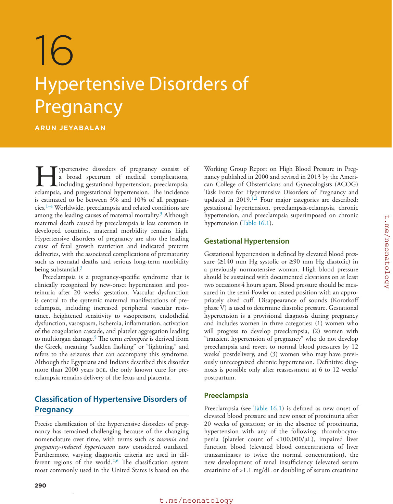

### Original source page 306

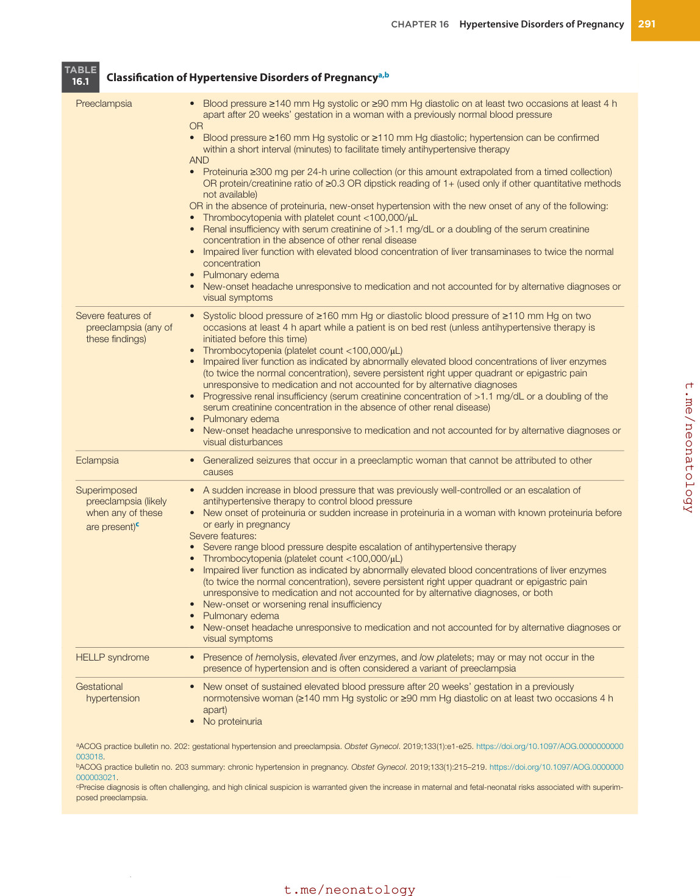

### Original source page 309

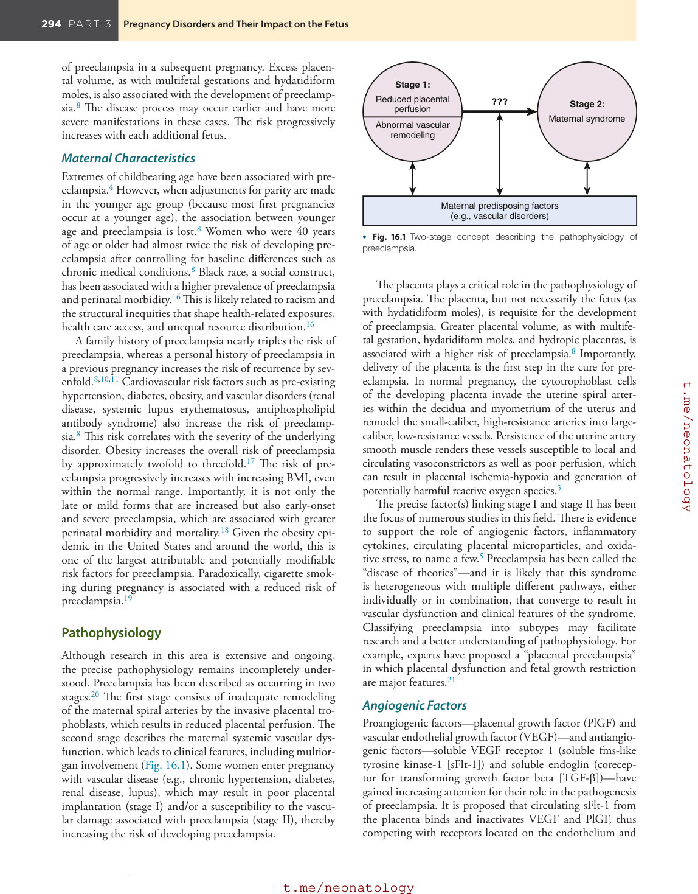

### Original source page 311

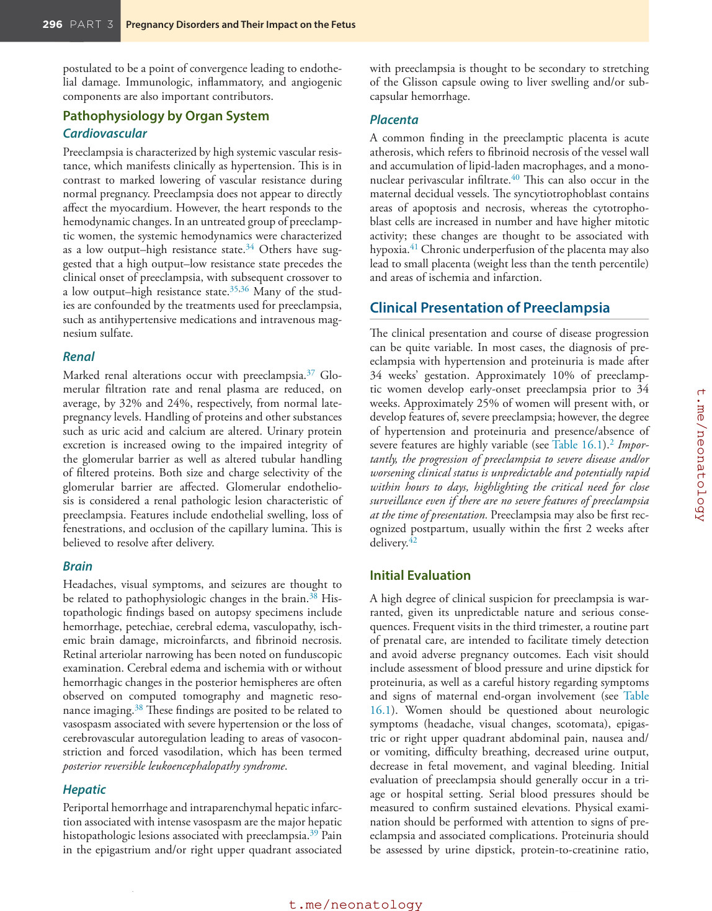

### Original source page 312

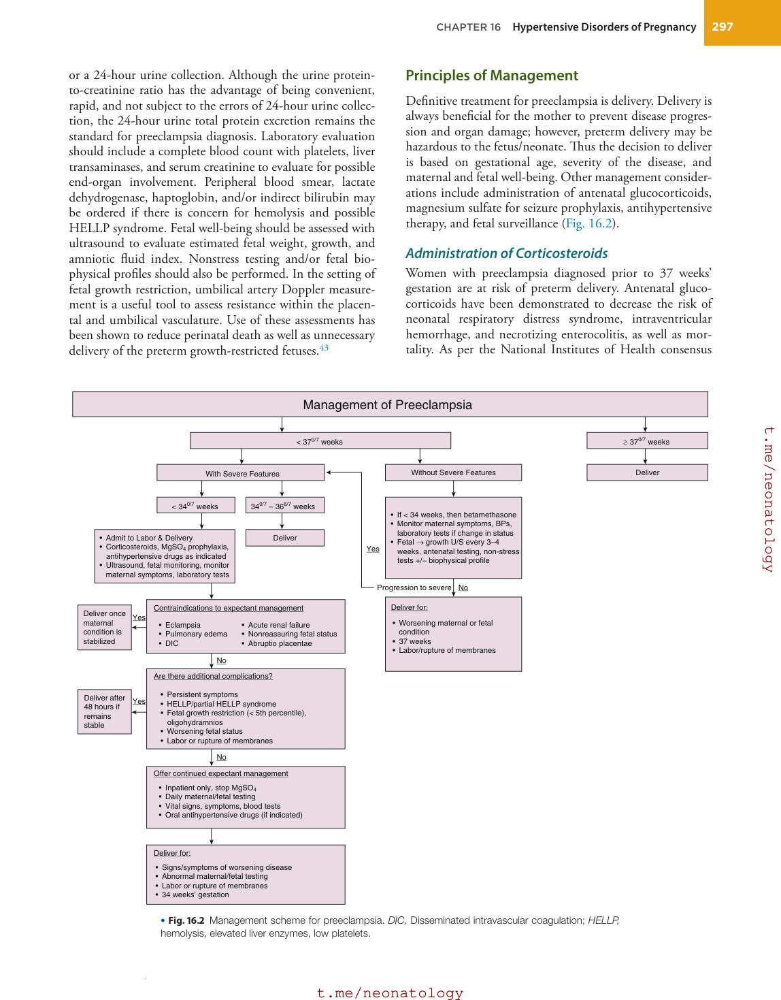

### Original source page 313

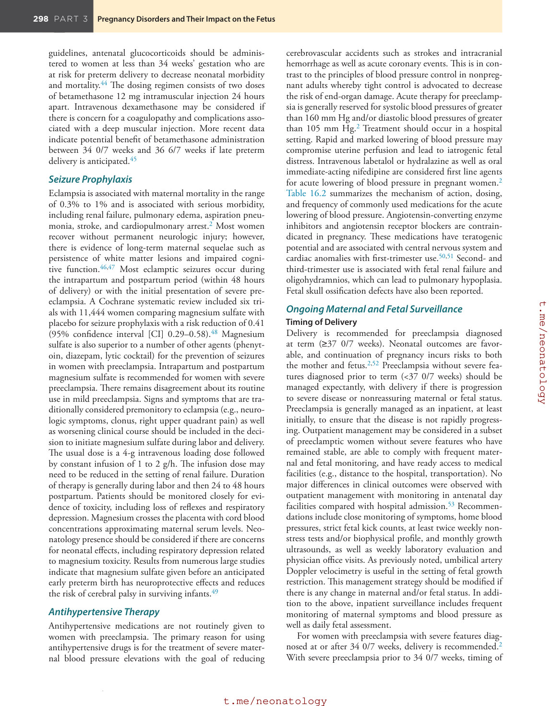

### Original source page 314

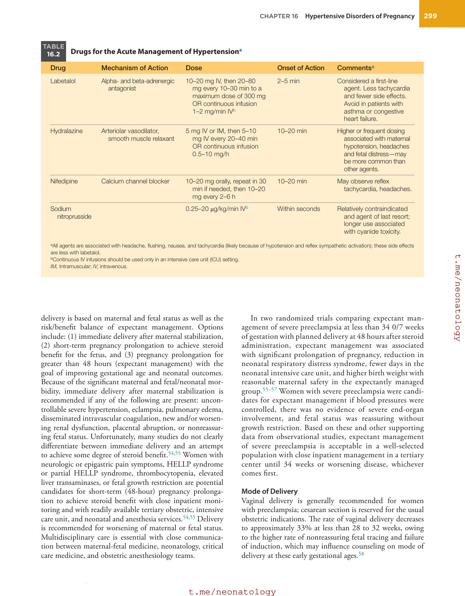

### Original source page 315

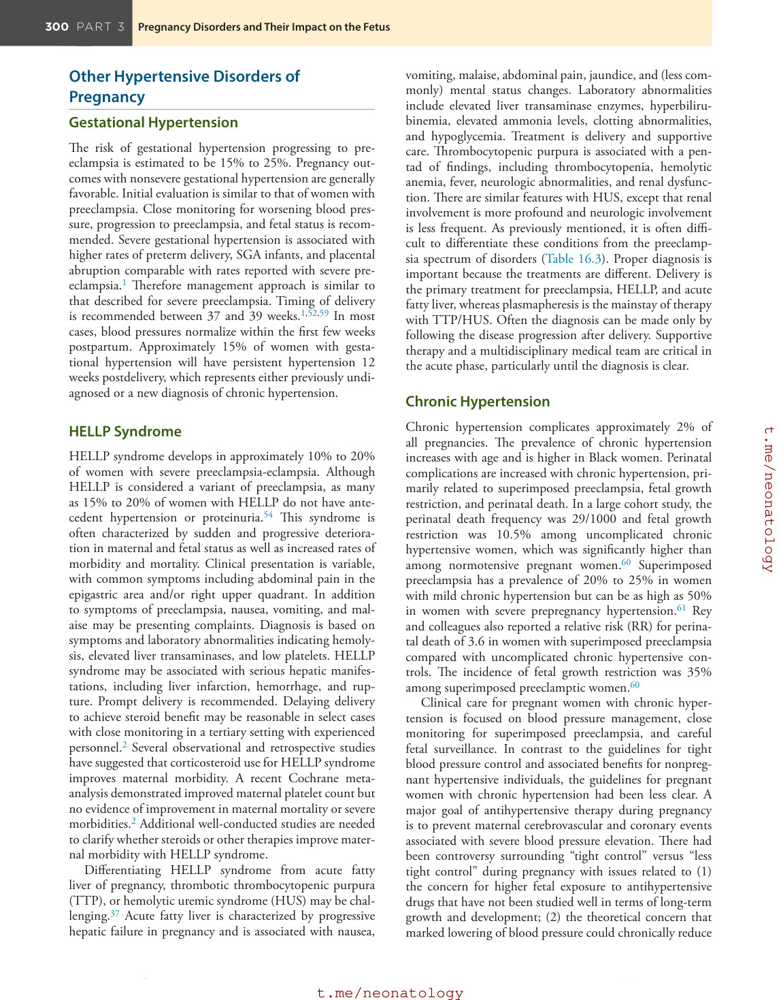

### Original source page 316

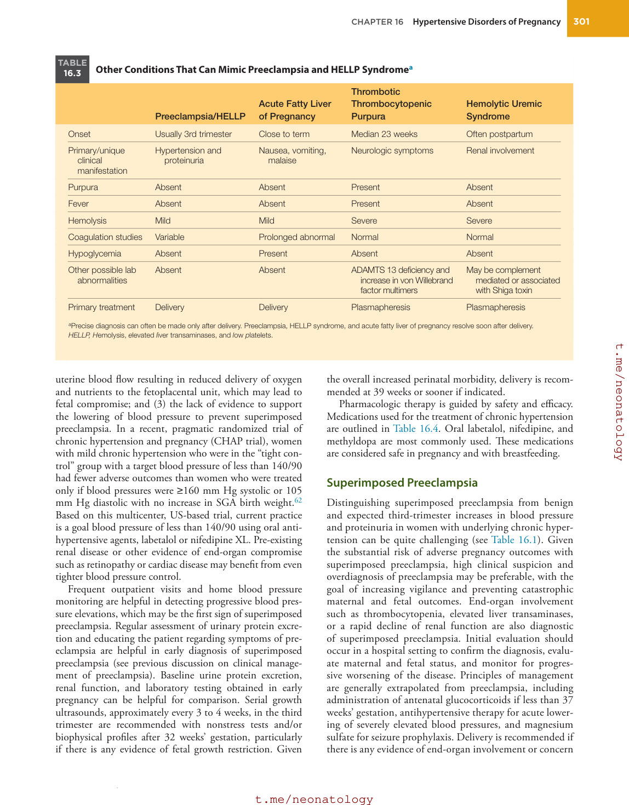

### Original source page 317

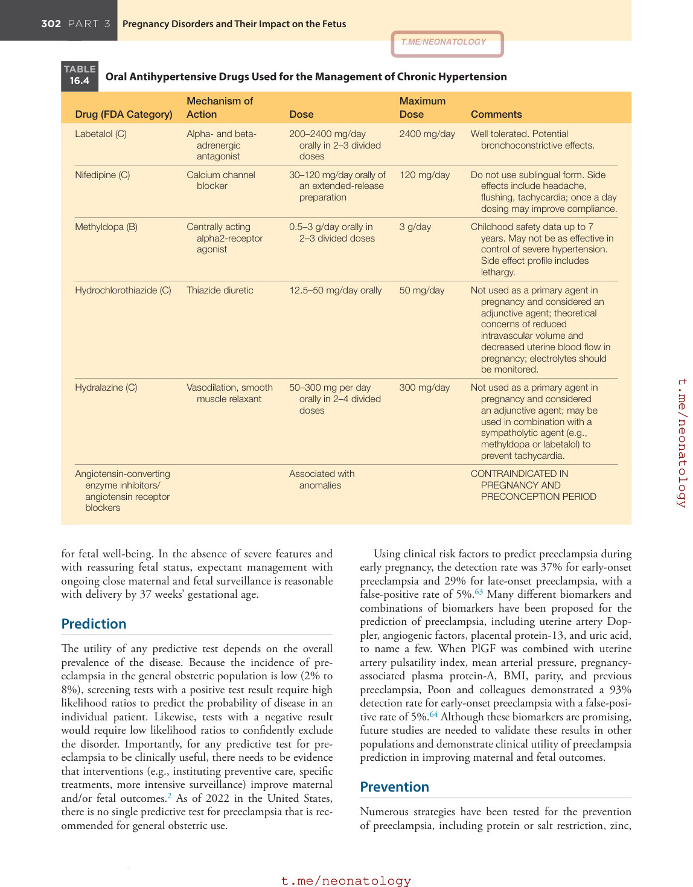

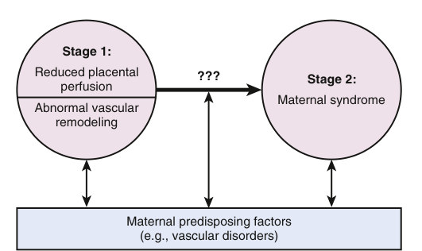

• Fig. 16.1 Two-stage concept describing the pathophysiology of preeclampsia.

PDF p. 309

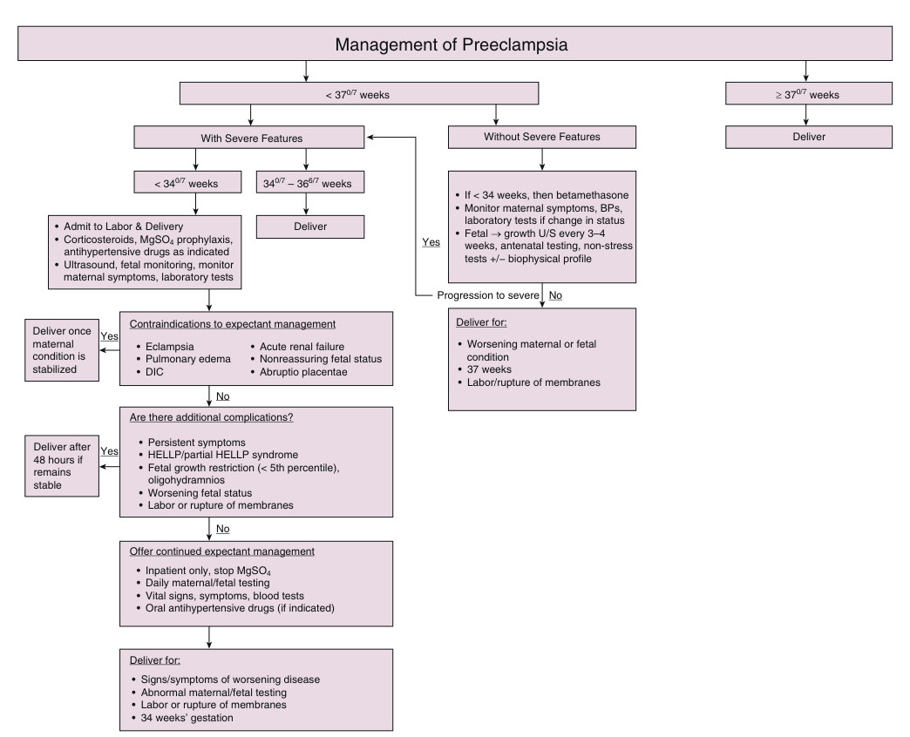

• Fig. 16.2 Management scheme for preeclampsia. DIC, Disseminated intravascular coagulation; HELLP, hemolysis, elevated liver enzymes, low platelets.

PDF p. 312
