# 20. Multiple Gestation-Fetal and Maternal Considerations
> [Source credits](../../SOURCE_CREDITS.md).

## Study pillars

### Zygosity

Two sperm fertilize two ova. Dizygotic twins result from two separate fertilizations; monozygotic twins arise from early cleavage of one conceptus.

PDF p. 376

### Early chorionicity

Chorionicity. Accurate early chorionicity determination guides pregnancy-specific follow-up and risk assessment.

PDF p. 377

### Volume imbalance

Unbalanced volume transfer through placental anastomoses. Donor hypovolemia produces oliguria and oligohydramnios; recipient overload produces polyuria and polyhydramnios.

PDF p. 379

### Hemoglobin imbalance

Twin anemia-polycythemia sequence. TAPS is characterized by donor anemia and recipient polycythemia, unlike the principal volume imbalance of TTTS.

PDF p. 382

### Pump-twin burden

Heart failure from supplying both circulations. The pump twin supports both fetuses through placental connections and may develop congestive heart failure.

PDF p. 382

## Full source extraction

# 20. Multiple Gestation-Fetal and Maternal Considerations
> Source attribution: [Source credits](../../SOURCE_CREDITS.md).

## PDF page 376 | printed page 361

20 Multiple Gestation: Fetal and Maternal Considerations

### NOA OFEK SHLOMAI, SMADAR EVENTOV FRIEDMAN, AND YUVAL GIELCHINSKY

### Epidemiology

Twins account for 3% of all births and triplets for 0.08%. There is a worldwide increase in the rate of multiple gestation since the 1980s.1 Some studies report an increase in twin and triplet pregnancies despite a decrease in total live births.2 This increase is attributed partly to advanced maternal age,3 but it is the use of assisted reproductive technology (ART) that has had the major impact on increasing the rate of multiple pregnancies. Recently, ART guidelines in many countries include single embryo transfer in in vitro fertilization (IVF), to reduce the rates of twin and triplet pregnancies. However, procedures such as preimplantation genetic testing increase the odds of embryo splitting, resulting in monozygotic (MZ) twins.1,4 Spontaneous twin rates vary worldwide, from 8 per 1000 live births in Asia up to over 17 per 1000 births in Africa.5,6

Multifetal pregnancies have a major contribution to neonatal morbidity and mortality, including 60% and greater than 95% preterm delivery (prior to 37 weeks’ gestation) for twins and triplets, respectively, versus approximately 8% for singleton. Compared with less than 1.5% singleton infants born with a very low birth weight (VLBW) of less than 1500 g, the rate is 9% and greater than 30% for twins and triplets, respectively.7 In 2018, the US twin birth rate was 32.6 twins per 1000 births. This rate increased by 76% (from 18.9 to 33.2 per 1000 births) from 1980 to 2009, was generally stable from 2009 to 2012, and then increased to 33.9 per 1000 births in 2014, the highest rate ever reported. The rate of triplet and higher-order multiple births in 2018 was 93 per 100,000 births, which was 8% less than in 2017 and less than 50% of the 1998 peak of 193.5 births per 100,000.7

Acknowledgment of the higher risk for maternal and neonatal perinatal morbidity and mortality associated with higher-order pregnancies led to advanced changes in infertility treatment practices, contributing to a steady decline of around 0.1% per year in multiple gestation rates.7

### Classification of Twin Pregnancies

Twin pregnancy may be the result of two sperms fertilizing two ova, generating dizygotic (DZ) twins, or one sperm fertilizing one ovum, which undergoes an early cleavage to create MZ twins.8 Rates of DZ twins are affected by genetic predisposition, maternal age, parity, body mass index, and more.8 Multiple embryo transfer during ART has increased substantially the rate of DZ twins.9

MZ twinning occurs in around 30% of twin pregnancies,6,10 with a largely uniform and stable rate worldwide.8 Interestingly, their incidence increased twofold to fivefold in ART pregnancies, possibly because of IVF techniques, culture media, or infertility-associated abnormalities.11

Beyond zygosity, which defines the genetic makeup multifetal pregnancies, chorionicity and amnionicity should be defined for multifetal pregnancies. Chorionicity refers to the number of outer membranes and placentas, whereas amnionicity refers to the number of separate amniotic fluid sacs. All DZ pregnancies are dichorionic and diamniotic (DCDA).

MZ twins may be DCDA or monochorionic (MC). The MC can be diamniotic (MCDA) or monoamniotic (MCMA), depending on the timing of division or cleavage of the zygote. DCDA twins have fewer perinatal and neonatal complications compared with MCDA twins (Table 20.1).

In one-third of the cases, early cleavage (days 1–4 post fertilization) will create DCDA. In two-thirds of the cases, later cleavage of the zygote (days 3–8) gives rise to an MCDA pregnancy; and less frequently, in 1%, cleavage at 8 to 12 days post fertilization creates MCMA twins. Delayed cleavage, beyond the 13th day, is very rare and may result in a conjoined twin pregnancy (Fig. 20.1).8,10

### Unusual Twinning

The well-known paradigm regarding zygosity and chorionicity has been enriched with rare reports of various atypical cases which open the door for additional pathways and

361

## PDF page 377

Complication Rates in Dichorionic

TABLE

20.1

Diamniotic (DCDA) and Monochorionic Diamniotic (MCDA) Twins

DCDA MCDA

Miscarriage 11–23 weeks 2% 12%

Perinatal death >23 weeks 1.5% 3%

Preterm delivery <32 weeks 5% 9%

Birth weight <5th centile 2% 8%

Major anomalies 1% 4-6%

From Sebire NJ, Snijders RJ, Hughes K, et al. The hidden mortality of monochorionic twin pregnancies. Obstet Gynaecol. 1997;104(10):1203–1207.

definitions in twinning. Atypical twins include chimeric twins, phenotypically discordant MZ twins, mirror-image twins, polar body twins, complete hydatidiform mole with a coexistent twin, vanishing twins, fetus papyraceus, fetus in fetus, superfetation, and superfecundation.11

Chimerism in monochorionic dizygotic twins (MCDZ) refers to a few case reports that have found MC twins that are DZ. This condition is probably because of partial early fusion of two embryos. The chimerism could be confined to the blood (blood chimerism) or could be more extensive and include chimerism in other tissues.12

### First Trimester Assessment of Multiple Gestations (11+0 to 13+6 Weeks Scans)

For many decades, fetal assessment during pregnancy follow-up began during midgestation when many of the complications of multiple gestation are already in process; therefore prevention and therapeutic strategies were very limited. A new concept for pregnancy follow-up was developed by Kypros Nicolaides, with the paradigm of the “inverted pyramid,” elaborating the idea that intensive assessment should be implemented in the first trimester, to screen for pregnancy complications and to enable early diagnosis and treatment and to plan the pregnancy’s specific follow-up accordingly. Many of these new modalities have become the standard of care.13

Early pregnancy assessment is even more essential in multiple gestation. Accurate determination of the chronicity is crucial and paves the way for planning antenatal follow-up. Very early anatomy scans may detect fetal anomalies and may enable a discussion regarding selective fetal reduction. Screening for fetal genetic abnormalities may be performed successfully on the first trimester scan at 11 to 13 weeks’ gestation, and a chorionic villus sampling (CVS) may be offered as needed. It has been shown that about half the major anatomical anomalies may be detected at this stage.14,15 Early assessment for preterm delivery is important to provide better antenatal care. Evaluating the risk for preeclampsia (PE) is an ongoing goal, and randomized trials for its prevention in twins are being conducted nowadays.

In the past, first-trimester scanning was mainly used to measure the nuchal translucency (NT) to assess the risk for trisomy 21. However, because of extensive progress in fetal medicine research, the NT scan may be used for extensive evaluation of the pregnancy and provide early detection and prediction of complications. This may allow prevention and treatment strategies that can reduce morbidity and mortality.

### Determining the Chronicity

Once multiple gestation is discovered, a thorough ultrasound scan examination is needed to diagnose the chorionicity. For example, if two fetuses are detected, one should look for the interfetal membrane which separates them. In DC twins, the membrane is thick and in the junction between the interfetal membrane and the placenta, there is a triangular projection of the placental tissue from the base of the placenta into the membranes (lambda sign, twin peak sign). In MC twins, the interfetal membrane is thin and there is no placental tissue projection from the base of the membrane (T-sign). In MCMA twins, there is no membrane separating them (Fig. 20.2).16

### Labeling Twins

One of the most important tasks in twin pregnancies is to label the twins early in the pregnancy course in a way that enables identifying which is which in future examinations. Fetus 1 is the twin above the internal os of the cervix, whereas fetus 2 is the adjacent one. It is important to also include all the additional information required for identification of each twin. Such identifiers include placenta location (anterior, posterior, fundal, left, right), cord insertion position (central, velamentous insertion, etc.), fetal gender, and position of the amniotic sac in relation to the mother (left or right side). It is critical to keep the name of each fetus as initially determined, and even if they change their position with regard to the cervix, the fetus that was labeled as fetus 1 will maintain its name. Before delivery, it is important to know which is the presenting twin (the one that will come first). Usually it will be fetus 1. However, there are condition in which fetus 2 is the presenting fetus.

### Pregnancy Dating

Accurate determination of gestational age is important for pregnancy follow-up. Wrong dating can cause misdiagnosis of intrauterine growth restriction (IUGR), wrong delivery time, etc. Traditionally, dating is based on the last menstrual period. However, in many cases it is inaccurate, and therefore in spontaneous conception the crown-rump length of the longest fetus is used for dating when scanned at 11 to 13 weeks. In IVF conception, the day of conception determines the dating of the pregnancy.

### Anatomy Assessment

Traditionally, an anatomy scan is performed between 19 and 23 weeks of gestation to detect fetal anomalies. Because of improved ultrasound accuracy and resolution, along with

## PDF page 378 | printed page 363

Dizygotic twins

70% of all twins

1/3

Dichorionic diamniotic (DCDA)

Monochorionic diamniotic

(MCDA)

• Fig. 20.1 Classification of twin pregnancies.

A B

• Fig. 20.2 Determination of chorionicity: (A) In dichorionic diamniotic twins the membrane is thick and lambda sign (twin peak sign) is present. (B) In monochorionic diamniotic the interfetal membrane is thin with the T-sign. See text for details.

extended knowledge in fetal medicine, it is now possible to perform an elaborate anatomy scan in the first trimester, as described. Still, some anomalies may only be detected at a later stage, and therefore it is still necessary to perform the late anatomy scan. Early detection of fetal anomalies is important in multiple pregnancies because, if selective termination is required, there is evidence of improved pregnancy outcome (reduced rate of pregnancy loss, reduced rate of early preterm delivery) when performed early.17

### Screening for Fetal Genetic Abnormalities

Combination of maternal age, ultrasound of NT measurement, and biochemical markers constitutes the first-trimester screening test for trisomy 21, with a detection rate of

Monozygotic twins

30% of all twins

2/3

Monochorionic (MC)

99% 1%

Monochorionic monoamniotic (MCMA)

96% in singleton and 90% in twins.18 Cell-free fetal deoxyribonucleic acid (DNA) testing (cffDNA testing) may be performed as early as 10 weeks of gestation and has a detection rate of 99% for trisomy 21 in both singletons and in twins.19 In pregnancies at high risk for genetic abnormality, CVS may be performed safely both in DC and MC twins.

### Screening for Preterm Delivery

Multiple gestations are at a 10-fold increased risk for preterm delivery compared with the 1% rate in singleton pregnancies.20 Shortening of the cervix is a warning flag for preterm birth. As in singleton pregnancies, a new powerful tool for prediction of preterm delivery is cervical length, which is measured by the ultrasound scan. It is recommended to

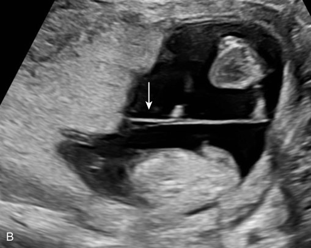

• Fig. 20.2 Determination of chorionicity: (A) In dichorionic diamniotic twins the membrane is thick and lambda sign (twin peak sign) is present. (B) In monochorionic diamniotic the interfetal membrane is thin with the T-sign. See text for details.

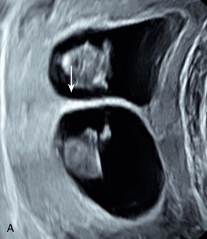

• Fig. 20.2 Determination of chorionicity: (A) In dichorionic diamniotic twins the membrane is thick and lambda sign (twin peak sign) is present. (B) In monochorionic diamniotic the interfetal membrane is thin with the T-sign. See text for details.

## PDF page 379

measure the cervix starting from the 11 to 13 weeks’ scan and from 16 weeks every 2 weeks. In case of shortening of the cervix, cervical cerclage and vaginal progesterone were found to be useful in singleton pregnancies but have a limited effect in twin pregnancies.21

### Screening for Preeclampsia

PE is a serious complication of pregnancy and a major cause of short- and long-term maternal and neonatal morbidity and mortality. Extensive research in the past decade has resulted in effective first-trimester screening for early PE, allowing prediction of about 90% of early PE with delivery at less than 32 weeks’ gestation. In twin pregnancies, the rate of PE is about 9%, which is 3 times higher than in singleton pregnancies. This is an underestimation because twins are usually delivered prematurely, and the rate is most increased ninefold compared with singleton pregnancies. Therefore all twin pregnancies should be regarded as high-risk of preterm PE. An ongoing multicenter study is investigating the role of prophylactic lowdose aspirin early in multiple-gestation pregnancies.

### Congenital Malformations

Significant associations between twinning and birth defects have been observed for a wide range of birth defects in large, registry-based studies.22,23 Twins are at an increased risk of congenital anomalies, and this risk differs depending on zygosity and chorionicity.24 MZ twins are at an increased risk of birth defects compared with both singletons and DZ twins.23

Several studies have reported that rates of congenital anomalies in DZ twins are similar to those of singletons, whereas the rate in MZ twins is up to fivefold higher.25 Anomalies in multiple gestations have been reported in all organ systems, but the most common involve the cardiovascular and central nervous systems.26

Compared with singletons, DC twins and MC twins are at increased risk for developing cardiac anomalies.27,28 Increased incidence of structural anomalies in MCMA twins, with up to 16% structural anomalies, may be explained by a two-hit theory, with the twinning process being the first hit and a second insult causing unequal development. Another explanation may be an unequal division of the embryonic cell mass.29 In a large retrospective study of more than 3500 twin pairs, concordance rate between MZ twins was higher compared with DZ twins only for malformation of the nervous system, circulatory system, cleft lip/palate, and urinary system.30

The risk for at least one of an MCDA twin pair having some form of congenital heart defect (CHD) is approximately 7%. The most frequently seen malformation is a ventricular septal defect, but all types of CHD are represented in this group.31

The spectrum of brain malformations in twins includes polymicrogyria, subcortical heterotopia, periventricular nodular heterotopia, cerebellar hypoplasia, and classic Dandy-Walker malformation. Twinning-associated brain

disruptions include hydranencephaly, porencephaly, multicystic encephalomalacia, and less specific loss of white matter volume.

Twinning-associated brain malformations and disruptions occur in both MZ and DZ twins, which supports a prenatal vascular pathogenesis, including defects in vasculogenesis, defects in vascular perfusion, and intracranial hemorrhage.32

In a survey of more than 20,000 pairs of twins, using parental report for assessing the rate of clubfoot, oral cleft, deafness, cerebral palsy (CP), muscular dystrophy, spina bifida, strabismus, and CHD, the authors reported the prevalence of clubfoot (2.9 per 1000 live births) was found to be about twofold higher than that of the general population, and there was a substantially greater risk for spina bifida (1.3 vs. 0.35 per 1000 live births, respectively).33 Twins were not found to have an increased risk for chromosomal anomalies.34

Overall, rates of congenital malformations are increased in MZ twins when compared with singletons. Etiology is most probably multifactorial and involves genetic, epigenetic, vascular, and other factors.

### Complications of Monochorionic Twins

MC pregnancies have a shared blood system because of communicating vessels over their single placenta and may develop unique complications (Table 20.2). The most important complications are twin-twin transfusion syndrome (TTTS), selective intrauterine growth restriction (sIUGR), twin anemia polycythemia sequence (TAPS), twin reversed arterial perfusion syndrome (TRAP), discordance for fetal abnormality (anomalies in one), and single intrauterine death in monoamniotic twins (MCMA). Half of complicated MC pregnancies require intrauterine interventions.35 Some MC pregnancies may develop more than one complication (e.g., TTTS with sIUGR), and therefore the management becomes more challenging.

### Twin-Twin Transfusion Syndrome (TTTS)

TTTS is identified in 10% to 20% of MC pregnancies usually between 16 and 26 weeks. In this condition, there is an unbalanced passage of blood through the placental anastomosis between the twins, and extra blood volume is transferred from one twin to the other. The twin that receives the excessive blood volume is defined as the “recipient twin,” while the contributing twin is addressed as the “donor twin.” The donor will present with symptoms of hypovolemia leading to oliguria and oligohydramnios, whereas the recipient will have characteristics of volume overload, hypervolemia, polyuria, and polyhydramnios. These signs are detected by an ultrasound scan and are the basis for the Quintero classification of TTTS (Table 20.3).36 It is important to clarify that there is no discordance in the hemoglobin/hematocrit levels and no size difference between the twins in TTTS. MC pregnancies complicated with TTTS have an increased risk for ischemic brain lesions; therefore it is recommended to conduct a detailed brain ultrasound

## PDF page 380 | printed page 365

TABLE

Complications in Monochorionic Twins

20.2

Complication Percentage of MC twins

Twin-twin transfusion

10%–20%

syndrome (TTTS)

Selective intrauterine

10%–20%

growth restriction (sIUGR)

Twin anemia polycythemia

5%–13%

sequence (TAPS)

Twin reversed arterial

1%

perfusion syndrome (TRAP)

Discordance of fetal

6%

anomalies

Single intrauterine fetal

7.5%

death

Monoamniotic twins 5%

From Lewi L, Gucciardo L, Van Mieghem T, et al. Monochorionic diamniotic twin pregnancies: natural history and risk stratification. Fetal Diagn Ther. 2010;27(3):121–33. doi: 10.1159/000313300. Epub 2010 Apr 21. PMID: 20413975.

Quintero Staging of Twin-Twin Transfusion

TABLE

20.3

Syndrome

Stage Recipient Twin Donor Twin

Stage 1 Polyhydramnios Oligohydramnios

Stage 2 Dilated bladder Nonvisualization of

the bladder

Stage 3 Absent/reverse end-

Absent/reverse end-

diastolic velocity in the umbilical artery, reverse flow in the ductus venosus

diastolic velocity in the umbilical artery, reverse flow in the ductus venosus

Stage 4 Hydrops fetalis Hydrops fetalis

Stage 5 Fetal demise Fetal demise

From Quintero RA, Morales WJ, Allen MH, et al. Staging of twin-twin transfusion syndrome. J Perinatol 1999;19(8 Pt 1):550–555.

scan or brain magnetic resonance imaging (MRI) a few weeks after the detection of TTTS. TTTS is a major cause of death and handicap in an MC twin pregnancy because of a combination of factors, including the blood volume imbalance (which affects different organs including the brain, heart, kidneys), the increased risk for preterm delivery of two sick infants, and as a consequence of intrauterine demise of one twin. In the past, fetal therapy for TTTS was started with serial reductions of amniotic fluid from the recipient twin, or septostomy which perforates the amniotic membranes between the twins, to equalize the amniotic fluid level. These were found to have limited value because

they failed to treat the underlying problem (i.e., the placental anastomoses). Nowadays, fetal surgery, using fetoscopic laser coagulation of all anastomoses along the equator, is the accepted treatment. This is currently the best treatment option regardless of disease severity. In this procedure (Fig. 20.3), a 3-mm port is inserted through the maternal abdomen, usually into the amniotic sac of the recipient. Through the port, a fetoscope is inserted and the blood anastomosis are easily visualized; using a laser fiber that is introduced into the fetoscope channel, the anastomoses are ablated.37

Laser therapy aims to cure the disease by disconnecting the two fetal circulations. After laser therapy, there is a 50% to 60% survival of both twins and an 80% survival at least one twin. Of surviving infants, 11% have some form of developmental impairment. CP is the most common impairment, affecting 5%. Both donor and recipient are at equal risk of long-term impairments. The single most important risk factor of adverse long-term outcome is prematurity.35

Another approach to TTTS treatment is selective feticide of one of the twins. This is required if one twin is severely injured or when laser coagulation cannot be performed technically. Because selective feticide by KCl injection is not an option in MC twins caused by the risk of KCl leakage to the other twin through the placental anastomoses, feticide is therefore performed in these cases by ultrasound-guided bipolar forceps.37

### Selective Intrauterine Growth Restriction (sIUGR)

sIUGR affects 10% to 20% of MC pregnancies. The definition of sIUGR in MC twins is not universally established, and it is often defined as an estimated fetal weight less than the 10th percentile in one twin, while the second twin has a normal estimated fetal weight. sIUGR is an important complication of MC pregnancies, with a high risk of intrauterine demise and neurologic adverse outcome for both twins. This condition is usually derived from unequal division of the placenta: one fetus has very few blood vessels emerging from the umbilical cord and therefore dominates only a small portion of the placenta, leading to growth restriction, whereas the other usually has many blood vessels that emerge from the umbilical cord and dominate large parts of the placenta.

The condition is subdivided into three types according to the Doppler finding of the end-diastolic flow (EDF) in the umbilical artery of the small fetus—type I: EDF positive, associated with good prognosis; type II: EDF absent or reversed, associated with predicated early deterioration of the small twin; and type III: EDF cyclical change from positive to absent and reversed, associated with unexpected fetal demise (around 15%) or neurologic injury in one or both twins (around 20%) along with increased risk of ischemic brain lesions in the larger twin (Fig. 20.4).38 Therapeutic strategies are related to the sIUGR type and the gestational age. These include conservative management with close observation, fetoscope laser coagulation of all anastomoses along the equator, thus protecting the larger twin in case of smaller twin fetal demise (30% mortality or severe morbidity from brain

## PDF page 381

A

B

C D

E

### • Fig. 20.3 Fetoscopic laser ablation of communicating blood vessels in monochorionic diamniotic twins

complicated with twin-twin transfusion syndrome. (A and B) The vascular anastomoses on the placenta after color injection. (C and D) Anastomoses through the fetoscope during the operation before (C) and after laser ablation (D). (E) Placenta after laser ablation. The ablation line is demonstrated throughout the placenta by the yellow arrows.

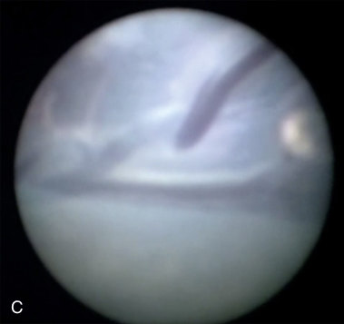

• Fig. 20.3 Fetoscopic laser ablation of communicating blood vessels in monochorionic diamniotic twins complicated with twin-twin transfusion syndrome. (A and B) The vascular anastomoses on the placenta after color injection. (C and D) Anastomoses through the fetoscope during the operation before (C) and after laser ablation (D). (E) Placenta after laser ablation. The ablation line is demonstrated throughout the placenta by the yellow arrows.

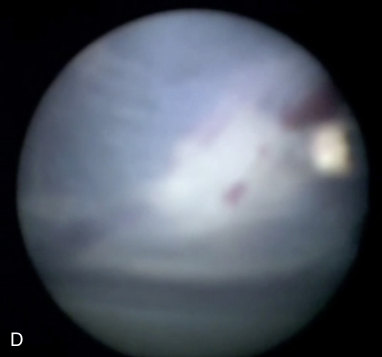

Unmatched source image; PDF page 381. Consult the original caption.

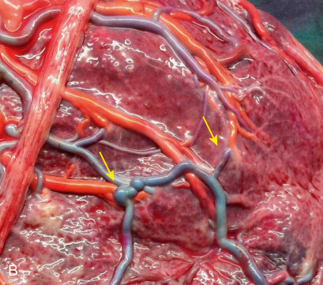

Unmatched source image; PDF page 381. Consult the original caption.

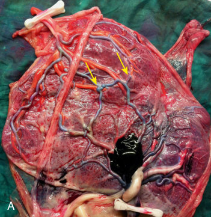

• Fig. 20.3 Fetoscopic laser ablation of communicating blood vessels in monochorionic diamniotic twins complicated with twin-twin transfusion syndrome. (A and B) The vascular anastomoses on the placenta after color injection. (C and D) Anastomoses through the fetoscope during the operation before (C) and after laser ablation (D). (E) Placenta after laser ablation. The ablation line is demonstrated throughout the placenta by the yellow arrows.

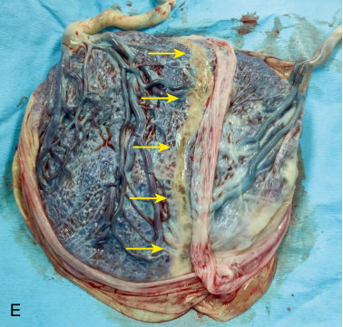

• Fig. 20.3 Fetoscopic laser ablation of communicating blood vessels in monochorionic diamniotic twins complicated with twin-twin transfusion syndrome. (A and B) The vascular anastomoses on the placenta after color injection. (C and D) Anastomoses through the fetoscope during the operation before (C) and after laser ablation (D). (E) Placenta after laser ablation. The ablation line is demonstrated throughout the placenta by the yellow arrows.

## PDF page 382 | printed page 367

Type I

Type II

Type III

• Fig. 20.4 Selective intrauterine growth restriction is subdivided into three types according to the Doppler finding of the end-diastolic flow (EDF) in the umbilical artery of the smaller twin fetus—type I: EDF positive, type II: EDF absent, and type III: EDF cyclical change from positive to absent and reversed.

damage caused by the drop in blood pressure following blood leakage), or selective feticide of the small twin.39

### Twin Anemia Polycythemia Sequence (TAPS)

TAPS is characterized by large intertwin hemoglobin differences that occur because of red blood cells’ passage from one fetus (donor/anemic) to the other (recipient/polycythemic) through tiny placental blood anastomoses. It is important to differentiate TAPS from TTTS. In TAPS there is change in the hemoglobin level, whereas in TTTS there is difference in blood volume. TAPS may occur spontaneously in about 5% of MC twin pregnancies (usually after 26 weeks). In addition, TAPS may develop after laser surgery for TTTS in about 2% to 13% of post laser cases. Antenatal diagnosis of TAPS can be reached based on Doppler ultrasound abnormalities showing an increased peak systolic velocity in the middle cerebral artery in the donor twin suggestive of fetal anemia, and a decreased velocity in the recipient twin suggestive of polycythemia (Table 20.4). Postnatal diagnosis of TAPS is based on the presence of chronic anemia in the donor and polycythemia in the recipient, defined as intertwin hemoglobin difference greater than 8.0 g/dL and at least one of the following: reticulocyte count ratio greater than 1.7 and placenta with only small (diameter <1 mm) vascular anastomoses. TAPS severity is assessed by the TAPS staging system (Fig. 20.5).40 Fetal anemia is associated with a decreased blood viscosity leading to an increase in blood speed. Fetal polycythemia is associated with an increased blood viscosity leading to a decrease in blood speed. The blood speed is measured in centimeters per second and converted to multiples of the median (MoM), which represents how far the measurement is from the average for the specific gestational week. The average is 1 MoM. Measurements greater than 1 will be considered as increased velocity (anemia), whereas measurements less than 1 will be considered as low velocity (polycythemia).

Prenatal and Postnatal Criteria and

TABLE

20.4

Staging of Twin Anemia Polycythemia Sequence

Intertwin Hemoglobin Difference (g/dL)

Stage Antenatal Doppler

1 MCV-PSV donor >1.5 MoM MCV-PSV recipient <1 MoM No signs of fetal compromise

>8

2 MCV-PSV donor >1.7 MoM MCV-PSV recipient <0.8 MoM No signs of fetal compromise

>11

3 Stage 1 or 2 + cardiac

>14

compromise of donor

4 Hydrops of donor >17

5 One/both fetal demise >20

MCA-PSV, Middle cerebral artery peak systolic velocity; MoM, multiples of the median. From Slaghekke F, Kist WJ, Oepkes D, et al. Twin anemia-polycythemia sequence: diagnostic criteria, classification, perinatal management and outcome. Fetal Diagn Ther. 2010;27(4):181–190.

The management of TAPS depends on the gestational age, the stage, and the accessibility of the equator and includes intrauterine blood transfusion to the anemic fetus (although this may deteriorate the condition of the polycythemic fetus because of blood leakage through the anastomoses), fetoscopy and laser ablation of the placental anastomosis, selective termination of one of the twins, and, in cases identified after 30 weeks’ gestation, delivery (considered because of the increased risk for intrauterine fetal demise [IUFD]).35

### Twin Reversed Arterial Perfusion Syndrome (TRAP)

TRAP is a rare condition affecting less than 1% of MC pregnancies, in which there is normal development of one twin (pump twin) while the other twin lacks a heart/not fully formed (acardiac twin). In DC twins, a failure of one twin to develop a heart will end up as fetal demise, while the other twin is not affected. However, in MC twins, blood supply from the normal fetus can keep the acardiac twin “alive” through the placental anastomoses. The acardiac twin usually has a poorly developed body and may be missing a head, limbs, or torso. Because the heart of the “pump twin” supplies blood to both fetuses, congestive heart failure may develop, and if untreated, perinatal mortality rate is up to 55%. The outcome may be improved by interventions to disconnect the circulation of the acardiac twin, usually performed after 16 weeks of gestation, with survival of the pump twin rising up to 80%. In the past decade, widespread introduction of a routine first-trimester ultrasound examination has led to early

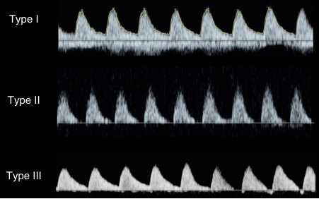

• Fig. 20.4 Selective intrauterine growth restriction is subdivided into three types according to the Doppler finding of the end-diastolic flow (EDF) in the umbilical artery of the smaller twin fetus—type I: EDF positive, type II: EDF absent, and type III: EDF cyclical change from positive to absent and reversed.

## PDF page 383

A Rt MCA-PS 17.73cm/s

60

50

40

30

20

10

cm/s

B Rt MCA-PS 42.79cm/s

60

50

40

30

20

10

cm/s

• Fig. 20.5 Cerebral artery peak systolic velocity measurements in twin anemia polycythemia sequence. Twin A: decreased MCA-PSV less than 0.8 MoM indicating polycythemia. Twin B: elevated MCA-PSV greater than 1.5 MoM indicating anemia. MCA-PSV, Middle cerebral artery peak systolic velocity; MoM, multiples of the median.

detection of the TRAP sequence. Preliminary data have demonstrated the feasibility, effectiveness, and safety of intrafetal laser performed at 12 to 14 weeks; hence survival may be improved by elective intervention at this stage.41

### Single Intrauterine Fetal Death

Uterine demise of one twin has unique aspects in MC pregnancies. Because of the shared circulation, one twin’s death may lead to double demise in 15% of the cases or to severe brain injury in 25% of the cases caused by exsanguination of the surviving co-twin into its demised twin’s circulation.42 Single fetal demise, which may occur after successful laser coagulation for TTTS, does not affect the surviving twin, since anastomoses are ablated and the surviving twin is protected from exsanguination. In cases with recent single intrauterine death it is important to measure the middle cerebral artery peak systolic velocity (MCA-PSV) to predict fetal anemia, and consider intrauterine blood transfusion if anemia exists. Careful follow-up, including detailed brain scans as well as brain MRI, is indicated to reveal brain injury.

### Monoamniotic Twin (MCMA) Complications

Because both twins are in the same amniotic sac, cord entanglement is usually demonstrable as early as in the first trimester.

The cords typically insert close to one another on the placenta, with very large anastomoses connecting the stem vessels of both twins. MA twins are at increased risk of adverse outcome: discordant structural anomalies affecting 20% of MA twins and increased risk of unexpected and usually double intrauterine demise, mostly caused by acute fetofetal

60

50

40

30

20

10

cm/s

60

50

40

30

20

10

cm/s

hemorrhage across the large-caliber anastomoses triggered by cord compression.35

Careful surveillance (inpatient monitoring starting at 28 weeks) and planned preterm birth (elective cesarean section at 32-33 weeks) seem to improve survival rates of MCMA twins up to 80%.

### Delivery Considerations

MC twin pregnancies carry an increased risk of perinatal death compared with DC twins.34,43 This is mainly because of higher prematurity rates, selective fetal growth restriction, congenital anomalies, and TTTS.44 MCMA twins carry an additional risk for perinatal death because of twin-related congenital anomalies and cord-related complications.45,46

A systematic review by D’Antonio et al. showed 6% fetal loss in MCMA pregnancies,46a most of which occurred before 30 weeks of gestation. At 31 to 32 and 33 to 34 weeks of gestation, fetal loss rate was 1% and 2%, respectively. In addition, these authors have reported fetal loss of 3% in twins of pregnancies managed as inpatients, compared with 7% in those followed up as outpatients.47 Thus MCMA pregnancies are usually delivered between 32+0 and 34+6 weeks of gestation in view of the reported high risk of unexpected fetal loss with advancing gestation.43,48 In practice, in many leading fetal medicine units, hospital MCMA are delivered at 32+0 weeks.34

For uncomplicated DCDA twins, the recommended time of birth is between 38 and 39 weeks of gestation. Uncomplicated MCDA twins should most probably be delivered at 34+0 to 37+6 weeks in uncomplicated pregnancies, although in many fetal units these are delivered at 36+0 weeks.46,49,50 There is some evidence for increased

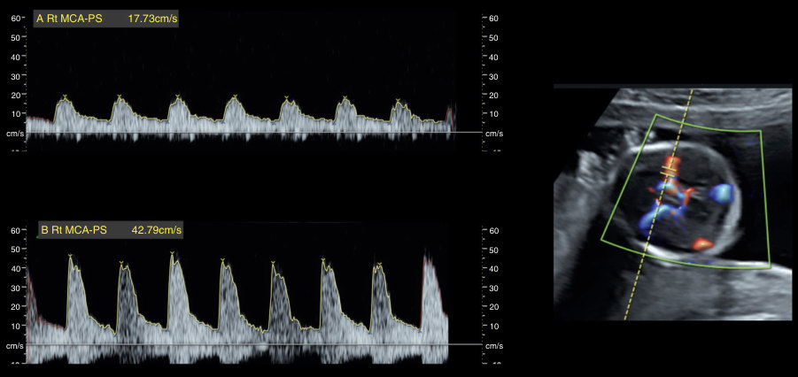

• Fig. 20.5 Cerebral artery peak systolic velocity measurements in twin anemia polycythemia sequence. Twin A: decreased MCA-PSV less than 0.8 MoM indicating polycythemia. Twin B: elevated MCA-PSV greater than 1.5 MoM indicating anemia. MCA-PSV, Middle cerebral artery peak systolic velocity; MoM, multiples of the median.

## PDF page 384 | printed page 369

fetal death in twin pregnancies continued beyond 38 weeks of gestation,51 although other studies found no short- or long-term risks for twins delivered beyond 38 weeks.52 For an uncomplicated trichorionic triamniotic pregnancy, the recommended time of birth is 35 weeks’ gestation, via cesarean section.51 Chorionicity does not play a role regarding the mode of delivery. Uncomplicated diamniotic twins, whether DC or MC, may be delivered vaginally or via cesarean section, given that the first twin is in a cephalic position.53–57 Current recommendation for delivery of MCMA twins is by cesarean section.51

### Antenatal Steroids in Twin Pregnancies

Multifetal gestation carries a significantly increased risk of preterm delivery, with nearly 60% of twins being born preterm at less than 37 weeks’ gestation and 12% to 14% born prior to 34 weeks.58 Over the years, there was a debate regarding the favorable effects of antenatal corticosteroids (ACSs) in multifetal pregnancies.59 Several studies reported that administration of ACSs up until 7 days prior to birth was associated with a significant decrease in neonatal mortality and morbidity in twin pregnancies, comparable with the effect on singleton infants.60

The EPIPAGE-2 study showed administration of a single complete course of ACSs reduced the incidence of severe neurologic morbidities and composite outcome in twins born between 24 and 31 completed weeks of gestation. In that study, in-hospital mortality was reduced only when the interval between ACS administration and delivery was 7 days or fewer.61

Some studies suggested suboptimal benefits of ACS treatment in twin pregnancies may be attributable to different maternal physiologic changes in twin pregnancies, such as greater maternal blood volume expansion and differences in betamethasone clearance.62 Other studies have established that there is no difference in pharmacokinetics, maternal serum, or cord blood betamethasone between multiple and singleton pregnancies.63 Studies comparing twin and singleton pregnancies reported that optimal ACS administration led to comparably improved outcomes64 and that the number of fetuses is not a determinant of the effect of ACSs in neonatal outcomes.65 However, twin pregnancy imposes an independent risk factor for suboptimal ACS administration timing because twin preterm labor is harder to predict, and therefore women are often treated too early or too late in regard to the ideal therapeutic window.66

### Outcome

Given the increased risk of maternal and fetal complications during multiple gestation, the overall outcome for multiples is worse when compared with the outcome of singletons. This is mostly because approximately half of twins are born preterm. However, advancements in antenatal and neonatal

care have resulted a significant decrease in perinatal and early neonatal mortality rates for both the first (8.6-fold reduction) and the second (6.8-fold reduction) twin.67

Multiples remain at higher risk for CP. However, this risk has been decreasing steadily since the 1990s, a decrease attributed to advances in perinatal care.

Recent studies from worldwide CP registries indicate the overall prevalence of CP is greater in triplets and quadruplets than in twins. This is most probably related to higher risk of preterm birth in higher-order multiples. Singleton and multiple births with CP display similar severity of motor impairment.68,69

When evaluating the impact of perinatal factors (i.e., IVF, growth restriction, prematurity) in DCDA twin pregnancies on main neurodevelopmental sequelae, similar risk for neurologic sequelae were observed in IVF DZ twins in comparison with their naturally conceived peers and singletons from assisted conception. Moreover, overall development and health status at 4 years of age in IVF twins was found comparable with that of 4-year-old IVF singletons, after adjusting for mediators and confounders. However, for twins born following fetal growth restriction, there was a fourfold risk for neurologic sequelae (motor development, speech and language development, and internalizing difficulties) versus normal growth twins. Significantly worse results regarding cognition, language, and motor skills were found in the smaller twin of a discordant pair at 2.5 to 3 years of age. Risk of death and neurologic impairments in twins with birth weight less than 1000 g was higher compared with singletons with similar birth weights. A high rate of mild to moderate cognitive impairment and severe neurodevelopmental impairment (NDI) at age 5 years was not identified at age 2 years. These data highlight the importance of longitudinal follow-up of survivors of TTTS beyond age 2 years and emphasize the precautions that should be taken when diagnosing an absence of impairment before school age.70 However, twins versus singletons born at less than 34 weeks of age had comparable motor and cognitive outcomes at 2 years of age.71

Follow-up of 66 twins and 157 singletons at 5 years of age in Turku, Finland revealed no major neurodevelopmental risks in twins compared with singletons. These data should be interpreted in light of the advanced perinatal care in Finland.72

In MC twins with sIUGR, evidence suggests that patients treated with laser therapy, considering the potential risks and complications of the procedure, may have an improved outcome over those managed expectantly, mainly because of postponing gestational age at delivery. Results show improvement of fetal growth in more than 50% of growth-restricted twins, while protecting the well-growing twin from the adverse consequences that could result from the fetal demise of the growthrestricted twin.73

Outcome at school age of MC twins treated with fetoscopic laser surgery for TTTS was found comparable with that of DC twins without invasive treatment. The long-term neurodevelopment was mainly dependent on gestational age

## PDF page 385

at birth.74 A recent systematic review demonstrated a 14% incidence of neurologic impairments after laser therapy at 2 years of age. CP was described in about 6% of the children treated with laser therapy.75

Overall, data reflect an increased risk for increased adverse perinatal outcome for the second twin, independent of chorionicity, sex, and presentation.76

In summary, multiple gestations are challenging and carry an increased risk for complications. Advances in fetal

Key Points

### • Multiples account for approximately 3% of life births,

with a steady increase since the 1980s, an increase that is attributed mostly to assisted reproductive technology. Multifetal pregnancies have a major contribution to neonatal morbidity and mortality, including preterm delivery, low birth weight, and more.

### • Twin pregnancies are classified into dizygotic twins, in

which two sperms fertilize two ova, and to monozygotic twins, in which an ovum fertilized by sperm has undergone early cleavage. Chorionicity is determined by the timing of the cleavage.

### • Multiples are more likely to have congenital defects com-

pared to singletons. These include neural tube, cardiac,

### References

1. Black M, Bhattacharya S. Epidemiology of multiple pregnancy

and the effect of assisted conception. Semin Fetal Neonatal Med. 2010;15(6):306–312. 2. Ko HS, Wie JH, Choi SK, et al. Multiple birth rates of Korea and

fetal/neonatal/infant mortality in multiple gestation. PLoS One. 2018;13(8):e0202318. 3. Hall JG. Twinning. Lancet. 2003;362(9385):735–743. 4. Chien P. Multiple pregnancy and assisted conception treatment.

Bjog. 2020;127(5):525–526. 5. Smits J, Monden C. Twinning across the developing world. PLoS

One. 2011;6(9):e25239. 6. Santana DS, Surita FG, Cecatti JG. Multiple pregnancy: epide-

miology and association with maternal and perinatal morbidity. Rev Bras Ginecol Obstet. 2018;40(9):554–562. 7. Martin JA, Hamilton BE, Osterman MJK, Driscoll AK. Births:

Final data for 2018. Natl Vital Stat Rep. 2019;68(13):1–47. 8. Duffy CR. Multifetal gestations and associated perinatal risks.

NeoReviews. 2021;22(11):e734–e746. 9. Aduloju OP, Olofinbiyi B, Olagbuji BN, et al. Obstetric out-

come of twin gestations in a tertiary hospital South-western Nigeria. J Matern Fetal Neonatal Med. 2015;28(8):900–904. 10. Corsello G, Piro E. The world of twins: an update. J Matern Fetal

Neonatal Med. 2010;23(suppl 3):59–62. 11. McNamara HC, Kane SC, Craig JM, et al. A review of the

mechanisms and evidence for typical and atypical twinning. Am J Obstet Gynecol. 2016;214(2):172–191. 12. Daum H, Frumkin A, Meiner V, et al. Non-confined long-stand-

ing blood chimerism in a spontaneous monochorionic dizygotic twin pregnancy. Int J Gynaecol Obstet. 2020;148(3):399–400. 13. Nicolaides KH. Turning the pyramid of prenatal care. Fetal Diagn

Ther. 2011;29(3):183–196.

medicine, fetal therapy, and neonatal intensive care unit (NICU) expertise result in an improvement in outcomes of multiple pregnancies.

Therefore it is essential to provide families with updated counseling and support. On a national level, it is essential to create ongoing database specifically designed for short- and long-term outcome measures of multiple gestations, for better planning of prenatal and postnatal interventions.

brain, and other malformations. The risk is significantly higher in monozygotic compared to dizygotic twins.

### • Complications of monochorionic diamniotic twins are

mostly related to vascular complications and include twin-twin transfusion syndrome, twin reversed arterial perfusion syndrome, twin anemia polycythemia sequence, and selective intrauterine growth restriction.

### • Long-term outcome of uncomplicated twins is compa-

rable to singletons, while higher order multiples have more neurodevelopmental complications such as cerebral palsy and cognitive deficits. Preterm, low birth twins have worse neurodevelopmental outcomes compared to singletons.

14. Syngelaki A, Chelemen T, Dagklis T, Allan L, Nicolaides KH.

Challenges in the diagnosis of fetal non-chromosomal abnormalities at 11-13 weeks. Prenat Diagn. 2011;31(1):90–102. 15. Syngelaki A, Cimpoca B, Litwinska E, et al. Diagnosis of fetal

defects in twin pregnancies at routine 11-13-week ultrasound examination. Ultrasound Obstet Gynecol. 2020;55(4):474–481. 16. Sepulveda W, Sebire NJ, Hughes K, et al. The lambda sign at

10-14 weeks of gestation as a predictor of chorionicity in twin pregnancies. Ultrasound Obstet Gynecol. 1996;7(6):421–423. 17. Evans MI, Goldberg JD, Dommergues M, et al. Efficacy of

second-trimester selective termination for fetal abnormalities: international collaborative experience among the world’s largest centers. Am J Obstet Gynecol. 1994;171(1):90–94. 18. Kagan KO, Wright D, Baker A, Sahota D, Nicolaides KH.

Screening for trisomy 21 by maternal age, fetal nuchal translucency thickness, free beta-human chorionic gonadotropin and pregnancy-associated plasma protein-A. Ultrasound Obstet Gynecol. 2008;31(6):618–624. 19. Sarno L, Revello R, Hanson E, et al. Prospective first-trimes-

ter screening for trisomies by cell-free DNA testing of maternal blood in twin pregnancy. Ultrasound Obstet Gynecol. 2016;47(6):705–711. 20. To MS, Fonseca EB, Molina FS, et al. Maternal characteristics

and cervical length in the prediction of spontaneous early preterm delivery in twins. Am J Obstet Gynecol. 2006;194(5):1360–1365. 21. Rehal A, Benkő Z, De Paco Matallana C, et al. Early vaginal pro-

gesterone versus placebo in twin pregnancies for the prevention of spontaneous preterm birth: a randomized, double-blind trial. Am J Obstet Gynecol. 2021;224(1):86.e1–86.e19. 22. Rider RA, Stevenson DA, Rinsky JE, Feldkamp ML. Association

of twinning and maternal age with major structural birth defects in Utah, 1999 to 2008. Birth Defects Res A Clin Mol Teratol. 2013;97(8):554–563.

## PDF page 386 | printed page 371

23. Dawson AL, Tinker SC, Jamieson DJ, et al. Twinning

and major birth defects, national birth defects prevention study, 1997-2007. J Epidemiol Community Health. 2016;70(11):1114–1121. 24. Harris BS, Bishop KC, Kemeny HR, et al. Risk factors for birth

defects. Obstet Gynecol Surv. 2017;72(2):123–135. 25. Weber MA, Sebire NJ. Genetics and developmental pathology of

twinning. Semin Fetal Neonatal Med. 2010;15(6):313–318. 26. Schinzel AA, Smith DW, Miller JR. Monozygotic twinning and

structural defects. J Pediatr. 1979;95(6):921–930. 27. McPherson E, Korlesky C, Hebbring S. Cardiac anomalies in

liveborn and stillborn monochorionic twins. Clin Med Res. 2020;18(2–3):58–67. 28. Hardin J, Carmichael SL, Selvin S, et al. Increased prevalence of

cardiovascular defects among 56,709 California twin pairs. Am J Med Genet. 2009;149a(5):877–886. 29. Karatza AA, Wolfenden JL, Taylor MJ, et al. Influence of twin-

twin transfusion syndrome on fetal cardiovascular structure and function: prospective case-control study of 136 monochorionic twin pregnancies. Heart. 2002;88(3):271–277. 30. Jung YM, Lee SM, Oh S, et al. The concordance rate of non-

chromosomal congenital malformations in twins based on zygosity: a retrospective cohort study. Bjog. 2021;128(5):857–864. 31. Manning N. The influence of twinning on cardiac development.

Early Hum Dev. 2008;84(3):173–179. 32. Park KB, Chapman T, Aldinger KA, et al. The spectrum of

brain malformations and disruptions in twins. Am J Med Genet. 2021;185(9):2690–2718. 33. Yu Y, Cozen W, Hwang AE, et al. Birth anomalies in monozy-

gotic and dizygotic twins: results from the California twin registry. J Epidemiol. 2019;29(1):18–25. 34. Glinianaia SV, Rankin J, Khalil A, et al. Prevalence, antenatal man-

agement and perinatal outcome of monochorionic monoamniotic twin pregnancy: a collaborative multicenter study in England, 2000-2013. Ultrasound Obstet Gynecol. 2019;53(2):184–192. 35. Lewi L, Deprest J, Hecher K. The vascular anastomoses in mono-

chorionic twin pregnancies and their clinical consequences. Am J Obstet Gynecol. 2013;208(1):19–30. 36. Quintero RA, Morales WJ, Allen MH, et al. Staging of twin-twin

transfusion syndrome. J Perinatol. 1999;19(8 Pt 1):550–555. 37. Klaritsch P, Albert K, Van Mieghem T, et al. Instrumen-

tal requirements for minimal invasive fetal surgery. Bjog. 2009;116(2):188–197. 38. Gratacós E, Lewi L, Muñoz B, et al. A classification system for

selective intrauterine growth restriction in monochorionic pregnancies according to umbilical artery Doppler flow in the smaller twin. Ultrasound Obstet Gynecol. 2007;30(1):28–34. 39. Bennasar M, Eixarch E, Martinez JM, Gratacós E. Selec-

tive intrauterine growth restriction in monochorionic diamniotic twin pregnancies. Semin Fetal Neonatal Med. 2017;22(6):376–382. 40. Slaghekke F, Kist WJ, Oepkes D, et al. Twin anemia-

polycythemia sequence: diagnostic criteria, classification, perinatal management and outcome. Fetal Diagn Ther. 2010;27(4):181–190. 41. Chaveeva P, Poon LC, Sotiriadis A, et al. Optimal method and

timing of intrauterine intervention in twin reversed arterial perfusion sequence: case study and meta-analysis. Fetal Diagn Ther. 2014;35(4):267–279. 42. Hillman SC, Morris RK, Kilby MD. Co-twin prognosis after

single fetal death: a systematic review and meta-analysis. Obstet Gynecol. 2011;118(4):928–940.

43. Shub A, Walker SP. Planned early delivery versus expectant

management for monoamniotic twins. Cochrane Database Syst Rev. 2015;4:Cd008820. 44. Management of Monochorionic Twin Pregnancy. Green-top

guideline No. 51. Bjog. 2017;124(1):e1–e45. 45. The MONOMONO Working Group. Inpatient vs outpatient

management and timing of delivery of uncomplicated monochorionic monoamniotic twin pregnancy: the MONOMONO study. Ultrasound Obstet Gynecol. 2019;53(2):175–183. 46. Hack KE, Derks JB, Schaap AH, et al. Perinatal outcome of

monoamniotic twin pregnancies. Obstet Gynecol. 2009;113(2 Pt 1):353–360. 46a. Murgano D, Khalil A, Prefumo F, et al. Outcome of twin-to-

twin transfusion syndrome in monochorionic monoamniotic twin pregnancy: systematic review and meta-analysis. Ultrasound Obstet Gynecol. 2020;55(3):310–317. 47. D’Antonio F, Odibo A, Berghella V, et al. Inpatient vs out-

patient management and timing of delivery of uncomplicated monochorionic monoamniotic twin pregnancy: the MONO- MONO study. Ultrasound Obstet Gynecol 2019al. Perinatal mortality, timing of delivery and prenatal management of monoamniotic twin pregnancy: systematic review and metaanalysis. Ultrasound Obstet Gynecol. 2019;53(2):166–174. 48. Multifetal gestations: twin, triplet, and higher-order multife-

tal pregnancies: ACOG practice Bulletin, number 231. Obstet Gynecol. 2021;137(6):e145–e162. 49. Dodd JM, Deussen AR, Grivell RM, Crowther CA. Elective birth

at 37 weeks’ gestation for women with an uncomplicated twin pregnancy. Cochrane Database Syst Rev. 2014;(2):Cd003582. 50. ACOG Practice Bulletin No. 144: multifetal gestations: twin,

triplet, and higher-order multifetal pregnancies. Obstet Gynecol. 2014;123(5):1118–1132. 51. National Guideline A. National Institute for Health and Care

Excellence: Clinical Guidelines. Twin and Triplet Pregnancy. London: National Institute for Health and Care Excellence (UK). Copyright © NICE 2019; 2019. 52. Imterat M, Wainstock T, Sheiner E, et al. Optimal delivery tim-

ing for dizygotic twins – the short- and long-term perspective. J Dev Orig Health Dis. 2021;12(1):88–93. 53. Asztalos EV, Hannah ME, Hutton EK, et al. Twin Birth Study:

2-year neurodevelopmental follow-up of the randomized trial of planned cesarean or planned vaginal delivery for twin pregnancy. Am J Obstet Gynecol. 2016;214(3):371.e1–371.e19. 54. Schmitz T, Korb D, Battie C, et al. Neonatal morbidity associ-

ated with vaginal delivery of noncephalic second twins. Am J Obstet Gynecol. 2018;218(4):449.e1–449.e13. 55. Schmitz T, Prunet C, Azria E, et al. Association between

planned cesarean delivery and neonatal mortality and morbidity in twin pregnancies. Obstet Gynecol. 2017;129(6):986–995. 56. Goossens S, Ensing S, van der Hoeven M, et al. Comparison

of planned caesarean delivery and planned vaginal delivery in women with a twin pregnancy: a nation wide cohort study. Eur J Obstet Gynecol Reprod Biol. 2018;221:97–104. 57. Zafarmand MH, Goossens S, Tajik P, et al. Planned Cesarean

or planned vaginal delivery for twins: secondary analysis of randomized controlled trial. Ultrasound Obstet Gynecol. 2021;57(4): 582–591. 58. Magann EF, Haram K, Ounpraseuth S, et al. Use of antena-

tal corticosteroids in special circumstances: a comprehensive review. Acta Obstet Gynecol Scand. 2017;96(4):395–409. 59. Choi SJ, Song SE, Seo ES, et al. The effect of single or mul-

tiple courses of antenatal corticosteroid therapy on neonatal

## PDF page 387

respiratory distress syndrome in singleton versus twin pregnancies. Aust N Z J Obstet Gynaecol. 2009;49(2):173–179. 60. Melamed N, Shah J, Yoon EW, et al. The role of antenatal corti-

costeroids in twin pregnancies complicated by preterm birth. Am J Obstet Gynecol. 2016;215(4):482.e1–482.e9. 61. Palas D, Ehlinger V, Alberge C, et al. Efficacy of antenatal corti-

costeroids in preterm twins: the EPIPAGE-2 cohort study. Bjog. 2018;125(9):1164–1170. 62. Ballabh P, Lo ES, Kumari J, et al. Pharmacokinetics of betameth-

asone in twin and singleton pregnancy. Clin Pharmacol Ther. 2002;71(1):39–45. 63. Della Torre M, Hibbard JU, Jeong H, Fischer JH. Betametha-

sone in pregnancy: influence of maternal body weight and multiple gestation on pharmacokinetics. Am J Obstet Gynecol. 2010;203(3):254.e1–254.e12. 64. Gibson AT, Carney S, Cavazzoni E, Wales JK. Neonatal and

post-natal growth. Horm Res. 2000;53(suppl 1):42–49. 65. Vaz A, Malheiro MF, Severo M, et al. Effect of antenatal cor-

ticosteroids on morbidity and mortality of preterm singletons and twins. J Matern Fetal Neonatal Med. 2018;31(6):754–760. 66. Rottenstreich A, Levin G, Kleinstern G, et al. Patterns of use

and optimal timing of antenatal corticosteroids in twin compared with singleton pregnancies. Acta Obstet Gynecol Scand. 2018;97(12):1508–1514. 67. Rissanen AS, Jernman RM, Gissler M, et al. Correction to: peri-

natal outcomes in Finnish twins: a retrospective study. BMC Pregnancy Childbirth. 2020;20(1):438. 68. Perra O, Rankin J, Platt MJ, et al. Decreasing cerebral palsy

prevalence in multiple births in the modern era: a population cohort study of European data. Arch Dis Child Fetal Neonatal Ed. 2021;106(2):125–130.

69. Sellier E, Goldsmith S, McIntyre S, et al. Cerebral palsy in twins

and higher multiple births: a Europe-Australia population-based study. Dev Med Child Neurol. 2021;63(6):712–720. 70. Knijnenburg PJC, Spruijt MS, Jansen L, et al. Neurodevelopmen-

tal trajectories of preterm born survivors of twin-twin transfusion syndrome: from birth to 5 years of age. J Pediatr. 2022;240: 51–57.e1. https://doi.org/10.1016/j.jpeds.2021.09.002. Epub 2021 Sep 7. PMID: 34506853. 71. Briana DD, Malamitsi-Puchner A. Twins and neurodevel-

opmental outcomes: the effect of IVF, fetal growth restriction, and preterm birth. J Matern Fetal Neonatal Med. 2019;32(13):2256–2261. 72. Ylijoki M, Haataja L, Lind A, et al. Neurodevelopmental outcome

of preterm twins at 5 years of age. Pediatr Res. 2020;87(6):1072– 1080. 73. Quintero R, Kontopoulos E, Williams ME, et al. Neurodevelop-

mental outcome of monochorionic twins with selective intrauterine growth restriction (SIUGR) type II: laser versus expectant management. J Matern Fetal Neonatal Med. 2021;34(10):1513–1521. 74. Rüegg L, Hüsler M, Krähenmann F, et al. Long-Term out-

come of monochorionic twins after fetoscopic laser therapy compared to matched dichorionic twins. Fetal Diagn Ther. 2020;47(12):947–954. 75. Miralles-Gutiérrez A, Narbona-Arias I, González-Mesa E. Neu-

rological complications after therapy for fetal-fetal transfusion syndrome: a systematic review of the outcomes at 24 months. J Perinat Med. 2018;46(9):991–997. 76. Armson BA, O’Connell C, Persad V, et al. Determinants of

perinatal mortality and serious neonatal morbidity in the second twin. Obstet Gynecol. 2006;108(3 Pt 1):556–564.

<!-- SOURCE_LAYOUT_VIEWS -->

## Original layout views and recovered diagrams

Automatic extraction can flatten tables and superscripts. Check the original layout for numeric data, footnotes and image credits. [Source review notes](../../SOURCE_REVIEW_NOTES.md).

### Original source page 376

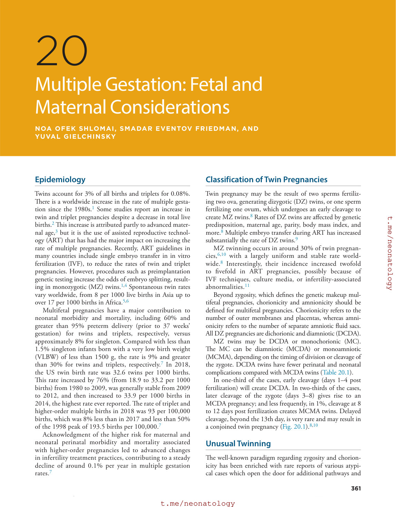

### Original source page 377

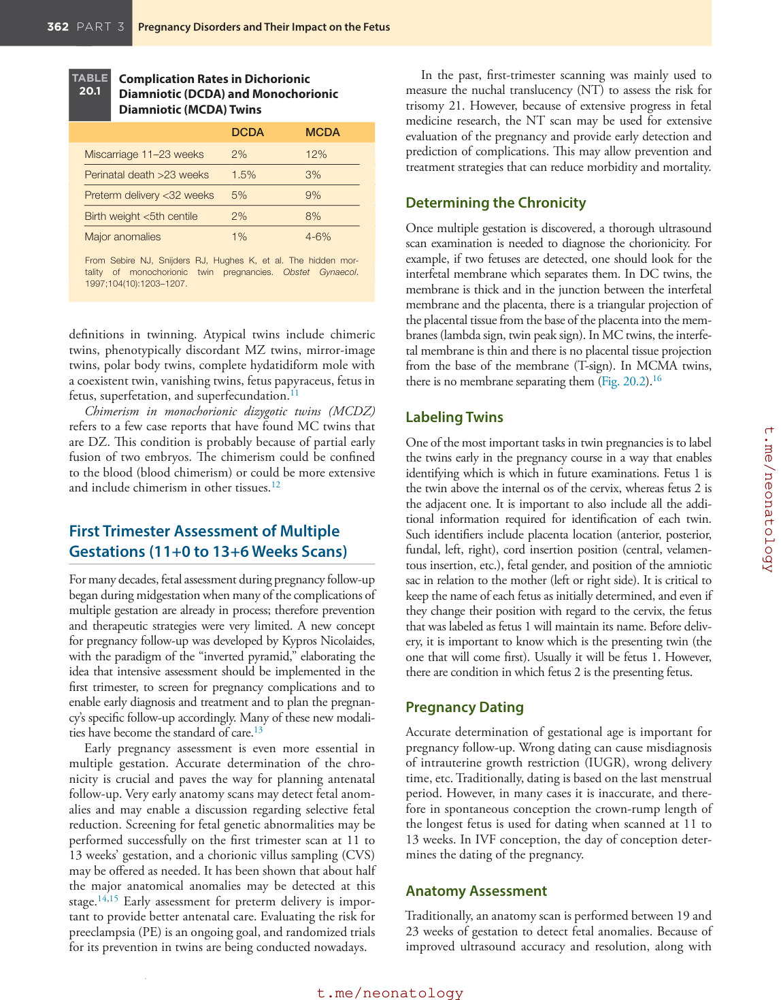

### Original source page 378

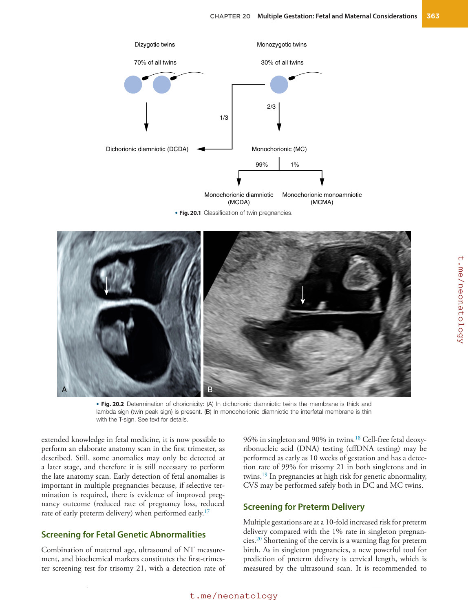

### Original source page 379

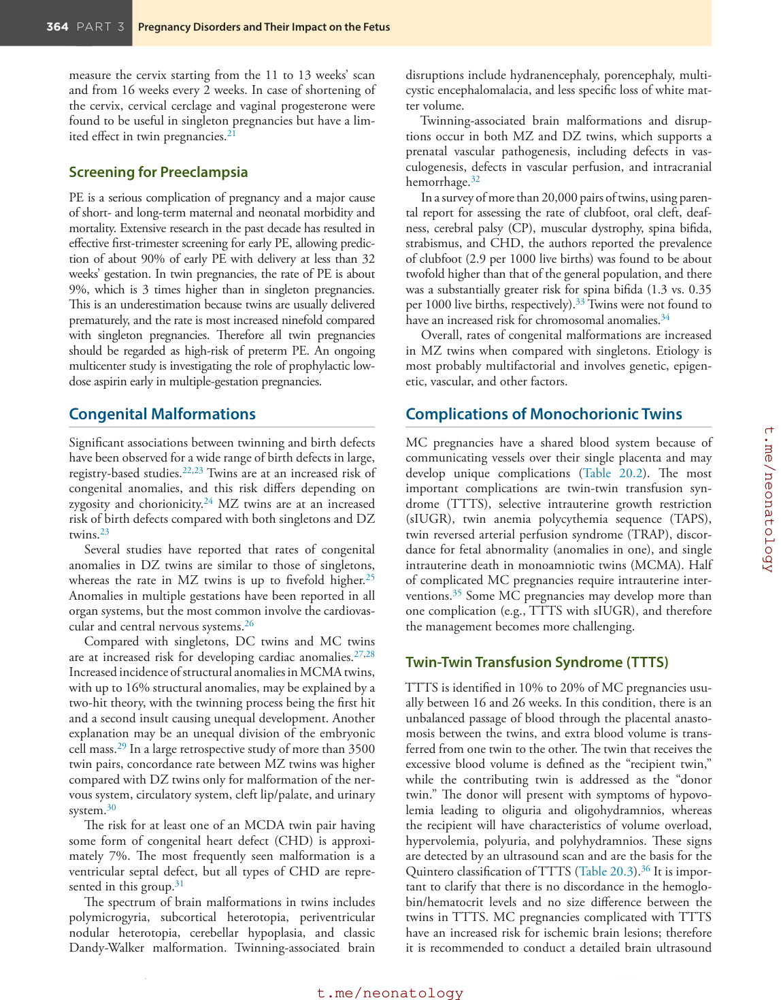

### Original source page 380

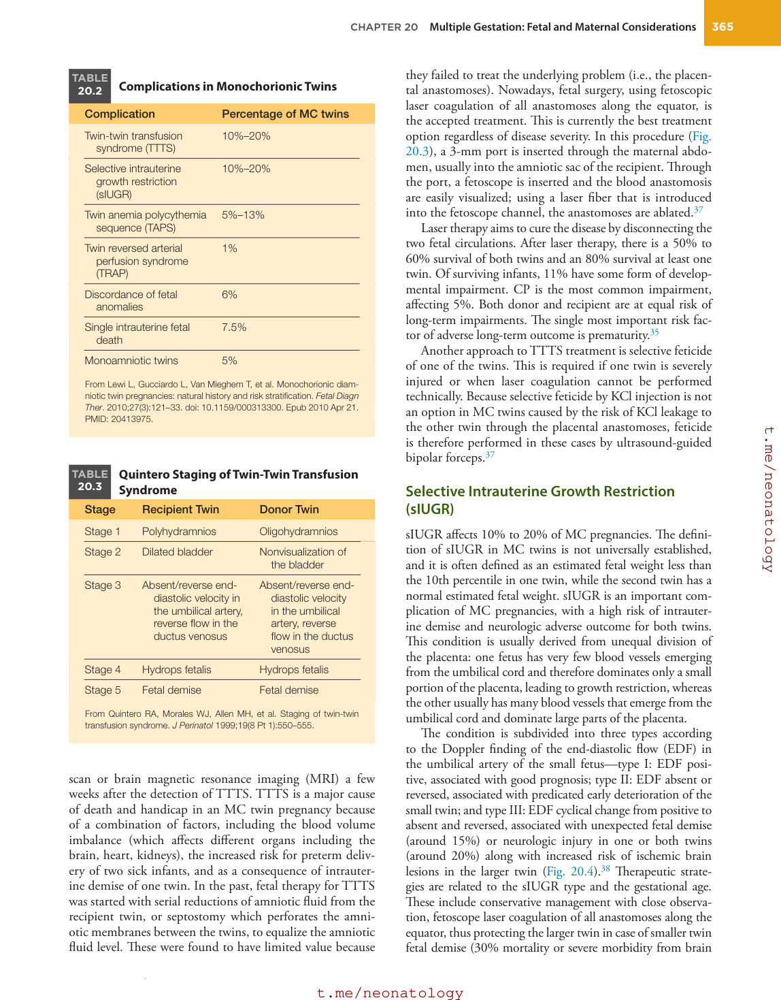

### Original source page 381

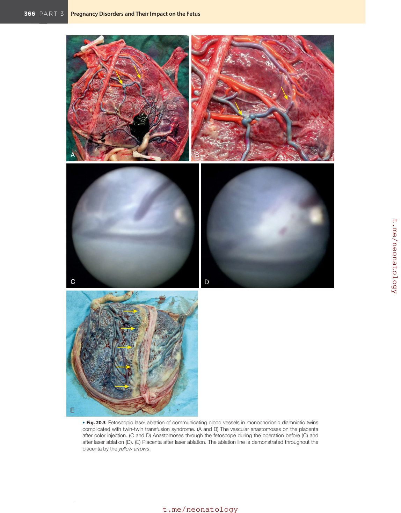

### Original source page 382

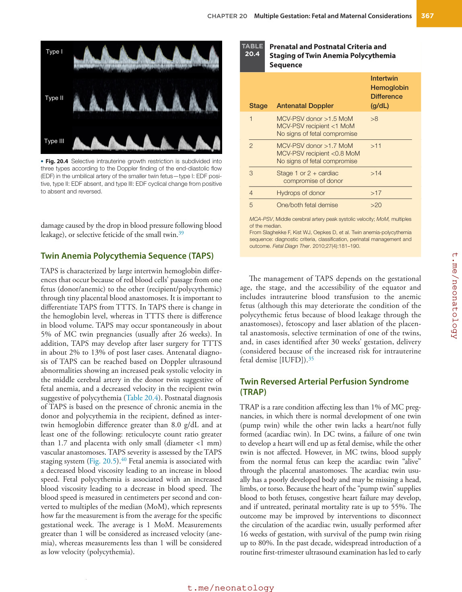

### Original source page 383

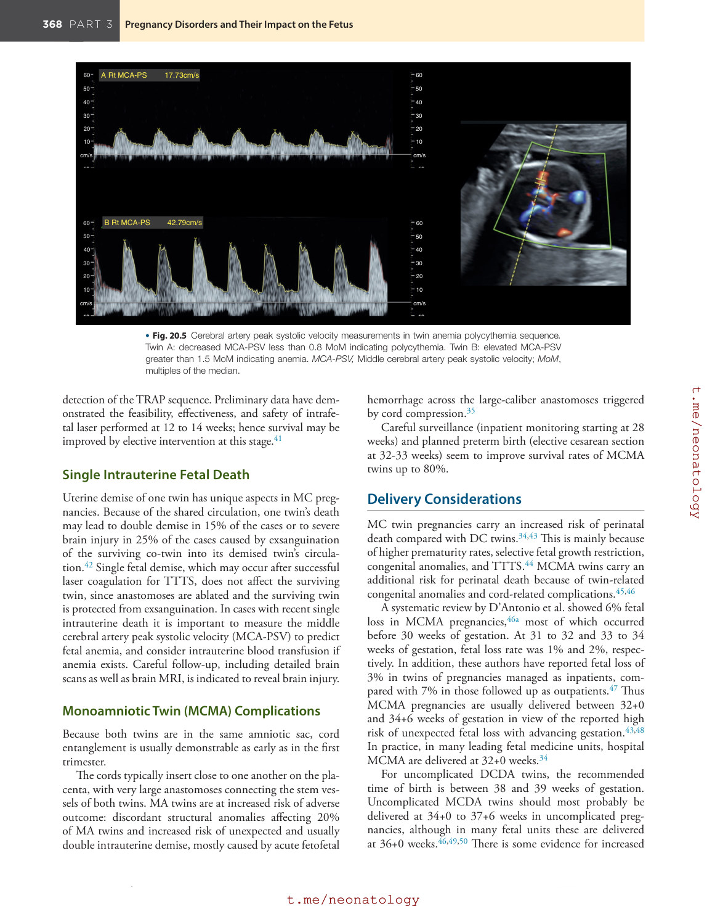
