# 21. Post-Term Pregnancy
> [Source credits](../../SOURCE_CREDITS.md).

## Study pillars

### Gestational categories

Post-term. Post-term begins at 42 completed weeks or294 days from the last menstrual period.

PDF p. 388

### Reliable dating

First-trimester ultrasound. Early ultrasound improves dating relative to menstrual recall and later pregnancy biometry.

PDF p. 388

### Low-fluid mechanism

Umbilical cord compression. Reduced fluid increases vulnerability to cord compression and associated fetal heart rate abnormalities.

PDF p. 390

### Postmaturity appearance

Postmaturity syndrome. The classic syndrome includes absent vernix, dry cracked skin and an alert, aged appearance.

PDF p. 390

### Induction readiness

A more dilated and effaced cervix. A favorable cervix, engaged presenting part and parity are associated with greater success.

PDF p. 391

## Full source extraction

# 21. Post-Term Pregnancy
> Source attribution: [Source credits](../../SOURCE_CREDITS.md).

## PDF page 388 | printed page 373

21 Post-Term Pregnancy

### DAVID PELEG AND YAEL SIMPSON-LAVY

Post-term pregnancy defines a gestation that has completed or gone beyond 294 days or 42 weeks from the last menstrual period (LMP). The prevalence of this condition varies across countries and is dependent on an accurate evaluation of pregnancy dating. There has been a decline in post-term pregnancies in recent years due to early interventions and labor inductions. The etiologies are varied and include parity, genetic, and environmental factors. It is associated with complications for both mother and baby, such as an increased risk of preeclampsia, oligohydramnios, macrosomia, fetal distress, and perinatal death. There is also an increase in the need for obstetrical interventions and cesarean deliveries. Long-term complications such as obesity and behavioral problems have been reported. Close monitoring and consideration of labor induction are recommended for women in or approaching the post-term period. This chapter discusses the etiologies, risks, and complications associated with post-term pregnancy and reviews ways of accurately estimating gestational age, methods of monitoring fetus well-being, and the different ways of inducing labor.

### Defining Post-Term

The human gestation for singleton pregnancies lasts an average of 266 days from fertilization or 280 days (40 weeks) from the first day of the LMP. In the past, the period between 37 and 42 weeks was considered “term,” as this was the interval during which most women delivered and newborns had the fewest complications. However, this has been shown to be inaccurate, as research has reported that the frequency of adverse outcomes is lowest between 39 weeks, 0 days and 40 weeks, 6 days.1 This interval has now been designated “full term.” The American College of Obstetrics and Gynecology and the Society for Maternal-Fetal Medicine have proposed that the terminology for deliveries after 37 weeks be changed (Box 21.1).2 “Post-term” is still defined as a gestation that has completed or gone beyond 294 days or 42 weeks from the LMP. Although the gestational age known as 42 “completed” weeks has been shown to be at increased risk for perinatal and neonatal mortality, as well as other adverse perinatal outcomes, some consider 41 weeks as the beginning of increased risk. In order to

• BOX 21.1 Recommended Classification of

Deliveries From 37 Weeks of Gestation

Early term: 37 0/7 weeks through 38 6/7 weeks Full term: 39 0/7 weeks through 40 6/7 weeks Late term: 41 0/7 weeks through 41 6/7 weeks Postterm: 42 0/7 weeks and beyond

Reprinted with permission from American College of Obstetricians and Gynecologists. ACOG Committee Opinion No. 579: Definition of term pregnancy. Obstet Gynecol. 2013;122(5):1139–1140.

minimize confusion when describing post-term, the use of the terms “postdates,” “prolonged,” or “postmature” should be discouraged. Table 21.1 lists the potential complications experienced by the mother and infant during the post-term period.3 Before proceeding with a discussion of these complications, we need to understand the importance of accurate pregnancy dating.

### Estimated Gestational Age

An accurate gestational age and estimated due date (EDD) are important for appropriate prenatal care. Using the LMP for establishing gestational age is based on the assumption that a woman’s cycle is regular and that ovulation occurs after 14 days. This method is notably inaccurate for several reasons, as it is dependent on the mother’s recall, regular cycle length, and timing of ovulation. First-trimester ultrasound has been shown to be more accurate to establish and/ or confirm gestational age, as well as to improve the EDD. It is now common practice to adjust the LMP and EDD if there is a discrepancy of 6 or more days as demonstrated on first-trimester ultrasound. Between 6% and 40% of women will have their LMP adjusted after a first-trimester ultrasound.4,5 However, the accuracy of dating a pregnancy by using a second or third trimester is suboptimal, with discrepancies of 7 to 14 days or more.6

### Incidence of Post-Term Pregnancy

The incidence of post-term pregnancy varies widely, as it is dependent on methodology and the population studied.

373

## PDF page 389

Adverse Maternal and Perinatal Outcomes

TABLE

21.1

in the Post-Term Period

Perinatal Maternal

Stillbirth Postmaturity syndrome NICU admission Meconium aspiration Neonatal convulsions Shoulder dystocia and

Preeclampsia Cesarean delivery Postpartum hemorrhage Perineal lacerations Oligohydramnios Macrosomia

birth injuries Hypoxic-ischemic

encephalopathy Childhood obesity

NICU, Neonatal intensive care unit. Adapted from Cunningham FG, et al. Williams Obstetrics. 25th ed. New York: McGraw Hill Medical; 2018.

The incidence of post-term pregnancy in the United States was 7.2% in 2000, 5.6% in 2006, and 0.35% in 2016,7 and the rate is continuing to decrease because early intervention is becoming common practice. The incidence varies by country due to different approaches to dating, recording, and management, as well as the multiple sociodemographic and obstetric factors involved. These include cultural differences, attitudes and education of women, and the availability of medical care. As an example, the reported incidence in China was 0.70% in 2016,8 but among European countries there is great variation, with rates reported as high as 7% to 8% in Denmark and Sweden and as low as 0.4% in Austria in the year 2000.9 Post-term applies to singleton pregnancies. There is no consensus as to what gestational age is considered post-term for twin pregnancies, although it is rare for twins to continue beyond 40 gestational weeks.

### Etiology

There are several identifiable risk factors, which include nulliparity, male fetus, fetal anencephaly, prior post-term pregnancy, obesity, and X-linked placental sulfatase deficiency and adrenal hypoplasia.10

### Genetic Factors

The familial and genetic factors predisposing for post-term pregnancy are not well understood. One study of close to half a million Swedish births demonstrated familial clustering of post-term pregnancies and estimated that nearly half of the variation could be attributed to genetic (maternal and fetal) factors.11 Sisters of women with a post-term birth were also at increased risk of delivering post-term. Little is known about the genes and genetic influences involved in post-term labor. One report investigated 9141 individuals from two Northern Finland cohorts, among whom 1167 were born post-term, and the authors reported an association between post-term pregnancy and intronic genetic variant within the ADAMTS13 gene.12 Other gene variants

were identified as well. The effect of these variants on postterm pregnancy is under investigation.

As many as 25% of routine inductions in low-risk women are performed due to post-term pregnancy.13 It has been suggested that some of the risks of post-term delivery, especially long term, are associated with shared underlying genetic factors rather than due to the prolonged gestation per se.14 Use of the term “post-term potential” has been suggested to describe those individuals genetically predisposed to post-term labor that were born term due to induction of labor and hence might still be prone to long-term “post-term” complications.

### Environmental Factors

Stress is associated with post-term pregnancy, which may represent an adaptive strategy to a stressful, suboptimal environment. Using the September 11, 2001, terror attack in the United States as the stressor, it was found that the odds of post-term delivery among gestations at 33 to 36 weeks in September 2001 exceeded what was statistically expected for all race, ethnic, and sex groups.15 It was proposed that stress later in gestation may operate to prolong delivery until conditions improve, the fetus is hardier, or the risks associated with prolonged gestation and post-term delivery outweigh the risks of giving birth to a baby in a suboptimal environment. Maternal obesity has also been found to be associated with post-term pregnancy. There is a direct correlation between obesity category and absolute post-term birth risk.16

### Maternal Complications

### Macrosomia, Cesarean Delivery, Shoulder Dystocia

Pregnancies that have progressed to late term or post-term are at increased risk of macrosomia.17 In one study of over 50,000 births, macrosomia (defined as a birth weight of over 4000 g) increased from 8% at 40 weeks’ to 12% at 41 weeks’ and 15% at 42 weeks’ gestation.18 This obviously contributed to the rise in cesarean delivery, which increased from 7% to 14%. Similarly, post-term pregnancy is a known risk factor for shoulder dystocia.19

### Placental Dysfunction

It is believed by many that the placenta has a preprogrammed lifespan, and function begins to deteriorate after term. Syncytiotrophabast dysfunction and placental apoptosis have been demonstrated in the post-term period.20 This has been associated with reduced functionality of the placenta and reduced oxygenation of the fetus. This was demonstrated by a 67% increase in umbilical cord erythropoietin concentration in post-term pregnancies.21 The post-term period is also associated with decreased amniotic fluid, although the exact mechanism of this reduction is still being debated. The two common methods of defining oligohydramnios are a deepest

## PDF page 390 | printed page 375

vertical pocket that is <2 cm or an amniotic fluid index of <5 cm. Because of oligohydramnios, there is increased risk of fetal heart rate abnormalities (“fetal distress”) as a result of cord compression.22,23 The association between a reduced amniotic fluid volume and variable decelerations has been well documented. The risk of developing preeclampsia also increases with gestational age. In one study of over 3000 low-risk nulliparous women, the incidence of preeclampsia increased from 5.0% in those delivering at 39 weeks to 6.9% in those delivering at 40 weeks and beyond.24

### Neonatal Risks of Post-Term Pregnancy

In 1954, Clifford25 described the post-maturity syndrome, which included the absence of vernix, dry and crackled skin, and an “old and worried” appearance, with infants having open eyes and being alert. The syndrome was related to in utero meconium release, meconium aspiration syndrome, placental dysfunction, intrauterine hypoxia, intrauterine mortality, and increased risk of neonatal death. This description is still valid today. Post-term delivery is associated with higher rates of meconium-stained amniotic fluid, increased risk for meconium aspiration syndrome, low 5-minute Apgar scores, asphyxia,26–28 and neonatal convulsions. There are also higher admission rates to the neonatal intensive care unit (NICU) and shoulder dystocia.29-31,18,32

Po’ at el.33 suggested that the perinatal mortality rate remains rather constant between 38 and 41 weeks’ gestation but begins to climb from 42 weeks onward; for example, Figure 21.1 shows the perinatal mortality of 12 million births for the 3-year period from 2014 to 2016 in the United States. However, there remains conflicting data regarding perinatal death in the post-term period. Earlier studies reported a significant increase in stillborn and neonatal death, whereas later studies, mainly on well-monitored, low-risk pregnancies, showed no such increase.27,32 Some of the confusion is due to research based on live-born registries, which do not include cases of intrauterine fetal death.

3

2.5

Stillbirths per 1000 births

2

1.5

1

0.613 0.561

0.5

0

39+0 – 39+6 40+0 – 40–6

Gestational week • Fig. 21.1 Perinatal mortality by gestational week. (Data from Po’ G, Oliver EA, Reddy UM, et al. The impact of induction of labor at 39 weeks in low-risk women on the incidence of stillbirth. Am J Obstet Gynecol. 2020;222(1):88–90.)

One study investigated the association of post-term pregnancy with neonatal outcomes in low-risk singleton newborns.32 Infants in the post-term group had more NICU admissions, greater respiratory morbidity, and more infections, but not more meconium aspiration syndrome, than term babies. They also observed more hypoglycemia in postterm babies. They did not find any increase in birth trauma or neurological morbidity.

### Long-Term Complications of Post-Term Pregnancy

Post-term delivery is associated with a decrease in IQ compared with term babies.27,34,35 Although consistent and statistically significant, the reported effect is relatively small (approximately 2 IQ points) and of unknown clinical significance. This slight reduction of IQ scores might be influenced by the small group of post-term infants that are severely impaired due to birth trauma and asphyxia. A large register-based study also demonstrated increased risk for intellectual disability, whereas risks for cerebral palsy, epilepsy, and sensorineural defects were not increased.27 However, another study did find a statistically significant increase in cerebral palsy among children born after 42 weeks of gestation, with a relative risk of 1.44.36

There is evidence for increased behavioral and emotional problems in children born post-term, as well as increased risk for mental disorders as adults. Overall, behavioral problems and attention deficit or hyperactivity problems were reported to be twice as high in post-term children (1.5 and 3 years, respectively) than in full-term children.37 There was a significant increase in the risk of any mental disorder in general, particularly of substance use and anxiety disorders, especially in men.38 Post-term birth is also associated with greater risk of being overweight or obese in boys, with higher body mass index (BMI) at 3 years of age and older compared to term infants. This difference continues to increase as they age.39

2.664

0.550

41+0 – 41+6 ≥ 42+0

## PDF page 391

### Management

Given the overall increased risks to the mother and fetus during the post-term period, intervention is warranted, although the method and timing are still debated. Intervention may take the form of either fetal surveillance or labor induction (delivery). Although there is no consensus, it is suggested that induction should be considered sometime during the 41st week of gestation and certainly by the 42nd week. One retrospective study compared expectant management versus induction beyond 41 weeks and found no difference in the cesarean or operative vaginal delivery rate.40 Another randomized trial compared induction versus fetal surveillance starting at 41 weeks.41 Fetal testing included non-stress testing and amniotic fluid volume assessment. In this trial, 901 women were managed by fetal surveillance and 900 women by induction of labor. There was one fetal death (0.1%) in the induction group and two (0.2%) in the expectant management group. There were no neonatal deaths. The composite adverse perinatal outcome was 1.7% in the induction group versus 3.1% in the expectant management group, which was marginally significant. The cesarean delivery rate was similar in both groups (10.7%).

### Fetal Surveillance

Several tests are available to assess fetal well-being. These include fetal kick counts, non-stress test (NST), biophysical profile (BPP), oxytocin contraction test, and the modified BPP, which combines the NST with amniotic fluid assessment (Table 21.2). There is no consensus as to which type, frequency, or combination of testing is optimal. One randomized study compared testing after 42 weeks using the

TABLE

Methods of Fetal Testing

21.2

Method Description

Fetal kick counts Perceived movement by mother while lying

quietly on left side

Non-stress test (NST) Cardiotocography (CTG): 20-min

visualization of fetal heart and uterine activity

Oxytocin contraction test CTG performed while stimulating 3–5

contractions per 10 min for 20 min by oxytocin administration

Amniotic fluid assessment Sonography

Biophysical profile (BPP) Sonography and NST to assess fetal tone,

gross movements, breathing, amniotic fluid, and NST; each element scores 2 points if present

Modified BPP Sonography and NST to assess amniotic

fluid and NST

BPP versus the modified BPP.42 There were more abnormal results with the BPP. The authors suggested this may be the result of using the amniotic fluid index rather than the deepest vertical pocket to evaluate amniotic fluid volume. There are no randomized controlled trials showing that antepartum fetal testing decreases morbidity or mortality; however, based on the increased fetal morbidity and mortality, it seems prudent to begin fetal testing no later than 41 weeks. By performing testing, the provider and mother should agree that induction and delivery are indicated if testing is abnormal.

### Induction of Labor

Once it has been agreed upon, induction of labor can be initiated. One survey from 2006 of obstetricians in the United States reported that 73% of them would routinely induce low-risk women at 41 weeks.43 Methods for induction are listed in Table 21.3.

### Factors Associated With Successful Induction

Successful induction is defined as placing a nonlaboring woman into active labor. There are several factors that increase the success rate of induction. These include a “favorable” cervix, engaged presenting part, and parity. Most agree that a diagnosis of failed induction cannot be made in the absence of rupture of membranes. A favorable cervix suggests that induction of labor is more likely to be successful. There is no exact definition of favorable, although it is agreed that the more the cervix is dilated and effaced, the more favorable it is.

Calculators to determine the probability of failed induction and cesarean delivery take into account cervical dilatation and effacement, station of the head, parity, BMI,

Interpretation

At least 3–5 movements within 30 min are

considered reassuring.

At least 2 accelerations (15 beats/min above

baseline for at least 15 s) of fetal heart activity in 20 min (reactive NST) are considered reassuring.

Absence of fetal variable or late decelerations

are considered reassuring.

The amniotic fluid index is the sum of vertical

pockets in 4 quadrants of the uterus, with ≥5 cm considered normal, or the deepest vertical pocket, with ≥2 cm considered normal.

A score of 8 or 10 is considered reassuring.

Normal fluid with reactive NST is considered

reassuring.

## PDF page 392 | printed page 377

TABLE

### Common Methods of Labor Induction

21.3

Method Description

Nipple

Use fingers or breast pump for up

stimulation

to 5 min per breast several times a day.

Stripping

Insert finger into cervix to loosen

(sweeping) of membranes

amniotic membranes from uterus.

Prostaglandin

Misoprostol, available as vaginal

E1

tablet (Cytotec)

Prostaglandin

Dinoprostine, available as

E2

endocervical gel or as slowrelease vagina insert (Prepidil, Cervidil)

CERVIDIL® is a registered trademark of Ferring B.V. © 2023 Ferring B.V.

Before membrane sweep

After membrane sweep

Continued

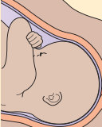

Unmatched source image; PDF page 392. Consult the original caption.

Unmatched source image; PDF page 392. Consult the original caption.

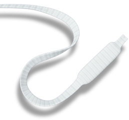

Unmatched source image; PDF page 392. Consult the original caption.

## PDF page 393

Common Methods of Labor Induction—cont’d TABLE

21.3

Method Description

Foley bulb

Usually 24–26 Fr, inserted into the

catheter

uterus; extra-amniotic balloon inflated with 30–80 mL saline

Cervical

18 Fr, double lumen (vaginal,

ripening balloon

intrauterine), each inflated with up to 80 mL saline

Laminaria Seaweed or synthetic; hygroscopic

osmotic rods are inserted into the cervix and expand slowly

Artificial

Must be performed before

rupture of membranes (amniotomy)

diagnosing “failed induction”

and gestational age. One such calculator can be found at http://www.uphs.upenn.edu/labor-induction-calculator.44 For example, an average-sized nulliparous woman after 40 weeks’ gestation who is undilated, 50% effaced, and station –2 has a successful induction probability of 59%, whereas a parous woman with 2-cm dilatation who is 80% effaced and station +1 has an 83% probability of success. In most

studies, induction of labor, especially in the presence of an unfavorable cervix, has a higher cesarean delivery rate.

Thus the dilemma: waiting for spontaneous labor with its lower risk of cesarean delivery versus the increased risk of maternal and perinatal complications caused by the advanced gestational age. The algorithm in Figure 21.2 may be used for managing women at 40 weeks and beyond.

Unmatched source image; PDF page 393. Consult the original caption.

Unmatched source image; PDF page 393. Consult the original caption.

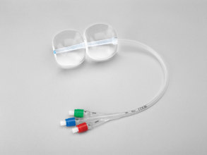

Unmatched source image; PDF page 393. Consult the original caption.

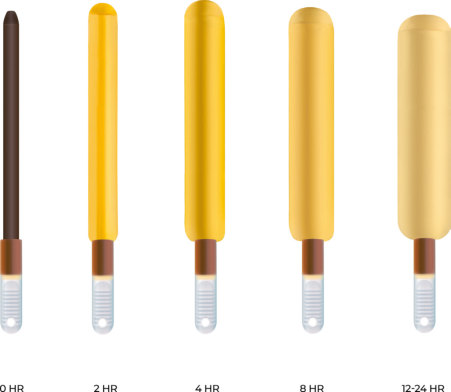

Unmatched source image; PDF page 393. Consult the original caption.

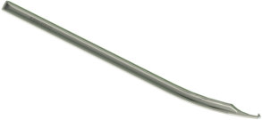

Unmatched source image; PDF page 393. Consult the original caption.

## PDF page 394 | printed page 379

40 weeks • Daily fetal kick countsa

• Begin biweekly modified BPPa

• Consider induction if cervix favorable

41 weeks • Continue fetal kick counts, biweekly modified BPPa

• Membrane stripping • Recommend induction, especially toward end of week

42 weeks

### • Fig. 21.2 Management of post-term pregnancies. aInduction and delivery recommended if reduced fetal

movements or abnormal fetal testing. BPP, Biophysical profile.

Key Points

### • Post-term pregnancy is defined as 294 days or 42 com-

pleted weeks from the last menstrual period (LMP).

### • An accurate gestational age is important for properly

identifying and treating post-term pregnancies.

### • LMP alone is not an accurate method of estimating preg-

nancy age.

### • Incidence of post-term pregnancy varies widely by place,

but there is a general decrease over the years due to early interventions.

### • Nulliparity, male fetus, prior post-term pregnancy, and

maternal obesity are some of the risk factors.

### • X-linked placental sulfatase deficiency and intronic vari-

ations in the ADAMTS13 gene are some of the genetic factors associated with post-term pregnancies. Other genetic factors are yet to be explored.

### References

1. Reddy UM, Bettegowda VR, Dias T, et al. Term pregnancy: a period

of heterogeneous risk for infant mortality. 2011;117(6):1279– 1287. https://doi.org/10.1097/AOG.0b013e3182179e28. 2. ACOG Committee Opinion No 579: definition of term preg-

nancy. Obstet Gynecol. 2013;122(5):1139–1140. https://doi. org/10.1097/01.AOG.0000437385.88715.4a. 3. Williams Obstetrics, 25e. 25th ed. McGraw Hill Medical; 2018. 4. Bennett KA, Crane JMG, O’Shea P, et al. First trimester

ultrasound screening is effective in reducing postterm labor induction rates: a randomized controlled trial. Am J Obstet Gynecol. 2004;190(4):1077–1081. https://doi.org/10.1016/j. ajog.2003.09.065. 5. Harrington DJ, MacKenzie IZ, Thompson K, et al. Does a first

trimester dating scan using crown rump length measurement reduce the rate of induction of labour for prolonged pregnancy? An uncompleted randomised controlled trial of 463 women. BJOG. 2006;113(2):171–176. https://doi.org/10.1111/j.1471- 0528.2005.00833.x. 6. Committee Opinion No 700. Methods for estimating the due

date. Obstet Gynecol. 2017;129(5):e150–e154. https://doi. org/10.1097/AOG.0000000000002046. 7. Martin JA, Hamilton BE, Osterman MJK, et al. Births: Final

data for 2016. Natl Vital Stat Rep. 2018;67(1):1–55.

• Induction/delivery

### • Maternal risks are placental dysfunction, preeclamp-

sia, decreased levels of amniotic fluid, macrosomia, and increased risk of cesarean delivery.

### • Neonatal risks include low Apgar scores, asphyxia,

increased neonatal intensive care unit admission rate, and increased risk for perinatal death.

### • Long-term complications include a tendency to be over-

weight and have emotional-behavioral problems.

### • Intervention, either close monitoring and fetal surveil-

lance or induction of labor, is warranted in all pregnancies approaching post-term.

### • Successful induction is defined as placing a nonlaboring

woman into active labor.

### • Several factors influence the success rate of induction,

such as cervical conditions, parity, and engagement of the presenting part.

8. Deng K, Huang Y, Wang Y, et al. Prevalence of postterm births

and associated maternal risk factors in China: data from over 6 million births at health facilities between 2012 and 2016. Sci Rep. 2019;9(1):273. https://doi.org/10.1038/s41598-018-36290-7. 9. Zeitlin J, Blondel B, Alexander S, Bréart G. Variation in

rates of postterm birth in Europe: reality or artefact? BJOG. 2007;114(9):1097–1103. https://doi.org/10.1111/j.1471- 0528.2007.01328.x. 10. ACOG practice bulletin no. 146: management of late-term and

postterm pregnancies. 2014;124(2Pt1):390–396. 11. Oberg AS, Frisell T, Svensson AC, Iliadou AN. Maternal and fetal

genetic contributions to postterm birth: familial clustering in a population-based sample of 475,429 Swedish births. Am J Epidemiol. 2013;177(6):531–537. https://doi.org/10.1093/aje/kws244. 12. Schierding W, Antony J, Karhunen V, et al. GWAS on pro-

longed gestation (post-term birth): analysis of successive Finnish birth cohorts. J Med Genet. 2018;55(1):55–63. https://doi. org/10.1136/jmedgenet-2017-104880. 13. Khireddine I, Le Ray C, Dupont C, et al. Induction of labor

and risk of postpartum hemorrhage in low risk parturients. PLoS One. 2013;8(1):e54858. https://doi.org/10.1371/journal. pone.0054858. 14. Schierding W, O’Sullivan JM, Derraik JGB, Cutfield WS. Genes

and post-term birth: late for delivery. BMC Res Notes. 2014;7:720. https://doi.org/10.1186/1756-0500-7-720.

## PDF page 395

15. Margerison-Zilko CE, Goodman JM, Anderson E, et al. Post-

term birth as a response to environmental stress: the case of September 11, 2001. Evol Med Public Health. 2015;2015(1):13–20. https://doi.org/10.1093/emph/eov001. 16. Slack E, Best KE, Rankin J, Heslehurst N. Maternal obesity

classes, preterm and post-term birth: a retrospective analysis of 479,864 births in England. BMC Pregnancy Childbirth. 2019;19(1):434. https://doi.org/10.1186/s12884-019-2585-z. 17. Maoz O, Wainstock T, Sheiner E, Walfisch A. Immediate perina-

tal outcomes of postterm deliveries. J Matern Fetal Neonatal Med. 2019;32(11):1847–1852. https://doi.org/10.1080/14767058.20 17.1420773. 18. Alexander JM, McIntire DD, Leveno KJ. Forty weeks and

beyond: pregnancy outcomes by week of gestation. Obstet Gynecol. 2000;96(2):291–294. https://doi.org/10.1016/s0029- 7844(00)00862-0. 19. Gottlieb AG, Galan HL. Shoulder dystocia: an update. Obstet

Gynecol Clin North Am. 2007;34(3):501–531, xii. https://doi. org/10.1016/j.ogc.2007.07.002. PMID: 17921012. 20. Torricelli M, Novembri R, Conti N, et al. Correlation with pla-

cental kisspeptin in postterm pregnancy and apoptosis. Reprod Sci. 2012;19(10):1133–1137. 21. Seikku L, Stefanovic V, Rahkonen P, et al. Amniotic fluid and

umbilical cord serum erythropoietin in term and prolonged pre et al gnancies. Eur J Obstet Gynecol Reprod Biol. 2019;233:1–5. https://doi.org/10.1016/j.ejogrb.2018.11.022. 22. Bochner CJ, Medearis AL, Davis J, et al. Antepautum pre-

dictors of fetal distress in postterm pregnancy. Am J Obstet Gynecol. 1987;157(2):353–358. https://doi.org/10.1016/s0002- 9378(87)80170-9. 23. Divon MY, Marks AD, Henderson CE. Longitudinal measurement

of amniotic fluid index in postterm pregnancies and its association with fetal outcome. Am J Obstet Gynecol. 1995;172(1):142–146. https://doi.org/10.1016/0002-9378(95)90103-5. 24. Moussa HN, Hosseini Nasab S, Amro FH, et al. Adverse pregnancy

outcomes in deliveries prior to, at and beyond 39 weeks; low- and high-risk women. J Matern Fetal Neonatal Med. 2018;31(19):2545– 2549. https://doi.org/10.1080/14767058.2017.1347624. 25. Clifford SH. Postmaturity—with placental dysfunction. J

Pediatr. 1954;44(1):1–13. https://doi.org/10.1016/S0022- 3476(54)80085-0. 26. Clausson B. Outcomes of post-term births: the role of fetal growth

restriction and malformations. Obstet Gynecol. 1999;94(5):758– 762. https://doi.org/10.1016/s0029-7844(99)00387-7. 27. Seikku L, Gissler M, Andersson S, et al. Asphyxia, neurologic

morbidity, and perinatal mortality in early-term and postterm birth. Pediatrics. 2016;137(6). https://doi.org/10.1542/ peds.2015-3334. 28. Odd DE, Yau C, Winter CD, et al. Associations between birth

at, or after, 41 weeks gestation and perinatal encephalopathy: a cohort study. BMJ Paediatr Open. 2018;2(1):e000010. https:// doi.org/10.1136/bmjpo-2017-000010. 29. Tunón K, Eik-Nes SH, Grøttum P. Fetal outcome in pregnancies

defined as post-term according to the last menstrual period estimate, but not according to the ultrasound estimate. Ultrasound Obstet Gynecol. 1999;14(1):12–16. https://doi.org/10.1046/ j.1469-0705.1999.14010012.x. 30. McLean FH, Boyd ME, Usher RH, Kramer MS. Postterm infants:

too big or too small? Am J Obstet Gynecol. 1991;164(2):619–624. https://doi.org/10.1016/s0002-9378(11)80035-9.

31. Balchin I, Whittaker JC, Lamont RF, Steer PJ. Maternal and fetal

characteristics associated with meconium-stained amniotic fluid. Obstet Gynecol. 2011;117(4):828–835. https://doi.org/10.1097/ AOG.0b013e3182117a26. 32. Linder N, Hiersch L, Fridman E, et al. Post-term pregnancy is

an independent risk factor for neonatal morbidity even in lowrisk singleton pregnancies. Arch Dis Child Fetal Neonatal Ed. 2017;102(4):F286–F290. https://doi.org/10.1136/archdischild-2015-308553. 33. Po’ G, Oliver EA, Reddy UM, et al. The impact of induction of

labor at 39 weeks in low-risk women on the incidence of stillbirth. Am J Obstet Gynecol. 2020;222(1):88–90. https://doi. org/10.1016/j.ajog.2019.09.032. 34. Eide MG, Oyen N, Skjaerven R, Bjerkedal T. Associations

of birth size, gestational age, and adult size with intellectual performance: evidence from a cohort of Norwegian men. Pediatr Res. 2007;62(5):636–642. https://doi.org/10.1203/ PDR.0b013e31815586e9. 35. Glover Williams A, Odd D. Investigating the association between

post-term birth and long term cognitive, developmental and educational impacts: a systematic review and meta-analysis. J Matern Fetal Neonatal Med. 2020;33(7):1253–1265. https://doi.org/10. 1080/14767058.2018.1514379. 36. Moster D, Wilcox AJ, Vollset SE, et al. Cerebral palsy among

term and postterm births. JAMA. 2010;304(9):976–982. https:// doi.org/10.1001/jama.2010.1271. 37. El Marroun H, Zeegers M, Steegers EAP, et al. Post-term birth

and the risk of behavioural and emotional problems in early childhood. Int J Epidemiol. 2012;41(3):773–781. https://doi. org/10.1093/ije/dys043. 38. Lahti M, Eriksson JG, Heinonen K, et al. Late preterm birth,

post-term birth, and abnormal fetal growth as risk factors for severe mental disorders from early to late adulthood. Psychol Med. 2015;45(5):985–999. https://doi.org/10.1017/ S0033291714001998. 39. Beltrand J, Soboleva TK, Shorten PR, et al. Post-term birth

is associated with greater risk of obesity in adolescent males. J Pediatr. 2012;160(5):769–773. https://doi.org/10.1016/j. jpeds.2011.10.030. 40. Daskalakis G, Zacharakis D, Simou M, et al. Induction of labor

versus expectant management for pregnancies beyond 41 weeks. J Matern Fetal Neonatal Med. 2014;27(2):173–176. https://doi. org/10.3109/14767058.2013.806892. 41. Keulen JK, Bruinsma A, Kortekaas JC, et al. Induction of

labour at 41 weeks versus expectant management until 42 weeks (INDEX): multicentre, randomised non-inferiority trial. BMJ. 2019;364:l344. https://doi.org/10.1136/bmj.l344. 42. Alfirevic Z, Walkinshaw SA. A randomised controlled trial of

simple compared with complex antenatal fetal monitoring after 42 weeks of gestation. Br J Obstet Gynaecol. 1995;102(8):638– 643. https://doi.org/10.1111/j.1471-0528.1995.tb11402.x. 43. Cleary-Goldman J, Bettes B, Robinson JN, et al. Postterm preg-

nancy: practice patterns of contemporary obstetricians and gynecologists. Am J Perinatol. 2006;23(1):15–20. https://doi.org/10. 1055/s-2005-918891. 44. Levine LD, Downes KL, Parry S, et al. A validated calculator to

estimate risk of cesarean after an induction of labor with an unfavorable cervix. Am J Obstet Gynecol. 2018;218(2):254.e1–254.e7. https://doi.org/10.1016/j.ajog.2017.11.603.

<!-- SOURCE_LAYOUT_VIEWS -->

## Original layout views and recovered diagrams

Automatic extraction can flatten tables and superscripts. Check the original layout for numeric data, footnotes and image credits. [Source review notes](../../SOURCE_REVIEW_NOTES.md).

### Original source page 388

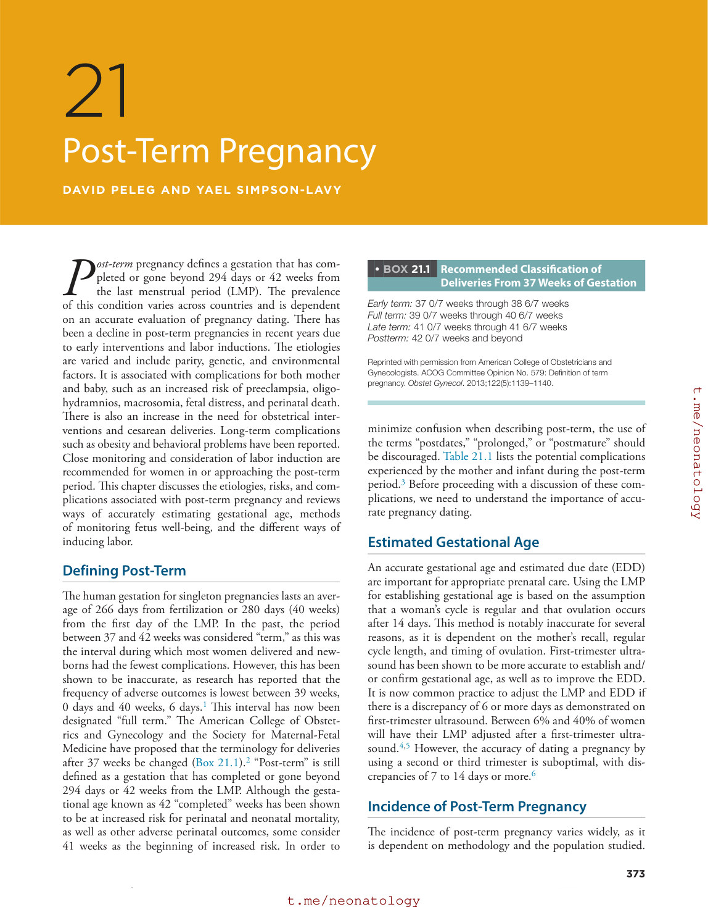

### Original source page 389

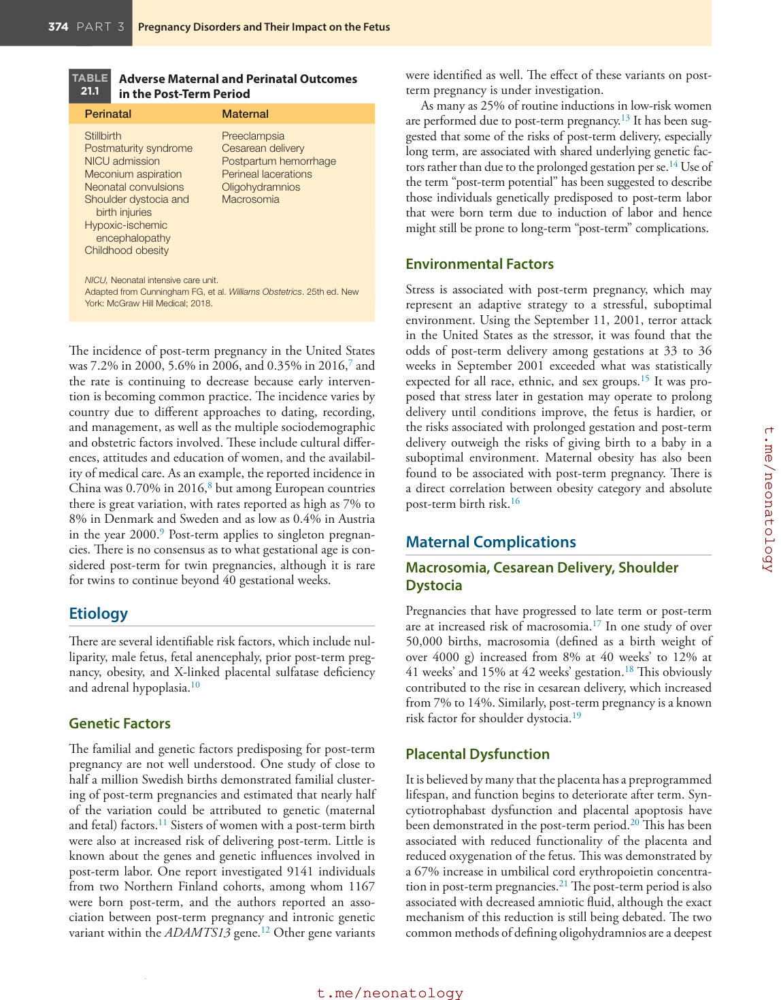

### Original source page 391

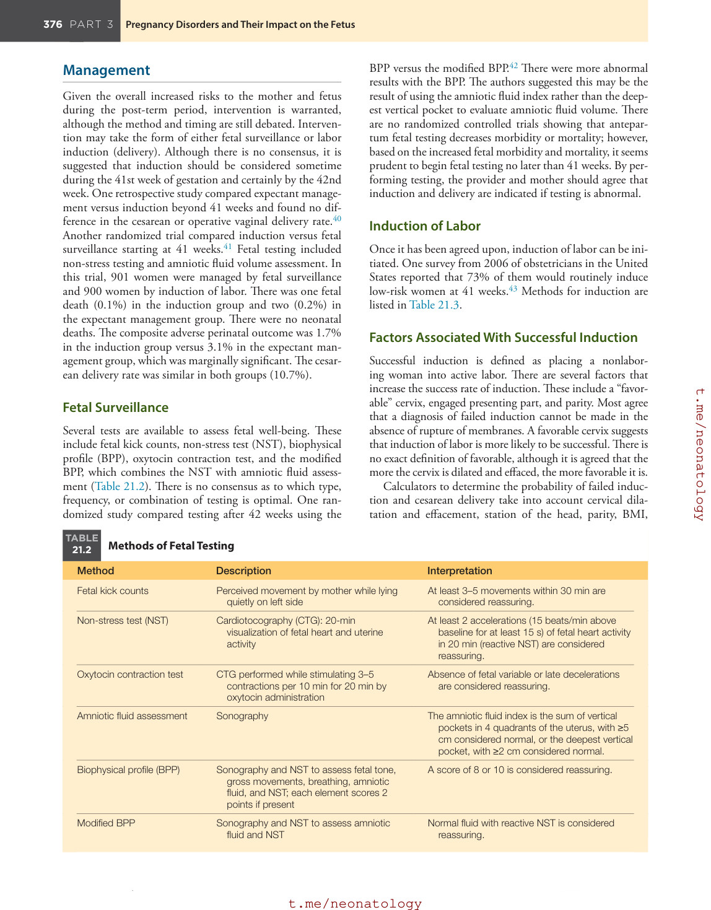

### Original source page 392

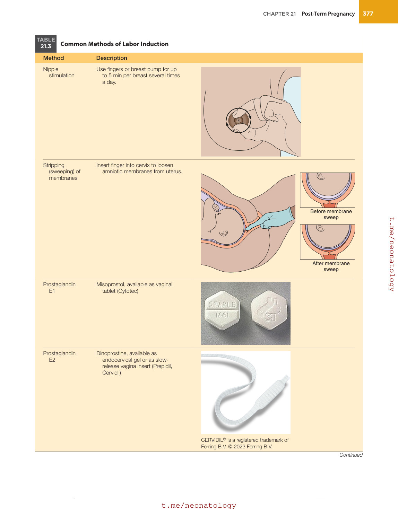

### Original source page 393

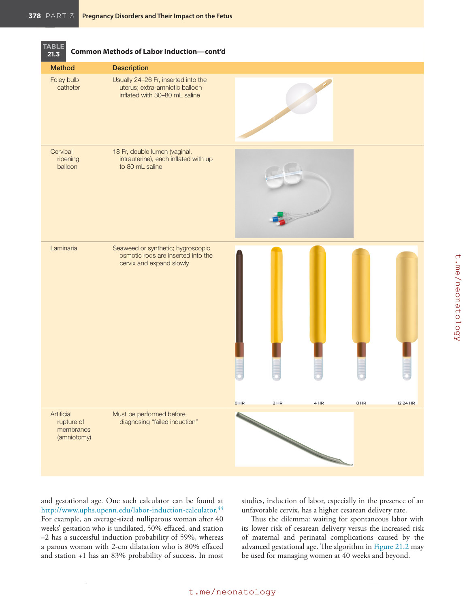

### Original source page 394

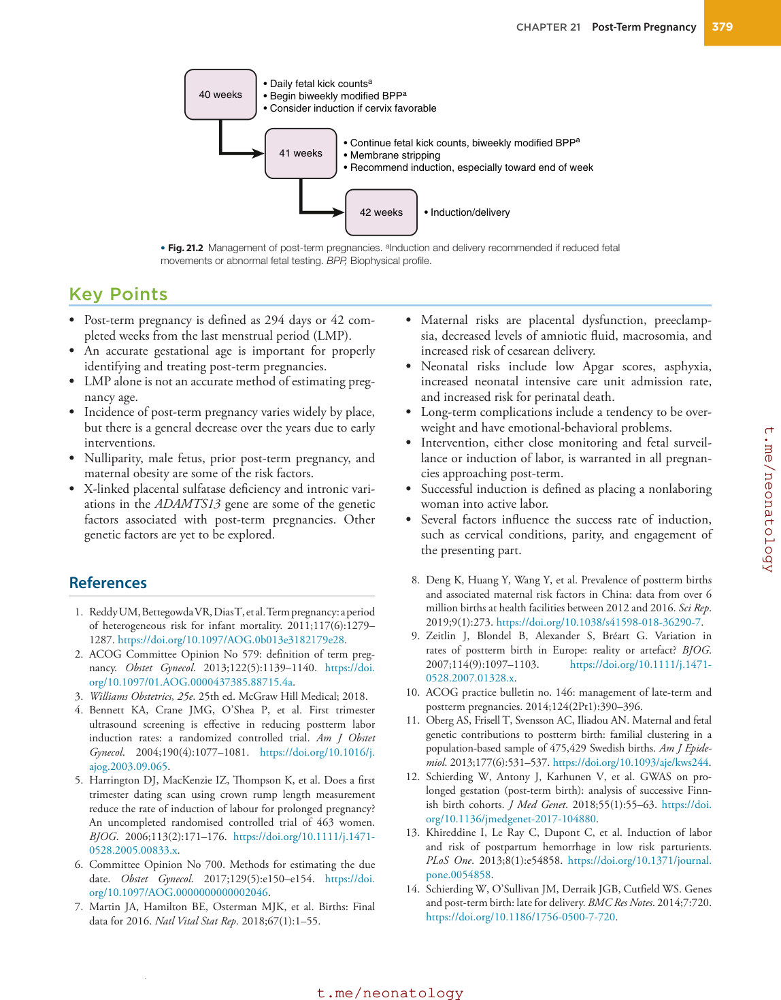

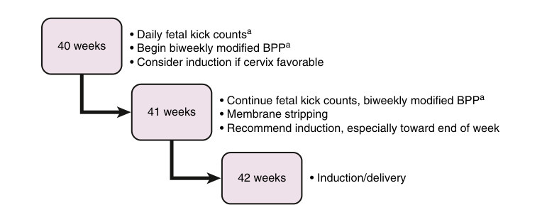

• Fig. 21.2 Management of post-term pregnancies. aInduction and delivery recommended if reduced fetal movements or abnormal fetal testing. BPP, Biophysical profile.

PDF p. 394
