# 22. Immune and Nonimmune Hydrops Fetalis
> [Source credits](../../SOURCE_CREDITS.md).

## Study pillars

### Multicompartment fluid

Excess fluid in multiple fetal compartments consistent with hydrops. The source defines hydrops by excessive fluid in at least two listed spaces or compartments.

PDF p. 396

### Immune mechanism

Maternal antibodies cross the placenta and hemolyze fetal erythrocytes. Maternal anti-Rh antibodies can cross the placenta and cause fetal red-cell destruction.

PDF p. 396

### Prenatal antibody evaluation

ABO group, RhD status and antibody screen. The source recommends blood grouping, RhD determination and antibody screening alongside relevant history.

PDF p. 398

### Anemia surveillance

Middle cerebral artery peak systolic velocity. Serial MCA peak systolic velocity assessment replaced older serial amniotic bilirubin approaches for anemia surveillance.

PDF p. 400

### Fluid-balance pathways

Reduced lymphatic return, reduced oncotic pressure or increased venous pressure. Imbalance of interstitial production and lymphatic return can arise through several pressure and drainage disturbances.

PDF p. 404

## Full source extraction

# 22. Immune and Nonimmune Hydrops Fetalis
> Source attribution: [Source credits](../../SOURCE_CREDITS.md).

## PDF page 396 | printed page 381

22 Immune and Nonimmune Hydrops Fetalis

### KAITLYN HEBERT TAYLOR, PAMELA M. SIMMONS, AND EVERETT F. MAGANN

Hydrops fetalis (HF) is defined as the presence of excessive fetal fluid in two or more of the following spaces: abdominal ascites, pleural effusion, pericardial effusion, skin edema, polyhydramnios, or placentomegaly. The diagnosis is made by ultrasound imaging evaluating body cavities, the placenta, and the amniotic fluid volume. Classically, HF has been classified into two categories based on etiology: Immune HF accounts for an estimated 10% to 24%, and nonimmune HF accounts for 76% to 90% of cases and is becoming increasingly the main cause of HF (Table 22.1).

### Immune Hydrops Fetalis

Immune hydrops fetalis (IHF) was initially recognized as the combination of neonatal hydrops, anemia, and jaundice along with erythroblastosis and red blood cell (RBC) hemolysis by Diamond and coinvestigators in 1932.1 The pathophysiology of the IHF was explained by the work of Karl Landsteiner and associates, who discovered the rhesus (Rh) antigen in 1940. In 1941, Levine and coworkers2 observed that, if an Rh-negative woman is exposed to RBCs that are Rh positive, she will form antibodies that may result in transplacental passage of the antibodies to fetal RBCs and may result in fetal hemolysis. The resultant maternal alloimmunization was initially documented by Chown and coworkers.3

Anti-D antibodies were proposed as a method to prevent the nonimmunized Rh-negative mother from becoming sensitized after birth. Freda and coworkers studied the efficacy of specific anti-D immune globulin in Rh-negative male prison volunteers who were given Rh-D-positive blood and observed that sensitization could be prevented.4 A subsequent investigation confirmed that if prisoners were given Rh-D-positive blood and received anti-D immune globulin within 72 hours, alloimmunization did not occur.5

### Genetics of the Rh System

Blood group antigens were among the first discoveries of genetic polymorphisms in human proteins.6 Of these, the

Rh factor (the largest of all of the blood groups) has more than 50 different described antigens, with additional discoveries likely to continue. Most of these are quantitative antigens (affecting the amounts of Rh factors expressed), although some are qualitative in nature. Not all antigens have clinical significance in pregnancy. Three of the most concerning antigens in pregnancy, the Rh(D), Rh(Cc), and Rh(Ee) antigens, are encoded at two human loci, found on chromosome #1 (1p36.1).7 They can cause antibody formation in pregnancy and lead to significant hemolytic disease of the newborn (HDN) in future pregnancies. Although there are multiple nomenclature systems for maternal rhesus (DCE) status, the Fisher and Race method has clinical advantages, such as ease of use and remembering, and was also proved genetically correct.8 In this system, each parent contributes an allele from the Rh(D), Rh(C), and Rh(E) gene loci. In broad terms, these alleles are called D or d, C or c, and E or e. A person can be homozygous or heterozygous for each of these alleles. The genes are so closely linked on chromosome #1 that crossover between the alleles is not thought to occur.

The D antigen is a transmembrane protein with several extracellular loops located on erythrocytes and their immediate progenitors. Most alleles of the Rh(D) gene (∼170 identified) are caused by nonsense or missense mutations, although frameshift and splice-site mutations have also been reported.9 Alleles that cause strongly reduced or complete absence of the Rh-D antigen are often referred to as DEL or negative alleles, respectively. These include the most common European d (Rh-negative) phenotype. The Rh-negative phenotype is most common in individuals of European and North American descent (15%–17%) followed by African and Indian (3%–8%), with the rarest in Asia (0.1%–0.3%).10,11 Thirty percent of Rh-negative Asians actually carry a DEL allele, whereas this phenotype is rare in Europeans. Other alleles may result in “partial D” antigens (qualitative). There are also alleles that produce a “weak” Rh(D) antigen. DEL, negative, partial D, and weak D alleles can be clinically significant in pregnancy and increase the risk for HDN.

381

## PDF page 397

Diagnostic Criteria and Definitions for

TABLE

22.1

Immune and Nonimmune Hydrops Fetalis

Diagnostic Criteria Definition

Presence or absence

Rh-D status Antibody screen

of red blood cell alloimmunization (immune vs. nonimmune hydrops fetalis)

Plus two or more abnormal fluid collections:

Ascites Echolucent rim encompassing

entire fetal abdomen in the transverse view60

Pleural effusions Unilateral or bilateral

visualization of lung border61

Pericardial effusion Nonphysiologic fluid ≥2 mm62

Skin edema Subcutaneous edema

≥5 mm63

Polyhydramnios Single deepest fluid pocket

≥8 mm Amniotic fluid index ≥25 cm64

Placentomegaly Placenta ≥6 cm thickness54

The D alleles are dominant over the d alleles. It is important to note that d is simply the absence of D antigen; there has been no identification of an actual d antigen. Thus it is the presence or absence (and the extent) of the D antigen that will determine if an individual is Rh positive or Rh negative. There are significantly fewer alleles identified at the Rh(CcEe) gene. Unlike the Rh(D) alleles, the Cc and Ee alleles are codominant; both are expressed in a heterozygote state. The mutations/changes between the alleles are limited and result in amino acid changes at only five locations.12 Partial C, c, E, and e antigens can be present, but the clinical significance of these in pregnancy is undetermined.

The Kell blood group gene, located on chromosome #7 (7q33),7 has many polymorphisms, and its alleles encode for approximately 20 to 25 antigens. Behind the Rh and ABO blood group antigens, Kell antigens carry the most risk for HDN in human pregnancy. The two most common alleles are K and k. The Kell protein transverses the RBC membrane only once, unlike D and CcEe. Kell antibodies work differently in the lysing of fetal RBCs than Rh and CcEe antibodies; Kell antibodies actually destroy early precursors of erythrocytes in the fetal liver and affect early proliferation of RBCs, instead of only attacking mature RBCs in fetal circulation.13

Because each of these antigens can lead to HDN, knowing ethnicity may be helpful in predicting risks for fetal status in a broad sense or if the father of a fetus is unavailable. Of course, when possible, it is advisable to obtain paternal DCE antigen and/or Kell antigen genotyping in at-risk pregnancies. Certainly other antigens have been linked to

HDN, but genotyping is not available for all of these blood groups. These results are of great importance in delineating the best courses of action during gestation for monitoring an at-risk fetus.

Typical methods of monitoring at-risk fetuses have included monitoring of maternal antibody titers; targeted ultrasounds to obtain serial middle cerebral artery peak systolic velocity (MCA-PSV) values and exclude the presence of hydrops, amniocentesis, or chorionic villus sampling for fetal antigen genotyping; and/or amniocentesis to determine ΔOD450, whereas the latter is rarely used clinically anymore. Traditionally, fetal genotyping has been performed using polymerase chain reaction (PCR) on amniocytes or chorionic villi. New technology now allows for noninvasive determination of fetal Rh-D antigen status through the use of cell-free fetal DNA collection from a maternal blood sample. Although this technology is relatively new, this method of testing has proved to be very accurate (94%– 97%), with high sensitivity and specificity.14,15 Because fetal DNA is directly tested from maternal serum, it reduces the need for invasive testing, Rh-D prophylaxis, and paternal antigen genotyping in most cases.

### Pathophysiology of Rh-D Isoimmunization

Alloimmunization, which was formerly known as isoimmunization, occurs when a mother develops antibodies to a paternally derived RBC antigen that is inherited by the fetus or from a transfusion of unmatched or mismatched blood. If this occurs, hemolytic disease of the fetus or neonate in subsequent pregnancies can occur. In Rh alloimmunization, an Rh-D-negative mother is exposed to Rh-D-positive blood. A quantifiable amount of hemorrhage occurs between the fetus and the mother in up to 75% of all pregnancies. This may range from less than 0.1 mL of blood in 60% of pregnancies to an excess of 5 mL in less than 1% of pregnancies. In an analysis of maternal fetal hemorrhage, 0.01 mL of fetal blood was detected in the maternal circulation in 3%, 12%, and 46% in the first, second, and third trimesters of pregnancy, respectively.16 The risk of sensitization is related to the amount of blood that passes between the fetus and mother. For 0.1 mL of blood, the risk of sensitization is 3%; for 0.4 mL, the risk rises to 22%. Rh sensitization has been reported as early as 38 days, and fetal maternal hemorrhage has been demonstrated as early as 5 to 6 weeks (mean maternal fetal transfusion at 8 weeks is 0.3 mL). The minimal amount of fetal blood needed to cause alloimmunization is estimated to be 0.25 mL. The greatest risk occurs at the time of delivery, when that risk is approximately 17%. ABO incompatibility of the mother and fetus in pregnancy with Rh sensitization (mother O; father A, B, or AB) will reduce the sensitization risk to 2%. Additionally, 30% of Rh-negative individuals are nonresponders and will not become sensitized. Box 22.1 summarizes the numerous risk factors for maternal fetal hemorrhage during pregnancy.

IHF is the end result of progressive RBC destruction, in which even with the recruitment of extramedullary tissue

## PDF page 398 | printed page 383

(liver and spleen) the severity of the hemolysis results in severe fetal anemia, HF, and often fetal death. Although the fetus is able to compensate for progressive anemia, one study determined that, when the hemoglobin deficit has exceeded 7 g/dL, this compensatory ability of the fetus may become exhausted and IHF will ensue.17 The concept of a fixed hemoglobin level for IHF likely should be adjusted for gestational age, because with advancing gestational age the mean hemoglobin value increases, going from 10.6 g/dL at 18 weeks to 13.8 g/dL at 40 weeks. It has been suggested that a hemoglobin value of less than 0.5 times the median for gestational age might be a more appropriate predictor for fetuses at significant risk for HF.

Progressive ultrasound findings of IHF include the early findings of polyhydramnios and placentomegaly, followed

• BOX 22.1 Risk Factors for Maternal-Fetal

Hemorrhage During Pregnancy

• Spontaneous abortion • Elective abortion • Amniocentesis • Chorionic villus sampling • Antepartum hemorrhage • Fetal blood sampling • Ectopic pregnancy • Blunt abdominal trauma • Fetal death in utero • Abruption • Placenta previa with bleeding • Cesarean delivery • Manual removal of the placenta

• Fig. 22.1 Initial management of blood type and screen. AB, Antibody; HDN, hemolytic disease of the newborn.

by hepatomegaly and pericardial effusions and late findings of ascites, scalp edema, pleural effusions, and, finally, oligohydramnios.18 Severe fetal anemia (fetal hemoglobin of ≤5 g/dL) associated with the development of HF19 has implications on fetal survival. In a study with intravascular transfusions, the survival rate for nonhydropic fetuses was 94% compared with 74% in fetuses with hydrops.20 The exact mechanism that causes IHF is unknown. Proposed mechanisms include high output cardiac failure, liver dysfunction, and fetal hypoxemia from fetal anemia. It is likely that a combination of all three is responsible for fetal hydrops.

### Management Prevention

Prevention of Rh alloimmunization begins at the first prenatal visit. A careful history should be taken of any problems associated with previous pregnancies or deliveries, prior blood transfusions, or blood disorders. Initial laboratory work should include ABO typing, Rh-D status, and an antibody screen. If the mother is Rh-D negative, this should be carefully documented in the chart. If the antibody screen is positive, the antibody test and a titer of the antibody should be repeated and a determination should be made for antibodies, Rh-D, and others that are not Rh-D to ascertain if the antibody is known to cause HDN (Fig. 22.1). If the antibody is positive Rh-D, then the patient should be questioned about a prior injection of anti-D immune globulin, as this could be the reason for the positive antibody titer.

### Rh-Immunoglobulin Prophylaxis

Anti-D immune globulin is a passive immunoglobulin that, when given to Rh-D-negative women, will prevent the

Repeat screen and administer RhoGAM at 28 weeks

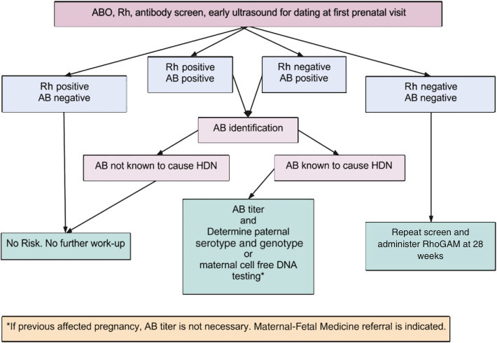

• Fig. 22.1 Initial management of blood type and screen. AB, Antibody; HDN, hemolytic disease of the newborn.

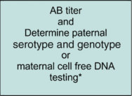

Unmatched source image; PDF page 398. Consult the original caption.

## PDF page 399

vast majority of cases of alloimmunization. Unfortunately, there are no other immune globulins specific for the other RBC antigens. After the initial screen at the first prenatal visit, a repeat Rh-D antibody screen is done at 24 to 28 weeks. If the antibody screen is negative, 300 μg of anti- D immune globulin is administered at that gestational age and then again within 72 hours of delivery if the neonate is Rh-D positive. Other accepted regimens are 100 μg at 28 and 34 weeks and following delivery if the neonate is Rh-D positive. Suggested doses of anti-D immune globulin for a first-trimester induced or spontaneous abortion, amniocentesis, or chorionic villus sampling and first-trimester ectopic pregnancy are 50–120 μg of anti-D immune globulin up to 12 weeks’ gestation. After 12 weeks’ gestation, it is recommended to use 300 μg of anti-D immune globulin.21–23 Three hundred micrograms of anti-D immune globulin will suppress the immune response of 30 mL of fetal blood or 15 mL of packed D-positive RBCs. Women should be screened at delivery and when maternal fetal hemorrhage is suspected to prevent an inadequate dose of anti-D immune globulin being administered and subsequent alloimmunization (Table 22.2).

### Preimplantation Diagnosis

Techniques using molecular genetics have permitted the preimplantation diagnosis of Rh-D status.24 This technology has the potential to prevent Rh isoimmunization through selective transfer of Rh-D-negative embryos. In the

TABLE

Indications for Rh Immunoglobulin Prophylaxis

22.2

Indication Justification

Spontaneous abortion/IUFD 2%–3% sensitization

Therapeutic abortion 4%–5% sensitization

Ectopic pregnancy 2%–5% sensitization

Chorionic villus sampling 50% FMH

Amniocentesis 10% FMH

Percutaneous umbilical blood

40% FMH

sampling

Abruptio placenta/placenta previa Variable

Antepartum vaginal bleeding Variable

External cephalic version Variable

Trauma Variable

7%–8% sensitizationa 15% sensitizationb

Pregnancy (28 weeks’ gestation

and ≤72 h postpartum)

Delivery 50% FMH

aFirst pregnancy. bSecond pregnancy. FMH, Fetomaternal hemorrhage; IUFD, intrauterine fetal demise.

case of severe maternal alloimmunization, the approach can prevent fetal hemolytic disease with its associated morbidity and mortality. In the first use of this technology in 2005, an unaffected Rh-negative neonate was born to an Rh-D alloimmunized mother.25 Following intracytoplasmic sperm injection, 12 embryos were obtained, and on day 3 biopsies were performed followed by PCR. Two Rh-D-negative embryos that were subsequently transferred resulted in the delivery of a healthy Rh-D-negative infant at 39 weeks of gestation. Notwithstanding the emotional, psychological, and financial burdens of in vitro fertilization, this represents a potentially lifesaving approach for selected couples with maternal Rh alloimmunization.

### Rh Alloimmunization

Detection of Rh alloimmunization begins with the initial laboratory work. Pregnant women who are Rh negative are screened for antibodies by the indirect Coombs test. This allows detection of Rh-D antibodies, as well as antibodies to other atypical antigens known to cause alloimmunization. If Rh-negative women are alloimmunized to Rh-D, they need to have their anti-D titer determined, because that titer is known to roughly correlate with the severity of the disease and the need for Doppler flow studies. Although each lab sets its own standards based on experience, anti-D titers of 1:16 or greater require further assessment. If the titer is less than 1:16, the patient can be followed with monthly titers.

Dosage (μg)

First Trimester Second or Third Trimester

50 300

50 300

50 300

50 300

300 300

300 300

300 300

300 300

N/A 300

300 300

N/A 300

N/A 300

## PDF page 400 | printed page 385

In sensitized Rh-D-negative women where the father is Rh-D positive, paternal genotyping may help clarify the fetal risk. PCR determination of paternal Rh-D status can facilitate counseling and dictate the need for intervention, because paternal heterozygosity is associated with a 50% risk of fetal Rh-D negativity, whereas homozygosity always produces an Rh-D-positive fetus, assuming correct paternity. Fetal Rh-D typing can also be done with amniocytes in the second trimester or with villi in the first trimester (Fig. 22.2). More recently, fetal Rh-D genotyping has been achieved through isolation of cell-free fetal DNA from the maternal circulation and provides a noninvasive way to directly assess fetal blood type and antibody status.

### Prediction of Anemia

Cordocentesis and sampling of fetal blood is the most accurate method to determine if fetal anemia is present; however, this technique is invasive and carries a fetal loss risk of up to 3%. This has led to the use of other techniques to evaluate when the risk for fetal anemia is present so that fetal blood sampling can be undertaken. Fetal anemia had been determined previously by amniocentesis and determination of risk for fetal anemia using optical density of amniotic fluid (ΔOD450). This method used an assessment of the bilirubin content of amniotic fluid to determine the estimated level of fetal anemia. Often, a series of amniocenteses was necessary to monitor the pregnancy and determine when a more invasive cordocentesis was undertaken. With improvements

• Fig. 22.2 Management of the sensitized gestation. AB, Antibody; IUT, intrauterine transfusion; MCA, middle cerebral artery; PSV, peak systolic velocity.

in ultrasound technology, this method has been replaced by serial assessments of the peak systolic velocity (PSV) of the middle cerebral artery (MCA) in the detection of fetal anemia.26

The objective of Doppler flow studies is to detect physiologic compensatory changes in the fetal circulation that would be associated with mild to moderate anemia. As anemia progresses, both right and left ventricular outputs increase up to 45% with the heart rate remaining unchanged. This increases stroke volume. Progressive anemia leads to decreased blood viscosity. If the given fetal blood vessel cross-sectional area also remains unchanged and applying Poiseuille’s law (blood velocity is directly proportional to flow), increased stroke volume results in increased flow (flow being the product of velocity and the cross-sectional area).

A number of fetal vessels were evaluated by Doppler flow studies to determine which vessel would be the most predictive of fetal anemia. The MCA was selected because it is well known that the cerebral arteries respond rapidly to hypoxemia by increasing blood flow velocity to maintain cerebral perfusion. Additionally, the MCA is easy to identify with low interobserver and intraobserver variability. Mari and the Collaborative Group for Doppler Assessment of the Blood Velocity in Anemic Fetuses measured the hemoglobin concentrations in blood obtained by cordocentesis and correlated those concentrations with MCA-PSV in 111 fetuses at risk for anemia secondary to RBC alloimmunization.27 The group used a hemoglobin

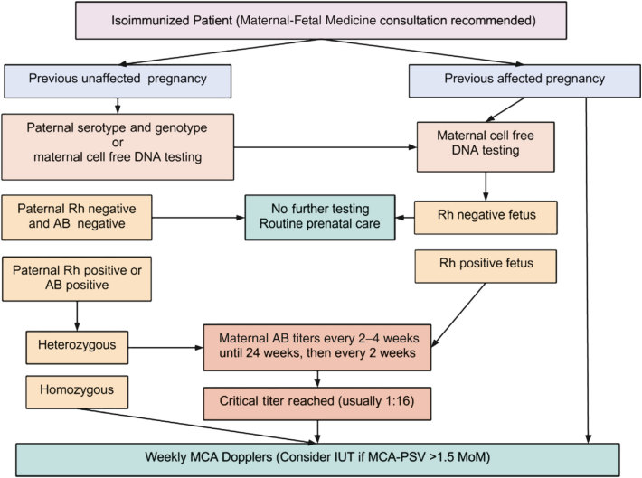

• Fig. 22.2 Management of the sensitized gestation. AB, Antibody; IUT, intrauterine transfusion; MCA, middle cerebral artery; PSV, peak systolic velocity.

## PDF page 401

concentration of 5 g/dL as a threshold to calculate degrees of anemia, because fetal hydrops is rare with a hemoglobin concentration greater than 5 g/dL.28 Strict cutoffs using receiver operating characteristic curves were determined to detect 100% of those fetuses with moderate to severe anemia. They found that the optimal threshold was 1.29 times the median for mild anemia, 1.5 times the median for moderate anemia, and 1.55 times the median for severe anemia, with a false-positive rate of 12%. These thresholds were chosen so as not to miss any fetus with moderate or severe anemia that might result in either fetal hydrops or death (Table 22.3). Measurements of the MCA-PSV can be started as early as 16 to 18 weeks and should be repeated at 1- to 2-week intervals.

Reference Values for Peak Systolic Velocity

TABLE

22.3

of Middle Cerebral Artery

Multiples of the Median

Gestational Age (wk)

1 1.3 1.5 1.7 2

15 20 26 30 34 40

16 21 27 32 36 42

17 22 29 33 37 44

18 23 30 35 39 46

19 24 31 36 41 48

20 25 33 38 43 50

21 26 34 39 44 52

22 28 36 42 48 56

23 29 38 44 49 58

24 30 39 45 51 60

25 32 42 48 54 64

26 33 43 50 56 66

27 35 46 53 60 70

28 37 48 56 63 74

29 38 49 57 65 76

30 40 52 60 68 80

31 42 55 63 71 84

32 44 57 66 75 88

33 46 60 69 78 92

34 48 62 72 82 96

35 50 65 75 85 100

36 53 69 80 90 106

37 55 72 83 94 110

38 58 75 87 99 116

39 61 79 92 104 122

40 63 82 95 107 126

### Suppressive Therapy Intravenous Immunoglobulin

Although most fetuses with severe Rh alloimmunization can be treated with in utero intravascular transfusions, some cannot because of gestational age (<18 weeks); they may be difficult to transfuse because of small vessels or other technical issues that may make the intravascular transfusion impractical or impossible. Maternal administration of intravenous immunoglobulin (IVIG) has been proposed as an alternative therapy until an intravascular transfusion is possible. The proposed mechanism of action is feedback inhibition of maternal antibody synthesis, blockade of reticuloendothelial Fc receptors, or blockade of placental antibody transport. There is some literature that suggests that, in pregnancies with severe Rh alloimmunization before 20 weeks, treatment with high-dose IVIG followed by an intrauterine transfusion after 20 weeks compared with pregnancies treated only with an intrauterine transfusion after 20 weeks had improved fetal survival rates.29 In another series of four pregnancies with severe Rh alloimmunization treated with high-dose IVIG, there appeared to be no effect on the total number of transfusions or the amount of blood transfused or progression to fetal hydrops.30 In one study of Rh-sensitized pregnancies with mild anemia treated with high-dose IVIG, benefit was observed only if treatment was started before the development of severe anemia.31 In another, a combination of plasmapheresis and IVIG had been reported to be successful in the treatment of severe maternal RBC alloimmunization.32 Despite the high cost of treatment with IVIG, there may be a role in pregnancies less than 18 to 20 weeks with severe fetal anemia caused by Rh alloimmunization, either with IVIG alone or in combination with other therapies, to prolong the pregnancy so that an intrauterine transfusion can be done at a later gestational age. Unfortunately, the cost of treatment with IVIG is a limiting factor in the treatment of Rh alloimmunization.

### Fetal Transfusion Intravascular Transfusion

The first direct intravascular fetal blood transfusion for Rh alloimmunization was done by fetoscopy and described in 1984.33 Since that time, fetoscopy is no longer used, and needle placement is done by ultrasound. When screening Rh alloimmunized pregnancies, if the MCA-PSV exceeds 1.5 multiples of the median (MoM), then sampling of the fetal blood is necessary to determine if fetal anemia is present. Fetal transfusions are typically done between 18 and 35 weeks. If fetal anemia is confirmed, then an intrauterine fetal transfusion will be necessary. The blood transfused is type O, Rh(D)-negative, cytomegalovirus-negative, irradiated packed RBCs crossmatched against maternal blood. The usual hematocrit of the blood is around 75%, which allows for minimal blood volume to be transfused.

The procedure should be performed by a trained surgeon in an operating room or in close proximity to an operating

## PDF page 402 | printed page 387

room, in case there is a complication that would require an urgent delivery.34 For this reason, an anesthetist should see the patient before the procedure and be immediately available if there is an urgent need for an abdominal delivery. The administration of corticosteroids to accelerate fetal lung maturity should also be considered in those pregnancies starting at viability. Depending on the institution, this can be between 22 5/7 weeks and up to 34 weeks of gestation. The administration of antibiotics and/or tocolytics before the procedure is not supported by any randomized trials. The tubing and syringes used in the procedure are heparinized. The maternal abdomen is prepped, and sterile towels and sheets are used to create a sterile field. A 20- to 22-gauge echogenic tip needle is used to puncture the umbilical vein, with the most desirable site being near the cord insertion site into the placenta. A free loop of cord, the intrahepatic portion of the hepatic vein, or the umbilical artery may be considered as alternatives but are less desirable sites because of fetal bradycardia and procedure-related complications that may accompany cord puncture at those sites.33,35–37 Some surgeons prefer a fetal paralytic agent (vecuronium 0.1 mg/kg), which may then be injected intramuscularly or intravascularly at the time of cordocentesis to prevent fetal movements. A system should be in place to report the fetal hematocrit as soon as possible. The blood sample can be confirmed using the mean corpuscular volume, which is greater than 110 μm3 in fetal blood. The volume of blood to be transfused depends on the estimated weight of the fetus, the fetal hematocrit, and the hematocrit of the RBCs to be transfused and the gestational age. This can be calculated using a variety of techniques, with a common calculator available online.38 Following the blood transfusion, hematocrit assessment should be obtained. A post-transfusion hematocrit should be approximately 40% unless the gestational age is less than 24 weeks. If the gestational age is less than 24 weeks, the post-transfusion hematocrit should be 25%, with a repeat procedure in 48 hours.

The overall procedure-related fetal loss rate is approximately 1%, and the emergency delivery rate within 24 hours for procedure-related complications and subsequent perinatal demise is 1.8%.39 Following the procedure, the fetus is continuously monitored for up to 4 to 6 hours, but that time may be extended if there are complications during the procedure or if uterine contractions develop following the procedure. Typically, the fetal hematocrit will fall approximately 1 percentage point per day, and a follow-up transfusion is likely to be necessary in approximately 2 weeks. Ultrasound evaluation of the MCA-PSV after the procedure may have to use a higher MoM cutoff of 1.69.40

### Intraperitoneal Transfusion

Intraperitoneal transfusions are rarely performed in modern practice except when the caliber of the umbilical vessels does not permit placement of the needle for the transfusion (generally <18 weeks) or when an intravascular transfusion is technically impossible because of fetal position or the location of the umbilical cord. The infused RBCs are absorbed

into the circulation via the subdiaphragmatic lymphatic lacunae and the right lymphatic duct, making fetal respiration important for absorption to occur. Early work in sheep suggests that the time to complete absorption is about 150 hours and that the absorption rate is directly related to the transfusion volume: the higher the volume, the faster the absorption.41 Generally, fetal intraperitoneal transfusions are less effective when fetal hydrops is present. In an assessment of intraperitoneal transfusions covering 154 fetuses treated by 270 intraperitoneal transfusions, the survival rate in the nonhydropic group increased from 35% to 83% over the 22 years of the study compared with the hydropic group, in whom the survival increased from 24% to 42% over those same 22 years.42

In the literature, the size of the needle used for the transfusion has varied from a 16- to 20-gauge Tuohy needle, with the smaller needle being more commonly used when the rarely needed intraperitoneal transfusion is undertaken. The fetal abdomen is usually entered between the umbilicus and the fetal bladder to avoid the liver. The catheter tip should be free in the abdominal cavity, which can be confirmed with injected saline. Calculation of the amount of blood to transfuse is important, because if the intraperitoneal pressure exceeds the pressure of blood in the umbilical vein, there will be no blood flow and fetal demise will result.43 This should not occur using the formula of Bowman for infused blood volume [volume = (weeks’ gestation − 20) × 10 mL]. Generally, not enough blood can be given with the first transfusion, and a second transfusion may be necessary 9 or 10 days later. Before fetal intravascular transfusions, the transfusions were repeated every 4 weeks with delivery at 34 to 35 weeks. In modern practice, intraperitoneal transfusion often can be abandoned as soon as vascular access can be achieved.

### Timing of Delivery

The overall timing of the delivery is somewhat controversial but is generally calculated based on the severity of alloimmunization and degree of HF. If antenatal testing suggests that the fetal hemolysis is determined to be mild, then a reasonable approach would be to induce labor between 37 and 38 weeks or sooner if the fetal lung studies document lung maturity at an earlier gestational age. If the studies suggest severe alloimmunization, with fetal/neonatal survival greater than 95% in most tertiary neonatal intensive care units, the last transfusion should be given at around 30 to 32 weeks, with delivery between 32 and 34 weeks and corticosteroids given to accelerate fetal lung maturity and to decrease the morbidity linked with preterm deliveries. Other experts have advocated that intrauterine transfusions continue up through the 35th week when there is a reasonable chance of fetal lung maturity with delivery at 37 weeks. The fetus should have continuous electronic fetal monitoring during labor, and a cord blood sample should be sent immediately to the laboratory following delivery for neonatal blood group, Rh typing, direct Coombs, bilirubin, hemoglobin, and hematocrit. Delivery should occur at

## PDF page 403

a tertiary care facility that has adequate neonatal intensive care, blood banking, and laboratory services.

### Outcome Short Term

With improvements in ultrasound technology, improved echogenic tip needles, and level of care offered in tertiary neonatal intensive care units, perinatal survival following an intrauterine fetal transfusion has increased dramatically. These improvements were well demonstrated in two large retrospective studies from The Netherlands and Scotland.44,45 A retrospective review of survival in fetuses treated for anemia caused by Rh alloimmunization with intrauterine transfusions between 1988 and 1999 in The Netherlands was performed in 208 pregnant women treated with 593 blood transfusions.45 The overall survival rate was 86%. Survival of the hydropic fetuses (78%) was significantly less than the survival of those pregnancies without hydrops (92%). Low survival rates were also observed if the first transfusion took place at less than 20 weeks and the fetus was hydropic (55%). Survival was much greater in Rh alloimmunized pregnancies (89%) compared with Kell alloimmunized pregnancies (58%). Overall fetal loss rate linked to the procedure was 4.8%.

In a retrospective review of the short-term outcomes of 116 pregnancies that underwent 457 transfusions in Scotland from 1993 to 2004, the rate of intrauterine death as a complication of the procedure was 2.3% for 1993 to 1998 and 0.8% for 1999 to 2004.44 Eight infants (6.9%) were delivered by emergency cesarean as a result of a complication during the intrauterine transfusion. The survival rate of neonates from birth to discharge was 97.4%. The majority of the neonates were delivered by cesarean or vaginally at 35 weeks. Roughly 33% of neonates required some type of respiratory support following delivery. Sixteen of the neonates had an exchange transfusion following delivery, with the number of exchanges ranging from one to four. At least one top-up transfusion was required in 54% of the neonates, with one infant requiring nine transfusions.

A more recent retrospective cohort study of the outcomes of 6650 cordocentesis in Thailand from 1992 to 2018 reported that the rate of fetal loss following cordocentesis was 1.8% (123/6650),34 although the rate of fetal loss secondary to the procedure is likely around 0.8%, as the rate of fetal loss among the control group was 1%. The study also identified specific procedural risk factors associated with fetal loss after cordocentesis. Prolonged bleeding from the puncture site, presence of fetal bradycardia, and penetration of the placenta were all identified as significant procedural risk factors for fetal loss. The professional level of the operator, difficulty of the procedure, gestational age, and puncture site (free loop vs. cord insert) were not significantly associated with increased rate of fetal loss.

The short-term neonatal outcomes of intrauterine transfusion are generally very good. In the The Netherlands study, pregnancies complicated by hydrops, pregnancies in which the first transfusion was undertaken at less than 20

weeks, and alloimmunization secondary to Kell had poorer outcomes. In the cohort from Scotland, there was minimal procedural loss, a low rate of emergency cesarean deliveries because of procedural complications, and no more than the expected rate of respiratory support needed secondary to gestational age of delivery at 35 weeks. All neonates were treated with phototherapy, and 16 needed exchange transfusions, primarily those who underwent an emergency delivery because of procedural problems with the intrauterine transfusions.

### Long Term

More information is now becoming available on the longterm outcome of fetuses who receive intrauterine transfusions. Previously, this information had been very limited because of the small size of the studies, length of follow-up, lack of controls, and unclear criteria used to evaluate development of the child. The publication of the LOTUS study provided much-needed additional information on longterm effects of fetuses undergoing this procedure.46 The LOTUS study evaluated the neurodevelopment of children with hemolytic disease treated with an intrauterine transfusion. Two hundred and ninety-one children were evaluated at a median age of 8.2 years. Cerebral palsy was detected in 2.1%, severe developmental delay in 3.1%, and bilateral deafness in 1%. The overall incidence of neurodevelopmental impairment was 4.8% (14/291). The only risk factor that could be linked with neurodevelopmental delay was severe fetal HF. The very high rate of intact survival in these atrisk pregnancies complicated by severe anemia is reassuring and confirms the relative safety of the treatment with intrauterine transfusions even in the fetus with severe hemolytic disease, including HF.

### Atypical Antigens

As the incidence of Rh disease has decreased with the administration of anti-D immune globulin, the incidence of alloimmunization caused by other RBC antigens has increased. This rise is because there are no screening programs for women who are negative for these other atypical antigens that have the potential for causing hemolytic disease. The greatest risk factor for isoimmunization of the other RBC antigens is a prior blood transfusion, but it can also occur after a maternal-fetal hemorrhage during pregnancy. Fortunately, most of the antibodies produced against these antigens are of the IgM type, do not cross the placenta, and therefore do not result in HDN. Because of the rarity of many of these atypical antigens, there is a paucity of evidence supporting specific management algorithms. Critical titers at which time additional surveillance should be undertaken are also not well established. Box 22.2 outlines a partial list of antibodies associated with HDN.

The most troublesome of the atypical antigens is the Kell antigen, which is highly immunogenic. After the reactions that occur with ABO and Rh blood groups, the Kell antigen is the most immunogenic. There are 25 Kell antigens

## PDF page 404 | printed page 389

• BOX 22.2 Partial List of Antibodies Associated

With Hemolytic Disease of the Fetus and the Newborn

Requiring Fetal Evaluation

• Rhesus: E, C, c, D (C, E, e are usually associated with mild

disease but may be additive to D) • Kell: K (especially K1 and K2) can cause moderate to

severe disease • Duffy: Fya • Kidd: Jka • MNSs: M, S, s, U, Mia • MSS: Mta • Diego: Dia, Dib, ELO, Wra, Wrb mild to severe (infrequently)

disease • P: PP1pk mild to severe disease • Public antigens: Yta moderate to severe • Ena moderate • Coa severe • Private antigens: Biles moderate • Good severe • Heibel moderate • Radin moderate • Wrighta severe • Zd moderate

Others (Infrequently Associated With Severe Disease)

• Coa, Co3, Ena, Far, MUT, Mur, Mv, sD, Lua, Lub, Vw, Mur,

Hil, Hut, JFV, JONES, Kg, MAM, REIT, Rd, Ce, Cw, Cx, ce, Dw, Ew, Evans, G, Goa7, Hr, Hro, JAL, HOFM, LOCR, Riv, Rh29, Rh32, Rh42, Rh46, Jsa, Jsb, Kpa, Kpb, K11, K22, Ku, Ula, STEM, Tar, HJK

encoded by a single gene on chromosome 7, with the “K” antigen being the most clinically significant. The pathophysiology of the HDN is different from that seen with ABO and Rh sensitization. The Kell IgG antibodies cause destruction of erythroid precursors by macrophages in the fetal liver and can result in severe fetal anemia.47

Fortunately, 91% of the population is Kell negative and only 5% of the population will form Kell antibodies after a transfusion, making the disorder relatively rare. Assessment of the father’s genotype, if paternity is certain, is initially undertaken because if he is Kell negative, then the pregnancy is not affected and no further workup is needed. In Kell alloimmunization, early suppression of fetal RBC synthesis results in less bilirubin being released during hemolysis. Because of this, serial amniocentesis for ΔOD450 titers is not reliable or could even be misleading and should not be used. Results have suggested that MCA-PSV with a cutoff greater than 1.5 is highly predictive of severe fetal anemia, as it is in the prediction of fetal anemia in Rh-D-negative mothers, and it should be routinely used in management.48 Other antibodies that have been infrequently linked with severe disease include Colton, Diego, Duffy, and MNS. Those associated with mild disease include Dombrock, Duffy, Kidd, and Gerbich. Surveillance is done with MCA- PSV using the threshold of greater than 1.5 for the diagnosis of fetal anemia.

### Nonimmune Hydrops Fetalis

Although the incidence of HF has remained stable in the range of 1/1500 to 1/3800 births since the development of Rh immunoglobulin, up to 90% of cases of HF are now the result of nonimmune etiologies. Nonimmune hydrops fetalis (NIHF) defines hydrops in those fetuses whose mothers are Rh positive or that results from a nonimmune cause.49–

51 Although improvements in ultrasound technology have allowed earlier diagnosis and improved understanding of underlying conditions, unfortunately the prognosis for NIHF neonates remains poor, with perinatal mortality rates ranging from 50% to 90%.49 Maternal complications associated with NIHF include preeclampsia, mirror syndrome, and increased cesarean rates when NIHF is diagnosed in the antepartum period.42,52

### Diagnosis

After ruling out fetal hydrops due to RBC alloimmunization, NIHF is defined by the same ultrasonographic presence of excessive fetal fluid in two or more of the following spaces: abdominal ascites, pleural effusion, pericardial effusion, skin edema, polyhydramnios, or placentomegaly (see Table 22.1). Unlike alloimmunization, there is not a specific screening test for the multiple etiologies of NIHF, and often this diagnosis is made incidentally after a mother undergoes an ultrasound for another indication (e.g., polyhydramnios, standard fetal evaluations).

### Pathophysiology

Hydrops occurs when interstitial fluid production and lymphatic return become imbalanced, leading to fluid accumulation in interstitial spaces within the fetus. This can result from a myriad of conditions, including those that cause reduced lymphatic flow (e.g., pulmonary masses, lymphatic malformations), lower plasma oncotic pressure (e.g., gastrointestinal anomalies, inborn errors of metabolism, liver failure), or increased central venous pressure (e.g., chromosomal abnormalities, heart failure caused by volume overload or anemia, compensatory hypoxia) (Fig. 22.3). NIHF rarely resolves spontaneously and, in general, carries a worse prognosis the earlier in pregnancy it is diagnosed.53

### Differential Diagnosis/Etiology

Just as the pathophysiology of NIHF can result from several different pathways, the conditions or anomalies that lead to these pathophysiologic changes are vast. Fig. 22.4 summarizes 14 separate etiologies most commonly associated with NIHF and the respective percentage for which a cause is identified.53 Within each of these categories, specific diagnoses or anomalies are further summarized in Table 22.4. In sum, more than 100 conditions, although many are very rare, have been associated with the ultimate finding and diagnosis of NIHF.

## PDF page 405

• Fig. 22.3 Pathophysiologic pathways for the development of nonimmune hydrops fetalis. GI, Gastrointestinal; TTTS, twin-twin transfusion syndrome.

25

21.7

20

17.8

15

13.4

10.4

10

6.7 6 5.7

5

0

Chromosomal

Idiopathic

Hematologic

Thoracic

Infection

Lymphatic

TTTS—placental

Cardiovascular

• Fig. 22.4 Etiology of nonimmune hydrops fetalis (%). TTTS, Twin-twin transfusion syndrome.

### Antepartum Evaluation

The clinical presentation of fetuses can vary depending on the underlying condition and the gestational age at which it is identified. A common finding in NIHF diagnosed before 20 weeks is a cystic hygroma, often associated with chromosomal anomalies. Common chromosomal abnormalities include Turner syndrome (45 XO) as well as trisomies 21, 18, and 13.54 In intrathoracic masses, restrictive fetal swallowing often causes polyhydramnios, resulting in uterine size measuring larger than gestational age and prompting ultrasound evaluation.55 Once identified, antepartum evaluation focusing on identification of the

5.6 4.4 3.7 2.3 1.1 0.7 0.5

Urinary tract malformation

Syndromic

Miscellaneous

Gastrointestinal

Inborn storage disease

Extra thoracic tumor

underlying cause includes a detailed history (personal and family), often with the assistance of a genetics counselor, targeted ultrasound, fetal echocardiography, MCA-PSV analysis, laboratory testing including evaluation of recent viral exposures, and sometimes diagnostic invasive testing. Table 22.5 summarizes the components of a full antenatal evaluation of NIHF.

More recent studies of prenatal genetic testing show promise in aiding in evaluation of NIHF. In a case series from 2018 to 2020, 127 fetuses with unexplained NIHF underwent exome sequencing.56 Of these 127 cases, 37 (29%) had an identifiable genetic disorder as a result of exome sequencing. RASopathy (syndromes implicated in the Ras/MAPK cell signaling

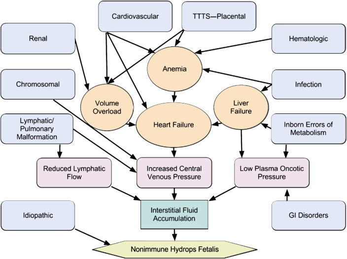

• Fig. 22.3 Pathophysiologic pathways for the development of nonimmune hydrops fetalis. GI, Gastrointestinal; TTTS, twin-twin transfusion syndrome.

Unmatched source image; PDF page 405. Consult the original caption.

### Automatic table extraction — verify rendered original

|Col1|21.7 17.8 13.4 10.4 6.7 6 5.7 5.6 4.4 3.7 2.3 1.1 0.7 0.5|Col3|Col4|Col5|Col6|Col7|Col8|Col9|Col10|Col11|Col12|Col13|Col14|Col15|
|---|---|---|---|---|---|---|---|---|---|---|---|---|---|---|
||||||||||||||||
||||||||||||||||
||||||||||||||||
||||||||||||||||
||||||||||||||||

[Original table](../../tables/ch022_p0405_1.jpg)

## PDF page 406 | printed page 391

TABLE

### Principal Diagnoses Associated With Nonimmune Hydrops Fetalis

22.4

Cardiovascular (21%) Structural

Chromosomal (13.4%) Trisomy

• Hypoplasias (left or right heart) • AV canal defect • Single ventricle • Transposition of great arteries • Septal defects (VSD/ASD) • Tetralogy of Fallot • Ebstein anomaly • Ductus arteriosus closure • Truncus arteriosus • Valvular (stenosis/insufficiency) Arrythmias

• 21 • 18 • 13 Monosomy

• 45, X • 45, X (mosaic) Duplications

• 18 q+ • 11p Deletions

• 13 q– • 17 q– Triploidy

• Atrial (flutter/tachyarrhythmia) • Wolff-Parkinson-White • Supraventricular tachycardia • Long QT interval • Heart block Cardiomyopathy

Thoracic/Extrathoracic Mass/Lymphatic (12.4%) Mass Effect

• Tumors • Neoplasias • Myopathies • Cardiosplenic syndromes

• Diaphragmatic hernia • Congenital pulmonary

adenomatoid malformation • Intrathoracic mass • Pulmonary sequestration • Chylothorax • Airway obstruction • Pulmonary lymphangiectasia • Bronchogenic cyst Skeletal Dysplasias • Thanatophoric dysplasia • Short rib polydactyly • Hypophosphatasia • Osteogenesis imperfecta • Achondrogenesis • Camptomelic dysplasia • Lethal chondroplasia

Infection (6.7%)

• Cytomegalovirus • Parvovirus B19 • Syphilis • Herpes simplex • Rubella • Coxsackievirus • Leptospirosis • Trypanosoma cruzi

Storage Disease (1.1%)

• Gaucher disease • GM1 gangliosidosis • Sialidosis • MPS IVA • Mucolipidosis type I + II • Galactosialidosis

TTTS-Placental (5.6%) Twin

• TTTS • Acardiac twin Placental

Idiopathic (17.8%)

• Umbilical vein thrombosis • Umbilical cord angiomyxoma • True cord knot • Chorionic vein thrombosis • Rare placenta disorders

ASD, Atrial septal defect; AV, arteriovenous; MPS, mucopolysaccharide; TTTS, twin-twin transfusion syndrome; VSD, ventricular septal defect.

pathway such as Noonan syndrome) was the most common disorder identified (30%), followed by inborn errors of metabolism and musculoskeletal (11%), lymphatic (8%), neurodevelopmental (8%), cardiovascular (8%), and hematologic (8%) disorders. Although exome sequencing shows promise in the prenatal evaluation of NIHF, current studies suggest low utility in the use of chromosomal microarray.57

Hematologic (10.4%)

• Alpha-thalassemia • Fetomaternal hemorrhage • Glucose-6-phosphate deficiency • Leukemia • Pyruvate kinase deficiency • Red blood cell aplasias

Gastrointestinal (0.5%)

• Duodenal atresia • Duodenal diverticulum • Jejunoileal atresia • Volvulus • Imperforate anus • Meconium peritonitis • Intestinal malrotation • Intestinal duplication • Hepatic fibrosis • Cholestasis • Biliary atresia • Hepatic vascular malformations • Hepatitis • Hepatic necrosis • Liver tumor or cysts

Syndromic/Miscellaneous (8.1%)

• Noonan syndrome • Arthrogryposis • Multiple pterygium syndrome • Neu-Laxova syndrome • Pena-Shokeir syndrome • Myotonic dystrophy • Saldino-Noonan syndrome • Francois syndrome, type III • Familial nuchal bleb • Elejalde syndrome • Thoracoabdominal syndrome • Lymphedema-distichiasis syndrome

Urinary Tract Malformation (2.3%)

• Urethral stenosis • Urethral atresia • Posterior urethral valve • Finnish type nephrosis • Edwards (prune belly) syndrome

### Management

Depending on gestational age at the time of diagnosis and whether a cause for NIHF can be identified, various management options may include termination of pregnancy, invasive therapeutic intervention, or conservative management, including supportive care and monitoring of the mother and fetus. Fetal surveillance may include frequent non-stress

## PDF page 407

TABLE

Antenatal Evaluation of Nonimmune Hydrops Fetalis

22.5

Maternal History (Consider Genetics Counselor)

• Age, parity, gestational age • Hereditary or metabolic diseases, anemia • Recent infections or contacts • Medication use

Maternal Laboratory Evaluation

• Complete blood cell count • Blood type, Rh, indirect Coombs antibody screen • Viral titers: parvovirus B19, toxoplasmosis, congenital

syphilis, rubella, cytomegalovirus, herpes simplex • Aneuploidy screening—integrated, sequential, quad, or

triple screen, cell-free fetal DNA in maternal serum • Metabolic studies, autoimmune screening, electrophoresis

(if indicated)

Fetal Echocardiography

• Cardiac malformations • Arrhythmias

PCR, Polymerase chain reaction.

testing or biophysical profiles on a weekly or twice-weekly basis. Because early delivery and neonatal compromise often occur, early consultation with relevant subspecialists (e.g., neonatologists, pediatric surgeons, pediatric cardiologists) is often warranted. If delivery is thought to be imminent, inpatient surveillance with the administration of antenatal corticosteroids may be indicated.

Maternal risks of conservative management include a condition known as mirror syndrome (Ballantyne syndrome).58 If this occurs, the mother begins to demonstrate similar findings of the fetus, including generalized maternal edema, often with pulmonary involvement, thus “mirroring” the edema of the hydropic fetus and placenta. Although the pathogenesis of this condition is unknown, it is thought that the hydropic placenta causes a systemic inflammatory response as a result of increased shedding of trophoblastic debris into maternal blood.59

In some cases, invasive fetal therapeutic interventions may be considered. Conditions such as diaphragmatic hernia, congenital pulmonary adenomatoid malformations, or extralobar pulmonary sequestration may benefit from in utero surgery. Although paracentesis or thoracentesis may be informative for diagnostic purposes, the fluid removed from the fetal body cavity often reaccumulates in a short period of time. In these cases, shunt placement is sometimes considered, with some notable improvement in survival.

Delivery may be indicated if there is evidence of maternal mirror syndrome. Other indications for delivery include gestational age greater than 34 weeks, mature fetal lung profile, or persistent biophysical profiles of less than 6. Cesarean delivery should be reserved for routine obstetrical indications (Table 22.6). Traumatic delivery because of severe soft

Ultrasonography

• Anatomic abnormalities (cystic hygromas, thoracic masses) • Evaluate extent of edema and/or effusions (cardiac

displacement, lung hypoplasia) • Middle cerebral artery Doppler to rule out anemia

Amniocentesis

• Karyotype • Viral culture or PCR • Lung maturity

Invasive Fetal Testing Fetal Blood Sampling

• Karyotype • Complete blood cell count, type • Hemoglobin electrophoresis • Viral culture or PCR • Metabolic testing Fetal Effusion Sampling

• Viral culture or PCR • Protein count • Cell count and cytology (lymphocytes)

Management of Nonimmune Hydrops

TABLE

22.6

Fetalis

Conservative Management Invasive Management

• Fetal surveillance—

• Shunt placement • Surgical repair when

NST, BPP weekly or twice weekly • Serial growth

indicated Indications for delivery: • Gestational age > 34

ultrasound Hospitalize if: • Fetal skin thickening • Pericardial effusion • Nonreactive NST • BPP <6 • Subjective decreased

wk • Mature fetal lung

profile • Persistent BPP <6 • Maternal compromise

(mirror syndrome)

fetal movement • Anticipated imminent

delivery • Administer antenatal

corticosteroids

BPP, Biophysical profile; NST, non-stress test.

tissue edema often occurs; however, this risk is not negated by cesarean delivery. Given the increased frequency of nonreassuring fetal testing and labor dystocia, however, the likelihood of cesarean delivery in NIHF is increased.

### Prognosis

Overall survival of a fetus diagnosed with NIHF remains poor. This is largely related to the underlying etiology of the condition. If a structural defect is identified or if no

## PDF page 408 | printed page 393

underlying cause is identified, then the perinatal mortality rate approaches 100%. In general, perinatal mortality rates are worse when NIHF is identified early in pregnancy (<24 weeks) and, conversely, when identified, delivery and neonatal treatments may be beneficial and improve mortality. Certainly the risks associated with prematurity compound the already tenuous status of a fetus with NIHF. Given the rareness of this entity, the risk of recurrence is also rare, especially when the cause is something other than a hereditary factor.

### Summary

HF, whether from immune or nonimmune causes, represents a large spectrum of rare disorders and conditions resulting in the common pathophysiologic outcome of heart failure and interstitial fluid accumulation in the

Key Points

### • Hydrops fetalis is defined as excessive fetal fluid in two or

more spaces. It can result from immune and nonimmune etiologies.

### • Immune hydrops fetalis (IHF) is due to blood group

antigens that can form antibodies and lead to significant hemolytic disease of the newborn.

### • IHF has significantly decreased after the routine imple-

mentation of Rh immunoglobulin prophylaxis with the anti-D immune globulin RhoGAM.

### • Fetal anemia can be predicted with Doppler flow stud-

ies by the peak systolic velocity of the middle cerebral

### References

1. Diamond LK, Blackfan KD, Baty JM. Erythroblastosis fetalis and

its association with universal edema of the fetus, icterus gravis neonatorum and anemia of the newborn. J Pediatr. 1932;1:269–274. 2. Levine P, Katzin EM, Burnham L. Isoimmunization in preg-

nancy: its possible bearing on the etiology of erythroblastosis fetalis. JAMA. 1941;116:825–830. 3. Chown B. Anemia from bleeding of the fetus into the mother’s

circulation. Lancet. 1954;I:1213–1215. 4. Freda VJ, Gorman JG, Pollack W. Successful prevention of

experimental Rh sensitization in man with an anti-Rh gamma2‐ globulin antibody preparation: preliminary report. Transfusion. 1964;4:26–31. 5. Freda VJ, Gorman JG, Pollack W. Prevention of Rh isoimmuni-

zation in obstetrics with Rh immunoglobulin: progress report. J Int Fed Gynecol Obstet. 1966;4:169–174. 6. Daniels G. The molecular genetics of blood group polymor-

phism. Transpl Immunol. 2005;14:143–153. 7. Human Genome Project. Accessed July 10, 2023. energy.gov 8. Race RR. The Rh genotype and Fisher’s theory. Blood. 1948;3:27. 9. Wagner FF, Eicher NI, Jorgensen JR, et al. DNB: a partial D

with anti-D frequent in Central Europe. Blood. 2002;100:2253– 2256. 10. Fung MK, Grossman BJ, Hillyer CD, Westhoff CM, eds. Techni-

cal Manual. 18th ed. Bethesda, MD: American Association of Blood Banks; 2014.

fetus. Given the seriousness of many of the underlying conditions, perinatal morbidity and mortality remain exceedingly high. Although the prognosis of IHF remains positive in those fetuses who receive intrauterine blood transfusions, treatment in NIHF is often conservative, with increased surveillance of fetal well-being but minimal improvement in short- or long-term neonatal outcomes. Invasive fetal treatment, however, is associated with improved survival in select conditions causing NIHF. All pregnancies should undergo screening for Rh alloimmunization with maternal blood typing and antibody screening. Despite improvements in technology and testing, a certain diagnosis of NIHF occurs only in approximately 67% of cases. Minimizing maternal complications such as mirror syndrome and determining the most appropriate timing for delivery remain challenging in this high-risk pregnancy population.

artery and can guide the need for fetal intravascular transfusion.

### • A nonimmune hydrops fetalis differential diagnosis

should include chromosomal anomalies, recent viral infections, and evaluation of fetal structural anomalies with ultrasound.

### • Overall prognosis is dependent on the underlying eti-

ology. Consultation with maternal-fetal medicine and neonatology with delivery in a facility capable for intervention are recommended.

11. Zipursky A, Paul VK. The global burden of Rh disease. Arch Dis

Child Fetal Neonatal Ed. 2011;96:F84–F85. 12. Flegel WA, Wagner FF. Blutgruppen: alloantigene auf erythro-

zyten. In: Muller-Eckhardt C, Kiefel V, eds. Transfusionsmedizin. Berlin: Springer; 2003:145–185. 13. Dean L. Blood Groups and Red Cell Antigens [Internet]. Bethesda,

MD: National Center for Biotechnology Information; 2005. 14. Bombard AT, Alkoleker R, Farkas D, et al. Fetal Rh genotype

detection from circulating cell-free fetal DNA in maternal plasma in non-sensitized Rh-D negative women. Prenat Diagn. 2011;13:802–808. 15. Geifman-Holtzman O, Grotegut CA, Gaughan JP. Diagnostic accu-

racy of noninvasive fetal Rh genotyping from maternal blood—a meta-analysis. Am J Obstet Gynecol. 2006;195(4):1163–1173. 16. Bowman JM, Pollock JM, Penston LE. Fetomaternal transpla-

cental hemorrhage during pregnancy and after delivery. Vox Sang. 1986;51:117–121. 17. Nicolaides KH. Studies on fetal physiology and pathophysiology

in rhesus disease. Semin Perinatol. 1989;13:328–337. 18. Whitecar PW, Moise K. Sonographic methods to detect fetal

anemia in red blood cell alloimmunization. Obstet Gynecol Surv. 2000;55:240–250. 19. Chitkara U, Bussel J, Alvarez M, et al. High-dose intravenous

gamma globulin: does it have a role in the treatment of severe erythroblastosis fetalis? Obstet Gynecol. 1990;76(4):703–708. 20. Schumacher B, Moise KJ. Fetal transfusion for fetal red blood cell

alloimmunization in pregnancy. Obstet Gynecol. 1996;88:137–150.

## PDF page 409

21. Fung Kee Fung K, Eason E, Crane J, et al. Prevention of Rh allo-

immunization. Maternal–Fetal Medicine Committee, Genetics Committee. J Obstet Gynaecol Can. 2003;25:765–773. 22. Qureshi H, Massey E, Kirwan D, et al. BCSH guideline for the

use of anti-D immunoglobulin for the prevention of haemolytic disease of the fetus and newborn. Transfus Med. 2014;24:8–20. 23. Royal Australian and New Zealand College of Obstetricians and

Gynaecologists. Guidelines for the Use of rh(D) Immunoglobulin (Anti- D) in Obstetrics in Australia. East Melbourne: RANZCOG; 2015. 24. Avner R, Reubinoff BE, Simon A, et al. Management of rhesus

isoimmunisation by preimplantation genetic diagnosis. Mol Hum Reprod. 1996;2:60–62. 25. Seeho SK, Burton G, Leigh D, et al. The role of preimplanta-

tion genetic diagnosis in the management of severe rhesus alloimmunization: first unaffected pregnancy: case report. Hum Reprod. 2005;20(3):697–701. 26. Moise KJ. Diagnosing hemolytic disease of the fetus—time to

put away the needles? N Engl J Med. 2006;355:192–194. 27. Mari G, Deter RL, Carpenter RL, et al. Noninvasive diagnosis

by Doppler ultrasonography of fetal anemia due to maternal redcell alloimmunization. Collaborative group for Doppler assessment of the blood velocity in anemic fetuses. N Engl J Med. 2000;342(1):9–14. 28. Nicolaides KH, Soothill PW, Clewell WH, et al. Fetal haemoglo-

bin measurement in the assessment of red cell isoimmunisation. Lancet. 1988;1(8594):1073–1075. 29. Voto LS, Mathet ER, Zapaterio JL, et al. High-dose gammaglob-

ulin (IVIG) followed by intrauterine transfusions (IUTs): a new alternative for the treatment of severe fetal hemolytic disease. J Perinat Med. 1997;25(1):85–88. 30. Chitkara U, Wilkins I, Lynch L, et al. The role of sonography in

assessing severity of fetal anemia in Rh- and Kell-isoimmunized pregnancies. Obstet Gynecol. 1990;75(6):965–969. 31. Gottvall T, Selbing A. Alloimmunization during pregnancy treated

with high dose intravenous immunoglobulin: effects on fetal hemoglobin concentration and anti-D concentrations in the mother and fetus. Acta Obstet Gynecol Scand. 1995;74(10):777–783. 32. Ruma MS, Moise Jr KJ, Kim E, et al. Combined plasmapher-

esis and intravenous immune globulin for the treatment of severe maternal red cell alloimmunization. Am J Obstet Gynecol. 2007;196(2):138.e1–6. 33. Rodeck CH, Kemp JR, Holman CA, et al. Direct intravascular

fetal blood transfusion by fetoscopy in severe rhesus isoimmunisation. Lancet. 1981;1(8221):625–627. 34. Tanvisut R, Wanapirak C, Piyamongkol W, et al. Cordocentesis-

associated fetal loss and risk factors: single-center experience with 6650 cases. Ultrasound Obstet Gynecol. 2020;56(5):664–671. 35. Tiblad E, Kublickas M, Ajne G, et al. Procedure-related com-

plications and perinatal outcome after intrauterine transfusions in red cell alloimmunization in Stockholm. Fetal Diagn Ther. 2011;30(4):266–273. 36. Van Kamp IL, Klumper FJ, Oepkes D, et al. Complications

of intrauterine intravascular transfusion for fetal anemia due to maternal red-cell alloimmunization. Am J Obstet Gynecol. 2005;192(1):171–177. 37. Weiner CP, Wenstrom KD, Sipes SL, et al. Risk factors for cor-

docentesis and fetal intravascular transfusion. Am J Obstet Gynecol. 1991;165(4 Pt 1):1020–1025. 38. Fetal Intravascular Fetal Transfusion Calculator. Accessed July 10,

2023. http://www.perinatology.com/protocols/rhc.htm 39. Johnstone-Ayliffe C, Prior T, Ong C, et al. Early proce-

dure-related complications of fetal blood sampling and

intrauterine transfusion for fetal anemia. Acta Obstet Gynecol Scand. 2012;91(4):458–462. 40. Detti L, Oz U, Guney I, et al. Collaborative group for Doppler

assessment of the blood velocity in anemic fetuses. Doppler ultrasound velocimetry for timing the second intrauterine transfusion in fetuses with anemia from red cell alloimmunization. Am J Obstet Gynecol. 2001;185:1048–1051. 41. Harman CR, Biehl DR, Pollock JM, et al. Intrauterine transfu-

sion: kinetics of absorption of donor cells in fetal lambs. Am J Obstet Gynecol. 1983;145(7):830–836. 42. Bennebroek Gravenhorst J, Kanhai HH, et al. Twenty-two years

of intra-uterine intraperitoneal transfusions. Eur J Obstet Gynecol Reprod Biol. 1989;33(1):71–77. 43. Crosby WM, Brobmann GF, Chang AC. Intrauterine transfu-

sion and fetal death. Relationship of intraperitoneal pressure to umbilical vein blood flow. Am J Obstet Gynecol. 1970;108(1):135– 138. 44. McGlone L, Simpson JH, Scott-Lang C, et al. Short-term out-

comes following intrauterine transfusion in Scotland. Arch Dis Child Fetal Neonatal Ed. 2011;96(1):F69–F70. 45. Van Kamp IL, Klumper FJ, Meerman RH, et al. Treatment of

fetal anemia due to red-cell alloimmunization with intrauterine transfusions in The Netherlands, 1988-1999. Acta Obstet Gynecol Scand. 2004;83(8):731–737. 46. Lindenburg IT, Smits-Wintjens VE, van Klink JM, et al. LOTUS

study group. Long-term neurodevelopmental outcome after intrauterine transfusion for hemolytic disease of the fetus/newborn: the LOTUS study. Am J Obstet Gynecol. 2012;206(2):141. e1–e8. 47. Dean L. Blood Groups and Red Cell Antigens. The Kell Blood

Group. Bethesda, MD: National Center for Biotechnology Information; 2005. [Chapter 8]. Accessed July 10, 2023. http://www. ncbi.nlm.nih.gov/books/NBK2270/ 48. Van Dongen H, Klumper F, Sikkel E, et al. Non-invasive test to

predict fetal anemia in Kell-alloimmunized pregnancies. Ultrasound Obstet Gynecol. 2005;25:341–345. 49. McCoy MC, et al. Non-immune hydrops after 20 weeks’ gesta-

tion: review of 10 years’ experience with suggestions for management. Obstet Gynecol. 1995;85:578. 50. Potter EL. Universal edema of the fetus unassociated with eryth-

roblastosis. Am J Obstet Gynecol. 1943;46:130. 51. Sohan K, et al. Analysis of outcome in hydrops fetalis in relation

to gestational age at diagnosis, cause and treatment. Acta Obstet Gynecol Scand. 2001;80:726. 52. Graves GR, Baskett TF. Nonimmune hydrops fetalis: antenatal

diagnosis and management. Am J Obstet Gynecol. 1984;148:563. 53. Bellini C, Hennekam RCM. Non-immune hydrops feta-

lis: a short review of etiology and pathology. Am J Med Genet. 2012;158A:597–605. 54. Romero R, et al. Nonimmune hydrops fetalis. In: Romero R,

et al., ed. Prenatal Diagnosis of Congenital Anomalies. Norwalk, CT: Appleton & Lange; 1988. 55. Watson J, Campbell S. Antenatal evaluation and management in

nonimmune hydrops fetalis. Obstet Gynecol. 1986;67:589. 56. Sparks TN, Lianoglou BR, Adami RR, et al. Exome sequencing

for prenatal diagnosis in nonimmune hydrops fetalis. N Engl J Med. 2020;383(18):1746–1756. 57. Mardy AH, Rangwala N, Hernandez-Cruz Y, et al. Utility of

chromosomal microarray for diagnosis in cases of nonimmune hydrops fetalis. Prenat Diagn. 2020;40(4):492–496. 58. Paternoster DM, Manganelli F, Minucci D, et al. Ballantyne syn-

drome: a case report. Fetal Diagn Ther. 2006;21(1):92–95.

## PDF page 410 | printed page 395

59. Graham N, Garrod A, Bullen P, et al. Placental expression of

anti-angiogenic proteins in mirror syndrome: a case report. Placenta. 2012;33(6):528–531. 60. Bianchi DW, et al. Nonimmune hydrops. In: Bianchi DW,

Crombleholme T, D’Alton ME, et al., eds. Fetology: Diagnosis and Management of the Fetal Patient. 2nd ed. New York: McGraw- Hill; 2010:893–899. 61. Castillo RA, Devoe LD, Hadi HA, et al. Nonimmune hydrops feta-

lis: clinical experience and factors related to a poor outcome. Am J Obstet Gynecol. 1986;155(4):812–816.

62. Dizon-Townson DS, Dildy GA, Clark SL. A prospective evalu-

ation of fetal pericardial fluid in 506 second-trimester low-risk pregnancies. Obstet Gynecol. 1997;90(6):958–961. 63. Saltzman DH, Frigoletto FD, Harlow BL, et al. Sonographic

evaluation of hydrops fetalis. Obstet Gynecol. 1989;74(1):106– 111. 64. Magann EF, Sanderson M, Martin JN, et al. The amniotic fluid

index, single deepest pocket, and two-diameter pocket in normal human pregnancy. Am J Obstet Gynecol. 2000;182(6):1581– 1588.

<!-- SOURCE_LAYOUT_VIEWS -->

## Original layout views and recovered diagrams

Automatic extraction can flatten tables and superscripts. Check the original layout for numeric data, footnotes and image credits. [Source review notes](../../SOURCE_REVIEW_NOTES.md).

### Original source page 396

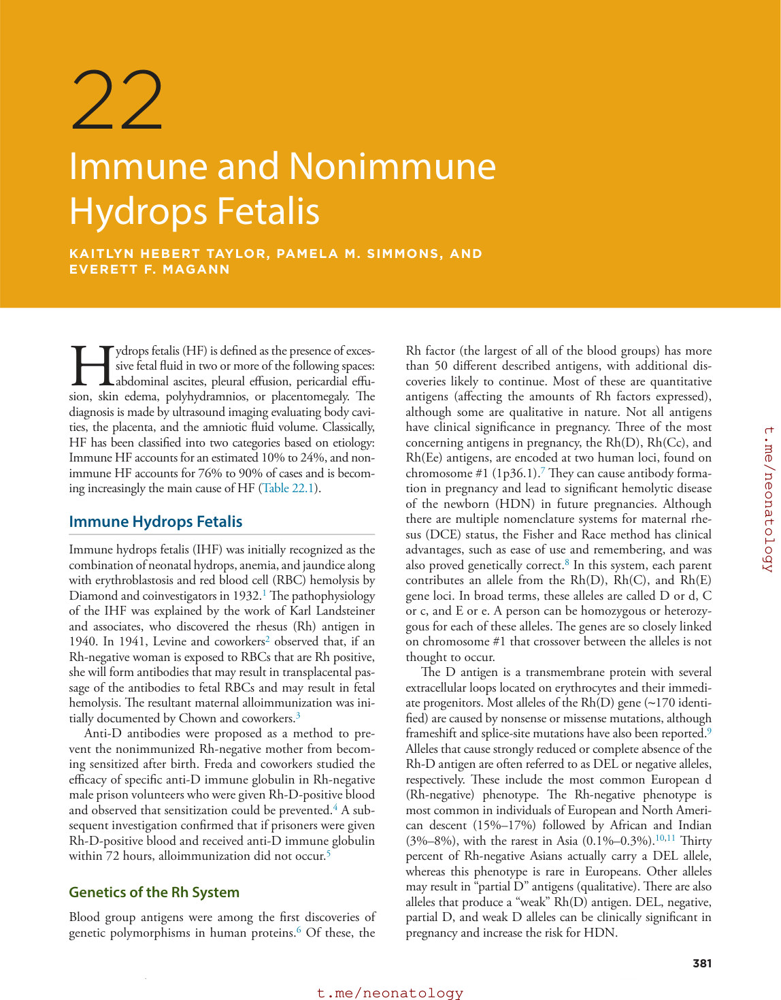

### Original source page 397

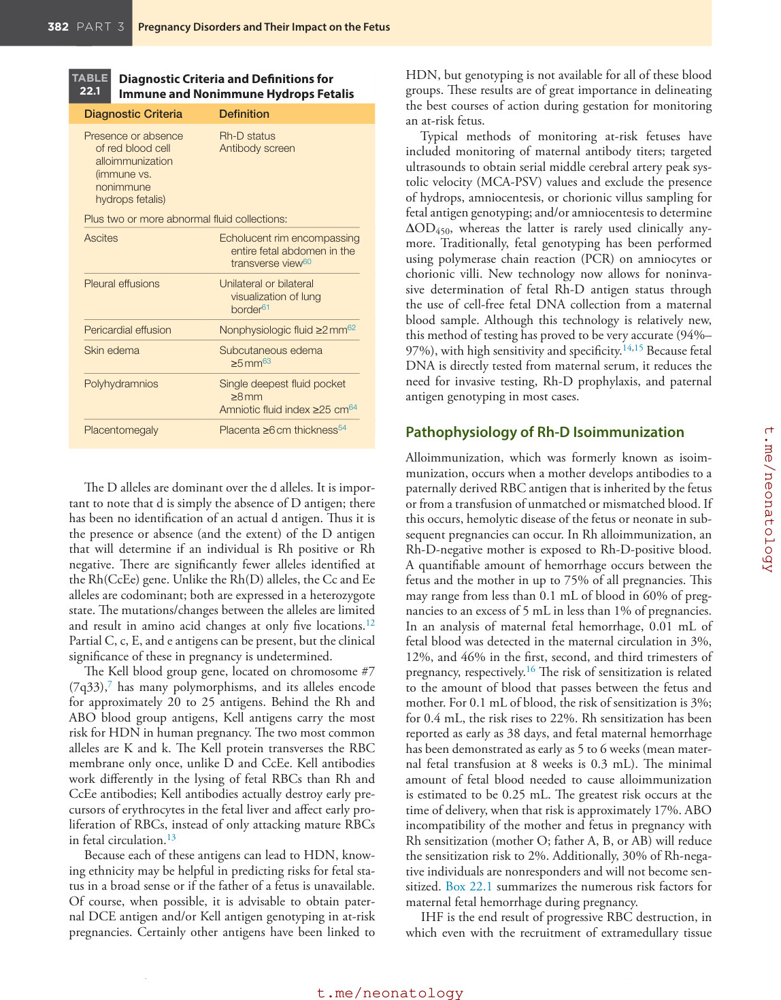

### Original source page 398

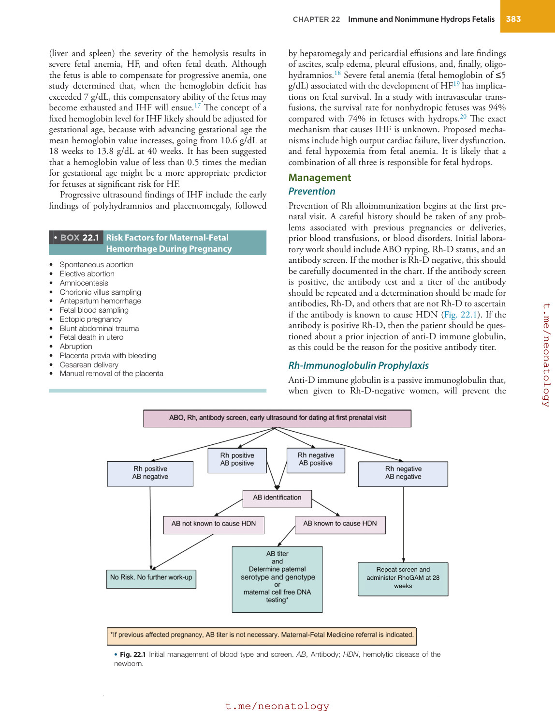

### Original source page 399

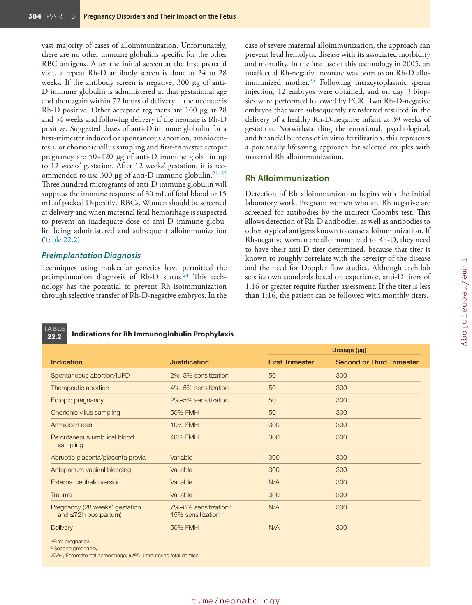

### Original source page 400

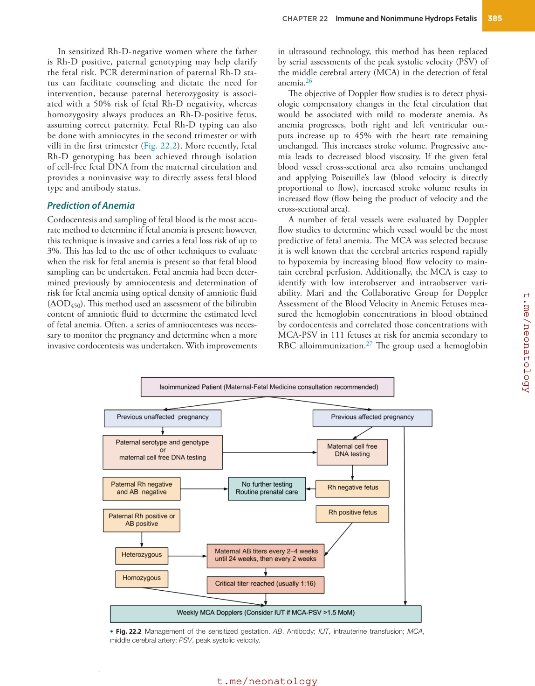

### Original source page 401

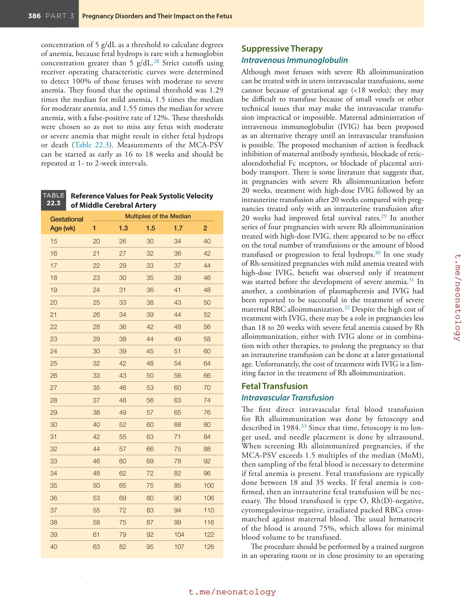

### Original source page 404

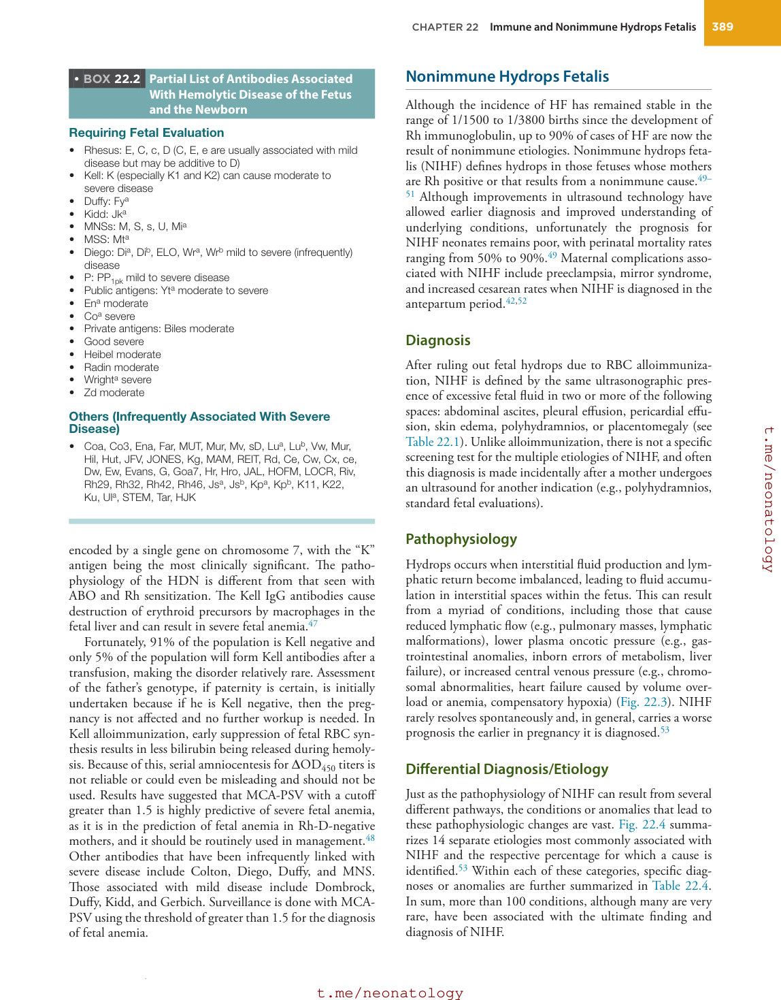

### Original source page 405

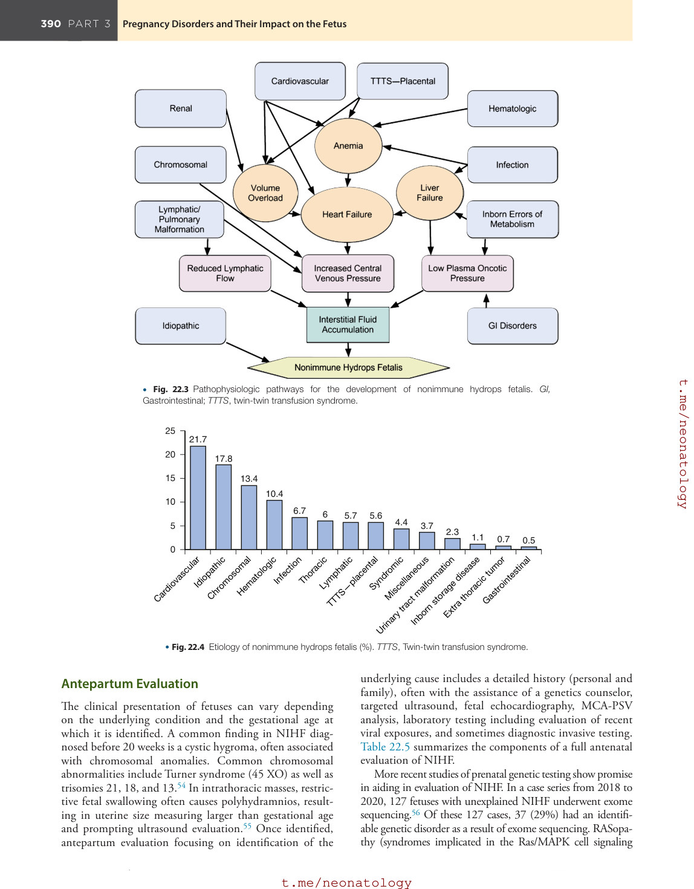

### Original source page 406

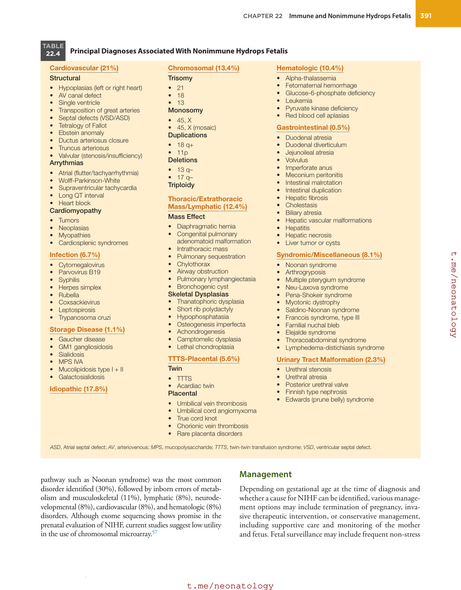

### Original source page 407

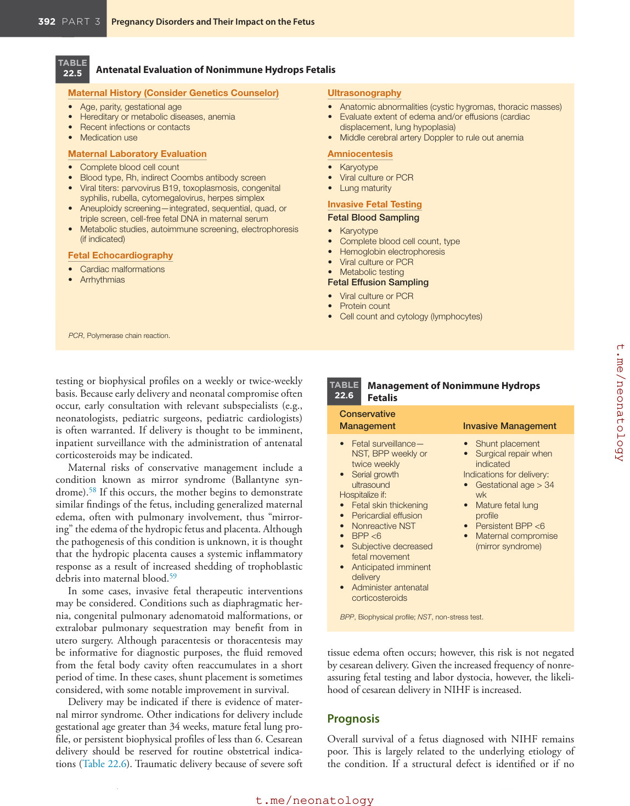

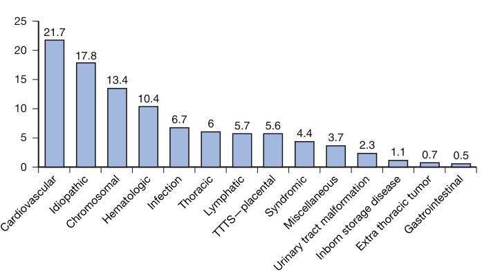

• Fig. 22.4 Etiology of nonimmune hydrops fetalis (%). TTTS, Twin-twin transfusion syndrome.

PDF p. 405
