# 23. Amniotic Fluid Volume
> [Source credits](../../SOURCE_CREDITS.md).

## Study pillars

### Fluid functions

Cushion fetus and cord while permitting movement and structural development. Fluid protects against trauma and permits mobility needed for growth and development.

PDF p. 411

### Renal contribution

Loss of the major fetal urinary contribution. Fetal renal output is a fundamental source of fluid, especially in the second half of pregnancy.

PDF p. 411

### Estimating volume

Direct measurement and dye dilution are cumbersome or invasive. Direct measurement is largely limited to cesarean delivery, and dye dilution requires invasive sampling and laboratory support.

PDF p. 412

### Test-driven intervention

More abnormal labels do not by themselves demonstrate better outcomes. The source describes more oligohydramnios diagnoses and interventions with AFI without improved perinatal outcome in these comparisons.

PDF p. 413

### Excess fluid pathways

Reduced absorption/removal of amniotic fluid. Reduced fetal swallowing limits fluid removal and can produce polyhydramnios; overproduction and idiopathic cases also occur.

PDF p. 423

## Full source extraction

# 23. Amniotic Fluid Volume
> Source attribution: [Source credits](../../SOURCE_CREDITS.md).

## PDF page 411 | printed page 396

23 Amniotic Fluid Volume

### KAITLYN HEBERT TAYLOR, PAMELA M. SIMMONS, AND EVERETT F. MAGANN

Amniotic fluid surrounds the developing embryo throughout gestation, protecting the fetus and umbilical cord from trauma while allowing mobility to facilitate structural growth and development. The underlying forces that regulate amniotic fluid are exceedingly complex and dynamic, synchronizing volumes within relatively narrow ranges and providing an indirect measure of fetal well-being. Understanding the pathways of water and solute exchange provides the physiologic basis of the pathologic conditions of oligohydramnios and polyhydramnios.

### Amniotic Fluid Dynamics

Several pathways for movement of amniotic fluid and solutes exist, including fetal swallowing, urination, and pulmonary secretions; intramembranous movement between fetal blood and the placenta; and transmembranous movement across the amnion and chorion.1 To understand how variations in amniotic fluid volume (AFV) can affect the fetus, we must first understand fluid dynamics.

### Composition

Amniotic fluid contains 98% to 99% water, with its solute composition changing throughout gestation. In early pregnancy, the factors that affect AFV are not well known. What is known is that the osmolarity of amniotic fluid and maternal plasma are alike, suggesting that amniotic fluid is a transudate of maternal plasma originating from either placental surfaces or coming through fetal skin.2 The fetal skin remains nonkeratinized until weeks 22 to 25, allowing it to act as a membrane through which amniotic fluid can readily pass.3 Because the fetal skin becomes keratinized and renal function matures, the hypotonic fetal urine causes the amniotic fluid osmolality to decline from 290 mOsm/kg in the first trimester to approximately 255 mOsm/kg near term.4 Conversely, concentrations of creatinine, urea, and uric acid from the fetal urine increase progressively in the amniotic fluid. Low concentrations of proteins (primarily albumin) are found in late pregnancy and provide a minor source of nutrition for the developing fetus. Near term, the amniotic fluid contains increased amount of particulate matter from

396

desquamated fetal skin and gastrointestinal cells, hair, vernix caseosa, stem cells, and occasionally meconium.

### Production and Regulation

Surface exchange is the main component of fluid dynamics in early pregnancy before skin keratinization. Beyond 24 weeks, the surfaces in the mouth and nose can additionally act to exchange fluid, but this is not considered a major source of AFV regulation.5 A fundamental source of amniotic fluid, particularly in the second half of pregnancy, is the fetal renal system. This is evidenced by the almost complete lack of amniotic fluid in fetuses with renal agenesis or bladder outlet obstructions. Secretions of the respiratory tract, fetal swallowing, and transport within and across the fetal membranes also contribute to AFV (Fig. 23.1).

Confirmation of a functioning renal system first starts around 8 to 11 weeks, when urine is initially observed in the fetal bladder. The dilute urine that is produced is thought to cause the observed drop in osmolality and sodium concentration in the amniotic fluid that persists until delivery.2 As pregnancy advances, urinary byproducts are observed at two to three times the concentration found in fetal plasma.6 Estimates of fetal urine output have been made by threedimensional (3D) measurements of bladder volume at timed intervals and have been found to range from 7 to 70 mL/h from 24 weeks until delivery in two separate studies.7,8 Fetal urine production is characteristically decreased in pregnancies with abnormalities of placental function that result in intrauterine growth restriction (IUGR).9 However, no correlation is observed between fetal weight and urine production in normal pregnancies. In normal pregnancies, low fetal urine output is not associated with lower Apgar scores, pH values <7.25, or late decelerations in labor.9

Fluid is excreted from the fetal pulmonary system. Approximately 300 to 400 mL of fluid is secreted per day, driven by chloride ion exchange across the pulmonary epithelium.4 It has been demonstrated in fetal sheep by Brace et al. that half of secreted lung fluid enters the amniotic fluid and the other half is swallowed upon exiting the trachea.10 Amniotic fluid is prevented from entering the lungs by the closed larynx, producing a new efflux of fluid from

## PDF page 412 | printed page 397

Fetus

Urine flow 800–1200 Lung fluid 340

Intramembranous

Swallowing 500–1000

200–500

170

170

Amniotic fluid

Transmembranous

10

• Fig. 23.1 Pathways for daily fluid production and removal between the fetus and amniotic fluid compartments (measured in milliliters). (From Gilbert WM, Moore TR, Brace RA. Amniotic fluid dynamics. Fetal Med Rev. 1991;3:89. Reprinted with permission of Cambridge University Press.)

the fetal lungs.11 This was confirmed in an investigation by Liley et al. in which the intra-amniotic injection of contrast medium resulted in, with the exception of a few cases, undetectable contrast in the fetal or neonatal lung.12 The net amount of lung fluid entering the fetal amniotic fluid is approximately 150 to 200 mL/day. As further evidence of secreted lung fluid being found in amniotic fluid, the phospholipids found in amniotic fluid, which are produced by pulmonary cells, are found in the amniotic fluid. Although meconium staining is not infrequent, with rates in the literature of 7% to 27% based on the population, meconium aspiration past the trachea is rare (less than 1% to 5%) and is usually associated with accompanying neonatal hypoxia.13,14 Rarely, the aspiration of amniotic fluid uncontaminated by meconium has been reported as a cause of neonatal death confirmed at autopsy.15,16

Analogous to renal agenesis being associated with low amniotic fluid, disruption in fetal swallowing is associated with excess AFV. The human fetus demonstrates swallowing around the same time that urine production begins, at 8 to 11 weeks,17 and the swallowed volume increases with gestational age. The ovine model has been used historically to approximate human fetal development.2 Studies evaluating the volume of amniotic fluid swallowed by the fetus were done primarily in sheep models and were found to range between 210 and 1085 mL/day.18,19 Ovine studies have also shown that the amount of amniotic fluid swallowed daily in late gestation is correlated with the AFV, suggesting that the fetus can react and attempt to regulate its amniotic fluid surroundings. This attempted regulation is not thought to be a major controller of volume,20 although the fetus is able to modulate its swallowing. In primate studies, esophageal ligation initially resulted in polyhydramnios, but the polyhydramnios did not persist across gestation, and at the time of delivery the AFV was normal.21 Observations of swallowed AFV in near-term fetuses range from 210 to 840 mL/day

(average 565 mL). This volume is equivalent to 5% to 10% of the fetal body weight.22

Excess fluid not removed by fetal swallowing is reabsorbed via an intramembranous pathway. More specifically, this is the reabsorption of fluids and solutes from the amniotic compartment to the fetal blood via the amnion.23 This pathway is capable of absorbing large quantities of fluid. Because the fluid requirements of the fetus increase with increasing gestation, water flow from the amniotic cavity to the fetal circulation via the fetal membranes increases up to 400 mL/day.24 This is thought to be regulated at least partially by aquaporins found in the human chorioamniotic membranes and the placenta. Aquaporins are small (26- to 34-kDa) cell membrane proteins that regulate water flux across the cell membranes, have been found to be adaptive to abnormal amniotic fluid levels, and may represent a possible future therapeutic target for abnormal AFV regulation.25–27 The osmotic gradient between the amniotic fluid and fetal blood also drives fluids and solutes from the amniotic fluid into the fetal blood.6 The flow of solutes and fluids, although bidirectional, is not necessarily equal.11,28 Vascular endothelial growth factor (VEGF) may also have an impact on intramembranous absorption of fluid.

Transmembranous movement of amniotic fluid describes the transport of water and solutes from the maternal circulation to the amniotic compartment via the placenta.23 Overall, this has been found to be an insignificant contribution to amniotic fluid dynamics.1

### Measurement of Amniotic Fluid Volume

The evaluation of AFV is important during the routine ultrasound evaluation of the fetus because variation above or below normal is associated with increased perinatal morbidity and mortality.29,30 AFV can be measured directly at the time of cesarean delivery (with corrections made for blood contamination)31 or by dye-dilution techniques using para-amino hippurate.32 The direct measurement can only be done on a single occasion at the time of cesarean delivery, making it impractical for serial assessments of AFV, and the dye-dilution technique is invasive (requires an amniocentesis), necessitates laboratory support to calculate the AFV, and is also impractical for the clinical determination of AFV.31 The relative accuracy of this indicator dilution technique has been validated by comparing the actual AFV measured at cesarean delivery with that determined by dyedilution techniques, showing only a 7% difference between the dye-determined and direct-measurement volumes (r = .99, P < .001).33,34 Magnetic resonance imaging has also been evaluated as a means for estimating AFV35; however, this is an expensive and impractical approach to everyday screening. Although the aforementioned techniques to measure AFV are accurate, they are time-consuming, cumbersome, and may require laboratory support; therefore the volumes are usually estimated by ultrasound.

Sonographic techniques to estimate the AFV include subjective (qualitative) estimation and semiquantitative

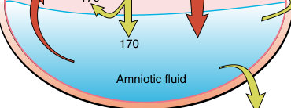

• Fig. 23.1 Pathways for daily fluid production and removal between the fetus and amniotic fluid compartments (measured in milliliters). (From Gilbert WM, Moore TR, Brace RA. Amniotic fluid dynamics. Fetal Med Rev. 1991;3:89. Reprinted with permission of Cambridge University Press.)

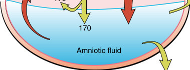

• Fig. 23.1 Pathways for daily fluid production and removal between the fetus and amniotic fluid compartments (measured in milliliters). (From Gilbert WM, Moore TR, Brace RA. Amniotic fluid dynamics. Fetal Med Rev. 1991;3:89. Reprinted with permission of Cambridge University Press.)

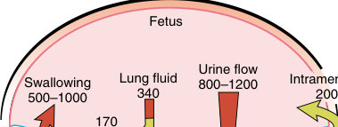

• Fig. 23.1 Pathways for daily fluid production and removal between the fetus and amniotic fluid compartments (measured in milliliters). (From Gilbert WM, Moore TR, Brace RA. Amniotic fluid dynamics. Fetal Med Rev. 1991;3:89. Reprinted with permission of Cambridge University Press.)

## PDF page 413

methods: these measurements consist of the measurement of the single largest pocket of amniotic fluid, which can be labeled as the largest vertical pocket or maximum vertical pocket or single deepest pocket (SDP), and the summed measurement of four largest pockets is considered as the amniotic fluid index (AFI). In this review, we will use the SDP to identify the single largest amniotic fluid pocket technique. Advantages of sonographic estimates include that they are simple to perform; easy to teach to residents, midwives, and nurses; and reproducible. In a study comparing all three measurements in singleton pregnancies with dye-dilution technique across different operator experiences, the accuracy of subjective and objective (sonographic) estimates was not affected by operator experience and was similarly accurate in identifying normal AFV. The disadvantage is that they are two dimensional (2D) representations of a complex, 3D structure with limited significance relative to clinical outcome. Although each has been studied extensively, no technique is universally considered superior at predicting perinatal outcome. In the same study, the accuracy of estimates of all three techniques ranged from 65% to 70%, and the three sonographic estimates were alike, ranging from 59% to 67%. Alarmingly, none of the techniques were accurate in the identification of abnormal volumes (oligohydramnios, or low amniotic fluid, and polyhydramnios, or high amniotic fluid). The accuracy in the identification of normal volumes in twin pregnancies was dismal, ranging from 7% to 29%.36

### Subjective Estimation

Subjective estimation of amniotic fluid is based on the overall sonographic visual impression of the AFV by an experienced sonographer, established by visualizing echolucent pockets between the fetal parts and uterine wall without measurements. Qualitative estimation of the fluid is characterized as normal, increased (polyhydramnios), reduced (oligohydramnios), or absent.

### Amniotic Fluid Index Measurement

AFI is the summation of the vertical diameter of the largest pocket in each of the four quadrants, as proposed by Phelan, with a horizontal measurement of 1 cm.37 It uses the maternal umbilicus as the central reference point dividing the maternal abdomen into upper and lower halves and the linear nigra, which divides the abdomen into right and left halves. The measurement requires the transducer to be oriented in the longitudinal axis of the maternal abdomen and be kept perpendicular to the floor during scanning. The AFI correlates closely with actual AFV as determined by dye-dilution techniques for normal fluid volume, although it loses its predictive value at the upper and lower ends of the extreme. Moore and Cayle established the mean and outer boundaries (5th and 95th percentiles, respectively) for the AFI from 16 to 42 weeks’ gestation in a study of 791

normal pregnancies.38 Magann et al. also established 5th to 95th percentiles, respectively, as 4.2 to 14.9 cm for AFI at gestational age 37 to 41 weeks.39,40 Both can be seen in Fig. 23.2. The mean AFI is approximately 12 to 14 cm throughout most of pregnancy, declining after 33 weeks. Above the 95th percentile is approximately 20 cm and below the 5th percentile is approximately 7 cm. The absolute maximum normal AFI is less than 24 or <25 cm. Typical limits for amniotic fluid assessment by AFI are defined in Table 23.1.

### Single Deepest Pocket

The single deepest vertical pocket, as originally described by Chamberlain,41 is simply found by identifying the largest pocket of amniotic fluid after a global assessment and taking the largest vertical measurement with a horizontal measurement of 1 cm. At gestational age 37 to 41 weeks, the 5th to 95th percentile was 2.3 cm to 6 cm for SDP according to nomograms by Magann et al.40 Typical limits for amniotic fluid assessment by SDP are shown in Table 23.2.

### Comparing Amniotic Fluid Assessment Techniques

As stated, the ideal test for sonographic assessment of AFV has not been firmly established. The ideal semiquantitative sonographic technique should be one that correctly identifies patients at risk for adverse outcomes. AFI, SDP, and a two-diameter pocket (horizontal × vertical measurements in cm2) were compared in a study of 50 normal pregnancies between the gestational ages of 14 and 41 weeks. The prevalence of oligohydramnios as defined by AFI ≤5 cm, SDP less than 2 cm, or two-diameter pocket less than 15 cm2 was significantly different (P < .0001) for the three techniques (8%, 1%, and 30%, respectively). The prevalence of polyhydramnios as defined by AFI greater than 24 cm, SDP greater than 8 cm, or two-diameter pocket greater than 50 cm2 was also diagnosed with significantly different frequencies (P < .0001) (0%, 0.7%, and 3%, respectively).40 Outcomes were not assessed in this study.

Subsequently, two prospective randomized trials comparing the use of SDP versus AFI during modified biophysical profiles in complicated pregnancies were performed. Chauhan and colleagues studied 1080 women and found that AFI identified oligohydramnios in 17% of pregnancies compared with 10% identified in SDP-assessed pregnancies (P = .002).42 However, there was no difference in delivery mode, newborn intensive care unit (NICU) admission, umbilical artery pH, or Apgar score. Magann and colleagues had similar findings, showing oligohydramnios was identified in twice as many patients using AFI as compared with SDP in 537 pregnancies (38% vs. 17%, P < .001), resulting in a doubling of inductions of labor (30% vs. 15%, P < .001) and cesarean sections (CSs) for fetal distress (13% vs. 7%, P < .05).43 There was, however, no improvement in the perinatal outcome. This was

## PDF page 414 | printed page 399

• Fig. 23.2 Amniotic fluid index. Four-quadrant sum of deepest vertical pockets (measured in millimeters). Solid line indicates the median values; upper and lower dashed lines are the 95th and 5th percentiles, respectively. (Adapted from Moore TR, Cayle JE. The amniotic fluid index in normal human pregnancy. Am J Obstet Gynecol. 1990;162:1168.)

Diagnostic Categories by Measurement of

TABLE

23.1

the Amniotic Fluid Index

AFI Value (cm)

Patients (%)

Amniotic Fluid Volume

Polyhydramnios ≥25 2

Normal >8 to <25 76

Moderate oligohydramnios ≥5 to ≤8 20

Severe oligohydramnios <5 2

AFI, Amniotic fluid index. Data from Moore TR. Oligohydramnios. Contemp Obstet Gynecol. 1996;41:15.

confirmed in two meta-analyses comparing the measurement of AFI to SDP.44,45 Neither sonographic test was superior to the other. Both poorly identified abnormal volumes when compared with dye-determined or directly measured AFV. However, AFI overdiagnosed clinically insignificant oligohydramnios, resulting in more intervention with no difference in outcome, suggesting that the SDP may be a superior sonographic assessment for antenatal testing of the at-risk pregnancy.45

The use of color Doppler has not been shown to aid in the identification of pregnancies with adverse outcomes. Using dye-determined volume as the benchmark, Magann et al. compared grayscale ultrasonography to Doppler color ultrasonography and found that color Doppler not only did not improve the diagnosis of actual dye-determined oligohydramnios but also overdiagnosed oligohydramnios by labeling 37% of women with normal AFV as having oligohydramnios.46

Diagnostic Categories by Measurement of

TABLE

23.2

the Single Deepest Pocket

SDP Value (cm)

Patients (%)

Amniotic Fluid Volume

Polyhydramnios ≥8.0 3

Normal >2 to <8 94

Moderate oligohydramnios ≥1 to ≤2 2

Severe oligohydramnios <1 1

SDP, Single deepest pocket. Data from Chamberlain PF, Manning FA, Morrison I, et al. Ultrasound evaluation of amniotic fluid volume: I. The relationship of marginal and decreased amniotic fluid volumes to perinatal outcomes. Am J Obstet Gynecol. 1984;150:245.

### How Should the Measurement Be Achieved?

Two techniques of how the transducer should be held when measuring amniotic fluid pockets have been described. In one technique, the ultrasound probe is held perpendicular to the floor as the AFV pockets are measured. Chamberlain described a technique in which the ultrasound probe is held perpendicular to the uterine contour when measuring pockets of amniotic fluid.29,30 Do these different techniques result in different AFI and SDP measurements? A recent study compared the measurements of singleton pregnancies between 28 and 40 weeks with the AFI and SDP measured perpendicular to the floor versus perpendicular to the uterine contour. There were a total of 20 scans at each gestational age for a total of 240 scans. Strong correlations were found between the AFI measurements (correlation coefficient 0.82;

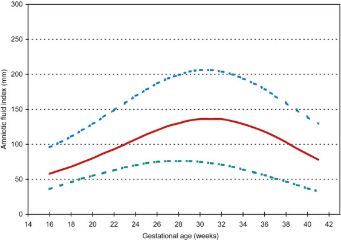

• Fig. 23.2 Amniotic fluid index. Four-quadrant sum of deepest vertical pockets (measured in millimeters). Solid line indicates the median values; upper and lower dashed lines are the 95th and 5th percentiles, respectively. (Adapted from Moore TR, Cayle JE. The amniotic fluid index in normal human pregnancy. Am J Obstet Gynecol. 1990;162:1168.)

## PDF page 415

interclass correlation 0.7) and the SDP measurements (correlation coefficient 0.7; interclass correlation 0.6). The investigators concluded that either technique could be used, perpendicular to the floor or perpendicular to the uterine contour, because there were no significant differences between the two techniques.47

### Other Techniques

Sahin et al. attempted to apply the Cavalieri method, a mathematical approximation of volumes, to estimate the AFV.48 Their results correlated with concurrent AFI measurements, and although this is a promising theory, it is complicated to perform and has not been correlated with pregnancy outcome or a directly measured volume.

Three-dimensional ultrasound technology has found relevance in the evaluation of the fetus; however, it has not yet found application in the assessment of amniotic fluid. There has been only one attempt to assess third-trimester AFV with 3D ultrasonography. It was concluded that 3D volume datasets are reliable for determining volume; however, it was determined subjectively by the sonographer based on five volume acquisitions and compared with the value obtained during the 2D ultrasound; there was no attempt at calculating a volume based on a gold standard.49 Interestingly, in the first trimester, growth charts have been developed for gestational sac volume and embryonic volume, the ratio of which correlates positively with gestational age.50 Clinical applications for this data have not yet been developed, but normal versus abnormal early pregnancies are being investigated to determine if these parameters can help predict early adverse outcomes such as miscarriage.

### Normal Volume and the Singleton Pregnancy

Gravid women accumulate approximately 6 L of additional fluid volume during pregnancy. Most of this fluid is associated with the conceptus: 2800 mL in the fetus, 400 mL in the placenta, and 700 to 800 mL of amniotic fluid.51 The remainder of the fluid is associated with the maternal uterus (800 mL), breasts (500 mL), and maternal blood volume expansion (850 mL).51 Throughout gestation, AFV is highly regulated, gradually increasing in the first trimester, stabilizing in the second trimester, and decreasing late in the third trimester, although remaining in a relatively narrow range of volumes.

Normality can be defined in two ways. Mathematically, it can represent the majority of the population as expressed by the area under the curve in a Gaussian distributed population. Typically, the lower and upper 5% are excluded as “abnormal.” Normality can also be defined in terms of outcome. Undesired outcomes are tracked and measurements associated with these outcomes are defined as “abnormal.” This second definition is more clinically useful but much more difficult to define.

2000

Brace and Wolf Magann Queenan

Amniotic fluid volume (mL)

1000

Week 34 max

Week 33 max Week 40 max

100

18 20 22 24 26 28

16

30 32 34 36 38 40 42

Gestational age (weeks)

• Fig. 23.3 Comparison of normal amniotic fluid volumes (dye-determined or directly measured) across gestation. Max, the gestation at which each trajectory peaks. (Adapted from Magann EF, Sandlin AT, Ounpraseuth ST. Amniotic fluid and the clinical relevance of the sonographically estimated amniotic fluid volume: oligohydramnios. J Ultrasound Med. 2011;30:1573– 1585; Brace RA, Wolf EJ. Normal amniotic fluid volume changes throughout pregnancy. Am J Obstet Gynecol. 1989;161:382–388; and Queenan JT, Thompson W, Whitfield CR, et al. Amniotic fluid volumes in normal pregnancies. Am J Obstet Gynecol. 1972;114:34–38.)

The AFV volume has been defined using both of these methods. The 5th and 95th percentiles have been defined for AFI, SDP, and dye-determined techniques across gestational ages, as fluid has been found to vary significantly throughout pregnancy. Nomograms for amniotic fluid in normal pregnancies were developed by Queenan et al. in 1972 by dye-determined methods,52 Brace and Wolfe by dye-dilution and direct measurement,4 and Magann et al. by dye-dilution and direct measurement (Fig. 23.3).39,40 Two of these studies showed that AFV increases steadily in early gestation and remains relatively stable between 22 and 38 weeks, averaging 750 to 800 mL. Thereafter, amniotic fluid volume declines by 8% per week, with a mean volume of approximately 500 mL at 40 to 42 weeks. The third nomogram found that AFV continues to increase throughout gestation, confirming a mean volume of approximately 800 mL at term.39 A more recent publication evaluated 1190 normal AFVs (by dye-dilution and direct measurement) across gestation, comparing four statistical methods to construct gestational age-specific reference intervals for amniotic fluid. Because of its flexibility and robustness, especially when data are sparse, the investigators determined that quantile regression is the preferred statistical technique to construct gestational age-specific reference for normal AFV (Table 23.3).53

A study of more than 15,000 patients done by Shanks et al. showed that an AFI <5th percentile versus a cutoff of 5 cm better predicts fetuses at risk for NICU admission,54 although this study has been criticized for its retrospective design and the variable intervals between the time the measurement was obtained and the time of delivery. In addition, an investigation of 291 pregnancies with dye-determined volumes in which the third and fifth percentiles of the AFI were assessed to determine if either of these percentiles was

### Automatic table extraction — verify rendered original

|Col1|Brace and Wolf Magann Queenan Week 34 max Week 33 max Week 40 max|Col3|Col4|Col5|Col6|Col7|Col8|Col9|Col10|Col11|Col12|Col13|Col14|Col15|Col16|Col17|
|---|---|---|---|---|---|---|---|---|---|---|---|---|---|---|---|---|
||||||||||||||||||
||||||||||||||||||
||||||||||||||||||

[Original table](../../tables/ch023_p0415_1.jpg)

## PDF page 416 | printed page 401

### Fitted 2.5th, 5th, 50th, 95th, and 97.5th Percentiles of Amniotic Fluid Volumes at 10–42 Weeks of

TABLE

23.3

### Gestation Based on the Quantile Regression Method

EGA (weeks) 2.5th 5th 50th

10 10 11.67071 33

11 14.67523 17.77286 46.78348

12 20.88759 26.02843 64.63046

13 28.86455 36.72243 87.08291

14 38.76757 50 114.5418

15 50.65874 65.81518 147.2026

16 64.47283 83.89999 185

17 80 103.7623 227.5713

18 96.88325 124.716 274.2441

19 114.6324 145.9388 324.053

20 132.6541 166.5515 375.784

21 150.2943 185.7025 428.0441

22 166.8892 202.647 479.3488

23 181.8158 216.8096 528.2168

24 194.5394 227.8216 573.2642

25 204.6493 235.533 613.2876

26 211.8822 240 647.3289

27 216.1299 241.4547 674.7173

28 217.433 240.2633 695.0874

29 215.9638 236.8802 708.3736

30 212 231.8045 714.7848

31 205.8945 225.5429 714.7645

32 198.0441 218.5812 708.9409

33 188.8609 211.3661 698.0733

34 178.7474 204.2954 683

35 168.0774 197.7177 664.5898

36 157.1828 191.9366 643.7017

37 146.3463 187.2225 621.1525

38 135.7982 183.8267 597.6943

39 125.7176 182 574

40 116.2365 182.0158 550.6572

41 107.4454 184.1975 528.1678

42 99.39999 188.9548 506.9539

EGA, Estimated gestational age. Data from Ounpraseuth, ST, Magann EF, Spencer HJ, et al. Normal amniotic fluid volume across gestation: comparison of statistical approaches in 1190 normal amniotic fluid volumes. J Obstet Gynaecol Res. 2017;43:1122–1131.

95th 97.5th

54.5 54.5

80.00315 85.11197

114.4997 128.7214

159.8753 188.7096

217.9379 268.4339

290.2362 370.8499

377.8607 498.0732

481.246 650.9382

600 828.619

732.7873 1028.385

877.2853 1245.544

1030.229 1473.61

1187.546 1704.68

1344.573 1930

1496.338 2140.636

1637.871 2328.18

1764.527 2485.396

1872.273 2606.735

1957.925 2688.672

2019.309 2729.829

2055.337 2730.905

2066 2694.441

2052.289 2624.451

2016.051 2526

1959.804 2404.752

1886.54 2266.555

1799.513 2117.087

1702.055 1961.572

1597.407 1804.597

1488.587 1650

1378.3 1500.832

1268.871 1359.384

1162.223 1227.244

## PDF page 417

superior to the fixed cutoff of less than 5 for the AFI to detect the 75 pregnancies with oligohydramnios, discovered that both the percentiles (third and fifth) and the fixed cutoff (<5) poorly identified oligohydramnios, but neither was superior to the other.55

### Twins and Amniotic Fluid

Multifetal pregnancies are at a higher risk of perinatal morbidity and mortality than singleton pregnancies. When evaluating the adequacy of the amniotic fluid in twin pregnancies, singleton growth curves and evaluations of fluid using singleton normograms are commonly used. This approach appears reasonable because in the only evaluation of the actual AFV using a dye-determination technique in third-trimester diamniotic twin pregnancies, the AFV of each sac was similar to those of normal singleton pregnancies.56 Morin and Lim performed a literature review with the Diagnostic Imaging Committee of the Society of Obstetricians and Gynaecologists of Canada and suggest that the SDP should be used in each sac with standard definitions for singleton pregnancies, although they state that there is not enough evidence to suggest that one method is more predictive than the others of adverse pregnancy outcome.57 The AFI has been used to estimate AFV in twins; however, when using the summated AFI (measurement of all four quadrants as is done in singletons but without taking membrane placement into consideration), the measurement poorly predicts dye-determined oligohydramnios and polyhydramnios.58

In a single prospective observational study of 299 diamniotic twin pregnancies, SDP was found to be constant between 17 and 37 weeks, with an increase in fetal labor intolerance and neonatal morbidity in twin pregnancies with polyhydramnios. Alternate fixed cutoffs of less than 2.2 cm for a low AFV and greater than 7.5 cm for a high AFV

Estimated Single Deepest Pocket Percentile Distributions for Each Gestational Age (299 Diamniotic

TABLE

23.4

Twin Pregnancies)

EGA (weeks) 2.5th 5th 10th 50th

<17 2.02 2.11 2.54 3.96

17–19 2.13 2.14 2.64 4.07

20–22 2.22 2.23 2.79 4.22

23–25 2.23 2.28 2.93 4.38

26–28 2.29 2.37 3.06 4.53

29–31 2.43 2.46 3.2 4.67

32–34 2.44 2.51 3.32 4.8

35–37 2.41 2.54 3.39 4.9

EGA, Estimated gestational age. Data from Magann EF, Doherty DA, Ennen CS, et al. The ultrasound estimation of amniotic fluid volume in diamniotic twin pregnancies and prediction of peripartum outcomes. Am J Obstet Gynecol. 2007;196(6):570.

were suggested in diamniotic twin pregnancies to identify pregnancies at risk for adverse intrapartum and neonatal outcomes (Table 23.4).33

Hernandez et al. performed a retrospective review of 1951 twin pregnancies, both dichorionic and monochorionic, with twin-twin transfusion syndrome (TTTS) excluded.59 Polyhydramnios was identified in 18% of pregnancies, defined as mild (SDP 8–9.9 cm), moderate (SDP 10–11.9 cm), and severe (SDP ≥12 cm). Pregnancy outcomes were reviewed, and polyhydramnios was not associated with preterm delivery, fetal growth restriction, NICU admission, or neonatal death in either twin. The incidence of major anomalies became more common in increasing polyhydramnios in both monochorionic and dichorionic pregnancies, with a prevalence of almost 20% in severe polyhydramnios. Severe polyhydramnios was significantly associated with stillbirth in monochorionic pregnancies (27%, P < .001).

Assessing relative AFV in twin pregnancies is also important because disparity in AFV is a significant component of twin oligohydramnios-polyhydramnios sequence (TOPS), of which TTTS is the extreme end point. TTTS carries with it a three- to fivefold increase in mortality and morbidity.60 It is often uncovered with ultrasound evidence of discordant fetal weights and AFVs in monochorionic/diamniotic twins, although it has been documented in monochorionic/monoamniotic pregnancies.61 It may also present sonographically as a “stuck twin,” with the fetus appearing to be suspended to the uterine wall with no intervening membrane visible, or there may be tightly adhered membranes that make a fetus appear wrapped in plastic wrap (Fig. 23.4). It is recommended that evaluation for twin-twin transfusion in these pregnancies should begin in the second trimester with weekly surveillance if discordant and evaluation every 2 weeks for concordant pregnancies.62

90th 95th 97.5th Twin Sacs

6.48 6.86 6.88 22

6.56 6.97 7.02 143

6.6 7.04 7.21 276

6.67 7.19 7.45 322

6.8 7.44 7.79 390

6.91 7.69 8.09 323

6.98 7.76 8.27 283

7.01 7.81 8.39 129

## PDF page 418 | printed page 403

A

B

• Fig. 23.4 Appearance of “stuck twin” in twin-twin transfusion syndrome. (A) Note fetus appears suspended to the anterior wall of uterus surrounded by large fluid collection (polyhydramnios of second twin). The membranes surrounding this twin are not visible on ultrasound examination. (B) Note the tightly adherent membranes (arrows) in the donor twin sac.

### Abnormalities of Amniotic Fluid Volume and Their Management

Deviation of AFV outside the normal range is associated with increased pregnancy loss. As early as the first trimester, low gestational sac fluid volume is predictive of increased rates of spontaneous abortion, 94% versus 8% in patients with normal sac size.63 In the second and third trimesters, departure above or below normal volumes increases the perinatal mortality (PNM) rate (Fig. 23.5). When diagnosis was made in the third trimester, patients fared better, although there was still a 15% PNM rate.

### Oligohydramnios

Oligohydramnios has been defined as an AFV that is less than 200 mL31 or 500 mL64 and occurs in 1% to 2% of pregnancies. It is sonographically defined as an SDP <2 cm, AFI <5 cm, or a subjectively low volume. Borderline fluid has been defined as an AFI between 5 cm and 8 cm or 5 cm and 10 cm and has been associated with fetal malformations if diagnosed at ages 24 and 34 weeks.65,66

300

(per 1000 live births)

Perinatal mortality

200

100

0

0 5 10 15

Maximum vertical pocket (cm)

• Fig. 23.5 Perinatal mortality rate related to maximum vertical pocket (MVP) measurements in centimeters. Note the increased perinatal mortality with MVP less than 2 or greater than 8 cm. (Adapted from Harman CR. Amniotic fluid abnormalities. Semin Perinatol. 2008;32:288.)

Low amniotic fluid can be caused by underproduction or loss, or it can be idiopathic. Underproduction can be the result of absent or dysfunctional kidneys, urinary tract obstruction, uteroplacental insufficiency, maternal medications, or maternal dehydration. Loss is caused by the rupture of membranes. Box 23.1 lists conditions associated with oligohydramnios. The clinical management of oligohydramnios should be directed toward diagnosing and alleviating remediable underlying conditions. Appropriate work-up for this abnormality is a review of the maternal history for evidence of rupture, anatomic evaluation of the renal system and bladder, and assessment of placental function and fetal growth and pulmonary status.

### Clinical Implications

Oligohydramnios increases perinatal morbidity with increased rates of IUGR (fetal weight less than the 10th percentile for gestational age, or abdominal circumference <2.5th percentile), meconium-stained amniotic fluid, fetal labor intolerance, and low Apgar scores. Regardless of the etiology, fetuses in pregnancies complicated by oligohydramnios are at increased risk of adverse outcomes in the form of cord accidents, fetal lung hypoplasia, and, if in the first and second trimesters, malformations and contractures.67 Oligohydramnios was retrospectively evaluated in 7582 fetuses in high-risk pregnancies with normal anatomy. PNM was 11% in these pregnancies versus 0.2% in pregnancies with normal fluid based on SDP. Borderline fluid of SDP 1 to 2 cm was associated with an increased mortality at 3.7%.29

There are conflicting data that contend that the most significant risk to the normal fetus with incidental oligohydramnios is iatrogenic prematurity resulting from the subsequent rush to delivery.68 Low AFV, as determined by dye-dilution, along with IUGR has been associated with NICU admission (OR 11.1) but no other measures of infant morbidity have been identified.69

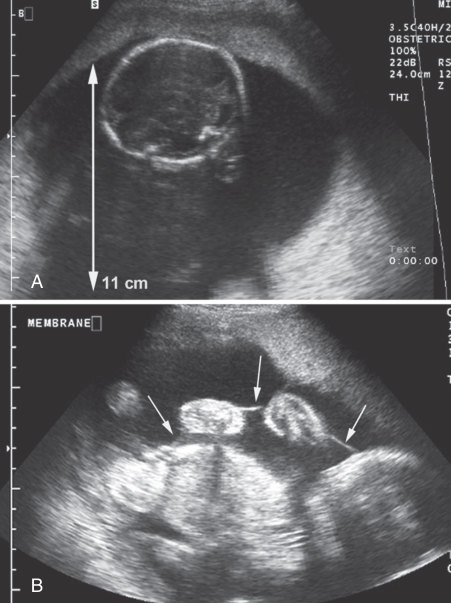

• Fig. 23.4 Appearance of “stuck twin” in twin-twin transfusion syndrome. (A) Note fetus appears suspended to the anterior wall of uterus surrounded by large fluid collection (polyhydramnios of second twin). The membranes surrounding this twin are not visible on ultrasound examination. (B) Note the tightly adherent membranes (arrows) in the donor twin sac.

## PDF page 419

• BOX 23.1 Principal Diagnoses Associated With

Oligohydramnios

Fetal

• Chromosomal abnormalities • Congenital anomalies • Genitourinary (renal agenesis, polycystic or multicystic

dysplastic kidneys, ureteral or urethral obstruction) • Intrauterine growth restriction • Intrauterine fetal demise • Postmaturity • Premature rupture of membranes (occult or overt) • Preterm • Prolonged

Maternal

• Uteroplacental insufficiency • Autoimmune condition • Antiphospholipid antibodies, collagen vascular disease • Maternal hypertension • Nephropathy • Diabetic vasculopathy • Maternal hypovolemia • Preeclampsia/gestational hypertension • Medications • Prostaglandin synthetase inhibitors • Angiotensin converting enzyme inhibitors

Placental

• Chronic abruption • Placental crowding in multiple gestation • Twin-twin transfusion • Placental infarction

Idiopathic

Modified from Peipert JF, Donnenfeld AE. Oligohydramnios: a review. Obstet Gynecol Surv. 1991;46:325.

### Etiology

In a series by Shenker and colleagues, the most common cause of oligohydramnios was premature rupture of membranes (PROM) (50%), followed by IUGR (18%) and congenital anomalies (14%).70 Shipp and colleagues noted a bimodal distribution of severe oligohydramnios, with congenital abnormalities accounting for 51% of cases occurring at 13 to 21 weeks’ gestation but only 22.1% at 34 to 42 weeks’ gestation. In this series, urinary tract malformations accounted for 58.7% of all anomalies seen, with aneuploidy accounting for 4% of severe oligohydramniotic patients.71 Genitourinary malformations associated with oligohydramnios include renal agenesis, cystic dysplasia of the kidneys, and obstructive uropathies, including posterior urethral valve syndrome. The sonographic appearance of posterior urethral valves with megacystis is shown in Fig. 23.6. Late diagnosis of oligohydramnios in pregnancies with normal anatomy has also been found to be associated with undiagnosed renal anomalies up to 9.8% of the time.72

Maternal use of certain medications can lead to development of oligohydramnios. Prostaglandin synthetase

• Fig. 23.6 Posterior urethral valve syndrome. Male fetus with “keyhole” bladder on ultrasound. Large bladder (B) and dilated ureter (Ur).

inhibitors (e.g., indomethacin, ibuprofen, sulindac), which are used to inhibit labor, reduce polyhydramnios, and relieve pain, also reduce the fetal glomerular filtration rate, resulting in decreased fetal urine output and oligohydramnios in up to 70% of patients. They may also decrease uteroplacental perfusion and prematurely cause closure of the ductus arteriosus. Although these effects are reversible, patients maintained on indomethacin for more than 72 hours should be evaluated with semiweekly amniotic fluid assessments and fetal echocardiography to assess the ductal flow. Angiotensin-converting enzyme (ACE) inhibitors have also been implicated as causing oligohydramnios, presumably secondary to severe fetal hypotension, reducing renal blood flow. ACE inhibitors are associated with producing prolonged neonatal anuria, renal anomalies, ossification defects in the fetal skull, and death; therefore they are contraindicated in pregnancy.

### Diagnostic Evaluation

Rule Out Ruptured Membranes

A sterile speculum examination should be performed on any patient suspected of having PROM. If amniotic fluid is grossly present in the posterior vagina, the diagnosis of PROM is confirmed. If only a small amount of fluid is present, it should be tested with nitrazine paper to detect the alkaline pH of amniotic fluid. A sample should also be applied to a slide and allowed to dry. Sodium chloride in the amniotic fluid crystallizes in a “ferning” pattern, confirming the diagnosis. Cervical mucus, when applied to a slide and allowed to dry, can also create a crystalized pattern, so care should be taken to avoid the collection of cervical mucus. Frequently, these examinations are negative or equivocal for reasons such as chronic leakage or contaminating blood or semen, making it difficult to conclusively diagnose chronic fluid leakage. If a normal-sized fetal bladder is observed on ultrasound with concomitant severe oligohydramnios, the likelihood of PROM is high. Injection of indigo carmine diluted in sterile saline into the amniotic sac with an amniocentesis needle after placement of a tampon in the vagina

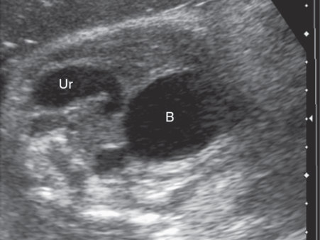

• Fig. 23.6 Posterior urethral valve syndrome. Male fetus with “keyhole” bladder on ultrasound. Large bladder (B) and dilated ureter (Ur).

## PDF page 420 | printed page 405

can confirm the diagnosis of PROM in cases that are difficult to detect. Currently, this dye is not available. Patients should be warned that if the fetus delivers within a few days of injection, the baby may be stained blue. Methylene blue dye has been reported to cause methemoglobinemia and hemolysis and therefore should not be used. Pyridium has also reportedly been used; however, the orange to red hue of the stained fluid is difficult to distinguish from bodily fluids.

Monoclonal antibodies to detect placental alpha microglobulin-1 (PAMG-1) in the vagina can be used to confirm PROM. In clinical testing, the test kit AmniSure (Amni- Sure International LCC, Cambridge, MA) was shown to be highly sensitive (98.7%) and specific (87.5%) at detecting even minute amounts of PAMG-1 in the vagina.73 However, false-positive results can occur if there is bleeding; false-negative results are possible if the sample is taken more than 12 hours after presumed PROM.

A group of 31 women with rupture before 24 weeks’ gestation was followed for outcomes based on SDP greater than or less than 1 cm (severe oligohydramnios). The group with SDP greater than 1 cm was associated with a longer latency to a live birth in 60% of pregnancies compared with 8.3% in the group with SDP less than 1 cm. The remainder of outcomes, such as sepsis, chorioamnionitis, and abruption, was not statistically different among groups.74 A separate study found that AFI was a poor predictor of survival in pregnancies with preterm PROM between 16 and 24 weeks.75

Assess Fetal Anatomy

A careful ultrasound examination with anatomic survey should be performed in cases of oligohydramnios to rule out congenital anomalies, particularly because renal and ureteral anomalies are the most common anatomic causes of severe oligohydramnios in the absence of ruptured membranes. The fetal urinary system should be thoroughly evaluated, paying close attention to the renal parenchyma, dimensions of the renal pelvis, and morphologic features of the fetal urinary bladder. Cardiac, skeletal, and central nervous system anomalies may coexist with primary renal anomalies and should be investigated. Chromosomal abnormalities (i.e., trisomies 18 and 21) can also present with renal anomalies, so evaluation for other signs of aneuploidy should be included, and genetic amniocentesis or maternal blood for fetal cell-free DNA should be considered. Interestingly, isolated renal anomalies do not increase the risk of aneuploidy. With bilateral renal agenesis, virtual anhydramnios is present from 16 weeks onward. With anhydramnios, it is difficult to adequately document whether the fetal kidneys are present. In addition, the fetal adrenals can become hypertrophied and resemble renal structures. To aid in the identification of renal agenesis, Doppler imaging (Fig. 23.7) may be necessary to document the absence of renal arteries to conclusively prove renal agenesis. Transabdominal infusion of normal saline into the amniotic cavity has also been used as an adjunct in midtrimester evaluation of suspected

5(1$/$57(5,(6

A

B

• Fig. 23.7 Bilateral renal agenesis. (A) Doppler image of normal renal arteries (arrows) at 24 weeks’ gestation. (B) Power Doppler image of fetal abdominal aorta and its bifurcation at 20 weeks’ gestation, demonstrating bilateral absence of renal arteries. Note absence of amniotic fluid. LK, Left kidney.

renal agenesis. In a series by Fisk and colleagues, suspected fetal anomalies were confirmed in 90% of patients using amnioinfusion to better visualize fetal structures.11 However, 13% of the etiologic diagnoses were changed as a result of information obtained at amnioinfusion, including the finding of kidneys in some cases of suspected renal agenesis. Aspiration of a small amount of the fluid instilled during amnioinfusion has also been used for chromosomal analysis with a 70% success rate.

Conversely, polycystic renal disease and obstructive uropathy (e.g., ureteropelvic junction obstruction) are more readily apparent but may not become evident until the late second trimester. Fortunately, unilateral renal agenesis or polycystic kidney disease rarely causes significant decreases in amniotic fluid. Magnetic resonance imaging can also be useful for assessing anatomy not well seen on ultrasound.

Assess Fetal Growth

Chronic poor placental function owing to maternal autoimmune disease, hypertension, or vasculopathy can lead to fetal growth restriction and oligohydramnios. Therefore if PROM and congenital anomalies are excluded, IUGR resulting from uteroplacental insufficiency should be considered. In general, uteroplacental insufficiency results in

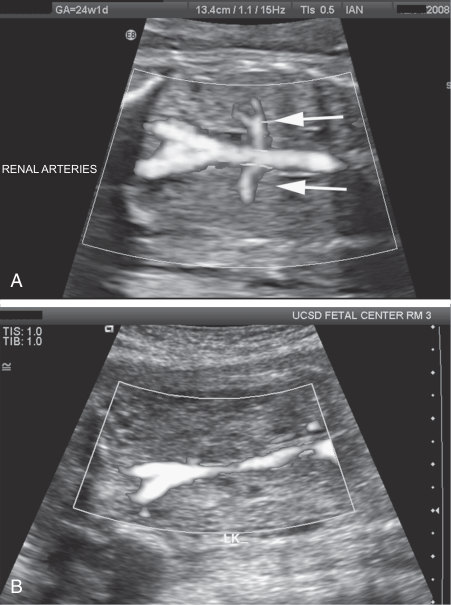

• Fig. 23.7 Bilateral renal agenesis. (A) Doppler image of normal renal arteries (arrows) at 24 weeks’ gestation. (B) Power Doppler image of fetal abdominal aorta and its bifurcation at 20 weeks’ gestation, demonstrating bilateral absence of renal arteries. Note absence of amniotic fluid. LK, Left kidney.

## PDF page 421

asymmetric IUGR, with the fetal abdomen lagging behind the fetal head growth. However, long-standing growth restrictions can produce a more symmetric picture. Earlyonset symmetric IUGR is more likely to be caused by aneuploidy or congenital anomaly.

In cases of IUGR related to placental insufficiency, Doppler studies of uterine and umbilical blood flow may reveal patterns of high resistance. Absent or reverse end-diastolic flow patterns in the umbilical artery are associated with higher PNM and are demonstrated in Fig. 23.8. The fetal middle cerebral artery (MCA) can also be interrogated via Doppler and can show increased amplitude of diastolic flow as a marker of fetal hypoxia and cerebral vasodilation. The management of abnormal Doppler studies is dependent on gestational age. Pulsatility of the MCA and abnormal ductus venosus flow are late findings of fetal compromise and are indications for delivery.

In patients with IUGR and oligohydramnios, intensive fetal monitoring and hospitalization should be initiated because the risks of fetal asphyxia and death are high. Monitoring should be continued in patients diagnosed between 26 and 32 weeks’ gestation. Corticosteroids for lung maturity should be considered. Amniocentesis to assess lung maturity should be considered after 32 weeks; however, with severe oligohydramnios, this can be technically challenging. Delivery should be undertaken if the lungs are mature or if there is evidence of a deteriorating fetal status.

Assess Fetal Pulmonary Status

Prolonged oligohydramnios can result in pulmonary hypoplasia, which is associated with a high PNM. Inhibition of fetal breathing, lack of a trophic function of amniotic fluid within the airways, and simple mechanical compression of the chest are proposed as causes of pulmonary hypoplasia; however, the precise pathophysiology remains unclear.

The risk of developing pulmonary hypoplasia is greatest if oligohydramnios is prolonged and occurs during the canalicular phase of alveolar proliferation, from 16 to 26 weeks of gestation.76 Improved survival is seen if there is a persistence of a fluid pocket of at least 2 cm between 20 and 25 weeks of gestation (30% survival if the pocket is <2 cm; 98% if the pocket is ≥2 cm). The estimated probability of developing pulmonary hypoplasia with severe oligohydramnios in the second trimester is illustrated in Fig. 23.9.

Several sonographic techniques have been proposed for predicting pulmonary hypoplasia, including measuring lung length and chest circumference or evaluating of biometric ratios (e.g., thoracic-to-abdominal circumference or thoracic circumference-to-femur length). D’Alton and colleagues found a thoracic-to-abdominal circumference ratio of less than 0.08 in severe oligohydramnios that was virtually 100% predictive of lethal pulmonary hypoplasia.77 Sonographically, this would have the appearance of a “bellshaped” chest, which by itself is concerning for pulmonary hypoplasia.

Vintzileos and coworkers reviewed six current sonographic parameters for predicting pulmonary hypoplasia

A

B

• Fig. 23.8 Doppler umbilical artery velocimetry. (A) Absent end-diastolic flow. Note the umbilical artery flow velocity waveform returns to zero following each fetal heartbeat (large arrow). (B) Reverse enddiastolic flow. Here the waveform extends below the zero line (negative flow) between the fetal heartbeats (small arrow).

Estimated probability of pulmonary hypoplasia

1.0

0.9

0.8

0.7

0.6

0.5

0.4

0.3

0.2

0.1

0.0

18 19 20 21 22 23 24 25 26 27 28 29 Gestational age at rupture (wk)

• Fig. 23.9 Estimated probability of development of pulmonary hypoplasia by gestational age in severe oligohydramnios (<2 cm maximum vertical pocket). Solid line indicates probability curve. Dashed line illustrates 50% probability at approximately 25 weeks’ gestation. (From Vergani P, Ghidini A, Locatelli A, et al. Risk factors for pulmonary hypoplasia in second-trimester premature rupture of membranes. Am J Obstet Gynecol. 1994;170:1359.)

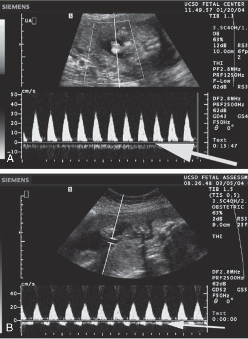

• Fig. 23.8 Doppler umbilical artery velocimetry. (A) Absent end-diastolic flow. Note the umbilical artery flow velocity waveform returns to zero following each fetal heartbeat (large arrow). (B) Reverse enddiastolic flow. Here the waveform extends below the zero line (negative flow) between the fetal heartbeats (small arrow).

## PDF page 422 | printed page 407

and found that the highest sensitivity (85%) and specificity (85%) were achieved by calculating the lung area ratio78:

(chest area −cardiac area) × 100

chest area

The normal lung area ratio should be greater than 66% with the heart occupying less than one-third of the fetal chest. Compared with 2D imaging techniques, 3D lung volumes have higher sensitivity (94%) but similar specificity (82%) in diagnosis of pulmonary hypoplasia. Fig. 23.10 shows total fetal lung volumes for a set of controls and cases with pulmonary hypoplasia using 3D ultrasound. Studies using magnetic resonance imaging are promising; however, nomograms for development have not been standardized.

### Treatment

The management of oligohydramnios depends on the severity of the condition, the underlying cause, and the gestational age of the patient. If discovered at term, induction of labor would be a reasonable option. There is a single randomized trial evaluating induction versus expectant management in 54 patients with oligohydramnios beyond 40 weeks.79 No difference was found in mode of delivery or neonatal Apgar score or cord blood pH.80 However, in more than 500 maternal-fetal medicine members surveyed, 92% would recommend induction without documented lung maturity before 39 weeks and 35% before 37 weeks, even though only one-third of respondents felt induction would decrease adverse outcomes.81 If expectant management is chosen, there is no consensus on what fetal monitoring is best, or even if fetal monitoring is necessary; however, the use of Doppler monitoring in pregnancies thought to be at risk of placental insufficiency has shown benefit. Consistent maternal oral hydration should be encouraged.

Before term, the discovery of oligohydramnios should initiate a comprehensive sonographic evaluation if that assessment has not already been undertaken, focusing on

Left lung

40

Controls Cases

30

Volume (mL)

Volume (mL)

20

10

0

20

25 30

35 40

Gestational age (wk)

• Fig. 23.10 Scatter dot plot and regression lines of left and right lung volumes for cases with pulmonary hypoplasia (▲) and controls without pulmonary hypoplasia (□), including serial scans. (Data from Vergani P, Andreani M, Greco M, et al. Two- or three-dimension ultrasonography: which is the best predictor of pulmonary hypoplasia? Prenat Diagn. 2010;30[9]:834–838.)

the renal system and bladder as well as fetal growth and placental function. Chromosomal analysis can be offered to patients and premature rupture of the membranes should be excluded. Antepartum nonstress testing or biophysical profiles along with Doppler flow studies may be useful, particularly in those pregnancies with isolated oligohydramnios and all other testing reassuring of fetal well-being in avoiding delivery of a preterm fetus or an induction in a term fetus with an unfavorable cervix.

The patient with PROM should be delivered if there is evidence of infection; otherwise, the patient can be managed expectantly with hospitalized bed rest and observation until the fetus reaches 34 weeks or has abnormal antenatal testing. Antibiotics should be administered to prolong latency, and corticosteroids should be given to enhance lung maturity. Most women deliver within a week, but those who do not can potentially remain pregnant for several weeks.

Maternal Hydration

Idiopathic oligohydramnios has been found to be responsive to maternal hydration with no difference in acute or long-term intravenous versus oral hydration.82,83 The effect, however, is short-lived without continued efforts at hydration.84 Women also placed in the left-lateral position at rest have been found to have an increase in AFI.85 It is notable that none of the preceding studies evaluated clinically important outcomes. Maternal hydration therefore has a limited clinical application and may help in cases in which adequate amniotic fluid assists in outcome, such as external cephalic versions or amniocentesis.

Amnioinfusion

Prophylactic transcervical amnioinfusion has been shown to reduce the CS rates when used in patients before being induced for oligohydramnios at term. Presumably, this effect is achieved by reducing cord compression during labor. However, potential complications from amnioinfusion, including uterine overdistention, hypertonus, infection, and amniotic fluid embolism, warrant using this

Right lung

Controls Cases

35

25

15

5

20

25 30

35 40

Gestational age (wk)

## PDF page 423

modality with cautious, close monitoring. Amnioinfusion as a treatment for meconium-stained amniotic fluid is no longer recommended.

In severe second-trimester oligohydramnios, serial transabdominal amnioinfusion has been advocated as a therapeutic procedure to prevent pulmonary hypoplasia and improve outcomes. However, in Fisk and colleagues’ limited series of nine patients,11 only 33% of neonates survived. In Locatelli and associates’ study of 49 women with PROM before 26 weeks, 36 underwent serial amnioinfusion.86 They were successful in maintaining the maximum vertical pocket greater than 2 cm in 11 patients, which significantly improved perinatal outcomes: pulmonary hypoplasia was reduced from 62% to 10% with no abnormal neurologic outcomes. Other small series similarly report decreased pulmonary hypoplasia, better neurologic outcomes, and overall improved survival with serial amnioinfusions. A prospective trial currently underway is the Renal Anhydramnios Fetal Therapy trial (RAFT) to determine if amnioinfusions can be successful in decreasing pulmonary hypoplasia with severe second-trimester oligohydramnios.

Tissue Sealants

Application of various compounds to seal ruptured membranes has been tried since 1979. Compounds used for treating preterm PROM include platelets with thrombin or cryoprecipitate, fibrin sealants to occlude the cervical canal, gelatin plugs, synthetic hydrogels, collagen plugs, and blood patches. These treatments have been associated with poor outcomes, including fetal bradycardia and death, and remain investigational, although a few successes have been reported in repairing the amniotomy made at the time of fetal surgery. The utility in the use of tissue sealants is problematic in pregnancies complicated by preterm PROM because the reason for the rupture is infection in a number of these pregnancies, and the use of a tissue sealant would not be appropriate in the management of these pregnancies. More study is needed before recommendations can be made for preterm PROM.

### Polyhydramnios

Polyhydramnios has been defined as an AFV of greater than 2000 mL87 and occurs in 1% to 3% of pregnancies. By ultrasound techniques, it has been estimated as an SDP greater than 8 cm, an AFI greater than 24 or 25 cm or an AFV above 95th percentile for gestational age, or a subjectively high volume of fluid. Patients with polyhydramnios may present with increased uterine fundal height, dyspnea, edema, and increased weight.

Elevated amniotic fluid can result from decreased absorption, overproduction, or be idiopathic. Decreased absorption typically results from a failure of fetal swallowing from etiologies such as tracheal atresia, tracheal or bowel obstruction, or neurologic abnormalities such as anencephaly. Chromosomal abnormalities,88 nonimmune hydrops, and diabetes are also recognized reasons for polyhydramnios.

The diagnostic work-up for polyhydramnios includes an assessment for diabetes, syphilis, Rh isoimmunization, or atypical antibodies that might lead to hemolytic disease of the newborn, fetal or placental (chorioangioma) abnormalities, and work-up for infection if there has been a recent exposure or maternal history suggestive of a recent infection.

### Clinical Implications

Retrospective reviews of pregnancies with polyhydramnios demonstrate an association with macrosomia, premature births, nonreactive nonstress tests, perinatal morbidity, and congenital anomalies in high-risk pregnancies with polyhydramnios.89 A total of 118 pregnancies with polyhydramnios, as defined by SDP greater than 8 cm with a normal fetal anatomic scan, 75-g glucose test, and TORCH serology, were studied retrospectively by Abele et al.58 Eleven of those pregnancies had postnatal abnormalities identified, with the majority being gastrointestinal atresia. In a study of 788 infants with polyhydramnios, the rate of congenital malformations was 2.3% compared with 0.13% in those with normal amniotic fluid. Those with no major congenital malformations diagnosed were at risk for the development of respiratory distress and hypoglycemia.90

### Etiology

The prevalence of polyhydramnios in pregnancy is 1% to 2%, with 50% to 60% of those pregnancies being idiopathic. Because the major pathway for removal of amniotic fluid is swallowing, it follows that congenital anomalies that interfere with swallowing or intestinal absorption (e.g., duodenal atresia) are the most common causes of polyhydramnios. The prevalence of congenital anomalies correlates with the severity of polyhydramnios, with a 2.6 times greater incidence of anomalies in severe polyhydramnios (75%) than in mild polyhydramnios (29%).91

Polyhydramnios has also been linked to maternal pregestational and gestational diabetes and fetal macrosomia. Increased fetal urination in mothers with adult-onset or gestational diabetes accounts for nearly 15% of cases of polyhydramnios.92 Isolated polyhydramnios has not been found to be a strong independent predictor of gestational diabetes. Aneuploidy is reported in 3% to 13% of pregnancies associated with polyhydramnios.92 The development of the Rh immunoglobulin to prevent immune hydrops fetalis resulting from Rh isoimmunization (see Chapter 22) has decreased the incidence of polyhydramnios because of this condition. Box 23.2 lists conditions associated with polyhydramnios.

### Diagnostic Evaluation

Assess Fetal Anatomy

A detailed sonographic evaluation should be performed to assess the fetus for possible congenital anomalies, paying particular attention to the gastrointestinal system for abnormalities that impair fetal swallowing and absorption of the fluid. With proximal obstruction (e.g., esophageal atresia, tracheoesophageal fistula, or esophageal compression from

## PDF page 424 | printed page 409

• BOX 23.2 Principal Diagnoses Associated With

Polyhydramnios

Fetal

• Chromosomal abnormalities • Congenital anomalies • Gastrointestinal (duodenal or esophageal atresia,

tracheoesophageal fistula, gastroschisis, omphalocele, diaphragmatic hernia) • Craniofacial (anencephaly, holoprosencephaly,

hydrocephaly, micrognathia, cleft palate) • Pulmonary (congenital pulmonary airway malformation,

chylothorax) • Cardiac (malformations, arrhythmias) • Skeletal dysplasias • Fetal hydrops (immune or nonimmune) • Anemia (fetomaternal hemorrhage, parvovirus infection,

isoimmunization, thalassemia) • Neuromuscular disorders (myotonic dystrophy,

Pena-Shokeir) • Neoplasias (teratomas, hemangiomas) • Constitutional macrosomia

Maternal

• Diabetes mellitus • Gestational diabetes • Adult-onset (type 2) diabetes

Placental

• Chorioangioma • Twin-twin transfusion

Idiopathic

Adapted from Phelan JP, Martin GI. Polyhydramnios: fetal and neonatal implications. Clin Perinatol. 1989;16:987; Hill LM, Breckle R, Thomas ML, et al. Polyhydramnios: ultrasonically detected prevalence and neonatal outcome. Obstet Gynecol. 1987;69:21; Ben-Chetrit A, Hochner-Celnikier D, Ron M, et al. Hydramnios in the third trimester of pregnancy: a change in the distribution of accompanying anomalies as a result of early ultrasonographic prenatal diagnosis. Am J Obstet Gynecol. 1990;162:1344.

a diaphragmatic hernia or lung mass), the usual stomach “bubble” is absent. Conversely with distal obstruction, multiple cystic structures may be seen in the fetal abdomen. For example, duodenal atresia produces a characteristic “double bubble” appearance (Fig. 23.11). Decreased fetal swallowing, which may result in polyhydramnios, is associated with anencephaly, trisomy 18, trisomy 21, muscular dystrophies, fetal akinesia, and skeletal dysplasias. If polyhydramnios is present with a growth-restricted fetus, or if markers of aneuploidy are seen, evaluation for chromosomal abnormalities should be undertaken. Close surveillance is important in pregnancy with polyhydramnios and IUGR because of the increased risk of PNM, neonatal morbidity, and neonatal mortality.91

Sonographic signs of fluid overload (i.e., hydrops fetalis), including ascites, pleural effusion, pericardial effusion, and skin edema, should be assessed. Polyhydramnios in hydrops fetalis may be the first presenting sign, prompting further evaluation for erythroblastosis fetalis or nonimmune hydrops.

• Fig. 23.11 Duodenal atresia. Note the characteristic double bubble sign within the fetal abdomen, illustrating the fluid-filled stomach (small arrow) and duodenum (large arrow) on this transverse view of the fetal abdomen.

In anatomically normal fetuses with otherwise unexplained polyhydramnios, diabetes should be suspected, particularly if there is fetal macrosomia or an asymmetrically larger fetal abdominal circumference. These patients should be evaluated with a glucose tolerance test and treated accordingly. Polyhydramnios in diabetes is associated with increased perinatal morbidity and mortality beyond that of the diabetes itself.

Currently, the best technique, AFI versus SDP, to estimate polyhydramnios is uncertain. In oligohydramnios, the AFI and SDP do not label pregnancies as having oligohydramnios similarly. Magann et al. observed that in 72% of pregnancies with an AFI less than 5, the SDP remained normal.93 The Cochrane review94 concluded that the SDP was superior to the AFI in antenatal testing because the AFI increased the number of pregnancies diagnosed with oligohydramnios, leading to more interventions without an improvement in perinatal outcomes. With the use of the AFI and SDP in labeling pregnancies as having polyhydramnios, an over-labeling with the SDP to classify a pregnancy at having polyhydramnios has been observed. Does the use of the SDP lead to an increased number of pregnancies being labeled as having polyhydramnios without an improvement in perinatal outcomes? A recent study analyzed the accuracy of ultrasound (SDP and AFI) to identify actual (dye-determined oligohydramnios, normal fluid volume, and polyhydramnios) from 506 singleton pregnancies. Although not statistically significant, the AFI had a higher positive predictive value compared with the SDP (55% vs. 31%) for the identification of actual polyhydramnios. The SDP had a higher missed call rate for high volume identification than the AFI (OR 5.5; 95% CI [2.04 to 14.97; P = .0005]). The investigators observed that of the 39 women with actual polyhydramnios, the AFI identified 9 and mislabeled 11 with normal fluid versus the SDP, which identified 11 with actual polyhydramnios but mislabeled 24

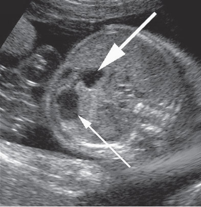

• Fig. 23.11 Duodenal atresia. Note the characteristic double bubble sign within the fetal abdomen, illustrating the fluid-filled stomach (small arrow) and duodenum (large arrow) on this transverse view of the fetal abdomen.

## PDF page 425

with normal fluid as having polyhydramnios. The AFI in this study was superior for the identification of actual (dye-determined) polyhydramnios.95

### Treatment

If nonlethal congenital anomalies are uncovered, appropriate pediatric specialists should be consulted for postnatal treatment. In patients with idiopathic mild polyhydramnios (AFI of 24–40 cm), the perinatal outcome should be no different than that in patients with normal AFV, other than large-forgestational-age babies (>4000 g at birth). Uterine overdistention, however, may stimulate preterm uterine contractions, and labor may ensue. These patients are at a significantly high risk for PROM and cord prolapse. They should be counseled on the signs and symptoms of preterm labor. If polyhydramnios is discovered at an early gestation, antenatal testing should be initiated at 24 weeks’ gestation, although there is no consensus on what type of testing should be begun or at what interval. This can be left to the discretion of the physician. The patient should be assessed for early cervical changes if she is contracting or otherwise symptomatic. In women with severe polyhydramnios (AFI >40 cm), amnioreduction or prostaglandin inhibitors should be considered for those with significant maternal complications (difficulty breathing). There are no recommendations for induction of labor if discovered at term.

Amnioreduction

Removal of excess amniotic fluid may prolong pregnancy and reduce maternal dyspnea from the overdistended uterus in patients with severe polyhydramnios. Calderyo-Barcia and coworkers demonstrated that amnioreduction reduces the baseline tonus and contractility of the uterus by using transabdominal intrauterine pressure transducers in cases of polyhydramnios96; however, amniotic fluid invariably returns, making serial amnioreduction necessary. In a series by Leung and colleagues, 134 rapid amnioreduction procedures were performed on 74 patients with a maximum vertical pocket greater than 10 cm using higher flow rates (≈100 mL per min).97 The most common reported indication for the amnioreduction was TTTS, and repeated procedures were required in 64% of cases. However, a single amnioreduction was sufficient in 70% of patients without TTTS. Complications of amnioreduction include PROM, preterm labor, abruption, fetal bradycardia, infection, and maternal hypoproteinemia.

Prostaglandin Synthetase Inhibitors

Indomethacin reduces AFV by stimulating fetal vasopressin release, which has an antidiuretic effect on fetal urine production. Indomethacin is also postulated to enhance fluid reabsorption by the fetal lungs and increase transmembranous absorption of excessive amniotic fluid back to the maternal circulation. The dosing of indomethacin is generally 25 mg orally every 6 hours but can range up to 100 mg every 4 to 8 hours, depending on the severity of polyhydramnios and clinical response. Treatment should

be discontinued once the fluid is reduced by one-third to one-half of its original volume, or when the AFI is less than 20 cm. Indomethacin is effective in reducing the AFV in more than 90% of cases of polyhydramnios, but complications during treatment include premature closure of the ductus arteriosus, renal complications, and necrotizing enterocolitis. Chronic ductal closure in utero can produce fetal hydrops and persistent pulmonary hypertension in the neonate. The risk of ductal constriction is 5% at 27 weeks and increases to almost 50% by 32 weeks; therefore indomethacin treatment should be discontinued before 32 weeks to avoid iatrogenic side effects. Complications linked with indomethacin use can be minimized if the total dose of indomethacin is less than 200 mg/day and the therapy is discontinued after 48 hours of therapy.

Sulindac, a prostaglandin inhibitor sometimes used for preterm labor symptoms, has incidentally been shown to also reduce AFV. It has the purported advantage of less ductal closure but has not been investigated prospectively for treatment of polyhydramnios.

Close Surveillance

Idiopathic polyhydramnios, in a review of the existing literature, has been linked with a two- to fivefold increase in the risk of PNM.98 The ideal management of idiopathic polyhydramnios is unknown. One proposed management scheme is to do serial antenatal testing, and as long as those assessments are reassuring, then delivery probably does not need to occur before term.99 If the idiopathic polyhydramnios resolves before term, the question of whether the pregnancy remains at increased risk for PNM is also unknown.

### Management of Fluid Abnormalities in Multifetal Pregnancies

Management of abnormal AFV in twin pregnancies does not vary much from singleton pregnancies with the single exception of TTTS. Pregnancies with polyhydramniosoligohydramnios sequence or those with diagnosed TTTS should be referred to maternal-fetal medicine for evaluation and potential treatment as indicated. Laser therapy is being used with increased frequency in monochorionic diamniotic twin pregnancies complicated by TTTS. Recommended surveillance is an assessment of AFV every 2 weeks, beginning at 16 weeks and continuing throughout the pregnancy. The surveillance recommendations for twin pregnancies are amniotic fluid assessments and growth scans every 4 weeks. The diagnosis of abnormal amniotic fluid in monoamniotic twins does not alter the management of the pregnancy, as antenatal testing should begin at viability and delivery should be planned early.99,100 The discovery of abnormal fluid volumes may prompt an earlier evaluation of causes such as TTTS, IUGR, and congenital anomalies. Dichorionic/diamniotic twin pregnancies should be treated as described for singleton pregnancies. In pregnancies in which polyhydramnios is found in both sacs, or in a single

## PDF page 426 | printed page 411

shared amnion, fluid reduction may be necessary for maternal comfort, and preterm labor may be encountered more frequently.101

### The Future

Amniotic fluid also harbors fetal cells for chromosomal analysis and multiple proteins, some of which have clinical significance, such as alpha-fetoprotein, phosphatidylglycerol,

Key Points

### • Fetal contributions to amniotic fluid include fetal urine,

lung fluid, and removal by fetal swallowing.

### • Ultrasound assessments of amniotic fluid volume include

amniotic fluid index and single deepest pocket.

### References

1. Gilbert WM, Brace RA. The missing link in amniotic fluid vol-

ume regulation: intramembranous absorption. Obstet Gynecol. 1989;74:748–754. 2. Beall MH, van den Wijngaard JP, van Gemert MJ, et al. Amni-

otic fluid water dynamics. Placenta. 2007;28:816–823. 3. Magann EF, Sandlin AT, Ounpraseuth ST. Amniotic fluid

and the clinical relevance of the sonographically estimated amniotic fluid volume: oligohydramnios. J Ultrasound Med. 2011;30:1573–1585. 4. Brace RA, Wolf EJ. Normal amniotic fluid volume changes

throughout pregnancy. Am J Obstet Gynecol. 1989;161:382– 388. 5. Brace RA. Amniotic fluid volume and its relationship to fetal

fluid balance: review of experimental data. Semin Perinatol. 1986;10:103–112. 6. Gillibrand PN. Changes in the electrolytes, urea and osmolality

of the amniotic fluid with advancing pregnancy. J Obstet Gynaecol Br Commonw. 1969;76:898–905. 7. Lee SM, Park SK, Shim SS, et al. Measurement of fetal urine

production by three-dimensional ultrasonography in normal pregnancy. Ultrasound Obstet Gynecol. 2007;30:281–286. 8. Peixoto-Filho FM, de Sa RA, Velarde LG, et al. Normal range

for fetal urine production rate by 3-D ultrasound in Brazilian population. Arch Gynecol Obstet. 2011;283:497–500. 9. Wladimiroff JW, Campbell S. Fetal urine-production rates in

normal and complicated pregnancy. Lancet. 1974;1:151–154. 10. Brace RA, Wlodek ME, Cock ML, et al. Swallowing of lung

liquid and amniotic fluid by the ovine fetus under normoxic and hypoxic conditions. Am J Obstet Gynecol. 1994;171:764–770. 11. Fisk NM, Ronderos-Dumit D, Soliani A, et al. Diagnostic and

therapeutic transabdominal amnioinfusion in oligohydramnios. Obstet Gynecol. 1991;78:270–278. 12. Assali NS. Pathophysiology of Gestation. New York: Academic

Press; 1972. 13. Balchin I, Whittaker JC, Lamont RF, et al. Maternal and fetal

characteristics associated with meconium-stained amniotic fluid. Obstet Gynecol. 2011;117:828–835. 14. Fischer C, Rybakowski C, Ferdynus C, et al. A population-

based study of meconium aspiration syndrome in neonates born between 37 and 43 weeks of gestation. Int J Pediatr. 2012;2012: 321545.

and interleukin-6. Amniotic fluid is now being evaluated by complex methods, such as capillary electrophoresis for early predictors of outcomes such as macrosomia and maternal gestational diabetes.102,103 Amnion and amniotic fluid are also being used to harvest embryonic stem cells for research in all arenas of medicine, including cancer research.104 Amniotic fluid is not only the nectar that supports a healthy pregnancy but also a clue to maternal and fetal disease and possibly the gateway to future therapy.

### • Both oligohydramnios and polyhydramnios may have

maternal, placental, or fetal etiologies and require close monitoring for fetal well-being.

15. Bolisetty S, Patole SK, McBride GA, et al. Neonatal amniotic

fluid aspiration syndrome underdiagnosed? Int J Clin Pract. 2001;55:727–728. 16. Ikeda N, Yamakawa M, Imai Y, et al. Sudden infant death from

atelectasis due to amniotic fluid aspiration. Am J Forensic Med Pathol. 1989;10:340–343. 17. Modena AB, Fieni S. Amniotic fluid dynamics. Acta Biomed.

2004;75(suppl 1):11–13. 18. Pritchard JA. Deglutition by normal and anencephalic fetuses.

Obstet Gynecol. 1965;25:289–297. 19. Tomoda S, Brace RA, Longo LD. Amniotic fluid volume and

fetal swallowing rate in sheep. Am J Physiol. 1985;249:R133– R138. 20. Brace RA, Anderson DF, Cheung CY. Fetal swallowing as a

protective mechanism against oligohydramnios and polyhydramnios in late gestation sheep. Reprod Sci. 2013;20(3):326– 330. 21. Minei LJ, Suzuki K. Role of fetal deglutition and micturition in

the production and turnover of amniotic fluid in the monkey. Obstet Gynecol. 1976;48:177–181. 22. Gilbert WM, et al. Amniotic fluid dynamics. Fetal Med Rev.

1991;3. 23. Beall MH, van den Wijngaard JP, van Gemert MJ, et al. Regula-

tion of amniotic fluid volume. Placenta. 2007;28:824–832. 24. Mann SE, Nijland MJ, Ross MG. Mathematic model-

ing of human amniotic fluid dynamics. Am J Obstet Gynecol. 1996;175:937–944. 25. Damiano AE. Review: water channel proteins in the human pla-

centa and fetal membranes. Placenta. 2011;32(suppl 2):S207– S211. 26. Jiang SS, Zhu XJ, Ding SD, et al. Expression and localization

of aquaporins 8 and 9 in term placenta with oligohydramnios. Reprod Sci. 2012;19(12):1276–1284. 27. Zhang Y, Ding S, Shen Q, et al. The expression and regulation

of aquaporins in placenta and fetal membranes. Front Biosci. 2012;17:2371–2382. 28. Faber JJ, Anderson DF. Absorption of amniotic fluid by

amniochorion in sheep. Am J Physiol Heart Circ Physiol. 2002;282:H850–H854. 29. Chamberlain PF, Manning FA, Morrison I, et al. Ultrasound

evaluation of amniotic fluid volume. I. The relationship of marginal and decreased amniotic fluid volumes to perinatal outcome. Am J Obstet Gynecol. 1984;150:245–249.

## PDF page 427

30. Chamberlain PF, Manning FA, Morrison I, et al. Ultrasound

evaluation of amniotic fluid volume. II. The relationship of increased amniotic fluid volume to perinatal outcome. Am J Obstet Gynecol. 1984;150:250–254. 31. Horsager R, Nathan L, Leveno KJ. Correlation of measured

amniotic fluid volume and sonographic predictions of oligohydramnios. Obstet Gynecol. 1994;83:955–958. 32. Magann EF, Nolan TE, Hess LW, et al. Measurement of amni-

otic fluid volume: accuracy of ultrasonography techniques. Am J Obstet Gynecol. 1992;167(6):1533–1537. 33. Magann EF, Doherty DA, Ennen CS, et al. The ultrasound esti-

mation of amniotic fluid volume in diamniotic twin pregnancies and prediction of peripartum outcomes. Am J Obstet Gynecol. 2007;196(570):e1–e6; discussion e6-8. 34. Magann EF, Whitworth NS, Files JC, et al. Dye-dilution

techniques using aminohippurate sodium: do they accurately reflect amniotic fluid volume? J Matern Fetal Neonatal Med. 2002;11:167–170. 35. Zaretsky MV, McIntire DD, Reichel TF, et al. Correlation of mea-

sured amnionic fluid volume to sonographic and magnetic resonance predictions. Am J Obstet Gynecol. 2004;191:2148–2153. 36. Magann EF, Chauhan SP, Whitworth NS, et al. Determination

of amniotic fluid volume in twin pregnancies: ultrasonographic evaluation versus operator estimation. Am J Obstet Gynecol. 2000;182:1606–1609. 37. Phelan JP, Ahn MO, Smith CV, et al. Amniotic fluid index

measurements during pregnancy. J Reprod Med. 1987;32:601– 604. 38. Moore TR, Cayle JE. The amniotic fluid index in normal

human pregnancy. Am J Obstet Gynecol. 1990;162:1168–1173. 39. Magann EF, Bass JD, Chauhan SP, et al. Amniotic fluid volume in

normal singleton pregnancies. Obstet Gynecol. 1997;90:524–528. 40. Magann EF, Sanderson M, Martin JN, et al. The amniotic fluid

index, single deepest pocket, and two-diameter pocket in normal human pregnancy. Am J Obstet Gynecol. 2000;182:1581–1588. 41. Queenan JT, Thompson W, Whitfield CR, et al. Amniotic

fluid volumes in normal pregnancies. Am J Obstet Gynecol. 1972;114:34–38. 42. Chauhan SP, Doherty DD, Magann EF, et al. Amniotic fluid

index vs single deepest pocket technique during modified biophysical profile: a randomized clinical trial. Am J Obstet Gynecol. 2004;191:661–667; discussion 7-8. 43. Magann EF, Doherty DA, Field K, et al. Biophysical pro-

file with amniotic fluid volume assessments. Obstet Gynecol. 2004;104:5–10. 44. Magann EF, Chauhan SP, Doherty DA, et al. The evidence for

abandoning the amniotic fluid index in favor of the single deepest pocket. Am J Perinatol. 2007;24:549–555. 45. Nabhan AF, Abdelmoula YA. Amniotic fluid index versus single

deepest vertical pocket: a meta-analysis of randomized controlled trials. Int J Gynaecol Obstet. 2009;104:184–188. 46. Magann EF, Chauhan SP, Barrilleaux PS, et al. Ultrasound esti-

mate of amniotic fluid volume: color Doppler overdiagnosis of oligohydramnios. Obstet Gynecol. 2001;98:71–74. 47. Hughes DS, Whittington JR, Kim H, et al. Is there a difference

in sonographic estimation of amniotic fluid volume when measuring with the probe perpendicular to the floor compared with perpendicular to the uterine contour? J Obstet Gynaecol Can. 2019;41(9):1295–1301. 48. Sahin B, Alper T, Kokcu A, et al. Estimation of the amniotic

fluid volume using the Cavalieri method on ultrasound images. Int J Gynaecol Obstet. 2003;82:25–30.

49. Bromley B, Shipp TD, Benacerraf B. Assessment of the third-

trimester fetus using 3-dimensional volumes: a pilot study. J Clin Ultrasound. 2007;35:231–237. 50. Rousian M, Koning AH, Hop WC, et al. Gestational sac fluid

volume measurements in virtual reality. Ultrasound Obstet Gynecol. 2011;38:524–529. 51. Schrimmer DB, Moore TR. Sonographic evaluation of amniotic

fluid volume. Clin Obstet Gynecol. 2002;45:1026–1038. 52. Queenan JT, Thompson W, Whitfield CR, et al. Amniotic

fluid volumes in normal pregnancies. Am J Obstet Gynecol. 1972;114:34–38. 53. Ounpraseuth ST, Magann EF, Spencer HJ, et al. Normal amni-

otic fluid volume across gestation: comparison of statistical approaches in 1190 normal amniotic fluid volumes. J Obstet Gynaecol Res. 2017;43:1122–1131. 54. Shanks A, Tuuli M, Schaecher C, et al. Assessing the optimal

definition of oligohydramnios associated with adverse neonatal outcomes. J Ultrasound Med. 2011;30:303–307. 55. Magann EF, Doherty DA, Chauhan SP, et al. How well do the

amniotic fluid index and single deepest pocket indices (below the 3rd and 5th and above the 95th and 97th percentiles) predict oligohydramnios and hydramnios? Am J Obstet Gynecol. 2004;190:164–169. 56. Magann EF, Whitworth NS, Bass JD, et al. Amniotic fluid

volume of third-trimester diamniotic twin pregnancies. Obstet Gynecol. 1995;85:957–960. 57. Morin L, Lim K. Ultrasound in twin pregnancies. J Obstet Gyn-

aecol Can. 2011;33:643–656. 58. Abele H, Starz S, Hoopmann M, et al. Idiopathic polyhy-

dramnios and postnatal abnormalities. Fetal Diagn Ther. 2012;32:251–255. 59. Hernandez JS, Twickler DM, McIntire DD, et al. Hydramnios

in twin gestations. Obstet Gynecol. 2012;120:759–765. 60. Stein RG, Diessner J, Frieauff E, et al. Acute foeto-foetal trans-

fusion syndrome—case report and review of the literature. Z Geburtshilfe Neonatol. 2012;216:147–149. 61. Shveiky D, Ezra Y, Schenker JG, et al. Monoamniotic twins:

an update on antenatal diagnosis and treatment. J Matern Fetal Neonatal Med. 2004;16:180–186. 62. Carver A, Haeri S, Moldenhauer J, et al. Monochorionic diam-

niotic twin pregnancy: timing and duration of sonographic surveillance for detection of twin-twin transfusion syndrome. J Ultrasound Med. 2011;30:297–301. 63. Bromley B, Harlow BL, Laboda LA, et al. Small sac size in the

first trimester: a predictor of poor fetal outcome. Radiology. 1991;178:375–377. 64. Dildy 3rd GA, Lira N, Moise Jr KJ, et al. Amniotic fluid volume

assessment: comparison of ultrasonographic estimates versus direct measurements with a dye-dilution technique in human pregnancy. Am J Obstet Gynecol. 1992;167:986–994. 65. Magann EF, Chauhan SP, Hitt WC, et al. Borderline or mar-

ginal amniotic fluid index and peripartum outcomes: a review of the literature. J Ultrasound Med. 2011;30:523–528. 66. Petrozella LN, Dashe JS, McIntire DD, et al. Clinical signifi-

cance of borderline amniotic fluid index and oligohydramnios in preterm pregnancy. Obstet Gynecol. 2011;117:338–342. 67. Oyelese Y. Placenta, umbilical cord and amniotic fluid: the not-

less-important accessories. Clin Obstet Gynecol. 2012;55:307–323. 68. Melamed N, Pardo J, Milstein R, et al. Perinatal outcome in

pregnancies complicated by isolated oligohydramnios diagnosed before 37 weeks of gestation. Am J Obstet Gynecol. 2011;205(241):e1–e6.

## PDF page 428 | printed page 413

69. Magann EF, Haas DM, Hill JB, et al. Oligohydramnios, small

for gestational age and pregnancy outcomes: an analysis using precise measures. Gynecol Obstet Invest. 2011;72:239–244. 70. Shenker L, Reed KL, Anderson CF, et al. Significance of oli-

gohydramnios complicating pregnancy. Am J Obstet Gynecol. 1991;164:1597–1599; discussion 9-600. 71. Shipp TD, Bromley B, Pauker S, et al. Outcome of singleton

pregnancies with severe oligohydramnios in the second and third trimesters. Ultrasound Obstet Gynecol. 1996;7:108–113. 72. Leibovitch L, Kuint J, Rosenfeld E, et al. Short-term outcome

among term singleton infants with intrapartum oligohydramnios. Acta Paediatr. 2012;101:727–730. 73. Lee SE, Park JS, Norwitz ER, et al. Measurement of placental

alpha-microglobulin-1 in cervicovaginal discharge to diagnose rupture of membranes. Obstet Gynecol. 2007;109:634–640. 74. Storness-Bliss C, Metcalfe A, Simrose R, et al. Correlation of

residual amniotic fluid and perinatal outcomes in periviable preterm premature rupture of membranes. J Obstet Gynaecol Can. 2012;34:154–158. 75. Hunter TJ, Byrnes MJ, Nathan E, et al. Factors influencing sur-

vival in pre-viable preterm premature rupture of membranes. J Matern Fetal Neonatal Med. 2012;25:1755–1761. 76. Vergani P, Ghidini A, Locatelli A, et al. Risk factors for pulmo-

nary hypoplasia in second-trimester premature rupture of membranes. Am J Obstet Gynecol. 1994;170:1359–1364. 77. D’Alton M, Mercer B, Riddick E, et al. Serial thoracic versus

abdominal circumference ratios for the prediction of pulmonary hypoplasia in premature rupture of the membranes remote from term. Am J Obstet Gynecol. 1992;166:658–663. 78. Vintzileos AM, Campbell WA, Rodis JF, et al. Comparison of

six different ultrasonographic methods for predicting lethal fetal pulmonary hypoplasia. Am J Obstet Gynecol. 1989;161:606–612. 79. Munn MB. Management of oligohydramnios in pregnancy.

Obstet Gynecol Clin North Am. 2011;38:387–395, xii. 80. Ek S, Andersson A, Johansson A, Kublicas M. Oligohydramnios

in uncomplicated pregnancies beyond 40 completed weeks. A prospective, randomised, pilot study on maternal and neonatal outcomes. Fetal Diagn Ther. 2005;20:182–185. 81. Schwartz N, Sweeting R, Young BK. Practice patterns in the

management of isolated oligohydramnios: a survey of perinatologists. J Matern Fetal Neonatal Med. 2009;22:357–361. 82. Magann EF, Doherty DA, Chauhan SP, et al. Effect of mater-

nal hydration on amniotic fluid volume. Obstet Gynecol. 2003;101:1261–1265. 83. Patrelli TS, Gizzo S, Cosmi E, et al. Maternal hydration therapy

improves the quantity of amniotic fluid and the pregnancy outcome in third-trimester isolated oligohydramnios: a controlled randomized institutional trial. J Ultrasound Med. 2012;31:239–244. 84. Malhotra B, Deka D. Duration of the increase in amniotic fluid

index (AFI) after acute maternal hydration. Arch Gynecol Obstet. 2004;269:173–175. 85. Ulker K, Temur I, Karaca M, et al. Effects of maternal left lateral

position and rest on amniotic fluid index: a prospective clinical study. J Reprod Med. 2012;57:270–276. 86. Locatelli A, Vergani P, Di Pirro G, et al. Role of amnioinfusion

in the management of premature rupture of the membranes at <26 weeks’ gestation. Am J Obstet Gynecol. 2000;183:878–882. 87. Magann EF, Morton ML, Nolan TE, et al. Comparative effi-

cacy of two sonographic measurements for the detection

of aberrations in the amniotic fluid volume and the effect of amniotic fluid volume on pregnancy outcome. Obstet Gynecol. 1994;83:959–962. 88. Brady K, Polzin WJ, Kopelman JN, et al. Risk of chromosomal

abnormalities in patients with idiopathic polyhydramnios. Obstet Gynecol. 1992;79:234–238. 89. Ott WJ. Reevaluation of the relationship between amniotic

fluid volume and perinatal outcome. Am J Obstet Gynecol. 2005;192:1803–1809; discussion 9. 90. Leibovitch L, Schushan-Eisen I, Kuint J, et al. Short-term out-

come for term and near-term singleton infants with intrapartum polyhydramnios. Neonatology. 2012;101:61–67. 91. Erez O, Shoham-Vardi I, Sheiner E, et al. Hydramnios and

small for gestational age are independent risk factors for neonatal mortality and maternal morbidity. Arch Gynecol Obstet. 2005;271(4):296–301. 92. Hill LM, Breckle R, Thomas ML, et al. Polyhydramnios: ultra-

sonically detected prevalence and neonatal outcome. Obstet Gynecol. 1987;69:21–25. 93. Magann EF, Chauhan SP, Kinsella MJ, et al. Antenatal test-

ing among 1001 patients at high risk: the role of ultrasonographic estimate of amniotic fluid volume. Am J Obstet Gynecol. 1999;180(6 Pt 1):1330–1336. 94. Nabhan AF, Abdelmoula YA. Amniotic fluid index versus

single deepest vertical pocket as a screening test for preventing adverse pregnancy outcome. Cochrane Database Syst Rev. 2008;3:CD006593. 95. Hughes DS, Magann EF, Whittington JR, et al. Accuracy of

the ultrasound estimate of the amniotic fluid volume (amniotic fluid index and single deepest pocket) to identify actual low, normal, and high amniotic fluid volumes as determined by quantile regression. J Ultrasound Med. 2020;39(2):373–378. 96. Caldeyro-Barcia R, Pose SV, Alvarez H. Uterine contractility in

polyhydramnios and the effects of withdrawal of the excess of amniotic fluid. Am J Obstet Gynecol. 1957;73:1238–1254. 97. Leung WC, Jouannic JM, Hyett J, et al. Procedure-related com-

plications of rapid amniodrainage in the treatment of polyhydramnios. Ultrasound Obstet Gynecol. 2004;23:154–158. 98. Magann EF, Chauhan SP, Doherty DA, et al. A review of idio-

pathic hydramnios and pregnancy outcomes. Obstet Gynecol Surv. 2007;62(12):795–802. 99. Su LL. Monoamniotic twins: diagnosis and management. Acta

Obstet Gynecol Scand. 2002;81:995–1000. 100. Inde Y, Miyake H, Takaya A, et al. A case of monochorionic-

diamniotic twin pregnancy with polyhydramnios-polyhydramnios sequence. J Nippon Med Sch. 2009;76:93–95. 101. Boisvert MR, Koski KG, Burns DH, et al. Early prediction of

macrosomia based on an analysis of second trimester amniotic fluid by capillary electrophoresis. Biomark Med. 2012;6:655– 662. 102. Boisvert MR, Koski KG, Burns DH, et al. Prediction of gesta-

tional diabetes mellitus based on an analysis of amniotic fluid by capillary electrophoresis. Biomark Med. 2012;6:645–653. 103. Gao T, Zablith N, Burns DH, et al. Identification and quantita-

tion of human amniotic fluid components using capillary zone electrophoresis. Anal Biochem. 2009;388:155–157. 104. Kang NH, Hwang KA, Kim SU, et al. Potential antitumor ther-

apeutic strategies of human amniotic membrane and amniotic fluid-derived stem cells. Cancer Gene Ther. 2012;19:517–522.

<!-- SOURCE_LAYOUT_VIEWS -->

## Original layout views and recovered diagrams

Automatic extraction can flatten tables and superscripts. Check the original layout for numeric data, footnotes and image credits. [Source review notes](../../SOURCE_REVIEW_NOTES.md).

### Original source page 412

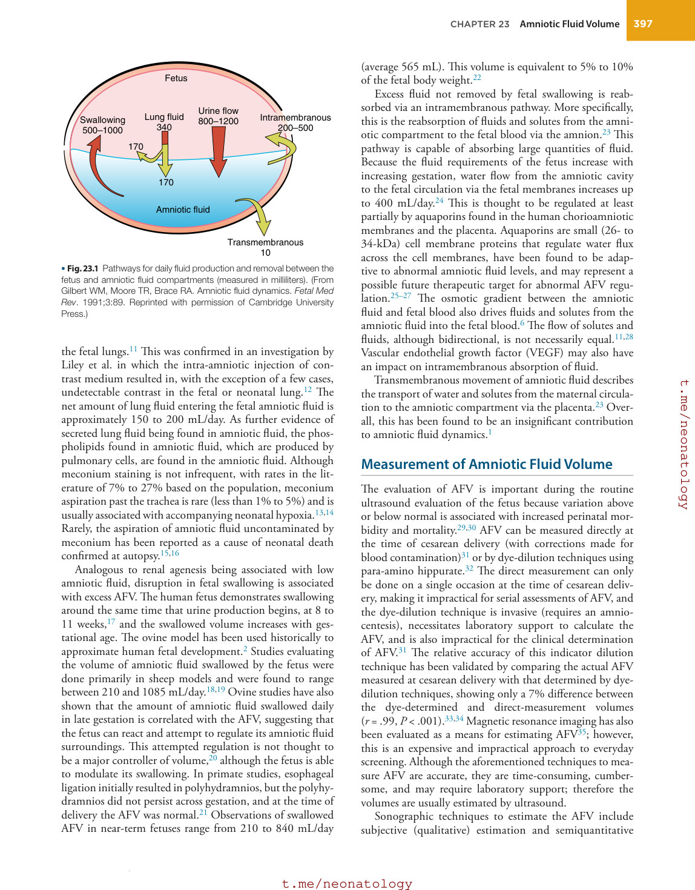

### Original source page 413

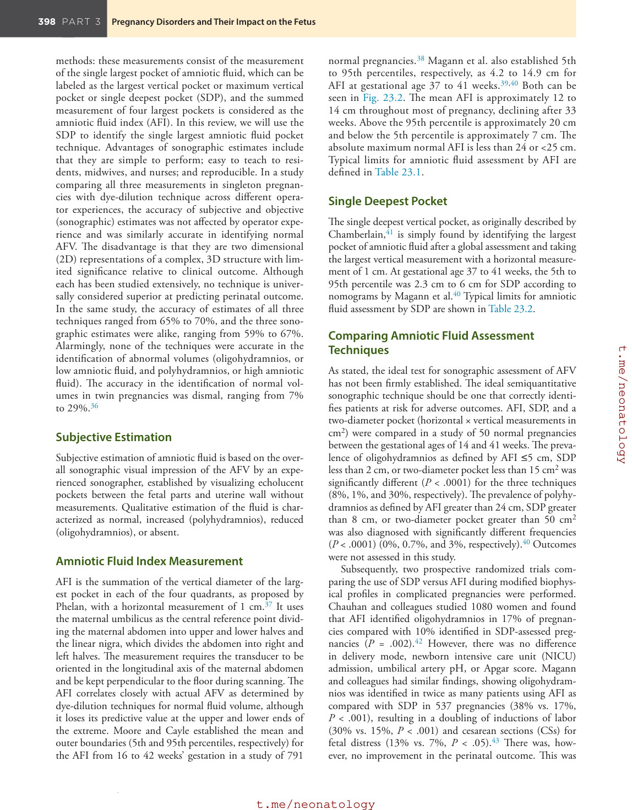

### Original source page 414

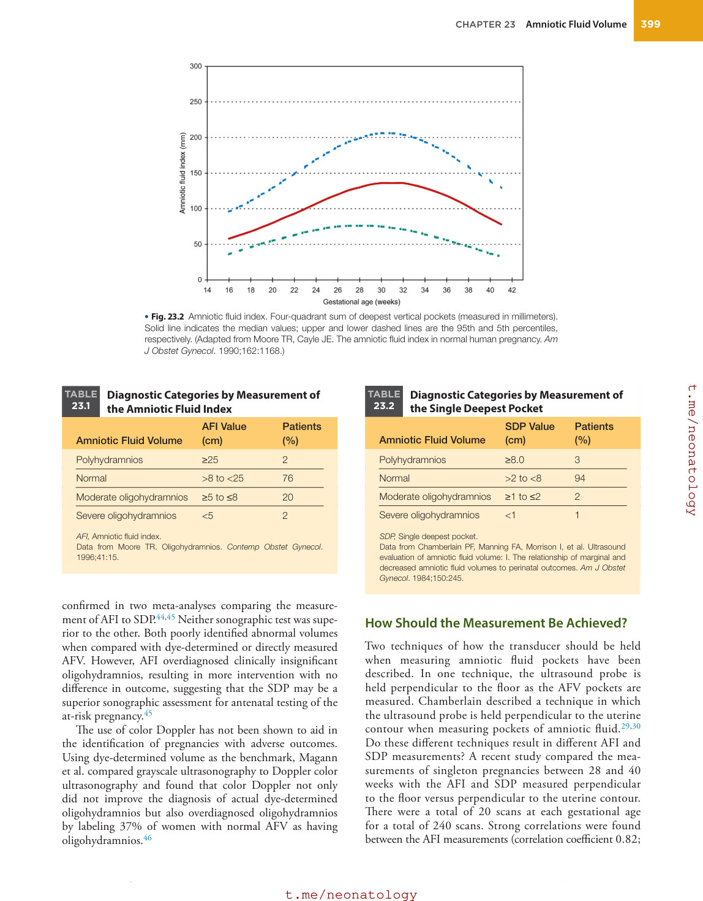

### Original source page 415

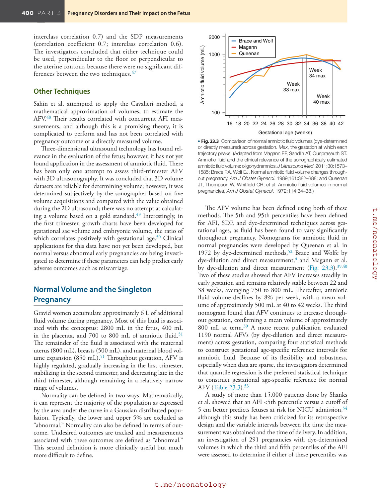

### Original source page 416

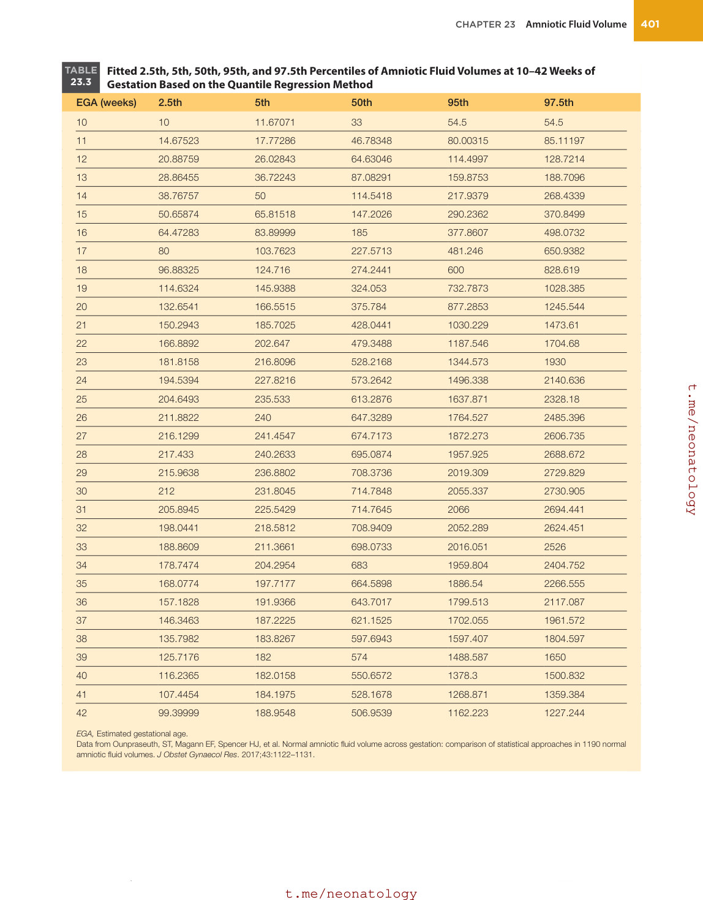

### Original source page 417

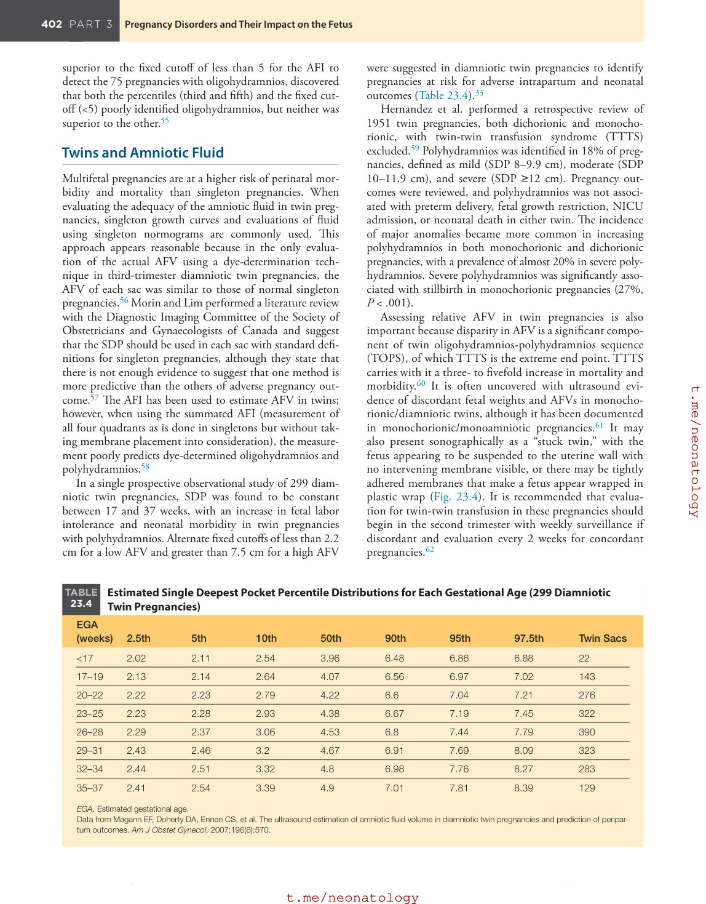

### Original source page 418

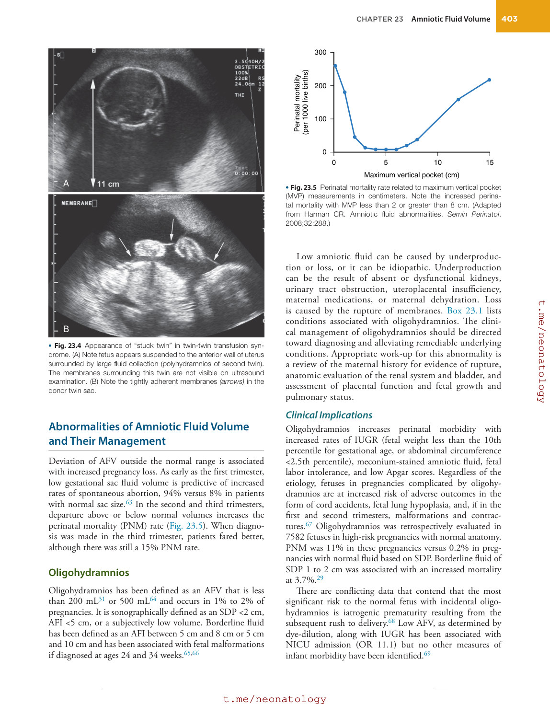

### Original source page 419

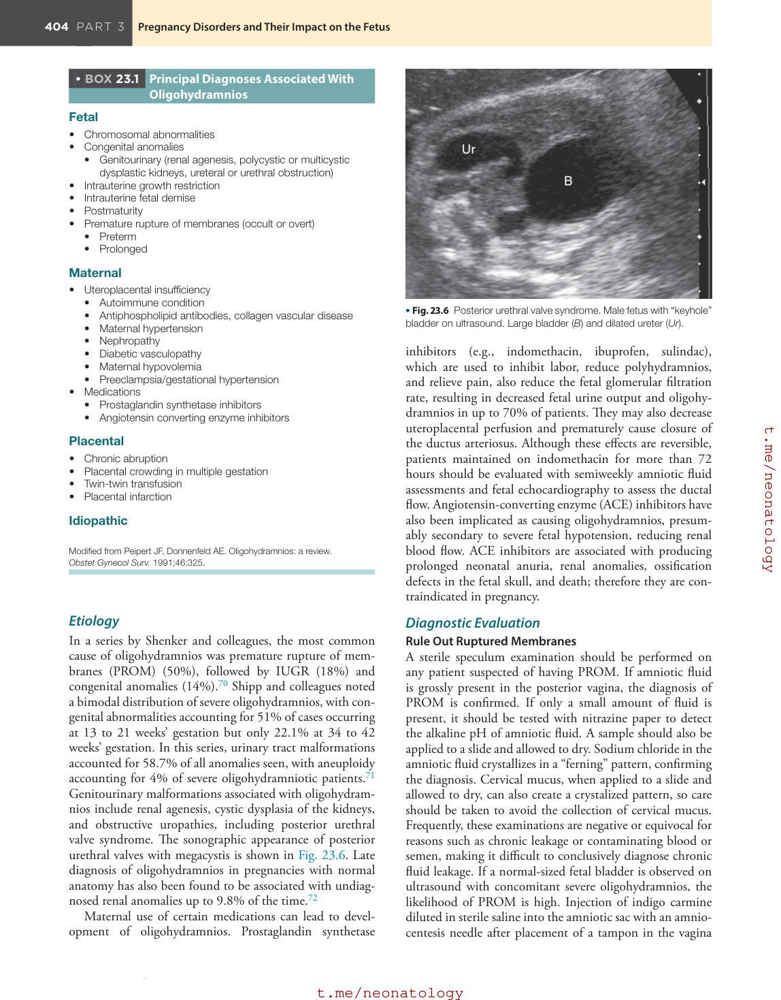

### Original source page 420

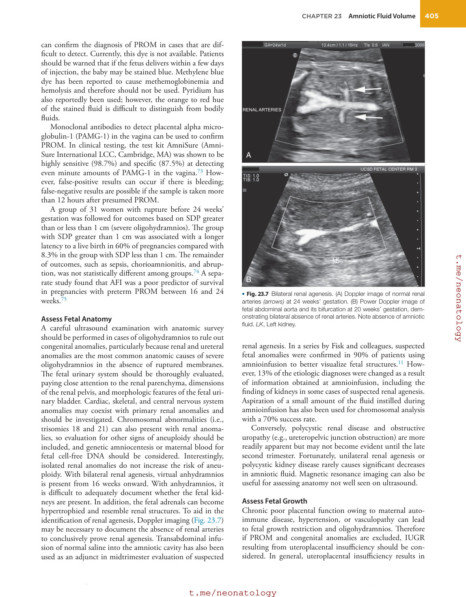

### Original source page 421

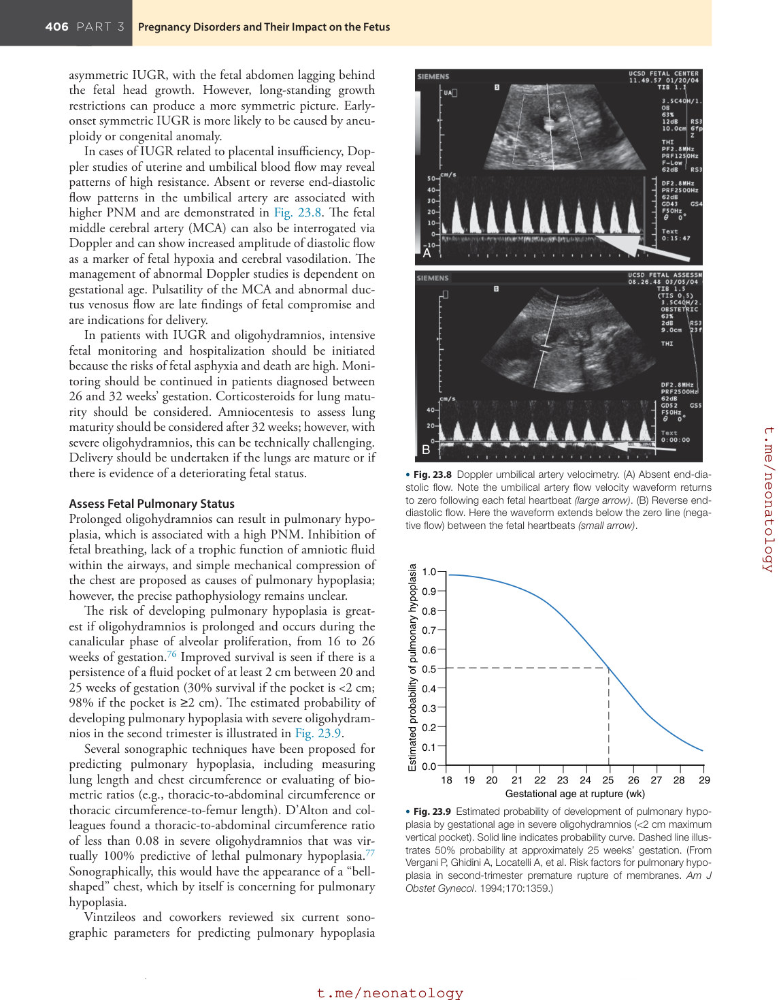

### Original source page 422

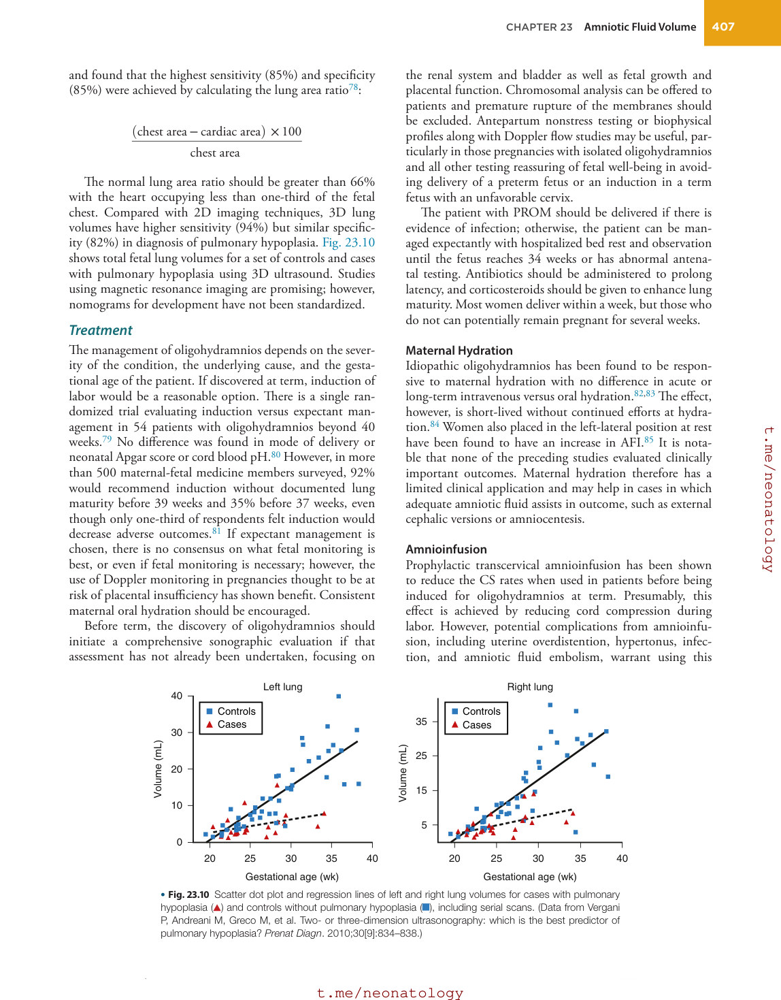

### Original source page 424

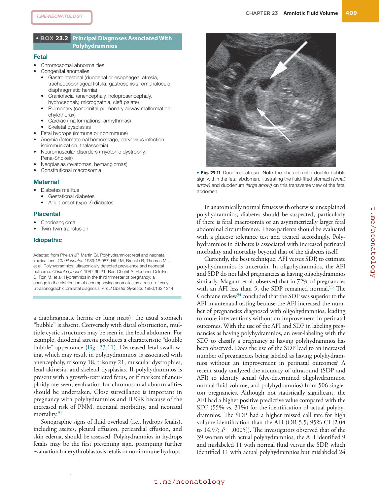

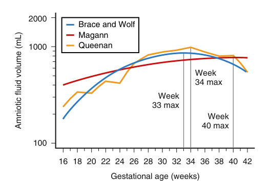

• Fig. 23.3 Comparison of normal amniotic fluid volumes (dye-determined or directly measured) across gestation. Max, the gestation at which each trajectory peaks. (Adapted from Magann EF, Sandlin AT, Ounpraseuth ST. Amniotic fluid and the clinical relevance of the sonographically estimated amniotic fluid volume: oligohydramnios. J Ultrasound Med. 2011;30:1573– 1585; Brace RA, Wolf EJ. Normal amniotic fluid volume changes throughout pregnancy. Am J Obstet Gynecol. 1989;161:382–388; and Queenan JT, Thompson W, Whitfield CR, et al. Amniotic fluid volumes in normal pregnancies. Am J Obstet Gynecol. 1972;114:34–38.)

PDF p. 415

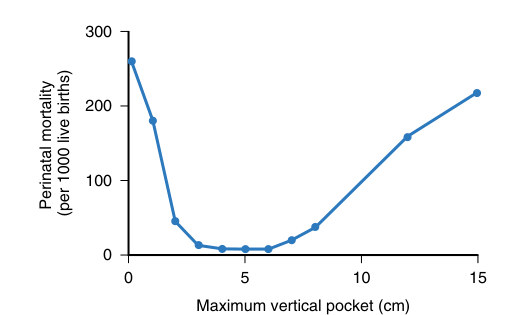

• Fig. 23.5 Perinatal mortality rate related to maximum vertical pocket (MVP) measurements in centimeters. Note the increased perinatal mortality with MVP less than 2 or greater than 8 cm. (Adapted from Harman CR. Amniotic fluid abnormalities. Semin Perinatol. 2008;32:288.)

PDF p. 418

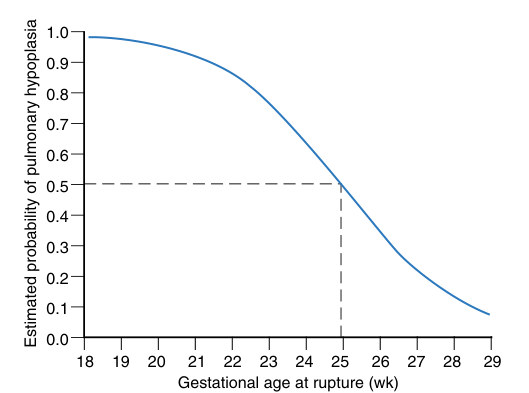

• Fig. 23.9 Estimated probability of development of pulmonary hypoplasia by gestational age in severe oligohydramnios (<2 cm maximum vertical pocket). Solid line indicates probability curve. Dashed line illustrates 50% probability at approximately 25 weeks’ gestation. (From Vergani P, Ghidini A, Locatelli A, et al. Risk factors for pulmonary hypoplasia in second-trimester premature rupture of membranes. Am J Obstet Gynecol. 1994;170:1359.)

PDF p. 421

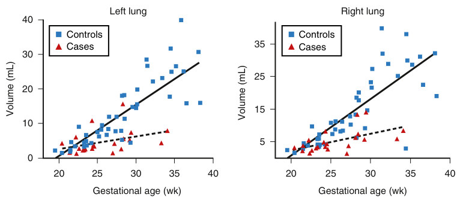

• Fig. 23.10 Scatter dot plot and regression lines of left and right lung volumes for cases with pulmonary hypoplasia (▲) and controls without pulmonary hypoplasia (□), including serial scans. (Data from Vergani P, Andreani M, Greco M, et al. Two- or three-dimension ultrasonography: which is the best predictor of pulmonary hypoplasia? Prenat Diagn. 2010;30[9]:834–838.)

PDF p. 422
