# 28. Birth Injuries
> [Source credits](../../SOURCE_CREDITS.md).

## Study pillars

### Birth-injury scope

An injury sustained during labor or delivery. The source defines birth injury around labor and delivery and excludes prenatal procedure and neonatal resuscitation injuries.

PDF p. 489

### Caput anatomy

Caput succedaneum. Caput is an edematous swelling over the presenting part of the scalp.

PDF p. 491

### Subperiosteal blood

Cephalhematoma. A cephalhematoma is a subperiosteal cranial blood collection.

PDF p. 492

### Subgaleal space

Subgaleal hemorrhage. Subgaleal hemorrhage occupies the space beneath the galea and above the periosteum and is associated with instrumental delivery.

PDF p. 493

### Common skeletal injury

Clavicle. The chapter identifies the clavicle as the most frequently fractured bone during labor and delivery.

PDF p. 500

## Full source extraction

# 28. Birth Injuries
> Source attribution: [Source credits](../../SOURCE_CREDITS.md).

## PDF page 489 | printed page 475

28 Birth Injuries

### PREETHA A. PRAZAD, MIRIAM NOBLE RAJPAL, AND HENRY H. MANGURTEN

Birth injuries are those sustained during the birth process, which includes labor and delivery. They may be avoidable, or they may be unavoidable and occur despite skilled and competent obstetric care, as in an especially hard or prolonged labor or with an abnormal presentation. Fetal injuries related to amniocentesis and intrauterine transfusions and neonatal injuries after resuscitation procedures are not considered birth injuries. However, injuries related to the use of intrapartum monitoring of the fetal heart rate and collection of fetal scalp blood for acid-base assessment are included. Factors predisposing the infant to birth injury include macrosomia, prematurity, cephalopelvic disproportion, dystocia, prolonged labor, abnormal presentation, and certain operative deliveries, particularly vacuum extraction. The fetus may also sustain injury, including death, if the mother is involved in a motor vehicle collision.1 Fetal deaths may occur from maternal cardiovascular instability, uterine rupture, placental abruption, hemorrhage, and direct injury to the fetus. Although usually protected by maternal soft tissues, the uterus, and amniotic fluid, the fetus may be subjected to the same acceleration-deceleration forces as the mother. This may result in full-thickness bowel injury and fulminant disseminated intravascular coagulation. Thus a thorough physical examination of the infant is critical after a maternal motor vehicle collision, to identify any internal injury that may have occurred.

The significance of birth injuries may be assessed by review of mortality data. In 1981, birth injuries ranked sixth among major causes of neonatal death, resulting in 23.8 deaths per 100,000 live births. During the ensuing decade, because of refinements in obstetric techniques and the increased use of cesarean deliveries over difficult vaginal deliveries, a dramatic decline occurred in birth injuries as a cause of neonatal death. Statistics for 1993 revealed a reduction to 3.7 deaths per 100,000 live births; because of the emergence of other conditions, birth injuries ranked 11th among major causes of neonatal death. Figures available identify only 10 leading causes of neonatal and post-neonatal death, with no mention of birth injuries.2

Despite a reduction in related mortality rates, birth injuries still represent an important source of neonatal

morbidity and neonatal intensive care unit admissions. Of particular concern are severe intracranial injuries after operative vaginal delivery (vacuum-assisted and forceps delivery) and failed attempts at operative vaginal delivery.

The clinician should consider the broad spectrum of birth injuries in the differential diagnosis of neonatal clinical disorders. Although many injuries are mild and self-limited, others are serious and potentially lethal. This chapter describes conditions that can be managed by observation only, as well as those that require more aggressive intervention. In addition to assuring timely institution of therapy when indicated, recognition and documentation before discharge from the hospital will help avoid inappropriate suspicion of inflicted injury (child abuse) at a later date.

### Injuries to Soft Tissues

### Erythema and Abrasions

Erythema and abrasions frequently occur when dystocia has occurred during labor as a result of cephalopelvic disproportion or when forceps have been used during delivery. Injuries caused by dystocia occur over the presenting part; forceps injury occurs at the site of application of the instrument. Forceps injury frequently has a linear configuration across both sides of the face, outlining the position of the forceps. The affected areas should be kept clean to minimize the risk for secondary infection. These lesions usually resolve spontaneously within several days with no specific therapy.

### Petechiae

Occasionally petechiae are present on the head, neck, upper portion of the chest, and lower portion of the back at birth after a difficult delivery; they are observed more frequently after breech and precipitous deliveries and tight nuchal cord.

### Etiology

Petechiae are probably caused by a sudden increase in intrathoracic and venous pressures during passage of the chest through the birth canal. An infant born with the cord

475

## PDF page 490

tightly wound around the neck may have petechiae only above the neck.

### Differential Diagnosis

Petechiae may be a manifestation of an underlying hemorrhagic disorder. The birth history, early appearance of the petechiae, and absence of bleeding from other sites help to differentiate petechiae caused by increased tissue pressure or trauma from petechiae caused by hemorrhagic disorders (see Chapter 80). The localized distribution of the petechiae, absence of subsequent crops of new lesions, and a normal platelet count exclude neonatal thrombocytopenia. The platelet count also may be low because of infection or disseminated intravascular coagulation. Infections may be clinically distinguished from traumatic petechiae by the presence of other signs and symptoms. Disseminated intravascular coagulation usually is associated with excessive and persistent bleeding from a variety of sites. Petechiae usually are distributed over the entire body when associated with systemic disease.

### Treatment

If the petechiae are caused by trauma, neither corticosteroids nor heparin should be used. No specific treatment is necessary.

### Prognosis

Traumatic petechiae usually fade within 2 or 3 days.

### Ecchymoses

Ecchymoses may occur after traumatic or breech deliveries. The incidence is increased in premature infants, especially after a rapid labor and poorly controlled delivery. When extensive, ecchymoses may reflect blood loss severe enough to cause anemia and, rarely, shock. The reabsorption of blood from an ecchymotic area may result in significant hyperbilirubinemia (Fig. 28.1).

### Treatment

No local or systemic therapy is necessary. The rise in serum bilirubin that follows severe bruising may be decreased by the use of phototherapy (see Chapter 95). Ecchymoses rarely result in significant anemia.

### Prognosis

The ecchymoses usually resolve spontaneously within 1 week.

### Subcutaneous Fat Necrosis

Subcutaneous fat necrosis is a rare form of panniculitis seen mostly in term or post-term infants characterized by wellcircumscribed, indurated lesions of the skin and underlying tissue (see Chapter 91).

### Etiology

Although subcutaneous fat necrosis can occur without any obvious cause, it is most commonly seen in association with perinatal asphyxia. Other etiologic factors that have been

• Fig. 28.1 Marked bruising of entire face of a 1490-g female infant born vaginally after face presentation. Less severe ecchymoses were present on extremities. Despite use of phototherapy from the first day, icterus was noted on the third day, and exchange transfusions were required on the fifth and sixth days.

implicated include cold exposure, localized skin trauma, obstetric trauma, preeclampsia, gestational diabetes, maternal or fetal risk of thrombosis, maternal cocaine use, hypothermia, prostaglandin E administration, brown fat deficiency, meconium aspiration, sepsis, and intrapartum calcium channel blocker administration. It can also occur as a complication of therapeutic hypothermia for perinatal asphyxia or in newborns undergoing surgical procedures.3,4 Many affected infants are large and have been delivered by operative vaginal delivery or after a prolonged, difficult labor involving vigorous fetal manipulation. The distribution of the lesions usually is related to the site of trauma, which explains the frequent involvement of shoulders and buttocks. One suggested mechanism of pathogenesis proposes that diminished in utero circulation and mechanical pressure during labor and delivery result in vascular compromise to specific areas, which eventually causes localized fat necrosis.

### Pathology

Histopathologic studies reveal initial endothelial swelling and perivascular inflammation in the subcutaneous tissues. This is followed by necrosis of fat and a dense granulomatous inflammatory infiltrate containing foreign body–type giant cells with needle-shaped crystals resembling cholesterol.

### Clinical Manifestations

Necrotic areas usually appear between 6 and 10 days of age but may be noted as early as the second day or as late as the sixth week. They occur on the cheeks, neck, back, shoulders, arms, buttocks, thighs, and feet, with relative sparing of the chest and abdomen. The lesions vary in size from 1 to 10 cm; rarely, they may be more extensive. They are irregularly shaped, hard, plaquelike, and nonpitting (Fig. 28.2). The overlying skin may be colorless, red, or purple with no local tenderness. The affected areas may be slightly elevated above the adjacent skin; small lesions may be easily movable in all directions. Fever may be seen in a small subset of infants with subcutaneous fat necrosis.

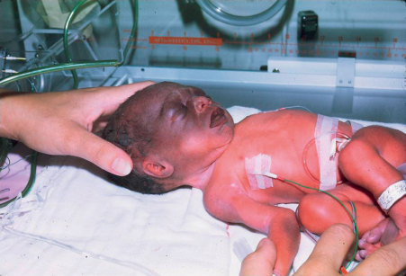

• Fig. 28.1 Marked bruising of entire face of a 1490-g female infant born vaginally after face presentation. Less severe ecchymoses were present on extremities. Despite use of phototherapy from the first day, icterus was noted on the third day, and exchange transfusions were required on the fifth and sixth days.

## PDF page 491 | printed page 477

• Fig. 28.2 Subcutaneous fat necrosis in a 2900-g term infant delivered vaginally; pregnancy, labor, and delivery were completely uncomplicated. Note nodular lesion located on right buttock and surrounded by erythema (darkened area). (Courtesy of Dr. Rajam Ramamurthy, Cook County Hospital, Chicago.)

This condition may be associated with hypoglycemia, hypertriglyceridemia, hypercalcemia, nephrocalcinosis, anemia, and thrombocytopenia. Marked symptomatic hypercalcemia may develop in infants with subcutaneous fat necrosis at 3 to 4 weeks of age; this has been characterized by vomiting, weight loss, anorexia, fever, somnolence, and irritability, with serum calcium levels as high as 17.3 mg/dL. The treatment includes intravenous hydration, calcium-wasting diuretics such as furosemide, potassium citrate to inhibit renal stone formation, and corticosteroids. Successful short-term treatment with bisphosphonates (e.g., pamidronate or etidronate) has been reported to control hypercalcemia.5 Investigators have suggested extrarenal production of 1,25-dihydroxyvitamin D by the granulomatous cells of fat necrosis as a possible mechanism for the hypercalcemia.

### Differential Diagnosis

The differential diagnosis includes lipogranulomatosis and sclerema neonatorum, which carry a potentially grave prognosis, and nodular nonsuppurative panniculitis, which is usually associated with fever, hepatosplenomegaly, and tender skin nodules. Congenital pressure injuries seen at birth may resemble subcutaneous fat necrosis. However, these lesions mostly occur over bony prominences in pregnancies with severely diminished amniotic fluid volume.6

### Treatment

Most of these lesions require only observation. Surgical management is not indicated, with the exception of extensive ulcerated lesions.

### Prognosis

The lesions slowly soften after 6 to 8 weeks and com pletely regress within several months. Occasionally, minimal residual atrophy, with or without small calcified areas, is observed. Affected infants should be followed closely during the first 6 weeks for potential development of hypercalcemia. It is important to treat this complication without delay to prevent central nervous system (CNS) and renal sequelae.

### Lacerations

Accidental lacerations may be inflicted with a scalpel during cesarean section. They usually occur on the scalp, buttocks, and thighs, but they may occur on any part of the body. If the wound is superficial, the edges may be held in apposition with adhesive strips. Deeper, more freely bleeding wounds should be sutured with the finest material available. Rarely, the amount of blood loss and depth of wound require suturing in the delivery room. After repair, the wound should be left uncovered unless it is in an area of potential soiling, such as the perineal area. Healing is usually rapid, and complications are rarely seen.

### Injuries to the Head

### Skull Caput Succedaneum

Caput succedaneum, a frequently observed lesion, is characterized by a vaguely demarcated area of edema over that portion of the scalp that was the presenting part during a vertex delivery.

Etiology

Serum, blood, or both accumulate above the periosteum in the presenting part during labor. This extravasation results from the higher pressure of the uterus or vaginal wall on those areas of the fetal head that border the caput. Thus, in a left occiput transverse presentation, the caput succedaneum occurs over the upper and posterior aspect of the right parietal bone; in a right-sided presentation, it occurs over the corresponding area of the left parietal bone.

Clinical Manifestations

The soft swelling is usually a few millimeters thick and may be associated with overlying petechiae, purpura, or ecchymoses. Because of the location external to the periosteum, a caput succedaneum may extend across the midline of the skull and across suture lines. After an especially difficult labor, an extensive caput may obscure various sutures and fontanelles.

Differential Diagnosis

Occasionally, a caput succedaneum may be difficult to distinguish from a cephalhematoma, particularly when the latter occurs bilaterally. Careful palpation usually indicates whether the bleeding is external to the periosteum (caput) or beneath the periosteum (cephalhematoma). Iatrogenic

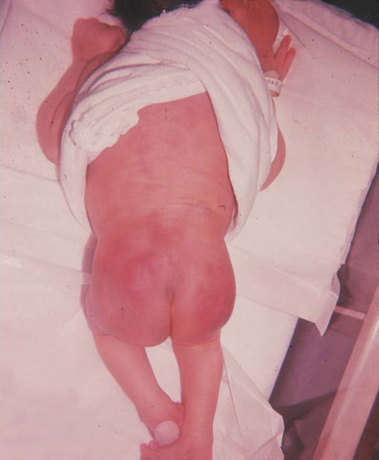

• Fig. 28.2 Subcutaneous fat necrosis in a 2900-g term infant delivered vaginally; pregnancy, labor, and delivery were completely uncomplicated. Note nodular lesion located on right buttock and surrounded by erythema (darkened area). (Courtesy of Dr. Rajam Ramamurthy, Cook County Hospital, Chicago.)

## PDF page 492

encephalocele is an infrequent complication of vacuum extraction delivery and may present like a caput succedaneum initially. Imaging should be considered in every child with a large caput succedaneum that does not diminish in 48 to 72 hours or with enlargement of the swelling more than 24 hours after delivery, especially when there are neurologic deficits and hemodynamic instability.7

Treatment

Usually, no specific treatment is indicated. Rarely, a hemorrhagic caput may result in shock and require blood transfusion.

Prognosis

A caput succedaneum usually resolves within several days.

### Cephalhematoma

Cephalhematoma is an infrequently seen subperiosteal collection of blood overlying a cranial bone. The incidence is 0.2% to 3% of live births, with a higher frequency in infants born to primiparous mothers.

Etiology

A cephalhematoma is caused during labor or delivery by a rupture of diploic blood vessels that traverse from skull to periosteum. Repeated buffeting of the fetal skull against the maternal pelvis during a prolonged or difficult labor and mechanical trauma caused by use of forceps and vacuum suction devices in delivery have been implicated. Petrikovsky and associates described seven infants in whom cephalhematoma or caput succedaneum was identified prenatally before onset of labor.8 Occurrence of premature rupture of membranes in five of the pregnancies suggests an etiology of fetal head compression by the uterine wall, resulting from oligohydramnios subsequent to the ruptured membranes.

Clinical Manifestations

The bleeding is sharply limited by periosteal attachments to the surface of one cranial bone; there is no extension across suture lines. The bleeding usually occurs over one or both parietal bones. Less often, it involves the occipital bones and, very rarely, the frontal bones. The overlying scalp is not discolored. Because subperiosteal bleeding is slow, the swelling may not be apparent for several hours or days after birth. The swelling is often larger on the second or third day, when sharply demarcated boundaries are palpable. The cephalhematoma may feel fluctuant and often is bordered by a slightly elevated ridge of organizing tissue that gives the false sensation of a central bony depression. It may be associated with an underlying linear, nondepressed skull fracture in a small percentage of infants.

Radiographic Manifestations

Radiographic manifestations vary with the age of the cephalhematoma. During the first 2 weeks, bloody fluid results in a shadow of water density. At the end of the second week, bone begins to form under the elevated pericranium at the

margins of the hematoma; the entire lesion is progressively overlaid with a complete shell of bone.

Differential Diagnosis

Cephalhematoma must be distinguished from other birth complications such as subgaleal hematoma, caput succedaneum, vacuum caput, leptomeningeal cyst, or congenital anomalies such as meningoceles. It may be differentiated from caput succedaneum by (1) its sharp periosteal limitations to one bone, (2) the absence of overlying discoloration, (3) the later initial appearance of the swelling, and (4) the longer time before resolution. Cranial meningocele is differentiated from cephalhematoma by pulsations, an increase in pressure during crying, and the demonstration of a bony defect on a radiograph. An occipital cephalhematoma may be confused initially with an occipital meningocele and with cranium bifidum because all occupy the midline position.

Treatment

No therapy is indicated for the uncomplicated cephalhematoma because more than 80% resolve by gradual hemolysis and resorption in 3 to 4 weeks. When the hematoma does not resolve spontaneously, it may get organized, and calcification may be seen. It may still get absorbed slowly and often disappears over 3 to 6 months. Persistent calcification that is not resolved by time may be an indication for surgical excision.9 Rarely, a massive cephalhematoma may result in blood loss severe enough to require transfusion. Significant hyperkalemia10 and hyperbilirubinemia may result from resolving hematoma, necessitating appropriate treatment. The most common associated complications are skull fracture and intracranial hemorrhage. Linear fractures do not require specific therapy, but radiographs should be taken at 4 to 6 weeks to ensure closure and exclude formation of leptomeningeal cysts; depressed fractures require immediate neurosurgical consultation. Routine incision or aspiration of a cephalhematoma is contraindicated because of the risk for introducing infection. Rarely, bacterial infections of cephalhematomas occur, usually in association with septicemia and meningitis. Focal infection should be suspected when a sudden enlargement of a static cephalhematoma occurs during the course of a systemic infection, with a relapse of meningitis or sepsis after treatment with antibiotics, or with the development of local signs of infection over the cephalhematoma (Fig. 28.3). Diagnostic aspiration may be indicated. If a local infection is present, surgical drainage and specific antibiotic therapy should be instituted. Osteomyelitis of the underlying skull may be a rare concurrent problem.11 The diagnosis may be suggested by periosteal elevation and overlying soft tissue swelling on skull radiographs. Additional rare complications that may accompany an infected cephalhematoma and osteomyelitis include venous sinus thrombosis and cerebellar hemorrhage.12 Magnetic resonance imaging (MRI) may be used to detect these two intracranial complications, whereas computed tomography (CT) is the best imaging modality

## PDF page 493 | printed page 479

to identify the permeative bone erosion and destruction of osteomyelitis.12

Prognosis

Most cephalhematomas are resorbed within 2 weeks to 3 months, depending on their size. In a few patients, calcium is deposited (Fig. 28.4), causing a bony swelling that may persist for several months and, rarely, up to several years. Radiographic findings persist after the disappearance of clinical signs. The outer table remains thickened as a flat, irregular hyperostosis for several months. Widening of the space between the new shell of bone and the inner table may persist for years; the space originally occupied by the hematoma usually develops into normal diploic bone, but cystlike defects may persist at the sites of the hematoma for months or years. Rarely, a neonatal cephalhematoma may persist into adult life as a symptomless mass, the cephalhematoma deformans of Schüller.

### Subgaleal Hemorrhage

Subgaleal hemorrhage is a collection of blood in the soft tissue space between the galea aponeurotica and the periosteum of the skull (Fig. 28.5). The incidence is about 4 per 10,000 noninstrumented deliveries, with higher incidence after instrumental deliveries.

• Fig. 28.3 Massive, persistently enlarging cephalhematoma in a 13-day-old female infant delivered by midforceps after occiput-posterior presentation. Surgical drainage revealed 300 mL of yellowish material that cultured as Escherichia coli.

Loose connective tissue

Galea (aponeurosis)

Subgaleal hemorrhage

Cranial suture Cerebrum

• Fig. 28.5 Subgaleal hemorrhage and cephalhematoma.

Etiology

The most common predisposing factor is difficult operative vaginal delivery, particularly midforceps delivery and vacuum extraction.13 The risk for subgaleal hemorrhage may be reduced by the use of softer silicone vacuum cups instead of the original rigid metallic ones. The major risk factors include coagulopathies, prematurity, macrosomia, fetal dystocia, precipitous labor, intrapartum hypoxia, male sex, cephalopelvic disproportion, prolonged labor, and nulliparity.

Mechanism of Injury

When vacuum is used, the mechanism of injury is thought to be the vacuum traction pulling the scalp away from stationary bony calvarium, thus avulsing open the subgaleal space and causing the bridging vessels to tear and bleed into the subgaleal space. The loose connective tissue of the subgaleal space is extremely expansive and extends over the entire area of the scalp. The space can accommodate the entire neonatal blood volume (250 mL or more in a term baby), leading to hypovolemic shock, disseminated intravascular coagulation,

• Fig. 28.4 Calcified cephalhematoma (arrow) in left parietal region of 5-week-old girl. Infant weighed 1410 g at birth and was delivered rapidly because of prolapsed cord. Hard left parietal swelling was detected at 5 weeks by nurses during feeding.

Cephalhematoma

Periosteum

Scalp

Dura mater

Skull

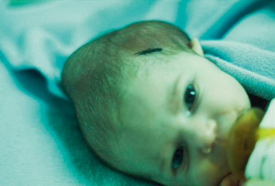

• Fig. 28.3 Massive, persistently enlarging cephalhematoma in a 13-day-old female infant delivered by midforceps after occiput-posterior presentation. Surgical drainage revealed 300 mL of yellowish material that cultured as Escherichia coli.

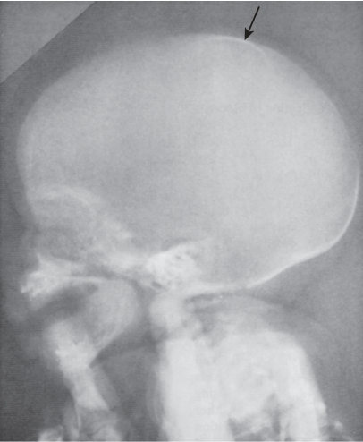

• Fig. 28.4 Calcified cephalhematoma (arrow) in left parietal region of 5-week-old girl. Infant weighed 1410 g at birth and was delivered rapidly because of prolapsed cord. Hard left parietal swelling was detected at 5 weeks by nurses during feeding.

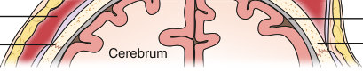

• Fig. 28.5 Subgaleal hemorrhage and cephalhematoma.

## PDF page 494

and multiorgan failure, resulting in death in up to 14% of the cases.14

Clinical Manifestations

Early manifestations may be limited to pallor, hypotonia, and diffuse swelling of the scalp. The development of a fluctuating mass straddling cranial sutures, fontanelles, or both is highly suggestive of the diagnosis. Because blood accumulates beneath the aponeurotic layer, ecchymotic discoloration of the scalp is a later finding. This is often associated with pitting edema and progressive posterior spread toward the neck and lateral spread around the ears, frequently displacing the ears anteriorly (Fig. 28.6). Periorbital swelling and ecchymosis also are commonly observed. Eventually, hypovolemic shock, multiorgan failure, and signs of cerebral irritation develop. Massive lesions can cause extracranial cerebral compression, which may lead to rapid neurologic decompensation. The clinician should be aware of occasional “silent presentation,” in which a fluctuant mass is not apparent initially despite serial clinical examinations. Subgaleal hemorrhage should be considered in infants who show signs of hypoperfusion and falling hematocrit after attempted or successful vacuum delivery even in the absence of a detectable fluctuant mass. Close monitoring is particularly important in those infants who are considered stable enough to allow admission to the normal newborn nursery.

Radiographic Manifestations

Standard radiographs of the skull may identify possible associated fractures. CT scanning may demonstrate abundant epicranial blood, parieto-occipital bone dehiscence, bone fragmentation, and posterior cerebral interhemispheric densities compatible with subarachnoid hemorrhage.

Differential Diagnosis

In contrast with cephalhematoma, subgaleal hemorrhage is characterized by its more diffuse distribution, more rapid course, significant anemia, signs of CNS trauma (e.g., hypotonia, lethargy, seizures), and frequent lethal outcome.

• Fig. 28.6 Clinical manifestations of subgaleal hemorrhage. Note anteriorly displaced ear.

Treatment

Prompt restoration of blood volume with fresh frozen plasma or blood is essential. In the presence of continued deterioration, neurosurgery may be considered as a last resort. A bicoronal incision allows for exposure of the subgaleal space. Bipolar cauterization of any bleeding points can then be accomplished, and a drain can be left in the subgaleal space.

Prognosis

Although nearly 14% of infants with subgaleal hemorrhage die, long-term prognosis for survivors is generally good. More experience with aggressive and timely neurosurgical intervention may help to improve outcomes.

### Skull Fractures

Fracture of the neonatal skull is uncommon because the bones of the skull are less mineralized at birth and thus more compressible. In addition, the separation of the bones by membranous sutures usually permits enough alteration in the contour of the head to allow its passage through the birth canal without injury.

Etiology

Skull fractures usually follow a forceps delivery or a prolonged, difficult labor with repeated forceful contact of the fetal skull against the maternal symphysis pubis, sacral promontory, fifth lumbar vertebrae, or ischial spine. They have also been described after vacuum-assisted vaginal delivery.15 Most of the fractures are linear. Depressed fractures are associated with forceps application. However, they may occur spontaneously after cesarean section or vaginal delivery without forceps. Factors that also have been implicated include pressure on the fetal skull by a maternal bony prominence (e.g., sacral promontory) or uterine fibroid, a fetal hand or foot, or the body part of a twin. Occipital bone fractures usually occur in breech deliveries as a consequence of traction on the hyperextended spine of the infant when the head is fixed in the maternal pelvis.

Clinical Manifestations

Linear fractures over the convexity of the skull frequently are accompanied by soft tissue changes and cephalhematoma. Usually, the infant’s behavior is normal unless there is an associated concussion or hemorrhage into the subdural or subarachnoid space. Fractures at the base of the skull with separation of the basal and squamous portions of the occipital bone almost always result in severe hemorrhage caused by disruption of the underlying venous sinuses. The infant may then exhibit shock, neurologic abnormalities, and drainage of bloody cerebrospinal fluid from the ears or nose.

Depressed fractures are visible, palpable indentations in the smooth contour of the skull, similar to dents in a ping-pong ball (Fig. 28.7). The infant may be entirely free of symptoms unless there is an associated intracranial injury.

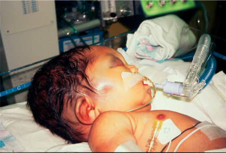

Unmatched source image; PDF page 494. Consult the original caption.

## PDF page 495 | printed page 481

• Fig. 28.7 Depressed skull fracture in term male infant delivered after rapid (1-hour) labor. Infant was delivered by occiput-anterior presentation after rotation from occiput-posterior position.

Radiographic Manifestations

The diagnosis of a simple linear or fissure fracture is seldom made without radiographs in which fractures appear as lines and strips of decreased density. Depressed fractures appear as lines of increased density. On some views, they are manifested by an inward buckling of bone with or without an actual break in continuity. CT imaging is the optimal diagnostic modality if a skull fracture and possible underlying injury are suspected.

Differential Diagnosis

Occasionally, the fragments of a linear fracture may be widely separated and may simulate an open suture. Conversely, parietal foramina, the interparietal fontanelle, mendosal sutures, and innominate synchondroses may be mistaken for fractures. In addition, normal vascular grooves, “ripple lines” that represent soft tissue folds of the scalp, and lacunar skull may be mistaken for fractures.

Treatment

Uncomplicated linear fractures over the convexity of the skull usually do not require treatment. Fractures at the base of the skull often necessitate blood replacement for severe hemorrhage and shock in addition to other supportive measures. If cerebrospinal fluid rhinorrhea or otorrhea is present, antimicrobial coverage is indicated to prevent secondary infection of the meninges.

Small (<5 mm in depth) “ping-pong” fractures may be observed without surgical treatment. Conservative management with spontaneous elevation of the depression within a period of 6 months have been reported.16 Several nonsurgical methods have been described for elevation of depressed skull fractures using pneumatic traction devices such as breast pump17 and obstetric vacuum extractor18 in certain infants. Because these methods are technically easier and less traumatic, they may be preferable to surgical intervention in a symptom-free infant with an isolated lesion.

Comminuted or large fractures associated with neurologic signs or symptoms should be treated by immediate

surgical elevation of the indented segment to prevent underlying cortical injury from pressure. Other indications for surgical elevation include manifestations of cerebrospinal fluid beneath the galea and failure to elevate the fracture by nonsurgical manipulation.

Prognosis

Simple linear fractures usually heal within several months without sequelae.

Basal fractures carry a poor prognosis. When separation of the basal and squamous portions of the occipital bone occurs, the outcome is almost always fatal; surviving infants have an extremely high incidence of neurologic sequelae.

The prognosis for a depressed fracture is usually good when treatment is early and adequate. When therapy is delayed, especially with a large depression, death may occur from pressure on vital areas of the brain. Because the natural history of depressed skull fractures in neonates has not been clearly elucidated, the outcome is uncertain for infants with smaller lesions managed either by simple observation or by surgery after significant delays.

### Intracranial Hemorrhage

See Chapter 55.

### Face Facial Nerve Palsy

Facial nerve palsy in the neonate may follow birth injury or rarely may result from agenesis of the facial nerve nucleus. The latter condition occasionally is hereditary but usually is sporadic.

Etiology

Traumatic facial nerve palsy most often follows compression of the peripheral portion of the nerve, either near the stylomastoid foramen through which it emerges or where the nerve traverses the ramus of the mandible. The neonate is vulnerable to these injuries because of the superficial course of the extracranial facial nerves. The nerve may be compressed by forceps, especially when the fetal head has been grasped obliquely. The condition also occurs after spontaneous deliveries in which prolonged pressure was applied by the maternal sacral promontory. Less frequently, injury is sustained in utero, often in association with a mandibular deformity, by the persistent position of the fetal foot against the superior ramus of the mandible. An extremely rare cause is the pressure of a uterine tumor on the nerve.

This condition may occur rarely with simultaneous ipsilateral brachial plexus palsy, most likely secondary to compressive forces during delivery.19 Contributing factors include prolonged second stage of labor and midforceps delivery.

Traumatic facial nerve palsy may follow a contralateral injury to the CNS such as a temporal bone fracture or hemorrhage, tissue destruction, or both to structures within the posterior fossa. This CNS injury is less frequent than peripheral nerve injury.

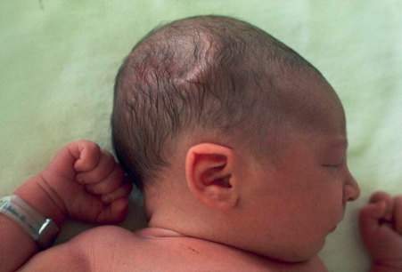

• Fig. 28.7 Depressed skull fracture in term male infant delivered after rapid (1-hour) labor. Infant was delivered by occiput-anterior presentation after rotation from occiput-posterior position.

## PDF page 496

Clinical Manifestations

Paralysis is usually apparent on the first or second day but may be present at birth. It usually does not increase in severity unless considerable edema occurs over the area of nerve trauma. The type and distribution of paralysis are different in central facial paralysis compared with peripheral paralysis.

Central paralysis is a spastic paralysis limited to the lower half or two-thirds of the contralateral side of the face. The paralyzed side is smooth and full and often appears swollen. The nasolabial fold is obliterated, and the corner of the mouth droops. When the infant cries, the mouth is drawn to the normal side, the wrinkles are deeper on the normal side, and movement of the forehead and eyelid is unaffected. Usually, other manifestations of intracranial injury appear, most often a sixth cranial nerve palsy.

Peripheral paralysis is flaccid and, when complete, involves the entire side of the face. When the infant is at rest, the only sign may be a persistently open eyelid on the affected side, caused by paralysis of the orbicular muscle of the eye. With crying, the findings are the same as in a central facial nerve injury, with the addition of a smooth forehead on the involved side. Because the tongue is not involved, feeding is not affected.

A small branch of the nerve may be injured, with involvement of only one group of facial muscles. Paralysis is then limited to the forehead, eyelid, or mouth. Peripheral paralysis caused by nerve injury distal to the geniculate ganglion may be accompanied by a hematotympanum on the same side.

Differential Diagnosis

Central and peripheral facial nerve palsies must be distinguished from nuclear agenesis (Möbius syndrome). The latter frequently results in bilateral facial nerve palsy; the face is expressionless and immobile, suggesting muscle fibrosis. Other cranial nerve palsies and deformities of the ear, palate, tongue, mandible, and other bones may be associated with Möbius syndrome. Congenital absence or hypoplasia of the depressor muscle of the angle of the mouth also may simulate congenital facial palsy and has been associated with an increased incidence of other congenital anomalies.

Treatment

No specific therapy is indicated for most facial palsies. If the paralysis is peripheral and complete, initial treatment should be directed at protecting the cornea with an eye pad and instilling artificial tears every 4 hours. The functional state of the nerve should be followed closely. Falco and colleagues proposed the following comprehensive approach20: 1. Distinguish developmental from acquired lesions on the

basis of the birth history and a detailed physical examination. Patients thought to have developmental palsy should be examined with radiologic and electrodiagnostic studies and brainstem evoked response as appropriate. 2. Because of the expected 90% likelihood of complete

spontaneous recovery, patients should be observed for 1 year before surgical intervention is considered. If

recovery is suggested by physical examination or serial electromyography, observation without surgery may be delayed until the second birthday. Infants who require surgery are best treated with decompression or neuroplasty or both.

Prognosis

Most facial palsies resolve spontaneously within several days; total recovery may require several weeks or months. Electrodiagnostic testing is beneficial in predicting recovery; repeatedly normal nerve excitability indicates a good prognosis, but decreased or absent excitability early in the course suggests a poor outlook. The subsequent appearance of muscle fibrillation potentials indicates nerve degeneration. The prognosis in surgically treated infants worsens with increasing age at treatment.

### Fractures and Dislocations of Facial Bones

Facial bone fractures may occur during passage through the birth canal, during forceps application and delivery, and during obstetric manipulation (most often the Mauriceau maneuver for delivery of the fetal head in a breech presentation). Manipulation may result in mandibular fractures and mandibular joint damage but is rarely severe enough to cause separation of the symphysis of the mandible. Fracture of the nose may result in early respiratory distress and feeding difficulties. The most frequent nasal injury is dislocation of the cartilaginous part of the septum from the vomerine groove and columella. This may result from intrauterine factors such as a uterine tumor or persistent pressure on the nose by fetal small parts or during delivery from pressure on the nose by the symphysis pubis, sacral promontory, or perineum. The presence of nasal septal dislocation may be differentiated from the more common normal variant of a misshapen nose by a simple compression test in which the tip of the nose is compressed (Fig. 28.8).21 In the presence of septal dislocation, the nostrils collapse, and the deviated septum becomes more apparent; in the normal nose, no nasal deviation occurs with compression.

Infants who sustain nasal trauma during the birth process may demonstrate stridor and cyanosis, even in the absence of septal dislocation. Miller and coworkers noted high nasal resistance in three such infants, only one of whom was found to have septal dislocation.22 The authors postulated the presence of edema and narrowed nasal passages from compression forces on the midface during delivery. The problem may be exaggerated by repeated nasal suctioning or transnasal bronchoscopy. These procedures and oral feeding should be avoided until the infant re-establishes normal nasal ventilation. Pulse oximetry measurements are useful in monitoring these infants.

Treatment

Fractures of the maxilla, lacrimal bones, and nose warrant immediate attention because they unite quickly, with fixation in 7 to 10 days. Nasal trauma may require surgery. While waiting, the pediatrician should provide an oral airway to

## PDF page 497 | printed page 483

A

B • Fig. 28.8 Result of finger compression, (A) when nasal septum is dislocated. Normal septal relationship, (B) results in no nasal deviation with pressure. (Modified from Daily W, Davis WE. Nasal septal dislocation in the newborn: case report. Mo Med. 1977;74:381.)

relieve respiratory distress. Fractures of the septal cartilage also may be reduced by simple manual remolding, but most are associated with hematomas that should be promptly incised and drained. The surgeon can visualize the deformity with an infant nasal speculum, place a septal elevator in the nose, and guide the septal cartilage into the vomerine groove; an audible and palpable click indicates return of the septum into position. For simple nasal positional deformity with no evidence of respiratory distress, Steri-Strip method (tapes are applied from the septal pyramid/vomer junction anchored to the cheek to straighten the columella and widen the nasal aperture) may be attempted for a few days unless septal dislocation is identified soon after birth.23

Early reduction and immobilization are advised for a displaced fracture of the mandible because rapid, firm union may occur as early as 10 to 14 days. Usually in neonates, mandible fractures are managed by closed method. Open reduction and internal fixation are difficult because of the soft and spongy mandible. These surgical procedures may damage the tooth buds and affect mandibular growth. Interdental wiring with lower border plating, interosseous and circumferential stainless-steel wiring, and resorbable suture fixation have been reported for managing mandibular fracture in an infant.24

Prognosis

If the fracture is reduced and fixated within a few days, rapid healing without complication is the usual course. If treatment is inadequate, missed, or delayed, subsequent developmental deformities may occur.

### Eyes

See Chapter 99. Mechanical trauma to various regions of the neonatal eye usually occurs during abnormal presentation in

dystocia from cephalopelvic disproportion or as a result of inappropriate forceps placement in normal deliveries. Most of the injuries are self-limited and mild and require no specific treatment.

### Eyelids

Edema, suffusion, and ecchymoses of the eyelids are common, especially after face and brow presentations or forceps deliveries. Severely swollen lids should be opened by an ophthalmologist for examination of the eyeball; retractors may be necessary. These findings usually resolve within a week without treatment.

A less common injury is laceration, including disruption of the lacrimal canaliculus. This has been associated with upper-eyelid laceration, including a full-thickness vertical wound lateral to the punctum and a full-thickness laceration through the lower eyelid with transection of the canaliculus after a low forceps delivery. Microsurgical repair of the lacrimal system and eyelids, including lacrimal intubation with a silicone stent, has been successful. Follow-up at 14 months revealed normal tear drainage with no amblyopia or residual deformity.25

An infant has been reported with superficial eyelid lacerations caused by an internal fetal monitoring spiral electrode.26 At delivery, the electrode was attached to the eyelid. Marked facial edema related to brow presentation apparently obscured the lacerations until 14 hours of age, when much of the edema had resolved. Periorbital edema was believed to have protected the infant from more serious injury to the eyelid and globe.

Lagophthalmos, the inability to close an eyelid, is an occasional finding thought to result from facial nerve injury by forceps pressure. It is usually unilateral. The exposed cornea should be protected by an eye pad and frequent use of artificial tears. The condition usually resolves within a week.

### Orbit

Orbital hemorrhage and fracture may follow direct pressure by the apex of one forceps blade, most often in high forceps extractions. In most instances, death occurs immediately. Surviving infants demonstrate traumatic eyelid changes, disturbances of extraocular muscle movements, and exophthalmos. The presence of the latter two findings warrants immediate ophthalmologic consultation. Subsequent management also may require neurosurgical and plastic surgery consultations.

### Sympathetic Nervous System

Horner syndrome, resulting from cervical sympathetic nerve trauma, frequently accompanies lower brachial plexus injury. The syndrome consists of miosis, partial ptosis, apparent enophthalmos, and anhidrosis of the ipsilateral side of the face. Although small, the pupil reacts to light. The presence of neurologic signs indicating brachial plexus injury helps distinguish this syndrome from intracranial hemorrhage as a cause of anisocoria. Pigmentation of the ipsilateral iris is frequently delayed to several months of

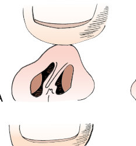

Unmatched source image; PDF page 497. Consult the original caption.

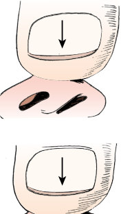

Unmatched source image; PDF page 497. Consult the original caption.

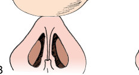

Unmatched source image; PDF page 497. Consult the original caption.

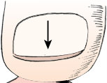

Unmatched source image; PDF page 497. Consult the original caption.

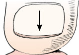

Unmatched source image; PDF page 497. Consult the original caption.

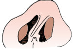

Unmatched source image; PDF page 497. Consult the original caption.

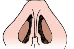

Unmatched source image; PDF page 497. Consult the original caption.

## PDF page 498

age; occasionally, pigmentation never occurs. Resolution of other signs of the syndrome depends on whether the injury to the nerve is transient or permanent.

### Subconjunctival Hemorrhage

Subconjunctival hemorrhage, characterized by bright red patches on the bulbar conjunctiva, is a relatively common finding in the neonate. It may be found after a difficult delivery but often is noted after easy, completely uncomplicated deliveries. This finding is considered to result from increased venous pressure in the infant’s head and neck, produced by obstruction to venous return consequent to compression of the fetal thorax or abdomen by uterine contractions during labor. If the infant is otherwise well, management consists of reassuring the parents. The blood is usually absorbed within 1 to 2 weeks. As the blood pigments break down and are absorbed, the color changes from bright red to orange and yellow.

### External Ocular Muscles

Injury involving the external ocular muscles may result from direct trauma to the cranial nerve (in the form of compression or surrounding hemorrhages) or from hemorrhage into the muscle sheath, with subsequent fibrosis. The sixth cranial nerve (abducens) is the most frequently injured cranial nerve because of its long intracranial course; the result is paralysis of the lateral rectus muscle. This injury may follow a tentorial laceration with extravasation of a small amount of blood around the intracranial portion of the nerve. The involvement may be mild and transient; internal strabismus noted at birth may resolve gradually within 1 to 2 months. The seventh cranial nerve may be injured simultaneously with the sixth nerve by compression with forceps. Improvement in lateral gaze of the affected eye may appear within 1 to 2 months. Alternate patching of either eye in the severely affected infant maintains visual acuity until, with time, maximal improvement has occurred. At 6 months, the degree of nerve regeneration may be evaluated. Some infants subsequently require surgical repair of the strabismus.

Fourth cranial nerve (trochlear) palsy occurs infrequently. It may follow small brainstem hemorrhages with nuclear damage. The affected muscle is the superior oblique, which mainly turns the eye inferiorly and medially. This condition is difficult to identify in the newborn infant. Surgical correction may be necessary later.

Third cranial nerve (oculomotor) palsy, when complete, causes paralysis of the inferior oblique and medial, superior, and inferior rectus muscles. This results in ptosis, a dilated fixed pupil, and outward and downward deviation of the eye, with inability to adduct or elevate up and in, or up and out, or to depress down and out. This palsy also may occur in partial form, with or without pupillary involvement. Partial palsies may recover function spontaneously within several months, whereas complete palsies usually require surgical intervention.

### Optic Nerve

The optic nerve may be injured directly by a fracture in the region of the optic canal or from a shearing force on the nerve, with resultant hemorrhage into the nerve sheath. The latter injury seldom is recognized because of the more apparent and severe changes in the sensorium. Occasionally, a fracture through the optic foramen results in formation of callus, which slowly compresses the nerve. A difficult forceps delivery is a frequent preceding event.

### Cornea

A diffuse or streaky haziness of the cornea is relatively common. This is usually caused by edema related to the birth process but also may follow use of a silver nitrate solution more concentrated than 1%. The haziness usually disappears in 7 to 10 days. When it persists, a rupture of the Descemet membrane has probably occurred, usually because of malpositioning of forceps at delivery. The consequence of a ruptured Descemet membrane is a leukoma or diffuse white opacity of the cornea. This results from interstitial damage of the substantia propria by fluids entering through the tear in the membrane. These leukomas are often permanent and, despite patching of the contralateral eye and use of glasses, are accompanied by a high incidence of amblyopia and strabismus. Once diagnosed, prompt refractive correction and amblyopia therapy to prevent visual deterioration in affected children is recommended. Surgical management is reserved for severely affected infants.27

### Intraocular Hemorrhage

Trauma at birth may result in retinal hemorrhage, hyphema, or vitreous hemorrhage, with retinal hemorrhage the most common. The cause is most likely compression of the fetal head, resulting in venous congestion. The fetal head is compressed two to four times more forcefully than other fetal parts during the second stage of labor. Retinal hemorrhage is more common in primiparous deliveries and after forceps or vacuum extraction; it is rare after cesarean section. It may occur in normal deliveries. The most common lesion is the flame-shaped or streak hemorrhage found mainly near the disk and sparing the macula and extreme periphery. A majority of cases resolve within 2 weeks with no residual effects. Rarely, hemorrhages may take up to 6 weeks to resolve. It is critical to identify birth-related retinal hemorrhages and document their presence on the infant’s chart to avoid subsequent suspicion of child abuse. Retinal hemorrhages may reduce the resolving power of the macula, either bilaterally to produce nystagmus or unilaterally to produce amblyopia, which may not always respond to prolonged covering of the fixing eye with improvement of the amblyopic eye.

Hyphemas and vitreous hemorrhages usually result from misplacement of forceps and often are associated with ruptures of the Descemet membrane. One infant has been described in whom an iris heterochromia developed in one eye after spontaneous delivery.28 The hyphema usually is clear of gross blood within 5 days; during this time

## PDF page 499 | printed page 485

the infant should be handled gently and fed frequently to minimize crying and agitation. If blood persists or secondary hemorrhage occurs, systemic administration of acetazolamide and surgical removal of blood may be necessary.

Vitreous hemorrhage is manifested by large vitreous floaters, blood pigment seen with the slit lamp, and an absent red reflex. The prognosis is guarded; if resolution does not occur in 6 to 12 months, surgical correction should be considered.

### Ears

The proximity of ears to the site of application of forceps makes them susceptible to injury at birth. Most of the injuries are mild and self-limited, but serious injuries may occur because of slipping or misplacement of forceps (Fig. 28.9).

### Abrasions and Ecchymoses

Abrasions must be cleansed gently to minimize the risk for secondary infection. Ecchymoses, if extensive and involving other areas of the body, may result in hyperbilirubinemia.

### Hematomas

Hematomas of the external ear, if not treated promptly, liquefy slowly and are followed by early organization and development of cauliflower ear. Wide incision and evacuation of the hematoma may be indicated.

### Lacerations

Lacerations of the auricle may be repaired by the pediatrician if they are superficial and involve only skin. If the

• Fig. 28.9 Extensive avulsion and laceration of auricle in term infant, resulting from forceful traction of misplaced forceps.

laceration involves cartilage, surgical consultation should be obtained because of the tendency toward postoperative perichondritis, which is refractory to treatment and leads to subsequent deformities. A sterile field and more meticulous presurgical preparation are essential. A contour pressure dressing is applied postoperatively.

### Vocal Cord Paralysis

Unilateral or bilateral paralysis of the vocal cords related to birth injury is rare in the neonate.

### Etiology

Unilateral paralysis may be a consequence of excessive traction on the head during a breech delivery or lateral traction with forceps in a cephalic presentation. The recurrent laryngeal branch of the vagus nerve in the neck is injured. The left side is involved more often because of this nerve’s lower origin and longer course in the neck. Bilateral paralysis may be caused by peripheral trauma involving both recurrent laryngeal nerves, but more frequently it is caused by a CNS insult such as hypoxia or hemorrhage involving the brainstem. Infants with vocal cord paralysis following instrumental delivery may have associated injuries such as subdural hemorrhage.29

### Clinical Manifestations

An infant with a unilateral paralysis may be completely free of symptoms when resting quietly, but crying is usually accompanied by hoarseness and mild inspiratory stridor. When associated with difficulty in feeding and clearing secretions, concurrent involvement of the 12th (hypoglossal) cranial nerve should be suspected, particularly if the tongue on the ipsilateral side does not protrude and demonstrates fasciculations. Hypoglossal paralysis also has been described in association with ipsilateral upper brachial plexus injury.30 Affected infants demonstrate difficulty in sucking, with swelling and immobility of the affected side of the tongue. Bilateral paralysis results in more severe respiratory symptoms. At birth, the infant may have difficulty in establishing and maintaining spontaneous respiration; later, dyspnea, retractions, stridor, cyanosis, or aphonia may develop.

### Differential Diagnosis

Unilateral paralysis of the vocal cords must be distinguished from congenital laryngeal malformations that produce neonatal stridor. A history of difficult delivery, especially involving excessive traction on the fetus, may suggest laryngeal paralysis; previously, the diagnosis was confirmed only by direct laryngoscopic examination. The availability of the flexible fiberoptic laryngoscope at the bedside has facilitated earlier diagnosis without disrupting the infant’s environment. Serial examinations to monitor progress also can be conducted with ease because the infant need not be transported to the operating room.

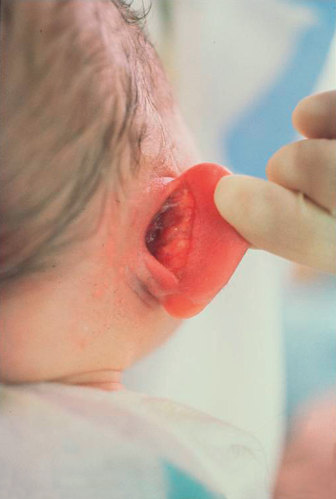

Unmatched source image; PDF page 499. Consult the original caption.

## PDF page 500

Bilateral paralysis also must be distinguished from a number of causes of respiratory distress in the neonate (see Chapter 69); stridor should suggest the larynx as the site of disturbance. Direct or flexible fiberoptic laryngoscopy is necessary to establish the diagnosis.

### Treatment

Infants with unilateral paralysis should be observed closely until there is evidence of improvement. Gentle handling and frequent small feedings aid in keeping the infant quiet and minimizing the risk for aspiration. Bilateral paralysis may need immediate tracheal intubation to establish an airway. Tracheostomy is required subsequently in most patients. Laryngoscopic examinations then should be performed at intervals to look for evidence of return of vocal cord function; early extubation may be attempted if complete return occurs within a short time.

### Prognosis

Unilateral paralysis usually resolves rapidly without treatment, and complete resolution occurs within 4 to 6 weeks. Glossolaryngeal paralysis or paresis resulting from birth injury should resolve spontaneously by 6 months of age. Recognition of this subtle condition is important for two reasons. First, its self-limited course is encouraging, thus avoiding needless alarm in the parents with concern about more ominous conditions such as Werdnig-Hoffmann disease. Second, unnecessary invasive and aggressive procedures can be avoided.

The prognosis for bilateral paralysis is more variable. If untreated, a funnel deformity may develop in the lower sternal area; this may appear as early as the 15th day of life. After tracheostomy, a decrease in the severity of the deformity may occur within several weeks. Some affected infants subsequently regain normally shaped chests; others may have residual fixed depressions occasionally severe enough to require surgical correction. The recovery of vocal cord function varies in time and degree. Some infants may show partial recovery within a few months, with several years elapsing before complete movement of the cords is restored. Other infants who have been followed for years show no improvement. Bilateral paralysis of central origin may improve completely if it is caused by cerebral edema or hemorrhage that rapidly resolves.

### Injuries to the Neck, Shoulder Girdle, and Chest

### Fracture of the Clavicle

See Chapter 101. The clavicle is the most frequently fractured bone during labor and delivery. Most clavicular fractures are of the greenstick type, but occasionally the fracture is complete.

### Etiology

The major causes of clavicular fractures are difficult delivery of the shoulders in vertex presentations and extended arms

in breech deliveries. Vigorous, forceful manipulation of the arm and shoulder usually has occurred. However, fracture of the clavicle may also occur in infants after apparently normal labor and delivery.31 It has been suggested that some fetuses may be more vulnerable to spontaneous birth trauma secondary to forces of labor, maternal pelvic anatomy, and in utero fetal position.

### Clinical Manifestations

Most often a greenstick fracture is not associated with any signs or symptoms but is first detected after the appearance of an obvious callus at 7 to 10 days of life. Thus most neonatal clavicular fractures are diagnosed at discharge or at the first follow-up visit. Complete fractures and some greenstick fractures may be apparent shortly after birth; movement of the arm on the affected side is decreased or absent. Deformity and, occasionally, discoloration may be visible over the fracture site with obliteration of the adjacent supraclavicular depression as a result of sternocleidomastoid muscle spasm. Passive movement of the arm elicits cries of pain from the infant. Palpation reveals tenderness, crepitus, and irregularity along the clavicle. Moro reflex on the involved side is characteristically absent. Radiographs confirm the diagnosis of fracture.

### Differential Diagnosis

A similar clinical picture of impaired movement of an arm with an absent Moro reflex may follow fracture of the humerus or brachial palsy. The fracture is confirmed by radiographs; palsy is accompanied by additional clinical findings. Rarely, an infant may present with a congenital pseudoarthrosis of the clavicle, which may be difficult to distinguish from a fracture. Pseudoarthrosis classically appears as a painless lump on the clavicle, with no associated tenderness or limitation of mobility of the shoulder and arm. Radiography reveals disruption of the affected clavicle, with enlargement of the end of the bone. The etiology is uncertain. Recommended treatment options include observation only or surgical excision of the cartilaginous cap at about 4 or 5 years of age, followed by alignment of bone fragments and, if necessary, bone grafting or internal fixation.

### Treatment

Therapy is directed toward minimizing the infant’s pain. The affected arm and shoulder should be immobilized with the arm abducted more than 60 degrees and the elbow flexed more than 90 degrees. A callus forms, and pain usually subsides by 7 to 10 days, when immobilization may be discontinued.

### Prognosis

The prognosis is excellent, with growth resulting in restoration of normal bone contour after several months.

### Fracture of Ribs

Rib fractures related to labor and delivery are exceedingly rare.

## PDF page 501 | printed page 487

### Etiology

Risk factors are similar to those related to fracture of the clavicle, including macrosomia, a primigravida mother, shoulder dystocia, and delivery by midforceps or vacuum extraction.

### Clinical Manifestations

Specific clinical manifestations are often absent, making diagnosis difficult, unless a chest radiograph is obtained for other reasons, including suspected clavicular fracture (Fig. 28.10),32 respiratory distress, or cyanosis.

### Mechanism of Injury

This injury is initiated when the anterior shoulder is impacted behind the symphysis pubis, with the other shoulder attempting to descend into the posterior compartment of the pelvis (Fig. 28.11).32 This results in compression forces on the fetal arms and thorax, leading to spontaneous rib fractures on the same side as the posterior shoulder (Fig. 28.12).

### Treatment

No specific treatment is required. However, it is extremely important to document this injury immediately after birth to avoid later unwarranted accusation of parents or other caretakers for suspicion of child abuse.

### Prognosis

The prognosis is excellent, with spontaneous healing within several months.

### Brachial Palsy

See Chapter 101. Brachial palsy is a paralysis involving the muscles of the upper extremity that follows mechanical

• Fig. 28.10 Chest radiograph of a 4905-g girl delivered by midforceps after right shoulder dystocia. On the 11th day, a prominent mass was noted in the right midclavicular region. Radiograph reveals a right midclavicular fracture (top left arrow) with slight superior angulation and incidental fractures of left fifth and sixth ribs (bottom right arrows). (From Mangurten HH, Wittert WR, McFadden J, et al. Incidental rib fractures in a neonate. Neonat Intensive Care. 1999;12:15.)

trauma to the spinal roots of the fifth cervical through the first thoracic nerves (the brachial plexus) during birth. Three main forms occur, depending on the site of injury: 1. Duchenne-Erb or upper arm paralysis results from injury

of the fifth and sixth cervical roots and is by far the most common. 2. Klumpke or lower arm paralysis results from injury of the

eighth cervical and first thoracic roots and is extremely rare. 3. Paralysis of the entire arm occurs slightly more often

than the Klumpke type.

Anterior shoulder

Sacral promontory

Posterior

shoulder

• Fig. 28.11 Diagram of fetus during delivery, illustrating impaction of anterior (right) shoulder behind the symphysis pubis, with left shoulder attempting to descend into posterior compartment of the pelvis. (From Mangurten HH, Wittert WR, McFadden J, et al. Incidental rib fractures in a neonate. Neonat Intensive Care. 1999;12:15.)

Clavicular

fracture

Forces of compression

Points of rib injury • Fig. 28.12 Diagram of fetus, illustrating compression forces on the fetal arms and thorax, which result in spontaneous fractures of right clavicle and left fifth and sixth ribs (arrows). (From Mangurten HH, Wittert WR, McFadden J, et al. Incidental rib fractures in a neonate. Neonat Intensive Care. 1999;12:15.)

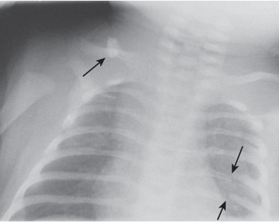

• Fig. 28.10 Chest radiograph of a 4905-g girl delivered by midforceps after right shoulder dystocia. On the 11th day, a prominent mass was noted in the right midclavicular region. Radiograph reveals a right midclavicular fracture (top left arrow) with slight superior angulation and incidental fractures of left fifth and sixth ribs (bottom right arrows). (From Mangurten HH, Wittert WR, McFadden J, et al. Incidental rib fractures in a neonate. Neonat Intensive Care. 1999;12:15.)

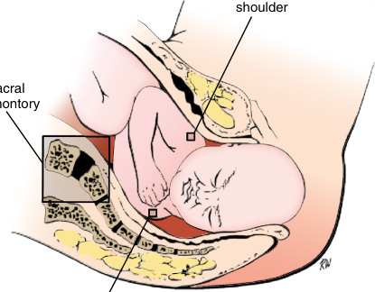

• Fig. 28.11 Diagram of fetus during delivery, illustrating impaction of anterior (right) shoulder behind the symphysis pubis, with left shoulder attempting to descend into posterior compartment of the pelvis. (From Mangurten HH, Wittert WR, McFadden J, et al. Incidental rib fractures in a neonate. Neonat Intensive Care. 1999;12:15.)

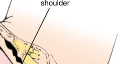

Unmatched source image; PDF page 501. Consult the original caption.

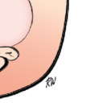

Unmatched source image; PDF page 501. Consult the original caption.

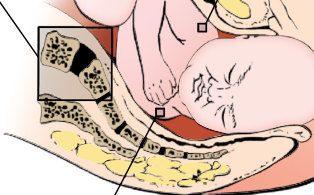

• Fig. 28.11 Diagram of fetus during delivery, illustrating impaction of anterior (right) shoulder behind the symphysis pubis, with left shoulder attempting to descend into posterior compartment of the pelvis. (From Mangurten HH, Wittert WR, McFadden J, et al. Incidental rib fractures in a neonate. Neonat Intensive Care. 1999;12:15.)

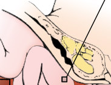

• Fig. 28.11 Diagram of fetus during delivery, illustrating impaction of anterior (right) shoulder behind the symphysis pubis, with left shoulder attempting to descend into posterior compartment of the pelvis. (From Mangurten HH, Wittert WR, McFadden J, et al. Incidental rib fractures in a neonate. Neonat Intensive Care. 1999;12:15.)

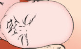

Unmatched source image; PDF page 501. Consult the original caption.

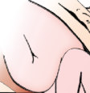

• Fig. 28.11 Diagram of fetus during delivery, illustrating impaction of anterior (right) shoulder behind the symphysis pubis, with left shoulder attempting to descend into posterior compartment of the pelvis. (From Mangurten HH, Wittert WR, McFadden J, et al. Incidental rib fractures in a neonate. Neonat Intensive Care. 1999;12:15.)

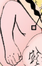

Unmatched source image; PDF page 501. Consult the original caption.

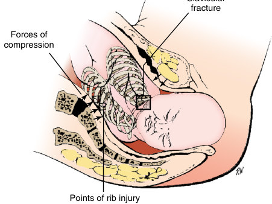

Unmatched source image; PDF page 501. Consult the original caption.

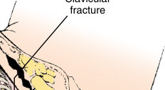

Unmatched source image; PDF page 501. Consult the original caption.

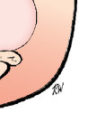

Unmatched source image; PDF page 501. Consult the original caption.

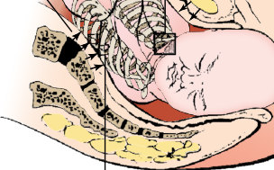

Unmatched source image; PDF page 501. Consult the original caption.

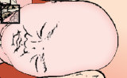

Unmatched source image; PDF page 501. Consult the original caption.

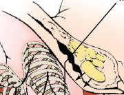

Unmatched source image; PDF page 501. Consult the original caption.

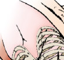

Unmatched source image; PDF page 501. Consult the original caption.

## PDF page 502

### Etiology

Many cases of brachial palsy follow a prolonged and difficult labor culminating in a traumatic delivery.33 The affected infant is frequently large, relaxed, and asphyxiated and thereby vulnerable to excessive separation of bony segments, overstretching, and injury to soft tissues. Injury of the fifth and sixth cervical roots may follow a breech presentation with the arms extended over the head; excessive traction on the shoulder in the delivery of the head may result in stretching of the plexus. The same injury may follow lateral traction of the head and neck away from one of the shoulders during an attempt to deliver the shoulders in a vertex presentation, particularly during a vacuum extraction34 and after shoulder dystocia. More vigorous traction of the same nature results in paralysis of the entire arm. The mechanism for isolated lower arm paralysis is uncertain; it is thought to result from the stretching of lower plexus nerves under and against the coracoid process of the scapula during forceful elevation and abduction of the arm. Excessive traction on the trunk during a breech delivery may result in avulsion of the lower roots from the cervical cord. In most patients, the nerve sheath is torn, and the nerve fibers are compressed by the resultant hemorrhage and edema. Less often, the nerves are completely ruptured and the ends severed, or the roots are avulsed from the spinal cord with injury to the spinal gray matter.

Some authorities suggest that twisting and extension of the fetal head during the cardinal movements of labor and during delivery contribute to the occurrence of brachial palsy.35 An increasing number of reports have described “no shoulder” brachial plexus palsy unrelated to excessive traction during delivery; some experts have suggested an intrauterine insult preceding labor, such as compression by uterine tumors or maternal pelvic bony prominences.36 One study, which confirmed the well-known association of shoulder dystocia and brachial plexus injury in macrosomic infants, also identified an increased incidence of other malpresentations in low and normal birth weight infants with brachial plexus injury.37

### Clinical Manifestations

Clinical manifestations may be understood in relation to depiction of the brachial plexus (Fig. 28.13).38 The infant with upper arm paralysis holds the affected arm in a characteristic position, reflecting involvement of the shoulder abductors and external rotators, forearm flexors and supinators, and wrist extensors. The arm is adducted and internally rotated, with extension at the elbow, pronation of the forearm, and flexion of the wrist. When the arm is passively abducted, it falls limply to the side of the body. Moro, biceps, and radial reflexes are absent on the affected side. There may be some sensory deficit on the radial aspect of the arm, but this is difficult to evaluate in the neonate. The grasp reflex is intact. Any signs of respiratory distress may indicate an accompanying ipsilateral phrenic nerve root injury (see Phrenic Nerve Paralysis).

Upper

C5

Suprascapular

C6

C7

Middle

Lateral

C8

T1

Posterior

Lower

Musculocutaneous

Medial

Axillary

Median

Radial Ulnar

• Fig. 28.13 Simplified schematic diagram of brachial plexus, indicating spinal nerves of origin, trunks, cords, and major peripheral nerves. Darker area signifies the portion of the plexus affected in Erb palsy. (Courtesy Dr. Joseph H. Piatt Jr., St. Christopher’s Hospital for Children, Philadelphia.)

Lower arm paralysis involves the intrinsic muscles of the hand and the long flexors of the wrist and fingers. The hand is paralyzed, and voluntary movements of the wrist cannot be made. The grasp reflex is absent; the deep tendon reflexes are intact. Sensory impairment may be demonstrated along the ulnar side of the forearm and hand. Frequently, dependent edema and cyanosis of the hand and trophic changes in the fingernails develop. After some time, there may be flattening and atrophy of the intrinsic hand muscles. Usually, an ipsilateral Horner syndrome is also present because of injury involving the cervical sympathetic fibers of the first thoracic root. Often this is associated with delayed pigmentation of the iris, sometimes of more than 1 year’s duration.

When the entire arm is paralyzed, it is usually completely motionless, flaccid, and powerless, hanging limply to the side. All reflexes are absent. The sensory deficit may extend almost to the shoulder.

### Differential Diagnosis

The presence of a flail arm in a neonate may be caused by cerebral injury or a number of injuries about the shoulder. Cerebral injury is usually associated with other manifestations of CNS injury. A careful radiographic study of the shoulder, including an examination of the lower cervical spine, clavicle, and upper humerus, should be made to exclude tearing of the joint capsule; fracture of the clavicle; and fracture, dislocation, or upper epiphyseal detachment of the humerus. Posterior dislocation of the humeral head may be difficult to identify with standard radiographs. Torode and Donnan have used CT scans to demonstrate that posterior dislocation is more common than previously believed.39 Ultrasonography may also clearly reveal a posterior dislocation. Because posterior dislocation will complicate resolution of the palsy, ultrasonographic evaluation should be considered early in the management of these infants.

### Treatment

The basic principle of treatment historically has been conservative, with initial emphasis on prevention of contractures

## PDF page 503 | printed page 489

while awaiting recovery of the brachial plexus. With the development of safe and effective surgical techniques for the management of brachial plexus injury, this approach has been replaced by a more comprehensive program that combines initial conservative management with closer followup and an earlier decision regarding surgical intervention.40 The management begins with differentiating neonatal brachial plexus palsy from neurologic and musculoskeletal conditions with similar presentation. A thorough and complete physical examination should be performed that includes careful palpation of the sternocleidomastoid muscle for contracture or pseudotumor; inspection for fractures of the clavicle, humerus, or ribs; observation for abdominal asymmetry, which could indicate paralysis of the hemidiaphragm; and assessment for ocular asymmetry, which may indicate associated Horner syndrome.

Ancillary investigations, including CT and magnetic resonance myelography, could be helpful in detecting possible nerve root avulsions to aid in surgical planning. Certain diagnostic and decision-making algorithms use electrodiagnostic studies; however, this is not considered standard of care at this time.

Infants should be referred for occupational therapy if brachial plexus injury is suspected contrary to the prior practice of immobilization of the arm. Immobilization of the affected arm is indicated only if an orthopedic condition requires it. Some infants may demonstrate discomfort because of a painful traumatic neuritis affecting the brachial plexus. If no discomfort is apparent and other lesions as noted earlier are ruled out, early passive range of motion exercises, particularly involving the elbow and wrist, should be instituted. Therapeutic exercises include shoulder rotation; elbow flexion and extension; wrist flexion and extension; finger flexion and extension; and thumb abduction, adduction, and opposition. Early therapy aids in maintaining normal passive joint range of motion, promoting functional use of the affected extremity, and selectively strengthening active muscles. Exercises should be continued at home under guidance of therapy staff, and caregivers should receive direct teaching and demonstration as well as supplemental visual aids to ensure that exercises are performed correctly at home.

The infant should be re-evaluated every month. Referral to a multidisciplinary brachial plexus palsy specialty program is strongly recommended if a child has not completely recovered by 1 month of age, so that appropriate intervention can be done before permanent changes in the nerve, muscle, and neuromuscular junction occur. Several management algorithms have been developed over the past several years, using a combination of serial physical examination, imaging, and electrodiagnostics to arrive at a decision. If the child has not recovered sufficient bicep strength to bring the hand to the mouth by 6 months of age against gravity, then he or she is generally considered a surgical candidate. One algorithm uses an active movement scale for accessing motor function in infants; a subthreshold performance at selected time periods of 3 and 9 months predicts poor

spontaneous recovery with conservative management, and primary nerve surgery is pursued.41

Currently, primary nerve surgery involves nerve grafting, nerve transplant, or a combination of the two. Nerve surgery in appropriately selected candidates can significantly improve function for those with brachial plexus palsy.

The initial surgical therapy may include a team of neurosurgeons, plastic surgeons, and physiatrists who collaborate in the exploration, evaluation, and repair of the injury. This aggressive approach has resulted in up to 90% of patients demonstrating useful function of muscle groups above the elbow. Function below the elbow has been characterized by 50% to 70% recovery because of the increased distance required for nerve regeneration.

### Prognosis

Continued close follow-up includes serial evaluation of shoulder, elbow, forearm, wrist, finger, and thumb function. Based on the child’s progress over time, a decision is made regarding further treatment. Physical therapy is continued until there is no further progress or the deficit is debilitating. For the infant who continues to demonstrate lack of improvement in certain muscle groups, secondary surgical reconstruction is available, with a variety of options depending on the individual deficit.

Although most (93%–95%) infants achieve return of function with conservative management, the remainder with persistent deficits may go on to development of longterm severe handicaps of the affected extremity. Early treatment offers significant improvement for about 90% of these children. Referral to centers that have an established rehabilitation program for infants with this condition may be initiated for a timely and successful treatment. In summary, the infant who does not improve spontaneously now has increased hope for recovery, owing to advances in microsurgery and nerve transfer techniques.

### Phrenic Nerve Paralysis

See Chapter 67. Phrenic nerve paralysis results in diaphragmatic paralysis and rarely occurs as an isolated injury in the neonate. Most injuries are unilateral and are associated with ipsilateral upper brachial plexus palsy.

### Etiology

The most common cause is a difficult breech delivery. Lateral hyperextension of the neck results in overstretching or avulsion of the third, fourth, and fifth cervical roots, which supply the phrenic nerve.

### Clinical Manifestations

The first sign may be recurrent episodes of cyanosis, usually accompanied by irregular and labored respirations. The respiratory excursions of the involved side of the diaphragm are largely ineffective, and the breathing is therefore almost completely thoracic, so that no bulging of the abdomen occurs with inspiration (Fig. 28.14A and B). The thrust of

## PDF page 504

B

A C

• Fig. 28.14 (A) Nine-hour-old, 3190-g female infant born after difficult total breech extraction; during delivery, cervix clamped down on head, necessitating extensive tugging and pulling on both arms. Note markedly hyperexpanded chest and classic appearance of both upper extremities in Erb palsy positions. (B) Lateral view of same infant, demonstrating increased anteroposterior diameter of chest and close-up view of left upper extremity adducted at shoulder, extended at elbow, and pronated and flexed at wrist. (C) Significant elevation of right hemidiaphragm to level of fifth thoracic vertebra in same infant, compatible with paralysis of right hemidiaphragm. Note significant shifting of heart and mediastinum to the left.

the diaphragm, which often may be felt just under the costal margin on the normal side, is absent on the affected side. Dullness to percussion and diminished breath sounds are found over the affected side. In a severe injury, tachypnea, weak cry, and apneic spells may occur.

### Radiographic Manifestations

Radiographs taken during the first few days may show only slight elevation of the affected diaphragm, occasionally so subtle that it may be considered normal. Additional radiographs show the more apparent elevation of the diaphragm, with displacement of the heart and mediastinum to the opposite side (see Fig. 28.14C). Frequently, areas of atelectasis appear bilaterally. Early diagnosis can be confirmed by real-time ultrasonographic examination of the diaphragm, which reveals abnormal motion of the affected hemidiaphragm. This procedure provides the added advantage of availability at the bedside. Fluoroscopy should be reserved for equivocal cases. In still questionable cases, diagnosis can be further enhanced by transvenous electrical stimulation of the phrenic nerve.

### Differential Diagnosis

Careful physical examination should allow differentiation among CNS, cardiac, and pulmonary causes of neonatal respiratory distress. The diagnosis can be confirmed by fluoroscopy and electrical stimulation of the phrenic nerve.

### Treatment

Most infants require only nonspecific medical treatment. The infant should be positioned on the involved side, and oxygen should be administered for cyanosis or hypoxemia. Intravenous fluids may be necessary for the first few days. If the infant begins to show improvement, progressive oral or gavage feedings may be started. Antibiotics are indicated if pneumonia occurs. Infants with more severe respiratory distress, particularly those with bilateral phrenic nerve palsy, may require assisted ventilation shortly after delivery.

Surgical plication may be considered in cases of persistent diaphragm paralysis. Historically, plication was done via thoracotomy. Currently, thoracoscopic repair is the most common method. Given that some infants will recover phrenic nerve function spontaneously, optimal timing of surgery is unknown. de Vries et al. advocated for conservative treatment for the first 30 days of life to ensure that the infant did not spontaneously recover.42 However, recent groups have reported plication before 30 days of life, resulting in earlier weaning of ventilatory support, shorter hospital stays, and lower readmission rates.43

### Prognosis

Many infants recover spontaneously. If avulsion of the cervical nerves has occurred, spontaneous recovery is not possible, and in the absence of surgery, the infant is susceptible

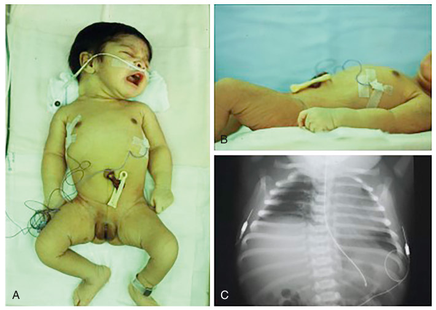

• Fig. 28.14 (A) Nine-hour-old, 3190-g female infant born after difficult total breech extraction; during delivery, cervix clamped down on head, necessitating extensive tugging and pulling on both arms. Note markedly hyperexpanded chest and classic appearance of both upper extremities in Erb palsy positions. (B) Lateral view of same infant, demonstrating increased anteroposterior diameter of chest and close-up view of left upper extremity adducted at shoulder, extended at elbow, and pronated and flexed at wrist. (C) Significant elevation of right hemidiaphragm to level of fifth thoracic vertebra in same infant, compatible with paralysis of right hemidiaphragm. Note significant shifting of heart and mediastinum to the left.

• Fig. 28.14 (A) Nine-hour-old, 3190-g female infant born after difficult total breech extraction; during delivery, cervix clamped down on head, necessitating extensive tugging and pulling on both arms. Note markedly hyperexpanded chest and classic appearance of both upper extremities in Erb palsy positions. (B) Lateral view of same infant, demonstrating increased anteroposterior diameter of chest and close-up view of left upper extremity adducted at shoulder, extended at elbow, and pronated and flexed at wrist. (C) Significant elevation of right hemidiaphragm to level of fifth thoracic vertebra in same infant, compatible with paralysis of right hemidiaphragm. Note significant shifting of heart and mediastinum to the left.

• Fig. 28.14 (A) Nine-hour-old, 3190-g female infant born after difficult total breech extraction; during delivery, cervix clamped down on head, necessitating extensive tugging and pulling on both arms. Note markedly hyperexpanded chest and classic appearance of both upper extremities in Erb palsy positions. (B) Lateral view of same infant, demonstrating increased anteroposterior diameter of chest and close-up view of left upper extremity adducted at shoulder, extended at elbow, and pronated and flexed at wrist. (C) Significant elevation of right hemidiaphragm to level of fifth thoracic vertebra in same infant, compatible with paralysis of right hemidiaphragm. Note significant shifting of heart and mediastinum to the left.

## PDF page 505 | printed page 491

to pneumonia in the atelectatic lung. Infants treated surgically do well, with no recurrence of pneumonia and no late pulmonary or chest wall complications.

### Injury to the Sternocleidomastoid Muscle

Injury to the sternocleidomastoid muscle is designated as muscular torticollis, congenital torticollis, or sternocleidomastoid fibroma. Its cause and pathologic features have been controversial.

### Etiology

The birth trauma theory suggests that the muscle or fascial sheath is ruptured during a breech or difficult delivery involving hyperextension of the muscle. A hematoma develops and is subsequently invaded by fibrin and fibroblasts, with progressive formation of scar tissue and shortening of the muscle. The intrauterine theory postulates abnormal pressure, position, or trauma to the muscle during intrauterine life. Another theory suggests a hereditary defect in the development of the muscle. Others have noted pathologic findings resembling infectious myositis, suggesting an infection in utero or a muscle injured at delivery. Davids and coworkers, based on use of MRI to visualize live infants and cadaver dissections and injection studies, suggest that congenital muscular torticollis results from intrauterine or perinatal compartment syndrome.44

In utero or intrapartum positioning of the head and neck in forward flexion, lateral bending, and rotation can result in the ipsilateral sternocleidomastoid muscle kinking on itself. If the kinking continues for a prolonged period in utero, an ischemic injury at the site could develop, followed by subsequent edema and development of a compartment syndrome. Therefore the mechanism of injury is localized kinking or crush, in contrast to the previously suspected mechanism of stretching or tearing (Fig. 28.15).

### Clinical Manifestations

A mass in the midportion of the sternocleidomastoid muscle may be evident at birth, although usually it is first noted 10 to 14 days after birth. It is 1 to 2 cm in diameter, hard, immobile, fusiform, and well circumscribed; there is no inflammation or overlying discoloration. The mass enlarges during the following 2 to 4 weeks and then gradually regresses and disappears by age 5 to 8 months.

A transient torticollis produced by contracture of the involved muscle appears soon after birth. The head tilts toward the involved side, and the chin is somewhat elevated and rotated toward the opposite shoulder. The head cannot be moved passively into a normal position. If the deformity persists beyond 3 or 4 years, the skull becomes foreshortened. Flattening of the frontal bone and bulging of the occipital bone occur on the involved side, whereas the contralateral frontal bone bulges and the occiput is flattened. The ipsilateral eyebrow is slanted; the clavicle and shoulder become elevated compared with the opposite normal side, and the ipsilateral mastoid process becomes more

Contracture

Fetus

Torticollis In utero

Engagement, flexion, bend, rotation

Labor

Fibrosis

Compression injury Sternocleidomastoid

Muscle infarction

Delivery

Muscle ischemia Nerve injury

Reperfusion injury

Edema

Edema

Increased compartment pressure

Compartment tamponade

• Fig. 28.15 Algorithm illustrating the Davids study,44 suggesting that congenital muscular torticollis results from intrauterine or perinatal compartment syndrome.

prominent. If treatment is not instituted, a lower cervical, upper thoracic scoliosis subsequently develops. Rarely, calcification develops in the affected muscles.

### Differential Diagnosis

Careful radiographic examination should be made of the cervical spine and shoulders to rule out Sprengel deformity or Klippel-Feil syndrome, cervical myelodysplasia, and occipitalization of the atlas. In clinically equivocal cases, CT scans may differentiate classic muscular torticollis from other cervical soft tissue lesions that may cause torticollis (e.g., hemangioma, lymphangioma, and teratoma).

### Treatment

Treatment should be instituted as early as possible. The involved muscle should be stretched to an overcorrected position by gentle, even, and persistent motion, with the infant supine. The head is flexed forward and away from the affected side, and the chin is rotated toward the affected side. The mother can be instructed to repeat this maneuver several times a day. The infant also should be stimulated to turn the head spontaneously toward the affected side; the crib may be positioned so that the infant must turn to the desired position of overcorrection in looking for window light or at a mobile or favorite rattle.

Ultrasonography may be useful in defining the quantity of normal muscle remnant surrounding the lesion, thereby helping to determine whether the infant requires no treatment at all, conservative stretching, or surgery.45 Conservative therapy may be continued for 6 months. If the deformity has not been fully corrected, surgery may be considered to prevent permanent skull and cervical spine deformities.

## PDF page 506

Procedures that have been used include distal tenotomy, muscle lengthening, and excision of the affected muscle. All are followed by some problems. After tenotomy, contractures may recur. Lengthening is difficult because of imprecision in estimating how much elongation will be adequate for subsequent growth. Complete excision deforms the outline of the neck. Torticollis braces and a vigorous physical therapy regimen is followed postoperatively to prevent relapse.

### Prognosis

Most infants treated conservatively show complete recovery within 2 to 3 months. If surgery is necessary and is performed early, the facial asymmetry will disappear almost entirely. Infants treated before their first birthday have a better outcome than those treated later, regardless of the type of treatment. Nonsurgical treatment after 1 year is rarely successful.

### Injuries to the Spine and Spinal Cord

Birth injuries to the vertebral spine and spinal cord are rarely diagnosed. The incidence of spinal cord injury in the neonatal period is 0.14 per 1000 live births. It is not certain whether the low incidence is real, reflecting improved obstetric techniques, or represents a tendency for postmortem examination to overlook spine and spinal cord lesions.

### Etiology

Spinal cord injury has been usually reported as a result of excessive traction or torsion placed on the spine during traumatic or instrumented delivery or in association with underlying abnormalities of the cord or surrounding tissues. Ligamental laxity, weak muscles, and incomplete mineralization predispose these infants to these types of injury. Other predisposing factors include malpresentations, dystocia (especially shoulder), prematurity, primiparity, and assisted and precipitous delivery. Isolated cases of spinal cord injury after atraumatic vaginal delivery are also reported in the literature.46 The injuries are usually caused by stretching of the cord. The most common mechanism is forceful longitudinal traction on the trunk while the head is still firmly engaged in the pelvis in a vaginal breech delivery. When combined with flexion and torsion of the vertebral axis, this becomes a more significant problem. Occasionally, a snap is felt by the obstetrician while traction is exerted. Difficulty in delivery of the shoulders in cephalic presentations may result in a similar mechanism of injury. The spinal cord is very delicate and inelastic. Its attachments are the cauda equina below and the roots of the brachial plexus and medulla above. Because the ligaments are elastic and the muscles delicate, the infant’s vertebral column may be stretched easily. In addition, the dura is more elastic in the infant than in the adult. Consequently, strong longitudinal

traction may be expected to cause elongation of the spinal column and to stretch the spinal cord and its membranes. The possible result is vertebral fracture, dislocation, or both, and cord transection. Most often, hemorrhage and edema produce a physiologic transection. The lower cervical and upper thoracic regions are most often involved, but occasionally the entire length of the spinal canal contains a heavy accumulation of blood.

### Clinical Manifestations

Affected infants may follow one of four clinical patterns. Those in the first group often manifest a catastrophic presentation and are either stillborn or in poor condition from birth, with respiratory depression, decreased or absent movement, loss of reflexes, lack of response to painful stimulation, shock, and hypothermia. They deteriorate rapidly; death occurs within several hours, often before neurologic signs are obvious. These infants usually have a high cervical or brainstem lesion.

The second group consists of infants who at birth may appear normal or show signs similar to those of the first group; these infants die after several days. Cardiac function is usually relatively strong. Within hours or days, the central type of respiratory depression that is initially present may be complicated by respiratory distress of pulmonary origin, usually pneumonia. The spinal lesion, usually in the upper or midcervical region, frequently is not recognized for several days, when flaccidity and immobility of the legs are noted. Occasionally, urinary retention may be the first symptom. Paralysis of the abdominal wall is manifested by a relaxation of the abdominal wall and bulging at the flanks when the infant is held upright. The intercostal muscles may be affected if the lesion is high enough. Deep tendon reflexes and spontaneous reflex movements are absent. The infant is constipated. The brachial plexus is involved in about 20% of all cases. The spinal column is usually clinically and radiographically normal.

The third group, with lesions at the seventh cervical to first thoracic vertebra or lower, comprises infants who survive for long periods, some for years. Paraplegia noted at birth may be transient. The lesion in the cord may be mild and reversible, or it may result in permanent neurologic sequelae with no return of function in the lower cord segments. The skin over the involved part of the body is dry and scaly, predisposing the infant to decubitus ulcers. Muscle atrophy, severe contractures, and bony deformities follow. Bladder distention and constant dribbling persist, and recurring urinary tract infections and pneumonia are common. Within several weeks or months, this clinical picture is replaced by a stage of reflex activity, or paraplegia-in-flexion. This is characterized by return of tone and rigid flexion of the involved extremities, improvement in skin condition with healing of decubitus ulcers, and periodic mass reflex responses consisting of tonic spasms of the

## PDF page 507 | printed page 493

extremities, spontaneous micturition, and profuse sweating over the involved part of the body.

Infants in the fourth group have subtle neurologic signs of spasticity thought to represent cerebral palsy. These patients have experienced partial spinal cord injuries and occasional cerebrovascular accidents.

### Differential Diagnosis

Differential diagnosis of spinal cord injury in the neonate presenting with flaccid paralysis includes brachial plexopathy, intracranial injury, neuromuscular disease, and a tumor or underlying anomalies of the spinal cord. During the first few weeks of life, injuries to the spinal cord may be confused with amyotonia congenita or myelodysplasia associated with spina bifida occulta. The former may be differentiated by the generalized distribution of the weakness and hypotonia and by the presence of normal sensation and sphincter control. The latter is usually associated with some cutaneous lesions over the sacral region such as dimples, angiomas, or abnormal tufts of hair; it is always associated with defects in the spinal lamina. Other conditions less often considered include transverse myelitis and spinal cord tumors, particularly in infants who demonstrate paralysis after an apparently normal labor and delivery. Cerebral hypotonia should be considered in infants who also demonstrate cranial nerve abnormalities, persistent primitive reflexes, and a dull facial appearance, contrasting to the bright, alert facies of the infant with spinal cord trauma. However, the concomitant occurrence of cerebral damage in an infant with spinal cord injury may confound the diagnosis. A final consideration is the infant with bilateral brachial plexus palsy with associated motor and sensory loss, or Horner syndrome; the demonstration of normal lower extremity function should rule out spinal cord injury.

Although somatosensory evoked potential recording has been used in establishing a diagnosis of spinal cord injury, cervical responses are usually small and can be difficult to detect even in clinically normal infants; in addition, scalp potentials overlying the somatosensory cortex may be absent in normal term neonates. Ultrasonography has been used to evaluate severe spinal cord injury in neonates.47 The procedure is easily performed at the bedside, with no disturbance to the patient. Initial cord edema, hematomyelia, and hemorrhage outside the cord can be assessed. MRI provides a direct image of the spinal cord and is the most reliable modality available to evaluate presumptive cervical spinal cord injury in the infant.48,49

### Treatment

Treatment is supportive and historically unsatisfactory. The infant affected at birth requires basic resuscitative and supportive measures. Infants who survive present a therapeutic challenge that can be met only by the combined and

interested efforts of a multidisciplinary team including the neonatologist, neurologist, neurosurgeon, urologist, psychiatrist, orthopedist, nurse, physical therapist, and occupational therapist.

While the infant is reasonably stable, cervical and thoracic spine radiographs should be obtained. In the rare occurrence of vertebral fracture, dislocation, or both, immediate neurosurgical consultation is necessary for reduction of the deformity and relief of cord compression, followed by appropriate immobilization. Lumbar puncture in the acute period is of little practical value and may aggravate existing cord damage if the infant is excessively manipulated during the procedure. However, after several days, a persistent spinal fluid block may be demonstrated and may be an indication for exploratory laminectomy at the site of trauma. This possibility should be suspected in an infant with partial paraplegia and negative radiographs.

Prompt and meticulous attention must be given to skin, bladder, and bowel care. An indwelling urethral catheter should be inserted within several hours after severe cord trauma at any level. Repeated instrumentation should be avoided. Cultures of urine should be obtained as clinically indicated. Antibiotic therapy should be used only in the presence of infection. After several weeks, the infant reaches the stage of paraplegia-in-flexion, and urinary retention usually is replaced by regular episodes of spontaneous voiding. The indwelling catheter may then be removed, and postvoid bladder residuals should be measured. A renal sonogram and a conventional fluoroscopically guided voiding cystourethrogram should be obtained. If there are large postvoid residuals (>10–15 mL) or if the renal sonogram or cystogram shows abnormality, urodynamic studies may be necessary. A high-pressure neurogenic bladder may be treated with an anticholinergic agent such as oxybutynin chloride, concurrently with clean intermittent bladder catheterization every 3 to 4 hours. Treatment of the low-pressure neurogenic bladder requires only clean intermittent catheterization.

Fecal retention is also a common problem, especially after total cord transection. Appropriate dietary balance should aid in keeping the stools soft. Early use of glycerin suppositories at regular intervals encourages automatic defecation. Digital manipulation may be necessary to relieve fecal impaction.

Physical rehabilitation should be instituted early to minimize deformity. After several years, orthopedic procedures may still be necessary to correct contractures and bony deformities.

Recently, there have been case reports of new therapeutic options for newborns with cervical spinal cord injury. Saleh et al. reported a case of successful surgical repair in a newborn with birth-related cervical fracture dislocation.50 Prompt intervention allowed significant neurologic recovery in this patient. Therapeutic hypothermia has also been proposed as a therapy in cases of neonatal cervical spine injury. Montaldo et al. reported a case of severe hemorrhagic

## PDF page 508

contusion of the cervical spine that underwent cooling therapy for hypoxic ischemic brain injury.51 At 1 year of age, the patient was neurologically normal apart from unilateral upper extremity weakness. Other case reports support the possible utility of this therapy.52 Future studies are warranted to investigate these promising therapies.

### Prognosis

The prognosis varies with the severity of the injury. Most severe injuries result in death shortly after birth. Infants with cord compression from vertebral fractures or dislocations or both may recover with reasonable return of function if prompt neurosurgical removal of the compression is performed. Infants with mild injuries or partial transections may recover with minimal sequelae. MRI evidence of hemorrhage in the cervical spinal cord portends a poor neurologic outcome.48 If MRI reveals extensive edema in multiple spinal cord segments without concurrent hemorrhage, complete recovery is possible. Infants who exhibit complete physiologic cord transection shortly after birth without vertebral fracture or dislocation have an extremely poor outlook for recovery of function. Many die in infancy of ascending urinary tract infection and sepsis. Long-term survivors have been reported to live into their third decade. They are extremely rare, and although they may have normal intelligence and learn to walk with special appliances, these children face the late complications of pain; spasms; autonomic dysfunction; bony deformities; and genitourinary, psychiatric, and school problems.

MacKinnon and colleagues have published an algorithm for predicting outcome in infants with upper cervical spinal cord injury; the algorithm is based on age at first breath and rate of recovery of breathing and limb movements in the first few weeks and months of life.53 For infants with rapid recovery, the prognosis was clarified by age 3 weeks. Infants who demonstrated very slow or no recovery of breathing or extremity movements by 3 months of age universally had a poor outcome. Patients with intermediate rates of recovery were thought to have an uncertain long-term prognosis at 3 months of age.

### Injuries to Intra-Abdominal Organs

Although birth trauma involving intra-abdominal organs is uncommon, it frequently must be considered by the physician who cares for neonates, because deterioration can be fulminant in an undetected lesion and therapy can be very effective when a lesion is diagnosed early. Intra-abdominal trauma should be suspected in any newborn with shock and abdominal distention or pallor, anemia, and irritability without evidence of external blood loss.

### Rupture of the Liver

The liver is the most frequently injured abdominal organ during the birth process. The autopsy incidence of liver injury varies from 0.9% to 9.6%.54

### Etiology

Birth trauma is the most significant factor contributing to liver injury. The condition usually occurs in large infants, infants with hepatomegaly (e.g., infants with erythroblastosis fetalis and infants of diabetic mothers), and infants who underwent breech delivery. Manual pressure on the liver during delivery of the head in a breech presentation is probably a typical mechanism of injury. Prematurity and postmaturity are also thought to predispose the infant to this injury. Other contributing factors include asphyxia and coagulation disorders. Trauma to the liver more often results in subcapsular hematoma than actual laceration of the liver.

### Clinical Manifestations

The infant usually appears normal the first 1 to 3 days but rarely for as long as 7 days. Nonspecific signs related to loss of blood into the hematoma may appear early; they include poor feeding, listlessness, pallor, jaundice, tachypnea, and tachycardia. A mass may be palpable in the right upper quadrant of the abdomen. The hematocrit and hemoglobin values may be stable early in the course, but serial determinations suggest blood loss. These manifestations are followed by sudden circulatory collapse, usually coincident with rupture of the hematoma through the capsule and extravasation of blood into the peritoneal cavity. The abdomen then may be distended, rigid, and dull to percussion, occasionally with a bluish discoloration of the overlying skin, which may extend over the scrotum in male infants. Abdominal radiographs may suggest the diagnosis by revealing liver enlargement, an abnormal course of a nasogastric tube or umbilical venous catheter, or uniform opacity of the abdomen, indicating free intraperitoneal fluid. Although paracentesis can confirm whether the latter indicates free blood in the peritoneal cavity, ultrasonography offers a noninvasive method of diagnosis.54 Fresh intrahepatic hemorrhage appears echogenic, with possible enlargement of the involved lobe; with involution of the hemorrhage, the lesion becomes more echolucent and may disappear. CT scan of the abdomen also may assist in establishing a diagnosis of subcapsular hemorrhage without rupture.

### Differential Diagnosis

This lesion is one of several that can result in hemoperitoneum; others include trauma to the adrenal glands, kidneys, gastrointestinal tract, and spleen. The presence of a right upper quadrant mass suggests trauma to the liver, but absence of a mass does not rule it out. Abdominal radiography, ultrasonography, and intravenous pyelography may assist in pinpointing the site of trauma, but ultimately a definitive diagnosis can be made only by laparotomy.

### Treatment

Immediate management consists of transfusion with packed red blood cells, as well as recognition and correction of any coagulation disorder. The role of surgical intervention is controversial. Hemostasis may be difficult to achieve at

## PDF page 509 | printed page 495

surgery. Consequently, blood transfusion and the tamponade of intra-abdominal pressure might be adequate therapy in some infants.

### Prognosis

In unrecognized liver trauma with formation of a subcapsular hematoma, shock and death may result if the hematoma ruptures through the capsule, reducing the pressure tamponade and resulting in new bleeding from the liver. Recognition of the possibility of liver rupture in infants with a predisposing birth history, followed by early diagnosis and prompt therapy, should improve the prognosis. Early diagnosis and correction of any existing coagulation disorder also improve the prognosis.

### Rupture of the Spleen

Rupture of the spleen in the newborn occurs much less often than rupture of the liver. However, recognition of this condition is equally important because of its similar potential for fulminant shock and death if the diagnosis is delayed.

### Etiology

The condition is most common in large infants, infants delivered in breech position, and infants with erythroblastosis fetalis or congenital syphilis in whom the spleen is enlarged and more friable and thereby susceptible to rupture either spontaneously or after minor trauma. An underlying clotting defect has also been implicated. Rupture of the spleen has occurred in normal-sized infants with uneventful deliveries and no underlying disease.55

### Clinical Manifestations

Clinical signs indicating blood loss and hemoperitoneum are similar to those described for hepatic rupture. The hemoglobin and hematocrit values decrease, and abdominal paracentesis may reveal free blood. Several infants have been described in whom the blood was circumscribed within the leaves of the phrenicosplenic ligament and therefore was not clinically detectable. Occasionally, a left upper quadrant mass may be palpable, and radiographs of the abdomen may show medial displacement of the gastric air bubble.

### Differential Diagnosis

Rupture of the liver and trauma to the adrenal glands, kidneys, and gastrointestinal tract must be distinguished.

### Treatment

Packed red blood cells should be transfused promptly, and any coexisting clotting defect should be corrected. This should be followed by immediate exploratory laparotomy. Every attempt should be made to repair and preserve the spleen to prevent the subsequent increased risk for infection. Packing of the wound surface with Gel Foam and Surgicel has been used to stop the oozing of blood.55 The Gel Foam and Surgicel may be removed at a follow-up

laparotomy within several days, at which time the spleen may be inspected for rebleeding.

### Prognosis

With early recognition and emergency surgery, the survival rate should approach 100%.

### Adrenal Hemorrhage

Neonatal adrenal hemorrhage is more common than previously suspected; some autopsy studies have revealed a high incidence of subclinical hemorrhage. Massive hemorrhage is much less common, and the incidence is difficult to determine because the diagnosis is often unsuspected and considered retrospectively only years later, when calcified adrenal glands are unexpectedly found on radiographs or at autopsy.

### Etiology

The most likely cause is birth trauma; risk factors include macrosomia, diabetes in the mother, breech presentation, congenital syphilis, and dystocia. Placental hemorrhage, anoxia, hemorrhagic disease of the newborn, prematurity, and, more recently, neuroblastoma have been implicated. Pathologic findings vary from unilateral minute areas of bleeding to massive bilateral hemorrhage. The increased size and vascularity of the adrenal gland at birth may predispose it to hemorrhage.

### Clinical Manifestations

Signs vary with the degree and extent of hemorrhage. The classic findings are fever, tachypnea out of proportion to the degree of fever, yellowish pallor, cyanosis of the lips and fingertips, a mass in either flank with overlying skin discoloration, and purpura. Findings suggesting adrenal insufficiency include poor feeding, vomiting, diarrhea, obstipation, dehydration, abdominal distention, irritability, hypoglycemia, uremia, rash, listlessness, coma, convulsions, and shock. There have also been case reports of adrenal hemorrhage presenting as scrotal hematoma. It is important to distinguish this from testicular torsion, to avoid unnecessary surgical intervention.56,57

### Radiographic Manifestations

Initial radiographic manifestations may be limited to widening of the retroperitoneal space with forward displacement of the stomach and duodenum or downward displacement of the intestines or kidneys. In time, calcification may appear. Typically this is rimlike and has been observed as early as the 12th day of life. After several weeks the calcification becomes denser and retracted and assumes the configuration of the adrenal gland (Fig. 28.16). Ultrasonographic examination of the neonate is an excellent adjunctive method of diagnosis. Abdominal ultrasonography performed during the first several days may reveal a solid lesion in the location of the adrenal hemorrhage; this is thought to represent either clot fragmentation or diffuse clotted blood throughout the adrenal gland. If adrenal hemorrhage is suspected,

## PDF page 510

• Fig. 28.16 Lateral abdominal radiographs of a 5312-g male infant delivered vaginally, with difficulty after shoulder dystocia. At 48 hours, fever, icterus, and slow feeding were noted, and a mass was palpable above the left kidney. At 31 days, there was dense, retracted calcification (arrows) that assumed the configuration of the adrenal gland.

ultrasonographic examination should be repeated at 3- to 5-day intervals. If adrenal hemorrhage has occurred, the lesion will change from a solid to a cystic appearance, coincident with liquefaction, degeneration, and lysis of the clot.

### Differential Diagnosis

Adrenal hemorrhage must be distinguished from other causes of abdominal hemorrhage. In addition, when a mass is palpable, the differential diagnosis must include the multiple causes of flank masses in the newborn, such as genitourinary anomaly, Wilms tumor, and neuroblastoma. If the infant is large or the delivery is traumatic or breech, an adrenal hemorrhage is most likely. Neuroblastoma may be distinguished by persistent demonstration of a solid lesion on serial ultrasonographic examinations and by increased excretion of vanillylmandelic acid and other urinary catecholamines in 85% to 90% of affected infants. Blood pressure measurements and radiographs also may help to evaluate this possibility.

### Treatment

Significant blood loss should be replaced with packed red blood cell transfusion. Suspicion of adrenal insufficiency may warrant the use of intravenous fluids and corticosteroids. The decision for surgical intervention is dictated by the location and degree of hemorrhage. If it appears to be retroperitoneal and limited by the perinephric fascia, some recommend blood replacement and careful observation in the hope of spontaneous control by tamponade; often this approach is successful, and surgery is not necessary. If paracentesis reveals blood or if blood loss exceeds replacement, exploratory laparotomy is indicated. Surgery may involve evacuation of hematoma, vessel ligation, and adrenalectomy with or without nephrectomy. When the hemorrhagic process extends to the peritoneal cavity, peritoneal exploration and evacuation of clots are indicated.

### Prognosis

Small hemorrhages are probably often asymptomatic and have no associated significant morbidity, judging from the unexpected discovery of calcified adrenal glands on abdominal radiographs taken for other reasons later in infancy and childhood. If hemoperitoneum, adrenal insufficiency, or both develop, the outlook depends on the speed with which diagnosis is made and appropriate therapy instituted. Surviving infants should be followed closely after discharge from the hospital. Adrenal function should be tested with adrenocorticotropic hormone stimulation at a later date to determine whether a normal response occurs in the urinary excretion of 17-hydroxycorticosterone.

### Renal Injury

Birth-related injury to the kidneys occurs rarely and less often than injury involving the liver, spleen, or adrenal gland.

### Etiology

Factors that predispose an infant to any form of intraabdominal injury also may affect the kidneys. They include macrosomia, malpresentation (especially breech), and precipitous labor or delivery or both. The potential for renal injury is enhanced by a pre-existing anomaly (e.g., hydronephrosis).

### Clinical Manifestations

The infant may demonstrate the same signs of blood loss and hemoperitoneum noted in the other intra-abdominal lesions. More specific signs include ascites, flank mass, and gross hematuria. Radiographs may confirm the presence of ascites and flank mass. Ultrasonographic examination may further define the mass (e.g., presence of cysts) and reveal ascites and retroperitoneal hematoma. Application of a Doppler probe to the renal hilus and the region of the vessels can assist in assessing renal arterial and venous flow. In ambiguous cases, CT scanning may help to clarify ultrasonographic findings.

### Differential Diagnosis

Other lesions that cause hematuria must be considered. They include renal tumor with hemorrhage and renal vein thrombosis with infarction.

### Treatment

After providing supportive measures similar to those used in other intra-abdominal injuries, the clinician should consider laparotomy. Possible findings at surgery include kidney rupture or transection, renal pedicle avulsion, and kidney necrosis. Use of an intraoperative Doppler probe can determine the status of renal blood flow. If there is no flow, nephrectomy is indicated.

### Prognosis

Early recognition of possible renal vascular injury may lead to earlier intervention, with the potential for kidney salvage.

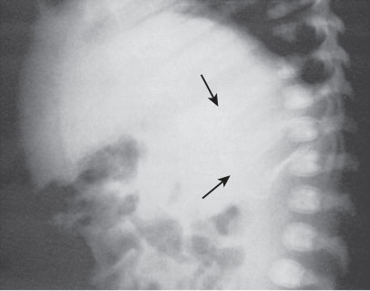

• Fig. 28.16 Lateral abdominal radiographs of a 5312-g male infant delivered vaginally, with difficulty after shoulder dystocia. At 48 hours, fever, icterus, and slow feeding were noted, and a mass was palpable above the left kidney. At 31 days, there was dense, retracted calcification (arrows) that assumed the configuration of the adrenal gland.

## PDF page 511 | printed page 497

### Injuries to the Extremities

### Fracture of the Humerus

After the clavicle, the humerus is the bone most often fractured during the birth process.

### Etiology

The most common mechanisms responsible are difficult delivery of extended arms in breech presentations and of the shoulders in vertex presentations. Besides traction with simultaneous rotation of the arm, direct pressure on the humerus also is a factor. This may account for the occurrence of fracture of the humerus in spontaneous vertex deliveries. The fractures are usually in the diaphysis. They are often greenstick fractures, although complete fracture with overriding of the fragments occasionally occurs.

### Clinical Manifestations

A greenstick fracture may be overlooked until a callus is noted. A complete fracture with marked displacement of fragments presents an obvious deformity that calls attention to the injury. Often the initial manifestation of the fracture is immobility of the affected arm. Palpation reveals tenderness, crepitation, and hypermobility of the fragments. The ipsilateral Moro response is absent. Radiographs confirm the diagnosis.

### Differential Diagnosis

The differential diagnosis includes all the previously noted lesions that cause immobility of the arm. An associated brachial plexus injury occasionally occurs.

### Treatment

The affected arm should be immobilized in adduction for 2 to 4 weeks. This may be accomplished by maintaining the arm in a hand-on-hip position with a triangular splint and a Velpeau bandage, strapping the arm to the chest, or application of a cast.

### Prognosis

The prognosis is excellent. Healing is associated with marked formation of callus. Moderate overriding and angulation disappear with time because of the excellent remodeling power of infants. Complete union of the fracture fragments usually occurs by 3 weeks. Fair alignment and shortening of less than 1 inch indicate satisfactory closed reduction. Fractures of the long bones in infants always result in epiphyseal stimulation; the closer the fracture to the epiphyseal cartilage, the greater the degree of subsequent overgrowth.

### Fracture of the Radius

Fracture of the radius is an extremely rare occurrence, reported in a macrosomic infant born after a shoulder dystocia.58 There was a concurrent midhumeral shaft fracture of the other arm, with lateral displacement of the distal fragment.

### Etiology

This injury, because it was a spiral fracture, was thought to have resulted from rotational maneuvers attempted to alleviate shoulder dystocia. An alternative explanation is compressive forces related to the shoulder dystocia itself; that is, the affected arm could have incurred an extreme degree of direct compression by the overlying symphysis pubis.

### Clinical Manifestations

Physical findings were limited to bruising of the affected forearm. However, as in any long bone fracture, if complete with displacement of fragments, additional findings may include swelling, deformity, tenderness, and crepitation.

### Treatment

In the presence of bilateral fractures, casts may need to be placed on both arms. If it occurs as an isolated injury, without displacement, a radial fracture can be treated with simple immobilization.

### Prognosis

Radiographs at 2 weeks of age revealed a healed radial fracture and marked callus formation around the humeral fracture.

### Fracture of the Femur

Although a relatively infrequent injury, fracture of the femur is by far the most common fracture of the lower extremity in the newborn.

### Etiology

Fracture of the femur usually follows a breech delivery when the leg is pulled down after the breech is already partially fixed in the pelvic inlet or when the infant is improperly held by one thigh during delivery of the shoulders and arms. Femoral fracture may even occur during cesarean delivery.59 Infants with congenital hypotonia may be more prone to this injury if their underlying disorder (e.g., severe Werdnig-Hoffmann disease) is associated with decreased muscle bulk at birth. Senanayake and associates reported on an infant who sustained a midtrimester fracture of the femur.60 No apparent maternal trauma was identified during the pregnancy. The infant was otherwise normal, with no other fractures and no evidence of skeletal dysplasia. Follow-up through age 6 years revealed normal growth, with no additional fractures. The authors were unable to identify an etiology, other than possible “unnoticed maternal trauma.” It is critical to document such an occurrence to preclude inappropriate focus on the delivery process as a cause of the fracture. In addition, failure to identify and document the timing of the fracture may lead to subsequent suspicion of nonaccidental trauma.

### Clinical Manifestations

Usually, an obvious deformity of the thigh is seen (Fig. 28.17); as a rule, the bone breaks transversely in the upper

## PDF page 512

• Fig. 28.17 Fullness and obvious deformity of left thigh in 4020-g male infant with Werdnig-Hoffmann disease. Muscle wasting of both lower extremities also is apparent. Radiograph confirmed fracture of proximal third of left femur.

half or third, where it is relatively thin. Less often, the injury may not be appreciated until several days after delivery when swelling of the thigh is noted; this swelling may be caused by hemorrhage into adjacent muscle. The infant refuses to move the affected leg or cries in pain during passive movement or with palpation over the fracture site. Radiographs almost always show overriding of the fracture fragments.

### Treatment

Optimal treatment is traction-suspension of both lower extremities, even if the fracture is unilateral. The legs are immobilized in a spica cast; with Bryant traction, the infant is suspended by the legs from an overhead frame, with the buttocks and lower back just raised off the mattress. The legs are extended and the thighs flexed on the abdomen. The weight of the infant’s body is enough to overcome the pull of the thigh muscles and thereby reduce the deformity. The infant is maintained in this position for 3 to 4 weeks until adequate callus has formed and new bone growth has started. During the treatment period, special attention should be given to careful feeding of the infant and to protection of bandages and casts from soiling with urine and feces.

### Prognosis

The prognosis is excellent; complete union and restoration without shortening are expected. Extensive calcification may develop in the areas of surrounding hemorrhage but is resorbed subsequently.

### Dislocations

Dislocations caused by birth trauma are rare. Often an apparent dislocation is actually a fracture displaced through an epiphyseal plate. Because the epiphyseal plate is radiolucent, a fracture occurring adjacent to an unmineralized epiphysis gives a radiographic picture simulating a dislocation of the neighboring joint. This type of injury has been

termed pseudodislocation. Because the humeral and proximal femoral epiphyses are usually not visible on radiographs at birth, a pseudodislocation can occur at the shoulder, elbow, or hip.

Of the true dislocations, those involving the hip and knee are probably not caused by the trauma of the birth process. Most likely, they are either intrauterine positional deformities or true congenital malformations. A true dislocation resulting from birth trauma is that involving the radial head. This has been associated with traumatic breech delivery. A radial head dislocation has been reported as a late complication years after brachial plexus palsy.61 Examination reveals adduction and internal rotation of the affected arm, with pronation of the forearm; Moro response is poor, and palpation reveals lateral and posterior displacement of the radial head. This is confirmed by radiographs. With supination and extension, the radial head can be reduced readily. This should be done promptly, followed by immobilization of the arm in this position in a circular cast for 2 to 3 weeks. Early recognition and treatment should result in normal growth and function of the elbow.

Bayne and associates illustrated the importance of establishing an early diagnosis when they described a term infant with a swollen, tender elbow after breech delivery.62 Movement produced obvious pain. Radiographs at that time and again at 8 months of age were misinterpreted as normal. At 1 year, an orthopedist diagnosed anteromedial dislocation. Because of several unsuccessful attempts at closed reduction, future osteotomy was required to treat this now permanent deformity.

### Epiphyseal Separations

As with dislocations, epiphyseal separations are rare. They occur mostly in primiparity, dystocic deliveries, and breech presentations, especially those requiring manual extraction or version and extraction. Any delivery associated with vigorous pulling may predispose the infant to this injury. The upper femoral and humeral epiphyses are most often involved. Usually on the second day, the soft tissue over the affected epiphysis develops a firm swelling with reddening, crepitus, and tenderness. Active motion is limited, and passive motion is painful. If the injury is in the upper femoral epiphysis, the infant assumes the frog-leg position with external rotation of the leg.

Early radiographs show only soft tissue swelling, with occasional superolateral displacement of the proximal femoral metaphysis. Because the neonatal femoral capital epiphysis is not ossified, this can be mistakenly interpreted as congenital hip dislocation. However, the presence of pain and tenderness would make dislocation unlikely. Besides plain radiographs of the hips, an infant with a history and physical examination compatible with traumatic epiphysiolysis should also undergo ultrasonography before manipulation is attempted. MRI may be a better tool for earlier detection. This examination would demonstrate a normal femoroacetabular relationship, in contrast with the

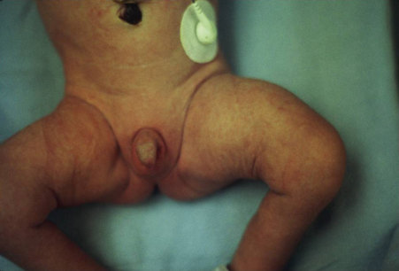

• Fig. 28.17 Fullness and obvious deformity of left thigh in 4020-g male infant with Werdnig-Hoffmann disease. Muscle wasting of both lower extremities also is apparent. Radiograph confirmed fracture of proximal third of left femur.

## PDF page 513 | printed page 499

abnormal findings in an infant with septic arthritis and congenital hip dislocation. In addition, in the presence of traumatic epiphysiolysis the femoral head and neck would not be continuous, in contrast with the findings of septic arthritis and congenital hip dislocation. Further differentiation between traumatic epiphysiolysis and septic arthritis can be provided by arthrocentesis; in epiphysiolysis, the joint does not contain excess fluid, and what is obtained may be serosanguineous, whereas in septic arthritis, purulent fluid is obtained. After 1 to 2 weeks, extensive callus appears, confirming the nature of the injury; during the third week, subperiosteal calcification appears.

If possible, treatment should be conservative. Closed reduction and immobilization are indicated within the first few days before rapidly forming fibrous callus prevents mobilization of the epiphysis. The hip is immobilized in the frog-leg position, as in congenital dislocation. Poorly

• Fig. 28.18 Radiograph of lower extremities of a 4205-g male delivered precipitously after complete breech presentation. Radiograph demonstrates displaced distal femoral physeal fracture on left (arrow) and nondisplaced distal femoral physeal fracture on right (arrow). (From Mangurten HH, Wittert WR, McFadden J, et al. Neonatal distal femoral physeal fracture requiring closed reduction and pinning. J Perinatol. 2005;25:216.)

A B

• Fig. 28.19 Because of unsuccessful attempts at closed reduction of left-sided fracture, a Kirschner wire was inserted to provide secure fixation of fracture fragments. Anteroposterior view, (A), and lateral view, (B). (From Mangurten HH, Wittert WR, McFadden J, et al. Neonatal distal femoral physeal fracture requiring closed reduction and pinning. J Perinatol. 2005;25:216.)

immobilized fragments of the proximal or distal femur (Fig. 28.18) may require temporary fixation with a Kirschner wire (Fig. 28.19).63 Union usually occurs within 10 to 15 days. Untreated or poorly treated epiphyseal injuries may result in subsequent growth distortion and permanent deformities such as coxa vara. Mild injuries carry a good prognosis.

### Deep Tendon Injuries

Accidental fetal injury is a serious but underreported complication of emergency cesarean deliveries. Although the most commonly documented injury is superficial skin laceration, deeper and more serious injuries have been described, including amputation of the distal digits and tendon injuries requiring surgical intervention.64 A prospective study at 13 university centers in the United States revealed an incidence of fetal injury of 1.1% during emergency cesarean section, with skin lacerations accounting for 64% of injuries overall.65 Neonatal tendon injuries during cesarean section have rarely been reported in the literature.66 Prazad and associates reported a case of severe multiple extensor tendon lacerations with open metacarpophalangeal joints (Fig. 28.20) sustained at the time of an emergency cesarean delivery.67

### Risk Factors Associated With Deep Tendon Injury

Several factors associated with increased risk for fetal laceration and fetal injury are emergency cesarean delivery, shortened duration between abdominal skin incision and delivery of infant, type of uterine incision, premature rupture of membranes, abnormal fetal presentation, and active labor.68

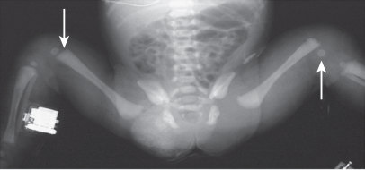

• Fig. 28.18 Radiograph of lower extremities of a 4205-g male delivered precipitously after complete breech presentation. Radiograph demonstrates displaced distal femoral physeal fracture on left (arrow) and nondisplaced distal femoral physeal fracture on right (arrow). (From Mangurten HH, Wittert WR, McFadden J, et al. Neonatal distal femoral physeal fracture requiring closed reduction and pinning. J Perinatol. 2005;25:216.)

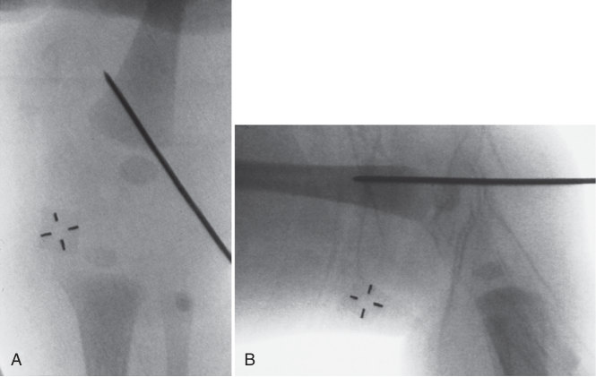

• Fig. 28.19 Because of unsuccessful attempts at closed reduction of left-sided fracture, a Kirschner wire was inserted to provide secure fixation of fracture fragments. Anteroposterior view, (A), and lateral view, (B). (From Mangurten HH, Wittert WR, McFadden J, et al. Neonatal distal femoral physeal fracture requiring closed reduction and pinning. J Perinatol. 2005;25:216.)

## PDF page 514

• Fig. 28.20 Laceration extending from index finger to baby finger, with open metacarpophalangeal joints. There were complete extensor tendon lacerations of middle, ring, and baby fingers, with partial laceration of index finger. (From Prazad P, Puppala BL, Baxamusa TH, et al. Complication of emergency cesarean section: open metacarpophalangeal disarticulation and complete extensor tendon lacerations of the hand in a neonate. J Neonat Perinat Med. 2009;2:131–133.)

### Management

Even though multiple surgical techniques have been described for adults with the same kind of injury, there is no information available regarding a favorable surgical approach in neonates. Fuller and colleagues described two different methods of extensor tendon repair.66 Laceration in one finger was closed in a single layer using a full-thickness stitch through the skin and extensor mechanism, and laceration in the second finger was repaired in two layers. Excellent clinical outcome of both fingers was noted after surgery. Kavouksorian and coworkers reported a flexor tendon laceration of the hand that occurred during emergency cesarean delivery, with excellent functional results despite delayed primary closure.69 Prazad and colleagues used immediate (within 3 hours of birth) microsurgical repair at the bedside under local field block anesthesia to achieve an excellent functional outcome at 18 months of age.67

### Other Peripheral Nerve Injuries

In contrast to the brachial plexus and phrenic and facial nerves, other peripheral nerves are injured less often at birth and usually in association with trauma to the extremity. Radial palsy has occurred after difficult forceps extractions, both from pressure of incorrectly applied forceps and in association with fracture of the arm. Occasionally the palsy occurs later, when the radial nerve is enmeshed within the callus of the healing fracture. Frequently associated subcutaneous fat necrosis overlies the course of the radial nerve along the lateral aspects of the upper arm. The presence of isolated wristdrop with weakness of the wrist, finger, and thumb extensors; skin changes overlying the course of the nerve; and absence of weakness above the elbow distinguish this condition from brachial plexus injury. Palsies of the femoral and sciatic nerves have occurred after breech extractions; sciatic palsy has followed extraction by the foot. Passive range of motion exercises are usually the only therapy required. Complete recovery usually occurs within several weeks or months.

### Trauma to the Genitalia

Soft tissue injuries involving the external genitalia sometimes occur, especially after breech deliveries and in large infants.

### Scrotum and Labia Majora

Edema, ecchymoses, and hematomas can occur in the scrotum and labia majora, especially when they are the presenting parts in a breech presentation. Because the male newborn has a pendulous urethra that is vulnerable to compression or injury, it is possible for significant trauma to occur after a protracted labor in the breech position; the mechanism is believed to be compression of the urethra against a firm structure in the maternal bony pelvis. Rarely, this may cause marked temporary hydronephrosis after delivery. The hydronephrosis usually resolves within 3 days. Because of laxity of the tissues, the degree of swelling and of discoloration occasionally is extreme enough (Fig. 28.21) to evoke considerable concern among the medical and nursing staff, especially regarding deeper involvement (e.g., periurethral hemorrhage and edema), which might hinder normal micturition. However, this has not generally been a problem, and frequently these infants void shortly after arriving in the nursery. Spontaneous resolution of edema occurs within 24 to 48 hours, and resolution of discoloration occurs within 4 to 5 days. Treatment is not necessary. Secondary ulceration, necrosis, or eschar formation is rare unless an associated underlying condition such as herpes simplex virus infection is present.

Marked scrotal hematoma may simulate testicular torsion, particularly when accompanied by a solid scrotal mass.70 Because untreated torsion may result in loss of the testis, it is critical to distinguish the two lesions. This may be done by Doppler ultrasonography. If blood flow to the testes is clearly demonstrated, and if the testes appear symmetric in size and echotexture, torsion may essentially be ruled out.

### Deeper Structures

Much less often birth trauma may involve the deeper structures of the genitalia. If the tunica vaginalis testis is injured and blood fills its cavity, a hematocele is formed. Absence of transillumination distinguishes this from a hydrocele. If it appears that the infant is in pain, the scrotum may be elevated and cold packs applied. Spontaneous resolution is the usual course.

The testes may be injured, often in association with injury to the epididymis. Usually, the involvement is bilateral. The testes may be enlarged, smoothly rounded, and insensitive. The infant may be irritable, with vomiting and poor feeding. Urologic consultation is indicated; occasionally exploration and evacuation of blood are necessary, especially with increasing size of the testes. Severe trauma may result in atrophy or failure of the testes to grow. The occasional finding in older children of a circumscribed fibrous area within the testicular tissue is thought to represent past birth trauma to the gland.

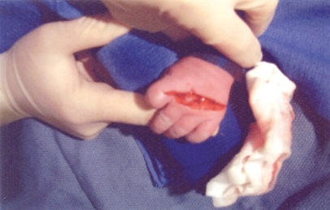

• Fig. 28.20 Laceration extending from index finger to baby finger, with open metacarpophalangeal joints. There were complete extensor tendon lacerations of middle, ring, and baby fingers, with partial laceration of index finger. (From Prazad P, Puppala BL, Baxamusa TH, et al. Complication of emergency cesarean section: open metacarpophalangeal disarticulation and complete extensor tendon lacerations of the hand in a neonate. J Neonat Perinat Med. 2009;2:131–133.)

## PDF page 515 | printed page 501

• Fig. 28.21 Hematoma of scrotum and penis in a 3895-g male infant delivered vaginally after frank breech presentation. Infant voided at 22 hours and regularly thereafter. Swelling diminished appreciably within 5 hours and was gone by third day. Discoloration was greatly diminished by second day.

### Injuries Related to Intrapartum Fetal Monitoring

Continuous monitoring of the fetal heart rate and the intermittent sampling of fetal scalp blood for determination of acid-base status often are used to monitor the fetus during labor. Thousands of patients have been monitored by these methods (see Chapter 11). The relative infrequency of complications indicates that, in experienced hands, these procedures are generally safe. However, certain specific complications have occurred.

### Injuries Related to Direct Fetal Heart Rate Monitoring

Direct monitoring of the fetal heart rate during labor depends on application of an electrode to the fetal scalp or other presenting part. Superficial abrasions, lacerations, and hematomas can occur rarely at the site of application of the electrode. These complications require no specific therapy beyond local treatment.

Rarely, abscesses of the scalp may follow application of scalp electrodes. These abscesses usually have been sterile and have required only local treatment. Systemic signs or symptoms require evaluation for possible septicemia.

### Injuries Related to Fetal Scalp Blood Sampling

Fetal biochemical monitoring requires puncture of the presenting part, usually the scalp, with a 2-mm blade and the collection of blood under direct visualization in a heparinized tube. Major complications that may occur rarely are excessive bleeding and accidental breakage of the blades. The bleeding can be stopped by pressure, but on occasion this requires sutures. Rarely, blood replacement may be required. It is important to obtain a detailed family history of bleeding disorders before initiation of this procedure.

The second major complication has been breakage of the blade within the fetal scalp. Removal soon after delivery is recommended to prevent secondary infection. This is accomplished by use of a magnet attached to a small forceps that probes the puncture site and elicits a click as the blade is attracted to the magnet. On occasion, radiographic localization followed by a small incision is necessary for withdrawal of the blade.

### Injuries Related to Trauma During Pregnancy

Trauma to women during pregnancy continues to be a major cause of maternal, fetal, and neonatal mortality and morbidity.1 The risk of trauma is enhanced by the enlarged size of the gravid uterus, rendering it more exposed to weapons and contact with hard surfaces, putting the developing fetus in close proximity to injury. Trauma unrelated to pregnancy events, which in turn may injure the fetus, may be divided into two major subsets, accidental and intentional. The accidental category most commonly involves automobile accidents in which the woman is the driver, passenger, or pedestrian. In addition, these accidents may result from cycling, falling while horseback riding, or simple falls. The intentional category usually results from criminal intent, resulting in shooting, stabbing, or blunt trauma to the abdomen. Fetal head injuries have been reported after violent insertion of a blunt object through the vagina with an intention to terminate the pregnancy. These may result in skull fractures and intraventricular hemorrhage leading to premature labor and fetal morbidity and mortality. Gunshot wounds during pregnancy may result in devastating effects on both mother and fetus throughout gestation. Not only may mother and fetus sustain significant organ damage from gunshot wounds, but also the extent of the physical maternal injury may dictate preterm delivery (Fig. 28.22). Prognosis usually is worse in the fetus than the mother. A well-coordinated team of surgeons, obstetricians, and neonatologists providing timely and comprehensive management may improve outcomes.

• Fig. 28.22 Deep skin wound lateral surface left thigh in 6-hour-old, 845-g preterm female infant delivered by emergency cesarean birth after mother sustained a gunshot wound to the abdomen.

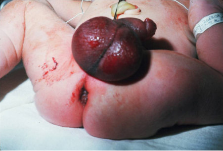

• Fig. 28.21 Hematoma of scrotum and penis in a 3895-g male infant delivered vaginally after frank breech presentation. Infant voided at 22 hours and regularly thereafter. Swelling diminished appreciably within 5 hours and was gone by third day. Discoloration was greatly diminished by second day.

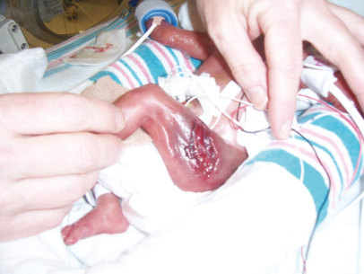

• Fig. 28.22 Deep skin wound lateral surface left thigh in 6-hour-old, 845-g preterm female infant delivered by emergency cesarean birth after mother sustained a gunshot wound to the abdomen.

## PDF page 516

Key Points

### • Birth injuries may occur despite skilled and competent

obstetric care.

### • Soft tissue injuries are observed more frequently after

instrumental, breech, or precipitous deliveries. Most lesions resolve spontaneously within several days with no specific therapy.

### • Subcutaneous fat necrosis is commonly seen in associa-

tion with perinatal asphyxia and may be associated with hypercalcemia.

### • Caput succedaneum may be difficult to distinguish from

a cephalhematoma. Careful palpation indicates whether the bleeding is external to the periosteum (caput) or beneath the periosteum (cephalhematoma).

### • Subgaleal hemorrhage should be considered in infants

who show signs of hypoperfusion and falling hematocrit even in the absence of a detectable fluctuant mass.

### • Traumatic facial nerve palsy most often follows compres-

sion of the peripheral portion of the nerve by forceps or maternal sacral promontory.

### References

1. Brown S, Mozurkewich E. Trauma during pregnancy. Obstet

Gynecol Clin North Am. 2013;40(1):47–57. 2. Murphy SL, et al. Annual summary of vital statistics. Pediatrics.

2017;139(6). 3. Akin MA, Akin L, Coban D, et al. Post-operative subcutane-

ous fat necrosis in a newborn: a case report. Fetal Pediatr Pathol. 2011;30:363–369. 4. Hogeling M, et al. Extensive subcutaneous fat necrosis of the

newborn associated with therapeutic hypothermia. Pediatr Dermatol. 2012;29:59. 5. Samedi VM, Yusuf K, Yee W, et al. Neonatal hypercalcemia

secondary to subcutaneous fat necrosis successfully treated with pamidronate: a case series and literature review. Am J Perinatol Reports. 2014;4:e93–e96. 6. Johnson DE. Recognizing congenital pressure injuries: a case

series. J Wound Ostomy Continence Nurs. 2019;46:65–68. 7. Jeltema HR, et al. Iatrogenic encephalocele: a rare complication

of vacuum extraction delivery. Childs Nerv Syst. 2011;27:2193. 8. Petrikovsky BM, et al. Cephalhematoma and caput succeda-

neum: do they always occur in labor? Am J Obstet Gynecol. 1998;179:906. 9. Guclu B, et al. Diagnosis and treatment of ossified cephalhema-

toma. J Craniofac Surg. 2012;23:e505. 10. Kirimi E, et al. Hyperkalemia most likely associated with mas-

sive cephalhematoma in a newborn infant who was treated with urgent peritoneal dialysis: case report. J Emerg Med. 2003;24:277. 11. Staudt MD, Etarsky D, Ranger A. Infected cephalohematomas

and underlying osteomyelitis: a case-based review. Child’s nervous system. 2016;32:1363–1369. 12. Chan MS, et al. MRI and CT findings of infected cephalhaema-

toma complicated by skull vault osteomyelitis, transverse venous sinus thrombosis and cerebellar haemorrhage. Pediatr Radiol. 2002;32:376.

### • Fractures of the maxilla, lacrimal bones, and nose may

present with respiratory distress and warrant emergent surgical attention.

### • It is critical to identify birth-related retinal hemorrhages

and to document their presence on the chart to avoid subsequent suspicion of child abuse.

### • The clavicle is the most frequently fractured bone during

labor and delivery. Greenstick-type clavicular fractures, which occur most frequently, have good outcomes.

### • Mechanical trauma to the spinal roots of the fifth cervi-

cal through the first thoracic nerves (the brachial plexus) during birth results in brachial palsy. Duchenne-Erb palsy caused by injury of the fifth and sixth cervical roots is by far the most common type.

### • Intra-abdominal trauma should be suspected in any new-

born with shock and abdominal distention or pallor, anemia, and irritability without evidence of external blood loss.

### • Excellent prognosis with complete union and restoration

of function is seen after a long bone fracture, which infrequently follows a difficult delivery.

13. Levin G, Mankuta D, Eventov-Friedman S, et al. Factors associ-

ated with the severity of neonatal subgaleal haemorrhage following vacuum assisted delivery. Eur J Obstet Gynecol Reprod Biol. 2020;245:205–209. 14. Swanson AE, Veldman A, Wallace EM, Malhotra A. Subgaleal

hemorrhage: risk factors and outcomes. Acta Obstet Gynecol Scand. 2012;91(2):260–263. https://doi.org/10.1111/j.1600- 0412.2011.01300.x. 15. Marchini G, Martín Muñoz D, Vladic Stjernholm Y. A pari-

etal bone fracture with subgaleal and subdural hemorrhage in association with vacuum extraction delivery. Clin Case Rep. 2019;8:2103–2106. 16. Agrawal SK, Kumar P, Sundaram V. Congenital depression of

the skull in neonate: a case of successful conservative management. J Child Neurol. 2010;25:387–389. 17. Ballestero MF, De Oliveira RS. Closed Depressed Skull Fracture in

Childhood Reduced with Suction Cup Vacuum Method: Case Report and a Systematic Literature Review. (Palo Alto, CA): Curēus; 2019:11. 18. Arocho-Quinones EV, Lew SM, Foy AB. Vacuum-assisted eleva-

tion of pediatric ping-pong skull fractures: a case series and technical note. J Neurosurg Pediatr. 2021;27:325–334.2020. 19. de Chalain TM, et al. Case report: unilateral combined facial

nerve and brachial plexus palsies in a neonate following a midlevel forceps delivery. Ann Plast Surg. 1997;38:187. 20. Falco NA, et al. Facial nerve palsy in the newborn: incidence and

outcome. Plast Reconstr Surg. 1990;85:1. 21. Daily W, et al. Nasal septal dislocation in the newborn. Mo Med.

1977;74:381. 22. Miller MJ, et al. Oral breathing in response to nasal trauma in

term infants. J Pediatr. 1987;111:899. 23. Yasin S, et al. A neonate with a crooked nose. Consultant.

2016;15. 24. Gopalakrishnan V, Sahoo NK, Roy ID. Mandibular fracture in

a neonate. International journal of oral and maxillofacial surgery. 2016. 2017;46:59–61.

## PDF page 517 | printed page 503

25. Harris GJ. Canalicular laceration at birth. Am J Ophthalmol.

1988;105:322. 26. Lauer AK, Rimmer SO. Eyelid laceration in a neonate by fetal

monitoring spiral electrode. Am J Ophthalmol. 1998;125:715. 27. Agarwal R, Singh N, Sinha R, Sharma N. Obstetrical forceps-

induced Descemet membrane tears. Indian J Ophthalmol. 2021;69:3432–3441. 28. Simpson SM, Yau G, Nischal KK, Strube YNJ. Forceps trauma

in a newborn presenting as iris heterochromia. J AAPOS. 2017;21:425–426. 29. Forbes E, et al. Unilateral vocal cord paralysis associated with sub-

dural haemorrhage in a newborn infant. J Perinatol. 2010;30:563. 30. Haenggeli CA, et al. Brachial plexus injury and hypoglossal paral-

ysis. Pediatr Neurol. 1989;5:197. 31. Kaplan B, et al. Fracture of the clavicle in the newborn following

normal labor and delivery. Int J Gynaecol Obstet. 1998;63:15. 32. Mangurten HH, et al. Incidental rib fractures in a neonate. Neo-

nat Intensive Care. 1999;12:15. 33. Vakhshori V, Bouz GJ, Alluri RK, et al. Risk factors associated

with neonatal brachial plexus palsy in the United States. J Pediatr Orthopaed. B. 2020;29:392–398. 34. Åberg K, Norman M, Pettersson K, Ekéus C. Vacuum extrac-

tion in fetal macrosomia and risk of neonatal complications: a population-based cohort study. Acta Obstet Gynecol Scand. 2016;95:1089–1096. 35. Sandmire H, et al. Newborn brachial plexus injuries: the twisting

and extension of the fetal head as contributing causes. J Obstet Gynaecol. 2008;28:170. 36. Gherman RB, et al. Brachial plexus palsy: an in utero injury? Am

J Obstet Gynecol. 1999;180:1303. 37. Gilbert WM, et al. Associated factors in 1611 cases of brachial

plexus injury. Obstet Gynecol. 1999;93:536. 38. Piatt JH. Birth injuries of the brachial plexus. Clin Perinatol.

2005;32:39. 39. Torode I, et al. Posterior dislocation of the humeral head in asso-

ciation with obstetric paralysis. J Pediatr Orthop. 1998;18:611. 40. Smith BW, Daunter AK, Yang LJ-, Wilson TJ. An update on

the management of neonatal brachial plexus palsy—replacing old paradigms: a review. JAMA Pediatr. 2018;172:585–591. 41. Curtis C, Stephens D, Clarke HM, Andrews D. The active move-

ment scale: an evaluative tool for infants with obstetrical brachial plexus palsy. J Hand Surg Am. 2002;27(3):470–478. https://doi. org/10.1053/jhsu.2002.32965. 42. de Vries Reilingh TS, et al. Surgical treatment of diaphragmatic

eventration caused by phrenic nerve injury in the newborn. J Pediatr Surg. 1998;33:602. 43. Rizeq YK, Many BT, Vacek JC, et al. Diaphragmatic paralysis after

phrenic nerve injury in newborns. J Pediatr Surg. 2020;55(2):240– 244. https://doi.org/10.1016/j.jpedsurg.2019.10.038. 44. Davids JR, et al. Congenital muscular torticollis: sequela of intra-

uterine or perinatal compartment syndrome. J Pediatr Orthop. 1993;13:141. 45. Lee Y, Park J, Lim M, et al. A clinical comparative study of ultra-

sound-normal versus ultrasound-abnormal congenital muscular torticollis. PM & R. 2015. 2016;8:214–220. 46. Goetz E. Neonatal spinal cord injury after an uncomplicated

vaginal delivery. Pediatr Neurol. 2010;42:69. 47. Babyn PS, et al. Sonographic evaluation of spinal cord birth

trauma with pathologic correlation. AJR Am J Roentgenol. 1988;151:763. 578. 48. Mills JF, et al. Upper cervical spinal cord injury in neonates: the

use of magnetic resonance imaging. J Pediatr. 2001;138:105–108.

49. Tekes A, Pinto PS, Huisman TA. Birth-related injury to the

head and cervical spine in neonates. Magn Reson Imaging Clin N Am. 2011;19(4):777–viii. https://doi.org/10.1016/j. mric.2011.08.004. 50. Saleh S, Swanson KI, Bragg T. Successful surgical repair and

recovery in a 2-week-old infant after birth-related cervical fracture dislocation. J Neurosurg Pediatr. 2018;21(1):16–20. https:// doi.org/10.3171/2017.7.PEDS17105. 51. Montaldo P, Oliveira V, Lally PJ, et al. Therapeutic hypo-

thermia in neonatal cervical spine injury. Arch Dis Child Fetal Neonatal Ed. 2016;101(5):F468. https://doi.org/10.1136/archdischild-2016-310690. 52. Arnaez J, Miranda M, Riñones E, García-Alix A. Whole-body

cooling and erythropoietin in neonatal cervical spine injury. Ther Hypothermia Temp Manag. 2019;9(2):159–162. https://doi. org/10.1089/ther.2018.0042. 53. MacKinnon JA, et al. Spinal cord injury at birth: diagnostic and

prognostic data in twenty-two patients. J Pediatr. 1993;122:431. 54. Share JC, et al. Unsuspected hepatic injury in the neonate: diag-

nosis by ultrasonography. Pediatr Radiol. 1990;20:320. 55. Hui CM, Tsui KY. Splenic rupture in a newborn. J Pediatr Surg.

2002;37:1. 56. Moh EN, Ake YL, Midekor KG, et al. Scrotal hematoma of

the newborn in the tropics: what attitude? Afr J Paediatr Surg. 2019;16(1):40–42. https://doi.org/10.4103/ajps.AJPS_17_17. 57. Yarci E, Arayici S, Sari FN, et al. Adrenal hemorrhage presenting

as a scrotal hematoma in the newborn: a case report. Arch Argent Pediatr. 2015;113(3):e161–e163. https://doi.org/10.5546/ aap.2015.e161. 58. Thompson KA, et al. Spiral fracture of the radius: an unusual

case of shoulder dystocia-associated morbidity. Obstet Gynecol. 2003;102:36. 59. Alexander J, et al. Femoral fractures at caesarean section: case

reports. Br J Obstet Gynaecol. 1987;94:273. 60. Senanayake H, et al. Mid-trimester fracture of femur in a normal

fetus. J Obstet Gynaecol Res. 2003;29:186. 61. Huo CW. Radial head dislocation as a rare complication of

obstetric brachial plexus palsy: literature review and five case series. Hand Surg. 2012;17:33. 62. Bayne O, et al. Medial dislocation of the radial head following

breech delivery: a case report and review of the literature. J Pediatr Orthop. 1984;4:485. 63. Mangurten HH, Puppala B, Knuth A. Neonatal distal femoral

physeal fracture requiring closed reduction and pinning. J Perinatol. 2005;25:216. 64. Aburezq H, et al. Iatrogenic fetal injury. Obstet Gynecol.

2005;106:1172. 65. Alexander JM, et al. Fetal injury associated with cesarean delivery.

Obstet Gynecol. 2006;108:885. 66. Fuller DA, et al. Extensor tendon lacerations in a preterm neo-

nate. J Hand Surg Am. 1999;24:628. 67. Prazad P, et al. Complication of emergency cesarean section:

open metacarpophalangeal disarticulation and complete extensor tendon lacerations of the hand in a neonate. J Neonat Perinat Med. 2009;2:131. 68. Haas DM, et al. Laceration injury at cesarean section. J Matern

Fetal Neonatal Med. 2002;11:196. 69. Kavouksorian RB, et al. Flexor tendon repair in the neonate. Ann

Plast Surg. 1982;9:415. 70. Diamond DA, et al. Neonatal scrotal haematoma: mimicker of

neonatal testicular torsion. BJU Int. 2003;91:675.

<!-- SOURCE_LAYOUT_VIEWS -->

## Original layout views and recovered diagrams

Automatic extraction can flatten tables and superscripts. Check the original layout for numeric data, footnotes and image credits. [Source review notes](../../SOURCE_REVIEW_NOTES.md).

### Original source page 490

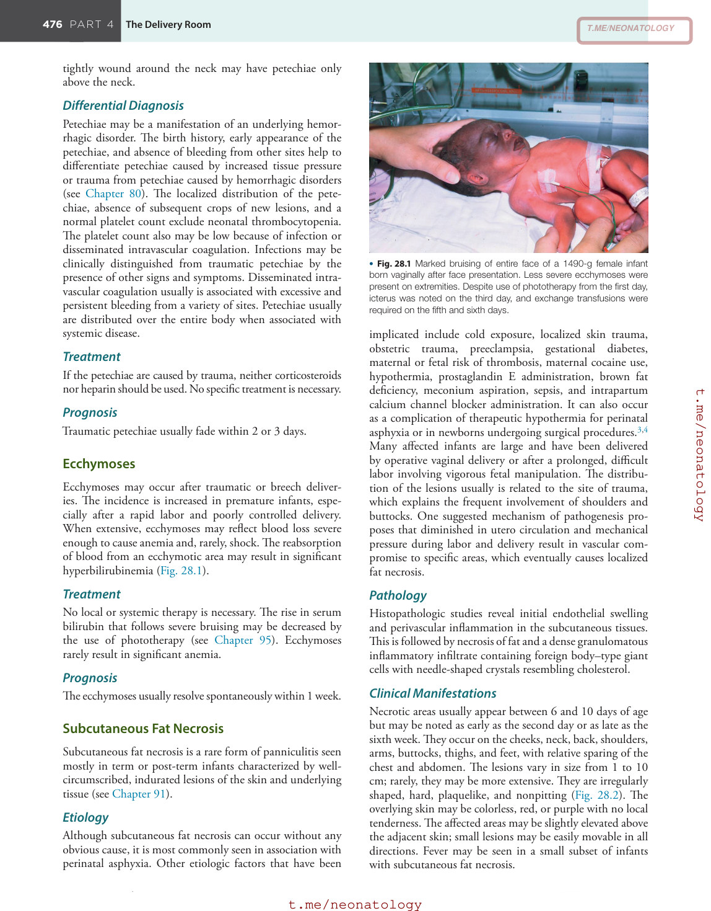

### Original source page 491

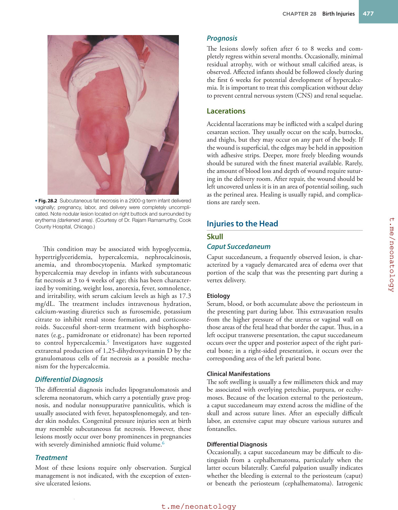

### Original source page 493

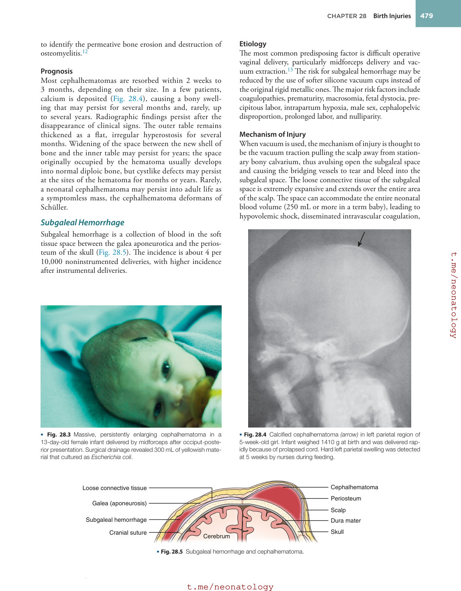

### Original source page 495

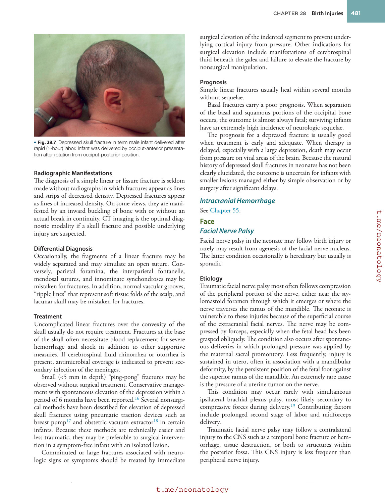

### Original source page 501

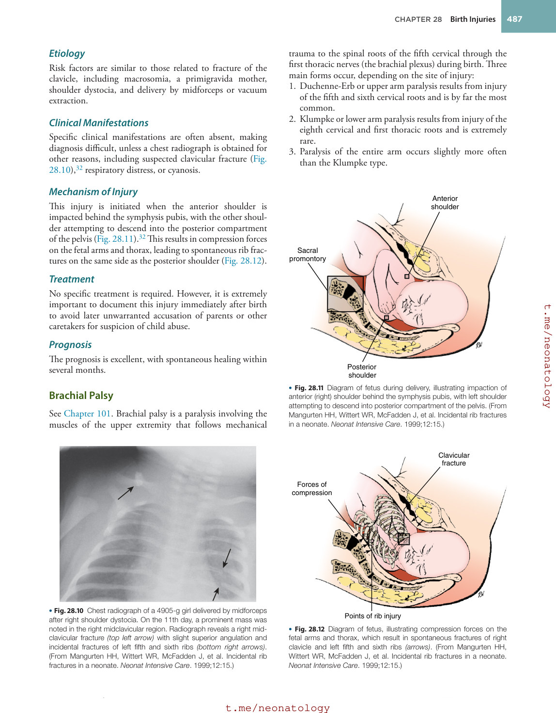

### Original source page 502

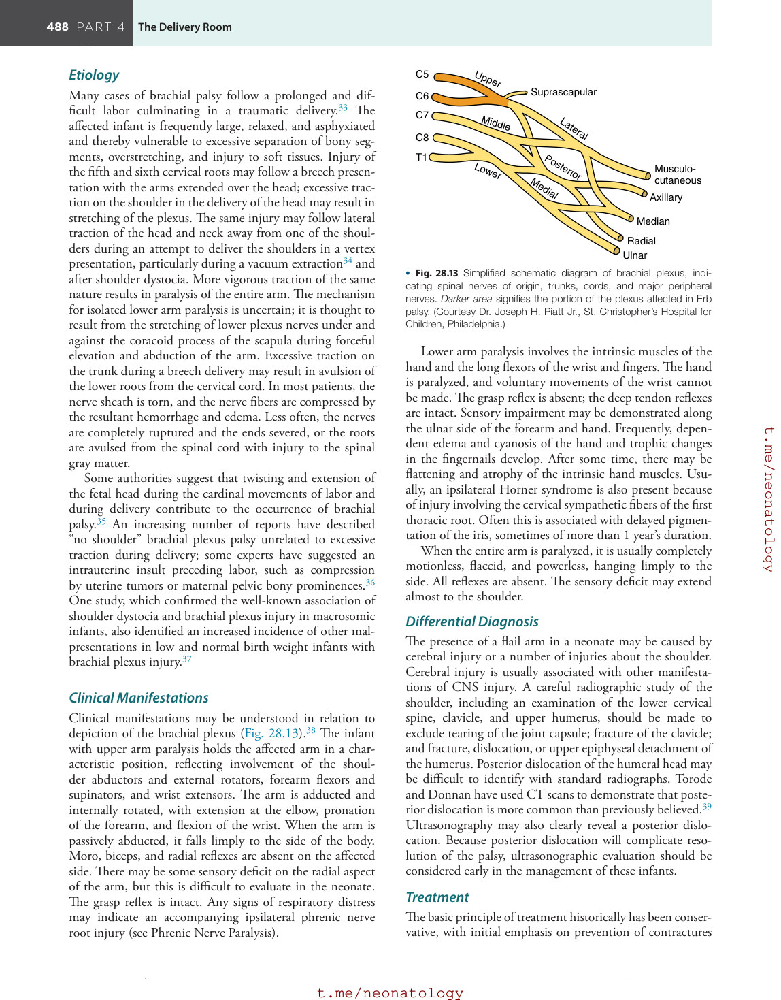

### Original source page 504

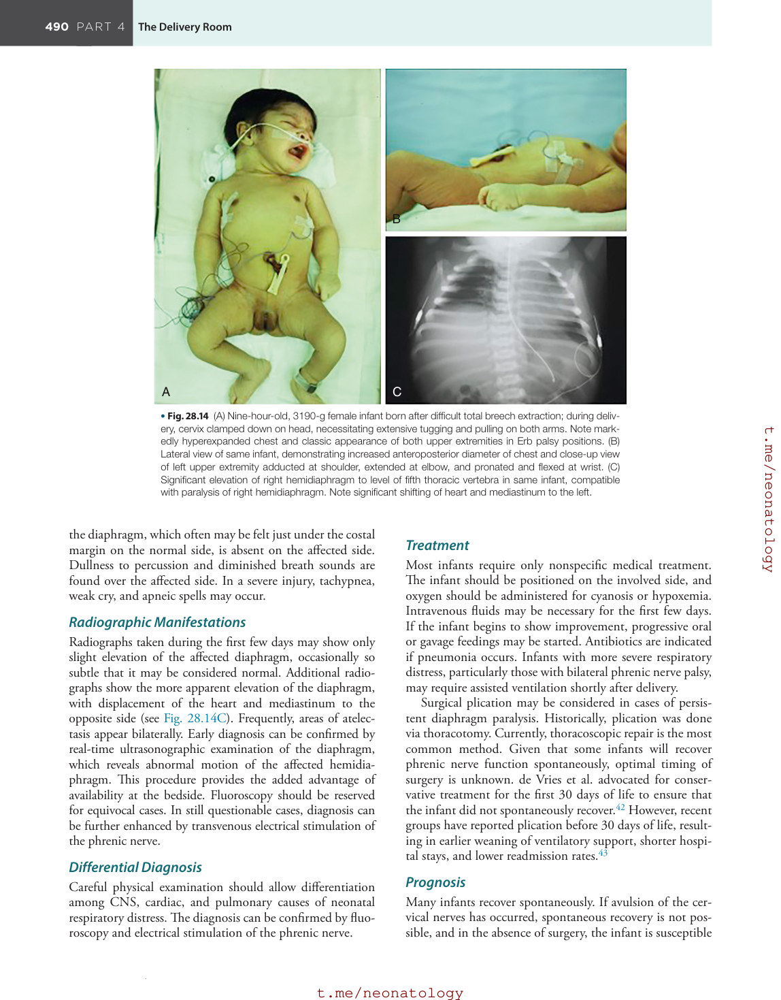

### Original source page 505

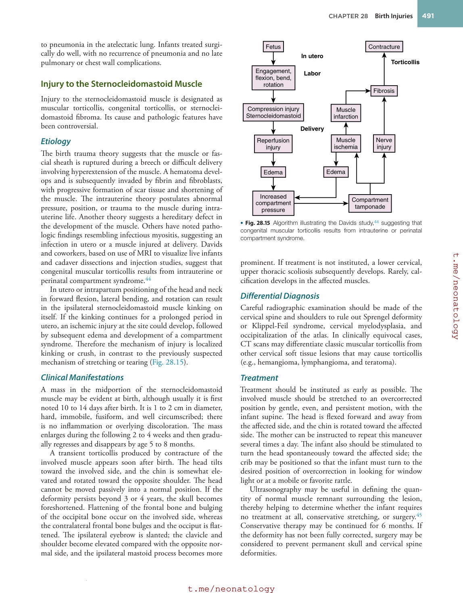

### Original source page 510

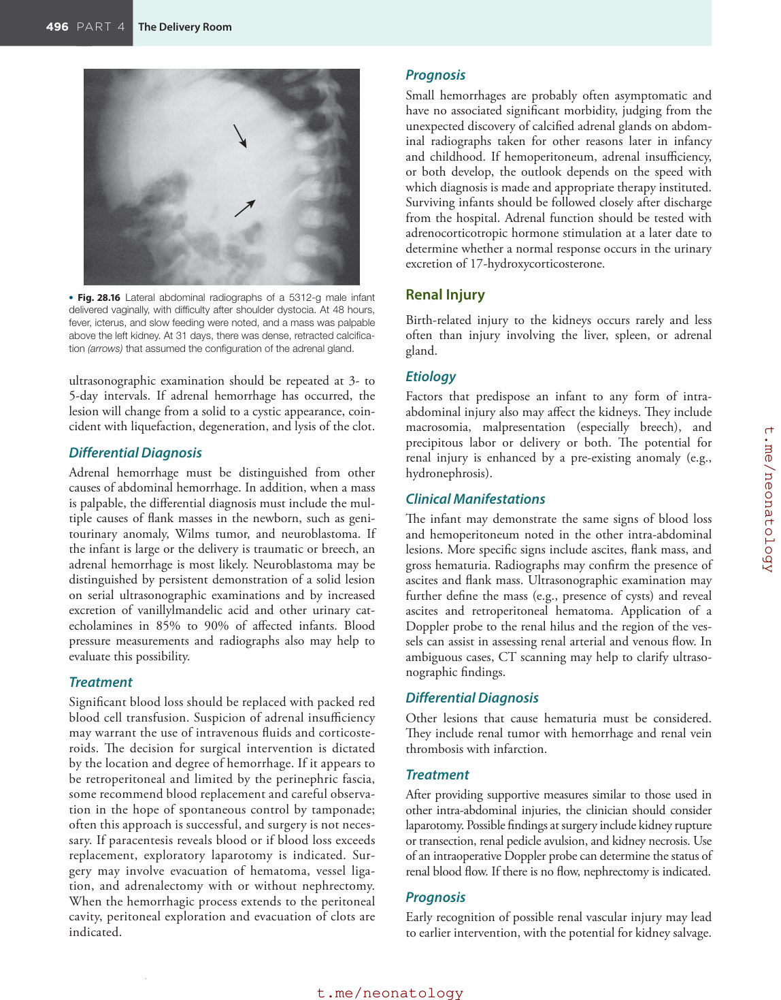

### Original source page 512

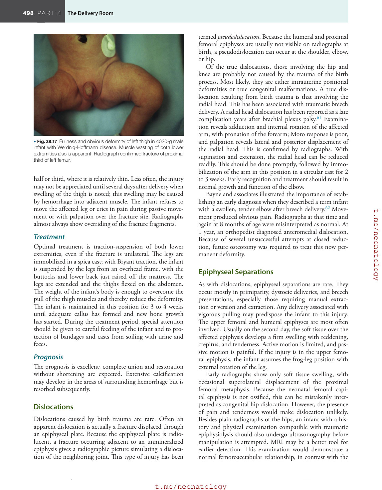

### Original source page 513

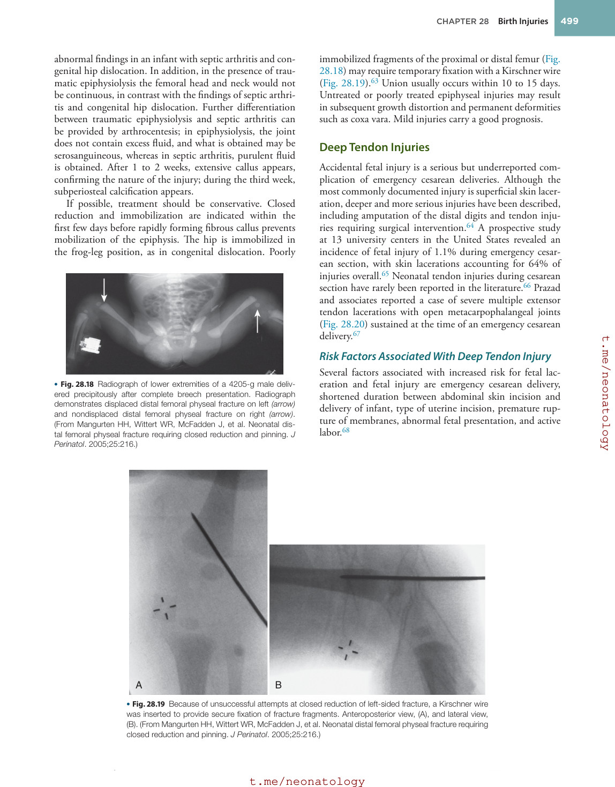

### Original source page 514

### Original source page 515

• Fig. 28.13 Simplified schematic diagram of brachial plexus, indicating spinal nerves of origin, trunks, cords, and major peripheral nerves. Darker area signifies the portion of the plexus affected in Erb palsy. (Courtesy Dr. Joseph H. Piatt Jr., St. Christopher’s Hospital for Children, Philadelphia.)

PDF p. 502

• Fig. 28.15 Algorithm illustrating the Davids study,44 suggesting that congenital muscular torticollis results from intrauterine or perinatal compartment syndrome.

PDF p. 505
