# 30. Overview and Initial Management of Delivery Room Resuscitation
> [Source credits](../../SOURCE_CREDITS.md).

## Study pillars

### Readiness at every birth

An individual responsible for the infant and capable of initiating PPV. Unexpected neonatal depression occurs; the source calls for a trained person whose primary responsibility is the infant.

PDF p. 543

### Gas-exchange transition

Aerated lungs with increased pulmonary perfusion. The lungs replace the placenta as the primary gas-exchange organ and must receive pulmonary blood flow.

PDF p. 545

### Do not await the score

Begin indicated support based on breathing and heart rate without waiting for Apgar scoring. Waiting for the score delays therapy; Apgar describes the infant’s state at specified times.

PDF p. 551

### Selective suction

No routine suctioning is necessary. Routine suction is unnecessary in this setting; posterior pharyngeal stimulation may provoke bradycardia.

PDF p. 554

### Failed stimulation

Prompt positive-pressure ventilation. Failure to respond should prompt PPV; ongoing ineffective stimulation delays ventilation and may worsen hypoxia.

PDF p. 554

## Full source extraction

# 30. Overview and Initial Management of Delivery Room Resuscitation
> Source attribution: [Source credits](../../SOURCE_CREDITS.md).

## PDF page 543 | printed page 530

30 Overview and Initial Management of Delivery Room Resuscitation

### JAY P. GOLDSMITH

The transition from fetus to neonate represents a series of rapid and dramatic physiologic changes during which the placenta is replaced by the lungs as the primary organ of gas exchange. Although this transition goes smoothly most of the time, in approximately 10% of births the active intervention of a skilled individual or team is necessary to ensure that the newborn receives the appropriate assistance to assume independent existence as quickly as possible.1,2 About 3% of newborns will require positive pressure ventilation (PPV) immediately after birth. The need for full resuscitation, including chest compressions and/or medication administration, is relatively rare, occurring in approximately one or two per 1000 live births.3 For these severely depressed newborns and for extremely premature infants, to avoid or minimize injury, the process of resuscitation during the first hour of life requires excellent communication, cognitive knowledge, skilled technical providers, and behaviors that are integral to a collaborative team effort.

Although certain episodes of fetal asphyxia cannot be prevented, there are many circumstances in which, in the immediate neonatal period, a prompt and skilled resuscitation may prevent death or ameliorate lifelong adverse sequelae. Newborns who require medication and/or chest compression in the first few minutes after birth usually have significant fetal acidemia, inadequate ventilation after birth, or both.3 Because the need for significant intervention cannot always be predicted, the American Heart Association (AHA)/American Academy of Pediatrics (AAP) Textbook on Neonatal Resuscitation and the Guidelines for Perinatal Care has advised: “At every delivery, there should be at least one individual whose primary responsibility is the infant and who is capable of initiating resuscitation, including positive pressure ventilation.”1,4 The Guidelines also suggest that “the identification and resuscitation of a distressed neonate require an organized plan of action” and that hospitals should ensure the competency and periodic

530

credentialing of individuals who perform these tasks.4 Successful resuscitation in small-volume delivery services (variably defined using thresholds of ≤200 and ≤500 deliveries per year)5 require enhanced anticipation and planning. The triage of high-risk mothers to appropriate large centers will reduce the incidence of neonatal resuscitations required in these small-volume delivery services. However, even among low-risk newborns, up to 5% will experience unexpected adverse neonatal outcomes after birth.6 Among all infants born in the United States, approximately 7.4% are born in hospitals with fewer than 500 deliveries per year.7 Jukkala et al.8 reported substantial variation in neonatal resuscitation preparedness among rural hospitals in Minnesota, which was associated with hospital delivery volume. Providers responsible for caring for newborns in rural settings reported varied knowledge, comfort, and experience with key aspects of neonatal resuscitation.9 Thus the preparation and training of personnel who are present in the hospital during all deliveries are essential to the execution of a skillful resuscitation of an unanticipated depressed neonate.

In the past several decades, neonatal resuscitation has been the subject of extensive research and review. The evidence evaluation process of the International Liaison Committee on Resuscitation (ILCOR) provides rigorously developed evidence-based guidelines based on the available medical science to inform the best approach to neonatal resuscitation.2 Although many elements of a resuscitation sequence have been agreed upon, debate and discussion regarding certain aspects of the process continue.10 Moreover, the ILCOR guidelines are a Consensus of Science and Treatment Recommendations (CoSTR) document, and each national resuscitation council may modify the treatment recommendations based on its members’ own deliberations of the science and what is deemed appropriate for its country. Thus, despite one international scientific document, there are often significant differences regarding the

## PDF page 544 | printed page 531

recommendations for performing neonatal resuscitation among various countries.11

Research continues to search for answers to many difficult questions. The US guidelines (e.g., Neonatal Resuscitation Program [NRP]), updated every 4 to 5 years by the AAP and the AHA,1 are essentially derived from the ILCOR CoSTR document, which is formally published the preceding year. Individual CoSTRs on certain topics are made available on the ILCOR website (www.ilcor.org) for public comment, and then summaries of the evidence are published periodically in the journals Resuscitation and Circulation.2 The recommendations in the NRP textbook represent the best distillation of the available science at the time of their publication as viewed by the AAP NRP Steering Committee and should serve as the foundation for any resuscitation program or algorithm in the United States. This chapter presents the current guidelines for neonatal resuscitation and reviews the evolving science in this area to provide an appreciation of common and controversial questions and a basis for understanding conflicting views.

### Fetus

In utero, the fetus depends on the placenta for gas exchange. Despite a PaO2 of 20 to 30 mm Hg, the normal fetus carries on essential metabolism and is not hypoxic. The tissues receive adequate amounts of oxygen, and anaerobic metabolic pathways are not usually used. Adequate oxygen delivery is accomplished with an adaptive process primarily involving the architecture of the circulatory system, the characteristics of fetal hemoglobin, and the rate of perfusion of fetal organs.

Although the placenta is composed solely of fetal cells, the blood supply originates from the maternal uterine and fetal umbilical arteries, with the maternal circulation acting as the source of placental and fetal nutrients and oxygen. The placenta has the lowest resistance in the circulatory system of the fetus and preferentially receives blood from the systemic circulation. Approximately 40% of the total cardiac output of the fetus flows through the placenta. Blood in the umbilical artery leaving the fetus traveling back to the placenta has a PO2 of 15 to 25 mm Hg.12 In humans, umbilical venous blood returning from the placenta to the fetus obtained by percutaneous umbilical vein sampling has a PO2 normally ranging from 20 to 40 mm Hg, but it may range up to 45 mm Hg.13 When the umbilical venous blood is mixed with venous return from the fetus, the resultant PO2 is lower. Although the arterial oxygen tension of the fetus is low compared with postnatal values, the high affinity of fetal hemoglobin for oxygen shifts the oxyhemoglobin curve to the left, resulting in only mildly diminished oxygen content of the blood.

Several adaptive and anatomic mechanisms help keep fetal tissue well perfused and oxygenated despite low oxygen tension. When the umbilical vein enters the abdomen of the fetus, the stream splits, with slightly more than half of the blood flowing through the ductus venosus into the

inferior vena cava. The remaining blood perfuses portions of the liver. The umbilical venous return entering the inferior vena cava tends to stream and does not completely mix with less oxygenated blood entering the inferior vena cava from below. In the right atrium, the crista dividens splits the inferior vena cava stream so that oxygenated blood from the umbilical vein flows through the foramen ovale into the left side of the heart. The less oxygenated blood returning from the fetal body flows into the right ventricle (Fig. 30.1).

In the fetus, blood flow through the lungs is diminished because of the high resistance of the fetal pulmonary circuit, the open ductus arteriosus, and the lower resistance of the systemic and placental circuits. Nearly 90% of the right ventricular output crosses the ductus arteriosus and enters the aorta, bypassing the lungs. With little return from the pulmonary veins, oxygen in the umbilical venous blood crossing the foramen ovale into the left atrium is only slightly diluted. The most highly oxygenated blood perfuses the brain and heart through the carotid and coronary arteries before its oxygen concentration is decreased by blood entering the aorta through the ductus arteriosus.

Carotid arteries

Superior vena cava

Ductus arteriosus

Foramen ovale

Inferior vena cava

Descending aorta

Ductus venosus

Umbilical vein

Umbilical arteries

• Fig. 30.1 Fetal circulation.

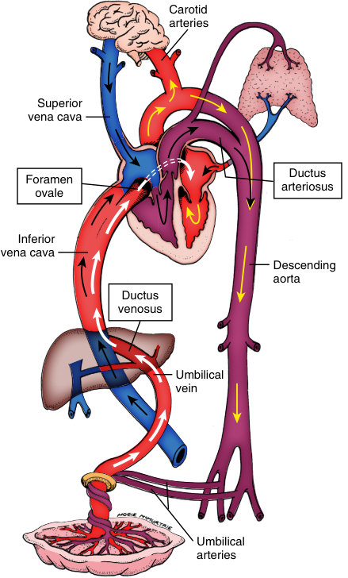

• Fig. 30.1 Fetal circulation.

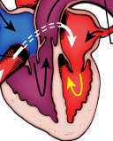

• Fig. 30.1 Fetal circulation.

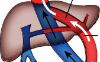

• Fig. 30.1 Fetal circulation.

• Fig. 30.1 Fetal circulation.

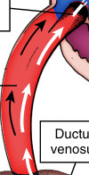

• Fig. 30.1 Fetal circulation.

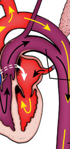

• Fig. 30.1 Fetal circulation.

• Fig. 30.1 Fetal circulation.

## PDF page 545

Another adaptive mechanism keeping the fetal tissues oxygenated is the rate of perfusion. Fetal tissues are perfused with blood at a higher rate than in the adult. The increased delivery of blood compensates for the low oxygen saturation (SpO2) in the fetus and the higher oxygen affinity of fetal hemoglobin. Finally, the fetus (except during labor) has less of an oxygen demand than the newborn. Because thermoregulation is unnecessary and respiratory effort is limited, two significant processes that consume oxygen in the newborn are either eliminated or markedly diminished in the fetus.

The PCO2 of the fetus is slightly higher than adult levels. The normal umbilical venous PCO2 is 35 to 45 mm Hg. Elimination of carbon dioxide from the fetus is enhanced by maternal hyperventilation and relative hypocarbia during pregnancy. Because of the lower PCO2 of the maternal blood, a gradient is created favoring the transfer of carbon dioxide across the placenta from fetal to maternal blood (Bohr effect). The low fetal PO2 contributes to the flow characteristics of the fetal circulation by helping to keep the pulmonary vascular resistance (PVR) high. The ductus arteriosus remains patent because of fetal production of prostaglandins and a relatively low PO2.

The fetus maintains metabolic homeostasis despite low oxygen tensions because of these adaptive and anatomic characteristics. However, any significant compromise of fetal gas exchange before labor (e.g., intrauterine growth restriction, placental abnormalities) or during the intrapartum period or lack of effective transition at birth quickly results in asphyxia, consisting of hypoxia, elevated PCO2, and metabolic acidosis.

### Transition at Birth

The circumstances and process of delivery contribute to the condition of the infant at birth. A cesarean section done before the onset of labor has a different physiologic effect on the process of transition than the standard labor process. Delivery of a multiple gestation and anesthesia administered to the mother may also be significant contributing factors. The labor process causes mild hypoxia and acidosis. With each contraction, uterine blood flow decreases, with a resulting decrease in placental perfusion and a temporary impairment of transplacental gas exchange resulting over time in a mild metabolic acidosis; this is accompanied by transient hypoxia and hypercapnia. The intermittent nature of normal labor permits the fetus to “recover” between each contraction; however, the effect is cumulative and may be exacerbated with an abnormal labor contraction pattern. Throughout a normal labor, the fetus undergoes a progressive but slow reduction in PO2, some increase in PCO2, a decrease in pH, and the accumulation of a mild metabolic acidosis.14 The normal fetus enters labor with a base excess of –2 mmol/L; with uncomplicated progression of labor to vaginal delivery, the base excess will be reduced by an additional 3 to 4 mmol/L.14,15 In the normal circumstance, these changes are not significant enough to depress

the infant and prevent normal transition from intrauterine to postnatal existence.

With birth, the neonate must establish the lungs as the site of gas exchange; the circulation, which in the fetus shunted blood away from the lungs, must now fully perfuse the pulmonary vasculature. Postnatal breathing is on a continuum with in utero breathing movements that are well established but intermittent in the term fetus.16 Clamping of the cord at birth stimulates peripheral and central chemoreceptors and, in conjunction with tactile and thermal stimulation, results in an increased systemic blood pressure. This combination of events is usually enough stimulation for a noncompromised infant to begin breathing. The AAP and American College of Obstetricians and Gynecologists (ACOG) now recommend delayed cord clamping for 30 to 60 seconds in vigorous term and preterm infants to increase blood volume, reduce the need for inotropic support, and reduce several complications of prematurity. However, if the placental circulation is not intact (i.e., abruptio placenta) or the newborn needs immediate resuscitation, immediate cord clamping should be considered or care should be individualized.1,2,17

Prior to birth, the fetal airways are liquid filled. A few days before a normal term vaginal delivery, the fetal production of lung fluid slows, and alveolar fluid volume decreases.18 The timing and mechanism of airway clearance during labor have been more fully understood with phase contrast x-ray imaging.19 The mechanisms depend on the mode of delivery and processes during labor. At least one of the mechanisms (Na+ reabsorption) is not active in preterm babies. The process of labor is a powerful stimulus for the clearance of lung fluid, and that transfer of fluid from the air spaces is predominantly a process of active transport into the interstitium and drainage through the pulmonary circulation, with some fluid exiting through lymphatic drainage.18,19 Although started before labor and influenced by the increasing levels of endogenous catecholamines, the process accelerates immediately after birth. Forces of uterine contraction can also result in lung liquid being expelled through the fetal nose and mouth. The clearance of lung fluid after birth is the result of multiple processes, mostly by the pressure gradients generated by inspiration, from either spontaneous or assisted breaths. These gradients may result in full aeration within 3 to 5 breaths in term newborns.

The first few breaths must facilitate clearance of fluid from the lungs and establish a functional residual capacity (FRC).20,21 The first breath of a spontaneously breathing term infant is generally characterized by short inspirations each followed by prolonged expiratory phases. Although the peak inspiratory pressure may be as high as –50 to –100 cm H2O, the opening pressures are very low. That is, gas begins to enter the lungs at very low pressures, usually less than –5 cm H2O pressure. Very high expiratory pressures are also generated; these pressures generally exceed the inspiratory pressure. This expiratory pressure, probably generated against a partially closed glottis, drives the liquid in the lung peripherally, increasing the FRC over the first

## PDF page 546 | printed page 533

several breaths with multiple inspiratory efforts. In a vigorous, spontaneously breathing, vaginally delivered infant, a significant FRC develops with the first several breaths. However, the depressed neonate may need assistance with establishing an FRC. Because of the high pulmonary resistance immediately after birth, it may take high inflating pressures or sustained (>1 second) inflations in term infants to open the lung and visualize chest movement with each inflation.22–24 A three-phase process proposed by Hooper et al.19 suggests that initial resuscitation of an apneic newly born baby should begin with a sustained inflation to aerate the lung followed by positive end-expiratory pressure to maintain the FRC (see Chapter 32) (Fig. 30.2). However, sustained lung inflation (SLI) is not recommended for preterm infants at birth.2 An important trial comparing SLI to standard ventilation techniques in premature newborns less than 26 weeks’ gestation was stopped early due to increased mortality in the SLI group.25

Expansion of the lungs is a stimulus for surfactant release, which reduces alveolar surface tension, increases compliance, and helps maintain a stable FRC. Simultaneously, the act of ventilation alone reduces PVR. Ventilation leads to a decrease in PCO2 and an increase in pH and PO2, also causing a decrease in PVR.26 The administration of oxygen is not necessary to produce this drop in PVR. In a study of lambs, Lakshminrusimha and colleagues27 showed that PVR decreased nearly as much (72%) in the first 30 minutes after birth with air resuscitation as with 100% oxygen. By 60 to 90 minutes after birth, the decrease in PVR in the air group had reached the same level as the 100% oxygen group. Fig. 30.3 illustrates the relationships among pH, PO2, and PVR.28 Clearance of lung fluid, establishment of FRC, and a decrease in PVR with an increase in pulmonary blood flow facilitate postnatal ventilation and oxygenation.

Phase 1

Phase 2

BV

Lung Tissue

Lung Tissue

At end expiration

AI P = 0 cmH2O

P = 0 cmH2O

BV

P = 6 cmH2O

BV

Lung Tissue Lung Tissue

AI

At end inspiration

P = 0 cmH2O

BV P = −30 cmH2O

P = −24 cmH2O

• Fig. 30.2 Three-phase process of respiratory transition in the newborn. Al, Alveolus; BV, blood vessel; P, pressure. (From Hooper SB, te Pas AB, Kitchen MJ. Respiratory transition in the newborn: a three-phase process. Arch Dis Child Fetal Neonatal Ed. 2016;101:F266–F271.)

With the onset of ventilation, the fetal circulatory system assumes the adult pattern. Coincident with clamping of the cord, the low-resistance placenta is removed from the systemic circuit, and systemic blood pressure increases. This increase in systemic pressure, coupled with the decrease in PVR and in pulmonary artery pressure, decreases the rightto-left shunt through the ductus arteriosus. The increase in PaO2 further stimulates functional closure of the ductus arteriosus. With ductal shunting diminished, pulmonary artery blood flow increases, resulting in increased pulmonary venous return to the left atrium and increased pressure in the left atrium. When the left atrial pressure exceeds right atrial pressure, the foramen ovale functionally closes.

An uncomplicated transition from fetal to newborn status is characterized by loss of fetal lung fluid, secretion of surfactant, establishment of FRC, decrease in PVR, increased systemic pressure after removal of the low-resistance placenta from the systemic circuit, functional closure of two shunts (ductus arteriosus and foramen ovale), and an increase in pulmonary artery blood flow. In most circumstances, the mild metabolic acidosis associated with labor is insufficient to interfere with this process. Regardless of the mode of birth, the transition may be significantly altered by various antepartum or intrapartum events, resulting in cardiorespiratory depression, asphyxia, or both. Infants who are very premature are especially vulnerable to these untoward events.

### Causes of Depression and Asphyxia

A newborn may be compromised because of problems initiated in utero with the mother, the placenta, or the fetus itself (Box 30.1). A process initiated in utero may extend into the neonatal period, preventing a normal transition. An asphyxial process also may be neonatal in origin; that is,

Phase 3

BV

BV

Lung Tissue

AI

P = 0 cmH2O AI

P = 0 cmH2O

BV

BV

P = −5 cmH2O

BV

BV

Lung Tissue

AI

P = 0 cmH2O AI

P = 0 cmH2O

BV

BV

P = −35 cmH2O

## PDF page 547

600

500

400

Percent increase PVR

300

pH

200

7.1

100

7.2

7.3

7.4

0

25 50 75

100

PO2 (mm Hg)

• Fig. 30.3 Pulmonary vascular resistance (PVR) in the calf. PO2, Partial pressure of oxygen. (Data from Rudolph AM, et al. Response of the pulmonary vasculature to hypoxia and H+ ion concentration changes. J Clin Invest. 1966;45:339.)

the infant seems well until required to breathe on his or her own. Maternal causes of fetal compromise may be related to decreased uterine blood flow, which decreases the amount of oxygen transported to the placenta. Diminished uterine blood flow may result from maternal hypotension (such as hypovolemia, allergic reaction, or as a result of drugs used to treat hypertension), regional anesthesia, eclampsia, or abnormal uterine contractions. Problems with the placenta, such as chronic structural abnormalities, infarcts, premature separation, edema, or inflammatory changes, may impair gas exchange. The fetus also may be compromised because of fetal problems related to cord compression, such as nuchal cord, prolapse, or a breech presentation with cord compression by the aftercoming head, or by intrinsic fetal problems, such as anemia or congenital abnormalities. In some cases, inflation of the lung occurs normally, but there may be a deficiency in oxygen-carrying capacity, as in severe hypovolemia from acute hemorrhage or fetalmaternal transfusion, or there may be inadequate cardiac output from numerous causes. A neonate may not have adequate ventilation after delivery because of many problems, including asphyxia, drug-induced central nervous system (CNS) depression, CNS anomalies or injury, spinal cord injury, mechanical obstruction of the airways, congenital facial or airway deformities, immaturity, pneumonia, or congenital anomalies.

Finally, there are some circumstances in which the infant may initiate breathing only to diminish markedly or stop breathing soon after birth. Examples include extreme prematurity with inadequate ventilatory support after birth, drug-induced depression in which the stimuli surrounding

• BOX 30.1 Factors Associated With Neonatal

Depression and Asphyxia

Antepartum Risk Factors

• Maternal diabetes • Pregnancy-induced hypertension • Chronic hypertension • Chronic maternal illness • Cardiovascular • Thyroid • Neurologic • Pulmonary • Renal • Anemia or isoimmunization • Previous fetal or neonatal death • Bleeding in second or third trimester • Maternal infection • Polyhydramnios • Oligohydramnios • Premature rupture of membranes • Post-term gestation • Multiple gestation • Size-dates discrepancy • Drug therapy • Lithium carbonate • Magnesium • Adrenergic blocking drugs • Selective serotonin reuptake inhibitor antidepressants • Maternal substance abuse • Fetal malformation • Diminished fetal activity • No prenatal care • Age <16 or >35 years

Intrapartum Risk Factors

• Emergency cesarean section • Forceps or vacuum-assisted delivery • Breech or other abnormal presentation • Premature labor • Precipitous labor • Chorioamnionitis • Prolonged rupture of membranes (>18 hours before

delivery) • Prolonged labor (>24 hours) • Prolonged second stage of labor (>3 hours) • Fetal bradycardia • Nonreassuring fetal heart rate patterns • Use of general anesthesia • Uterine tetany • Narcotics given to mother within 4 hours of delivery • Meconium-stained amniotic fluid • Prolapsed cord • Abruptio placentae • Placenta previa

birth initially overcome the depression, congenital diaphragmatic hernia, and spontaneous pneumothorax.

### Response to Asphyxia

The goal with any depressed or asphyxiated infant, whether the process is initiated in the fetal or the neonatal period, is to reverse the ongoing events as soon as possible and

## PDF page 548 | printed page 535

avoid death or permanent injury. An understanding of the response of the fetus or neonate to asphyxia forms the basis of the resuscitative process. Intrapartum asphyxia can be divided into two major types: acute near-total asphyxia and partial prolonged asphyxia. Acute near-total asphyxia has an abrupt onset, usually lasts 5 to 30 minutes, and causes complete or near-complete cessation of blood flow to the fetus. Etiologies include maternal cardiac arrest, uterine rupture, complete placental abruption, and severe cord compression. Partial prolonged asphyxia occurs more slowly over one to many hours and usually results from various causes of uteroplacental insufficiency. When a fetus or neonate is subjected to partial prolonged asphyxia, the classic “diving” reflex occurs; this is simply an attempt to either accentuate or restore a fetal type of circulation. Hypoxia and acidosis, regardless of their duration, increase vasoconstriction of the pulmonary vasculature (see Fig. 30.3).29 The increase in PVR results in a decline in pulmonary blood flow, decreasing left atrial return, which lowers left atrial pressure. The decline in left atrial pressure increases right-to-left shunting across the foramen ovale. In the fetus, this shunting directs the most highly oxygenated blood coming from the placenta to the left side of the heart. In a neonate with no placenta, this shunting merely bypasses the lungs, perpetuating a vicious cycle of hypoxia, more acidosis, and more shunting. In acute near-total asphyxia, there may not be time for the diving reflex to have a physiologic effect; in contrast to partial prolonged asphyxia, there may not be significant multisystem organ damage from shunting of blood away from the kidneys, liver, bones, and other organs not essential to the immediate preservation of life.

In the fetus and the neonate, the increase in noncerebral peripheral resistance during prolonged asphyxia results in a redistribution of blood flow, with increased flow to the head, heart, and adrenal glands, and decreased flow to organs not vital to immediate survival. Although the oxygen content of the blood is low, during the early stages of asphyxia the amount of oxygen brought to the head and heart is maximized by the maintenance of cardiac output and the increased flow to these organs.30,31 The increased peripheral resistance sustains blood pressure early in asphyxia. The blood pressure remains at reasonable levels as long as the myocardium is able to maintain cardiac output. As the asphyxia progresses and hypoxia and acidosis worsen, the myocardium fails, and cardiac output and blood pressure decrease.30,31

Hypoxic cardiomyopathy is the intermediary step to significant brain and other organ damage in partial prolonged asphyxia.31 The asphyxiated newborn will usually be born with little muscle tone, apnea, and a low heart rate. However, many healthy babies are born with a heart rate less than 100 beats per minute (bpm), and the clinician should use other signs of significant acidosis (e.g., hypotonia, apnea) to determine which baby needs immediate resuscitation. The resuscitation algorithm of children and adults emphasizes interventions to promote the return of spontaneous circulation and does not apply in newborns; the provision of

adequate ventilation is the mainstay of neonatal resuscitation with the goals to reverse the bradycardia and restore adequate circulation. Superimposed on these circulatory and hemodynamic changes is a characteristic change in respiratory pattern. Initially, there are gasping respirations (which may occur in utero). With continuing asphyxia, respirations cease in what is known as primary apnea. If the asphyxia is not corrected, the infant again begins to gasp irregularly, and the respirations cease (secondary apnea) unless effective PPV and successful resuscitation occur (Fig. 30.4).29

Primary apnea usually responds to the cessation of the asphyxiating insult and stimulation. Secondary apnea is usually accompanied by severe metabolic acidemia and requires much more vigorous resuscitation for the newborn to recover. The longer the asphyxia has gone on, the longer it takes for the onset of spontaneous ventilation to occur after PPV is started (Fig. 30.5).32 Asphyxia may begin before birth, and the infant may pass through any or all of these stages of the asphyxial cascade in utero. It may be

Gasping

Heart rate

Blood pressure

Cardiac output

Blood flow

to head

Brain damage

• Fig. 30.4 Schematic diagram of changes associated with asphyxia. Arrow indicates the point of primary apnea. (Modified from Dawes GS. Fetal and Neonatal Physiology. Chicago, IL: Year Book Medical; 1968:149. Phibbs RH. Delivery room management of the newborn. In: Avery G, ed. Neonatology. 3rd ed. Philadelphia, PA: Lippincott; 1987:215.)

## PDF page 549

Time to breathing

30

Time from ventilation (min)

20

To first gasp

10

Last gasp

0

5 10 15 Duration of asphyxia (min)

• Fig. 30.5 Time from ventilation to first gasp and to rhythmic breathing in newborn monkeys asphyxiated for 10, 12.5, and 15 minutes at 30 °C. (Data from Adamsons K, et al. Resuscitation by positive pressure ventilation and tris-hydroxymethylaminomethane of rhesus monkeys asphyxiated at birth. J Pediatr. 1964;65:807.)

difficult to determine at birth how far the asphyxial episode has progressed. With any depressed infant, it is essential to assume that the infant is in secondary apnea, and resuscitation should be initiated without delay. The goal of resuscitation, although not always attainable, is to initiate interventions in a timely and effective manner so that the insults of hypoxia, ischemia, and acidosis are reversed before they cause permanent injury (Box 30.2).

### Preparation for Resuscitation

The strategic elements in preparing for resuscitation are anticipation of the problem, provision of adequate and well-functioning equipment, and presence of trained personnel. The turmoil that sometimes occurs with resuscitation of an infant, especially an unexpected resuscitation, is primarily caused by late notification, inadequate or unavailable equipment, or staff members who are unskilled or have difficulty coordinating their activities. In most cases, appropriate preparation and timely notification of a high-risk delivery can ameliorate many of these problems. The training of personnel using simulation has been shown to be an effective preparation for the teamwork and communication required in the emergent situation of a neonatal resuscitation.33,34 Some units have designed a scripted protocol of care for each provider at an anticipated difficult resuscitation (e.g., delivery of an extremely low birth weight infant) to facilitate an orderly response with assigned responsibilities and optimal use of time during the first “golden hour” of life.35 Periodic training should include cognitive learning and technical and behavioral skills to conduct a resuscitation appropriately. In a small-volume delivery service, the designation of a resuscitation team that is available at all

• BOX 30.2 Consequences of Asphyxia

Central Nervous System

• Cerebral hemorrhage • Cerebral edema • Neonatal encephalopathy • Seizures • Stroke

Lung

• Delayed onset of respiration • Acquired surfactant deficiency (respiratory distress

syndrome) • Meconium aspiration syndrome

Cardiovascular System

• Myocardial failure • Papillary muscle necrosis • Persistent pulmonary hypertension of the newborn

Renal System

• Cortical/tubular/medullary necrosis

Gastrointestinal Tract

• Necrotizing enterocolitis

Blood

• Disseminated intravascular coagulation

times may require the inclusion of people with different skills to be able to accomplish all of the cognitive decisions and procedures necessary for an effective resuscitation. The emergency room physician, anesthesiologist or certified registered nurse anesthetist, and other personnel may be part of this team. The availability of adequate models to practice technical skills (e.g., intubation, catheter placement) can be a major impediment in the training of personnel for the rare full resuscitation. New high-fidelity manikins that are now available provide much greater realism and anatomic fidelity to solve this problem in training, but they are expensive and require a skilled instructor.34 The decreased opportunities to practice technical skills on live neonates in both training programs and daily practice make the acquisition and continued mastery of these skills a continuing challenge for all neonatal providers.36,37 Moreover, the most recent guidelines suggest that, for retention of necessary skills, neonatal resuscitation task training should occur more frequently than every 2 years.2 Recently, the AAP has teamed up with RQI (Resuscitation Quality Improvement) Partners, LLC, to provide a self-directed, simulation-based designed program using high-frequency, relatively short-interval learning and skills practice sessions in an effort to address this problem.

Communication between the obstetric and neonatal teams is essential to the graded response needed for neonatal resuscitation. In some situations, a single competent person is appropriate to the clinical situation. At other times, a full resuscitation team of three or more skilled providers may be necessary. When time allows, a careful review of

## PDF page 550 | printed page 537

the antepartum and intrapartum history can identify many problems that put a mother at risk of delivering a depressed or asphyxiated infant (see Box 30.1) and determine the composition of the resuscitation team. Even an emergency call for assistance to the neonatal team should include pertinent information. Using the acronym HANDS may be helpful to highlight the most important data: H for hemorrhage, A for amniotic fluid (clear or meconium-stained), N for number of infants expected, D for dates (gestational age), and S for fetal monitoring strip (category I, II, or III). This is also the appropriate time to discuss umbilical cord management and delayed cord clamping, if appropriate.

Identifying a high-risk situation before delivery of the infant provides time for adequate preparation and gathering the appropriate personnel in the delivery room. Because of modern obstetric techniques and anesthesia, it is no longer necessary to consider a repeat cesarean section as a high-risk delivery because this form of delivery carries no greater risk than a vertex vaginal delivery at term.38 Only if the cesarean section involves a premature infant, fetal distress, or other complications is there any cause for added concern. It is impossible to identify every infant who may need assistance. At every delivery, equipment and personnel should be available in case of unanticipated neonatal depression.

### Ethical and Legal Aspects of Delivery Room Resuscitation

The American Medical Association code of medical ethics may be applied to neonatal resuscitation situations.39 This code provides guidance on how providers should act, taking into account the chance that therapy will succeed; the risk involved in treatment and nontreatment; the degree to which the therapy, if successful, will extend life; the pain and discomfort associated with the therapy; and the anticipated quality of life for the newborn with and without treatment. State and federal laws prescribe how providers must act in resuscitation scenarios within their jurisdictions. In 1984, a Federal Child Abuse Amendment required physicians to provide care except if the child is clinically and irreversibly comatose, if treatment would only prolong dying, or if treatment would be deemed “futile.”40 In 1989, a civil rights law mandated medical care for every child. As time progressed, issues arose regarding criminal as well as civil liability in cases where newborns were not resuscitated and in other cases where newborns were successfully resuscitated against their parents’ wishes and survived with significant handicaps. There is no law mandating delivery room resuscitation in all circumstances. Local and state laws differ in various regions of the country, and the resuscitation team should be aware of laws in their locale. Moreover, the parents should be part of the decision-making process, especially when there is a question of whether or not to begin resuscitation in the periviable baby and sufficient time to give adequate information prior to birth.1,41 However, when parental direction is unclear, the provider must always be the advocate for the child.

### Adequate Equipment

Whenever an infant is delivered, appropriate equipment must be close at hand and in good working order. An area in or near the delivery room should be designated as the resuscitation area, and provisions should be made for adequate space, heat (radiant warmer), blended oxygen, and suction. Supplies and drugs as specified in the resuscitation guidelines should be placed in a code cart or bag or attached to a wall board for easy access.1 These supplies should be routinely checked by hospital personnel and rechecked for completeness and effectiveness (e.g., laryngoscope light works) before an anticipated resuscitation. A delay in effective resuscitation may occur if someone needs to leave the delivery room during the procedure to obtain an essential piece of equipment. When expecting an extremely depressed infant (e.g., terminal bradycardia resulting in an emergency cesarean section), it may be appropriate to prepare the umbilical catheter and draw up epinephrine before delivery.

### Adequate Personnel

Individuals vested with the responsibility of resuscitating infants should be adequately trained, readily available, and capable of working together as a team. Having trained personnel readily available means having someone present at every delivery who has the skill required to initiate resuscitation, with other available staff close at hand in case they are needed. This person does not have to be a physician but should be able to recognize the need for resuscitation and perform the initial steps, including the initiation of PPV. The hospital is responsible for ensuring the competence of these personnel in the same way a surgeon is credentialed to perform certain operations.4 At least two, if not three, people are needed to carry out a full resuscitation. Adequate training involves more than simply going through a course and receiving a certificate of completion. The NRP of the AHA/AAP and similar courses are simply starting points.1 These programs do not ensure competence or qualify one to assume independent responsibility.

Finally, the personnel available to the delivery room should be capable of working together as a team. If staff are skilled at carrying out their responsibilities and can anticipate each other’s needs, the tension inherent in any resuscitation can be reduced, and the process will go much more smoothly. The use of simulation training using manikins, holding mock code drills on an ongoing basis, and reviewing video recordings of resuscitations may help to maintain skills and develop coordination among staff.33,34,37,42

### Apgar Score

The Apgar score is a tool that can be used objectively to define the state of an infant at given times after birth, traditionally at 1 minute and 5 minutes (Table 30.1).43,44 The Apgar score should not be used as the primary indicator for resuscitation, because it is not normally assigned until 1

## PDF page 551

TABLE

Apgar Score

30.1

Sign 0 1

Heart rate Absent

Respiratory effort Absent

Muscle tone Flaccid

Reflex irritability No response

Color Pale or blue

bpm, Beats per minute.

minute of age. As noted, asphyxia may begin in utero and continue into the neonatal period. To minimize the chances of adverse sequelae, one should begin resuscitation as soon as there is evidence that the infant is unable to establish ventilation sufficient to maintain an adequate heart rate. Waiting until a 1-minute Apgar score is assigned before initiating resuscitation only delays potential therapies. An Apgar score at 1 minute of 0 to 3 often indicates the presence of secondary apnea. Infants who fail to achieve an Apgar score of 7 by 5 minutes of age should have repeated Apgar scores every 5 minutes until the score is at least 7.43 Steps taken during the resuscitation and the resulting Apgar scores should become part of the medical record (Table 30.2).43

### Umbilical Cord Blood Gases

Umbilical cord blood analysis for high-risk deliveries (i.e., low 5-minute Apgar score, severe intrauterine growth restriction, fetal heart rate tracing abnormalities, intrapartum fever, multiple gestation pregnancies, and cesarean deliveries for fetal distress) is currently recommended by ACOG.4 The arterial cord gas can be a valuable representation of the fetal acid-base state prior to delivery.45–48 Adverse neurologic sequelae have been associated with a low arterial cord pH.49 Using both the arterial and venous cord values, the clinician may be able to determine the intrapartum events leading to neonatal depression.46,50 Severe acidosis in a cord blood gas may inform the resuscitation and determine triage of the newborn to the appropriate postresuscitation care.51,52 An arterial cord pH less than 7.0 and a base excess greater than –16 in association with signs of neonatal encephalopathy have been used as criteria for therapeutic hypothermia in the treatment of intrapartum asphyxia.53,54 If only one cord blood gas is reported, it may be from the umbilical vein, as this vessel is larger and more easily sampled.46,51 One clue that a single gas sample is of venous origin is the PaO2 value. If the reported PaO2 is >31 mm Hg, it is highly likely to be a venous sample.46

In the ideal situation, both arterial and venous umbilical cord blood will be sampled for blood gas analysis.4,45,52 The umbilical artery pH should be at least 0.02 units lower than that of the vein.51 The normal umbilical arterial pCO2 is usually more than 4 mm Hg greater than that of the vein.

2

<100 bpm >100 bpm

Slow, irregular Good, crying

Some flexion of extremities Active motion

Grimace Vigorous cry

Acrocyanotic Completely pink

Therefore, if two cord gases are reported and the arterialvenous difference is 0.02 units or less in pH and <4 mm Hg in PCO2, then the two results are likely from the same vessel.51 Normal umbilical cord blood gases are shown in Table 30.3.46

### Elements of a Resuscitation

A resuscitation can be viewed as a series of elements. The process is not a linear set of steps in which one marches inexorably from one point to another; rather, it involves an evaluation of the infant’s condition, a decision based on that evaluation, and action.55 These steps are repeated until the process is concluded. Fig. 30.6 provides an overview of the resuscitation process.1

Virtually all infants undergo the initial steps. Most infants requiring active resuscitation respond to appropriately administered PPV.1,3 Adequate ventilation is the most important aspect of a successful neonatal resuscitation. Unfortunately, the administration of mask ventilation is subjective with very little feedback to the provider, and the technique may be unsatisfactory, resulting in inadequate alveolar ventilation (see Chapter 31). All infants, whether they require only the initial steps or a complete resuscitation, are entitled to a skilled and timely response, regardless of who is performing the resuscitation. Parents may be present while perinatal care is being provided to neonates, including procedures, resuscitation, and stabilization. Parents should be informed about and involved in the care of their infants within the principles of family-centered care.1,41

### Initial Quick Overview

Most infants are vigorous, cry at birth, and breathe easily thereafter; however, there may be a delay of 30 seconds or more before a healthy baby takes a first breath. Many times parents prefer that the infant go to the mother immediately after birth rather than be placed on a warmer and put through the “initial steps” in resuscitation. In most circumstances, a healthy and vigorous infant does not require suctioning after delivery. With appropriate triaging and oversight, most newborns can be given directly to the mother immediately after birth without compromising their care.

## PDF page 552 | printed page 539

TABLE

Expanded Apgar Score Reporting Form

30.2

Apgar Score

Sign 0 1 2

COLOR Blue or pale Acrocyanotic Completely pink

HEART RATE Absent <100 beats/min >100 beats/min

REFLEX

No response Grimace Cry or active

IRRITABILITY

withdrawal

MUSCLE TONE Limp Some flexion Active motion

RESPIRATION Absent Weak cry;

Good, crying

hypoventilation

TOTAL

Comments: Resuscitation

Minutes

Oxygen

PPV/nCPAP

ETT

Chest compressions

Epinephrine

ETT, Endotracheal tube; nCPAP, nasal continuous positive airway pressure; PPV, positive pressure ventilation. From American Academy of Pediatrics Committee on Fetus and Newborn; American College of Obstetricians and Gynecologists Committee on Obstetric Practice. The Apgar score. Pediatrics. 2015;136(4):819-22.

TABLE

Normal Arterial and Venous Cord Blood Gas Values

30.3

Venous Cord Blood, Normal Range (Mean ± 2 SD)

pH 7.25–7.45

PCO2 (mm Hg) 26.8–49.2

PO2 (mm Hg) 17.2–40.8

HCO3– 15.8–24.2

Base excessa 0 to –8

HCO3–, Bicarbonate electrolyte; PCO2, partial pressure of carbon dioxide; PO2, partial pressure of oxygen; SD, standard deviation. “Normal” is arbitrarily defined as the mean ± 2 times the SD (approximately 95.4% of a normally distributed population). aEstimated from data. From Pomerance JJ. Interpreting Umbilical Cord Blood Gases. 2nd ed. Glendora, CA: BNMG; 2012.

A rapid initial assessment that provides the information necessary to triage the infant appropriately is required. Regardless of the appearance of the amniotic fluid, if the baby is term, breathing easily, has good tone, and appears normal and vigorous, it is appropriate to hand the child to the mother for skin-to-skin contact, bonding, and the initiation of breastfeeding immediately after birth. As the mother holds the infant, a light blanket may be provided to prevent rapid evaporative heat loss while the infant is covered in such a way that he or she can be observed for

Gestational Age ______ Weeks

1 Min 5 Min 10 Min 15 Min 20 Min

1 5 10 15 20

Arterial Cord Blood, Normal Range (Mean ± 2 SD)

7.18–7.38

32.2–65.8

5.6–30.8

17–27

0 to –8

signs of distress. During this process, a trained observer should be able to see the infant’s nose and mouth, and the head should be turned to one side and not covered with a towel or blanket.29 If the infant is preterm, not breathing easily, has diminished tone, or does not appear normal and vigorous, the infant should be placed on a radiant warmer until a more thorough assessment of the infant can be done.

Although the following steps apply to any infant who is not term, healthy, and vigorous at birth, there are several

## PDF page 553

Antenatal counseling. Team briefing. Equipment check.

Birth

Term gestation? Good tone? Breathing or crying?

No

Warm, dry, stimulate, position airway, suction if needed.

1 minute

### A

Apnea or gasping? HR < 100 bpm?

Yes

PPV. Pulse oximeter. Consider cardiac monitor.

### B

HR < 100 bpm?

Yes

Ensure adequate ventilation. Consider ETT or laryngeal mask. Cardiac monitor.

No

HR < 60 bpm?

Yes

ETT or laryngeal mask. Chest compressions. Coordinate with PPV-100% oxygen. UVC.

### C

No

HR < 60 bpm?

Yes

IV epinephrine every 3-5 minutes. If HR remains < 60 bpm, • Consider hypovolemia. • Consider pneumothorax.

### D

### • Fig. 30.6 Overview of resuscitation in the delivery room. bpm, Beats per minute; CPAP, continuous pos-

itive airway pressure; ETT, endotracheal tube; GA, gestational age; HR, heart rate; IV, intravenous; PPV, positive pressure ventilation; UVC, umbilical venous catheter. (From Weiner GM, ed. Textbook of Neonatal Resuscitation, 8th ed. Itasca, IL: American Academy of Pediatrics and American Heart Association; 2020.)

caveats. An initial evaluation should be done but may take longer than 30 seconds.56 The median heart rate in healthy term and preterm infants is <100 bpm and may take up to 2 minutes to rise to 140 bpm.10 Evaluation of color at birth is usually not helpful in determining the status of a newborn, as it usually takes several minutes for even a healthy term infant to achieve SpO2 greater than 90% and “become pink” (see Chapter 32).3,57 Therefore the clinician must evaluate

Yes

Stay with mother for initial steps, routine care, ongoing evaluation.

No

Labored breathing or persistent cyanosis?

Yes

Position airway, suction if needed. Pulse oximeter. Oxygen if needed. Consider CPAP.

No

Post-resuscitation care. Team debriefing.

Target Oxygen Saturation Table

1 min

60%–65%

2 min

65%–70%

3 min

70%–75%

4 min

75%–80%

5 min

80%–85%

10 min

85%–95%

Initial oxygen concentration for PPV

35 weeks’ GA 21% oxygen

21%–30% oxygen < 35 weeks’ GA

the newly born infant carefully, looking at all aspects of wellbeing, and recognize the normal processes of transition.

### Initial Steps

Although there is no research comparing the initial steps of a resuscitation, the eighth edition of the NRP textbook has reordered these steps to reflect usual practice.1 If

### Automatic table extraction — verify rendered original

|Antenatal counseling. Team briefing. Equipment check. Birth|Col2|
|---|---|
|||

[Original table](../../tables/ch030_p0553_1.jpg)

### Automatic table extraction — verify rendered original

|Birth|Col2|Col3|
|---|---|---|
|Term gestation? Good tone? Breathing or crying? No No No No No Yes Yes Yes Yes Yes Yes Warm, dry, stimulate, position airway, suction if needed. PPV. Pulse oximeter. Consider cardiac monitor. HR < 100 bpm? HR < 60 bpm? Ensure adequate ventilation. Consider ETT or laryngeal mask. Cardiac monitor. ETT or laryngeal mask. Chest compressions. Coordinate with PPV-100% oxygen. UVC. IV epinephrine every 3-5 minutes. If HR remains < 60 bpm, • Consider hypovolemia.    • Consider pneumothorax. Stay with mother for initial steps, routine care, ongoing evaluation. Labored breathing or persistent cyanosis? Position airway, suction if needed. Pulse oximeter. Oxygen if needed. Consider CPAP. Post-resuscitation care. Team debriefing. Target Oxygen Saturation Table 1 min 2 min 3 min 4 min 5 min 10 min 60%–65% 65%–70% 70%–75% 75%–80% 80%–85% 85%–95% Initial oxygen concentration for PPV  35 weeks’ GA 21% oxygen 21%–30% oxygen < 35 weeks’ GA Apnea or gasping? HR < 100 bpm? HR < 60 bpm?|Term gestation? Good tone? Breathing or crying? No No No No No Yes Yes Yes Yes Yes Yes Warm, dry, stimulate, position airway, suction if needed. PPV. Pulse oximeter. Consider cardiac monitor. HR < 100 bpm? HR < 60 bpm? Ensure adequate ventilation. Consider ETT or laryngeal mask. Cardiac monitor. ETT or laryngeal mask. Chest compressions. Coordinate with PPV-100% oxygen. UVC. IV epinephrine every 3-5 minutes. If HR remains < 60 bpm, • Consider hypovolemia.    • Consider pneumothorax. Stay with mother for initial steps, routine care, ongoing evaluation. Labored breathing or persistent cyanosis? Position airway, suction if needed. Pulse oximeter. Oxygen if needed. Consider CPAP. Post-resuscitation care. Team debriefing. Target Oxygen Saturation Table 1 min 2 min 3 min 4 min 5 min 10 min 60%–65% 65%–70% 70%–75% 75%–80% 80%–85% 85%–95% Initial oxygen concentration for PPV  35 weeks’ GA 21% oxygen 21%–30% oxygen < 35 weeks’ GA Apnea or gasping? HR < 100 bpm? HR < 60 bpm?|Term gestation? Good tone? Breathing or crying? No No No No No Yes Yes Yes Yes Yes Yes Warm, dry, stimulate, position airway, suction if needed. PPV. Pulse oximeter. Consider cardiac monitor. HR < 100 bpm? HR < 60 bpm? Ensure adequate ventilation. Consider ETT or laryngeal mask. Cardiac monitor. ETT or laryngeal mask. Chest compressions. Coordinate with PPV-100% oxygen. UVC. IV epinephrine every 3-5 minutes. If HR remains < 60 bpm, • Consider hypovolemia.    • Consider pneumothorax. Stay with mother for initial steps, routine care, ongoing evaluation. Labored breathing or persistent cyanosis? Position airway, suction if needed. Pulse oximeter. Oxygen if needed. Consider CPAP. Post-resuscitation care. Team debriefing. Target Oxygen Saturation Table 1 min 2 min 3 min 4 min 5 min 10 min 60%–65% 65%–70% 70%–75% 75%–80% 80%–85% 85%–95% Initial oxygen concentration for PPV  35 weeks’ GA 21% oxygen 21%–30% oxygen < 35 weeks’ GA Apnea or gasping? HR < 100 bpm? HR < 60 bpm?|
|Term gestation? Good tone? Breathing or crying? No No No No No Yes Yes Yes Yes Yes Yes Warm, dry, stimulate, position airway, suction if needed. PPV. Pulse oximeter. Consider cardiac monitor. HR < 100 bpm? HR < 60 bpm? Ensure adequate ventilation. Consider ETT or laryngeal mask. Cardiac monitor. ETT or laryngeal mask. Chest compressions. Coordinate with PPV-100% oxygen. UVC. IV epinephrine every 3-5 minutes. If HR remains < 60 bpm, • Consider hypovolemia.    • Consider pneumothorax. Stay with mother for initial steps, routine care, ongoing evaluation. Labored breathing or persistent cyanosis? Position airway, suction if needed. Pulse oximeter. Oxygen if needed. Consider CPAP. Post-resuscitation care. Team debriefing. Target Oxygen Saturation Table 1 min 2 min 3 min 4 min 5 min 10 min 60%–65% 65%–70% 70%–75% 75%–80% 80%–85% 85%–95% Initial oxygen concentration for PPV  35 weeks’ GA 21% oxygen 21%–30% oxygen < 35 weeks’ GA Apnea or gasping? HR < 100 bpm? HR < 60 bpm?|Target Oxygen Saturation Table|Target Oxygen Saturation Table|
|Term gestation? Good tone? Breathing or crying? No No No No No Yes Yes Yes Yes Yes Yes Warm, dry, stimulate, position airway, suction if needed. PPV. Pulse oximeter. Consider cardiac monitor. HR < 100 bpm? HR < 60 bpm? Ensure adequate ventilation. Consider ETT or laryngeal mask. Cardiac monitor. ETT or laryngeal mask. Chest compressions. Coordinate with PPV-100% oxygen. UVC. IV epinephrine every 3-5 minutes. If HR remains < 60 bpm, • Consider hypovolemia.    • Consider pneumothorax. Stay with mother for initial steps, routine care, ongoing evaluation. Labored breathing or persistent cyanosis? Position airway, suction if needed. Pulse oximeter. Oxygen if needed. Consider CPAP. Post-resuscitation care. Team debriefing. Target Oxygen Saturation Table 1 min 2 min 3 min 4 min 5 min 10 min 60%–65% 65%–70% 70%–75% 75%–80% 80%–85% 85%–95% Initial oxygen concentration for PPV  35 weeks’ GA 21% oxygen 21%–30% oxygen < 35 weeks’ GA Apnea or gasping? HR < 100 bpm? HR < 60 bpm?|1 min|60%–65%|
|Term gestation? Good tone? Breathing or crying? No No No No No Yes Yes Yes Yes Yes Yes Warm, dry, stimulate, position airway, suction if needed. PPV. Pulse oximeter. Consider cardiac monitor. HR < 100 bpm? HR < 60 bpm? Ensure adequate ventilation. Consider ETT or laryngeal mask. Cardiac monitor. ETT or laryngeal mask. Chest compressions. Coordinate with PPV-100% oxygen. UVC. IV epinephrine every 3-5 minutes. If HR remains < 60 bpm, • Consider hypovolemia.    • Consider pneumothorax. Stay with mother for initial steps, routine care, ongoing evaluation. Labored breathing or persistent cyanosis? Position airway, suction if needed. Pulse oximeter. Oxygen if needed. Consider CPAP. Post-resuscitation care. Team debriefing. Target Oxygen Saturation Table 1 min 2 min 3 min 4 min 5 min 10 min 60%–65% 65%–70% 70%–75% 75%–80% 80%–85% 85%–95% Initial oxygen concentration for PPV  35 weeks’ GA 21% oxygen 21%–30% oxygen < 35 weeks’ GA Apnea or gasping? HR < 100 bpm? HR < 60 bpm?|2 min|65%–70%|
|Term gestation? Good tone? Breathing or crying? No No No No No Yes Yes Yes Yes Yes Yes Warm, dry, stimulate, position airway, suction if needed. PPV. Pulse oximeter. Consider cardiac monitor. HR < 100 bpm? HR < 60 bpm? Ensure adequate ventilation. Consider ETT or laryngeal mask. Cardiac monitor. ETT or laryngeal mask. Chest compressions. Coordinate with PPV-100% oxygen. UVC. IV epinephrine every 3-5 minutes. If HR remains < 60 bpm, • Consider hypovolemia.    • Consider pneumothorax. Stay with mother for initial steps, routine care, ongoing evaluation. Labored breathing or persistent cyanosis? Position airway, suction if needed. Pulse oximeter. Oxygen if needed. Consider CPAP. Post-resuscitation care. Team debriefing. Target Oxygen Saturation Table 1 min 2 min 3 min 4 min 5 min 10 min 60%–65% 65%–70% 70%–75% 75%–80% 80%–85% 85%–95% Initial oxygen concentration for PPV  35 weeks’ GA 21% oxygen 21%–30% oxygen < 35 weeks’ GA Apnea or gasping? HR < 100 bpm? HR < 60 bpm?|3 min|70%–75%|
|Term gestation? Good tone? Breathing or crying? No No No No No Yes Yes Yes Yes Yes Yes Warm, dry, stimulate, position airway, suction if needed. PPV. Pulse oximeter. Consider cardiac monitor. HR < 100 bpm? HR < 60 bpm? Ensure adequate ventilation. Consider ETT or laryngeal mask. Cardiac monitor. ETT or laryngeal mask. Chest compressions. Coordinate with PPV-100% oxygen. UVC. IV epinephrine every 3-5 minutes. If HR remains < 60 bpm, • Consider hypovolemia.    • Consider pneumothorax. Stay with mother for initial steps, routine care, ongoing evaluation. Labored breathing or persistent cyanosis? Position airway, suction if needed. Pulse oximeter. Oxygen if needed. Consider CPAP. Post-resuscitation care. Team debriefing. Target Oxygen Saturation Table 1 min 2 min 3 min 4 min 5 min 10 min 60%–65% 65%–70% 70%–75% 75%–80% 80%–85% 85%–95% Initial oxygen concentration for PPV  35 weeks’ GA 21% oxygen 21%–30% oxygen < 35 weeks’ GA Apnea or gasping? HR < 100 bpm? HR < 60 bpm?|4 min|75%–80%|
|Term gestation? Good tone? Breathing or crying? No No No No No Yes Yes Yes Yes Yes Yes Warm, dry, stimulate, position airway, suction if needed. PPV. Pulse oximeter. Consider cardiac monitor. HR < 100 bpm? HR < 60 bpm? Ensure adequate ventilation. Consider ETT or laryngeal mask. Cardiac monitor. ETT or laryngeal mask. Chest compressions. Coordinate with PPV-100% oxygen. UVC. IV epinephrine every 3-5 minutes. If HR remains < 60 bpm, • Consider hypovolemia.    • Consider pneumothorax. Stay with mother for initial steps, routine care, ongoing evaluation. Labored breathing or persistent cyanosis? Position airway, suction if needed. Pulse oximeter. Oxygen if needed. Consider CPAP. Post-resuscitation care. Team debriefing. Target Oxygen Saturation Table 1 min 2 min 3 min 4 min 5 min 10 min 60%–65% 65%–70% 70%–75% 75%–80% 80%–85% 85%–95% Initial oxygen concentration for PPV  35 weeks’ GA 21% oxygen 21%–30% oxygen < 35 weeks’ GA Apnea or gasping? HR < 100 bpm? HR < 60 bpm?|5 min|80%–85%|
|Term gestation? Good tone? Breathing or crying? No No No No No Yes Yes Yes Yes Yes Yes Warm, dry, stimulate, position airway, suction if needed. PPV. Pulse oximeter. Consider cardiac monitor. HR < 100 bpm? HR < 60 bpm? Ensure adequate ventilation. Consider ETT or laryngeal mask. Cardiac monitor. ETT or laryngeal mask. Chest compressions. Coordinate with PPV-100% oxygen. UVC. IV epinephrine every 3-5 minutes. If HR remains < 60 bpm, • Consider hypovolemia.    • Consider pneumothorax. Stay with mother for initial steps, routine care, ongoing evaluation. Labored breathing or persistent cyanosis? Position airway, suction if needed. Pulse oximeter. Oxygen if needed. Consider CPAP. Post-resuscitation care. Team debriefing. Target Oxygen Saturation Table 1 min 2 min 3 min 4 min 5 min 10 min 60%–65% 65%–70% 70%–75% 75%–80% 80%–85% 85%–95% Initial oxygen concentration for PPV  35 weeks’ GA 21% oxygen 21%–30% oxygen < 35 weeks’ GA Apnea or gasping? HR < 100 bpm? HR < 60 bpm?|10 min|85%–95%|
|Term gestation? Good tone? Breathing or crying? No No No No No Yes Yes Yes Yes Yes Yes Warm, dry, stimulate, position airway, suction if needed. PPV. Pulse oximeter. Consider cardiac monitor. HR < 100 bpm? HR < 60 bpm? Ensure adequate ventilation. Consider ETT or laryngeal mask. Cardiac monitor. ETT or laryngeal mask. Chest compressions. Coordinate with PPV-100% oxygen. UVC. IV epinephrine every 3-5 minutes. If HR remains < 60 bpm, • Consider hypovolemia.    • Consider pneumothorax. Stay with mother for initial steps, routine care, ongoing evaluation. Labored breathing or persistent cyanosis? Position airway, suction if needed. Pulse oximeter. Oxygen if needed. Consider CPAP. Post-resuscitation care. Team debriefing. Target Oxygen Saturation Table 1 min 2 min 3 min 4 min 5 min 10 min 60%–65% 65%–70% 70%–75% 75%–80% 80%–85% 85%–95% Initial oxygen concentration for PPV  35 weeks’ GA 21% oxygen 21%–30% oxygen < 35 weeks’ GA Apnea or gasping? HR < 100 bpm? HR < 60 bpm?|Initial oxygen concentration for PPV|Initial oxygen concentration for PPV|
|Term gestation? Good tone? Breathing or crying? No No No No No Yes Yes Yes Yes Yes Yes Warm, dry, stimulate, position airway, suction if needed. PPV. Pulse oximeter. Consider cardiac monitor. HR < 100 bpm? HR < 60 bpm? Ensure adequate ventilation. Consider ETT or laryngeal mask. Cardiac monitor. ETT or laryngeal mask. Chest compressions. Coordinate with PPV-100% oxygen. UVC. IV epinephrine every 3-5 minutes. If HR remains < 60 bpm, • Consider hypovolemia.    • Consider pneumothorax. Stay with mother for initial steps, routine care, ongoing evaluation. Labored breathing or persistent cyanosis? Position airway, suction if needed. Pulse oximeter. Oxygen if needed. Consider CPAP. Post-resuscitation care. Team debriefing. Target Oxygen Saturation Table 1 min 2 min 3 min 4 min 5 min 10 min 60%–65% 65%–70% 70%–75% 75%–80% 80%–85% 85%–95% Initial oxygen concentration for PPV  35 weeks’ GA 21% oxygen 21%–30% oxygen < 35 weeks’ GA Apnea or gasping? HR < 100 bpm? HR < 60 bpm?|35 weeks’ GA|21% oxygen|
|Term gestation? Good tone? Breathing or crying? No No No No No Yes Yes Yes Yes Yes Yes Warm, dry, stimulate, position airway, suction if needed. PPV. Pulse oximeter. Consider cardiac monitor. HR < 100 bpm? HR < 60 bpm? Ensure adequate ventilation. Consider ETT or laryngeal mask. Cardiac monitor. ETT or laryngeal mask. Chest compressions. Coordinate with PPV-100% oxygen. UVC. IV epinephrine every 3-5 minutes. If HR remains < 60 bpm, • Consider hypovolemia.    • Consider pneumothorax. Stay with mother for initial steps, routine care, ongoing evaluation. Labored breathing or persistent cyanosis? Position airway, suction if needed. Pulse oximeter. Oxygen if needed. Consider CPAP. Post-resuscitation care. Team debriefing. Target Oxygen Saturation Table 1 min 2 min 3 min 4 min 5 min 10 min 60%–65% 65%–70% 70%–75% 75%–80% 80%–85% 85%–95% Initial oxygen concentration for PPV  35 weeks’ GA 21% oxygen 21%–30% oxygen < 35 weeks’ GA Apnea or gasping? HR < 100 bpm? HR < 60 bpm?|< 35 weeks’ GA|21%–30% oxygen|

[Original table](../../tables/ch030_p0553_2.jpg)

## PDF page 554 | printed page 541

resuscitation is deemed necessary, the initial steps are warm, dry, stimulate, and position the airway. Many of these steps can be accomplished simultaneously. When positioning, the infant is placed in a “sniffing” position, which will facilitate opening the airway. If needed, secretions can be cleared with a bulb syringe and the infant is dried, unless very preterm, in which case a plastic wrap is used to maintain temperature. The infant is then stimulated to breathe and is observed before starting the next steps. If PPV or an alternative airway is necessary, a cardiac monitor is suggested early in the resuscitation algorithm for the most accurate assessment of heart rate.1,2

### Thermal Management

The fetus maintains a body temperature about 0.5° higher than maternal temperature. Through the accumulation of brown fat late in gestation, the term newborn is able to activate thermogenesis by stimuli of oxygenation, ventilation, and oxidative metabolism via various hormonal intermediaries. The lack of brown fat accumulation in preterm infants and the sequelae of asphyxia in term infants put these newborns at significant disadvantage in thermoregulation postdelivery.20 Delivery rooms are kept at a level of thermal comfort for the adults working in them. The neonate with a very large ratio of surface area to mass is susceptible to cold stress; this is especially true for depressed infants with poor perfusion and extremely low birth weight infants. Unintentional hypothermia in neonates has been associated with metabolic acidosis, increased oxygen consumption, and increased mortality, especially in very preterm infants.58 For very low birth weight infants, one large cohort study revealed a 28% increase in mortality for each 1 °C decrease in neonatal intensive care unit admission temperature.59

Studies have shown that >30% of infants with extremely low birth weight (<1000 g) become hypothermic with standard warming techniques in the delivery room.58,60 Because this population makes up less than 1% of all deliveries, special preparations should be made for these infants by prewarming the delivery room or an adjacent resuscitation area to 75° to 78 °F and using a radiant warmer and food-grade plastic wrap to keep the infant warm after birth.1,58,61 Other strategies may include prewarmed blankets, hats, exothermic mattresses, and the use of warmed, humidified air/oxygen for ventilation.24 Care must be taken not to overheat an infant, as animal studies have shown that hyperthermia is synergistic with asphyxia in worsening cerebral injury.2

For a term nondistressed newborn, the infant should be placed skin-to-skin with the mother or in the microenvironment of a preheated radiant warmer immediately after birth. Newborns who do not qualify for routine care should be placed in warm blankets and quickly moved to a preheated radiant warmer set at 100% power. The infant should be thoroughly dried, and the wet blankets should be promptly removed to avoid evaporative heat loss. These simple measures can minimize the decrease in core temperature that the term infant experiences at birth.62 Preventing excessive

heat loss can become especially important with a preterm infant or an infant who is asphyxiated and hypoxic. Because hypoxia blunts the normal response to cold, a hypoxic infant undergoes a greater than normal decline in core temperature if not thermally protected.63 Recovery from acidosis also is delayed by hypothermia (see Chapter 35).64

### Clearing the Airway

Previously, it was recommended that the airway should be cleared with the use of a bulb syringe or a suction catheter. However, if the newborn is vigorous and born through clear amniotic fluid, this procedure is not necessary,65,66 and stimulation of the posterior portion of the pharynx may induce bradycardia.67 If the infant has excessive secretions, a bulb syringe may be used to clear first the mouth and then the nose (“m” before “n”). An infant exposed to meconium in the amniotic fluid represents a special circumstance (discussed in Chapter 33).

### Monitoring

Heart rate may be evaluated by palpation of a peripheral pulse or the umbilical cord; however, studies have shown that these measurements are not reliable.68 If the resuscitation team is expecting a significantly depressed baby or a very low birth weight infant who probably needs help in transition, attaching electrocardiogram (ECG) leads to monitor heart rate should be done early in the resuscitation process. Use of a pulse oximeter to guide treatment is also suggested by the NRP.1 There may be a delay of 1 to 2 minutes after attaching the pulse oximeter until accurate readings of both heart rate and oxygen saturation are obtained. If the baby has poor perfusion or a very low heart rate, the pulse oximeter may not give accurate readings.

### Tactile Stimulation and Assessment

Usually the act of drying the infant is enough tactile stimulation to initiate respiration. An infant in primary apnea will generally respond to these gentle measures. All babies will be cyanotic at birth, and blow-by oxygen is not indicated. If the infant does not breathe after tactile stimulation, gently flicking the soles of the feet or rubbing the infant’s back may be enough additional stimulation to elicit regular respirations. After initial steps, if stimulation fails to elicit a vigorous response, the baby should be assumed to be in secondary apnea, and PPV should be quickly initiated. PPV may be given initially to infants ≥35 weeks with air (21% FiO2). Continued and more vigorous tactile stimulation is not useful and may be harmful if ineffective maneuvers allow the baby to remain hypoxic and acidotic. The decisions from this point revolve around the response of the infant—primarily heart rate and respirations.

### Preparing for Oxygen Administration

Over the past several years, there has been considerable discussion and research on the use of oxygen in neonatal resuscitation (see Chapter 32).69–72 Previously, the Textbook of Neonatal Resuscitation recommended that free-flow oxygen be used if the newborn remained cyanotic after

## PDF page 555

30 seconds of initial steps (drying, warmth) and evaluation, or if PPV was needed. This recommendation has been revised based on numerous studies. The current recommendation is to use pulse oximetry if resuscitation is anticipated, when PPV is given, and if central cyanosis persists after 5 to 10 minutes. Resuscitation for infants ≥35 weeks should begin with room air (21% oxygen at sea level), and oxygen should be given if necessary and titrated according to the interquartile range of healthy term newborns after vaginal birth at sea level (Fig. 30.6). If the newborn is <35 weeks’ gestation, the initial oxygen concentration should be 21% to 30% FiO2. If chest compressions, medication, or both are needed, 100% oxygen is recommended (Fig. 30.6).1,2 Current recommendations advise against the routine use of oxygen for transient cyanosis and the avoidance of high concentrations of oxygen whenever possible.2,71

If the infant is spontaneously breathing and the heart rate is greater than 100 bpm, but the infant remains cyanotic for >5 minutes after birth, oxygen may be administered through a free-flow system until it can be shown that the oxygen concentration can be reduced (arterial oxygen saturation [SaO2] > 85%) or that lowering the concentration makes no difference (cyanotic heart disease). Studies

Key Points

• At birth, the newborn must establish the lung as the

organ of gas exchange, and this may require the assistance of a skilled resuscitation team. • A neonate may not have adequate ventilation after

delivery because of many problems, including asphyxia, drug-induced central nervous system (CNS) depression, CNS anomalies or injury, spinal cord injury, mechanical obstruction of the airways, congenital facial or airway deformities, immaturity, pneumonia, systemic infection, or congenital anomalies.

### References

1. Weiner GM, ed. Textbook of Neonatal Resuscitation. 8th ed. Itasca

Village, IL: American Academy of Pediatrics, American Heart Association; 2020. 2. Wyckoff MH, Wyllie J, Aziz K, et al. Neonatal Life Support 2020

International Consensus on Cardiopulmonary Resuscitation and Emergency Cardiovascular Care Science With Treatment Recommendations. Resuscitation. 2020;156:A156–A187. 3. Perlman JM, Risser R. Cardiopulmonary resuscitation in the

delivery room: associated clinical events. Arch Pediatr Adolesc Med. 1995;149:20. 4. American Academy of Pediatrics/American College of Obste-

tricians and Gynecologists. Guidelines for Perinatal Care. 8th ed. Elk Grove Village, IL: American Academy of Pediatrics; 2017. 5. Friedman AM, Ananth CV, Huang Y, et al. Hospital delivery

volume, severe obstetrical morbidity, and failure to rescue. Am J Obs Gynecol. 2016;215(795):e1–e14.

of normal term newborns have shown that it may take 6 minutes or longer for infants to reach SaO2 greater than 90%, and many clinicians believe the use of oxygen should be restricted unless the baby remains bradycardic.73,74 A high concentration of oxygen can be obtained with an oxygen mask (with escape holes) held firmly over the face or an oxygen tube cupped in the hand. A flow-inflating bag (but not a self-inflating bag) is capable of delivering high concentrations of blow-by oxygen.1 The use of high concentrations of oxygen is not usually necessary and hyperoxia should be avoided, especially in a preterm infant.

It is best to heat and humidify the oxygen. During an emergency, cold, dry oxygen may be given for a short time; however, if free-flow oxygen is to be continued for any period, it should be heated and humidified and given through wide-bore tubing. An oxygen blender and oximeter are useful in determining the amount of oxygen the infant requires. It is recommended that all hospitals should be capable of blending oxygen in the delivery room and using pulse oximetry in this area.1 After suctioning and tactile stimulation, if the respirations are gasping or are insufficient to sustain the heart rate at greater than 100 bpm, PPV must be initiated.

• The strategic elements in preparing for resuscitation

are anticipation of the problem, provision of adequate equipment, and presence of trained personnel. • The need for and the extent of resuscitation required

will be determined by the clinical condition of the newly born infant, umbilical cord blood gases, and evolving Apgar scores. • In most resuscitations, following the algorithm pro-

vided by the Neonatal Resuscitation Program will guide the team in the appropriate series of steps to revive a depressed or acidemic newborn.

6. Grobman WA, Rice MM, Reddy UM, et al. Labor induction

versus expectant management in low-risk nulliparous women. N Engl J Med. 2018;379:513–523. 7. Handley SC, Passarella M, Herrick HM, et al. Birth volume and

geographic distribution of US hospitals with obstetric services from 2010 to 2018. JAMA Netw Open. 2021;4(10p):e2125373. 8. Jukkala, et al. Rural hospital preparedness for neonatal resuscita-

tion. J Rural Health. 2008;24(4):423–428. 9. Jukkala, et al. Provider readiness for neonatal resuscitation in rural

hospitals. J Obstet Gynecol Neonatal Nurs. 2009;38:443–452. 10. Chalkias A, Xanthos T, Syggelou A, et al. Controversies in neo-

natal resuscitation. J Matern Fetal Neonatal Med. 2013;26(suppl 2):50–54. 11. Raupp P, McCutcheon C. Neonatal resuscitation—an analysis of

the transatlantic divide. Resuscitation. 2007;75:345. 12. Lewis RM, Cleal JK. Mechanism of transfer across the human

placenta. In: Polin RA, Abman SH, Rowitch DH, Benitz WE, eds. Fetal and Neonatal Physiology. 6th ed. Philadelphia: Elsevier; 2022.

## PDF page 556 | printed page 543

13. Nageotte MP. Intrapartum fetal surveillance. In: Creasy RK,

Resnik R, eds. Creasy & Resnik’s Maternal-Fetal Medicine Principles and Practice. 7th ed. Philadelphia: Saunders; 2014:488–506. 14. Boylan P. Acid-base physiology in the fetus. In: Creasy RK, ed.

Maternal-Fetal Medicine. Philadelphia: Saunders; 1989. 15. Ross MG, Gala R. Use of umbilical artery base excess: algorithm

for the timing of hypoxic injury. Am J Obstet Gynecol. 2002;187:1. 16. Patrick J, et al. Patterns of human fetal breathing during the last

10 weeks of pregnancy. Obstet Gynecol. 1980;56:24. 17. American College of Obstetricians and Gynecologists. Commit-

tee opinion no. 684. Delayed umbilical cord clamping after birth. Obstet Gynecol. 2017;129.e5–e10. 18. Carlton DP. Regulation of lung secretion and absorption by the

fetal and neonatal lung. In: Polin RA, Abman SH, Rowitch DH, Benitz WE, eds. Fetal and Neonatal Physiology. 6th ed. Philadelphia: Elsevier; 2022. 19. Hooper SB, te Pas AB, Kitchen MJ. Respiratory transition in the

newborn: a three-phase process. Arch Dis Child Fetal Neonatal Ed. 2016;101:F266–F271. 20. Hillman NH, Kallapur SG, Jobe AH. Physiology of transi-

tion from intrauterine to extrauterine life. Clin Perinatol. 2012;39:769–783. 21. te Pas AB, et al. Establishing a functional residual capacity at

birth: the effect of sustained inflation and positive end expiratory pressure in a preterm rabbit model. Pediatr Res. 2009;65:537. 22. Bruschettini M, O’Donnell CP, Davis PG, et al. Sustained versus

standard inflations during neonatal resuscitation to prevent mortality and improve respiratory outcomes. Cochrane Database Syst Rev. 2020;3(3):CD004953. https://doi.org/10.1002/14651858. CD004953.pub4. PMID: 32187656. 23. Milner AD, et al. Lung expansion at birth. J Pediatr.

1982;101:879. 24. Singh A, Duckett J, Newton T, et al. Improving neonatal unit

admission temperatures in preterm babies: exothermic mattresses, polythene bags or a traditional approach? J Perinatol. 2010;30:45–49. 25. Kirpalani H, Ratcliffe SJ, Keszler M, et al; SAIL Site Investiga-

tors. Effect of sustained inflations vs intermittent positive pressure ventilation on bronchopulmonary dysplasia or death among extremely preterm infants: the SAIL Randomized Clinical Trial. JAMA. 2019;321(12):1165–1175. https://doi.org/10.1001/ jama.2019.1660. PMID: 30912836. 26. Cassin S, et al. The vascular resistance of the foetal and newly

ventilated lung of the lamb. J Physiol (Lond). 1964;171:61. 27. Lakshminrusimha S, Russell JA, Steinhorn RH, et al. Pulmonary

hemodynamics in neonatal lambs resuscitated with 21%, 50% and 100% oxygen. Pediatr Res. 2007;62:313. 28. Rudolph AM, et al. Response of the pulmonary vasculature

to hypoxia and H+ ion concentration changes. J Clin Invest. 1966;45:399. 29. Dawes GS. Birth asphyxia, resuscitation, brain damage. In: Fetal

and Neonatal Physiology. Chicago: Year Book Medical Publishers; 1968. 30. Noori S, Friedlich PS, Seri I. Pathophysiology of shock in the

fetus and neonate. In: Polin RA, Abman SH, Rowitch DH, Benitz WE, eds. Fetal and Neonatal Physiology. 6th ed. Philadelphia: Elsevier; 2022. 31. Rainaldi MA, Perlman JM. Pathophysiology of birth asphyxia.

Clin Perinatol. 2016;43(3):409–422. 32. Adamsons Jr K, et al. Resuscitation by positive pressure ventila-

tion and tris-hydroxymethyl aminomethane of rhesus monkeys asphyxiated at birth. J Pediatr. 1964;65:807.

33. Murphy AA, Halamek LP. Simulation-based training in neonatal

resuscitation. NeoReviews. 2005;6(11):e489. 34. Sawyer T, Umoren RA, Gray MM. Neonatal resuscita-

tion: advances in training and practice. Adv Med Educ Pract. 2016;8:11–19. 35. Annibale DJ, Bissinger RL. The golden hour. Adv Neonatal Care.

2010;10(5):221–223. 36. Anderson R, Sebaldt A, Lin Y, Cheng A. Optimal training frequency

for acquisition and retention of high-quality CPR skills: a randomized trial. Resuscitation. 2019;135:153–161. https://doi.org/10.1016/j. resuscitation.2018.10.033. Epub 2018 Nov 2. PMID: 30391370. 37. Thomas EJ, et al. Teamwork and quality during neonatal care in

the delivery room. J Perinatol. 2006;26:163. 38. Levine EM, et al. Pediatrician attendance at cesarean delivery:

necessary or not? Obstet Gynecol. 1999;93:338. 39. American Medical Association (AMA). Opinion 2.215. In: Code

of Medical Ethics: Current Opinions with Annotations. 2010-2011. Chicago: AMA; 2010-2011. 40. Child Abuse Amendments of 1984. Pub. L. No. 98-457, 98 Stat.

1749 (1984) (To Be Codified at 42 U.S.C. 5101-5107). 41. Harrison H. The principles for family-centered neonatal care.

Pediatrics. 1993;92:643. 42. Schilleman K, Siew ML, Lopriore E, et al. Auditing resuscitation

of preterm infants at birth by recording video and physiological parameters. Resuscitation. 2012;83(9):1135–1139. 43. American Academy of Pediatrics. Committee on Fetus and New-

born, American College of Obstetricians and Gynecologists, Committee on Obstetric Practice. The Apgar score. Pediatrics. 2006;117:1444. 44. Apgar V. A proposal for a new method of evaluation of the new-

born infant. Curr Res Anesth Analg. 1953;32:260. 45. Armstrong L, Stenson BJ. Use of umbilical cord blood gas analy-

sis in the assessment of the newborn. Arch Dis Child Fetal Neonatal Ed. 2007;92(6):F430–F434. 46. Pomerance JJ. Interpreting Umbilical Cord Gases. 2nd ed. Glen-

dora, CA: BNMG; 2012. 47. Blickstein I, Green T. Umbilical cord blood gases. Clin Perinatol.

2007;34(3):451–459. 48. Nicolaides KH, et al. Ultrasound-guided sampling of umbili-

cal cord and placental blood to assess fetal wellbeing. Lancet. 1986;1:1065. 49. King TA, Jackson GL, Josey AS, et al. The effect of profound

umbilical artery acidemia in term neonates admitted to a newborn nursery. J Pediatr. 1998;132(4):624–629. 50. Downes KJ, Narendran V, Meinzen-Derr J, et al. The lost art of

intubation: assessing opportunities for residents to perform neonatal intubation. J Perinatol. 2012;32(12):927–932. 51. Higgins C. Umbilical-cord Blood Gas Analysis. Brønshøj, Den-

mark: Radiometer Medical ApS; 2014. 52. Westgate J, Garibaldi JM, Greene KR. Umbilical cord blood gas

analysis at delivery: a time for quality data. Br J Obstet Gynaecol. 1994;101(12):1054–1063. 53. Jacobs SE, Berg M, Hunt R, et al. Cooling for newborns with

hypoxic ischaemic encephalopathy. Cochrane Database Syst Rev. 2013;1:CD003311. 54. Papile LA, Baley JE, Benitz W, et al. Hypothermia and neonatal

encephalopathy. Pediatrics. 2014;133(6):1146–1150. 55. Manley BJ, Owen LS, Hooper SB, et al. Towards evi-

dence-based resuscitation of the newborn infant. Lancet. 2017;389(10079):1639–1648. 56. Rabe H, Gyte GM, Díaz-Rossello JL, Duley L. Effect of tim-

ing of umbilical cord clamping and other strategies to influence

## PDF page 557

placental transfusion at preterm birth on maternal and infant outcomes. Cochrane Database Syst Rev. 2019;9(9):CD003248. https://doi.org/10.1002/14651858.CD003248.pub4. PMID: 31529790. 57. Malin GL, Morris RK, Khan KS. Strength of association between

umbilical cord pH and perinatal and long term outcomes: systematic review and meta-analysis. BMJ. 2010;340:c1471. 58. McCall EM, Alderdice F, Halliday HL, et al. Interventions to

prevent hypothermia at birth in preterm and/or low birth weight infants. Cochrane Database Syst Rev. 2018;2(2):CD004210. https://doi.org/10.1002/14651858.CD004210.pub5. PMID: 29431872. 59. Laptook AR, Salhab W, Bhaskar B. Admission temperature of

low birth weight infants: predictors and associated morbidities. Pediatrics. 2007;119:e643–e649. 60. Bhatt DR, White R, Martin G, et al. Transitional hypothermia

in preterm newborns. Adv Neonatal Care. 2010;10(suppl 5):S15– S17. 61. Vohra S, et al. Heat loss prevention (HeLP) in the delivery room:

a randomized controlled trial of polyethylene occlusive skin wrapping in very preterm infants. J Pediatr. 2004;145:750. 62. Feldman-Winter L, Goldsmith JP, Committee on Fetus and New

Task Force on Sudden Infant Death Syndrome. Safe sleep and skin-to-skin care in the neonatal period for healthy term newborns. Pediatrics. 2016:e20161889. 63. Bruck K. Temperature regulation in the newborn infant. Biol

Neonate. 1961;3:65. 64. Adamsons Jr K, et al. The influence of thermal factors upon

oxygen consumption of the newborn human infant. J Pediatr. 1965;66:495. 65. Foster JP, Dawson JA, Davis PD, Dahlen HG. Routine oro/

nasopharyngeal suction versus no suction at birth. Cochrane

Database Syst Rev. 2017;4(4):CD010332. https://doi. org/10.1002/14651858.CD010332.pub2. 66. Gungor S, Kurt E, Teksoz E, et al. Oronasopharyngeal suction

versus no suction in normal and term infants delivered by elective cesarean section: a prospective randomized controlled trial. Gynecol Obstet Invest. 2006;61:9–14. 67. Cordero Jr L, et al. Neonatal bradycardia following nasopharyn-

geal stimulation. J Pediatr. 1971;78:441. 68. Dawson JA, Schmölzer GM, Wyllie J. Monitoring heart rate in

the delivery room. Semin Fetal Neonatal Med. 2018;23(5):327– 332. https://doi.org/10.1016/j.siny.2018.07.001. Epub 2018 Jul 6. PMID: 30005922. 69. Kim E, Nguyen M. Oxygen therapy for neonatal resuscitation in

the delivery room. NeoReviews. 2019;20(9):e500–e512. https:// doi.org/10.1542/neo.20-9-e500. PMID: 31477598. 70. O’Donnell CP, Kamlin CO, Davis PG, et al. Clinical assessment

of infant colour at delivery. Arch Dis Child Fetal Neonatal Ed. 2007;92(6):F465–F467. 71. Oei JL, Vento M, Rabi Y, et al. Higher or lower oxygen for deliv-

ery room resuscitation of preterm infants below 28 completed weeks gestation: a meta-analysis. Arch Dis Child Fetal Neonatal Ed. 2017;102(1):F24–F30. 72. Richmond S, Goldsmith JP. Refining the role of oxygen admin-

istration during delivery room resuscitation: what are the future goals? Semin Fetal Neonatal Med. 2008;13:368. 73. Saugstad OD. Saturations immediately after birth. J Pediatr.

2006;148:569. 74. Welsford M, Nushiyama C, Shortt C, et al; International

Liaison Committee on Resuscitation Neonatal Life Support Task Force. Room air for initiating term newborn resuscitation: a systematic review with meta-analysis. Pediatrics. 2019;143(01):e201881825.

<!-- SOURCE_LAYOUT_VIEWS -->

## Original layout views and recovered diagrams

Automatic extraction can flatten tables and superscripts. Check the original layout for numeric data, footnotes and image credits. [Source review notes](../../SOURCE_REVIEW_NOTES.md).

### Original source page 544

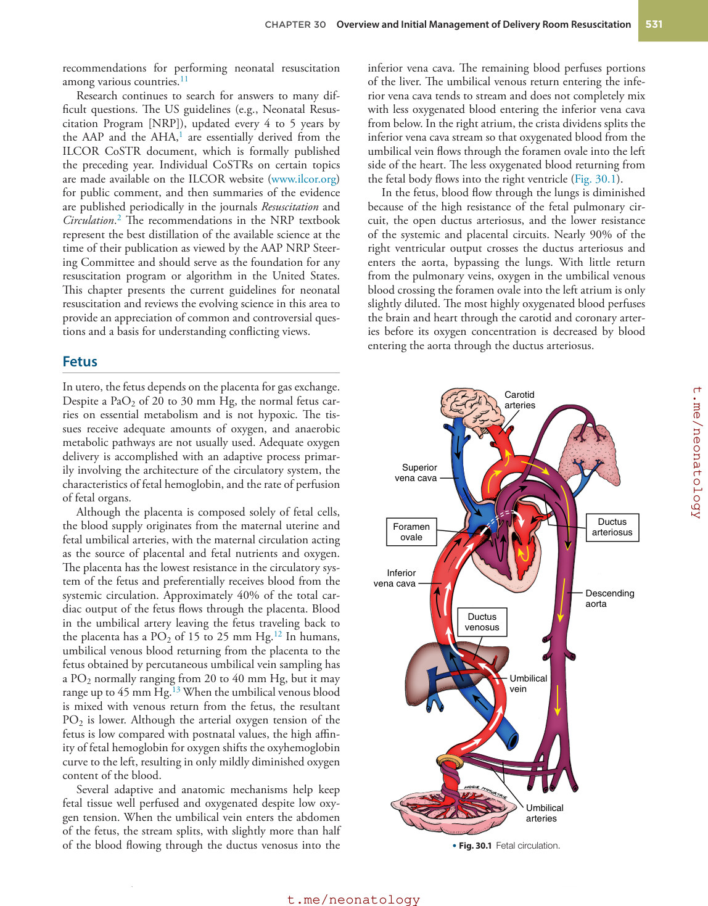

### Original source page 546

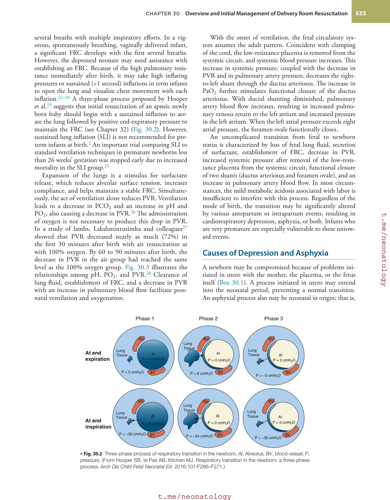

### Original source page 547

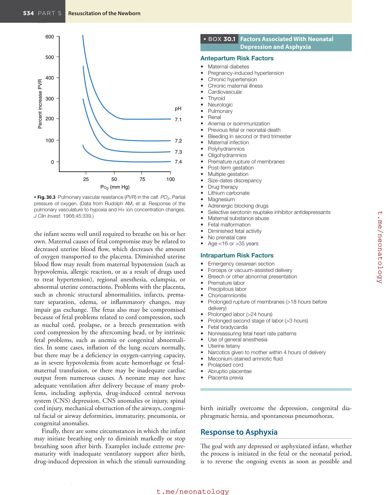

### Original source page 548

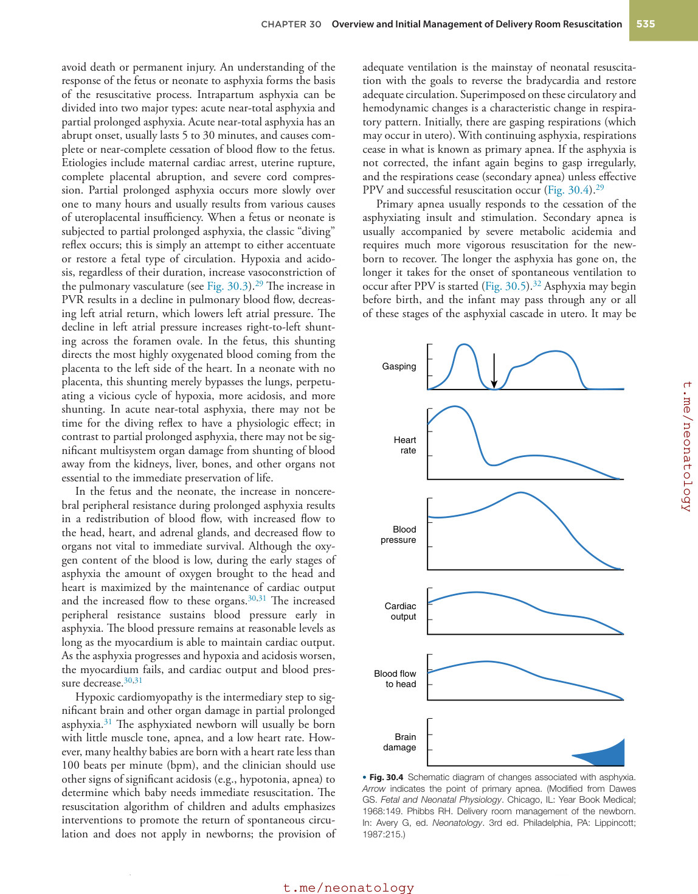

### Original source page 549

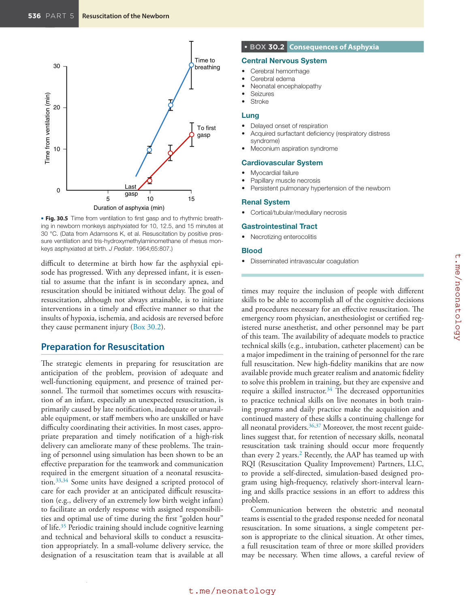

### Original source page 550

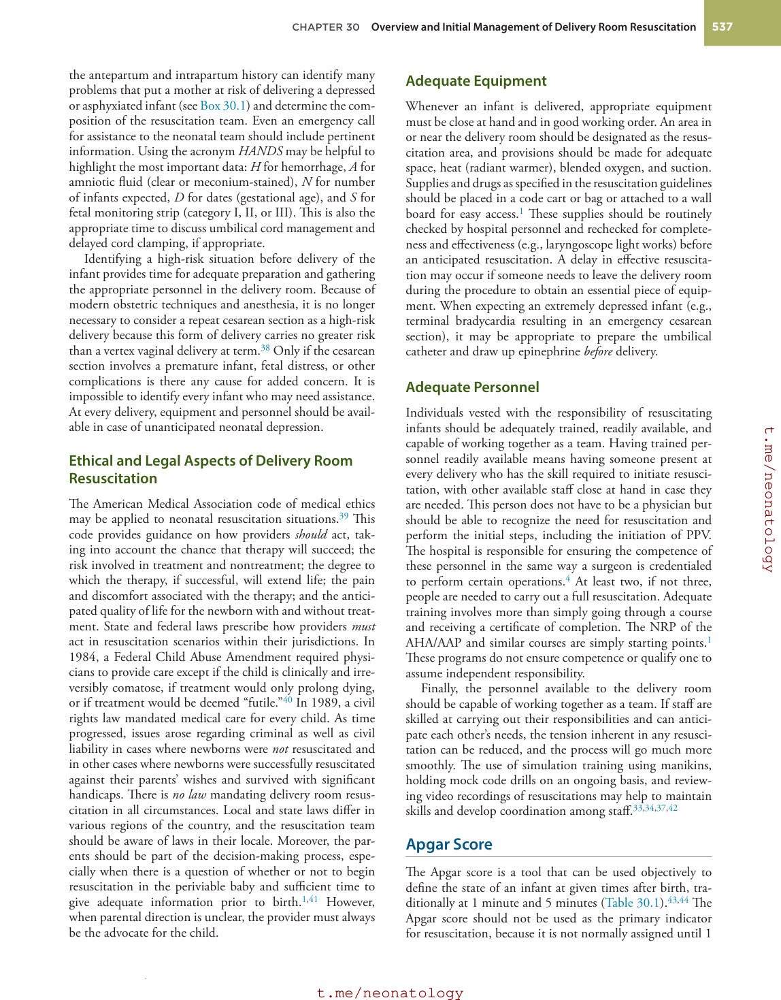

### Original source page 551

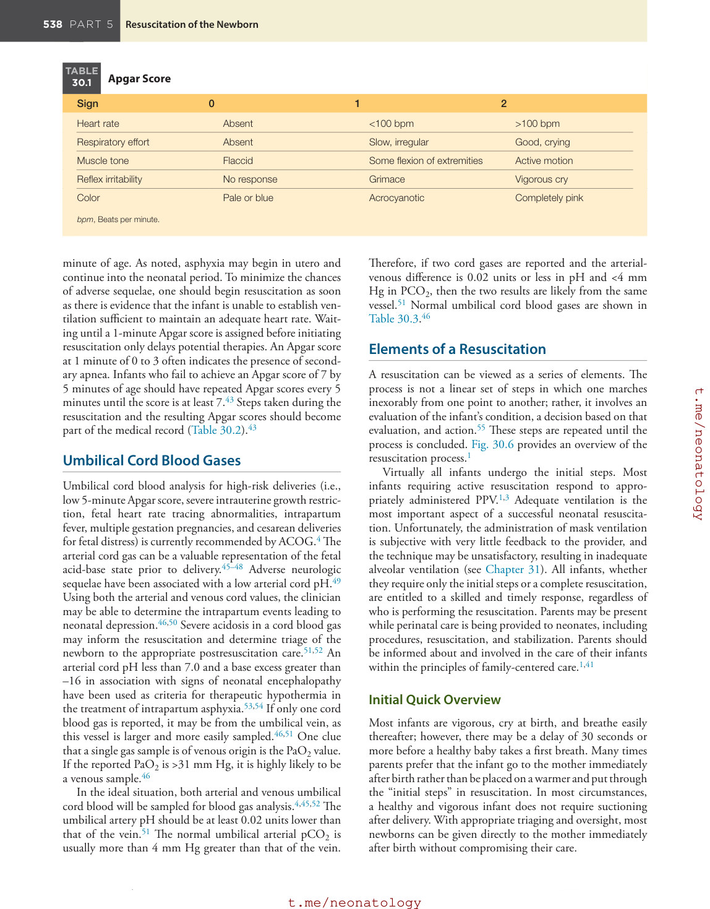

### Original source page 552

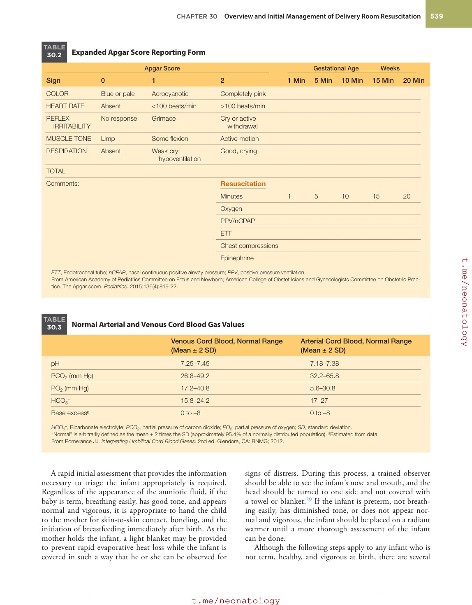

### Original source page 553

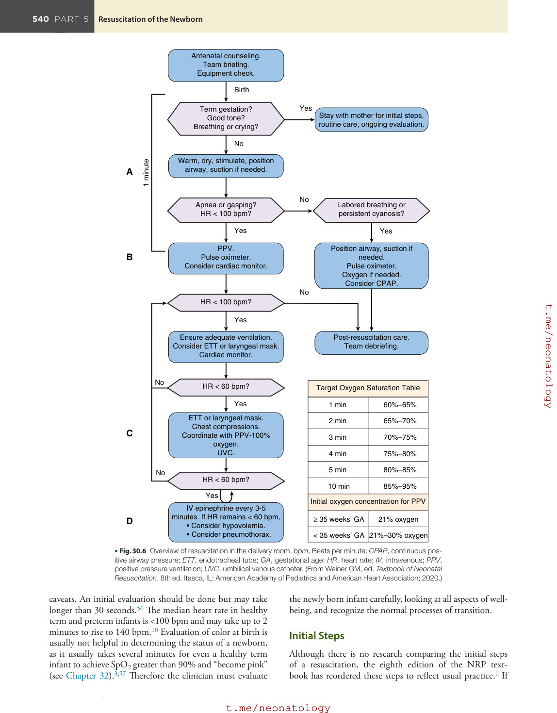

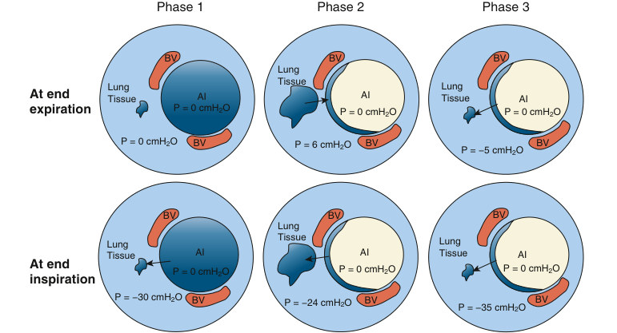

• Fig. 30.2 Three-phase process of respiratory transition in the newborn. Al, Alveolus; BV, blood vessel; P, pressure. (From Hooper SB, te Pas AB, Kitchen MJ. Respiratory transition in the newborn: a three-phase process. Arch Dis Child Fetal Neonatal Ed. 2016;101:F266–F271.)

PDF p. 546

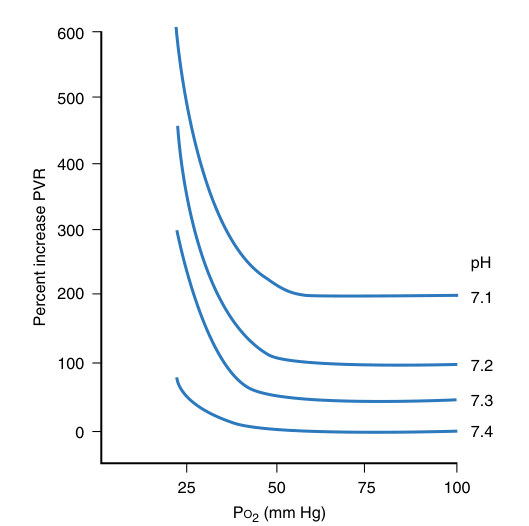

• Fig. 30.3 Pulmonary vascular resistance (PVR) in the calf. PO2, Partial pressure of oxygen. (Data from Rudolph AM, et al. Response of the pulmonary vasculature to hypoxia and H+ ion concentration changes. J Clin Invest. 1966;45:339.)

PDF p. 547

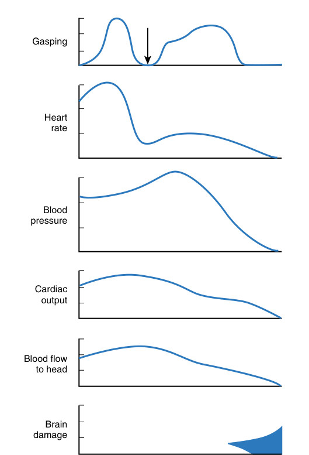

• Fig. 30.4 Schematic diagram of changes associated with asphyxia. Arrow indicates the point of primary apnea. (Modified from Dawes GS. Fetal and Neonatal Physiology. Chicago, IL: Year Book Medical; 1968:149. Phibbs RH. Delivery room management of the newborn. In: Avery G, ed. Neonatology. 3rd ed. Philadelphia, PA: Lippincott; 1987:215.)

PDF p. 548

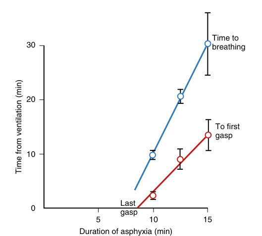

• Fig. 30.5 Time from ventilation to first gasp and to rhythmic breathing in newborn monkeys asphyxiated for 10, 12.5, and 15 minutes at 30 °C. (Data from Adamsons K, et al. Resuscitation by positive pressure ventilation and tris-hydroxymethylaminomethane of rhesus monkeys asphyxiated at birth. J Pediatr. 1964;65:807.)

PDF p. 549

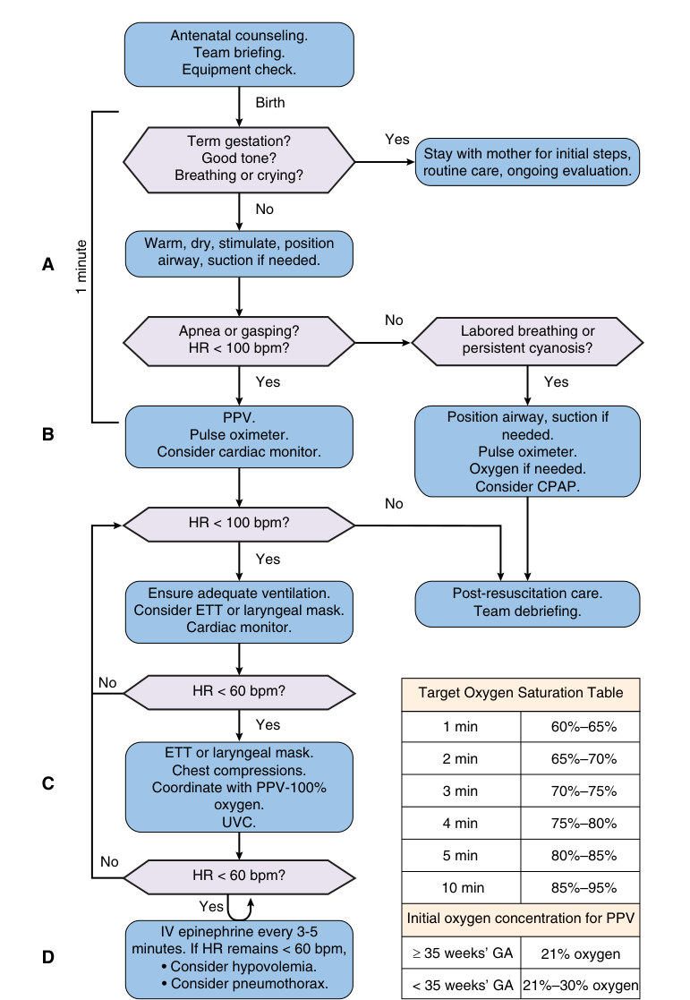

• Fig. 30.6 Overview of resuscitation in the delivery room. bpm, Beats per minute; CPAP, continuous positive airway pressure; ETT, endotracheal tube; GA, gestational age; HR, heart rate; IV, intravenous; PPV, positive pressure ventilation; UVC, umbilical venous catheter. (From Weiner GM, ed. Textbook of Neonatal Resuscitation, 8th ed. Itasca, IL: American Academy of Pediatrics and American Heart Association; 2020.)

PDF p. 553
