# 31. Role of Positive Pressure Ventilation in Neonatal Resuscitation
> [Source credits](../../SOURCE_CREDITS.md).

## Study pillars

### Functional residual capacity

Replacement of lung liquid by air and establishment of FRC. Lung aeration and FRC support gas exchange while pulmonary blood flow increases.

PDF p. 558

### Device without gas supply

Self-inflating bag. Self-inflating bags re-expand after compression and can operate without a gas supply.

PDF p. 561

### T-piece function

Occlude the T-piece opening. Occluding the opening delivers set peak pressure; leaving it open permits PEEP or CPAP.

PDF p. 562

### Mask seal

Mouth and nose without covering eyes or extending beyond the chin. Correct size and positioning over mouth and nose help limit leaks; eyes and chin should not be overlapped.

PDF p. 563

### End-expiratory support

Maintain end-expiratory volume and reduce distal airway collapse. PEEP helps maintain FRC and reduces end-expiratory collapse; physiologic rationale does not prove every clinical outcome.

PDF p. 568

## Full source extraction

# 31. Role of Positive Pressure Ventilation in Neonatal Resuscitation
> Source attribution: [Source credits](../../SOURCE_CREDITS.md).

## PDF page 558 | printed page 545

31 Role of Positive Pressure Ventilation in Neonatal Resuscitation

### LOUISE S. OWEN AND PETER G. DAVIS

Newborn babies who do not spontaneously breathe at birth require support to safely make the transition to extrauterine life. Over the past 20 years, guidelines for those providing care to these infants have been developed.1 However, the evidence available to guide initial respiratory support remains limited, reflecting the challenges associated with conducting research in the delivery room.

The crucial steps in the adaption to extrauterine life involve the transition from liquid-filled to air-filled lungs, and the establishment of functional residual capacity (FRC). These changes normally occur in the first minutes after birth and include an increase in pulmonary blood flow and the onset of regular respiration. Lung aeration and the development of an FRC facilitate gas exchange. Deferring cord clamping until these are achieved ensures a smooth transition to extrauterine life. If an infant does not quickly establish effective respiration, assistance is immediately required. Typically, this is a brief need for basic respiratory support only,2 unless there is abnormal anatomy or significant fetal acidemia or ineffective respiratory support is provided. Preterm infants have additional requirements at birth; although most preterm infants breathe and cry,3 very preterm infants are still likely to need support to effectively establish and maintain FRC. Preterm lungs are delicate, and lung injury can occur with just a few high-volume positive pressure inflations.4 This has led to a shift in emphasis in preterm stabilization toward a gentle, supportive approach to augment rather than override their efforts, and to minimize lung injury.

### Normal Transition and Initial Spontaneous Breathing

In healthy, newborn, term infants, normal transition is characterized by repeated, short, deep inspirations, each followed by a prolonged expiratory phase through a partially

closed glottis (crying). The inspiratory efforts generate large negative transpulmonary pressures, typically −50 cm H2O to −100 cm H2O, such that the high-resistance liquid filling the infant’s airways is driven distally, moving the air-liquid interface toward the distal airways.

Detailed imaging of rabbit lungs demonstrates that initial lung aeration depends on the generation of this transpulmonary pressure, with consequent stepwise increases in FRC over three to five repeated inspiratory efforts. More volume is inspired than expired with each breath, which overcomes small losses in FRC between inspiratory efforts as lung liquid moves back into the airways.5 The lung liquid then moves into the interstitial tissue and is cleared over the following hours.

Prolonged expiration through a partially closed glottis, with simultaneous abdominal muscle contraction pressurizes the chest, further pushing the air-liquid interface distally; this is called expiratory braking (Fig. 31.1). Flow recordings of the first breaths in preterm infants have shown that they use crying and expiratory braking to facilitate lung recruitment and development of FRC (Fig. 31.2).6 These observations have been supported by electrical impedance tomography (EIT) recordings, which demonstrate that newborn infants generate unique flow and volume patterns during this process (Fig. 31.3).7

### Delayed Transition and Need for Respiratory Support

Some infants do not breathe or have ineffective breathing at birth. Guidelines recommend initial steps of stimulating, drying, and wrapping the baby, followed by clamping the cord and then opening, and in some cases clearing, the airway.1 They stipulate that positive pressure support should be commenced by 60 seconds of age if the baby remains apneic, has irregular or gasping respirations, or has a heart rate less

545

## PDF page 559

12

3. Next inspiration 1. Inspiration

2.4 seconds

Flow (L/min)

0

2. Cry Cry

−12

50

1 second

Tidal volume (mL)

0

−50

• Fig. 31.1 Example of crying in a term infant at birth. There is a large inspiration (1), followed by crying, seen as high-frequency interruptions to the expiratory flow wave lasting more than 2 seconds (2), followed immediately by the next inspiration (3). The software resets the volume trace at end inspiration and end expiration. (Adapted from te Pas AB, Wong C, Kamlin CO, et al. Breathing patterns in preterm and term infants immediately after birth. Pediatr Res. 2009;65:352.)

than 100 beats per minute (bpm).1 However, following these recommendations may not always be straightforward. • Healthy babies may not take their first breath immedi-

ately after birth; there may be a delay of 30 seconds or longer. • In practice, initial evaluation often takes longer than 60

seconds,8 particularly in light of current recommendations for greater than 30 or 60 seconds of delayed cord clamping in preterm and term infants, respectively. • Clinical assessment of heart rate at birth, either by palpa-

tion or auscultation, is intermittent and inaccurate.9 • Assessment of a newborn’s color is subjective and unreli-

able.10 Although assessment of color is not used in the most recent resuscitation guidelines, it remains part of the Apgar assessment. These factors make assessment at birth, and the decision whether to intervene, more complex. If decisions are made too early, unnecessary interventions may be applied, whereas if decisions are delayed, there may be further cardiorespiratory compromise. It may be helpful to be aware that: • Accurate measurements of oxygen saturation (SpO2) and

heart rate can be obtained by about 90 seconds using pulse oximetry,11 and heart rate values may be seen within 1 minute using electrocardiography.12

20

1 second

Mask pressure (cm H2O)

1. Inspiration

4. Next inspiration

Flow (L/min)

2. Hold 3. Expiration

Volume in Volume out Tidal volume (mL)

Reset*

−5

• Fig. 31.2 Example of expiratory braking in a preterm infant on continuous positive airway pressure (CPAP), just after birth. There is a short, large inspiration (1) followed by a 2-second period without any flow (2), then a short, quick expiration (3), immediately followed by the next inspiration (4), without any post-expiratory pause. The software resets the volume at end expiration. (Adapted from te Pas AB, Davis PG, Kamlin CO, et al. Spontaneous breathing patterns of very preterm infants treated with continuous positive airway pressure at birth. Pediatr Res. 2008;64:281.)

• The key sign of an infant’s condition in the minutes after

birth, and response during stabilization, is the heart rate. • An infant who has good tone is unlikely to be severely

hypoxic.

### Basics of Positive Pressure Support

When an infant fails to establish spontaneous breathing after birth, the caregiver must commence positive pressure support. Typically, this is initially applied using a face mask and a pressure-generating device. If the infant is breathing irregularly or with difficulty, continuous positive airway pressure (CPAP) may aid inflation of the lungs and establishment of FRC. CPAP helps to establish and maintain end expiratory lung volume, reduce alveolar collapse, and decrease the work of breathing. It aids lung expansion and helps to conserve surfactant. CPAP also improves oxygenation, lung compliance, and ventilation-perfusion mismatch.13 However, an infant who has no respiratory effort, or who is bradycardic, will require positive pressure ventilation (PPV). Ideally, PPV should be given along with positive end-expiratory pressure (PEEP), although not all resuscitation devices are capable of delivering PEEP

## PDF page 560 | printed page 547

Fetal lung (fluid filled)

Inflation and aeration

Start of expiration

Insp Exp

Insp Exp

Insp Exp

∆VL

∆VL

∆VL

At

t

t

B

V

R

L

D

C

• Fig. 31.3 Demonstration of lung volume change during a single cry shortly after birth that resulted in an increase in end-expiratory functional residual capacity (FRC). Top row (A) graphical depiction of lung volume change. Middle row (B) representation of fluid shift and diaphragmatic contraction. Bottom row (C) lung images using electrical impedance tomography; lighter color represents increasing aeration. The figure shows a single breath divided into five phases. At the start of inflation, the airways and alveoli are fluid filled (column 1). A large inspiration with rapid contraction of the diaphragm generates aeration and moves fetal fluid from the proximal airways to the alveoli and lung interstitium (column 2). Expiration begins with rapid contraction of the diaphragm (column 3). The decrease in intrathoracic pressure during expiration allows some lung fluid to influx back into the alveoli. To counteract this, the infant slows diaphragmatic contraction (diaphragmatic braking) and partially closes the glottis, transiently re-pressurizing the lung (column 4). When expiration continues, it does so more slowly, against a partially closed glottis. This supports slower expiratory gas flow allowing some gas to remain in the lung, resulting in a greater end-expiratory FRC (column 5) than at the start of the inflation, with the lung more aerated for the start of the next inflation. (Reprinted with permission of the American Thoracic Society. Copyright © 2023 American Thoracic Society. All rights reserved. From Tingay DG, Farrell O, Thomson J, et al. Imaging the Respiratory Transition at Birth: Unraveling the Complexities of the First Breaths of Life. Am J Respir Crit Care Med. 2021;204(1):82–91. The American Journal of Respiratory and Critical Care Medicine is an official journal of the American Thoracic Society.)

(Table 31.1). Studies in intubated preterm animals have demonstrated that the addition of PEEP to PPV results in more rapid acquisition of FRC, improved oxygenation and lung compliance, and decreased lung injury.14 PEEP is recommended for the resuscitation of preterm infants,1 although clinical trials have failed to show a significant difference in the proportion of infants requiring intubation in the delivery room15 or in SpO2 at 5 minutes of age16 when PEEP was added. Use of PEEP during stabilization of preterm infants in the delivery room in major units in the United Kingdom and Canada was higher than 75% 10 years ago17,18 and is currently reported to be 90% to 99% in Australia, New Zealand,19 and Italy.20

Endotracheal intubation should be considered for infants who have an ongoing need for PPV and those who remain bradycardic and/or hypoxic despite adequate mask PPV. The management of preterm infants who require

Slowing of expiratory flow

End of expiration

Insp Exp

Insp Exp

∆VL

∆VL

Gain in FRC

t

t

∆Z

+

0

ongoing respiratory support has evolved over the past decade, moving away from immediate intubation and surfactant administration toward continuing CPAP support with either rescue intubation and surfactant treatment if certain criteria are met, or rescue surfactant administration with ongoing noninvasive respiratory support, without endotracheal intubation.21 Meta-analysis of trials that assessed immediate intubation versus initial CPAP found a reduction in the combined outcome of death or bronchopulmonary dysplasia (BPD) in the CPAP group, without any difference in pneumothorax risk.22 Both strategies may be appropriate; however, international guidelines currently recommend initial CPAP for spontaneously breathing preterm infants with respiratory distress, rather than routine intubation.23 As a gentler approach to early respiratory support has become more popular, more preterm infants are likely to be supported by CPAP in the delivery room.

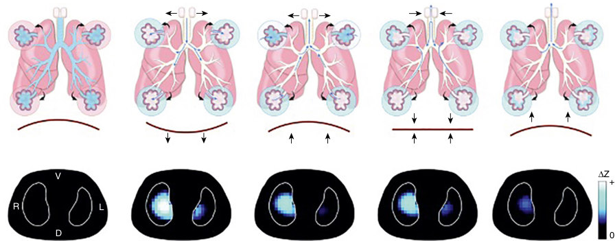

• Fig. 31.3 Demonstration of lung volume change during a single cry shortly after birth that resulted in an increase in end-expiratory functional residual capacity (FRC). Top row (A) graphical depiction of lung volume change. Middle row (B) representation of fluid shift and diaphragmatic contraction. Bottom row (C) lung images using electrical impedance tomography; lighter color represents increasing aeration. The figure shows a single breath divided into five phases. At the start of inflation, the airways and alveoli are fluid filled (column 1). A large inspiration with rapid contraction of the diaphragm generates aeration and moves fetal fluid from the proximal airways to the alveoli and lung interstitium (column 2). Expiration begins with rapid contraction of the diaphragm (column 3). The decrease in intrathoracic pressure during expiration allows some lung fluid to influx back into the alveoli. To counteract this, the infant slows diaphragmatic contraction (diaphragmatic braking) and partially closes the glottis, transiently re-pressurizing the lung (column 4). When expiration continues, it does so more slowly, against a partially closed glottis. This supports slower expiratory gas flow allowing some gas to remain in the lung, resulting in a greater end-expiratory FRC (column 5) than at the start of the inflation, with the lung more aerated for the start of the next inflation. (Reprinted with permission of the American Thoracic Society. Copyright © 2023 American Thoracic Society. All rights reserved. From Tingay DG, Farrell O, Thomson J, et al. Imaging the Respiratory Transition at Birth: Unraveling the Complexities of the First Breaths of Life. Am J Respir Crit Care Med. 2021;204(1):82–91. The American Journal of Respiratory and Critical Care Medicine is an official journal of the American Thoracic Society.)

## PDF page 561

TABLE

Comparison of Attributes Across the Range of Positive Pressure Generating Devices

31.1

Attribute Self-Inflating Bag Flow-Inflating Bag

✓ X

Operates

independent of gas supply

Delivers accurate,

X X

consistent peak pressure

Measures delivered

X X

peak pressure

Ability to deliver a

X May be possible

sustained inflation

Delivers PEEP May be possible May be possible

Delivers CPAP X X

✓ ✓

Delivered pressures

are independent of gas flow

Measures delivered

X X

tidal volume

✓, Yes; X, no; CPAP, continuous positive airway pressure; PEEP, positive end-expiratory pressure.

### Application of Noninvasive Positive Pressure Support

### How to Generate Positive Pressure

Various devices are available for generating positive pressure in the delivery room. The choice of device may be made based on availability of a gas supply, the skills of the resuscitator, the desire to deliver PEEP and CPAP, and local preferences. A 2010 European survey reported that centers typically use more than one device. At the time, selfinflating bags (SIBs) were most commonly used (85%),24 whereas a 2015 Japanese survey reported flow-inflating bags (FIBs) to be most commonly used (63%),25 and a 2019 Australian/New Zealand survey reported the T-piece to be most frequently used (92%).19

### Self-Inflating Bags

SIBs (Fig. 31.4A and B) re-expand after compression. These are the only devices that can be used without a gas supply; they have been shown to be an effective method for reducing mortality from birth asphyxia in resource-limited areas.26 Their use is an integral part of the international Helping Babies Breathe program.27

Several types and sizes of SIBs exist. The smallest sizes, approximately 240 mL, are most appropriate for newborns. The peak pressure delivered by an SIB depends on how hard and fast the bag is squeezed. SIBs usually incorporate a valve, which limits the maximum deliverable pressure. The valve can be manually overridden to deliver higher pressures

Device

T-Piece Ventilator

X X

✓ ✓

✓ ✓

✓ X

✓ ✓

✓ ✓

X ✓

X May be possible

but can be inadvertently overridden if the SIB is squeezed hard and fast. Pressures greater than 100 cm H2O have been reported, resulting in very high delivered volumes, greater than 20 mL/kg. The more fingers that are used to squeeze the bag, the more pressure is generated28; for most resuscitations, a gentle squeeze with a finger and thumb is all that is required. Many studies, including Bassani et al., have shown that it is difficult to deliver consistent peak pressures when using an SIB, particularly if an operator is inexperienced.29 Manometers attached to the SIB help to improve the consistency of peak pressure delivery,30 and newer “upright” designs of SIB have been shown to provide more consistent volume and pressure delivery,31 even with novice operators.32 If a PEEP valve is attached to an SIB, some PEEP can be delivered. However, it is difficult to achieve the desired PEEP, and delivered PEEP is dependent on the inflation rate.33 PEEP levels decay quickly between inflations,34 although newer valve models are better.35 Different brands of SIB have different capacities to deliver inflations of differing duration36; closing the pressure relief valve can increase the ability to lengthen inflation duration.37 It is not possible to deliver CPAP using an SIB; therefore it may not be the optimal device for stabilizing preterm infants.

### Flow-Inflating Bags

An FIB needs a continuous gas supply, something which may not always be readily available. The delivered pressure and tidal volume depend on how hard the bag is squeezed. A pressure-limiting valve can be attached to prevent high pressure being inadvertently delivered. PEEP can be delivered

## PDF page 562 | printed page 549

B

A

• Fig. 31.4 Neonatal resuscitation devices. (A) A 320-mL “upright” self-inflating bag. (B) A 240-mL selfinflating bag with an oxygen reservoir attached. (C) Fisher & Paykel Healthcare Neopuff Infant T-piece Resuscitator. (A, Laerdal Global Health, Stavanger, Norway. B, Laerdal Medical, Stavanger, Norway. C, Neopuff Infant Resuscitator; Fisher & Paykel, Auckland, New Zealand.)

with an FIB by manually controlling the rate of gas escaping from the back of the bag during expiration. This technique requires experience because it can inadvertently lead to dangerously high PEEP. It is difficult to consistently deliver both the desired PEEP and peak pressures with an FIB,38,39 and many operators find the FIB more difficult to use than the SIB. Prolonged inflations can be delivered by a skilled operator, but the pressure achieved is more variable than that delivered using a T-piece.40 It is very difficult to deliver CPAP with an FIB.

### T-Piece Devices

T-piece devices (see Fig. 31.4C) also require a continuous gas supply, again something that may not be available in resource-limited settings. The gas flow and an internal valve generate the set peak pressure and set PEEP. The peak pressure is achieved by occluding the hole in the top/side of the T-piece with a finger. When the hole is open, PEEP or CPAP is delivered. Inflation time depends on how long the hole is occluded.

T-pieces are easy to use and are preferred by both experienced and inexperienced operators.41 In manikin studies, the T-piece device delivers peak and PEEP pressures more accurately and consistently than other devices, resulting in more stable tidal volume delivery,42 even with inexperienced operators.29

Although face mask leak is common during PPV, leak has less detrimental effect on pressure and volume delivery when using a T-piece, compared with an SIB.43 Randomized studies of infants requiring PPV at birth have shown less need for intubation,44,45 less supplemental oxygen, and shorter duration of PPV when using a T-piece compared with an SIB,45 but no difference in proportion of infants with heart rate greater than 100 bpm at 2 minutes of life44 or other longer-term outcomes.

Occlusion of the hole on the T-piece allows delivery of a consistent, sustained inflation of any duration or pressure.40 Likewise, the T-piece is capable of delivering consistent CPAP42 and therefore may be the optimal device for

Cproviding respiratory support for preterm infants at birth.41 However, care needs to be taken if gas flow is increased during T-piece PPV, because increased flow increases the delivered pressures, particularly PEEP.46 In addition, as set PEEP is increased in some T-piece systems, the resistance and imposed work of breathing can increase.47 Recent work using a test lung suggests that during PPV, some T-pieces inadvertently deliver PEEP (and in some cases peak inspiratory pressure) levels well above those set by the clinician.48

### Other Options for Providing Positive Pressure

Positive pressure support can be delivered using a neonatal ventilator; this delivers accurate peak and PEEP pressures and may allow both synchronization of inflations with the infant’s own efforts, and tidal volume measurement.49 CPAP can also be continuously delivered through a ventilator. Other methods of providing noninvasive CPAP support in the delivery room have been used, although they do not include the capacity to deliver PPV. These methods include nasal high-flow support,50,51 and CPAP generated using a Benveniste gas-jet valve that uses the Venturi effect to entrain and pressurize gas. Delivered pressure is not monitored with either device, and there are no blow-off valves or alarms to avoid delivery of excessive pressure.

In the resource-limited setting, no devices may be available to generate positive pressure support, so mouth-tomask52 and mouth-to-tube53 ventilation may be used. Both are preferable to mouth-to-mouth resuscitation, but both still carry some risk of infection.

In summary, there are advantages and pitfalls with all these devices (see Table 31.1). A systematic review of the topic identified four eligible randomized controlled trials (RCTs). Resuscitation with a T-piece resuscitator was associated with a reduced duration of PPV and reduced risk of BPD than an SIB.54 However, the authors concluded that the evidence was of low certainty, and therefore a strong recommendation could not be made. With the possible exception of a ventilator, no device provides information

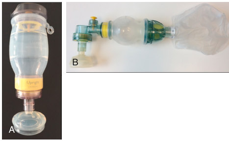

• Fig. 31.4 Neonatal resuscitation devices. (A) A 320-mL “upright” self-inflating bag. (B) A 240-mL selfinflating bag with an oxygen reservoir attached. (C) Fisher & Paykel Healthcare Neopuff Infant T-piece Resuscitator. (A, Laerdal Global Health, Stavanger, Norway. B, Laerdal Medical, Stavanger, Norway. C, Neopuff Infant Resuscitator; Fisher & Paykel, Auckland, New Zealand.)

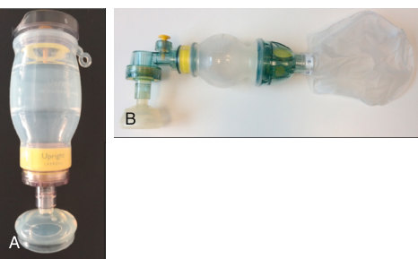

• Fig. 31.4 Neonatal resuscitation devices. (A) A 320-mL “upright” self-inflating bag. (B) A 240-mL selfinflating bag with an oxygen reservoir attached. (C) Fisher & Paykel Healthcare Neopuff Infant T-piece Resuscitator. (A, Laerdal Global Health, Stavanger, Norway. B, Laerdal Medical, Stavanger, Norway. C, Neopuff Infant Resuscitator; Fisher & Paykel, Auckland, New Zealand.)

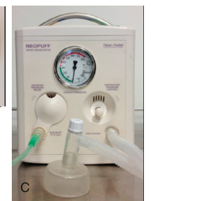

Unmatched source image; PDF page 562. Consult the original caption.

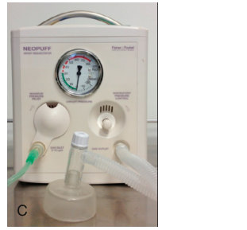

Unmatched source image; PDF page 562. Consult the original caption.

## PDF page 563

A B

• Fig. 31.5 Photographs demonstrating optimal mask placement technique, rolling the mask up the face from the chin. (A) Mask aligned with groove between chin and lower lip. (B) Mask extended up toward nose. (C) Mask placed over nasal bridge. (D) Correctly positioned mask held firmly over mouth and nose. (Photographs courtesy Fiona Wood and Colin Morley.)

A B

• Fig. 31.6 (A) Round Laerdal mask: the “two-point top hold” provides the best mask seal. (B) Fisher & Paykel round mask: the “OK rim hold” provides the best seal. (Photographs courtesy Fiona Wood and Colin Morley.)

on perhaps the most important parameter—the tidal volume being delivered. Novel resuscitation devices and simple delivery room monitors that accurately measure and display delivered tidal volume are currently being developed and tested but are not in general clinical use. Whichever pressure delivery device is used, providers need to be trained in how to set up, use, and troubleshoot the equipment.

### Choosing an Interface to Deliver Positive Pressure

Positive pressure may be delivered via face mask, nasal tube, nasal mask, nasal cannulae, laryngeal masks, and endotracheal tubes (ETTs).

### Face Masks

Use of a face mask requires a good seal between the mask and the infant’s face,55 but this is difficult to achieve and maintain; leak and pressure loss leading to reduced tidal volume delivery are common. Round, cushion-rimmed masks are used more commonly than anatomically shaped, triangular masks,56 and there is conflicting evidence as to whether leak is greater with one type or the other. Newer masks being tested may help to overcome this.57,58 However, it is clear that mask leak is common in the delivery room and is frequently large and troublesome.59

A face mask should seal around the mouth and nose but not cover the eyes or overlap the chin. Several makes and sizes of round face masks are available, but many commonly used brands may be too large for very preterm infants.60 Accurate positioning and mask hold are required to minimize mask leak. An accurate position can be obtained when the correctly sized mask is rolled upward onto the face from a finger placed on the chin tip

D C

(Fig. 31.5); this technique reduces leak.61 The optimal hold for a mask varies with the brand of mask being used; for example, two commonly used brands are shown to have similar leak in the delivery room.62 With the Laerdal mask (Laerdal Medical, Stavanger, Norway), equal pressure should be applied to either side of the top flat portion of the mask, with the thumb and index finger where the silicone is thickest around the stem, to obtain the best seal (Fig. 31.6A).61 The operator’s fingers should not encroach onto the “skirt” of the mask, because this distorts the rim, causing kinking and gas leakage.63 In contrast, when using the Fisher & Paykel round masks (Fisher & Paykel Healthcare, Auckland, New Zealand), the thumb and index finger should form a “C” shape (as in the “OK” hand gesture) placed around the top flat portion of the mask, applying an even distribution of pressure to the outer edge of the mask to provide the best seal (see Fig. 31.6B).61 Initial education and regular retraining are important for the maintenance of this important skill.61

Typically, operators using a T-piece and face mask with a neonatal manikin have 40% to 60% mask leak, although this can be reduced with training61 and by using a two-handed mask hold technique.64 Despite large and variable mask leaks, the desired pressure may still be achieved.43 Unfortunately, neither the delivered pressure nor the amount of chest rise seen correlates well with the delivered tidal volume.65 Variable leaks may result in some tidal volumes that are too low and others that are dangerously large.59,66 Concern over large face mask leak may lead the provider to apply excessive pressure to the mask67 and therefore to the face and head of the infant.68 This pressure may obstruct the airway69 by distorting the nose and altering the position of the mouth and chin; obstruction occurs in 25% to 75% of preterm mask resuscitations.69,70 Although inefficient mask ventilation may not achieve adequate pressure and tidal volume, there may still be some benefit because of stimulation of Head’s paradoxical reflex. This reflex generates a large inspiratory effort in response to a small inflation. The response may assist with the first effective inspiratory volume during newborn transition, even if mask ventilation fails to adequately inflate the lungs.

### Single Nasal Tube and Binasal Prongs

Alternative interfaces include a single nasal tube (Fig. 31.7A), binasal prongs, nasal masks, and nasal cannulae. To ensure minimal leak when the nasal route is used, it may be necessary to close the mouth, and when a single nasal tube

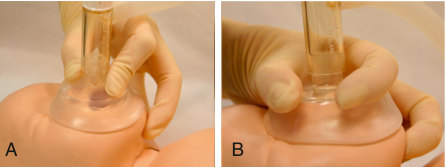

• Fig. 31.6 (A) Round Laerdal mask: the “two-point top hold” provides the best mask seal. (B) Fisher & Paykel round mask: the “OK rim hold” provides the best seal. (Photographs courtesy Fiona Wood and Colin Morley.)

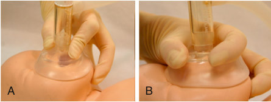

• Fig. 31.6 (A) Round Laerdal mask: the “two-point top hold” provides the best mask seal. (B) Fisher & Paykel round mask: the “OK rim hold” provides the best seal. (Photographs courtesy Fiona Wood and Colin Morley.)

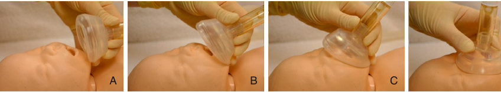

• Fig. 31.5 Photographs demonstrating optimal mask placement technique, rolling the mask up the face from the chin. (A) Mask aligned with groove between chin and lower lip. (B) Mask extended up toward nose. (C) Mask placed over nasal bridge. (D) Correctly positioned mask held firmly over mouth and nose. (Photographs courtesy Fiona Wood and Colin Morley.)

• Fig. 31.5 Photographs demonstrating optimal mask placement technique, rolling the mask up the face from the chin. (A) Mask aligned with groove between chin and lower lip. (B) Mask extended up toward nose. (C) Mask placed over nasal bridge. (D) Correctly positioned mask held firmly over mouth and nose. (Photographs courtesy Fiona Wood and Colin Morley.)

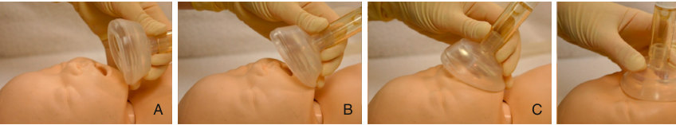

• Fig. 31.5 Photographs demonstrating optimal mask placement technique, rolling the mask up the face from the chin. (A) Mask aligned with groove between chin and lower lip. (B) Mask extended up toward nose. (C) Mask placed over nasal bridge. (D) Correctly positioned mask held firmly over mouth and nose. (Photographs courtesy Fiona Wood and Colin Morley.)

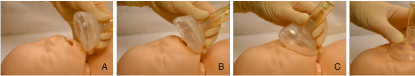

• Fig. 31.5 Photographs demonstrating optimal mask placement technique, rolling the mask up the face from the chin. (A) Mask aligned with groove between chin and lower lip. (B) Mask extended up toward nose. (C) Mask placed over nasal bridge. (D) Correctly positioned mask held firmly over mouth and nose. (Photographs courtesy Fiona Wood and Colin Morley.)

## PDF page 564 | printed page 551

A

B

C

• Fig. 31.7 (A) Example of a single nasal tube interface in a neonatal manikin using a cut down endotracheal tube and a T-piece. (B) An inflatable, laryngeal mask airway showing the rim inflated. (Image courtesy Teleflex Incorporated. © 2018 Teleflex Incorporated. All rights reserved.) (C) An i-gel laryngeal mask airway (LMA). (Intersurgical, Wokingham, Berkshire, United Kingdom.)

is used, it may also be necessary to occlude the contralateral nostril.

An RCT comparing a single nasal tube with a round cushion-rimmed face mask showed no difference in measures of effectiveness of resuscitation of preterm infants, including intubation in the delivery room, or in short- or long-term respiratory outcomes.71 The authors subsequently reported more leak and obstruction with the nasal prong and less overall tidal volume delivery.72 Therefore a nasal tube may be a useful alternative to a face mask, but there is no evidence for its superiority. Retrospective reports exist of delivery room CPAP application via nasal cannulae73 (e.g., with RAM cannulae); however, higher pressures are required to achieve lung inflation with this device,74 and no randomized data regarding efficacy exist. Nasal cannulae have also been used to deliver high-flow support to stabilize preterm infants in the delivery room; one randomized trial in infants 28 to 34 weeks’ gestation did not demonstrate any short-term differences between high flow and CPAP.50

### Assessing the Effectiveness of Noninvasive Positive Pressure Ventilation

It is important to be able to accurately assess whether the support being given is effective. However, clinical assessments of color change10 and heart rate9 are imprecise and

inaccurate. Pulse oximeters provide rapid, continuous, accurate displays of heart rate and oxygenation and are now recommended for use in babies requiring assistance in the delivery room. In addition, clinicians are poor at assessing mask leak, chest rise, and delivered tidal volume.65 A respiratory function monitor can assist with assessment of leak and adequate tidal volume delivery.71,75 O’Currain et al. conducted an RCT which demonstrated that the use of a respiratory function monitor during newborn resuscitation training improved tidal volume delivery and reduced leak.76 A systematic review identified three RCTs evaluating the use of respiratory function monitors in the delivery room.77 Pooled analysis showed no effect on mortality but a significant reduction in rates of intraventricular hemorrhage in infants managed with a respiratory function monitor.

A colorimetric carbon dioxide (CO2) detector or quantitative end-tidal carbon dioxide monitor may help to determine whether there is gas exchange occurring during mask ventilation,78 but neither has been shown to improve short-term clinical outcomes.79 Most recently, cerebral oxygenation using near-infrared spectroscopy has been used in the delivery room to give additional information on the effectiveness of resuscitation.80 Normal values have been ascertained,81 but targeting cerebral oxygenation levels has not been shown to alter short-term outcomes in preterm infants.82

### Laryngeal Mask Airway

Laryngeal mask airways are supraglottic airways (SGAs) commonly used during anesthesia. SGAs consist of a soft elliptical mask with an inflatable, or gel rim, and a flexible airway tube (see Fig. 31.7B and C). The mask is inserted into the infant’s mouth using the index finger, such that the mask covers the laryngeal opening and the rim conforms to the contours of the hypopharynx, occluding the esophagus. The inflatable rim can be expanded via a small balloon. The airway tube can be attached to any resuscitation device. Various sizes and reusable and disposable versions are commercially available. An SGA may be helpful for infants with congenital anomalies involving the mouth, lip, palate, or other upper airway anomalies where endotracheal intubation is difficult. It may also be a useful technique where resources, training, and clinical experience are lacking. Almost all SGA insertions are successful at the first attempt and within 10 seconds.83 Several studies have assessed the effectiveness of PPV delivered by SGA in term and nearterm infants, and international guidelines now recommend that an SGA be used in these infants if mask ventilation is unsuccessful and endotracheal intubation is not possible.23 A large RCT conducted in Uganda enrolled infants requiring PPV and compared the use of SGA with face mask.84 There were no important differences in rates of mortality or neonatal intensive care unit (NICU) admission between the groups. Studies have assessed SGA use in more immature preterm infants for the delivery of surfactant, with promising results.85,86 However, there are currently no SGA devices small enough for infants less than 1500 g.

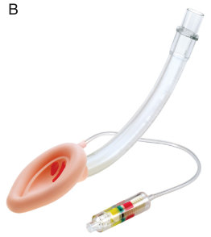

Unmatched source image; PDF page 564. Consult the original caption.

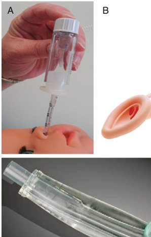

• Fig. 31.7 (A) Example of a single nasal tube interface in a neonatal manikin using a cut down endotracheal tube and a T-piece. (B) An inflatable, laryngeal mask airway showing the rim inflated. (Image courtesy Teleflex Incorporated. © 2018 Teleflex Incorporated. All rights reserved.) (C) An i-gel laryngeal mask airway (LMA). (Intersurgical, Wokingham, Berkshire, United Kingdom.)

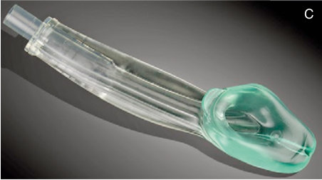

• Fig. 31.7 (A) Example of a single nasal tube interface in a neonatal manikin using a cut down endotracheal tube and a T-piece. (B) An inflatable, laryngeal mask airway showing the rim inflated. (Image courtesy Teleflex Incorporated. © 2018 Teleflex Incorporated. All rights reserved.) (C) An i-gel laryngeal mask airway (LMA). (Intersurgical, Wokingham, Berkshire, United Kingdom.)

## PDF page 565

### Endotracheal Tube

There are no absolute criteria for tracheal intubation after birth. Indications vary depending on gestational age, degree of respiratory effort, response to noninvasive ventilation, and the skill and experience of the resuscitator. International guidelines suggest intubation is considered at several stages: • if the heart rate is less than 100 bpm after 30 seconds of

effective PPV,87 • if noninvasive ventilation does not increase the heart

rate, or • if the infant continues to be apneic despite adequate

ventilation. It is also recommended if mask ventilation is prolonged or ineffective or if there are congenital anomalies affecting transition. Infants without a detectable heartbeat and who are very hypotonic should be intubated and ventilated as soon as possible. For infants less than 29 weeks who are spontaneously breathing and who have respiratory distress requiring respiratory support in the delivery room, international guidelines now suggest initial use of CPAP in preference to routine intubation.23

Neonatal intubation is a difficult skill to acquire and maintain. Fewer infants are now intubated, and skills are declining. Although experienced operators are successful more than 85% of the time, junior trainees are successful in less than half of attempts.88 Success can be increased by techniques such as use of videolaryngoscopy,89,90 but less experienced operators still take longer to perform intubations. Successful intubations frequently take longer than the recommended 30 seconds, and infants often become bradycardic and deteriorate during intubation attempts.88

Nasal high-flow therapy has been used in older children and adults to facilitate safe intubation using a technique known as transnasal humidified rapid insufflation ventilatory exchange (THRIVE).91 When applied to neonates in both the delivery room and NICU, this technique improved the likelihood of successful intubation on the first attempt without physiologic instability.92 By providing more time before the infant’s saturations decrease to unacceptable levels, this technique appears to be most beneficial when junior trainees are attempting intubation.

Neonatal ETTs are uncuffed and usually straight. Some providers use a stylet inside the ETT, although there is no evidence that this reduces the duration or improves the rate of successful intubation.93

### Intubation Procedure

Prior to endotracheal intubation, all necessary equipment should be assembled, a team and team leader identified, their roles delineated, and an escalation plan made for the possibility of intubation not initially being successful. The suggested items are outlined in Box 31.1. The infant should be placed supine in a “sniffing position” (Fig. 31.8A), avoiding both flexion and hyperextension of the neck, which make the glottis hard to visualize. The tip of the laryngoscope blade should be advanced over the tongue to the vallecula, or over the top of the epiglottis, and elevated gently

• BOX 31.1 Equipment Required for Endotracheal

Intubation

1. Shoulder roll to facilitate optimal head position 2. Pressure delivery device (T-piece, self-inflating bag, or

flow-inflating bag; manometer and positive end-expiratory pressure [PEEP] valves optional) 3. Neonatal face masks—preterm and term infant sizes 4. Laryngoscope with blades (straight blade, Miller size

number 00, 0 for preterm, and number 1 for term infant) 5. Straight endotracheal tubes (2.5-, 3.0-, 3.5-, and 4.0-mm

internal diameter); with a standard curve, radio-opaque, and with marks to indicate depth of insertion 6. Endotracheal tube stylet (optional) 7. Magill neonatal forceps (if nasal intubation) 8. Sterile scissors 9. Neonatal stethoscope 10. Exhaled CO2 detector 11. Air and oxygen supply; oxygen flow meter with air blender 12. Pulse oximeter for measuring heart rate and oxygen saturation 13. Suction apparatus and suction catheters (5-, 6-, 8-, and

10-French sizes) 14. Equipment to secure endotracheal tube; appropriate

adhesive tape to attach tube to face

to reveal the vocal cords (see Fig. 31.8B). The laryngoscope should support the tongue toward the left side of the mouth to have adequate space to see the larynx and pass the ETT. If the laryngoscope blade is advanced too far, the tip will be in the lower pharynx and the larynx will not be visible. Gentle cricoid pressure may be helpful in bringing the larynx into view.

The ETT should be inserted to the level of the tube marker, so that it is visible just above the larynx (Fig. 31.9). The ETT should be secured with the appropriate centimeter side mark located at the upper lip (Table 31.2). This level is estimated as 6.0 cm plus the infant’s weight in kilograms. If a stylet is used to assist with ETT insertion, care must be taken not to allow the stylet to protrude beyond the tip of the ETT and damage the trachea. When removing a stylet from a correctly placed ETT, care must be taken not to dislodge the tube. If a nasal intubation is being performed, McGill forceps may be required to advance the ETT through the vocal cords.

The position of the ETT in the trachea must always be verified. The best clinical indicator of correct placement is a prompt increase in heart rate. Correct positioning can be verified by visualizing the tube passing through the vocal cords, listening to both axillae with a stethoscope, observing misting inside the ETT during expiration, and observing chest movements during inflations. However, none of these methods are absolute confirmation. Use of an end-tidal CO2 detector on the ETT connector is currently recommended to verify correct tube placement quickly.87 Colorimetric CO2 detectors can rapidly demonstrate CO2 in the expired ETT gas more quickly than changes in heart rate and oxygen saturations are seen.94 However, they can give a false-negative result when very

## PDF page 566 | printed page 553

Correct — Line of sight clear (tongue will be lifted by laryngoscope blade)

Incorrect — Line of sight obstructed

Incorrect — Line of sight

obstructed

A

• Fig. 31.8 (A) Effects of flexion and hyperextension on ability to visualize the glottis. (B) Correct view of glottis in preparation for intubation. (Adapted from Kattwinkel J, ed. Textbook of Neonatal Resuscitation. 5th ed. Copyright American Heart Association/American Academy of Pediatrics, 2006. Used with permission of the American Academy of Pediatrics.)

A B

markers

• Fig. 31.9 (A) Size 3.5 endotracheal tube. (B) Size 2.5 endotracheal tube. (A, ShileyTM Endotracheal Tube, © 2023 Medtronic. All rights reserved. Used with the permission of Medtronic. B, Portex endotracheal tube, Smiths Medical, Minneapolis, USA.)

Tongue

Vallecula

Epiglottis

Vallecula

Epiglottis

Glottis

Vocal cords

Esophagus

Blow tidal volumes are being delivered95 and false-positive results when contaminated by adrenaline or surfactant.96 Respiratory function monitors can provide a quicker indication of correct ETT placement than clinical assessment and expired CO2 detectors.97 When insertion is verified, correct depth of ETT insertion should be assessed by checking the measurement on the tube at the lips, by assessing symmetric chest movement, and with chest radiography.

### Applying Positive Pressure Support

When delivering PPV, the clinician aims to provide effective ventilation for adequate gas exchange, without causing lung injury. It has been well documented that lung injury can be caused by lung overdistention (volutrauma),98 excessive pressure (barotrauma), and repeated alveolar collapse and re-expansion (atelectrauma). Studies in preterm animals have shown that lung injury can occur within the first few positive pressure inflations, resulting in an inflammatory response within a few minutes.99 Therefore knowledge about the causes and prevention of lung injury during ventilation of preterm infants should be applied from birth. Actions to prevent lung injury include facilitating formation and maintenance of FRC, avoiding large tidal volumes that can easily and inadvertently be delivered with currently available resuscitation equipment,66 and avoiding repeated lung collapse and re-expansion.

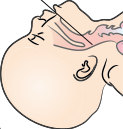

• Fig. 31.9 (A) Size 3.5 endotracheal tube. (B) Size 2.5 endotracheal tube. (A, ShileyTM Endotracheal Tube, © 2023 Medtronic. All rights reserved. Used with the permission of Medtronic. B, Portex endotracheal tube, Smiths Medical, Minneapolis, USA.)

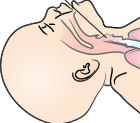

• Fig. 31.9 (A) Size 3.5 endotracheal tube. (B) Size 2.5 endotracheal tube. (A, ShileyTM Endotracheal Tube, © 2023 Medtronic. All rights reserved. Used with the permission of Medtronic. B, Portex endotracheal tube, Smiths Medical, Minneapolis, USA.)

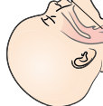

• Fig. 31.9 (A) Size 3.5 endotracheal tube. (B) Size 2.5 endotracheal tube. (A, ShileyTM Endotracheal Tube, © 2023 Medtronic. All rights reserved. Used with the permission of Medtronic. B, Portex endotracheal tube, Smiths Medical, Minneapolis, USA.)

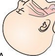

• Fig. 31.9 (A) Size 3.5 endotracheal tube. (B) Size 2.5 endotracheal tube. (A, ShileyTM Endotracheal Tube, © 2023 Medtronic. All rights reserved. Used with the permission of Medtronic. B, Portex endotracheal tube, Smiths Medical, Minneapolis, USA.)

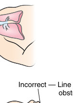

Unmatched source image; PDF page 566. Consult the original caption.

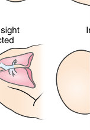

Unmatched source image; PDF page 566. Consult the original caption.

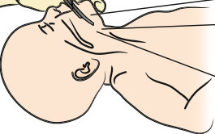

Unmatched source image; PDF page 566. Consult the original caption.

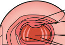

Unmatched source image; PDF page 566. Consult the original caption.

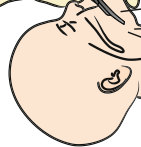

Unmatched source image; PDF page 566. Consult the original caption.

Unmatched source image; PDF page 566. Consult the original caption.

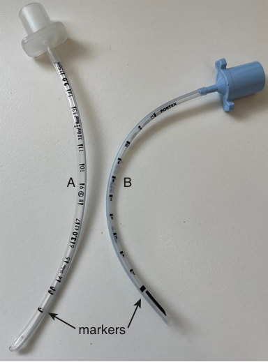

• Fig. 31.9 (A) Size 3.5 endotracheal tube. (B) Size 2.5 endotracheal tube. (A, ShileyTM Endotracheal Tube, © 2023 Medtronic. All rights reserved. Used with the permission of Medtronic. B, Portex endotracheal tube, Smiths Medical, Minneapolis, USA.)

## PDF page 567

TABLE

Guidelines for Endotracheal Tube Sizes and Depth of Insertion

31.2

Endotracheal Tube Size (mm ID)

Orotracheal Tube Length (cm) From Upper Lip

Weight (g) Gestation (wk)

500–750 <26 2.5 6.5

750–1000 <28 2.5 6.5–7.0

1000–2000 28–34 3.0 7.0–8.0

2000–3000 34–38 3.0/3.5 8.0–9.0

>3000 >38 3.5/4.0 >9.0

Depth can be calculated as weight (in kg) +6 cm for oral intubation, or weight (in kg) +7 cm for nasal intubation.

Very premature infants are especially vulnerable to the interventions applied in the first minutes after birth.100 Therefore, as most preterm infants spontaneously breathe soon after birth, they may manage with CPAP alone, which is likely to cause less lung damage than routinely intubating them and applying PPV.101 For infants who do not breathe or who require more than CPAP support, a gentle ventilatory strategy needs to be applied.

### The First Breaths

The long initial inspirations, followed by prolonged expirations through a partially closed glottis that are seen in spontaneously breathing infants at birth, led researchers to question whether longer initial positive pressure inflations would be beneficial in infants without adequate spontaneous breathing. In anesthetized, intubated, preterm animal models, sustained inflation at modest pressure leads to rapid lung aeration without overexpansion, immediate development of appropriate FRC, and uniformly aerated lungs102 without serious side effects.103 Alternative strategies such as serial increases in applied PEEP may also have similar benefits.104

The optimal pressure and duration of a sustained inflation in preterm infants are unknown, and the effects of variable face mask leak, intermittent spontaneous breathing, and potential closure of the glottis make the standardization of applying a sustained inflation difficult. The Sustained Aeration for Infant Lungs (SAIL) trial did not reduce the combined primary outcome of death or BPD. Rates of early mortality were higher in the sustained inflation arm, leading to the early closure of the trial.105 Systematic review of the topic identified nine studies including 1406 infants. Pooled analysis was consistent with the findings of the SAIL trial, with no effect on death or BPD and higher early mortality in infants managed with sustained inflation.106 The International Liaison Committee on Resuscitation (ILCOR) currently suggests against the routine use of sustained inflation and to limit its use to randomized clinical trials.1

Nasotracheal Tube Length (cm) From Nasal Flare

7.5

7.5–8.0

8.0–9.0

9.0–10.0

>10.0

### Peak Inflation Pressures and Tidal Volumes

Tidal volumes are not usually measured in the delivery room; therefore clinicians must use peak pressure and clinical judgment of chest rise as a proxy for volume delivery. Neither of these provides reliable guidance regarding volume delivery.59,107 However, they remain the most practical methods of targeting delivered volume given the equipment currently available. The actual delivered volume depends on multiple factors—the infant’s spontaneous breathing effort, lung compliance, mask leak, obstruction at the mouth and nose, and the resuscitation device used. This means that tidal volumes delivered during PPV are variable and usually much higher than those generated during spontaneous breathing.108 Animal studies have shown that high tidal volumes given soon after birth result in reduced oxygenation, increased need for ventilatory support, and instability of cerebral blood flow that increases the risk of brain injury.109 The ideal target volumes for ventilation of term and preterm infants remain uncertain. Avoidance of tidal volumes greater than 8 mL/kg appears reasonable.110 Development and testing of inexpensive, reliable, and accurate techniques to measure and display tidal volume is an important priority in neonatal resuscitation.

In the absence of tidal volume monitoring devices, clinicians rely on set peak pressure and clinical signs to deliver safe and effective ventilation. Typically, pressures in the range of 20 to 30 cm H2O are suggested as initial settings87,111 and have been shown to produce reasonable tidal volumes. Infants who make no respiratory effort may require higher pressures initially. As the lungs aerate and become more compliant, pressure may need to be reduced.112 A rising heart rate is a good sign that effective ventilation is being delivered.87

### Positive End-Expiratory Pressure

The lungs of preterm infants are immature, surfactant deficient, partially liquid filled, and prone to collapse at end expiration. PEEP provides many beneficial effects (Box 31.2).

## PDF page 568 | printed page 555

• BOX 31.2 Beneficial Effects of Positive End-

Expiratory Pressure

• Splinting the airways open • Facilitating lung fluid clearance • Increased lung expansion and promoting the formation

and retention of a residual lung volume at end expiration, preventing alveolar collapse • Conserving surfactant • Reducing ventilation-perfusion mismatch and right-to-left

shunting • Improving oxygenation • Improving lung compliance • Reducing airway resistance by dilating the larynx and

airways • Reducing upper airway occlusion by decreasing upper

airway resistance and increasing the pharyngeal crosssectional area • Reducing the work of breathing • Stabilizing the respiratory pattern • Stabilizing the chest wall and counteracting paradoxical

movements

PEEP protects against lung injury and distal airway collapse at end expiration, while improving lung compliance, oxygenation, and accumulation of FRC. Whether or not an initial sustained inflation is given, animal studies have shown that without PEEP, no FRC is established14 or maintained.102 After an inflation without PEEP, lung volume is lost, airways collapse, and the infant becomes at risk of atelectrauma during subsequent inflations.113

There are few randomized studies in premature infants examining the use of PEEP at birth. Those that have been published failed to show a significant benefit over PPV without PEEP in terms of short-term respiratory outcomes.15,16

Key Points

• Most full-term and late preterm infants breathe at birth

and need no assistance to transition to extrauterine life. • Infants who do not establish regular respiration require

prompt respiratory support. • Effective mask ventilation should result in a rapid

increase in heart rate.

### References

1. Wyckoff MH, Wyllie J, Aziz K, et al. Neonatal life support 2020

international consensus on cardiopulmonary resuscitation and emergency cardiovascular care science with treatment recommendations. Resuscitation. 2020;156:A156–A187. 2. Morley CJ, Davis PG. Advances in neonatal resuscitation:

supporting transition. Arch Dis Child Fetal Neonatal Ed. 2008;93(5):F334–F336. 3. O’Donnell CP, Kamlin CO, Davis PG, Morley CJ. Crying and

breathing by extremely preterm infants immediately after birth. J Pediatr. 2010;156(5):846–847. 4. Schmolzer GM, Te Pas AB, Davis PG, Morley CJ. Reducing

lung injury during neonatal resuscitation of preterm infants. J Pediatr. 2008;153(6):741–745.

International guidelines suggest that PEEP is likely to be beneficial during positive pressure support of preterm infants and that if it is available, it should be used.87

It is not possible to predict a single optimal PEEP level for all infants; however, infants with the highest oxygen requirements usually have the smallest FRC and may benefit from higher PEEP. Guidelines currently suggest the use of PEEP of 5 cm H2O in the delivery room.1 Trials of different levels of PEEP during resuscitation of human infants at birth are underway.

### Inflation Rate and Duration

There is little evidence on which to base the optimal inflation rate. Rates of 40 to 60 per minute are recommended and match the typical respiratory rates of healthy newborns. In an infant who has some respiratory effort, it is likely that manual inflations will sometimes be asynchronous with spontaneous breaths. This may lead to ineffective resuscitation, inadvertent high pressures, and increased risk of injury such as pneumothorax.114 The duration of each inflation may, following the initial inflations, be best timed to reflect spontaneous inspiratory times of newborn infants to last approximately 0.3 seconds.

### Gas Flow

It is rarely necessary to change the gas flow to greater than the standard 8 to 10 L/min during a resuscitation. Alteration of gas flow may not affect pressure or volume delivery when using an SIB or FIB. Increasing gas flow to greater than recommended rates during T-piece ventilation increases leak; it also increases the PEEP without increasing the peak pressure, resulting in lower delivered tidal volumes.46,115

• Excessive tidal volume may cause lung damage, especially

in preterm infants. • Endotracheal intubation should be considered if resusci-

tation is prolonged or the infant remains bradycardic.

5. Hooper SB, Te Pas AB, Kitchen MJ. Respiratory transition in

the newborn: a three-phase process. Arch Dis Child Fetal Neonatal Ed. 2016;101(3):F266–F271. 6. te Pas AB, Davis PG, Kamlin CO, et al. Spontaneous breathing

patterns of very preterm infants treated with continuous positive airway pressure at birth. Pediatr Res. 2008;64(3):281–285. 7. Tingay DG, Farrell O, Thomson J, et al. Imaging the respira-

tory transition at birth: unraveling the complexities of the first breaths of life. Am J Respir Crit Care Med. 2021;204(1):82–91. 8. Schilleman K, Siew ML, Lopriore E, et al. Auditing resuscita-

tion of preterm infants at birth by recording video and physiological parameters. Resuscitation. 2012;83(9):1135–1139. 9. Kamlin CO, O’Donnell CP, Everest NJ, et al. Accuracy of clini-

cal assessment of infant heart rate in the delivery room. Resuscitation. 2006;71(3):319–321.

## PDF page 569

10. O’Donnell CP, Kamlin CO, Davis PG, et al. Clinical assess-

ment of infant colour at delivery. Arch Dis Child Fetal Neonatal Ed. 2007;92(6):F465–F467. 11. Dawson JA, Kamlin COF, Vento PG, et al. Defining the ‘nor-

mal’ range for oxygen saturations in newly born infants. In: Pediatric Academic Society. vol. 3860:186. Baltimore, MD; 2009. 12. Katheria A, Rich W, Finer N. Electrocardiogram provides

a continuous heart rate faster than oximetry during neonatal resuscitation. Pediatrics. 2012;130(5):e1177–e1181. 13. Aly H, Mohamed MA, Wung JT. Surfactant and continuous

positive airway pressure for the prevention of chronic lung disease: History, reality, and new challenges. Semin Fetal Neonatal Med. 2017. Oct;22(5):348–353. 14. Siew ML, Te Pas AB, Wallace MJ, et al. Positive end-expiratory

pressure enhances development of a functional residual capacity in preterm rabbits ventilated from birth. J Appl Physiol. 2009;106(5):1487–1493. 15. Finer NN, Carlo WA, Duara S, et al. Delivery room continu-

ous positive airway pressure/positive end-expiratory pressure in extremely low birth weight infants: a feasibility trial. Pediatrics. 2004;114(3):651–657. 16. Dawson JA, Kamlin COF, Te Pas AB, et al. Neopuff Compared

with Laerdel Self-Inflating Bag for the First Five Minutes of Resuscitation in Infants < 29 Weeks Gestation at Birth: A Randomized Controlled Trial. In: Pediatric Academic Society. Baltimore, MD; 2009: 3212.3217. 17. El-Naggar W, McNamara PJ. Delivery room resuscitation of

preterm infants in Canada: current practice and views of neonatologists at level III centers. J Perinatol. 2012;32(7):491–497. 18. Singh Y, Oddie S. Marked variation in delivery room manage-

ment in very preterm infants. Resuscitation. 2013;84(11):1558– 1561. 19. Hodgson KA, Owen LS, Lui K, Shah V. Neonatal golden hour:

a survey of Australian and New Zealand Neonatal Network units’ early stabilisation practices for very preterm infants. J Paediatr Child Health. 2021;57(7):990–997. 20. Petrillo F, Gizzi C, Maffei G, et al. Neonatal Pneumology

Study Group Italian Society of N: neonatal respiratory support strategies for the management of extremely low gestational age infants: an Italian survey. Ital J Pediatr. 2019;45(1):44. 21. Dargaville PA, Carlin JB, Davis PG, Investigators O-

AT. Minimally invasive surfactant therapy vs sham treatment and death or bronchopulmonary dysplasia in preterm infants with respiratory distress syndrome-reply. JAMA. 2022;327(16):1614–1615. 22. Schmolzer GM, Kumar M, Pichler G, et al. Non-invasive versus

invasive respiratory support in preterm infants at birth: systematic review and meta-analysis. BMJ. 2013;347:f5980. 23. Perlman JM, Wyllie J, Kattwinkel J, et al. Part 7: neonatal

resuscitation: 2015 international consensus on cardiopulmonary resuscitation and emergency cardiovascular care science with treatment recommendations (Reprint). Pediatrics. 2015;136(suppl 2):S120–S166. 24. Roehr CC, Grobe S, Rudiger M, et al. Delivery room man-

agement of very low birth weight infants in Germany, Austria and Switzerland—a comparison of protocols. Eur J Med Res. 2010;15(11):493–503. 25. Hosono S, Tamura M, Kunikata T, et al. Survey of delivery

room resuscitation practices at tertiary perinatal centers in Japan. Pediatr Int. 2015;57(2):258–262.

26. Guinsburg R, de Almeida MFB, de Castro JS, et al. T-piece ver-

sus self-inflating bag ventilation in preterm neonates at birth. Arch Dis Child Fetal Neonatal Ed. 2018;103(1):F49–F55. 27. Niermeyer S. Global gains after helping babies breathe. Acta

Paediatr. 2017;106(10):1550–1551. 28. Bassani MA, Filho FM, de Carvalho Coppo MR, Martins Marba

ST. An evaluation of peak inspiratory pressure, tidal volume, and ventilatory frequency during ventilation with a neonatal self-inflating bag resuscitator. Respir Care. 2012;57(4):525–530. 29. Roehr CC, Kelm M, Proquitte H, Schmalisch G. Equipment

and operator training denote manual ventilation performance in neonatal resuscitation. Am J Perinatol. 2010;27(9):753–758. 30. Rafferty AR, Johnson L, Maxfield D, et al. The accuracy of

delivery of target pressures using self-inflating bag manometers in a benchtop study. Acta Paediatr. 2016;105(6):e247–e251. 31. Narayanan I, Mendhi M, Bansil P, Coffey PS. Evaluation of

simulated ventilation techniques with the upright and conventional self-inflating neonatal resuscitators. Respir Care. 2017;62(11):1428–1436. 32. Thallinger M, Ersdal HL, Ombay C, et al. Randomised compar-

ison of two neonatal resuscitation bags in manikin ventilation. Arch Dis Child Fetal Neonatal Ed. 2016;101(4):F299–F303. 33. Kelm M, Proquitte H, Schmalisch G, Roehr CC. Reliability of

two common PEEP-generating devices used in neonatal resuscitation. Klin Pädiatr. 2009;221(7):415–418. 34. Morley CJ, Dawson JA, Stewart MJ, et al. The effect of a PEEP

valve on a Laerdal neonatal self-inflating resuscitation bag. J Paediatr Child Health. 2010;46(1–2):51–56. 35. Thallinger M, Ersdal HL, Morley C, et al. Neonatal ventila-

tion with a manikin model and two novel PEEP valves without an external gas source. Arch Dis Child Fetal Neonatal Ed. 2017;102(3):F208–F213. 36. Thio M, Dawson JA, Moss TJ, et al. Self-inflating bags ver-

sus T-piece resuscitator to deliver sustained inflations in a preterm lamb model. Arch Dis Child Fetal Neonatal Ed. 2014;99(4):F274–F277. 37. Boldingh AM, Solevag AL, Benth JS, et al. How doctors learn

and perform sustained inflations with a self-inflating bag: a manikin study with a newborn lung simulator. Acta Paediatr. 2015;104(4):e178–e183. 38. Bennett S, Finer NN, Rich W, Vaucher Y. A comparison of three

neonatal resuscitation devices. Resuscitation. 2005;67(1):113– 118. 39. Dawson JA, Gerber A, Kamlin CO, et al. Providing PEEP dur-

ing neonatal resuscitation: which device is best? J Paediatr Child Health. 2011;47(10):698–703. 40. Klingenberg C, Dawson JA, Gerber A, et al. Sustained infla-

tions: comparing three neonatal resuscitation devices. Neonatology. 2011;100(1):78–84. 41. Hussey SG, Ryan CA, Murphy BP. Comparison of three man-

ual ventilation devices using an intubated mannequin. Arch Dis Child Fetal Neonatal Ed. 2004;89(6):F490–F493. 42. Roehr CC, Kelm M, Fischer HS, et al. Manual ventilation

devices in neonatal resuscitation: tidal volume and positive pressure-provision. Resuscitation. 2010;81(2):202–205. 43. Hartung JC, te Pas AB, Fischer H, et al. Leak during manual

neonatal ventilation and its effect on the delivered pressures and volumes: an in vitro study. Neonatology. 2012;102(3):190–195. 44. Szyld E, Aguilar A, Musante GA, et al. Comparison of devices

for newborn ventilation in the delivery room. J Pediatr. 2014;165(2):234–239 e233.

## PDF page 570 | printed page 557

45. Thakur A, Saluja S, Modi M, et al. T-piece or self inflating bag

for positive pressure ventilation during delivery room resuscitation: an RCT. Resuscitation. 2015;90:21–24. 46. te Pas AB, Schilleman K, Klein M, et al. Low versus high gas

flow rate for respiratory support of infants at birth: a manikin study. Neonatology. 2011;99(4):266–271. 47. Drevhammar T, Nilsson K, Zetterstrom H, Jonsson B. Com-

parison of seven infant continuous positive airway pressure systems using simulated neonatal breathing. Pediatr Crit Care Med. 2012;13(2):e113–e119. 48. Hinder M, McEwan A, Drevhammer T, Donaldson S, Tracy

MB. T-piece resuscitators: how do they compare? Arch Dis Child Fetal Neonatal Ed. 2019;104(2):F122–F127. 49. Tracy MB, Klimek J, Coughtrey H, et al. Ventilator-delivered

mask ventilation compared with three standard methods of mask ventilation in a manikin model. Arch Dis Child Fetal Neonatal Ed. 2011;96(3):F201–F205. 50. Grover R, Singh P, Shubham S, et al. Delivery room respiratory

stabilization of preterm neonates: a randomized, controlled trial. Indian J Pediatr. 2022;89(8):793–800. 51. Siva NV, Reynolds PR. Stabilisation of the preterm infant in

the delivery room using nasal high flow: a 5-year retrospective analysis. Acta Paediatr. 2021;110(7):2065–2071. 52. Massawe A, Kilewo C, Irani S, et al. Assessment of mouth-to-

mask ventilation in resuscitation of asphyxic newborn babies. A pilot study. Trop Med Int Health. 1996;1(6):865–873. 53. Terndrup TE, Kanter RK, Cherry RA. A comparison of infant

ventilation methods performed by prehospital personnel. Ann Emerg Med. 1989;18(6):607–611. 54. Trevisanuto D, Roehr CC, Davis PG, et al. International Liai-

son Committee on resuscitation neonatal life support Task F: devices for administering ventilation at birth: a systematic review. Pediatrics. 2021;148(1). 55. Wood FE, Morley CJ. Face mask ventilation—the dos and

don’ts. Semin Fetal Neonatal Med. 2013;18(6):344–351. 56. O’Donnell CP, Davis PG, Morley CJ. Positive pressure ventila-

tion at neonatal resuscitation: review of equipment and international survey of practice. Acta Paediatr. 2004;93(5):583–588. 57. Lorenz L, Ruegger CM, O’Currain E, et al. Suction mask vs

conventional mask ventilation in term and near-term infants in the delivery room: a randomized controlled trial. J Pediatr. 2018;198:181–186 e182. 58. Rafferty AR, Johnson L, Davis PG, et al. Neonatal manne-

quin comparison of the upright self-inflating bag and snap-fit mask versus standard resuscitators and masks: leak, applied load and tidal volumes. Arch Dis Child Fetal Neonatal Ed. 2018;103(6):F562–F566. 59. Schmolzer GM, Kamlin OC, O’Donnell CP, et al. Assessment

of tidal volume and gas leak during mask ventilation of preterm infants in the delivery room. Arch Dis Child Fetal Neonatal Ed. 2010;95(6):F393–F397. 60. O’Shea JE, Thio M, Owen LS, et al. Measurements from pre-

term infants to guide face mask size. Arch Dis Child Fetal Neonatal Ed. 2016;101(4):F294–F298. 61. Wood FE, Morley CJ, Dawson JA, et al. Improved techniques

reduce face mask leak during simulated neonatal resuscitation: study 2. Arch Dis Child Fetal Neonatal Ed. 2008;93(3):F230–F234. 62. Cheung D, Mian Q, Cheung PY, et al. Mask ventilation

with two different face masks in the delivery room for preterm infants: a randomized controlled trial. J Perinatol. 2015;35(7):464–468.

63. Merritt TA, Hallman M, Bloom BT, et al. Prophylactic treat-

ment of very premature infants with human surfactant. N Engl J Med. 1986;315(13):785–790. 64. Tracy MB, Klimek J, Coughtrey H, et al. Mask leak in one-

person mask ventilation compared to two-person in newborn infant manikin study. Arch Dis Child Fetal Neonatal Ed. 2011;96(3):F195–F200. 65. Schmolzer GM, Kumar M, Aziz K, et al. Sustained infla-

tion versus positive pressure ventilation at birth: a systematic review and meta-analysis. Arch Dis Child Fetal Neonatal Ed. 2015;100(4):F361–F368. 66. Solevag AL, Haemmerle E, van Os S, et al. Comparison of posi-

tive pressure ventilation devices in a newborn manikin. J Matern Fetal Neonatal Med. 2017;30(5):595–599. 67. Schilleman K, Witlox RS, Lopriore E, et al. Leak and obstruc-

tion with mask ventilation during simulated neonatal resuscitation. Arch Dis Child Fetal Neonatal Ed. 2010;95(6):F398–F402. 68. van Vonderen JJ, Kleijn TA, Schilleman K, et al. Compressive

force applied to a manikin’s head during mask ventilation. Arch Dis Child Fetal Neonatal Ed. 2012;97(4):F254–F258. 69. Finer NN, Rich W, Wang C, Leone T. Airway obstruction dur-

ing mask ventilation of very low birth weight infants during neonatal resuscitation. Pediatrics. 2009;123(3):865–869. 70. Schmolzer GM, Dawson JA, Kamlin CO, et al. Airway

obstruction and gas leak during mask ventilation of preterm infants in the delivery room. Arch Dis Child Fetal Neonatal Ed. 2010;96(4):F254–F257. 71. Kamlin CO, Schilleman K, Dawson JA, et al. Mask versus nasal

tube for stabilization of preterm infants at birth: a randomized controlled trial. Pediatrics. 2013;132(2):e381–e388. 72. van Vonderen JJ, Kamlin CO, Dawson JA, et al. Mask versus

nasal tube for stabilization of preterm infants at birth: respiratory function measurements. J Pediatr. 2015;167(1):81–85 e81. 73. Paz P, Ramanathan R, Hernandez R, Biniwale M. Neonatal

resuscitation using a nasal cannula: a single-center experience. Am J Perinatol. 2014;31(12):1031–1036. 74. Claassen CC, Strand ML, Williams HL, Hillman NH. Use of

the RAM cannula with early bubble continuous positive airway pressure requires higher pressures: clinical and in vitro evaluations. Am J Perinatol. 2021;38(11):1167–1173. 75. Schmolzer GM, Morley CJ, Wong C, et al. Respiratory function

monitor guidance of mask ventilation in the delivery room: a feasibility study. J Pediatr. 2012;160(3):377–381 e372. 76. O’Currain E, Thio M, Dawson JA, et al. Respiratory monitors

to teach newborn facemask ventilation: a randomised trial. Arch Dis Child Fetal Neonatal Ed. 2019;104(6):F582–F586. 77. de Medeiros SM, Mangat A, Polglase GR, et al. Respiratory

function monitoring to improve the outcomes following neonatal resuscitation: a systematic review and meta-analysis. Arch Dis Child Fetal Neonatal Ed. 2022;107(6):589–596. 78. Leone TA, Lange A, Rich W, Finer NN. Disposable colo-

rimetric carbon dioxide detector use as an indicator of a patent airway during noninvasive mask ventilation. Pediatrics. 2006;118(1):e202–e204. 79. Kong JY, Rich W, Finer NN, Leone TA. Quantitative end-tidal

carbon dioxide monitoring in the delivery room: a randomized controlled trial. J Pediatr. 2013;163(1):104–108 e101. 80. Pichler G, Cheung PY, Aziz K, et al. How to monitor the

brain during immediate neonatal transition and resuscitation? A systematic qualitative review of the literature. Neonatology. 2014;105(3):205–210.

## PDF page 571

81. Ozawa J, Watanabe T, Ito M, et al. Defining the reference range

of regional cerebral tissue oxygen saturation using a new portable near-infrared spectroscopy device for term infants. Early Hum Dev. 2020;141:104941. 82. Pichler G, Urlesberger B, Baik N, et al. Cerebral oxygen satura-

tion to guide oxygen delivery in preterm neonates for the immediate transition after birth: a 2-center randomized controlled pilot feasibility trial. J Pediatr. 2016;170. 73-78 e71-74. 83. Zhu XY, Lin BC, Zhang QS, et al. A prospective evaluation of

the efficacy of the laryngeal mask airway during neonatal resuscitation. Resuscitation. 2011;82(11):1405–1409. 84. Pejovic NJ, Myrnerts Hook S, Byamugisha J, et al. A random-

ized trial of laryngeal mask airway in neonatal resuscitation. N Engl J Med. 2020;383(22):2138–2147. 85. Pinheiro JM, Santana-Rivas Q, Pezzano C. Randomized trial of

laryngeal mask airway versus endotracheal intubation for surfactant delivery. J Perinatol. 2016;36(3):196–201. 86. Sadeghnia A, Tanhaei M, Mohammadizadeh M, Nemati M.

A comparison of surfactant administration through i-gel and ET-tube in the treatment of respiratory distress syndrome in newborns weighing more than 2000 grams. Adv Biomed Res. 2014;3:160. 87. Perlman JM, Wyllie J, Kattwinkel J, et al. Neonatal resuscita-

tion: 2010 international consensus on cardiopulmonary resuscitation and emergency cardiovascular care science with treatment recommendations. Pediatrics. 2010;126(5):e1319–e1344. 88. O’Donnell CP, Kamlin CO, Davis PG, Morley CJ. Endotracheal

intubation attempts during neonatal resuscitation: success rates, duration, and adverse effects. Pediatrics. 2006;117(1):e16–e21. 89. O’Shea JE, Thio M, Kamlin CO, et al. Videolaryngoscopy

to teach neonatal intubation: a randomized trial. Pediatrics. 2015;136(5):912–919. 90. Lingappan K, Arnold JL, Fernandes CJ, Pammi M. Videolar-

yngoscopy versus direct laryngoscopy for tracheal intubation in neonates. Cochrane Database Syst Rev. 2018;6:CD009975. 91. Patel A, Nouraei SA. Transnasal Humidified Rapid-Insufflation

Ventilatory Exchange (THRIVE): a physiological method of increasing apnoea time in patients with difficult airways. Anaesthesia. 2015;70(3):323–329. 92. Hodgson KA, Owen LS, Kamlin COF, et al. Nasal high-flow

therapy during neonatal endotracheal intubation. N Engl J Med. 2022;386(17):1627–1637. 93. O’Shea JE, O’Gorman J, Gupta A, et al. Orotracheal intuba-

tion in infants performed with a stylet versus without a stylet. Cochrane Database Syst Rev. 2017;6:CD011791. 94. Schmolzer GM, Bhatia R, Davis PG, Tingay DG. A compari-

son of different bedside techniques to determine endotracheal tube position in a neonatal piglet model. Pediatr Pulmonol. 2013;48(2):138–145. 95. Garey DM, Ward R, Rich W, et al. Tidal volume threshold for

colorimetric carbon dioxide detectors available for use in neonates. Pediatrics. 2008;121(6):e1524–e1527. 96. Hughes SM, Blake BL, Woods SL, Lehmann CU. False-posi-

tive results on colorimetric carbon dioxide analysis in neonatal resuscitation: potential for serious patient harm. J Perinatol. 2007;27(12):800–801. 97. Schmolzer GM, Poulton DA, Dawson JA, et al. Assessment

of flow waves and colorimetric CO2 detector for endotracheal tube placement during neonatal resuscitation. Resuscitation. 2011;82(3):307–312.

98. Jobe AH, Hillman N, Polglase G, et al. Injury and inflam-

mation from resuscitation of the preterm infant. Neonatology. 2008;94(3):190–196. 99. Hillman NH, Polglase GR, Pillow JJ, et al. Inflammation and

lung maturation from stretch injury in preterm fetal sheep. Am J Physiol Lung Cell Mol Physiol. 2010;300(2):L232–L241. 100. Vento M, Cheung PY, Aguar M. The first golden minutes of

the extremely-low-gestational-age neonate: a gentle approach. Neonatology. 2009;95(4):286–298. 101. Jobe AH, Kramer BW, Moss TJ, et al. Decreased indicators of

lung injury with continuous positive expiratory pressure in preterm lambs. Pediatr Res. 2002;52(3):387–392. 102. te Pas AB, Siew M, Wallace MJ, et al. Establishing functional

residual capacity at birth: the effect of sustained inflation and positive end-expiratory pressure in a preterm rabbit model. Pediatr Res. 2009;65(5):537–541. 103. Sobotka KS, Hooper SB, Allison BJ, et al. An initial sus-

tained inflation improves the respiratory and cardiovascular transition at birth in preterm lambs. Pediatr Res. 2011;70(1):56–60. 104. Tingay DG, Bhatia R, Schmolzer GM, et al. Effect of sustained

inflation vs. stepwise PEEP strategy at birth on gas exchange and lung mechanics in preterm lambs. Pediatr Res. 2014;75(2):288– 294. 105. Kirpalani H, Ratcliffe SJ, Keszler M, et al. Effect of sustained

inflations vs intermittent positive pressure ventilation on bronchopulmonary dysplasia or death among extremely preterm infants: the SAIL Randomized Clinical Trial. JAMA. 2019;321(12):1165–1175. 106. Foglia EE, Te Pas AB, Kirpalani H, et al. Sustained inflation vs

standard resuscitation for preterm infants: a systematic review and meta-analysis. JAMA Pediatr. 2020;174(4):e195897. 107. Poulton DA, Schmolzer GM, Morley CJ, Davis PG. Assessment

of chest rise during mask ventilation of preterm infants in the delivery room. Resuscitation. 2011;82(2):175–179. 108. Kaufman J, Schmolzer GM, Kamlin COF, Davis PG. Mask

ventilation of preterm infants in the delivery room. Arch Dis Child Fetal Neonatal Ed. 2013;98(5). 109. Polglase GR, Miller SL, Barton SK, et al. Initiation of resus-

citation with high tidal volumes causes cerebral hemodynamic disturbance, brain inflammation and injury in preterm lambs. PLoS One. 2012;7(6):e39535. 110. Stenson BJ, Boyle DW, Szyld EG. Initial ventilation strategies

during newborn resuscitation. Clin Perinatol. 2006;33(1):65– 82 (vi-vii). 111. Vento M, Lista G. Managing preterm infants in the first min-

utes of life. Paediatr Respir Rev. 2015;16(3):151–156. 112. Lindner W, Vossbeck S, Hummler H, Pohlandt F. Deliv-

ery room management of extremely low birth weight infants: spontaneous breathing or intubation? Pediatrics. 1999;103(5 Pt 1):961–967. 113. Clark RH. Support of gas exchange in the delivery room and

beyond: how do we avoid hurting the baby we seek to save? Clin Perinatol. 1999;26(3):669–681 (vii-viii). 114. Greenough A, Rossor TE, Sundaresan A, et al. Synchronized

mechanical ventilation for respiratory support in newborn infants. Cochrane Database Syst Rev. 2016;9:CD000456. 115. Schilleman K, Schmolzer GM, Kamlin OC, et al. Changing gas

flow during neonatal resuscitation: a manikin study. Resuscitation. 2011;82(7):920–924.

<!-- SOURCE_LAYOUT_VIEWS -->

## Original layout views and recovered diagrams

Automatic extraction can flatten tables and superscripts. Check the original layout for numeric data, footnotes and image credits. [Source review notes](../../SOURCE_REVIEW_NOTES.md).

### Original source page 559

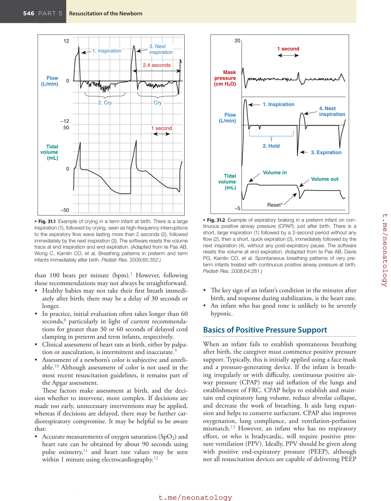

### Original source page 560

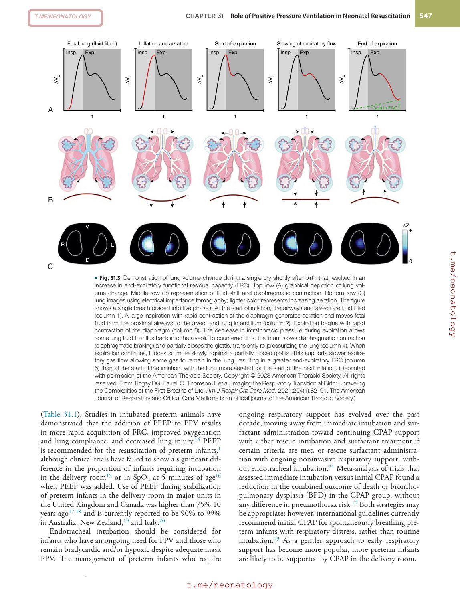

### Original source page 561

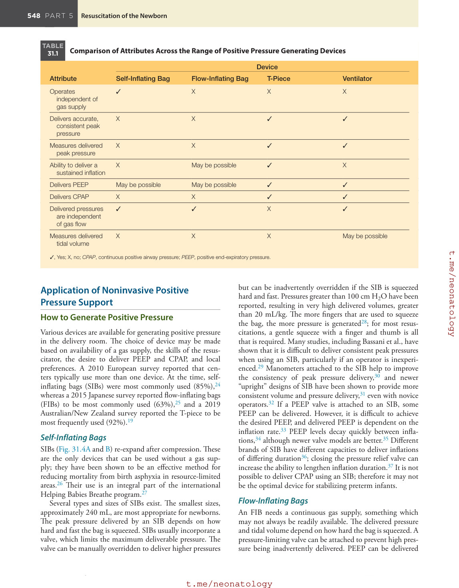

### Original source page 562

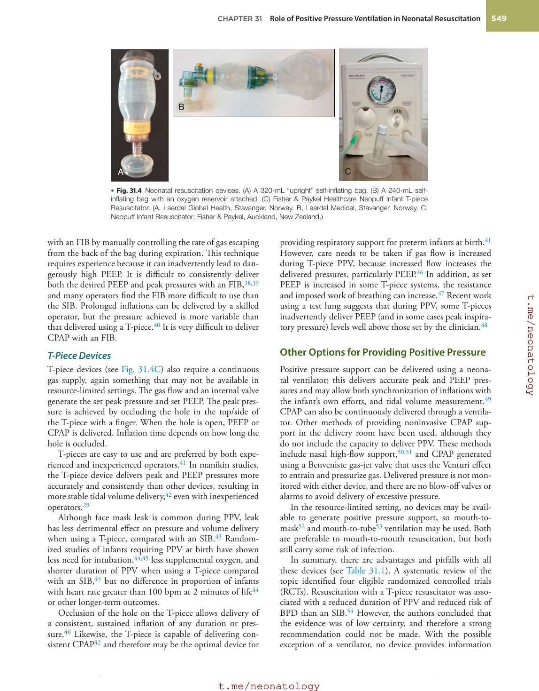

### Original source page 563

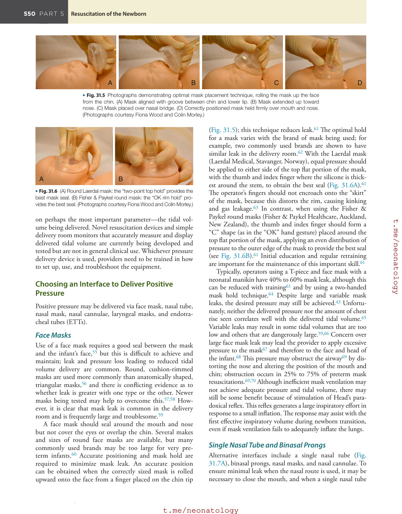

### Original source page 564

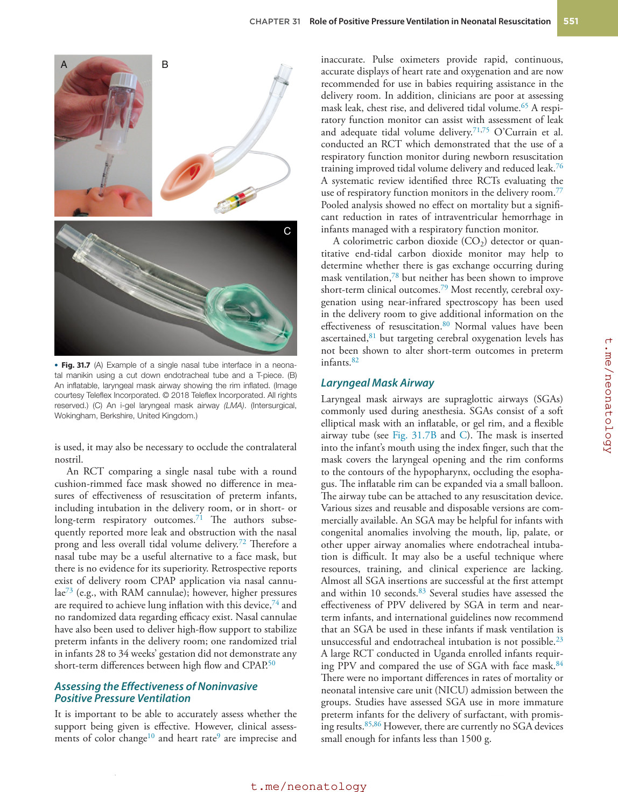

### Original source page 565

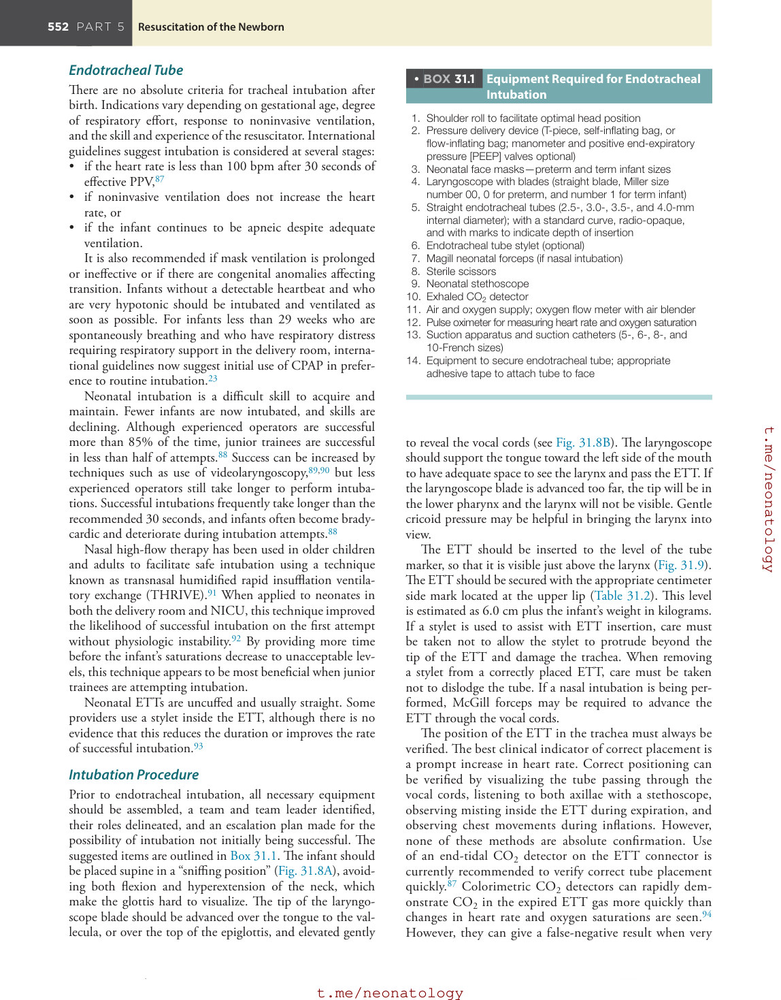

### Original source page 566

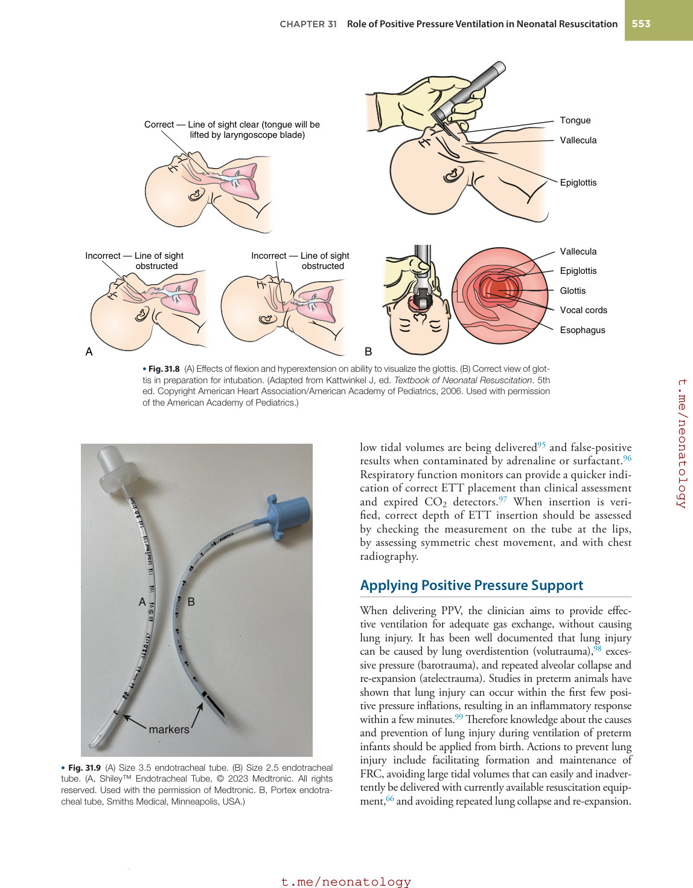

### Original source page 567

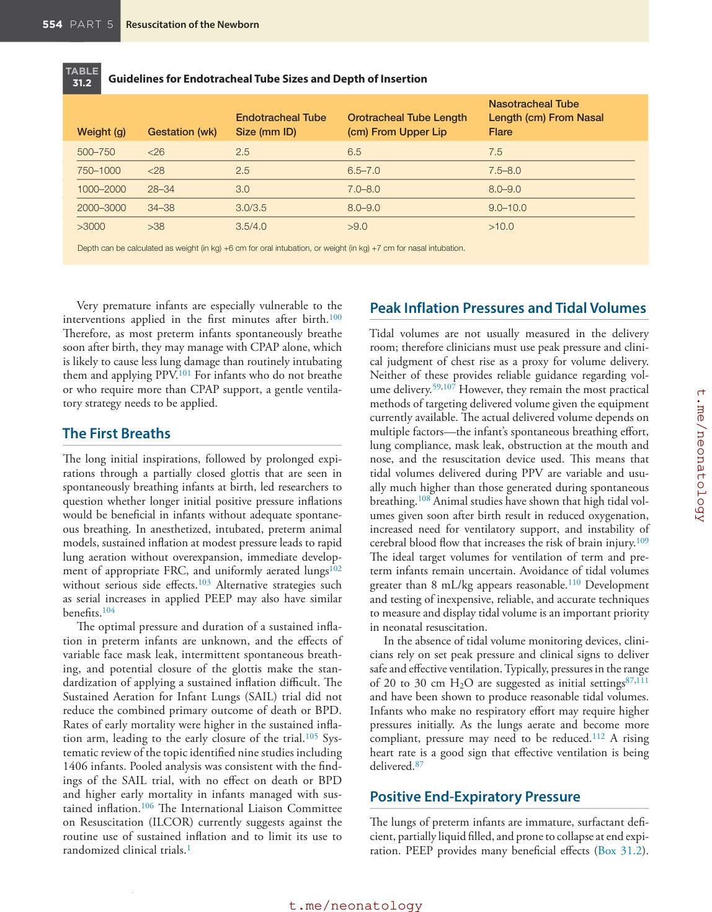

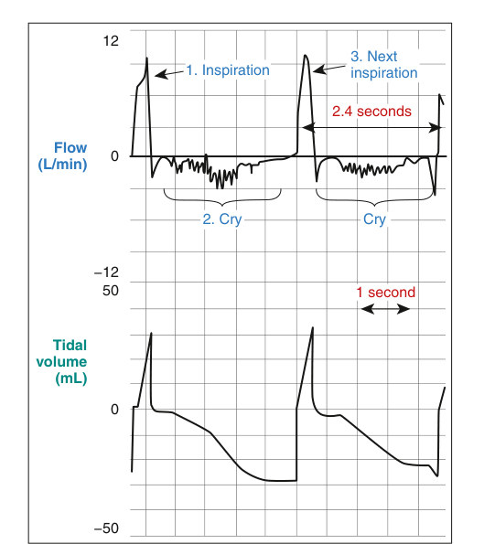

• Fig. 31.1 Example of crying in a term infant at birth. There is a large inspiration (1), followed by crying, seen as high-frequency interruptions to the expiratory flow wave lasting more than 2 seconds (2), followed immediately by the next inspiration (3). The software resets the volume trace at end inspiration and end expiration. (Adapted from te Pas AB, Wong C, Kamlin CO, et al. Breathing patterns in preterm and term infants immediately after birth. Pediatr Res. 2009;65:352.)

PDF p. 559

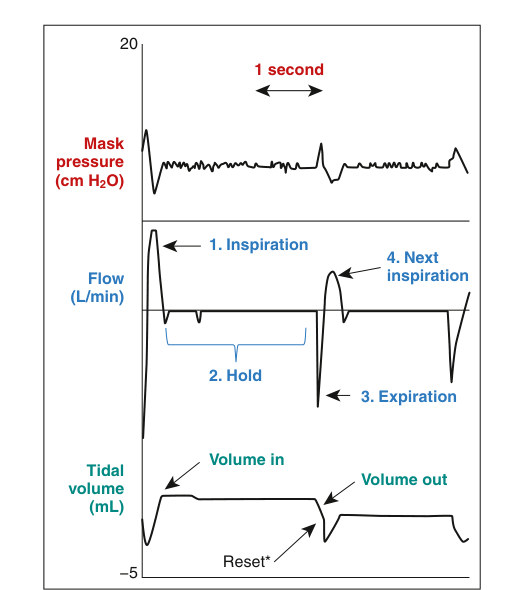

• Fig. 31.2 Example of expiratory braking in a preterm infant on continuous positive airway pressure (CPAP), just after birth. There is a short, large inspiration (1) followed by a 2-second period without any flow (2), then a short, quick expiration (3), immediately followed by the next inspiration (4), without any post-expiratory pause. The software resets the volume at end expiration. (Adapted from te Pas AB, Davis PG, Kamlin CO, et al. Spontaneous breathing patterns of very preterm infants treated with continuous positive airway pressure at birth. Pediatr Res. 2008;64:281.)

PDF p. 559
