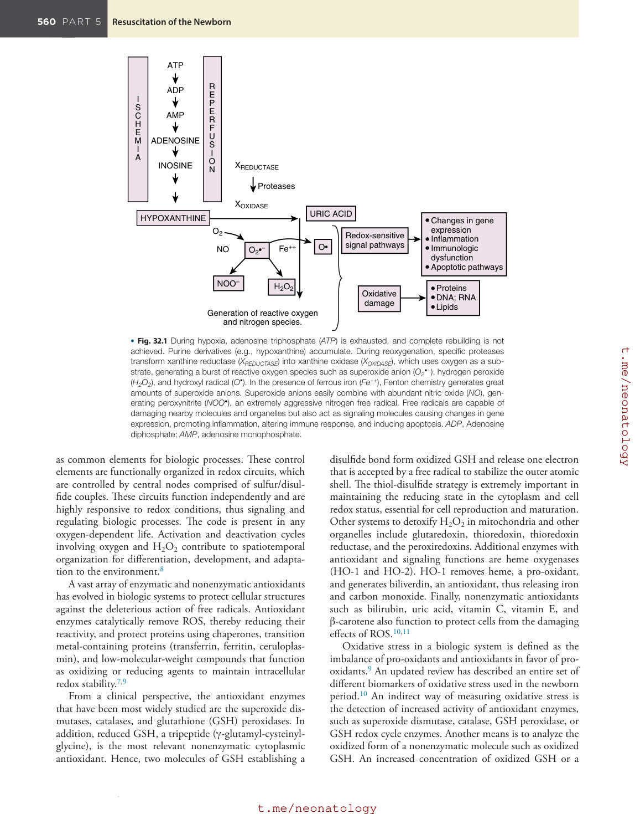
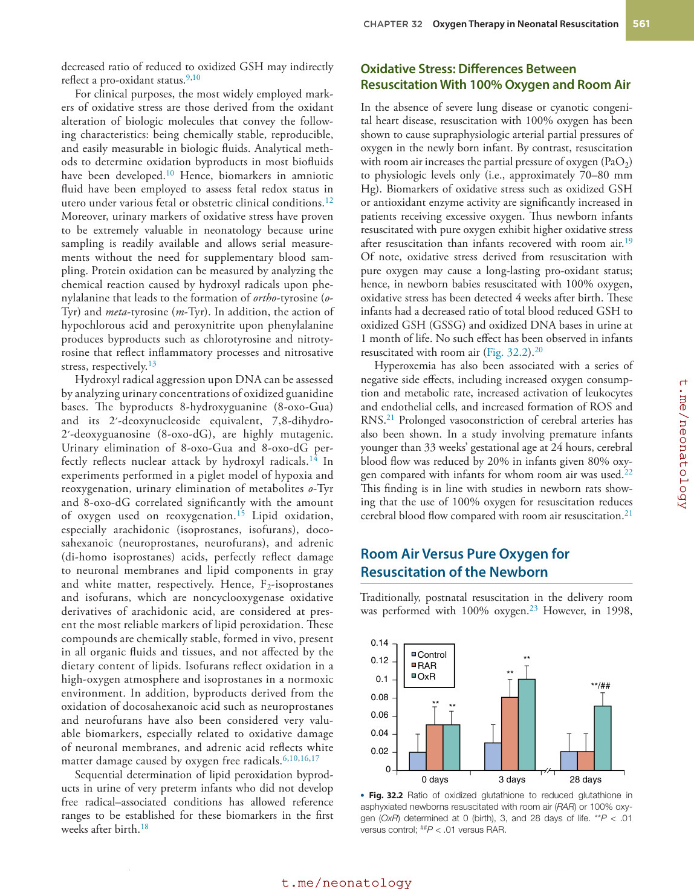
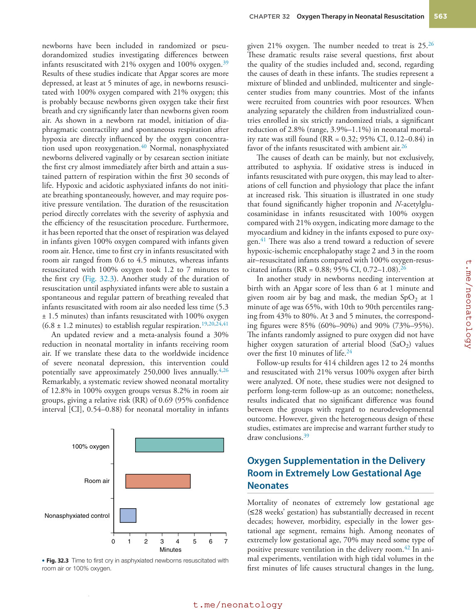
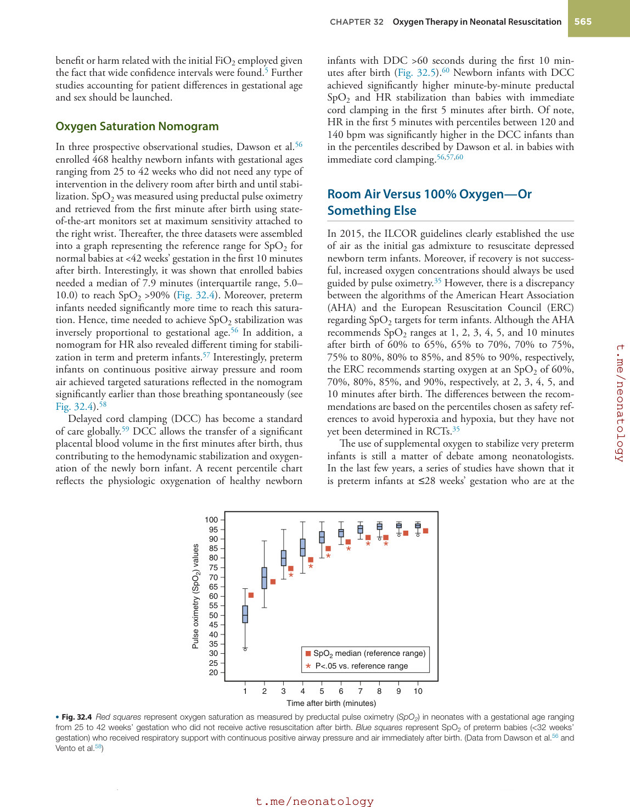
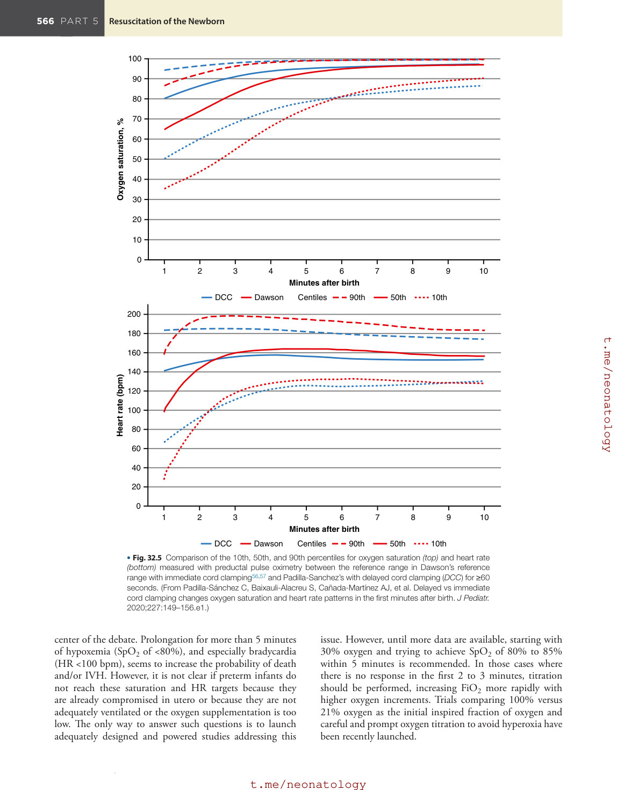
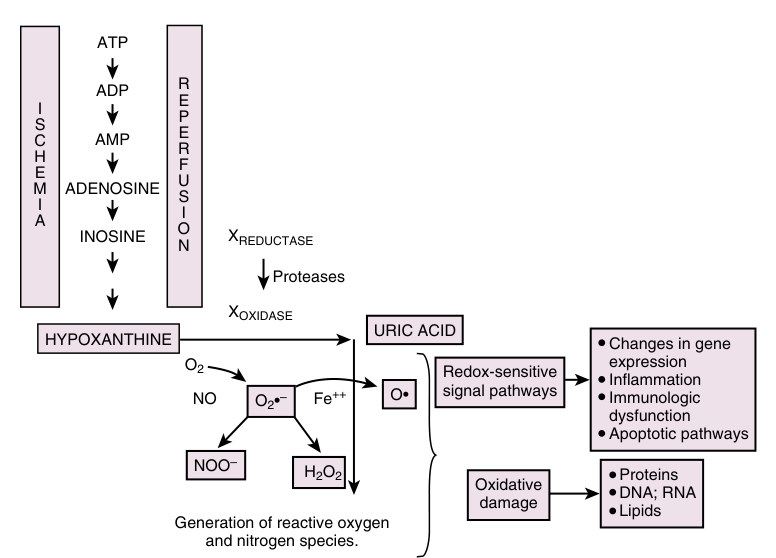
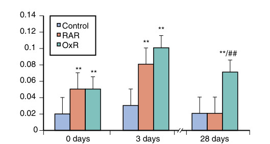
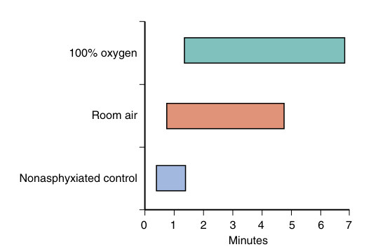
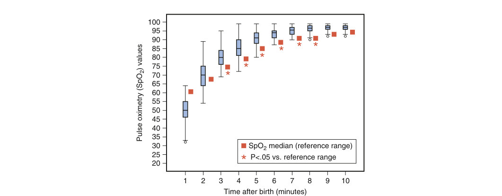
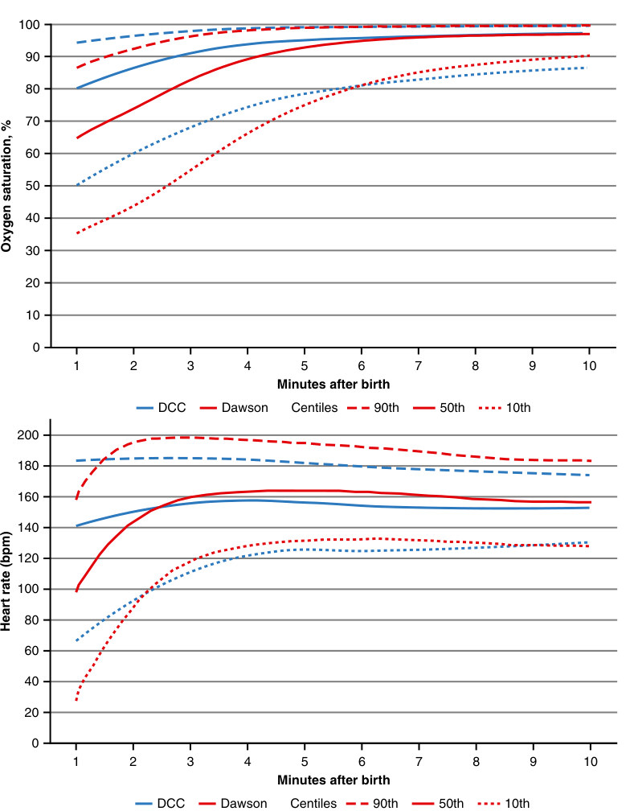

# 32. Oxygen Therapy in Neonatal Resuscitation
> [Source credits](../../SOURCE_CREDITS.md).

## Study pillars

### Energy failure

Failure of ion pumps with sodium and calcium accumulation. ATP depletion impairs ion pumps, causing swelling, calcium accumulation and vulnerability to oxidative damage.

PDF p. 572

### Reoxygenation injury

Free-radical production during purine metabolism. Reintroduced oxygen permits xanthine-oxidase metabolism that generates ROS, illustrating reoxygenation injury.

PDF p. 572

### Oxidative targets

Membrane lipids, proteins and nucleic acids. Reactive species can peroxidize lipids and damage proteins, enzymes and nucleic acids.

PDF p. 572

### Transitional saturation

Normal transitional saturations change over the first minutes and vary with gestation. Healthy infants in the observational datasets required minutes to reach high saturations, with slower stabilization in preterm infants.

PDF p. 578

### Preductal measurement

Right wrist. The cited studies obtained preductal measurements at the right wrist.

PDF p. 578

## Full source extraction

# 32. Oxygen Therapy in Neonatal Resuscitation
> Source attribution: [Source credits](../../SOURCE_CREDITS.md).

## PDF page 572 | printed page 559

32 Oxygen Therapy in Neonatal Resuscitation

### MAXIMO VENTO

### Use of Oxygen in Perinatal Asphyxia and Resuscitation

### Oxidative Stress: Pathophysiologic Background

Perinatal asphyxia is a devastating disorder that affects roughly 2% of newborn babies in industrialized countries, but it constitutes one of the leading causes of early neonatal death in low- and middle-income countries.1 Both ischemia and hypoxia reduce the supply of oxygen and glucose to neurons, leading to adenosine-triphosphate (ATP) depletion and inactivation of ATP-dependent ion pumps, causing intracellular accumulation of Na+ (cell swelling), of ionic Ca++ (increased free-radical formation and oxidative stress/damage), and inhibition of neurotransmitter recaptation at the synaptic cleft, causing hyperexcitability. Altogether, these pathophysiologic circumstances not only will lead to cell necrosis but will also collectively predispose tissue to reoxygenation injury.2 During hypoxia, limited oxygen availability decreases oxidative phosphorylation, resulting in a failure to resynthesize energy-rich phosphates, including adenosine 5′-triphosphate (ATP) and phosphocreatine, resulting in an accumulation of purine derivatives, especially hypoxanthine. The tissue concentration of these metabolites is directly dependent on the intensity and prolongation of hypoxia (Fig. 32.1).3 Upon resuscitation, restoration of oxygen and glucose supplies may salvage neurons, but it will also activate specific proteases that transform xanthine dehydrogenase (XDH) into xanthine oxidase (XO). XO metabolization of purine derivatives generates the byproducts of oxygen and nitrogen free radicals. This pro-oxidant situation will activate proinflammatory and pro-apoptotic master regulators such as nuclear factor kappa B (NF-κB), prompting expansion of the initial neuronal damage.4 Moreover, in the endothelium, ischemia promotes the expression of proinflammatory gene products (e.g., leukocyte adhesion molecules, cytokines) and bioactive agents (e.g., endothelin, thromboxane A2) while repressing other “protective” gene products (e.g., prostacyclin, nitric oxide).

Ischemia induces a proinflammatory state that increases tissue vulnerability to further injury on reperfusion.5

Reperfusion and reoxygenation of ischemic tissue result in the formation of toxic reactive oxygen species, including superoxide anions (•O2−), hydrogen peroxide (H2O2), hydroxyl radicals (•OH), and nitrogen reactive species, especially peroxynitrite (•ONOO–). Under physiologic conditions, hypoxanthine accumulated during the ischemia is further oxidized by XDH to uric acid in the cells containing this enzyme. However, during prolonged ischemia, XDH is converted to XO by specific proteases. Of note, XO uses oxygen as a substrate and during hypoxia-ischemia is unable to catalyze the conversion of hypoxanthine (resulting in the buildup of excess tissue levels of hypoxanthine). When oxygen is reintroduced during resuscitation, conversion of the excess hypoxanthine by XO results in the formation of reactive oxygen species (ROS), especially anion superoxide. Moreover, in the presence of nitric oxide, both superoxide and nitric oxide will combine to form reactive nitrogen species (RNS), especially peroxynitrite. In tissues rich in ferrous iron such as the brain, Fenton chemistry will lead to the formation of the highly reactive hydroxyl radical. Interestingly, XO in humans is mainly restricted to the liver and intestine. It has been shown, however, that XO leaks out into the blood after hypoxia and hypotension, and the hypoxanthine-XO system may be detrimental in all parts of the body. Other oxygen radical–generating systems are presently well described.6

ROS and RNS are potent oxidizing and reducing agents that directly damage cellular structures. They can peroxidize membrane lipid bilayers, structural proteins and enzymes, and nucleic acids. In addition, they are known to be extremely important regulators of intracellular signaling pathways that modulate DNA and RNA synthesis, protein synthesis, and enzyme activation, and they directly influence the cell.7 Increasingly, the concept of a redox code has acquired more relevance. The redox code defines the positioning of nicotinamide adenine dinucleotides (NAD, NADP), thiol/disulfide (GSH/GSSG; CysSH/CysS-S), and other redox systems, as well as the thiol redox proteome,

559

## PDF page 573

ATP

R E P E R F U S I O N XREDUCTASE

ADP

I S C H E M I A

AMP

ADENOSINE

INOSINE

Proteases

XOXIDASE

URIC ACID

HYPOXANTHINE

O2

NO O• O2•–

Fe++

H2O2 NOO–

Generation of reactive oxygen and nitrogen species.

• Fig. 32.1 During hypoxia, adenosine triphosphate (ATP) is exhausted, and complete rebuilding is not achieved. Purine derivatives (e.g., hypoxanthine) accumulate. During reoxygenation, specific proteases transform xanthine reductase (XREDUCTASE) into xanthine oxidase (XOXIDASE), which uses oxygen as a substrate, generating a burst of reactive oxygen species such as superoxide anion (O2•−), hydrogen peroxide (H2O2), and hydroxyl radical (O•). In the presence of ferrous iron (Fe++), Fenton chemistry generates great amounts of superoxide anions. Superoxide anions easily combine with abundant nitric oxide (NO), generating peroxynitrite (NOO•), an extremely aggressive nitrogen free radical. Free radicals are capable of damaging nearby molecules and organelles but also act as signaling molecules causing changes in gene expression, promoting inflammation, altering immune response, and inducing apoptosis. ADP, Adenosine diphosphate; AMP, adenosine monophosphate.

as common elements for biologic processes. These control elements are functionally organized in redox circuits, which are controlled by central nodes comprised of sulfur/disulfide couples. These circuits function independently and are highly responsive to redox conditions, thus signaling and regulating biologic processes. The code is present in any oxygen-dependent life. Activation and deactivation cycles involving oxygen and H2O2 contribute to spatiotemporal organization for differentiation, development, and adaptation to the environment.8

A vast array of enzymatic and nonenzymatic antioxidants has evolved in biologic systems to protect cellular structures against the deleterious action of free radicals. Antioxidant enzymes catalytically remove ROS, thereby reducing their reactivity, and protect proteins using chaperones, transition metal-containing proteins (transferrin, ferritin, ceruloplasmin), and low-molecular-weight compounds that function as oxidizing or reducing agents to maintain intracellular redox stability.7,9

From a clinical perspective, the antioxidant enzymes that have been most widely studied are the superoxide dismutases, catalases, and glutathione (GSH) peroxidases. In addition, reduced GSH, a tripeptide (γ-glutamyl-cysteinylglycine), is the most relevant nonenzymatic cytoplasmic antioxidant. Hence, two molecules of GSH establishing a

Changes in gene expression Inflammation Immunologic dysfunction Apoptotic pathways

Redox-sensitive signal pathways

Proteins DNA; RNA Lipids

Oxidative damage

disulfide bond form oxidized GSH and release one electron that is accepted by a free radical to stabilize the outer atomic shell. The thiol-disulfide strategy is extremely important in maintaining the reducing state in the cytoplasm and cell redox status, essential for cell reproduction and maturation. Other systems to detoxify H2O2 in mitochondria and other organelles include glutaredoxin, thioredoxin, thioredoxin reductase, and the peroxiredoxins. Additional enzymes with antioxidant and signaling functions are heme oxygenases (HO-1 and HO-2). HO-1 removes heme, a pro-oxidant, and generates biliverdin, an antioxidant, thus releasing iron and carbon monoxide. Finally, nonenzymatic antioxidants such as bilirubin, uric acid, vitamin C, vitamin E, and β-carotene also function to protect cells from the damaging effects of ROS.10,11

Oxidative stress in a biologic system is defined as the imbalance of pro-oxidants and antioxidants in favor of prooxidants.9 An updated review has described an entire set of different biomarkers of oxidative stress used in the newborn period.10 An indirect way of measuring oxidative stress is the detection of increased activity of antioxidant enzymes, such as superoxide dismutase, catalase, GSH peroxidase, or GSH redox cycle enzymes. Another means is to analyze the oxidized form of a nonenzymatic molecule such as oxidized GSH. An increased concentration of oxidized GSH or a

## PDF page 574 | printed page 561

decreased ratio of reduced to oxidized GSH may indirectly reflect a pro-oxidant status.9,10

For clinical purposes, the most widely employed markers of oxidative stress are those derived from the oxidant alteration of biologic molecules that convey the following characteristics: being chemically stable, reproducible, and easily measurable in biologic fluids. Analytical methods to determine oxidation byproducts in most biofluids have been developed.10 Hence, biomarkers in amniotic fluid have been employed to assess fetal redox status in utero under various fetal or obstetric clinical conditions.12 Moreover, urinary markers of oxidative stress have proven to be extremely valuable in neonatology because urine sampling is readily available and allows serial measurements without the need for supplementary blood sampling. Protein oxidation can be measured by analyzing the chemical reaction caused by hydroxyl radicals upon phenylalanine that leads to the formation of ortho-tyrosine (o- Tyr) and meta-tyrosine (m-Tyr). In addition, the action of hypochlorous acid and peroxynitrite upon phenylalanine produces byproducts such as chlorotyrosine and nitrotyrosine that reflect inflammatory processes and nitrosative stress, respectively.13

Hydroxyl radical aggression upon DNA can be assessed by analyzing urinary concentrations of oxidized guanidine bases. The byproducts 8-hydroxyguanine (8-oxo-Gua) and its 2′-deoxynucleoside equivalent, 7,8-dihydro- 2′-deoxyguanosine (8-oxo-dG), are highly mutagenic. Urinary elimination of 8-oxo-Gua and 8-oxo-dG perfectly reflects nuclear attack by hydroxyl radicals.14 In experiments performed in a piglet model of hypoxia and reoxygenation, urinary elimination of metabolites o-Tyr and 8-oxo-dG correlated significantly with the amount of oxygen used on reoxygenation.15 Lipid oxidation, especially arachidonic (isoprostanes, isofurans), docosahexanoic (neuroprostanes, neurofurans), and adrenic (di-homo isoprostanes) acids, perfectly reflect damage to neuronal membranes and lipid components in gray and white matter, respectively. Hence, F2-isoprostanes and isofurans, which are noncyclooxygenase oxidative derivatives of arachidonic acid, are considered at present the most reliable markers of lipid peroxidation. These compounds are chemically stable, formed in vivo, present in all organic fluids and tissues, and not affected by the dietary content of lipids. Isofurans reflect oxidation in a high-oxygen atmosphere and isoprostanes in a normoxic environment. In addition, byproducts derived from the oxidation of docosahexanoic acid such as neuroprostanes and neurofurans have also been considered very valuable biomarkers, especially related to oxidative damage of neuronal membranes, and adrenic acid reflects white matter damage caused by oxygen free radicals.6,10,16,17

Sequential determination of lipid peroxidation byproducts in urine of very preterm infants who did not develop free radical–associated conditions has allowed reference ranges to be established for these biomarkers in the first weeks after birth.18

### Oxidative Stress: Differences Between Resuscitation With 100% Oxygen and Room Air

In the absence of severe lung disease or cyanotic congenital heart disease, resuscitation with 100% oxygen has been shown to cause supraphysiologic arterial partial pressures of oxygen in the newly born infant. By contrast, resuscitation with room air increases the partial pressure of oxygen (PaO2) to physiologic levels only (i.e., approximately 70–80 mm Hg). Biomarkers of oxidative stress such as oxidized GSH or antioxidant enzyme activity are significantly increased in patients receiving excessive oxygen. Thus newborn infants resuscitated with pure oxygen exhibit higher oxidative stress after resuscitation than infants recovered with room air.19 Of note, oxidative stress derived from resuscitation with pure oxygen may cause a long-lasting pro-oxidant status; hence, in newborn babies resuscitated with 100% oxygen, oxidative stress has been detected 4 weeks after birth. These infants had a decreased ratio of total blood reduced GSH to oxidized GSH (GSSG) and oxidized DNA bases in urine at 1 month of life. No such effect has been observed in infants resuscitated with room air (Fig. 32.2).20

Hyperoxemia has also been associated with a series of negative side effects, including increased oxygen consumption and metabolic rate, increased activation of leukocytes and endothelial cells, and increased formation of ROS and RNS.21 Prolonged vasoconstriction of cerebral arteries has also been shown. In a study involving premature infants younger than 33 weeks’ gestational age at 24 hours, cerebral blood flow was reduced by 20% in infants given 80% oxygen compared with infants for whom room air was used.22 This finding is in line with studies in newborn rats showing that the use of 100% oxygen for resuscitation reduces cerebral blood flow compared with room air resuscitation.21

### Room Air Versus Pure Oxygen for Resuscitation of the Newborn

Traditionally, postnatal resuscitation in the delivery room was performed with 100% oxygen.23 However, in 1998,

0.14

Control RAR OxR

**

0.12

**

0.1

**/##

0.08

** **

0.06

0.04

0.02

0

0 days 3 days 28 days

• Fig. 32.2 Ratio of oxidized glutathione to reduced glutathione in asphyxiated newborns resuscitated with room air (RAR) or 100% oxygen (OxR) determined at 0 (birth), 3, and 28 days of life. **P < .01 versus control; ##P < .01 versus RAR.

## PDF page 575

the Resair 2 trial showed that it was feasible to resuscitate depressed newborn infants with room air.24 Thereafter, a series of clinical studies summarized in an updated review and meta-analysis has reported not only the suitability of room air for the resuscitation of the depressed term neonate but also a series of advantages, among which the most relevant is a decrease in mortality.25,26

### Animal Studies

Animal studies have shown that, after a period of severe hypoxia, physiologic functions such as blood pressure and blood flow to various organs, including the brain, are restored equally efficiently with 21% and 100% oxygen. Evoked potentials and biochemical indicators such as base deficit and hypoxanthine are restored efficiently using room air for resuscitation. Furthermore, experimental studies have also clearly shown that using 21% instead of 100% oxygen offers significant additional advantages. Hence, the use of high oxygen concentrations is toxic not only for the lungs but also for several other organs such as the heart, liver, and brain. A review has detailed the most relevant findings in animal models of hypoxia and reoxygenation with 21% versus 100%.27 Extracellular glycerol concentration from the striatum was significantly higher in hypoxic piglets resuscitated with pure oxygen as compared with those resuscitated with air.28 Moreover, in a mouse model, hyperoxia after hypoxic-ischemic brain injury increased secondary neuronal injury and interfered with myelination.29 Matrix metalloproteinases, which reflect tissue damage and repair, were measured in the lung, liver, heart, and brain of hypoxic piglets recovered with 100% versus 21% oxygen. Remarkably, use of the elevated oxygen concentration caused a significant increase of metalloproteinases in all analyzed tissues.30 The H2O2 concentration in leukocytes from the sagittal sinus increased significantly in newborn hypoxic piglets resuscitated with 100% oxygen in contrast to piglets given 21% oxygen. The nitric oxide concentration in the brain also tended to be higher if pure oxygen was used compared with ambient air for the resuscitation of piglets. The stage might be set for higher production of RNS and peroxynitrite if 100% oxygen is used.31–33

There are also clear indications that resuscitation with 100% oxygen augments inflammatory processes in the myocardium and the brain more than with 21% oxygen. In a study using cord occlusion of fetal lambs, resuscitation with room air restored blood pressure as fast as when using 21% oxygen. In the cortex and subcortical area, significantly higher levels of proinflammatory cytokines and activities of Toll-like receptors 2 and 4 were found in animals given 100% oxygen.29

Some animal studies have shown that cerebral brain microflow is reestablished more quickly with 100% oxygen. One study in newborn mice found that 100% versus 21% oxygen provided faster cerebral blood flow restoration but poorer short-term and improved long-term recovery.34 In another study, however, the slower normalization of cerebral

blood flow in animals resuscitated with room air versus animals resuscitated with 100% oxygen almost disappeared if moderate hypercapnia was present. In birth asphyxia, hypercapnia always coincides with hypoxia. Hypercapnia might seem to be an important factor in reestablishing brain blood flow after asphyxia. As mentioned earlier, other studies have shown that 100% oxygen during normocapnia, in contrast to the use of 21% oxygen, reduces cerebral blood flow.21

In the current guidelines, the use of 100% oxygen is recommended during resuscitation of a neonate requiring chest compressions.35 However, experimental studies comparing the administration of 21% and 100% oxygen have not shown a difference in incidence or timing of return of spontaneous circulation (ROSC). Hence, newborn lambs receiving chest compression with either 21% or 100% oxygen until ROSC after pulseless cardiac arrest of 5 minutes showed carotid flow, systemic PaO2, and oxygen delivery to the brain significantly below the baseline, irrespective of the fraction of inspired oxygen (FiO2) employed during chest compressions.36

Oxygen is a pulmonary vasodilator, but studies performed in animal models of hypoxia reoxygenation have shown that hyperoxia blunts the vasodilator activity of oxygen, probably mediated by the generation of ROS, especially H2O2 in the mitochondrial matrix. H2O2 diffuses to the cytoplasm, activating phosphodiesterase-5, which, acting upon the vascular smooth muscle cells, degrades cyclic guanosine monophosphate (cGMP), thus inhibiting nitric oxide–mediated vasorelaxation and favoring persistent vasoconstriction. Remarkably, resuscitation with 100% oxygen of term fetal lambs asphyxiated by cord occlusion initially induced a decrease in pulmonary vascular resistance (PVR) and subsequent increase in pulmonary blood flow. Nonetheless, subsequent values (between 2 and 30 minutes) for PVR did not differ between lambs resuscitated with air or 100% oxygen. Interestingly, the increased pulmonary artery contractility induced by 100% oxygen was reversed when superoxide anions were scavenged. Hence, the use of 100% oxygen increases the partial pressure of oxygen in the pulmonary artery, yet it does not enhance oxygen uptake by lung tissue, does not decrease PVR, and does not increase systemic oxygen extraction ratios. Furthermore, 100% oxygen also induces oxidative stress and increases pulmonary artery contractility, thus favoring pulmonary hypertension.37,38

Results from animal studies reveal that room air resuscitation is, in most cases, beneficial when compared with the use of 100% oxygen. Still, there are clinical conditions, such as extreme prematurity with primary lung disease, when initial supplemental oxygen titrated according to the heart rate (HR) and oxygen saturation (SpO2) response should be taken into consideration.

### Clinical Data

Several clinical studies have been conducted to evaluate the efficacy of resuscitation with ambient air compared with pure oxygen. Ten studies that involved a total of 2133

## PDF page 576 | printed page 563

newborns have been included in randomized or pseudorandomized studies investigating differences between infants resuscitated with 21% oxygen and 100% oxygen.39 Results of these studies indicate that Apgar scores are more depressed, at least at 5 minutes of age, in newborns resuscitated with 100% oxygen compared with 21% oxygen; this is probably because newborns given oxygen take their first breath and cry significantly later than newborns given room air. As shown in a newborn rat model, initiation of diaphragmatic contractility and spontaneous respiration after hypoxia are directly influenced by the oxygen concentration used upon reoxygenation.40 Normal, nonasphyxiated newborns delivered vaginally or by cesarean section initiate the first cry almost immediately after birth and attain a sustained pattern of respiration within the first 30 seconds of life. Hypoxic and acidotic asphyxiated infants do not initiate breathing spontaneously, however, and may require positive pressure ventilation. The duration of the resuscitation period directly correlates with the severity of asphyxia and the efficiency of the resuscitation procedure. Furthermore, it has been reported that the onset of respiration was delayed in infants given 100% oxygen compared with infants given room air. Hence, time to first cry in infants resuscitated with room air ranged from 0.6 to 4.5 minutes, whereas infants resuscitated with 100% oxygen took 1.2 to 7 minutes to the first cry (Fig. 32.3). Another study of the duration of resuscitation until asphyxiated infants were able to sustain a spontaneous and regular pattern of breathing revealed that infants resuscitated with room air also needed less time (5.3 ± 1.5 minutes) than infants resuscitated with 100% oxygen (6.8 ± 1.2 minutes) to establish regular respiration.19,20,24,41

An updated review and a meta-analysis found a 30% reduction in neonatal mortality in infants receiving room air. If we translate these data to the worldwide incidence of severe neonatal depression, this intervention could potentially save approximately 250,000 lives annually.4,26 Remarkably, a systematic review showed neonatal mortality of 12.8% in 100% oxygen groups versus 8.2% in room air groups, giving a relative risk (RR) of 0.69 (95% confidence interval [CI], 0.54–0.88) for neonatal mortality in infants

100% oxygen

Room air

Nonasphyxiated control

0 1 2 3 4 Minutes

5 6 7

• Fig. 32.3 Time to first cry in asphyxiated newborns resuscitated with room air or 100% oxygen.

given 21% oxygen. The number needed to treat is 25.26 These dramatic results raise several questions, first about the quality of the studies included and, second, regarding the causes of death in these infants. The studies represent a mixture of blinded and unblinded, multicenter and singlecenter studies from many countries. Most of the infants were recruited from countries with poor resources. When analyzing separately the children from industrialized countries enrolled in six strictly randomized trials, a significant reduction of 2.8% (range, 3.9%–1.1%) in neonatal mortality rate was still found (RR = 0.32; 95% CI, 0.12–0.84) in favor of the infants resuscitated with ambient air.26

The causes of death can be mainly, but not exclusively, attributed to asphyxia. If oxidative stress is induced in infants resuscitated with pure oxygen, this may lead to alterations of cell function and physiology that place the infant at increased risk. This situation is illustrated in one study that found significantly higher troponin and N-acetylglucosaminidase in infants resuscitated with 100% oxygen compared with 21% oxygen, indicating more damage to the myocardium and kidney in the infants exposed to pure oxygen.41 There was also a trend toward a reduction of severe hypoxic-ischemic encephalopathy stage 2 and 3 in the room air–resuscitated infants compared with 100% oxygen-resuscitated infants (RR = 0.88; 95% CI, 0.72–1.08).26

In another study in newborns needing intervention at birth with an Apgar score of less than 6 at 1 minute and given room air by bag and mask, the median SpO2 at 1 minute of age was 65%, with 10th to 90th percentiles ranging from 43% to 80%. At 3 and 5 minutes, the corresponding figures were 85% (60%–90%) and 90% (73%–95%). The infants randomly assigned to pure oxygen did not have higher oxygen saturation of arterial blood (SaO2) values over the first 10 minutes of life.24

Follow-up results for 414 children ages 12 to 24 months and resuscitated with 21% versus 100% oxygen after birth were analyzed. Of note, these studies were not designed to perform long-term follow-up as an outcome; nonetheless, results indicated that no significant difference was found between the groups with regard to neurodevelopmental outcome. However, given the heterogeneous design of these studies, estimates are imprecise and warrant further study to draw conclusions.39

### Oxygen Supplementation in the Delivery Room in Extremely Low Gestational Age Neonates

Mortality of neonates of extremely low gestational age (≤28 weeks’ gestation) has substantially decreased in recent decades; however, morbidity, especially in the lower gestational age segment, remains high. Among neonates of extremely low gestational age, 70% may need some type of positive pressure ventilation in the delivery room.42 In animal experiments, ventilation with high tidal volumes in the first minutes of life causes structural changes in the lung,

## PDF page 577

predisposing to chronic lung disease.43 Moreover, oxygen in excess upon resuscitation causes oxidative damage, especially in patients with an immature antioxidant defense system predisposing to chronic lung disease.6,44 The feasibility of resuscitating extremely preterm infants with low initial FiO2 has been approached in different studies. The use of room air was unsuccessful in achieving target saturations and HRs in a significant number of very preterm infants who then needed to be switched to 100% oxygen.45 In contrast, resuscitation with an initial FiO2 of 0.3 was significantly more successful in achieving postnatal stabilization with less oxygen exposure.44,46 In both studies, very preterm infants achieved SpO2 of 75% at 5 minutes after birth and SpO2 of 85% at 8 to 10 minutes.

In 2014, a meta-analysis by Saugstad et al.47 that included randomized controlled trials (RCTs) comparing higher (60%–100%) versus lower (21%–30%) initial oxygen in 677 preterm infants at ≤32 weeks’ gestation showed no differences in morbidity but a trend toward lower mortality in the lower oxygen group. It was concluded that preterm infants could be initially stabilized with FiO2 of 0.21 to 0.3.47 A survey among neonatologists from 25 countries in 2016 showed that only a small minority would resuscitate with an initial high level of supplemental oxygen.48 However, Oei et al.49 published results of a large RCT that compared the effects of resuscitation with room air versus 100% oxygen in 289 preterm infants at <32 weeks’ gestation, targeting an SpO2 of 65% to 95% by 5 minutes and 85% to 95% until admission. Mortality in the subgroup of babies at <29 weeks’ gestation was 16.2% in the room air group and 6% in the 100% oxygen group. Although statistically marginal, results emphasized the urgent need for larger RCTs.49

In addition, the Canadian Neonatal Network published a retrospective cohort study comparing infants at ≤27 weeks’ gestation before and after 2006 when the policy regarding initial FiO2 for preterm infants in the delivery room was changed from 100% to <100% oxygen and titration according to SpO2. The adjusted odds ratio (AOR) for the primary outcome of severe neurologic injury or death was higher in the lower oxygen group (AOR = 1.36; 95% CI, 1.11–1.66) and in those resuscitated with room air (AOR = 1.33; 95% CI, 1.04–1.69) when compared with 100% oxygen. The investigators cautioned about the consequences of a policy of initial stabilization with lower oxygen in very preterm infants compared to starting with 100% oxygen.50 However, because both studies were simultaneously published with the 2015 ILCOR treatment recommendations, they were not included in the 2015 ILCOR final statements.35

In 2017, a meta-analysis of outcomes of RCTs in infants ≤28 6/7 weeks’ gestation randomized to resuscitation with low (≤0.3) versus high (≥0.6) FiO2 at delivery, the main outcomes were death in hospital, bronchopulmonary dysplasia (BPD), retinopathy of prematurity (ROP) (>stage 2), intraventricular hemorrhage (IVH) (>grade 2), patent ductus arteriosus (PDA), and necrotizing enterocolitis (NEC) (>stage 2 of Bell). No differences in BPD, ROP, PDA, and NEC or overall mortality were found.51 Furthermore, in a

simultaneous study, the association of SpO2 at 5 minutes after birth and clinical outcomes in preterm infants at ≤32 weeks’ gestation was analyzed.52 Data from 768 infants at ≤32 weeks’ gestation from eight RCTs of lower (≤0.3) versus higher (≥0.6) initial FiO2 were analyzed. The study aimed to establish a relationship among SpO2 at 5 minutes, death, and IVH greater than grade 3. Interestingly, only 23% of the 706 patients met the SpO2 targets at 5 minutes, and 46% did not reach SpO2 80%. Pooled data showed a decreased likelihood of reaching SpO2 80% if resuscitation was initiated with FiO2 <0.3 (P < .05); moreover, SpO2 <80% was associated with lower HRs and with IVH (P < .05). Of note, bradycardia (HR <100 bpm) at 5 minutes increased the risk of death (P < .05). Taken altogether, and after accounting for confounders including gestation, birth weight, and bradycardia at 5 minutes, risk of death was significantly increased with time taken to reach SpO2 80%. These findings could be explained because insufficient oxygen was provided or because the inability of an infant to respond to resuscitation is a reflection of the infant’s status in utero.52

Kapadia et al.53 determined whether hospital mortality, which was the primary outcome, was associated with the duration of bradycardia without chest compression during delivery room resuscitation in a retrospective cohort study of RCTs in preterm infants assigned low versus high initial oxygen concentrations.53 Neonates with prolonged bradycardia (>2 minutes) had higher odds of hospital death before or after adjusting for potential confounders (e.g., gestational age, gender, type of delivery). Of note, the incidence of bradycardia in infants resuscitated with low (≤30%) and high (≥60%) oxygen was similar. Moreover, neonates with both prolonged bradycardia and SpO2 <80% at 5 minutes after birth had higher odds of hospital mortality.53

In 2016, Boronat et al.54 published a follow-up study from preterm infants randomized to an initial FiO2 of 0.3 versus 0.6. A total of 206 infants at <32 weeks’ gestation representing 81.4% of the total recruited in two studies completed follow-up at 24 months. No differences in perinatal characteristics, oxidative stress, or morbidities during the neonatal period were found. Moreover, no differences in mortality at hospital discharge or when follow-up was completed were found between the groups. Remarkably, no differences regarding Bayley III scale scores (motor, cognitive, and language composites), neurosensorial handicaps, cerebral palsy, or language skills between groups were found.54

More recently, Oei et al.55 published an initial patient meta-analysis of neurodevelopmental outcomes of preterm infants stabilized in the delivery room with lower (≤30%) versus higher (≥60%) initial FiO2. Initial FiO2 was not associated with difference in death and/or disability. However, the 5-minute SpO2 >80% was associated with decreased disability/death and cognitive scores >85 (P = .01). Multinomial regression analysis noted decreased death with 5-minute SpO2 ≥80% and gestation relative to children without death or neurodevelopmental impairment. The researchers concluded that results cannot exclude substantial

## PDF page 578 | printed page 565

benefit or harm related with the initial FiO2 employed given the fact that wide confidence intervals were found.5 Further studies accounting for patient differences in gestational age and sex should be launched.

### Oxygen Saturation Nomogram

In three prospective observational studies, Dawson et al.56 enrolled 468 healthy newborn infants with gestational ages ranging from 25 to 42 weeks who did not need any type of intervention in the delivery room after birth and until stabilization. SpO2 was measured using preductal pulse oximetry and retrieved from the first minute after birth using stateof-the-art monitors set at maximum sensitivity attached to the right wrist. Thereafter, the three datasets were assembled into a graph representing the reference range for SpO2 for normal babies at <42 weeks’ gestation in the first 10 minutes after birth. Interestingly, it was shown that enrolled babies needed a median of 7.9 minutes (interquartile range, 5.0– 10.0) to reach SpO2 >90% (Fig. 32.4). Moreover, preterm infants needed significantly more time to reach this saturation. Hence, time needed to achieve SpO2 stabilization was inversely proportional to gestational age.56 In addition, a nomogram for HR also revealed different timing for stabilization in term and preterm infants.57 Interestingly, preterm infants on continuous positive airway pressure and room air achieved targeted saturations reflected in the nomogram significantly earlier than those breathing spontaneously (see Fig. 32.4).58

Delayed cord clamping (DCC) has become a standard of care globally.59 DCC allows the transfer of a significant placental blood volume in the first minutes after birth, thus contributing to the hemodynamic stabilization and oxygenation of the newly born infant. A recent percentile chart reflects the physiologic oxygenation of healthy newborn

100 95

90

85

Pulse oximetry (SpO2) values

80

*

75

*

70

65

60

55

50

45

40

35

30

SpO2 median (reference range)

25

P<.05 vs. reference range

20

1 2 3 4 5 Time after birth (minutes)

• Fig. 32.4 Red squares represent oxygen saturation as measured by preductal pulse oximetry (SpO2) in neonates with a gestational age ranging from 25 to 42 weeks’ gestation who did not receive active resuscitation after birth. Blue squares represent SpO2 of preterm babies (<32 weeks’ gestation) who received respiratory support with continuous positive airway pressure and air immediately after birth. (Data from Dawson et al.56 and Vento et al.58)

infants with DDC >60 seconds during the first 10 minutes after birth (Fig. 32.5).60 Newborn infants with DCC achieved significantly higher minute-by-minute preductal SpO2 and HR stabilization than babies with immediate cord clamping in the first 5 minutes after birth. Of note, HR in the first 5 minutes with percentiles between 120 and 140 bpm was significantly higher in the DCC infants than in the percentiles described by Dawson et al. in babies with immediate cord clamping.56,57,60

### Room Air Versus 100% Oxygen—Or Something Else

In 2015, the ILCOR guidelines clearly established the use of air as the initial gas admixture to resuscitate depressed newborn term infants. Moreover, if recovery is not successful, increased oxygen concentrations should always be used guided by pulse oximetry.35 However, there is a discrepancy between the algorithms of the American Heart Association (AHA) and the European Resuscitation Council (ERC) regarding SpO2 targets for term infants. Although the AHA recommends SpO2 ranges at 1, 2, 3, 4, 5, and 10 minutes after birth of 60% to 65%, 65% to 70%, 70% to 75%, 75% to 80%, 80% to 85%, and 85% to 90%, respectively, the ERC recommends starting oxygen at an SpO2 of 60%, 70%, 80%, 85%, and 90%, respectively, at 2, 3, 4, 5, and 10 minutes after birth. The differences between the recommendations are based on the percentiles chosen as safety references to avoid hyperoxia and hypoxia, but they have not yet been determined in RCTs.35

The use of supplemental oxygen to stabilize very preterm infants is still a matter of debate among neonatologists. In the last few years, a series of studies have shown that it is preterm infants at ≤28 weeks’ gestation who are at the

* * * *

6 7 8 9 10

## PDF page 579

100

90

80

70

Oxygen saturation, %

60

50

40

30

20

10

0

1 2 3 4 5 Minutes after birth

DCC Dawson Centiles

200

180

160

140

Heart rate (bpm)

120

100

80

60

40

20

0

1 2 3 4 5 Minutes after birth

DCC Dawson Centiles

• Fig. 32.5 Comparison of the 10th, 50th, and 90th percentiles for oxygen saturation (top) and heart rate (bottom) measured with preductal pulse oximetry between the reference range in Dawson’s reference range with immediate cord clamping56,57 and Padilla-Sanchez’s with delayed cord clamping (DCC) for ≥60 seconds. (From Padilla-Sánchez C, Baixauli-Alacreu S, Cañada-Martínez AJ, et al. Delayed vs immediate cord clamping changes oxygen saturation and heart rate patterns in the first minutes after birth. J Pediatr. 2020;227:149–156.e1.)

center of the debate. Prolongation for more than 5 minutes of hypoxemia (SpO2 of <80%), and especially bradycardia (HR <100 bpm), seems to increase the probability of death and/or IVH. However, it is not clear if preterm infants do not reach these saturation and HR targets because they are already compromised in utero or because they are not adequately ventilated or the oxygen supplementation is too low. The only way to answer such questions is to launch adequately designed and powered studies addressing this

6 7 8 9 10

90th 50th 10th

6 7 8 9 10

90th 50th 10th

issue. However, until more data are available, starting with 30% oxygen and trying to achieve SpO2 of 80% to 85% within 5 minutes is recommended. In those cases where there is no response in the first 2 to 3 minutes, titration should be performed, increasing FiO2 more rapidly with higher oxygen increments. Trials comparing 100% versus 21% oxygen as the initial inspired fraction of oxygen and careful and prompt oxygen titration to avoid hyperoxia have been recently launched.

## PDF page 580 | printed page 567

Key Points

### • Cellular injury results from biochemical pathways acti-

vated by both hypoxia and reoxygenation, with oxidative stress determined by pro-oxidant/antioxidant imbalance.

### • Both animal and human studies have documented det-

rimental physiologic and biochemical consequences of 100% versus 21% oxygen resuscitation. In extremely low gestation infants, initial low supplemental oxygen (e.g., 30%) is frequently needed.

### • Reaching a preductal oxygen saturation (SpO2) of 80%

to 85% at 5 minutes after birth improves the rate of survival and decreases the chance of having intraventricular

### References

1. Lehtonen L, Gimeno A, Parra-Llorca A, Vento M. Early neo-

natal death: a challenge worldwide. Semin Fetal Neonatal Med. 2017;22:153–160. 2. Douglas-Escobar M, Weiss MD. Hypoxic-ischemic encephalopa-

thy: a review for the clinician. JAMA Pediatr. 2015;169:397–403. 3. Kuligowski J, Solberg R, Sánchez-Illana Á, et al. Plasma metab-

olite score correlates with hypoxia time in a newly born piglet model for asphyxia. Redox Biol. 2017;12:1–7. 4. Saugstad OD, Oei JL, Lakshminrusimha S, et al. Oxygen therapy

of the newborn from molecular understanding to clinical practice. Pediatr Res. 2019;85:20–29. 5. Granger DN, Kvietys PR. Reperfusion injury and reactive oxygen

species: the evolution of a concept. Redox Biol. 2015;6:524–551. 6. Torres-Cuevas I, Parra-Llorca A, Sánchez-Illana A, et al. Oxy-

gen and oxidative stress in the perinatal period. Redox Biol. 2017;12:674–681. 7. Sies H, Belousov VV, Chandel NS, et al. Defining roles of spe-

cific reactive oxygen species (ROS) in cell biology and physiology. Nat Rev Mol Cell Biol. 2022;23:499–515. 8. Jones DP, Sies H. The redox code. Antioxid Redox Signal.

2015;23:734–746. 9. Sies H. Oxidative stress: concept and some practical aspects.

Antioxidants (Basel). 2020;9:852. 10. Sánchez-Illana Á, Piñeiro-Ramos JD, Ramos-Garcia V, et al.

Oxidative stress biomarkers in the preterm infant. Adv Clin Chem. 2021;102:127–189. 11. Vento M, Hummler H, Dawson J, et al. Use of oxygen in

the resuscitation of neonates. In: Dennery PA, Buonocore G, Saugstad OD, eds. Perinatal and Prenatal Disorders. 1st ed. New York: Human Press (Springer + Business Media); 2014:213–244. 12. Cascant-Vilaplana MM, Albiach-Delgado A, Camprubí-Cam-

prubí M, et al. A UPLC-MS/MS method for the determination of oxidative stress biomarkers in amniotic fluid. Free Radic Biol Med. 2022;179:164–169. 13. Torres-Cuevas I, Kuligowski J, Cárcel M, et al. Protein-bound

tyrosine oxidation, nitration and chlorination by-products assessed by ultraperformance liquid chromatography coupled to tandem mass spectrometry. Anal Chim Acta. 2016;913:104–110. 14. Cooke MS, Olinski R, Evans MD. Does measurement of oxida-

tive damage to DNA have clinical significance? Clin Chim Acta. 2006;365:30.

hemorrhage regardless of the initial inspired fraction of oxygen employed. Therefore titration of oxygen in the delivery room should aim at reaching this saturation target in very low birth weight infants.

### • Available SpO2 reference ranges provide a useful guide

to titrate supplemental oxygen against SpO2 targets obtained via pulse oximetry, especially in preterm infants. Recent reference ranges in babies with delayed cord clamping for at least 60 seconds reflect the clinical reality and should be employed.

15. Solberg R, Andresen JH, Escrig R, et al. Resuscitation of hypoxic

newborn piglets with oxygen induces a dose-dependent increase in markers of oxidation. Pediatr Res. 2007;62:559. 16. Belik J, González-Luis GE, Perez-Vizcaino F, Villamor E. Iso-

prostanes in fetal and neonatal health and disease. Free Radic Biol Med. 2010;48:177–188. 17. Casetta B, Longini M, Proietti F, et al. Development of

a fast and simple LC-MS/MS method for measuring the F2-isoprostanes in newborns. J Matern Fetal Neonatal Med. 2012;25(suppl 1):114–118. 18. Kuligowski J, Aguar M, Rook D, et al. Urinary lipid peroxidation

byproducts: are they relevant for predicting neonatal morbidity in preterm infants? Antioxid Redox Signal. 2015;23:178–184. 19. Vento M, Asensi M, Sastre J, et al. Oxidative stress in asphyxi-

ated term infants resuscitated with 100% oxygen. J Pediatr. 2003;142:240. 20. Vento M, Asensi M, Sastre J, et al. Resuscitation with room air

instead of 100% oxygen prevents oxidative stress in moderately asphyxiated term neonates. Pediatrics. 2001;107:642. 21. Frappell PB. Metabolism during normoxia, hyperoxia, and recov-

ery in newborn rats. Can J Physiol Pharmacol. 1992;70:408. 22. Fabian RH, Perez-Polo JR, Kent TA. Perivascular nitric oxide and

superoxide in neonatal cerebral hypoxia-ischemia. Am J Physiol Heart Circ Physiol. 2008;295:H1809. 23. American Academy of Pediatrics. American Academy of Pediatrics/

American College of Obstetricians and Gynecologists Guidelines for Perinatal Care. 3rd ed. Elk Grove Village, IL: American Academy of Pediatrics; 1992. 24. Saugstad OD, Rootwelt T, Aalen O. Resuscitation of asphyxi-

ated newborn infants with room air or oxygen: an international controlled trial: the Resair 2 study. Pediatrics. 1998;102:e1. 25. Saugstad OD, Ramji S, Rootwelt T, et al. Response to resusci-

tation of the newborn: early prognostic variables. Acta Paediatr. 2005;94:890. 26. Saugstad OD, Ramji S, Soll RF, et al. Resuscitation of newborn

infants with 21% or 100% oxygen: an updated systematic review and meta-analysis. Neonatology. 2008;94:176. 27. Saugstad OD, Sejersted Y, Solberg R, et al. Oxygenation of the

newborn: a molecular perspective. Neonatology. 2012;101:315. 28. Munkeby BH, Børke WB, Bjørnland K, et al. Resuscitation with

100% O2 increases cerebral injury in hypoxemic piglets. Pediatr Res. 2004;56:783–790. 29. Markus T, Hansson S, Amer-Wåhlin I, et al. Cerebral inflamma-

tory response after fetal asphyxia and hyperoxic resuscitation in newborn sheep. Pediatr Res. 2007;62:71.

## PDF page 581

30. Solberg R, Andresen JH, Pettersen S, et al. Resuscitation of

hypoxic newborn piglets with supplementary oxygen induces dose-dependent increase in matrix metalloproteinase-activity and down-regulates vital genes. Pediatr Res. 2010;67:250–256. 31. Kondo M, Itoh S, Isobe K, et al. Chemiluminescence because of

the production of reactive oxygen species in the lungs of newborn piglets during resuscitation periods after asphyxiation load. Pediatr Res. 2000;47:524. 32. Kutzsche S, Ilves P, Kirkeby OJ, et al. Hydrogen peroxide pro-

duction in leukocytes during cerebral hypoxia and reoxygenation with 100% or 21% oxygen in newborn piglets. Pediatr Res. 2001;49:834. 33. Kutzsche S, Solas AB, Lyberg T, et al. Nitric oxide synthesis inhi-

bition during cerebral hypoxemia and reoxygenation with 100% oxygen in newborn pigs. Biol Neonate. 2002;82:197. 34. Presti AL, Kishkurno SV, Slinko SK, et al. Reoxygenation with

100% oxygen versus room air: late neuroanatomical and neurofunctional outcome in neonatal mice with hypoxic-ischemic brain injury. Pediatr Res. 2006;60:55. 35. Wyckoff MH, Aziz K, Escobedo MB, et al. Part 13: Neonatal Resus-

citation: 2015 American Heart Association Guidelines Update for Cardiopulmonary Resuscitation and Emergency Cardiovascular Care (Reprint). Pediatrics. 2015;136(suppl 2):S196–S218. 36. Rawat M, Chandrasekharan P, Gugino S, et al. Oxygenation

and hemodynamics during chest compressions in a lamb model of perinatal asphyxia induced cardiac arrest. Children. 2019;6:52. 37. Lakshminrusimha S, Steinhorn RH, Wedgwood S, et al. Pulmo-

nary hemodynamics and vascular reactivity in asphyxiated term lambs resuscitated with 21% and 100% oxygen. J Appl Physiol. 2011;111:1441. 38. Lakshminrusimha S. The pulmonary circulation in neonatal

respiratory failure. Clin Perinatol. 2012;39:655. 39. Saugstad OD, Vento M, Ramji S, et al. Neurodevelopmental out-

come of infants resuscitated with air or 100% oxygen: a systematic review and meta-analysis. Neonatology. 2012;102:98. 40. Bookatz GB, Mayer CA, Wilson CG, et al. Effect of supplemen-

tal oxygen on reinitiation of breathing after neonatal resuscitation in rat pups. Pediatr Res. 2007;61:698. 41. Vento M, Sastre J, Asensi MA, et al. Room-air resuscitation

causes less damage to heart and kidney than 100% oxygen. Am J Respir Crit Care Med. 2005;172:1393. 42. Vento M. Oxygen supplementation in the neonatal period:

changing the paradigm. Neonatology. 2014;105:323–331. 43. Jobe AH, Hillman N, Polglase G, et al. Injury and inflamma-

tion from resuscitation of the preterm infant. Neonatology. 2008;94:190. 44. Vento M, Moro M, Escrig R, et al. Preterm resuscitation with low

oxygen causes less oxidative stress, inflammation, and chronic lung disease. Pediatrics. 2009;124:438. 45. Wang CL, Anderson C, Leone TA, et al. Resuscitation of pre-

term neonates using room air or 100% oxygen. Pediatrics. 2008;121:1083.

46. Escrig R, Arruza L, Izquierdo I, et al. Achievement of targeted

saturation values in extremely low gestational age neonates resuscitated with low or high oxygen concentrations: a prospective randomized trial. Pediatrics. 2008;121:875. 47. Saugstad OD, Aune D, Aguar M, et al. Systematic review and

meta-analysis of optimal initial fraction of oxygen levels in the delivery room at ≤32 weeks. Acta Paediatr. 2014;103:744–751. 48. Oei JL, Ghadge A, Coates E, et al. Clinicians in 25 countries

prefer to use lower levels of oxygen to resuscitate preterm infants at birth. Acta Paediatr. 2016;105:1061–1066. 49. Oei JL, Saugstad OD, Lui K, et al. Targeted oxygen in the resus-

citation of preterm infants, a randomized clinical trial. Pediatrics. 2017;139:pii: e20161452. 50. Rabi Y, Lodha A, Soraisham A, et al. Outcomes of preterm

infants following the introduction of room air resuscitation. Resuscitation. 2015;96:252–259. 51. Oei JL, Vento M, Rabi Y, et al. Higher or lower oxygen for deliv-

ery room resuscitation of preterm infants below 28 completed weeks gestation: a meta-analysis. Arch Dis Child Fetal Neonatal Ed. 2017;102:F24–F30. 52. Oei JL, Finer NN, Saugstad OD, et al. Outcomes of oxygen

saturation targeting during delivery room stabilisation of preterm infants. Arch Dis Child Fetal Neonatal Ed. 2018;103:F446–F454. 53. Kapadia V, Oei JL, Rich W, et al. Outcomes of delivery room resus-

citation of bradycardic preterm infants: a retrospective cohort study of randomized trials of high vs low initial oxygen concentration and an individual patient analysis. Resuscitation. 2021;167:209–217. 54. Boronat N, Aguar M, Rook D, et al. Survival and neurodevelop-

mental outcomes of preterms resuscitated with different oxygen fractions. Pediatrics. 2016;138:e20161405. 55. Oei JL, Kapadia V, Rabi Y, et al. Neurodevelopmental outcome of

preterm infants after randomization to initial lower (FiO2 < 0.3) or higher (FiO2 > 0.6) initial oxygen levels. An individual patient metaanalysis. Arch Dis Child Fetal Neonatal Ed. 2022;107:386–392. 56. Dawson JA, Kamlin CO, Vento M, et al. Defining the

range for oxygen saturation for infants after birth. Pediatrics. 2010;125:e1340. 57. Dawson JA, Kamlin CO, Wong C, et al. Changes in heart rate

in the first minutes after birth. Arch Dis Child Fetal Neonatal Ed. 2010;95:F177. 58. Vento M, Cubells E, Escobar JJ, et al. Oxygen saturation after

birth in preterm infants treated with continuous positive airway pressure and air: assessment of gender differences and comparison with a published nomogram. Arch Dis Child Fetal Neonatal Ed. 2013;98:F228–F232. 59. Wyckoff MH, Wyllie J, Aziz K, et al. Neonatal Life Support: 2020

International Consensus on Cardiopulmonary Resuscitation and Emergency Cardiovascular Care Science With Treatment Recommendations. Circulation. 2020;142(suppl 1):S185–S221. 60. Padilla-Sánchez C, Baixauli-Alacreu S, Cañada-Martínez AJ,

et al. Delayed vs immediate cord clamping changes oxygen saturation and heart rate patterns in the first minutes after birth. J Pediatr. 2020;227:149–156.e1.

<!-- SOURCE_LAYOUT_VIEWS -->

## Original layout views and recovered diagrams

Automatic extraction can flatten tables and superscripts. Check the original layout for numeric data, footnotes and image credits. [Source review notes](../../SOURCE_REVIEW_NOTES.md).

### Original source page 573

### Original source page 574

### Original source page 576

### Original source page 578

### Original source page 579

• Fig. 32.1 During hypoxia, adenosine triphosphate (ATP) is exhausted, and complete rebuilding is not achieved. Purine derivatives (e.g., hypoxanthine) accumulate. During reoxygenation, specific proteases transform xanthine reductase (XREDUCTASE) into xanthine oxidase (XOXIDASE), which uses oxygen as a substrate, generating a burst of reactive oxygen species such as superoxide anion (O2•−), hydrogen peroxide (H2O2), and hydroxyl radical (O•). In the presence of ferrous iron (Fe++), Fenton chemistry generates great amounts of superoxide anions. Superoxide anions easily combine with abundant nitric oxide (NO), generating peroxynitrite (NOO•), an extremely aggressive nitrogen free radical. Free radicals are capable of damaging nearby molecules and organelles but also act as signaling molecules causing changes in gene expression, promoting inflammation, altering immune response, and inducing apoptosis. ADP, Adenosine diphosphate; AMP, adenosine monophosphate.

PDF p. 573

• Fig. 32.2 Ratio of oxidized glutathione to reduced glutathione in asphyxiated newborns resuscitated with room air (RAR) or 100% oxygen (OxR) determined at 0 (birth), 3, and 28 days of life. **P < .01 versus control; ##P < .01 versus RAR.

PDF p. 574

• Fig. 32.3 Time to first cry in asphyxiated newborns resuscitated with room air or 100% oxygen.

PDF p. 576

• Fig. 32.4 Red squares represent oxygen saturation as measured by preductal pulse oximetry (SpO2) in neonates with a gestational age ranging from 25 to 42 weeks’ gestation who did not receive active resuscitation after birth. Blue squares represent SpO2 of preterm babies (<32 weeks’ gestation) who received respiratory support with continuous positive airway pressure and air immediately after birth. (Data from Dawson et al.56 and Vento et al.58)

PDF p. 578

• Fig. 32.5 Comparison of the 10th, 50th, and 90th percentiles for oxygen saturation (top) and heart rate (bottom) measured with preductal pulse oximetry between the reference range in Dawson’s reference range with immediate cord clamping56,57 and Padilla-Sanchez’s with delayed cord clamping (DCC) for ≥60 seconds. (From Padilla-Sánchez C, Baixauli-Alacreu S, Cañada-Martínez AJ, et al. Delayed vs immediate cord clamping changes oxygen saturation and heart rate patterns in the first minutes after birth. J Pediatr. 2020;227:149–156.e1.)

PDF p. 579
