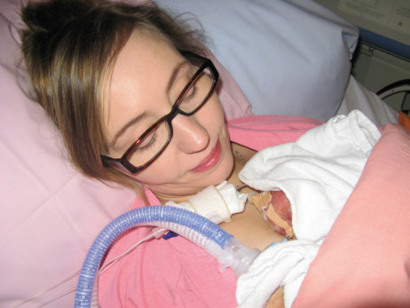
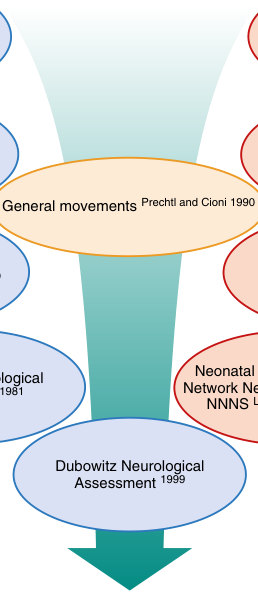
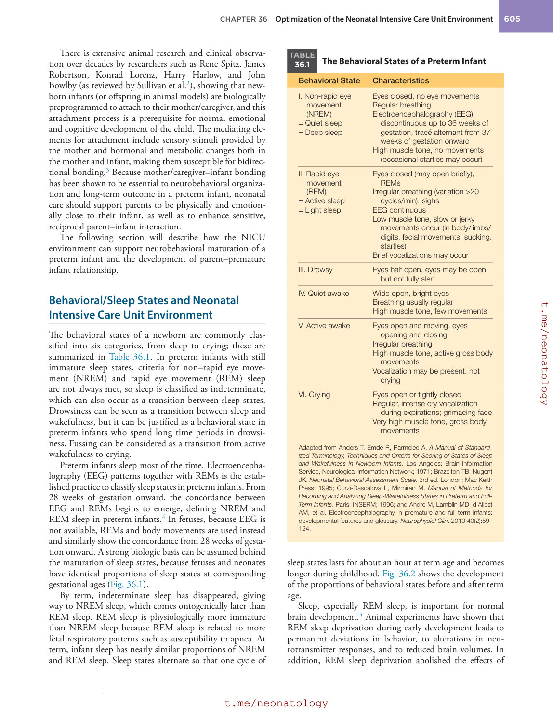
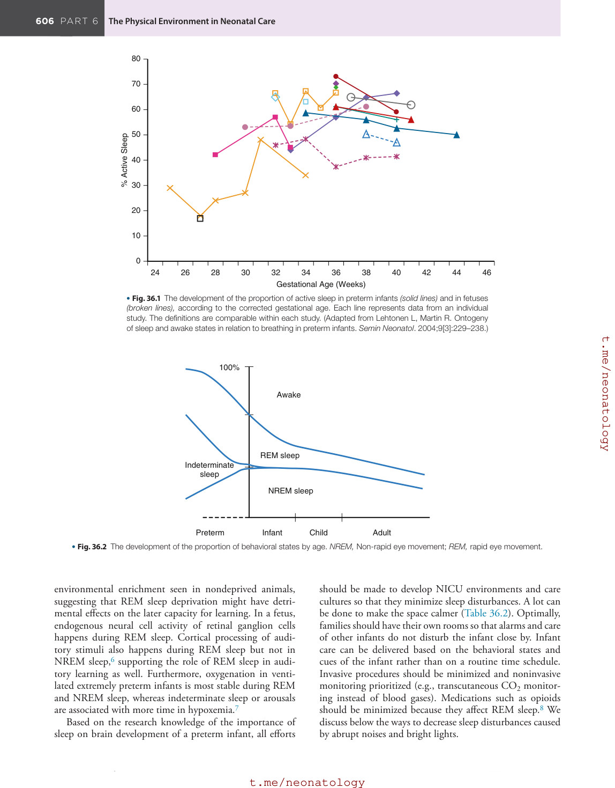
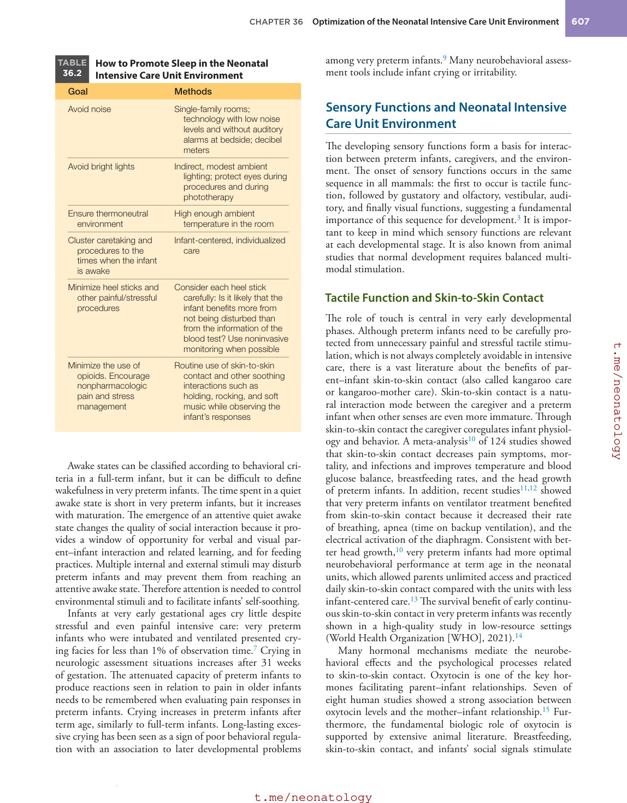
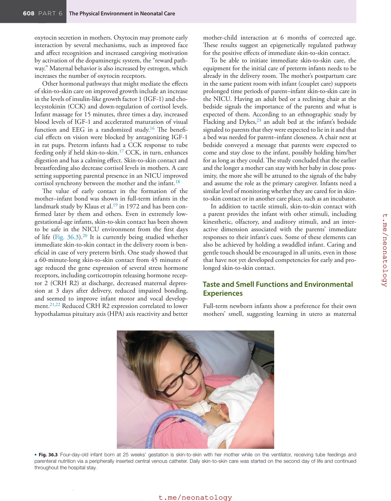
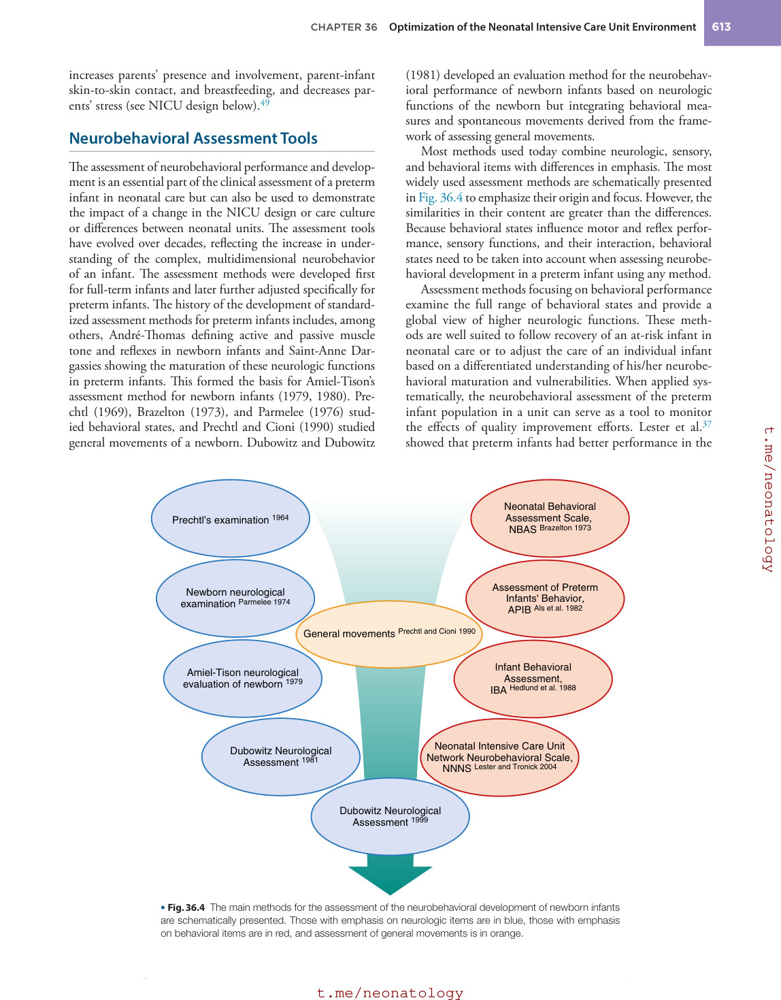
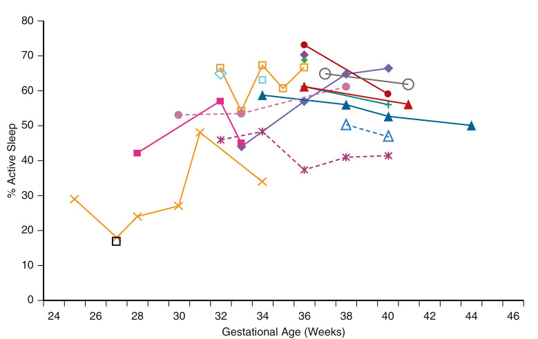

# 36. Optimization of the Neonatal Intensive Care Unit Environment
> [Source credits](../../SOURCE_CREDITS.md).

## Study pillars

### Developmental context

Physical and social experiences can modify developing neural connections. Rapid growth, synaptogenesis and plasticity make care experiences capable of supporting or disrupting development.

PDF p. 615

### Sleep-state maturity

Indeterminate sleep. Immature sleep states may not meet established REM or NREM criteria and can be classified as indeterminate.

PDF p. 616

### Supportive touch

Coregulation of infant physiology and behavior. The source describes physiologic, behavioral, thermal and breastfeeding benefits of supported skin-to-skin contact.

PDF p. 618

### Pain without strong behavior

Pain sensitivity remains despite immature behavioral expression. Very preterm infants are pain-sensitive despite weak overt responses; repeated pain is associated with developmental effects.

PDF p. 621

### Lactation-supportive design

Privacy, accessible pumps, comfortable chairs and convenient milk storage. Practical design and valuing breastfeeding as interaction support expression and feeding opportunities.

PDF p. 622

## Full source extraction

# 36. Optimization of the Neonatal Intensive Care Unit Environment
> Source attribution: [Source credits](../../SOURCE_CREDITS.md).

## PDF page 615 | printed page 604

36 Optimization of the Neonatal Intensive Care Unit Environment

### LIISA LEHTONEN AND ROBERT WHITE

### Neurobehavioral Maturation

The expected physiologic environment for a preterm infant would be in utero—floating and moving in warm amniotic fluid, mostly in a flexed position, tasting the amniotic fluid, sensing their mother’s movements and circadian rhythm, hearing her voice and sounds from her body but being protected from loud noises, receiving rich amounts of nutrients for optimal growth, and performing gas exchange through the placenta. Full-term newborns demonstrate capabilities they have developed and learned during their fetal life: they recognize their mother’s smell and voice, and they are ready to crawl to the breast of the mother and start sucking from the breast during the first hour of life. From this time point onward, development continues in both physical and emotional closeness with the caregivers and the larger social environment, optimally by getting breast milk directly from the breast for the first months of life.

The neurobehavioral maturation of a preterm infant is based on the genetically programmed development that normally occurs in utero, including highly active axonal and dendritic growth, myelination, synaptogenesis, and proliferation of microglia and astrocytes. This development is modified by environmental influences in the neonatal intensive care unit (NICU), often for several weeks or months. This environment is completely different from the physiologic in utero environment. The stimuli experienced by the developing brain in the NICU can either strengthen or weaken the development of specific neural connections, or they can modify the reading of the genetic information by epigenetic mechanisms.1 The time window during prematurity and early infancy is a time of unique plasticity, allowing therapeutic interventions to compensate for structural brain injuries. Therefore the quality of the hospital care has a large potential to affect the long-term developmental outcome of preterm infants. Medical treatments and

604

procedures, medications and nutrition, the physical and social environment, and routine infant care can be either nurturing or directly toxic to the brain. Experiences in the NICU environment should be designed to keep in mind the physiologic, age-appropriate in utero environment as a point of reference, while also understanding that just as the heart, lungs, and other organs must function differently after delivery than they did in utero, so too must certain elements of neurodevelopmental support.

Depending on their gestational age at birth, preterm infants are born at different developmental stages with a large variation in the degree of immaturity of the central and autonomous nervous systems and sensory functions. Whereas a full-term newborn infant has a well-developed sleep-wake cycle; is capable of reciprocal social interaction, meaningful behaviors, and responding to stimuli from the environment; and has abilities to breastfeed, a preterm infant has an attenuated capacity to regulate behavioral/ sleep states and has problems processing or even tolerating a high amount of sensory information, as well as immature feeding competencies and undifferentiated and/or weak signals about their needs or stress. Their skills for social interaction are immature, especially for visual interaction, emphasizing the role of those senses that develop in earlier phases of fetal life.

A preterm infant has especially poor compensatory capacities in response to stressful stimuli, which cannot be completely avoided because of the many inevitable invasive procedures in the NICU environment. Therefore focusing on a developmentally supportive physical and social environment is especially important during prematurity when infants are still developing their capacities to reach a balanced state (i.e., to achieve neurobehavioral organization and to be able to interact with the caregivers). Reciprocity has been shown to be an essential factor supporting learning and parent–infant bonding.

## PDF page 616 | printed page 605

There is extensive animal research and clinical observation over decades by researchers such as Rene Spitz, James Robertson, Konrad Lorenz, Harry Harlow, and John Bowlby (as reviewed by Sullivan et al.2), showing that newborn infants (or offspring in animal models) are biologically preprogrammed to attach to their mother/caregiver, and this attachment process is a prerequisite for normal emotional and cognitive development of the child. The mediating elements for attachment include sensory stimuli provided by the mother and hormonal and metabolic changes both in the mother and infant, making them susceptible for bidirectional bonding.3 Because mother/caregiver–infant bonding has been shown to be essential to neurobehavioral organization and long-term outcome in a preterm infant, neonatal care should support parents to be physically and emotionally close to their infant, as well as to enhance sensitive, reciprocal parent–infant interaction.

The following section will describe how the NICU environment can support neurobehavioral maturation of a preterm infant and the development of parent–premature infant relationship.

### Behavioral/Sleep States and Neonatal Intensive Care Unit Environment

The behavioral states of a newborn are commonly classified into six categories, from sleep to crying; these are summarized in Table 36.1. In preterm infants with still immature sleep states, criteria for non–rapid eye movement (NREM) and rapid eye movement (REM) sleep are not always met, so sleep is classified as indeterminate, which can also occur as a transition between sleep states. Drowsiness can be seen as a transition between sleep and wakefulness, but it can be justified as a behavioral state in preterm infants who spend long time periods in drowsiness. Fussing can be considered as a transition from active wakefulness to crying.

Preterm infants sleep most of the time. Electroencephalography (EEG) patterns together with REMs is the established practice to classify sleep states in preterm infants. From 28 weeks of gestation onward, the concordance between EEG and REMs begins to emerge, defining NREM and REM sleep in preterm infants.4 In fetuses, because EEG is not available, REMs and body movements are used instead and similarly show the concordance from 28 weeks of gestation onward. A strong biologic basis can be assumed behind the maturation of sleep states, because fetuses and neonates have identical proportions of sleep states at corresponding gestational ages (Fig. 36.1).

By term, indeterminate sleep has disappeared, giving way to NREM sleep, which comes ontogenically later than REM sleep. REM sleep is physiologically more immature than NREM sleep because REM sleep is related to more fetal respiratory patterns such as susceptibility to apnea. At term, infant sleep has nearly similar proportions of NREM and REM sleep. Sleep states alternate so that one cycle of

TABLE

The Behavioral States of a Preterm Infant

36.1

Behavioral State Characteristics

I. Non-rapid eye

Eyes closed, no eye movements Regular breathing Electroencephalography (EEG)

movement (NREM) = Quiet sleep = Deep sleep

discontinuous up to 36 weeks of gestation, tracé alternant from 37 weeks of gestation onward High muscle tone, no movements

(occasional startles may occur)

II. Rapid eye

Eyes closed (may open briefly),

movement (REM) = Active sleep = Light sleep

REMs Irregular breathing (variation >20

cycles/min), sighs EEG continuous Low muscle tone, slow or jerky

movements occur (in body/limbs/ digits, facial movements, sucking, startles) Brief vocalizations may occur

III. Drowsy Eyes half open, eyes may be open

but not fully alert

IV. Quiet awake Wide open, bright eyes Breathing usually regular High muscle tone, few movements

V. Active awake Eyes open and moving, eyes

opening and closing Irregular breathing High muscle tone, active gross body

movements Vocalization may be present, not

crying

VI. Crying Eyes open or tightly closed Regular, intense cry vocalization

during expirations; grimacing face Very high muscle tone, gross body

movements

Adapted from Anders T, Emde R, Parmelee A. A Manual of Standardized Terminology, Techniques and Criteria for Scoring of States of Sleep and Wakefulness in Newborn Infants. Los Angeles: Brain Information Service, Neurological Information Network; 1971; Brazelton TB, Nugent JK. Neonatal Behavioral Assessment Scale. 3rd ed. London: Mac Keith Press; 1995; Curzi-Dascalova L, Mirmiran M. Manual of Methods for Recording and Analyzing Sleep-Wakefulness States in Preterm and Full- Term Infants. Paris: INSERM; 1996; and Andre M, Lamblin MD, d’Allest AM, et al. Electroencephalography in premature and full-term infants: developmental features and glossary. Neurophysiol Clin. 2010;40(2):59– 124.

sleep states lasts for about an hour at term age and becomes longer during childhood. Fig. 36.2 shows the development of the proportions of behavioral states before and after term age.

Sleep, especially REM sleep, is important for normal brain development.5 Animal experiments have shown that REM sleep deprivation during early development leads to permanent deviations in behavior, to alterations in neurotransmitter responses, and to reduced brain volumes. In addition, REM sleep deprivation abolished the effects of

## PDF page 617

80

70

60

50

% Active Sleep

40

30

20

10

0 24 26 28 30 32 34 Gestational Age (Weeks)

• Fig. 36.1 The development of the proportion of active sleep in preterm infants (solid lines) and in fetuses (broken lines), according to the corrected gestational age. Each line represents data from an individual study. The definitions are comparable within each study. (Adapted from Lehtonen L, Martin R. Ontogeny of sleep and awake states in relation to breathing in preterm infants. Semin Neonatol. 2004;9[3]:229–238.)

100%

Awake

REM sleep

Indeterminate

sleep

NREM sleep

Child Infant

Preterm • Fig. 36.2 The development of the proportion of behavioral states by age. NREM, Non-rapid eye movement; REM, rapid eye movement.

environmental enrichment seen in nondeprived animals, suggesting that REM sleep deprivation might have detrimental effects on the later capacity for learning. In a fetus, endogenous neural cell activity of retinal ganglion cells happens during REM sleep. Cortical processing of auditory stimuli also happens during REM sleep but not in NREM sleep,6 supporting the role of REM sleep in auditory learning as well. Furthermore, oxygenation in ventilated extremely preterm infants is most stable during REM and NREM sleep, whereas indeterminate sleep or arousals are associated with more time in hypoxemia.7

Based on the research knowledge of the importance of sleep on brain development of a preterm infant, all efforts

36 38 40 42 44 46

Adult

should be made to develop NICU environments and care cultures so that they minimize sleep disturbances. A lot can be done to make the space calmer (Table 36.2). Optimally, families should have their own rooms so that alarms and care of other infants do not disturb the infant close by. Infant care can be delivered based on the behavioral states and cues of the infant rather than on a routine time schedule. Invasive procedures should be minimized and noninvasive monitoring prioritized (e.g., transcutaneous CO2 monitoring instead of blood gases). Medications such as opioids should be minimized because they affect REM sleep.8 We discuss below the ways to decrease sleep disturbances caused by abrupt noises and bright lights.

### Automatic table extraction — verify rendered original

|100%|Col2|Col3|Col4|
|---|---|---|---|
|100% Awake REM sleep NREM sleep Indeterminate sleep|Awake REM sleep NREM sleep|Awake REM sleep NREM sleep|Awake REM sleep NREM sleep|
|100% Awake REM sleep NREM sleep Indeterminate sleep|Awake REM sleep NREM sleep|||

[Original table](../../tables/ch036_p0617_1.jpg)

## PDF page 618 | printed page 607

How to Promote Sleep in the Neonatal

TABLE

36.2

Intensive Care Unit Environment

Goal Methods

Avoid noise Single-family rooms;

technology with low noise levels and without auditory alarms at bedside; decibel meters

Avoid bright lights Indirect, modest ambient

lighting; protect eyes during procedures and during phototherapy

Ensure thermoneutral

High enough ambient

environment

temperature in the room

Cluster caretaking and

Infant-centered, individualized

procedures to the times when the infant is awake

care

Minimize heel sticks and

Consider each heel stick

other painful/stressful procedures

carefully: Is it likely that the infant benefits more from not being disturbed than from the information of the blood test? Use noninvasive monitoring when possible

Minimize the use of

Routine use of skin-to-skin

opioids. Encourage nonpharmacologic pain and stress management

contact and other soothing interactions such as holding, rocking, and soft music while observing the infant’s responses

Awake states can be classified according to behavioral criteria in a full-term infant, but it can be difficult to define wakefulness in very preterm infants. The time spent in a quiet awake state is short in very preterm infants, but it increases with maturation. The emergence of an attentive quiet awake state changes the quality of social interaction because it provides a window of opportunity for verbal and visual parent–infant interaction and related learning, and for feeding practices. Multiple internal and external stimuli may disturb preterm infants and may prevent them from reaching an attentive awake state. Therefore attention is needed to control environmental stimuli and to facilitate infants’ self-soothing.

Infants at very early gestational ages cry little despite stressful and even painful intensive care: very preterm infants who were intubated and ventilated presented crying facies for less than 1% of observation time.7 Crying in neurologic assessment situations increases after 31 weeks of gestation. The attenuated capacity of preterm infants to produce reactions seen in relation to pain in older infants needs to be remembered when evaluating pain responses in preterm infants. Crying increases in preterm infants after term age, similarly to full-term infants. Long-lasting excessive crying has been seen as a sign of poor behavioral regulation with an association to later developmental problems

among very preterm infants.9 Many neurobehavioral assessment tools include infant crying or irritability.

### Sensory Functions and Neonatal Intensive Care Unit Environment

The developing sensory functions form a basis for interaction between preterm infants, caregivers, and the environment. The onset of sensory functions occurs in the same sequence in all mammals: the first to occur is tactile function, followed by gustatory and olfactory, vestibular, auditory, and finally visual functions, suggesting a fundamental importance of this sequence for development.3 It is important to keep in mind which sensory functions are relevant at each developmental stage. It is also known from animal studies that normal development requires balanced multimodal stimulation.

### Tactile Function and Skin-to-Skin Contact

The role of touch is central in very early developmental phases. Although preterm infants need to be carefully protected from unnecessary painful and stressful tactile stimulation, which is not always completely avoidable in intensive care, there is a vast literature about the benefits of parent–infant skin-to-skin contact (also called kangaroo care or kangaroo-mother care). Skin-to-skin contact is a natural interaction mode between the caregiver and a preterm infant when other senses are even more immature. Through skin-to-skin contact the caregiver coregulates infant physiology and behavior. A meta-analysis10 of 124 studies showed that skin-to-skin contact decreases pain symptoms, mortality, and infections and improves temperature and blood glucose balance, breastfeeding rates, and the head growth of preterm infants. In addition, recent studies11,12 showed that very preterm infants on ventilator treatment benefited from skin-to-skin contact because it decreased their rate of breathing, apnea (time on backup ventilation), and the electrical activation of the diaphragm. Consistent with better head growth,10 very preterm infants had more optimal neurobehavioral performance at term age in the neonatal units, which allowed parents unlimited access and practiced daily skin-to-skin contact compared with the units with less infant-centered care.13 The survival benefit of early continuous skin-to-skin contact in very preterm infants was recently shown in a high-quality study in low-resource settings (World Health Organization [WHO], 2021).14

Many hormonal mechanisms mediate the neurobehavioral effects and the psychological processes related to skin-to-skin contact. Oxytocin is one of the key hormones facilitating parent–infant relationships. Seven of eight human studies showed a strong association between oxytocin levels and the mother–infant relationship.15 Furthermore, the fundamental biologic role of oxytocin is supported by extensive animal literature. Breastfeeding, skin-to-skin contact, and infants’ social signals stimulate

## PDF page 619

oxytocin secretion in mothers. Oxytocin may promote early interaction by several mechanisms, such as improved face and affect recognition and increased caregiving motivation by activation of the dopaminergic system, the “reward pathway.” Maternal behavior is also increased by estrogen, which increases the number of oxytocin receptors.

Other hormonal pathways that might mediate the effects of skin-to-skin care on improved growth include an increase in the levels of insulin-like growth factor 1 (IGF-1) and cholecystokinin (CCK) and down-regulation of cortisol levels. Infant massage for 15 minutes, three times a day, increased blood levels of IGF-1 and accelerated maturation of visual function and EEG in a randomized study.16 The beneficial effects on vision were blocked by antagonizing IGF-1 in rat pups. Preterm infants had a CCK response to tube feeding only if held skin-to-skin.17 CCK, in turn, enhances digestion and has a calming effect. Skin-to-skin contact and breastfeeding also decrease cortisol levels in mothers. A care setting supporting parental presence in an NICU improved cortisol synchrony between the mother and the infant.18

The value of early contact in the formation of the mother–infant bond was shown in full-term infants in the landmark study by Klaus et al.19 in 1972 and has been confirmed later by them and others. Even in extremely lowgestational-age infants, skin-to-skin contact has been shown to be safe in the NICU environment from the first days of life (Fig. 36.3).20 It is currently being studied whether immediate skin-to-skin contact in the delivery room is beneficial in case of very preterm birth. One study showed that a 60-minute-long skin-to-skin contact from 45 minutes of age reduced the gene expression of several stress hormone receptors, including corticotropin releasing hormone receptor 2 (CRH R2) at discharge, decreased maternal depression at 3 days after delivery, reduced impaired bonding, and seemed to improve infant motor and vocal development.21,22 Reduced CRH R2 expression correlated to lower hypothalamus pituitary axis (HPA) axis reactivity and better

• Fig. 36.3 Four-day-old infant born at 25 weeks’ gestation is skin-to-skin with her mother while on the ventilator, receiving tube feedings and parenteral nutrition via a peripherally inserted central venous catheter. Daily skin-to-skin care was started on the second day of life and continued throughout the hospital stay.

mother-child interaction at 6 months of corrected age. These results suggest an epigenetically regulated pathway for the positive effects of immediate skin-to-skin contact.

To be able to initiate immediate skin-to-skin care, the equipment for the initial care of preterm infants needs to be already in the delivery room. The mother’s postpartum care in the same patient room with infant (couplet care) supports prolonged time periods of parent–infant skin-to-skin care in the NICU. Having an adult bed or a reclining chair at the bedside signals the importance of the parents and what is expected of them. According to an ethnographic study by Flacking and Dykes,23 an adult bed at the infant’s bedside signaled to parents that they were expected to lie in it and that a bed was needed for parent–infant closeness. A chair next at bedside conveyed a message that parents were expected to come and stay close to the infant, possibly holding him/her for as long as they could. The study concluded that the earlier and the longer a mother can stay with her baby in close proximity, the more she will be attuned to the signals of the baby and assume the role as the primary caregiver. Infants need a similar level of monitoring whether they are cared for in skinto-skin contact or in another care place, such as an incubator.

In addition to tactile stimuli, skin-to-skin contact with a parent provides the infant with other stimuli, including kinesthetic, olfactory, and auditory stimuli, and an interactive dimension associated with the parents’ immediate responses to their infant’s cues. Some of these elements can also be achieved by holding a swaddled infant. Caring and gentle touch should be encouraged in all units, even in those that have not yet developed competencies for early and prolonged skin-to-skin contact.

### Taste and Smell Functions and Environmental Experiences

Full-term newborn infants show a preference for their own mothers’ smell, suggesting learning in utero as maternal

• Fig. 36.3 Four-day-old infant born at 25 weeks’ gestation is skin-to-skin with her mother while on the ventilator, receiving tube feedings and parenteral nutrition via a peripherally inserted central venous catheter. Daily skin-to-skin care was started on the second day of life and continued throughout the hospital stay.

## PDF page 620 | printed page 609

dietary flavors are transmitted to the amniotic fluid and recognized as both flavors and odors by the term newborn. Fetuses show behavioral responses to taste as early as 16 weeks of gestation. Behavioral or cortical blood flow responses to olfactory stimuli have been documented in preterm infants from 28 to 35 weeks of gestation.24

Familiar tastes and smells can be used in NICU environments to calm the preterm infant. During tube feeding, drops of maternal breast milk on the tip of the infant’s tongue familiarize her/him to the taste of maternal breast milk. Smell has been used as a calming method, along with other sensory elements, by bringing the mother’s smell to the baby in a fabric.25 Smell might be one beneficial component of mother–infant skin-to-skin contact and can be available even without the presence of the mother.

### Vestibular/Proprioceptive Functions

Newborn babies are carried around by their caregivers for most of the day in many traditional cultures. Better motor development is shown in the infants who are carried in an upright position, facing the caregiver and legs flexed. Rocking is also a common experience provided to young infants. Fetuses are exposed to acceleratory environment when the mother moves, usually for most of the day. The care provided for very preterm infants in incubators is far from these physiologic situations in fetuses and full-term infants. Lying in one flat position easily molds the skull of a preterm infant. It can be hypothesized that the lack of upright position and lack of experiences of acceleratory movements during early development partly explain later problems in motor coordination commonly seen in very preterm infants.

### Auditory Functions and Environmental Experiences

Fetal auditory learning is suggested by newborn infants’ preference for the voices of their own mothers and to music their mothers listened to during pregnancy. Auditory function in fetuses develops during pregnancy in an environment in which amniotic fluid and maternal tissues protect the fetus from high-frequency noise. All axonal layers of the auditory cortex are found histologically by 25 weeks of gestation, but the density of the axons increases up to 9 months of corrected age, suggesting increasing cortical capacity in processing sounds.

Very preterm infants from 23 weeks of gestation react behaviorally and electrophysiologically to intense auditory signals. Fetuses have been shown to have magnetoelectrographic responses to auditory stimuli from 28 weeks of gestation. Very preterm infants born below 30 weeks of gestation show different auditory evoked potentials compared with older preterm infants when tested at 35 weeks of gestation, suggesting that the development of auditory functions is affected by the NICU environment as compared with the intrauterine environment.26

When skin-to-skin contact is practiced, the infant can hear the heartbeat and breathing sounds of the parent and also the parent’s voice, which are normal stimuli during fetal life as well. Parental voice seems, indeed, to be one important stimulus for infant development. A study showed that preterm infants vocalized more actively already at 32 weeks of gestation when the parents were present compared with when the staff were present.27 Later language development correlated to the amount of adult words these very preterm infants had heard at 32 weeks of gestation.28 Consistently, very preterm infants had better language development if their mothers were actively involved in their care compared with low involvement mothers.29 The infants cared for in a single-family room NICU supporting parents’ presence had better language development compared with those cared for in an open-bay model.30 Consistently, if preterm infants were cared for in private patient rooms without parents’ beds and mostly separated from the parents, their language development was more delayed than those cared for in an open unit model.31

All these studies support NICU environments where parents are engaged in the care of their infants and where they have a calm and private environment to talk, and maybe sing, to and with their infants. The parent’s voice may have many benefits compared with the unfamiliar voices of the staff members: the parent’s voice is familiar to the newborn from the intrauterine environment, and its familiarity strengthens during postnatal time; the parent’s voice might include more emotional components; and the parent’s talk is likely to be more sensitively tuned to the infant’s cues and responses.

It is important and possible to control noise in the neonatal environment. Noise disturbs the developing auditory system of a preterm infant and is a source of stress for both the infant and the parent. Even moderate elevations of sound levels disturb sleep, decrease oxygen saturation, and increase heart rate in preterm infants.32 The noise level of any equipment should be taken into account when making decisions on purchases, encouraging development of more quiet equipment. Patient monitors can be silent in the patient room, transmitting alarms only to the staff member responsible for the patient, thereby avoiding disturbing the patient and parents. Technologies could be improved to increase the reliability of signals, thereby decreasing false alarms, which would benefit infant and staff. Single-family room design is more quiet than open ward design33 because such design prevents infants from being exposed to the noise from alarms and care of other patients.

### Visual Functions and Environmental Experiences

The visual system matures in utero anatomically and functionally, even if fetuses are not exposed to discrete visual stimuli. Endogenous neural cell activity of retinal ganglion cells is an important part of visual system development. Together with sleep cycle organization, the endogenous

## PDF page 621

neural activity concentrates in REM sleep periods. Stimuli disturbing the immature retina or REM sleep might interfere with the development of the visual system. Therefore exposure to bright lights is one potentially toxic but avoidable environmental stimulus. Extremely preterm infants can already react to bright light. The capability to follow an object emerges at 29 to 30 weeks of gestation. Although preterm infants have been reported to be ahead of full-term infants in visual tracking at term, delays have been reported in preterm infants compared with full-term infants in many dimensions of visual functioning such as smoothly pursuing eye movements and cortical vision. These delays suggest that the development of visual function is affected by the neonatal care environment as compared with the intrauterine environment. Maturation in vision, eye movements, and cortical vision will continue after term age.

One implication of research on the development of vision on NICU design is that ambient light should be gentle, preferably with moderate daytime lighting to provide a circadian stimulus. The rooms should be designed with indirect ambient lighting with levels adjustable through a range of 10 to 600 lux. When needed for procedures, the light should be a spotlight directed only to the area of attention, and the eyes of the patient should be covered. The level of lighting is affected by the design. Areas with daylight windows get more light, but they also have a more pronounced circadian variation in light levels.33

### Circadian Rhythm and Neonatal Intensive Care Unit Environment

Circadian rhythmicity has developed during evolution to adjust life to the rotation of earth. Specific genes have been identified that regulate circadian rhythmicity, yet it is profoundly affected by the sensory environment, especially light. In newborn infants, circadian rhythm is not yet mature and the shorter, about 1.5- to 3-hour sleep (ultradian) cycles, reinforced by feedings, dominate. Wakefulness starts to cluster toward daytime during the second month after term, and a clear rhythm following the 24-hour day is normally developed by 1 year of age.

During fetal life, circadian rhythmicity operates quite differently than during the rest of life. The fetus has a well-developed circadian rhythm by the end of the second trimester, probably influenced by multiple maternal physical stimuli (movement, body temperature) and hormonal timekeepers (transplacental melatonin, cortisol). In preterm infants, a circadian rhythm cannot be detected, even though the neural mechanisms to respond to a circadian light stimulus are intact by early in the third trimester. The NICU environment provides few circadian stimuli: body temperature is rigidly servo controlled, touch and kinesthetic stimuli are as likely to occur in the middle of the night as during the day, and access to maternal rhythms of melatonin and cortisol, present in breast milk, is often prevented by the

administration of breast milk without regard for the time it was expressed or by the use of artificial formula. Even skinto-skin contact with the mother for several hours a day may not be sufficient to impart circadian information to the preterm infant. According to a meta-analysis, circadian cycling of light might shorten the hospital stay as compared with continuous light or constant darkness34 and can therefore be recommended.

### Sensory Functions and Pain

Very preterm infants have not yet developed clear behavioral pain responses. The robustness of pain responses (crying, arousal, and facial grimace) increases with development. Even if poorly capable of displaying clear behavioral responses, preterm infants are sensitive to pain. Blood flow changes in the contralateral somatosensory cortex have been shown to be related to a heel stick as early as 25 weeks of gestation, and the blood flow responses are stronger at lower gestational ages compared with more mature preterm infants.35 Recurrent pain exposure in preterm infants may delay their growth, alter their brain maturation and performance in neurobehavioral assessments, and impair their motor and cognitive development.36

As both pain and pain medications are potentially harmful for brain development, the optimal solution is to avoid both of them. The care of preterm infants has become less invasive and more gentle over time. Interestingly, Lester et al. showed that the infants cared for in a single-family room were exposed to fewer procedures than infants in the old open-bay unit.37 This may reflect better stability of the infants in single-family rooms or a higher threshold for the staff to do procedures in the presence of parents.

Skin-to-skin contact in different forms has been used to alleviate pain and stress in preterm infants.38 Parents can effectively alleviate the stress/pain behavior of their preterm infant by holding the infant with their warm hands in a flexed position during a heel stick.39

### Muscle Tone, Movements, and Reflexes

Preterm infants typically have lower muscle tone and less coordinated movements than full-term infants. A flexed position maintained most of the time in utero supports infants’ self-soothing abilities, such as bringing the hand to the mouth (Box 36.1). To provide similar opportunities for preterm infants, special attention in nursing care needs to be paid to supporting a flexed position in a preterm infant both during rest and during handling. Although healthy preterm infants can reach the same level in muscle tone, tone distribution, spontaneous movements, and reflex functions by term as full-term infants, preterm infants present a larger variation in their performance, especially in muscle tone. This variation makes it more difficult to define neurologic normality in preterm infants at term equivalent age than in

## PDF page 622 | printed page 611

• BOX 36.1 Examples of Behavioral Signs of a

Preterm Infant Indicating Stress/ Avoidance and Self-Soothing/Approach Behavior

Stress Signs/Avoidance

Abnormal cry (high-pitched, monotonous, weak), irritability Abrupt behavioral state changes, unable to reach quiet awake

state Gaze aversion, abnormal eye movements Labored breathing Yawning, sneezing, hiccoughing Burping, gagging Pale, mottled, cyanosis Startles, tremors Hypertonia, back arching, fisting, extension of arms and legs

Self-Soothing Behaviors/Approach

Visual fixation Hand-to-mouth Sucking on the fist/thumb/fingers Stroking the face Crossing arms/legs Grasping cords/tubes/blanket Bracing leg(s) Moving to a flexed posture

Adapted from Boukydis CF, Bigsby R, Lester BM. Clinical use of the Neonatal Intensive Care Unit Network Neurobehavioral Scale. Pediatrics. 2004;113(3 Pt 2):679–689.

full-term infants. Preterm infants at term tend to have less flexor limb tone, less head control, and increased hyperexcitability seen in brisk reflexes, strong grasp, startles, and tremors.

The flexed position of a preterm infant should be supported in their environment, whether it is in an incubator or on a parent’s chest, or during rest or handling. It is an open question how much movement (vestibular stimulation) the care environment should offer for a preterm infant as current care does not usually provide such stimulation.

### Sucking and Swallowing

A fetus swallows amniotic fluid from 12 weeks of gestation in increasing amounts as sucking movements develop as an integral part of age-appropriate neurobehavioral development. Immature sucking patterns with short bursts and long pauses develop into long, rhythmic sucking bursts of 10 to 30 sucks per burst. To be able to feed orally, a preterm infant must be able to synchronize sucking and swallowing with breathing. Both respiratory stability and sufficient neurobehavioral organization are required for safe and efficient oral feeding. Nonnutritive sucking has been used as an indicator for readiness for oral feeding, but there are no proven feeding readiness instruments to predict the time to full oral feedings. Breastfeeding seems to be easier for preterm infants to coordinate with breathing compared with

bottle feeding. Even if respiratory stability requires ventilator support, the first feeding experiences, such as licking/ sucking the breast or small drops of milk from a syringe, can be initiated for the infant’s pleasure and learning. Full oral feeding is reached at an earlier postmenstrual age by infants born at lower gestational age, suggesting that exposure to (breast) feeding enhances learning. Controlled studies have demonstrated that nonnutritive sucking, sensory stimulation, and early initiation of oral feedings enhance the learning of nutritive sucking.40 In some studies, however, it might be that the experimental settings allow the infants with readiness for feeding to feed earlier than is allowed in the control groups, and in many clinical practices in which feeding may be rigidly based on weeks of gestation instead of the infant’s individual capacities. Full oral feeding can be achieved by most infants at 34 to 36 weeks of gestation, and almost all preterm infants are capable of full oral feedings at 38 weeks of gestation, even if the efficacy of feeding increases after infants reach term. The key is to sensitively observe the behavioral state and cues of the infant to see the readiness of the infant to feed and support the mother’s presence to make breastfeeding directly from the breast available.

### Environmental Support of Growth

During the period of rapid growth, it remains challenging to provide a preterm infant with nutrition comparable to the nutrition provided through the placenta to a fetus during normal pregnancy. The initiation and maintenance of sufficient lactation to enable breastfeeding when the infant is ready for it is also a challenge for the mothers of preterm infants. In full-term infants, breastfeeding relates to higher IQ scores as shown in a cluster randomized study design.41 This effect may be a sum of optimal nutrients and many bioactive components in maternal milk such as hormones, immune and growth factors, stem cells and microbes, as well as the mother–infant closeness and interaction components of breastfeeding.42 Better developmental outcome was found in very preterm infants who were breastfed at discharge despite lower weight gain before term age compared with formula-fed controls.43 Both the duration of breastfeeding and the amount of breast milk intake during neonatal care have been shown to correlate in a dose-response relationship with developmental outcome in very preterm infants.30

The NICU care culture and environment can support breast milk pumping and breastfeeding in many ways. It is important to value breastfeeding as an important opportunity for mother–infant interaction regardless of the volume of milk produced/ingested. Providing privacy for pumping and breastfeeding is important to many mothers. Breast milk pumps, comfortable chairs and refrigerators in the patient rooms, and easy milk logistics are essential parts of NICU design. Maternal breast milk volumes have been shown to be higher and exclusive breastfeeding at discharge higher among mothers of very preterm infants in a

## PDF page 623

single-family room NICU compared with earlier open-bay units.44

### Environmental Protection From Infections

If a preterm infant is treated for sepsis during the hospital stay, the risk for death or cerebral palsy increases.45 Therefore care routines and design protecting preterm infants from nosocomial infections are also important from the perspective of infant neurodevelopment. Research evidence consistently shows that single-family room design decreases the risk of sepsis.44,46 It may be caused by better location/ availability for hand disinfectants and sinks for handwashing, longer distances and separation between patients, or parents’ surveillance and control over staff hand hygiene. If one patient stays in the same room throughout the stay, the spread of (multiresistant) bacteria may decrease within the unit as well.

### Environmental Support of Parent–Infant Interaction

Animal research has shown that the mother/parent is an important regulator of infant physiology, behavior, and development, and separation from the parent produces dysregulation in the offspring’s brain functioning and behavior. In modern NICU care, parents are included in the care team rather than being considered visitors. Parental presence in the NICU has been shown to be associated with better neurobehavioral organization of the infant during the neonatal period47 and subsequent behavioral problems up to 7 years of age.48 Neonatal care has more recently been organized in such a way that parent–infant separation is minimized by using couplet care immediately after birth, followed by various models of single-family room design.46 A meta-analysis concluded that single-family room design increases parents’ presence, involvement, and parent–infant skin-to-skin contact, as well as decreases parents’ stress levels.49 Whereas there is little research on the effects of architecture on the long-term development of preterm infants,44 Vohr et al.30 showed improved cognitive and language scores in very preterm infants cared for in a single-family room design as compared with the outcomes of the infants cared for in the previous open-bay unit NICU. More studies with a sufficient time period for follow-up are needed to learn about how changes in parent–infant interaction are reflected in the long-term child development.

Parents’ presence can be supported, in addition to architectural design supporting parents’ presence, by operational strategies that include them in the care of their infant in a meaningful way. Several intervention programs support parent–staff collaboration and guide them to use the knowledge of infant neurobehavior and infant cues in neonatal care. Preterm infants have the capacity to show stress signs or avoidance behaviors when overwhelmed, and they use self-soothing behaviors and show approach behaviors (see

Box 36.1). As the staff and parents understand how to adjust the amount of stimulation and interaction to the immediate capacity of their infant, they can help the infant to reach and sustain a quiet awake state, or they can support the infant’s sleep. Parents and staff can plan the everyday care of the infants so that it is guided by the individual neurobehavioral signs of the preterm infant to synchronize the care better with the infant’s needs. Parents’ involvement will bring consistency, and most likely also warm affection, in the style of care during the hospital stay. After discharge, this consistency will extend to the care at home.

The basis of the parent–infant relationship after preterm birth is formed during neonatal hospital care. Thereby, the engagement of the parents during hospital time modifies the neurobehavioral development of the preterm infants during neonatal care and throughout childhood. In a study on the Mother–Infant Transaction Program, carried out around discharge, the intervention group demonstrated more nurturing child-rearing attitudes when the child was 12 and 24 months old, progressively decreasing parenting stress scores over years50 and improved cognitive development in the children at 5 years of age.51 This study suggests that parenting interventions during neonatal care can start a positive trajectory early on and that the effects accumulate over years and are mediated through different dimensions of parent–infant interaction. It is noteworthy that the differences in neurodevelopment were not yet measurable at 2 years of corrected age, showing that the intervention effect on cognition is not measurable at 24 months and/or progresses after 24 months of age.

Evidence is accumulating regarding family-centered neonatal care interventions that promote partnership with parents in infant care, individualized care, and support for parenting. Such interventions have been shown to decrease parents’ stress, anxiety, and depression, and to improve parent satisfaction and infant growth.52,53 Parents’ participation in infant care and in care-related decisions and emotional support provided to parents by staff have been important elements in family-centered care explaining variation in later depressive symptoms among parents of preterm infants.54 Because the incidence of postpartum depression in the mothers of preterm infants is high, the quality improvements in family-centered care can potentially improve the psychological growth environment of a large number of preterm infants. A Cochrane meta-analysis of early interventions concluded that the interventions focusing on the parent–infant relationship, in addition to infant development, had the greatest impact on cognitive outcome of the children.55

Parents’ participation in infant care and in decision-making about infant care, skin-to-skin contact during intensive care, and continuing with breastfeeding during convalescent care are safe ways to decrease parent–infant separation and to provide the mother a unique role in caregiving. The NICU design can support parents’ participation and probably also the optimal long-term neurodevelopmental outcomes of preterm infants. Single-family room design

## PDF page 624 | printed page 613

increases parents’ presence and involvement, parent-infant skin-to-skin contact, and breastfeeding, and decreases parents’ stress (see NICU design below).49

### Neurobehavioral Assessment Tools

The assessment of neurobehavioral performance and development is an essential part of the clinical assessment of a preterm infant in neonatal care but can also be used to demonstrate the impact of a change in the NICU design or care culture or differences between neonatal units. The assessment tools have evolved over decades, reflecting the increase in understanding of the complex, multidimensional neurobehavior of an infant. The assessment methods were developed first for full-term infants and later further adjusted specifically for preterm infants. The history of the development of standardized assessment methods for preterm infants includes, among others, André-Thomas defining active and passive muscle tone and reflexes in newborn infants and Saint-Anne Dargassies showing the maturation of these neurologic functions in preterm infants. This formed the basis for Amiel-Tison’s assessment method for newborn infants (1979, 1980). Prechtl (1969), Brazelton (1973), and Parmelee (1976) studied behavioral states, and Prechtl and Cioni (1990) studied general movements of a newborn. Dubowitz and Dubowitz

Prechtl’s examination 1964

Newborn neurological examination Parmelee 1974

General movements Prechtl and Cioni 1990

Amiel-Tison neurological evaluation of newborn 1979

Dubowitz Neurological Assessment 1981

Dubowitz Neurological Assessment 1999

• Fig. 36.4 The main methods for the assessment of the neurobehavioral development of newborn infants are schematically presented. Those with emphasis on neurologic items are in blue, those with emphasis on behavioral items are in red, and assessment of general movements is in orange.

(1981) developed an evaluation method for the neurobehavioral performance of newborn infants based on neurologic functions of the newborn but integrating behavioral measures and spontaneous movements derived from the framework of assessing general movements.

Most methods used today combine neurologic, sensory, and behavioral items with differences in emphasis. The most widely used assessment methods are schematically presented in Fig. 36.4 to emphasize their origin and focus. However, the similarities in their content are greater than the differences. Because behavioral states influence motor and reflex performance, sensory functions, and their interaction, behavioral states need to be taken into account when assessing neurobehavioral development in a preterm infant using any method.

Assessment methods focusing on behavioral performance examine the full range of behavioral states and provide a global view of higher neurologic functions. These methods are well suited to follow recovery of an at-risk infant in neonatal care or to adjust the care of an individual infant based on a differentiated understanding of his/her neurobehavioral maturation and vulnerabilities. When applied systematically, the neurobehavioral assessment of the preterm infant population in a unit can serve as a tool to monitor the effects of quality improvement efforts. Lester et al.37 showed that preterm infants had better performance in the

Neonatal Behavioral Assessment Scale, NBAS Brazelton 1973

Assessment of Preterm Infants' Behavior, APIB Als et al. 1982

Infant Behavioral Assessment, IBA Hedlund et al. 1988

Neonatal Intensive Care Unit Network Neurobehavioral Scale, NNNS Lester and Tronick 2004

Unmatched source image; PDF page 624. Consult the original caption.

## PDF page 625

Neonatal Intensive Care Unit Network Neurobehavioral Scale (NNNS) when cared for in a single-family room unit compared with an open-bay unit. In Italy, an association between the level of infant-centered care in the unit and neurobehavioral performance of preterm infants was also shown by using the NNNS.13

On the other hand, if the goal is in diagnostics or in defining the infants at risk for long-term neurodevelopmental problems and therefore in need of additional support, the structured methods with more specific neurologic items, such as the Dubowitz Scale, or general movements seem to give better predictive value. More important than the method chosen is the systematic application of a standardized assessment. To screen for neurologic diagnoses of a preterm infant in neonatal care, any method is expected to discriminate normal maturational progress of the infant. The strengths and weaknesses of the assessment methods are important to understand, and they differ in the amount of training needed to use them reliably as reviewed by Noble and Boyd (2011)56 and Craciunoiu and Holsti (2017).57 The length of time needed for assessment is also important from a practical point of view. Preterm infants do not tolerate much handling, so it is beneficial if the test is noninvasive. The methods with clear written/illustrated manuals, easily definable variables, and a relatively short time to perform may better suit the realities of everyday clinical settings, whereas those requiring long training, extensive lists of variables, and longer time to perform may better suit research purposes.

If the expected age-appropriate progress in neurobehavioral development is not seen, a concern for underlying neurologic disease or pathology related to prematurity should be raised. The precise prediction of outcome based on the neurobehavioral status of a preterm infant cannot, however, be expected because preterm infants benefit from their unique brain plasticity, compensating for deficits during the neonatal period. Early information about deviations in neurobehavioral status should be used to optimize care and the neonatal environment to support neuronal growth and synaptogenesis and to support inherent compensating plasticity.

### Neonatal Intensive Care Unit Design

The approach to NICU design should be guided by the research evidence of its effects on patients, their parents, and the staff. Opportunities to improve the environment are not frequent because the investments needed in renovations or building of a new unit are usually large. Therefore the potential for improvements should be fully used.

The planning process of the NICU and infant care in the delivery room can progress according to the phases described in Box 36.2. After creating the vision, the main goals are important to define and prioritize to protect them from compromises inevitable during the process. The main goals should be prioritized when planning the overall layout with proximities and floor space. The proximity of the NICU to delivery ward and other units sharing the patient care process should be considered. Fluent access to C-section

for the mother and the care space of a sick newborn after both vaginal birth and C-section should be planned. The planning should include consideration about how much of the initial care of the infant will happen within the delivery ward. Depending on the space and equipment built in there, the initial care can be continued up to different stages before the transport. The transport to the NICU is easier when the patient is stable, there is no urgent need of care at the time of transport, and when the distance is short and on the same level.

Single-family rooms with facilities for the parents to stay throughout the day and night in the patient room of their infant can be considered as evidence-based architecture because only benefits have been shown. Therefore singlefamily room designs have become more common in different countries.46 There are, however, large differences in how this concept is implemented regarding space and layout, furniture and support spaces available for parents, and sound and light environment. Particularly, the degree of privacy provided to the families is different in different units: some units rely on technology to monitor the patients, whereas others have transparent walls, compromising privacy to maintain visual access to the rooms. All these aspects are important in how well the architecture supports parents’ presence. The differences in design should be reported in detail when reporting the research outcomes.

Although the benefits of single-family rooms such as fewer infections44 may generate economic savings for the hospital and society, the greatest advantages are likely to be seen in the improved well-being of the infants and psychological well-being and satisfaction of the parents49 and other family members. The benefits for the developing parent– infant relationship and for parents’ psychological well-being are likely to mediate the improvements in the long-term outcomes of the infants.

There are recommendations of sufficient space for family rooms in a NICU, mostly based on experiences, summarized by Zana-Taïeb et al.58 An American recommendation59 suggests a minimum floor area of 16.7 m2 for infant care and 28 m2 for combined mother–infant care; European recommendation suggests 24 m2. The key factors and related recommendations to be taken into account in designing the NICU are listed in Box 36.3.

### Health Care Team Perspectives

New NICU designs and related changes in family-centered care culture are both challenges and opportunities for the health care team of the unit. The challenge for staff is how to adopt a professional role focusing more on facilitation of parenting and to let parents perform infant care routines. The whole health care team needs new skills to negotiate and collaborate with parents as equal partners and to support parenting. In one study, the nurse–parent interaction time per nursing shift increased from 35 to 117 minutes after moving to a single-family room unit.60 New care culture, together with parents, is likely to bring more meaning and

## PDF page 626 | printed page 615

### • BOX 36.2 The Planning Process of a Neonatal Intensive Care Unit

From the Dream to a Plan

1. Assemble the multidisciplinary team. • Who are equal partners and who are not? Disciplines

that are not included from the beginning are often given the message that they are not on an equal level in the decision-making process. Most notable in this respect are parents, who are often not included until the “user group” stage. • Include architects as early as possible to allow sufficient

time for developing mutual communication. Initially, your “languages” may be different. 2. Determine the vision and prioritize your main goals. • How will the new unit change the culture, attitudes,

processes, and lives of the people who are cared for and caregivers there? Recognize that this is a lifedefining place for many people who pass through. How can the unit design facilitate the best outcomes for all constituencies? 3. Review what you appreciate about your existing unit. • For example, collegiality, visibility, easy communication.

Too often, a new unit is built to address the glaring inadequacies of the existing unit but creates new problems of its own because the benefits of working in close, open quarters are overlooked and therefore are not preserved with new strategies. 4. Develop the functional plan including the main goals in

priority order. • Do this together with the multidisciplinary team and

the representatives of families. Use, for example, value stream mapping to identify the bottlenecks and patient flow analyses and Lean fundamentals to optimize the care processes.63 • Identify all discrete areas needed, the amount of space

needed for each, and desirable adjacencies and traffic patterns. Make sure to include areas that you may not have now but need in a new unit, such as infant care in the delivery rooms and ORs, family support spaces, recycling area, and sufficient staff support space. All change is incremental, so spaces that do not exist or are grossly inadequate currently are often the hardest to get right. The tendency is to make the space larger but still inadequate. 5. Educate your team on change strategies. Keep the main

goals in the minds of all throughout the process. Building a new unit requires major changes for everyone and achieving buy-in will be necessary at many points along the way.

Design Process

1. Select an architectural firm, as well as any additional

design collaborators (e.g., acoustical engineer, lighting engineer, interior designer). 2. Review the advantages and challenges a new location

will give you. Typical constraints include financial and space limitations. Finding out about these after the design process is well advanced can be the source of much frustration!

Modified from the work developed for use in the Vermont Oxford Network NICQ 2009 Improvement Collaborative.

3. Design the patient room mock-up concurrently with the

floor plan. Do not let the geography and space available dictate the ideal room size/layout any more than absolutely necessary. 4. Additional activities that are important to initiate early in the

design process: • Methods for communicating the progress of the design

process to all staff for their input and buy-in. • Planning for the move, especially if interim space

will be used during the construction process or if the relationship of the neonatal intensive care unit to the labor, delivery, and recovery area will change. Simulations of moving the patients with the team who will move the patients. • Planning for sustainable design/operation. Many of

these decisions will need to be made very early in the design process and would be very expensive to introduce later. This will lead to decisions about heating, ventilation, and air conditioning (HVAC) systems; floor, wall, cabinetry, and ceiling finishes; power supply and use; and more. • New communication systems/strategies for a larger,

more private unit (e.g., patient monitor alarms, equipment alarms, and parent calls to nurses and their backups, camera surveillance systems). • New health care team collaboration/training

opportunities/challenges/strategies. Collaboration skills with parents may need to be updated by education if parents’ prolonged presence is new to the staff. Doing this beforehand prevents stress after moving. • New supply access/storage/removal opportunities/

challenges/strategies • New infection control opportunities/challenges • Health Insurance Portability and Accountability Act

(HIPAA)/privacy considerations • Site visits—a very important component to “get right.”

Choosing at least a couple of units to visit that have a similar size, acuity, and philosophy is important, but much can be learned from innovative units even if they are much different from your own and even if they are in other parts of the hospital, such as pediatric or adult intensive care units (ICUs) or noncritical care facilities. • Equipment planning

Build

1. Once the design is finalized and the unit is under

construction, many months remain to prepare for the dramatic changes in culture and practice that can occur in a new unit. Teams that are already at this stage are advised to review the items in the design stage and focus on any of those that still remain in an early stage or may even have been overlooked until now. 2. Monitor the building process to notice any budget cuts

affecting the plans in the middle of the process. 3. Monitor the building to notice mistakes from the user

perspective.

## PDF page 627

### • BOX 36.3 Key Factors in Designing the Neonatal Intensive Care Unit

Location

• Close proximity or controlled access to delivery and

transport areas • Controlled access and egress for patient and staff safety

Space Allocation58,59

• Open bay: minimum of 14–18 m2 (=150–193 square feet)

per bed space (excluding sinks and aisles) in American and European recommendation, respectively • Single-family rooms: minimum of 15.3–24 m2 (=165–258

square feet) in American and European recommendation, respectively • Adequate and easily accessible storage (1.7–2.8 m2 =

18–30 square feet per child in intermediate care and in intensive care, respectively) for supplies and equipment

Access

• At least 1.2 m2 = 4-foot aisles in multibed rooms • At least 2.4 m2 = 8-foot corridors outside private rooms

Privacy

• Minimum of 2.4 m2 = 8 feet between beds, with provisions

for family and speech privacy • A comfortable reclining chair and/or a hospital bed (head

to be adjusted) for the parent for skin-to-skin contact and breastfeeding • Visual privacy with nontransparent walls/shields

Nutrition

• A breast milk pump for each mother, a comfortable

reclining chair for breast milk pumping, and refrigerator for breast milk storage

Headwall

• Twenty simultaneously accessible electrical outlets, divided

between normal and emergency power circuits • Three each of compressed air, oxygen, and vacuum

outlets, all simultaneously accessible • Data transmission port

Hand Hygiene

• Hand disinfectant at each patient bed • Large sinks with hands-free controls within 6 m = 20 feet

of every bed • Sinks designed to accommodate children and persons in

wheelchairs • Appropriate provision for soap, towel dispensers, and

receptacles for trash, recyclables, and biohazardous waste

Surfaces

• Floors: easily cleanable, durable, glare free, and cushioned

in patient care areas • Walls: easily cleanable and durable; sound-absorbent

materials can be used where they can be protected from damage; interior design signaling warmth, comfort, and normality; nontransparent for privacy • Ceilings: washable, highly sound-absorbent acoustical tile

wherever feasible

Lighting64

• Ambient lighting levels adjustable through a range of

10–600 lux with gradual increases in the light levels • No direct ambient lighting in patient care areas • Light sources with suitable spectrum to permit accurate

color rendering • Procedure lighting capable of providing at least 2000 lux

at the bed surface and adjustable in both location and intensity • Greater light levels and daylighting for adult work areas,

with appropriate shading and insulation

Acoustics

• Noise control measures to maintain the combination of

background and operation sound below a mean level of 45 dB52 • Silent alarms in the patient rooms to avoid sudden

increases in the sound levels32

Heating, Ventilation, and Air Conditioning

• Ambient temperature of 22°–26° C (72°–78° F) • Relative humidity of 30%–60% • Minimum of six air exchanges per hour with appropriate

filtering; two changes should be with outside air • Exhaust vents situated to minimize drafts near patient beds

and appropriately sized and constructed to minimize noise from airflow

Family Support

• Adequate and welcoming directional and informational

signage and parking space • Lounge with the needs of siblings included, refreshments,

restrooms, showers, storage, Wi-Fi • Overnight rooms if rooming-in is not possible • Private, quiet space for consultations/grieving • Lactation area (if sufficient privacy is not available at the

bedside) • Dedicated area at the bedside for infant care, work, and

rest

Staff Support

• Lockers, lounge, restrooms, on-call rooms • Adequate and comfortable charting/work area at each

bedside • Clerical/work areas away from, but easily accessible to,

each bedside • Office/desk space for all disciplines that routinely provide

care

Sustainable Design

• Use of materials that are free of substances known to be

teratogenic, mutagenic, carcinogenic, or otherwise harmful to human health • Designs and materials that reduce consumption of energy,

cleaning fluids, and nonrenewable resources

## PDF page 628 | printed page 617

satisfaction to the work of the staff when the child is seen as a part of a larger family context. Family members are also in a better position to improve the quality of care. The health care team needs to learn to openly embrace their input.

The health care team members also appreciate the opportunity to collaborate and socialize with their colleagues throughout the workday. A “nursing station” is a space away from the bedside, but within the patient care area, for the health care team to meet and collaborate in a setting that encourages interaction with their colleagues while keeping them informed of the status of their patients through electronic monitoring and communication devices. Charting stations immediately outside the patient rooms are useful but do not replace this additional gathering area. Many units have found that each nursing station, properly sized and situated, can serve 8 to 20 beds. The staff lounge should be attractive and comfortable, and it should be located separate from parents’ lounges to allow the staff time off from close contact with the parents. The staff lounge has its role during pauses, and it does not replace the “nursing station” area for facilitating teamwork.

The layout of the unit significantly dictates the distances the staff has to cover. However, the distances are likely longer between the patients in single-family room NICUs. Many hospitals have still succeeded in moving from openbay units to single-family room NICUs without increasing the number of staff members.

The optimal physical NICU environment may also be different from staff and infant perspectives. Preterm infants require higher ambient temperatures and modest, adjustable ambient lighting. The staff might feel more energetic in somewhat lower temperature and brighter light. Most night-shift workers are nocturnal while working but diurnal on their days off, leading to stress and sleep deprivation.61 Although even moderate levels of light at night can suppress

Key Points

• The neurobehavioral development of a preterm infant is

modified by environmental influences from the neonatal intensive care unit. • The physiologic sensory environment of a preterm infant

who would be in utero includes multimodal sensory inputs and intimate interaction with the mother’s activities and physiology. • Parent–preterm infant closeness and interaction can

compensate for many environmental elements that would have been present in utero.

### References

1. Essex MJ, Boyce WT, Hertzman C, et al. Epigenetic vestiges

of early developmental adversity: childhood stress exposure and DNA methylation in adolescence. Child Dev. 2013;84(1):58–75. 2. Sullivan R, Perry R, Sloan A, et al. Infant bonding and attach-

ment to the caregiver: insights from basic and clinical science. Clin Perinatol. 2011;38(4):643–655.

melatonin-induced sleepiness and improve alertness while reducing the normal circadian night-time temperature decline, attempts to keep the infant’s environment dark may make supplemental lighting difficult to provide for caregivers. In addition, with evidence that night-shift workers are at increased risk for cancer61 and that melatonin may be beneficial in reducing tumor growth, it is impossible to know at present what the ideal lighting environment is for night-shift workers, at least with respect to providing them an optimal work environment while causing the least harm.

Natural daylight and a view of nature have been suggested to improve staff well-being and recovery of adult patients.62 Similarly, the parents in the unit would benefit from natural daylight and a view of nature. The design of the unit should find a solution to provide those elements for the staff and parents without compromising the infant’s environment.

### Conclusion

The management of a preterm infant calls for a delicate counterbalance between necessary and sufficient support for the infant’s physiology and avoidance of any unnecessary interference with parent–infant interaction. During the long care process, countless decisions are made, and encounters occur in the complex system of neonatal care. Within this care process, all treatment and care practices, as well as the physical and psychological environment, are important in optimizing the neurobehavioral development of a preterm infant. The goal should be to provide the infant with nurturing stimuli and an opportunity to form a healthy attachment relationship with his/her parents. Single-family rooms bring family members together and provide privacy, individuality, a sense of closeness, peacefulness, and protection, which have been shown to benefit all family members.

• Undisturbed sleep is shown to be important for brain

development. • Couplet care and single-family rooms protect preterm

infants from noxious stimuli and provide more nurturing stimuli. These rooms also support an opportunity to form a healthy parent–infant attachment relationship by bringing family members together and by providing privacy, individuality, closeness, peacefulness, and protection.

3. Ronca AE, Alberts JR. Fetal and birth experiences: proximate

effects, developmental consequences, epigenetic legacies. In: Reissland N, Kisilevsky BS, eds. Fetal Development: Research on Brain and Behavior, Environmental Influences, and Emerging Technologies. Springer; 2016:15–42. 4. André M, Lamblin MD, d’Allest AM, et al. Electroencephalogra-

phy in premature and full-term infants. Developmental features and glossary. Neurophysiol Clin. 2010;40(2):59–124.

## PDF page 629

5. Mirmiran M, Maas YG, Ariagno RL. Development of fetal

and neonatal sleep and circadian rhythms. Sleep Med Rev. 2003;7(4):321–334. 6. Suppiej A, Mento G, Zanardo V, et al. Auditory processing dur-

ing sleep in preterm infants: an event related potential study. Early Hum Dev. 2010;86(12):807–812. 7. Lehtonen L, Martin RJ. Ontogeny of sleep and awake states

in relation to breathing in preterm infants. Semin Neonatol. 2004;9(3):229–238. 8. Axelin A, Kirjavainen J, Salanterä S, Lehtonen L. Effects of

pain management on sleep in preterm infants. Eur J Pain. 2010;14(7):752–758. 9. Korja R, Huhtala M, Maunu J, et al. PIPARI Study Group. Pre-

term infant’s early crying associated with child’s behavioral problems and parents’ stress. Pediatrics. 2014;133(2):e339–e345. 10. Boundy EO, Dastjerdi R, Spiegelman D, et al. Kangaroo

mother care and neonatal outcomes: a meta-analysis. Pediatrics. 2016;137(1):e20152238. 11. Lee J, Parikka V, Lehtonen L, Soukka H. Parent-infant skin-to-skin

contact reduces the electrical activity of the diaphragm and stabilizes respiratory function in preterm infants. Pediatr Res. 2021;4:1–5. 12. Kato Y, Takemoto A, Oumi C, et al. Effects of skin-to-skin

care on electrical activity of the diaphragm in preterm infants during neurally adjusted ventilatory assist. Early Hum Dev. 2021;157:105379. 13. Montirosso R, Del Prete A, Bellù R, et al; Neonatal Adequate Care

for Quality of Life (NEO-ACQUA) Study Group. Level of NICU quality of developmental care and neurobehavioral performance in very preterm infants. Pediatrics. 2012;129(5):e1129–e1137. 14. WHO Immediate KMC Study Group, Arya S, Naburi H,

Kawaza K, et al. Immediate "kangaroo mother care" and survival of infants with low birth weight. N Engl J Med. 2021;384(21): 2028–2038. 15. Galbally M, Lewis AJ, Ijzendoorn M, Permezel M. The role

of oxytocin in mother-infant relations: a systematic review of human studies. Harv Rev Psychiatry. 2011;19(1):1–14. 16. Guzzetta A, Baldini S, Bancale A, et al. L. Massage accelerates

brain development and the maturation of visual function. J Neurosci. 2009;29(18):6042–6051. 17. Törnhage CJ, Serenius F, Uvnäs-Moberg K, Lindberg T. Plasma

somatostatin and cholecystokinin levels in preterm infants during kangaroo care with and without nasogastric tube-feeding. J Pediatr Endocrinol Metab. 1998;11(5):645–651. 18. Mörelius E, Broström EB, Westrup B, et al. The Stockholm Neo-

natal Family-Centered Care Study: effects on salivary cortisol in infants and their mothers. Early Hum Dev. 2012;88(7):575–581. 19. Klaus MH, Jerauld R, Kreger NC, et al. Maternal attach-

ment. Importance of the first post-partum days. N Engl J Med. 1972;286(9):460–463. 20. Karlsson V, Heinemann AB, Sjörs G, et al. Early skin-to-skin care

in extremely preterm infants: thermal balance and care environment. J Pediatr. 2012;161(3):422–426. 21. Hucklenbruch-Rother E, Vohlen C, Mehdiani N, et al. Delivery

room skin-to-skin contact in preterm infants affects long-term expression of stress response genes. Psychoneuroendocrinology. 2020;122:104883. 22. Mehler K, Hucklenbruch-Rother E, Trautmann-Villalba P, et al.

Delivery room skin-to-skin contact for preterm infants-A randomized clinical trial. Acta Paediatr. 2020;109(3):518–526. 23. Flacking R, Dykes F. ‘Being in a womb’ or ‘playing musi-

cal chairs’: the impact of place and space on infant feeding in NICUs. BMC Pregnancy Childbirth. 2013;13:179.

24. Bartocci M, Winberg J, Papendieck G, et al. Cerebral hemo-

dynamic response to unpleasant odors in the preterm newborn measured by near-infrared spectroscopy. Pediatr Res. 2001;50(3):324–330. 25. Welch MG, Firestein MR, Austin J, et al. Family nurture inter-

vention in the neonatal intensive care unit improves social-relatedness, attention, and neurodevelopment of preterm infants at 18 months in a randomized controlled trial. J Child Psychol Psychiatry. 2015;56(11):1202–1211. 26. Bisiacchi PS, Mento G, Suppiej A. Cortical auditory processing in

preterm newborns: an ERP study. Biol Psychol. 2009;82(2):176–185. 27. Caskey M, Stephens B, Tucker R, Vohr B. Importance of parent

talk on the development of preterm infant vocalizations. Pediatrics. 2011;128(5):910–916. 28. Caskey M, Stephens B, Tucker R, Vohr B. Adult talk in the

NICU with preterm infants and developmental outcomes. Pediatrics. 2014;133:e578–e584. 29. Lester BM, Salisbury AL, Hawes K, et al. 18-month follow-up of

infants cared for in a single-family room neonatal intensive care unit. J Pediatr. 2016;177:84–89. 30. Vohr B, McGowan E, McKinley L, et al. Differential effects

of the single-family room neonatal intensive care unit on 18- to 24-month Bayley scores of preterm infants. J Pediatr. 2017;185:42–48.e1. 31. Pineda RG, Neil J, Dierker D, et al. Alterations in brain struc-

ture and neurodevelopmental outcome in preterm infants hospitalized in different neonatal intensive care unit environments. J Pediatr. 2014;164(1):52–60.e2. 32. Kuhn P, Zores C, Pebayle T, et al. Infants born very preterm

react to variations of the acoustic environment in their incubator from a minimum signal-to-noise ratio threshold of 5 to 10 dBA. Pediatr Res. 2012;71(4 Pt 1):386–392. 33. Aita M, Robins S, Charbonneau L, et al. Comparing light and

noise levels before and after a NICU change of design. J Perinatol. 2021;41(9):2235–2243. 34. Morag I, Ohlsson A. Cycled light in the intensive care unit for

preterm and low birth weight infants. Cochrane Database Syst Rev 2011. 2013;2016;8:CD006982. 35. Slater R, Fabrizi L, Worley A, et al. Premature infants display

increased noxious-evoked neuronal activity in the brain compared to healthy age-matched term-born infants. Neuroimage. 2010;52(2):583–589. 36. Valeri BO, Holsti L, Linhares MB. Neonatal pain and develop-

mental outcomes in children born preterm: a systematic review. Clin J Pain. 2015;31(4):355–362. 37. Lester BM, Hawes K, Abar B, et al. Single-family room care and

neurobehavioral and medical outcomes in preterm infants. Pediatrics. 2014;134(4):754–760. 38. Disher T, Benoit B, Johnston C, Campbell-Yeo M. Skin-to-skin

contact for procedural pain in neonates: acceptability of novel systematic review synthesis methods and GRADEing of the evidence. J Adv Nurs. 2017;73(2):504–519. 39. Axelin A, Salanterä S, Kirjavainen J, Lehtonen L. Oral glucose

and parental holding preferable to opioid in pain management in preterm infants. Clin J Pain. 2009;25(2):138–145. 40. Fucile S, Gisel EG, McFarland DH, Lau C. Oral and non-oral

sensorimotor interventions enhance oral feeding performance in preterm infants. Dev Med Child Neurol. 2011;53(9):829–835. 41. Kramer MS, Aboud F, Mironova E, et al. Promotion of Breast-

feeding Intervention Trial (PROBIT) Study Group. Breastfeeding and child cognitive development: new evidence from a large randomized trial. Arch Gen Psychiatry. 2008;65(5):578–584.

## PDF page 630 | printed page 619

42. de Weerth C, Aatsinki AK, Azad MB, et al. Human milk: from

complex tailored nutrition to bioactive impact on child cognition and behavior. Crit Rev Food Sci Nutr. 2022:1–38. 43. Rozé JC, Darmaun D, Boquien CY, et al. The apparent breast-

feeding paradox in very preterm infants: relationship between breast feeding, early weight gain and neurodevelopment based on results from two cohorts, EPIPAGE and LIFT. BMJ Open. 2012;2(2):e000834. 44. van Veenendaal NR, Heideman WH, Limpens J, et al. Hospi-

talising preterm infants in single family rooms versus open bay units: a systematic review and meta-analysis. Lancet Child Adolesc Health. 2019;3(3):147–157. 45. Mukhopadhyay S, Puopolo KM, Hansen NI, Stoll BJ, et al;

NICHD Neonatal Research Network. Neurodevelopmental outcomes following neonatal late-onset sepsis and blood culture-negative conditions. Arch Dis Child Fetal Neonatal Ed. 2021;106(5):467–473. 46. Lehtonen L, Lee SK, Kusuda S, et al. International Network for

Evaluating Outcomes of Neonates (iNeo). Family rooms in neonatal intensive care units and neonatal outcomes: an international survey and linked cohort study. J Pediatr. 2020;226:112–117.e4. 47. Reynolds LC, Duncan MM, Smith GC, et al. Parental presence

and holding in the neonatal intensive care unit and associations with early neurobehavior. J Perinatol. 2013;33(8):636–641. 48. Latva R, Lehtonen L, Salmelin RK, Tamminen T. Visiting less than

every day: a marker for later behavioral problems in Finnish preterm infants. Arch Pediatr Adolesc Med. 2004;158(12):1153–1157. 49. van Veenendaal NR, van Kempen AAMW, Franck LS, et al. Hos-

pitalising preterm infants in single family rooms versus open bay units: a systematic review and meta-analysis of impact on parents. EClinicalMedicine. 2020;23:100388. 50. Landsem IP, Handegård BH, Tunby J, et al. Early intervention

program reduces stress in parents of preterms during childhood, a randomized controlled trial. Trials. 2014;15:387. 51. Nordhov SM, Rønning JA, Dahl LB, et al. Early intervention

improves cognitive outcomes for preterm infants: randomized controlled trial. Pediatrics. 2010;126(5):e1088–e1094. 52. Ding X, Zhu L, Zhang R, et al. Effects of family-centred care

interventions on preterm infants and parents in neonatal intensive care units: a systematic review and meta-analysis of randomised controlled trials. Aust Crit Care. 2019;32(1):63–75. 53. Ahlqvist-Björkroth S, Axelin A, Setänen S, et al. Fewer mater-

nal depression symptoms after the Close Collaboration with

Parents intervention: two-year follow-up. Acta Paediatr. 2022;111(6):1160–1166. 54. Axelin A, Feeley N, Cambell-Yeo M, et al; Separation, Close-

ness Experiences in Neonatal Environment (SCENE) research group. Symptoms of depression in parents after discharge from NICU associated with family-centred care. J Adv Nurs. 2022;78(6):1676–1687. 55. Spittle A, Orton J, Anderson PJ, et al. Early developmental inter-

vention programmes provided post hospital discharge to prevent motor and cognitive impairment in preterm infants. Cochrane Database Syst Rev. 2015;2015(11):CD005495. 56. Noble Y, Boyd R. Neonatal assessments for the preterm infant up

to 4 months corrected age: a systematic review. Dev Med Child Neurol. 2012;54(2):129–139. 57. Craciunoiu O, Holsti L. A systematic review of the predictive

validity of neurobehavioral assessments during the preterm period. Phys Occup Ther Pediatr. 2017;37(3):292–307. 58. Zana-Taïeb E, Sizun J, Kuhn P, Reynaud A; GREEN study group

from the French Neonatal Society. Practical recommendations on room sizes for hospitalised newborn infants and their families based on a systematic review of the literature. Acta Paediatr. 2022;111(6):1109–1114. 59. White RD; Consensus Committee on Recommended Design Stan-

dards for Advanced Neonatal Care. Recommended standards for newborn ICU design, 9th edition. J Perinatol. 2020;40(S1):2–4. 60. Toivonen M, Lehtonen L, Löyttyniemi E, Axelin A. Effects of

single-family rooms on nurse-parent and nurse-infant interaction in neonatal intensive care unit. Early Hum Dev. 2017;106–107: 59–62. 61. Figueiro MG, White R. Health consequences of shift work and

implications for structural design. J Perinatol. 2013;33:S17–S23. 62. Shepley MM, Gerbi RP, Watson AE, et al. The impact of daylight

and views on ICU patients and staff. HERD. 2012;5(2):46–60. 63. Reijula J, Karvonen S, Petäjä H, Reijula K, Lehtonen L. Participa-

tive facility planning for obstetrical and neonatal care processes: beginning of life process. J Healthc Eng. 2016;2016:7836493. 64. Zores-Koenig C, Kuhn P, Caeymaex L; Group of Reflection and

Evaluation of the Environment of Newborns study group of the French Neonatology Society. Recommendations on neonatal light environment from the French Neonatal Society. Acta Paediatr. 2020;109(7):1292–1301.

<!-- SOURCE_LAYOUT_VIEWS -->

## Original layout views and recovered diagrams

Automatic extraction can flatten tables and superscripts. Check the original layout for numeric data, footnotes and image credits. [Source review notes](../../SOURCE_REVIEW_NOTES.md).

### Original source page 616

### Original source page 617

### Original source page 618

### Original source page 619

### Original source page 624

• Fig. 36.1 The development of the proportion of active sleep in preterm infants (solid lines) and in fetuses (broken lines), according to the corrected gestational age. Each line represents data from an individual study. The definitions are comparable within each study. (Adapted from Lehtonen L, Martin R. Ontogeny of sleep and awake states in relation to breathing in preterm infants. Semin Neonatol. 2004;9[3]:229–238.)

PDF p. 617
