# 38. Diagnostic Imaging of the Neonate
> [Source credits](../../SOURCE_CREDITS.md).

## Study pillars

### Radiographic tasks

Device position, acute thoracoabdominal disease and treatment response. Radiographs assess support-device placement, urgent conditions and response to interventions.

PDF p. 643

### Ultrasound strengths and limits

Sound transmits poorly through air and calcified structures. Air and calcified structures restrict sonographic windows; operator skill and probe choice also matter.

PDF p. 645

### Surfactant-deficient pattern

Surfactant-deficient RDS. Alveolar collapse produces the characteristic low-volume granular or ground-glass appearance.

PDF p. 648

### Retained fluid course

Transient tachypnea from retained lung fluid. TTN is a clinical diagnosis with nonspecific retained-fluid appearances and usually a benign resolving course.

PDF p. 650

### Bilious vomiting despite a normal film

Continue urgent evaluation for malrotation or volvulus when no other cause is defined. Malrotation can have a normal radiograph; bilious vomiting is a potential surgical emergency requiring appropriate evaluation.

PDF p. 656

## Full source extraction

# 38. Diagnostic Imaging of the Neonate
> Source attribution: [Source credits](../../SOURCE_CREDITS.md).

## PDF page 643 | printed page 634

38 Diagnostic Imaging of the Neonate

### SHEILA C. BERLIN AND CARA BETH CARR

### Introduction

Diagnostic imaging is integral to the evaluation of neonates with medical and surgical conditions. Understanding the advantages and shortcomings of imaging modalities, as well as the most recent practice patterns, facilitates the selection of appropriate imaging. This chapter begins with an introduction to the benefits, risks, and limitations of relevant imaging modalities. The remainder of the chapter reviews the imaging approach to common neonatal diseases according to organ system. This discussion highlights the imaging appearance of normal anatomy and common neonatal pathologies.

### Digital Radiography, Fluoroscopy, and Computed Tomography

Digital radiography is the most common imaging technique used in the neonatal intensive care unit (NICU), with many infants having multiple radiographs during their stay. These images, largely of the chest and abdomen, provide critical information about life-support device placement, acute lifethreatening conditions such as tension pneumothorax and bowel perforation, and disease response to medical and surgical interventions. To generate these important diagnostic images, digital radiography—along with fluoroscopy and computed tomography (CT)—uses low doses of ionizing radiation.

Substantial scientific data show that high-energy photons from ionizing radiation can damage DNA when delivered at high doses. These effects occur at many multiples of the doses received in diagnostic medical imaging and natural background exposure. Although children are more radiosenstive than adults (i.e., the cancer risk per unit dose of radiation is higher) and have longer lifetimes over which to express a radiation-induced genetic mutation, adaptive DNA repair mechanisms appear to function well in children exposed to low doses of radiation.1 It is known that delivering doses at increments rather than all at once allows tissues

634

to recover and that the risk from multiple serial exams is not cumulative.2 As ionizing radiation is among the potential iatrogenic harms to which neonates and their parents and caregivers may be exposed, it is important to understand how dose is measured, as well as how dose is optimized in neonatal radiographic, fluoroscopic, and CT imaging.

The average annual effective dose of natural background ionizing radiation in the United States is 3 milliSeiverts (mSv), with a range from 1 to 20 mSv. At these background doses, there is no direct evidence of harm.3 Estimation of the exposure to medical radiation in the NICU has been reported using modern digital radiographic techniques. These studies report effective dose ranges from 0.012 to 0.016 mSv per radiograph.4,5 Even the highest reported total radiation doses during a NICU stay are less than the annual natural background effective dose. In order to help caregivers better understand dose metrics, use of a relative risk descriptor comparing medical radiation dose to natural background dose is helpful. Because of the complexity of scientific dose metrics, the background equivalent radiation time (BERT) was designed to educate the general public about radiation dose without complex concepts or terminology. Based on the BERT relative risk descriptor, a single portable radiograph of the chest would be the equivalent of about 1 day of natural background radiation (Table 38.1).6

Another concern that arises in the NICU is the significance of scatter or secondary radiation in the vicinity of a radiographic exposure.7 Scatter radiation occurs when the beam intercepts an object—most frequently the patient’s body—and causes the x-rays to be scattered. The radiation dose from scatter is a very small fraction of the dose received from the primary x-ray beam. An important principle of dose reduction is the inverse square law, a property of physics stating that, if one doubles the distance from the primary radiation source, the dose is reduced by a factor of four. To minimize the scatter radiation dose to caregivers, parents, and neighboring patients in the NICU, these individuals should be positioned at least 1 meter from the irradiated field; at this distance, the primary scatter radiation is estimated to represent approximately 0.1% to 0.2% of the

## PDF page 644 | printed page 635

Background Dose Equivalent Radiation

TABLE

38.1

Time

Estimates of Equivalent Amount of Background Radiation

Radiation Dose Estimate

Radiation Source

Natural background

3 mSv 1 year

radiation

Airline passenger

0.04 mSv 4 days

for cross-country travel

Newborn chest

0.01–0.02

1 day

x-ray

mSv

Upper GI series 0.5 mSv 2 months

VCUG 0.3 mSv 5 weeks

CT head 0.5–2 mSv 2–8 months

CT, Computed tomography; GI, gastrointestinal; VCUG, voiding cystourethrogram.

incident radiation. If health care personnel are required to be within 1 meter of the radiation field, they should wear a lead apron.

Commonly performed fluoroscopy procedures in the newborn, such as an upper gastrointestinal (UGI) series, contrast enema, or voiding cystourethrogram (VCUG), can be performed at doses between 0.5 and 2.0 mSv. Although performed far less frequently, CT is also performed at low radiation doses; most head and body CT scans can be performed at a dose less than 2 mSv. Current epidemiological evidence supporting future cancer risk or mortality from medical imaging using low-dose radiation (below 100 mSv ) is inconclusive.8 In the absence of data confirming a causal relationship between low-dose radiation exposure and cancer, parents and providers should be reassured that the benefits of a medically necessary exam far exceed any potential future cancer risk.9 Even so, current recommendations advise performing only medically necessary exams and limiting radiation exposure to doses that are as low as reasonably achievable (ALARA).10 Such steps include using patient size–based tube current and tube voltage, paying attention to patient positioning, artifact removal, and beam collimation.

Since the first patient scan in 1971, CT use has increased rapidly because of this modality’s excellent diagnostic accuracy, availability, short acquisition time, and cost-effectiveness. With this expansion in application, CT scientists have adapted the technology for child-size protocols that automatically adjust exposure based on patient size and reduce dose by using features such as iterative reconstruction.11 As hypothetical predicted cancer risks from CT are extremely low, the “anticipated benefits to the patient are highly likely to outweigh any small potential risks.”8

Infants requiring a CT scan of the brain or body are typically scanned without sedation, as image acquisition times are usually less than 5 seconds. Intravenous iodinated contrast media (ICM) may be administered to evaluate for cardiovascular abnormalities, neoplasm, or infectious disease. In the absence of known renal failure, neonates show no increased risk for renal toxicity after receiving ICM.12 A rare reported side effect of the administration of ICM is transient hypothyroidism. Risk factors that increase the likelihood of transient hypothyroidism include low birth weight, prematurity, and the presence of cardiac or other conditions requiring care in neonatal or pediatric intensive care units. The US Food and Drug Administration (FDA) recently issued a recommendation to monitor infants and toddlers under the age of 3 years for hypothyroidism or a temporary decrease in thyroid hormone levels following exposure to ICM.13 The American College of Radiology (ACR) reviewed the research studies cited by the FDA and determined the “risk of clinically-relevant hypothyroidism related to ICM to be quite low in the pediatric population under three months of age, and minimal to absent in children three months of age and older.” The ACR suggests that the decision to perform thyroid function testing following intravascular contrast material exposure should be on a “patient-by-patient basis following the review of that patient’s specific risk factors” and “universal testing in all young children is not warranted nor supported by the literature at this time.”14

Once a mainstay of patient radiation protection, gonadal shielding for radiography, fluoroscopy, and CT has been reexamined by the scientific community. In light of the most current scientific literature, the American Association of Physicists in Medicine (AAPM), ACR, Health Physics Society, Radiologic Society of North America, and Image Gently and Image Wisely recommend discontinuation of the use of patient gonadal shielding as a routine practice.15 Use of these shields during diagnostic imaging may obscure anatomic information, compromise the diagnostic efficacy of the exam, and result in a second exposure. Further, shields that are detected by automatic exposure controls of an imaging system can result in an increase in the patient’s radiation dose: “Because of these tangible risks and minimal to nonexistent benefit associate with fetal and gonadal shielding, the AAPM recommends that the use of such shielding should be discontinued.”15 Because patient shielding has been used for more than 70 years, this recent shift in practice may result in questions from health care providers and parents. The AAPM has prepared a list of frequently asked questions to help health care providers address common concerns about the discontinuation of lead shielding (Box 38.1).2

### Ultrasound

Following radiography, sonography is the most common imaging examination performed in the neonate. Ultrasound

## PDF page 645

• BOX 38.1 Patient Gonadal and Fetal Shielding in

Diagnostic Imaging: Frequently Asked Questions

Why is my child not shielded now?

Shields have been used in the past, but we know more about radiation now and have imaging equipment that uses much less radiation than in the past. We have also seen that shields can cover up parts of your child’s body that are important for your doctor to see.

Why is my child not shielded if I am required to wear a lead apron while I am in the room with them?

Your child’s doctor wants an image so that he or she can better see what is going on inside your child’s body. This exposes your child to a little bit of radiation. Your doctor has thought about the benefits and risks to your child. He or she has decided that the benefit from having the information from the image is much higher than the risk from the radiation, which is very small or zero. Because you aren’t being imaged, there is no need for you to get any radiation, and so we give you an apron to wear to make sure that you don’t get any dose.

My child previously had an imaging exam where shielding was used. Why the change in practice?

Patient shields have been used for more than 70 years. A lot has changed since then. We have better machines that use much less radiation. We also know more about how radiation affects the human body. Some parts of the body—such as the testicles and ovaries—are much less sensitive to radiation than we used to think, thus there is no benefit to placing shields on your child.

Can I ask for a shield for my child?

We do not recommend using lead shielding during imaging exams. Some exams can never be done using a shield because it would always cover parts of the body we need to see. But, if you insist that we use a shield, we will honor your request if it is possible to do so without compromising the exam your child is having.

is particularly suitable for newborns because of its low cost, accessibility, portability, lack of ionizing radiation, and absence of known health risks. Technologists capture both static and cine images characterizing flow dynamics with color and spectral Doppler without the need for sedation. High-quality sonographic images are far more dependent on operator skill and experience than any other imaging modality. Knowledge of both normal and abnormal anatomy, identification of optimal viewing windows, and appropriate selection of ultrasound probes of varying frequencies are essential for obtaining diagnostic images. Small, handheld ultrasound devices now offer the opportunity for rapid, real-time, acute point-of-care ultrasound (POCUS) diagnostic imaging to be performed and interpreted by bedside clinicians.16 Because sound waves travel poorly through air and calcified structures, sonographic imaging is limited if obscured by gas-filled bowel, aerated lung, or overlying bone. Other disadvantages of ultrasound are the relatively

low spatial resolution and limited field of view relative to CT and magnetic resonance imaging (MRI).

### Magnetic Resonance Imaging

Although ultrasound remains the screening modality of choice in the prenatal period, MRI has become a valuable adjunct to identify at-risk infants who may benefit from in utero intervention, as well as to prepare for optimal perinatal management. In the postnatal period, MRI can provide vital detailed information that ultrasound and CT cannot—particularly in the diagnosis of traumatic or anoxic brain injury, vascular malformations, and congenital anomalies. Intravenous gadolinium-based contrast agents (GBCAs) may be used without risk of renal toxicity in infants without known renal failure.12 Gadolinium deposition has been identified in the brain tissue of patients receiving multiple GBCA doses over their lifetimes. Although there are no known adverse clinical consequences associated with gadolinium deposition, additional research is warranted, and it is “prudent to consider the clinical benefit of the diagnostic information or treatment result that MRI or magnetic resonance angiography (MRA) may provide against the unknown potential risk of gadolinium deposition in the brain for each individual patient.”17 Despite scan times that may exceed 30 minutes, the majority of infants under 3 months of age can be scanned without sedation using the “feed and swaddle” technique.18,19 Careful attention must be taken to ensure that monitors and leads are not only MR safe but also free of white noise emissions that can degrade image quality. Infant hypothermia during MRI is common if not proactively managed.20 In the MRI suite, infants should be swaddled with blankets and wear a cap and, if possible, arrive in an MRI-compatible isolette. The most significant barrier to MRI use is the need to travel to the radiology department MRI suite, which frequently is not in close proximity to the NICU. Dedicated infant-sized MR scanners designed to be housed in the NICU may offer a solution to the risks of transport and minimize the disruption of care for critically ill neonates.21,22 A recent study suggests that in-NICU MRI has the potential to be a valuable clinical tool. Specifically, in a cohort with conventional 3T MRI for comparison, in-NICU MRI provided images with similar diagnostic yields.22

### Scintigraphy

Nuclear medicine contributes to the care of newborns with congenital anomalies, infection, and neoplasm. The radiopharmaceuticals used are nonallergenic and show no toxic effects. The radiation dose for most exams is between 0.6 and 5.5 mSv, in the range of CT imaging. Although most studies require that the patient remain still for a relatively long period of time, most neonates can be imaged without sedation. As with CT and ultrasound, these exams require

## PDF page 646 | printed page 637

patient transport to the nuclear medicine suite of the radiology department.

### Point-of-Care Ultrasound

POCUS is an emerging imaging modality in neonatology. Bedside providers perform POCUS to answer a focused clinical question, often in a clinical situation requiring rapid assessment. POCUS is intended to complement the physical exam and is not meant to replace the comprehensive exams performed by cardiologists and radiologists. Similar to conventional ultrasonography, the quality of the study and the information obtained are operator dependent. Neonatal POCUS can be used for both procedural and diagnostic applications, and the level of required training varies based on the indication.23 Significant limitations to the broad adaptation of neonatal POCUS in the United States are the limited training opportunities and the lack of consensus regarding the credentialing process.24–26 The credentialing process for clinician-performed ultrasound is more formalized in some other countries, such as through the Australasian Society for Ultrasound in Medicine in Australia.

### Cardiac

Cardiac POCUS, also referred to as targeted neonatal echocardiography (TNE), can provide immediate information about the patient’s cardiac physiology to inform medical decision-making.27 Bedside providers trained in cardiac POCUS can use ultrasound for various cardiac indications, including determining the quality of myocardial function, identifying a hemodynamically significant patent ductus arteriosus (PDA), visualizing ultrasonographic signs of pulmonary hypertension, assessing volume status, and detecting cardiac tamponade or pericardial effusion.25,28 Cardiac POCUS is particularly useful for serial monitoring of a patient’s condition and evaluating response to intervention.28 At this time in the United States, there is no national consensus on the extent of training one needs to be considered competent in cardiac bedside ultrasound. Required training and credentialing are typically decided at an institutional level; however, postfellowship training programs in advanced hemodynamics and TNE are available for interested providers.

### Chest

Although air does not allow the transmission of ultrasound waves, the artifacts seen on lung ultrasound allow it to serve as a valuable imaging tool.29 Lung pathologies identifiable by clinician-performed lung ultrasound include pneumothorax, pleural effusion, transient tachypnea of the newborn (TTN), respiratory distress syndrome (RDS), and meconium aspiration syndrome (MAS).30 The ultrasound findings used to diagnose a pneumothorax are the absence of lung sliding, presence of a lung point, absence

of B lines, and seeing a stratosphere or barcode sign.31 In one study, lung ultrasound was superior to clinical evaluation and faster than obtaining conventional radiography,31 thus allowing clinicians to intervene earlier in potentially life-threatening situations.

### Neuroimaging

POCUS can be utilized to visualize intraventricular hemorrhages (IVHs). The usefulness of clinician-performed cranial ultrasound may be limited in detecting subtle changes, but it can guide clinical management when interpreted during an acute patient decompensation.29

### Abdomen

Abdominal indications for POCUS include assessing for free fluid in the abdomen. Trained providers can identify the largest area of fluid and verify that structures, such as the epigastric vessels, are outside the targeted area before performing ultrasound-guided paracentesis.32 POCUS can also be used to visualize the bladder, assess urinary retention, measure bladder volume, and provide direct ultrasound guidance during suprapubic aspiration.

### Vascular Access

POCUS has been shown to be accurate in confirming the position of umbilical catheters and peripherally inserted central catheters (PICCs).33,34 Randomized studies have demonstrated that bedside ultrasound results in a decrease in the time needed for catheter placement, line manipulations, and number of radiographs required.33,35 POCUS has good agreement with conventional radiography for both umbilical and PICC lines.34 Similar to central venous lines, POCUS improved overall success rates and decreased the number of attempts required for peripheral arterial lines in randomized controlled trials of anesthesiology providers.36,37

### Lumbar Punctures

Bedside ultrasound can be used during lumbar punctures using a static or dynamic approach. The static method uses ultrasound to identify the anatomical structures before the procedure, usually marking the appropriate entrance site with a sterile pen.32 The dynamic approach uses ultrasound to guide the needle into the cerebrospinal fluid space.32 POCUS is emerging as a useful adjuvant tool for diagnostic and interventional support in neonatology. Standardization of training and credentialing is urgently needed in the United States.

### Chest

Respiratory distress is the most common indication for imaging in the newborn. The chest radiograph plays an important role in the assessment of cardiopulmonary

## PDF page 647

pathology in the neonate and young infant and is usually the initial examination of choice. Portable chest radiographs are obtained in the anteroposterior (AP) view with the infant lying supine. The arms should be extended away from the body or above the head, and the thighs should be immobilized. The chin should be visible on the upper margin of the exposure with the head in a neutral position without lateral rotation or neck flexion. With proper positioning, the radiograph should demonstrate symmetry of the clavicles and ribs and a midline appearance of the superior mediastinum. It is important to ensure proper patient positioning because a rotation-distorted image may obscure or mimic cardiac and pulmonary pathology. Further, leads and electrodes may also compromise image quality by obscuring regions of critical importance such as tube and line placement or small air leaks.

Additional imaging modalities can be used to evaluate specific neonatal chest abnormalities. Sonography is useful in the assessment of diaphragmatic motion, pleural fluid, and catheter complications. Cross-sectional imaging with CT or MRI is useful for surgical and medical treatment planning for more complex thoracic conditions. Specifically, CT is the study of choice to evaluate parenchymal and mediastinal lesions. Both CT and MRI are useful in the evaluation of complex congenital heart conditions.

### Evaluating a Normal Chest

Familiarity with the normal appearance of the newborn chest radiograph improves recognition of pathologic changes. Normal lungs appear primarily radiolucent and symmetric in volume. The pulmonary vessels are seen as branching, linear shadows that taper in size as they extend from the hilum to the lung periphery. Normal vessels decrease in size and number in the lateral half of the lung and are not visualized in the lung periphery. Normally collapsed, the pleural space is visualized only when it is distended from fluid, air, or pleural thickening. The heart borders should be distinct, and the diaphragm should be outlined clearly by aerated lung. The normal cardiac diameter on an AP radiograph should be less than 60% of the thoracic diameter. The normal thymus is visible in most newborns. Extremely variable in size and shape, it is composed of two asymmetric lobes and may therefore have an asymmetric appearance in chest radiography (Fig. 38.1). The “wavy” undulations of the lateral borders often silhouette a portion of the heart and can give the appearance of cardiomegaly (Fig. 38.2).

### Catheters, Tubes, and Lines

The positions of the endotracheal tube, enteric tube, and various arterial and venous catheters should be evaluated on all neonatal radiographs, as malpositioning may lead to complications. The endotracheal tube tip should overlie in the trachea between the medial ends of the clavicles and the carina. To prevent unplanned extubation, the position of the endotracheal tube can be digitally annotated on the

• Fig. 38.1 Normal thymus. Anteroposterior chest radiograph demonstrates an asymmetrically enlarged right lobe of the thymus.

• Fig. 38.2 Normal thymus. Anteroposterior chest radiograph demonstrates a symmetrically enlarged thymus resulting in a widened mediastinum.

radiograph at the time of the exposure (Fig. 38.3). This way, the location of the tube is documented at the time of the radiograph in the event that the tube moves after the exposure. Intubation of the right mainstem bronchus is the most common site of tube malposition. The enteric tube should terminate in the stomach body, beyond the gastroesophageal junction.

Umbilical catheters can be easily identified by their characteristic paths. The umbilical venous catheter (UVC) courses superiorly and gradually posteriorly within the umbilical vein to intersect the left portal vein, continuing through the ductus venosus, left or middle hepatic vein, and then into the inferior vena cava (IVC). Its tip should be directed superiorly, ending at the right atrial (RA)/IVC junction. Malposition of the UVC within the liver is the most common complication and may result in portal vein thrombosis or portal hypertension. The umbilical arterial catheter (UAC) first extends inferiorly and posteriorly to the junction of the umbilical artery and internal iliac artery. The catheter then turns superiorly to course through the common iliac artery and aorta. The tip of the UAC should

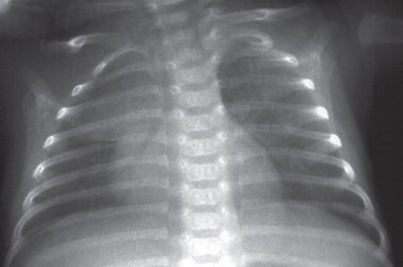

• Fig. 38.1 Normal thymus. Anteroposterior chest radiograph demonstrates an asymmetrically enlarged right lobe of the thymus.

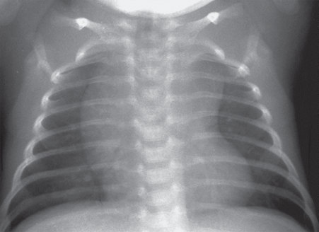

• Fig. 38.2 Normal thymus. Anteroposterior chest radiograph demonstrates a symmetrically enlarged thymus resulting in a widened mediastinum.

## PDF page 648 | printed page 639

Port@0125

9cm

• Fig. 38.3 Optimal positioning for anteroposterior chest radiograph. Chin midline, clavicles straight, and tubes/lines out of the field of view; endotracheal tube depth digital annotation.

also be directed superiorly, lying below the ductus arteriosus and above or below the visceral arteries. The UAC therefore may be placed in a high position, ending between T6 and T10, or in a low position, ending between L3 and L5. Malposition of the UAC may result in thrombosis of the aortic branches and possible ischemic injury.

The position of percutaneously placed catheters, including PICC lines and extracorporeal membrane oxygenation (ECMO) catheters, must also be documented. The tip of an upper extremity PICC line should lie within the superior vena cava (SVC) or at the RA/SVC junction. A lower extremity PICC line should end between the 9th and 12th ribs. An ECMO circuit may use a venous and an arterial catheter or a dual-lumen venous catheter. The venous catheter is inserted through the right internal jugular vein and ends in the RA. The arterial catheter is inserted into the common carotid artery and ends near the origin of the innominate artery. Complications of all vascular catheters include malposition, thrombosis, perforation, or infection.

### Respiratory Disease: Medically Treated Respiratory Distress Syndrome

RDS from surfactant deficiency is the most common cause of respiratory distress and a leading cause of morbidity in the premature infant. The typical radiographic appearance of RDS reflects generalized alveolar collapse and shows a finely granular or ground-glass pattern with diminished lung volumes. The severity of radiographic disease is variable and usually correlates with the severity of clinical disease. Mild radiographic disease is characterized by a finely granular pattern that allows visualization of normal vessels (Fig. 38.4), whereas severe disease

• Fig. 38.4 Moderate surfactant deficiency disease. Anteroposterior chest radiograph demonstrates a fine granular pattern. The heart borders, vessels, and diaphragm are well seen.

results in loss of defined heart borders and diaphragm, which is rarely seen today with current therapies (Fig. 38.5). Peripheral air bronchograms may be seen with severe disease because of air in the bronchi visualized against a background of alveolar collapse. The distribution of disease is usually diffuse and symmetric; however, patchy or asymmetric disease may be seen. The radiographic changes associated with RDS are often seen immediately after birth but can also develop over the first 6 to 12 hours of life. The radiographic abnormalities related to uncomplicated RDS should resolve by the time the neonate is 3 to 4 days old or sooner if surfactant therapy is given. Severe RDS on the initial radiograph in the first few hours of life has been proposed as being predictive of continuous positive airway pressure failure in extremely low birth weight infants.38 New diffuse worsening of bilateral opacities in the lungs may be seen with pulmonary edema or pulmonary hemorrhage. Sudden increase in focal opacity usually indicates atelectasis.

Chest radiography can be used to help assess the effectiveness of surfactant replacement therapy in infants with RDS. Typically, improvement in the appearance of the lungs is rapid and uniform after surfactant administration. In 80% to 90% of neonates treated with surfactant, improvement occurs in one or both lungs. When there is a partial response, the improvement may be asymmetric or even restricted to one lung. Explanations for asymmetric radiographic improvement following surfactant therapy include (1) maldistribution of surfactant, (2) insufficient surfactant, and (3) regional differences in lung aeration before surfactant treatment. The absence of radiographic improvement after surfactant administration is a poor prognostic sign and suggests a diagnosis other than surfactant deficiency. Surfactant-related

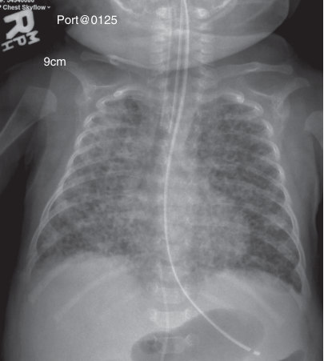

• Fig. 38.3 Optimal positioning for anteroposterior chest radiograph. Chin midline, clavicles straight, and tubes/lines out of the field of view; endotracheal tube depth digital annotation.

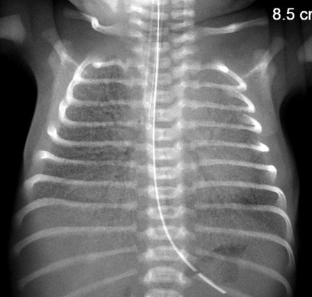

• Fig. 38.4 Moderate surfactant deficiency disease. Anteroposterior chest radiograph demonstrates a fine granular pattern. The heart borders, vessels, and diaphragm are well seen.

## PDF page 649

• Fig. 38.5 Severe surfactant deficiency disease. Anteroposterior chest radiograph demonstrates diffuse ground-glass opacities. The heart borders and diaphragm are silhouetted.

pulmonary hemorrhage may mimic RDS with focal or diffuse alveolar parenchymal disease.

A variety of air leaks can result from the high distending pressures of mechanical ventilation that may be required in the treatment of RDS. Alveolar rupture from overdistention results in pulmonary interstitial emphysema (PIE). The radiographic appearance of PIE includes small, rounded or linear lucencies representing interstitial air coursing along the bronchovascular sheaths (Fig. 38.6). These meandering radiolucencies may be diffuse or localized. Larger focal air collections, referred to as pseudocysts or pneumatoceles, may also form in the interstitium of the lung. Pulmonary interstitial emphysema can dissect into the mediastinum or the pleural space, resulting in a pneumomediastinum or pneumothorax. Radiographic signs of pneumomediastinum include (1) lateral displacement of the mediastinal pleura, (2) continuous diaphragm sign, and (3) superior elevation of the thymus, which is referred to as the spinnaker sail sign or angel wings (Fig. 38.7). Radiographic findings of pneumothorax include (1) increased lucency, (2) identification of the visceral pleural line (Fig. 38.8), (3) increased sharpness of the adjacent mediastinal border or hemidiaphragm, and (4) visualization of a deep costophrenic sulcus. Pneumothoraces may be seen bilaterally (Fig. 38.9). Lateral decubitus or cross-table lateral radiographs can be useful in the detection of small pneumothoraces. Large pneumothoraces can produce tension, resulting in contralateral shift of mediastinal structures and depression or eversion of the ipsilateral hemidiaphragm. Pneumopericardium, a life-threatening emergency, may be associated with air leaks in other locations. Neonatal pneumopericardium appears as a “halo sign,” a continuous band of air that conforms to the cardiac contour and does not extend beyond the level of the great vessels. (Fig. 38.10)

• Fig. 38.6 Pulmonary interstitial emphysema. Anteroposterior chest radiograph shows multiple rounded and tubular lucencies throughout the left lung.

• Fig. 38.7 Pneumomediastinum. Anteroposterior chest radiograph shows superior displacement of the thymus (thymic sail sign).

### Neonatal Pneumonia

Neonatal pneumonias may be acquired in utero, during delivery, or after birth. Infection typically disseminates widely throughout the lungs because of incomplete formation of the interlobar fissures at this age. Diffuse granular or ground-glass opacities are often seen and are indistinguishable from RDS. Alternatively, coarse nodularity or a streaky, hazy appearance of the lungs may be seen. The presence of pleural fluid should raise the suspicion of bacterial infection, because effusions are uncommon in RDS or viral pneumonia.

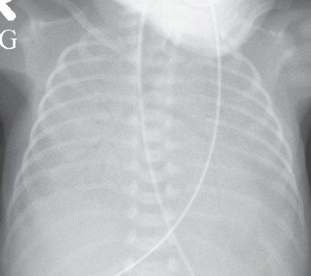

• Fig. 38.5 Severe surfactant deficiency disease. Anteroposterior chest radiograph demonstrates diffuse ground-glass opacities. The heart borders and diaphragm are silhouetted.

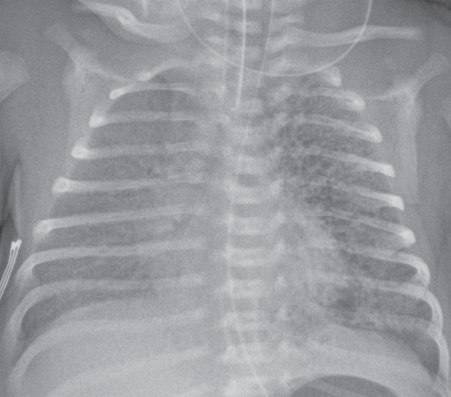

• Fig. 38.6 Pulmonary interstitial emphysema. Anteroposterior chest radiograph shows multiple rounded and tubular lucencies throughout the left lung.

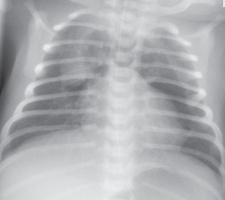

• Fig. 38.7 Pneumomediastinum. Anteroposterior chest radiograph shows superior displacement of the thymus (thymic sail sign).

## PDF page 650 | printed page 641

• Fig. 38.8 Anteroposterior chest radiograph of right pneumothorax. Air in the pleural space appears radiolucent and causes some mild compressive atelectasis of the right lung.

• Fig. 38.9 Bilateral pneumothoraces. Anteroposterior chest radiograph shows radiolucency along the right and left mediastinum from bilateral medially positioned pneumothoraces.

### Transient Tachypnea of the Newborn

TTN is associated with retained lung fluid that may be associated with precipitous delivery or cesarean section. Typically a clinical diagnosis, TTN has a varied and nonspecific appearance. The radiograph may appear normal or show streaky, perihilar opacities and hyperinflation. Small pleural effusions may also be seen. A normal heart size with TTN

• Fig. 38.10 Pneumopericardium and pneumothorax. Anteroposterior chest radiograph shows a “halo sign,” a continuous band of air that conforms to the cardiac contour and does not extend beyond the level of the great vessels. A right pneumothorax is also present.

helps distinguish retained fluid from pulmonary edema or heart failure. The radiographic and clinical findings of TTN have a benign course, usually resolving within the first 24 to 48 hours of life.

### Meconium Aspiration Syndrome

Fetal aspiration of meconium causes obstruction of small airways with associated atelectasis and air trapping. Radiographic findings of MAS are seen within the first few hours of birth and include coarse, patchy, or nodular opacities and segmental hyperinflation (Fig. 38.11). The distribution of disease is bilateral and often asymmetric, and pleural effusion may be present. Complications include chemical pneumonitis, surfactant inactivation, pulmonary hypertension, and air-leak phenomena such as pneumothorax and pneumomediastinum.

### Pulmonary Hemorrhage

In intubated patients, pulmonary hemorrhage is usually established by detecting blood in the endotracheal tube. The radiographic appearance of pulmonary hemorrhage is variable and nonspecific; small amounts of hemorrhage may not be visible, but more extensive hemorrhage results in focal or diffuse ground-glass opacities. Findings may mimic pneumonia or pulmonary edema. The radiographic changes from a single episode of pulmonary hemorrhage are usually transient, resolving within 24 to 48 hours.

### Chronic Respiratory Disease of Prematurity

Chronic lung disease in the premature infant, which is referred to as bronchopulmonary dysplasia (BPD), is most often seen in very low birth weight infants. BPD is also seen in higher birth weight infants following prolonged mechanical ventilation for conditions including neonatal

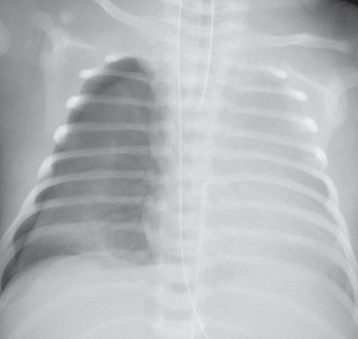

• Fig. 38.8 Anteroposterior chest radiograph of right pneumothorax. Air in the pleural space appears radiolucent and causes some mild compressive atelectasis of the right lung.

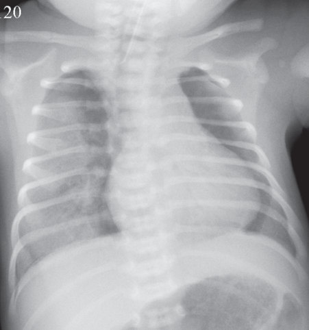

• Fig. 38.9 Bilateral pneumothoraces. Anteroposterior chest radiograph shows radiolucency along the right and left mediastinum from bilateral medially positioned pneumothoraces.

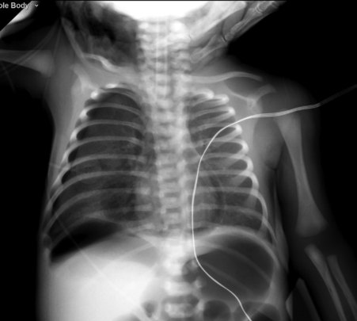

• Fig. 38.10 Pneumopericardium and pneumothorax. Anteroposterior chest radiograph shows a “halo sign,” a continuous band of air that conforms to the cardiac contour and does not extend beyond the level of the great vessels. A right pneumothorax is also present.

## PDF page 651

• Fig. 38.11 Meconium aspiration. Anteroposterior chest radiograph demonstrates patchy alveolar opacities throughout both lungs with airtrapping in the right lung base.

pneumonia, meconium aspiration, and congenital cardiac disorders. Pathologically, BPD is considered to be part of the group of alveolar growth abnormalities and can be recognized on imaging. Because BPD is the result of injury and repair of the immature developing lung, the pathologic and radiologic findings are affected by changes in therapy and the degree of prematurity of the infant. Chest radiograph findings of the later stages of BPD include hyperinflated lungs; asymmetric, coarse, patchy opacities; and bubbly cystic emphysematous changes (Fig. 38.12). Studies have related the cystic bubbly radiographic changes to a greater need for oxygen therapy.39 A large study with a cohort of more than 8000 infants showed that bubbly/cystic changes at 28 days were more predictive of home oxygen therapy than gestational age, birth weight, chorioamnionitis, or any other factor.40 Those without the bubbly/cystic changes had only a 2% rate of home oxygen.

Chest CT can provide detailed evaluation of the lungs for air-trapping, cysts, mosaic perfusion, and opacities, which can range from linear bands and small triangular opacities against the pleura to large confluent opacities. CT performed during tidal breathing and after removal of airway pressure support can document tracheobronchomalacia, which is present in 10% to 48% of neonates undergoing bronchoscopy.41

### Respiratory Disease: Surgically Treated Congenital Diaphragmatic Hernia

Congenital diaphragmatic hernia (CDH) is a complex life-threatening lesion caused by defective fusion of the pleuroperitoneal membranes during embryologic development. Patent pleuroperitoneal canals located posterolaterally are known as the foramina of Bochdalek. Bowel and solid organs may herniate through the foramen into the hemithorax, most commonly on the left side. At birth, the

• Fig. 38.12 Bronchopulmonary dysplasia. Anteroposterior chest radiograph shows diffuse, coarse parenchymal opacities.

herniated bowel loops may be fluid filled, making radiographic diagnosis difficult. Eventually, gas-filled bowel loops are seen in the thorax with a paucity of bowel loops in the abdomen (Fig. 38.13). The ipsilateral lung is almost universally hypoplastic, and there is usually contralateral shift of the mediastinum, resulting in contralateral lung hypoplasia. However, partial aeration of the ipsilateral lung with a smaller hernia may also occur and may be difficult to distinguish from complete eventration (Fig. 38.14). In such cases, ultrasound can be used to evaluate for continuity of the hemidiaphragm. Prenatal sonography and fetal MRI (Fig. 38.15) allow early diagnosis and may predict neonatal survival by evaluating the degree of pulmonary hypoplasia and defining associated anomalies.

### Congenital Lung Malformations

Congenital lung malformations include congenital pulmonary airway malformation (CPAM), congenital lobar overinflation (CLO), bronchial atresia, and bronchopulmonary sequestration (BPS). Most congenital lung malformations are hybrid lesions and share a common embryological origin with in utero airway obstruction and potential persistent embryological vascular supply. CPAMs are a group of congenital, hamartomatous cystic and noncystic lung masses characterized by overgrowth of the primary bronchioles, arrested alveolar development, and proximal communication with a defective bronchial tree.

According to the classification system of Stocker et al.,42 there are five types of CPAMs based on the presumed site of maldevelopment. Type 0 is acinar dysplasia of tracheal or bronchial origin and is incompatible with life. Type 1, the most common, has a single or multiple large cysts (>2 cm) of bronchial or bronchiolar origin. Type 2 has a single or multiple small cysts (≤2 cm) of bronchiolar origin. Type 3 is predominantly solid with microcysts (<0.5 cm) of bronchiolar-alveolar duct origin. Finally, type 4,

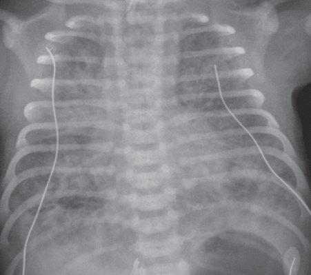

• Fig. 38.11 Meconium aspiration. Anteroposterior chest radiograph demonstrates patchy alveolar opacities throughout both lungs with airtrapping in the right lung base.

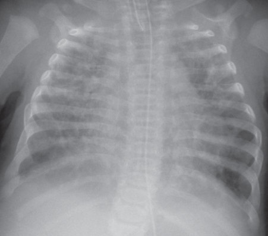

• Fig. 38.12 Bronchopulmonary dysplasia. Anteroposterior chest radiograph shows diffuse, coarse parenchymal opacities.

## PDF page 652 | printed page 643

characterized by large air-filled cysts, has a distal acinar origin and is indistinguishable from pleuropulmonary blastoma on imaging.

BPSs are lesions containing bronchial and pulmonary tissue that does not communicate with the tracheobronchial tree or pulmonary arteries. They can be extralobar

A B

• Fig. 38.13 Congenital diaphragmatic hernia. (A) Anteroposterior radiograph shows a gas-filled stomach and central bowel loops in an otherwise opacified left hemithorax. (B) Left hemithorax shows gas-filled bowel loops. There is a mediastinal shift from left to right in both cases.

B

A

• Fig. 38.14 Congenital diaphragmatic hernia. (A) Anteroposterior radiograph shows gas-filled bowel in the lower left hemithorax with preserved aeration of a portion of the left lung. (B) Sagittal sonographic image shows herniation of spleen into the chest.

(extrapleural) or intralobar (intrapleural), and supradiaphragmatic or infradiaphragmatic. These lesions will appear mostly solid, and a systemic feeding vessel is frequently identified. Ultrasound or MRI can confirm or exclude the presence of a systemic vessel arising from the aorta in the setting of a “hybrid” lesion.

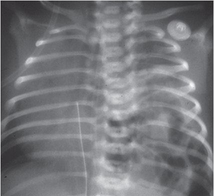

Unmatched source image; PDF page 652. Consult the original caption.

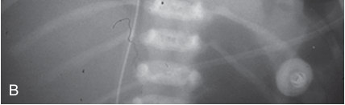

Unmatched source image; PDF page 652. Consult the original caption.

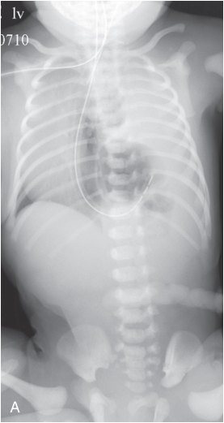

• Fig. 38.13 Congenital diaphragmatic hernia. (A) Anteroposterior radiograph shows a gas-filled stomach and central bowel loops in an otherwise opacified left hemithorax. (B) Left hemithorax shows gas-filled bowel loops. There is a mediastinal shift from left to right in both cases.

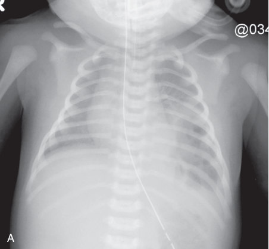

• Fig. 38.14 Congenital diaphragmatic hernia. (A) Anteroposterior radiograph shows gas-filled bowel in the lower left hemithorax with preserved aeration of a portion of the left lung. (B) Sagittal sonographic image shows herniation of spleen into the chest.

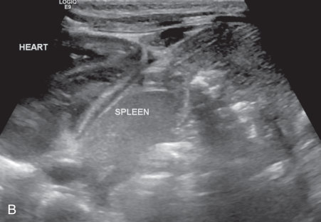

Unmatched source image; PDF page 652. Consult the original caption.

## PDF page 653

Prenatal sonography and fetal MRI classify CPAMs mainly based on the presence of macrocysts, microcysts, or solid tissue. At birth, chest radiography and CT may show a range of findings from large single or multiple air-filled cystic structures to solid lesions that resemble consolidation (Fig. 38.16A and B). Because of the association of CPAMs with sequestration, precise vascular mapping is essential. Ultrasound may be useful in identifying an abnormal vascular systemic supply typical of sequestration (see Fig. 38.16C). However, CT angiography with two-dimensional (2D) and three-dimensional (3D) reconstructions provides the most accurate assessment of the lung parenchymal and vascular anatomy of these lesions. For example, there are

• Fig. 38.15 Congenital diaphragmatic hernia. Sagittal fetal magnetic resonance image shows multiple fluid-filled bowel loops and stomach in the left hemithorax.

A B

• Fig. 38.16 Congenital pulmonary airway malformation. (A) Anteroposterior chest radiograph demonstrates a multicystic lesion in the left lung, resulting in mediastinal shift and compression of the right lung. (B) Sagittal chest computed tomography shows a large parenchymal multicystic lesion the left lung. (C) Longitudinal color Doppler fetal sonography shows systemic arterial supply from the aorta to the left lung hybrid lesion.

characteristic thoracic CT findings for combined bronchial atresia–CPAM congenital lung lesions. CT imaging shows a solitary, well-circumscribed solid and multicystic mass; a nonenhancing nodule reflects the bronchial atresia component, and an adjacent cystic mass represents the CPAM component.43

### Congenital Lobar Overinflation

CLO is a condition characterized by progressive overinflation of one or more pulmonary lobes. CLO most commonly affects the left upper lobe, followed by the right middle lobe and right upper lobe. At birth, the involved lobe may be radiographically opaque because of retained lung fluid. When the fluid clears, imaging demonstrates progressively increased volume, hyperlucency, and attenuated vascular markings of the involved lobe with compression of the remaining ipsilateral lung and mediastinal shift (Fig. 38.17). CT more precisely characterizes these findings and can distinguish multilobar involvement. CT is also helpful in excluding causes of extrinsic bronchial compression such as vascular anomalies or mediastinal.

### Esophageal Atresia and Tracheoesophageal Fistula

The pairing of the terms esophageal atresia and tracheoesophageal fistula (TEF) describes a disorder in formation and separation of the primitive foregut and esophagus. A spectrum of malformations is noted, ranging from esophageal atresia (with or without a proximal or distal TEF) to a TEF without esophageal atresia. The most common type, involving proximal esophageal atresia with a distal TEF, accounts for more than 80% of cases. With this type, a blind-ending, air-filled proximal esophageal pouch is noted on a chest radiograph (Fig. 38.18). The presence of a distal fistula is supported by air in the gastrointestinal tract. An esophagram can be performed to evaluate for a fistulous tract or stricture. TEF is associated with multisystem abnormalities in approximately one-third of cases, including vertebral, cardiac, renal, and limb anomalies, as well as other

C

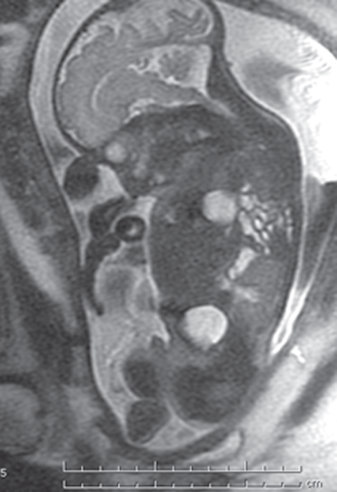

• Fig. 38.15 Congenital diaphragmatic hernia. Sagittal fetal magnetic resonance image shows multiple fluid-filled bowel loops and stomach in the left hemithorax.

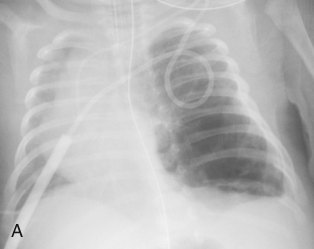

• Fig. 38.16 Congenital pulmonary airway malformation. (A) Anteroposterior chest radiograph demonstrates a multicystic lesion in the left lung, resulting in mediastinal shift and compression of the right lung. (B) Sagittal chest computed tomography shows a large parenchymal multicystic lesion the left lung. (C) Longitudinal color Doppler fetal sonography shows systemic arterial supply from the aorta to the left lung hybrid lesion.

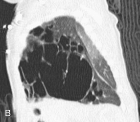

Unmatched source image; PDF page 653. Consult the original caption.

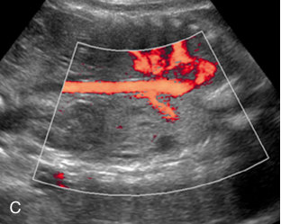

Unmatched source image; PDF page 653. Consult the original caption.

## PDF page 654 | printed page 645

gastrointestinal tract atresias. All infants with a tracheoesophageal abnormality should undergo additional imaging evaluation to assess for associated anomalies.

### Heart

Cardiac disease in infants is usually congenital in origin. Chest radiography rarely leads to a specific diagnosis and is primarily used to exclude pulmonary conditions as a cause

• Fig. 38.17 Congenital lobar overinflation. Axial chest computed tomography shows marked overinflation of the right lower lobe with attenuated vascular markings, contralateral mediastinal shift, and compression of the normal left lung.

• Fig. 38.18 Tracheoesophageal fistula. Anteroposterior chest radiograph demonstrates an air-filled blind-ending proximal esophageal pouch. Gas-filled stomach is seen.

of respiratory distress. Cardiac echocardiography remains the primary imaging tool for the diagnosis of congenital heart disease. Although POCUS is increasingly used at the bedside, it should not be used as a screening tool for congenital heart disease. Rather, POCUS offers valuable physiological and hemodynamic information to assist in real-time decision-making.16 Cardiac echocardiography may incompletely define extracardiac vasculature and associated airway involvement. Computed tomography angiography (CTA) and cardiac MRI/MRA complement echocardiography by illustrating not only vital extracardiac structures but also complex spatial relationships, anatomy, and function inadequately defined with echocardiography. MRI/MRA is the recommended modality for ventricular function, flow measurements, shunt quantification, valvular disease and cardiac masses, and postoperative evaluation (Fig. 38.19). CTA is recommended for evaluation of the coronary arteries, vascular rings, and associated pulmonary or airway anomaly.44

High spatial and temporal resolution in cardiac CTA together with fast imaging times allow delineation of the cardiac anatomy, usually without the need for sedation. CT and CTA are particularly useful in evaluation of aortic arch anomalies (coarctation of the aorta, interrupted aortic arch, and vascular ring or sling) (Fig. 38.20A and B). Prospectively electrocardiogram-gated volumetric scanning with iterative reconstruction performed with a 320-multiple detector computed tomography (MDCT) scanner has several benefits in cardiovascular imaging of neonates and infants, including low radiation dose, improved image quality compared to retrospective gating, high diagnostic accuracy, and ability to perform freebreathing studies.45

• Fig. 38.19 Postoperative cardiac magnetic resonance imaging shows persistent severe left pulmonary artery (LPA) stenosis in infant with tetralogy of Fallot; no flow is seen to the left lung from the LPA.

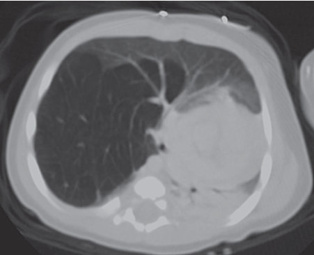

• Fig. 38.17 Congenital lobar overinflation. Axial chest computed tomography shows marked overinflation of the right lower lobe with attenuated vascular markings, contralateral mediastinal shift, and compression of the normal left lung.

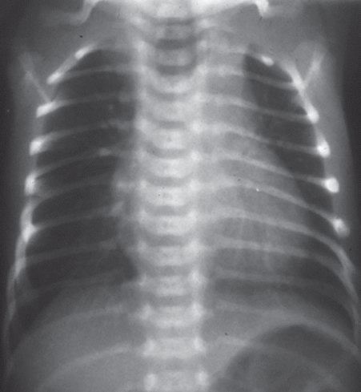

• Fig. 38.18 Tracheoesophageal fistula. Anteroposterior chest radiograph demonstrates an air-filled blind-ending proximal esophageal pouch. Gas-filled stomach is seen.

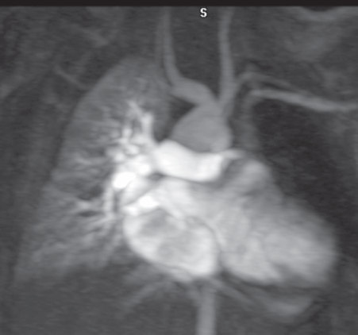

• Fig. 38.19 Postoperative cardiac magnetic resonance imaging shows persistent severe left pulmonary artery (LPA) stenosis in infant with tetralogy of Fallot; no flow is seen to the left lung from the LPA.

## PDF page 655

### Abdomen

### Evaluation of the Normal Abdominal Radiograph

Plain-film abdominal radiography is a frequently performed examination in the high-risk neonate suspected of having intra-abdominal pathology. The exam is obtained in the AP projection with the infant supine. If there is concern for free air, a cross-table lateral view (with the infant supine) or a lateral decubitus view (with the infant turned on either their right or left side) will identify smaller amounts of air than the AP view. Air is seen in the stomach within minutes of birth, within most of the small bowel by 3 hours, and within most of the large bowel by 8 to 9 hours. Gas-filled normal bowel loops should appear polygonal in shape. Gas-filled loops of bowel that are conspicuously located in the central abdomen suggest the presence of ascites. A paucity of bowel gas may relate to fluid-filled bowel or bowel obstruction.

### Gastrointestinal Tract

Intestinal obstruction is the most common abdominal emergency in the newborn period. Neonatal obstruction is typically characterized as high, occurring proximal to the distal ileum, or low, involving the distal ileum or colon. The clinical presentation of infants with high and low intestinal obstruction may overlap with symptoms of abdominal distention, vomiting, and poor feeding. Low obstructions are often characterized by failure to pass meconium. Abdominal radiographs are the initial imaging examination of choice to distinguish between high and low intestinal obstructions. Radiographs in infants with high intestinal obstruction

A

• Fig. 38.20 Axial computed tomography (CT) (A) and posterior view of a three-dimensional CT angiogram (B) show a double aortic arch. The dominant right arch is larger than the left.

typically show few dilated bowel loops (Fig. 38.21), whereas radiographs in infants with low obstruction show many dilated bowel loops (Fig. 38.22). When bowel obstruction is present, the dilated bowel loops become elongated and are stacked in a parallel configuration. The distinction between high and low intestinal obstruction dictates the type of imaging that the infant may need. With a high obstruction, the upper gastrointestinal (UGI) series is the examination

• Fig. 38.21 High intestinal obstruction. Supine abdominal radiograph demonstrates a couple of dilated proximal small bowel loops and an absence of distal bowel gas.

B

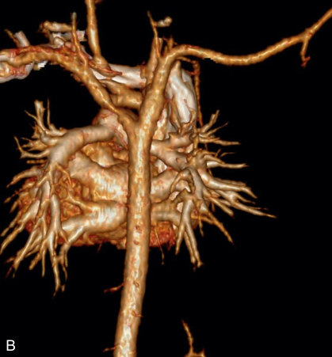

Unmatched source image; PDF page 655. Consult the original caption.

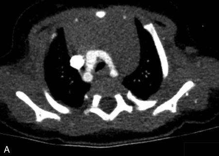

• Fig. 38.20 Axial computed tomography (CT) (A) and posterior view of a three-dimensional CT angiogram (B) show a double aortic arch. The dominant right arch is larger than the left.

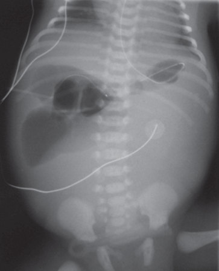

• Fig. 38.21 High intestinal obstruction. Supine abdominal radiograph demonstrates a couple of dilated proximal small bowel loops and an absence of distal bowel gas.

## PDF page 656 | printed page 647

of choice. Infants with a suspected low obstruction are typically evaluated with a water-soluble contrast enema. As with all radiologic examinations, proper positioning is important because even a small degree of patient rotation may distort anatomic landmarks.

### High Intestinal Obstruction

Midgut Malrotation

Midgut malrotation is the most critical etiology of upper intestinal obstruction. Most infants with malrotation present with bilious vomiting; up to 75% of patients present in

• Fig. 38.22 Low intestinal obstruction. Supine abdominal radiograph demonstrates diffuse mild dilatation of multiple bowel loops.

A B

• Fig. 38.23 Midgut malrotation. Fluoroscopic images from an upper gastrointestinal series show the duodenal-jejunal junction in the right upper quadrant (A) and midgut volvulus with partial obstruction and corkscrew appearance of the duodenum (B).

the first month of life. Bilious vomiting in an infant should be considered a potential surgical emergency, and, in the absence of another defined cause, evaluation for midgut malrotation should be performed. The abdominal radiographic findings may be normal in infants with malrotation. A high obstruction pattern may be seen in the setting of abnormal peritoneal attachments (Ladd bands) or midgut volvulus. Dilatation of multiple bowel loops may indicate volvulus-induced ischemia. The diagnostic examination of choice is the UGI. The location of the duodenum seen on this study is predictive of the mesenteric attachment. Normally, the third portion of the duodenum (D3) courses posteriorly in the retroperitoneum, crossing the midline to reach the duodenal-jejunal junction (DJJ). This junction is normally located to the left of midline and at the level of the pyloric channel. An abnormal course of the duodenum and abnormal location of the DJJ are diagnostic of midgut malrotation (Fig. 38.23A). A spiral or corkscrew appearance of the duodenum and jejunum indicates midgut volvulus (Fig. 38.23B). The wrapping of the superior mesenteric artery around the superior mesenteric vein, known as the “whirlpool sign,” is specific for the diagnosis of midgut volvulus.

Cross-sectional imaging with sonography or CT has been proposed as an alternative method to diagnose midgut malrotation by identifying the anatomic location of D3 and its relationship to the superior mesenteric vessels. However, a normal retroperitoneal position of D3 does not exclude malrotation, and the relationship of the mesenteric vessels is highly variable and unreliable.46 Because of the lack of sensitivity or specificity of cross-sectional imaging, UGI remains the gold standard for diagnosing midgut malrotation.

Duodenal Atresia

Duodenal atresia is the most common cause of high intestinal obstruction in the newborn. It occurs more commonly

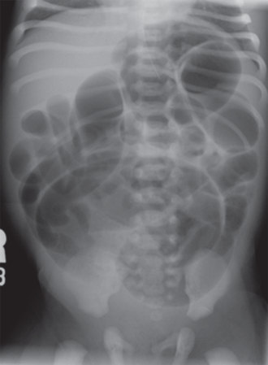

• Fig. 38.23 Midgut malrotation. Fluoroscopic images from an upper gastrointestinal series show the duodenal-jejunal junction in the right upper quadrant (A) and midgut volvulus with partial obstruction and corkscrew appearance of the duodenum (B).

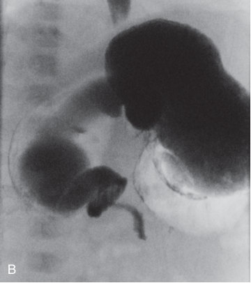

Unmatched source image; PDF page 656. Consult the original caption.

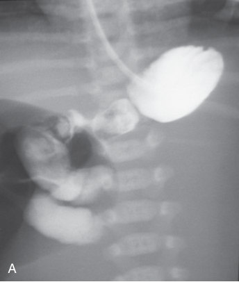

• Fig. 38.23 Midgut malrotation. Fluoroscopic images from an upper gastrointestinal series show the duodenal-jejunal junction in the right upper quadrant (A) and midgut volvulus with partial obstruction and corkscrew appearance of the duodenum (B).

## PDF page 657

than duodenal stenosis or web and results from congenital failure of recanalization of the duodenum during embryologic development. Because the majority of cases occur distal to the ampulla, infants often present with bilious vomiting. Approximately two-thirds of patients have associated anomalies of the heart, genitourinary, or gastrointestinal tract. Nearly 40% have Down syndrome. Early abdominal radiographs confirm the “double bubble” sign (Fig. 38.24). These findings are diagnostic for duodenal atresia; when present, no further study is necessary.

Jejunal Atresia

Jejunal atresia results from an ischemic injury to the developing small intestine. The injury may result from a primary vascular accident or a mechanical obstruction, such as an in utero volvulus. Newborns with jejunal atresia present with bilious emesis and abdominal distention. Abdominal radiographs typically demonstrate dilated small bowel loops that may contain air-fluid levels indicative of a mid-small-bowel obstruction. A “triple bubble” sign may be seen, characterized by dilation of the stomach, duodenum, and proximal jejunum. UGI will show obstruction in the proximal jejunum (Fig. 38.25). Because there may be additional sites of atresia in these patients, contrast enema is usually performed prior to surgical repair to define the anatomy of the distal bowel.

### Low Intestinal Obstruction

Hirschsprung Disease

Hirschsprung disease (HD) is characterized by the absence of distal enteric ganglion cells. This is caused by an arrest

• Fig. 38.24 Duodenal atresia. Abdominal radiograph demonstrates a “double bubble” with air in the dilated stomach and proximal duodenum.

of the craniocaudal migration of neural crest cells during embryologic development, resulting in a failure of normal colorectal relaxation and functional obstruction. Most infants present in the first 6 weeks of life with abdominal distention, constipation, vomiting, and occasionally diarrhea. The condition is more common in male than female infants. Abdominal radiographic findings in HD are usually nonspecific, with variable dilation of bowel and frequent absence of air in the rectum. The diagnostic imaging examination of choice in patients with suspected HD is a water-soluble contrast enema. A contrast enema may also be therapeutic, as the water-soluble contrast promotes the passage of meconium. A small, soft catheter should be used without inflation of a catheter balloon so as not to obscure a transition zone. The lateral view best demonstrates the transition zone between normal, dilated proximal colon and the contracted aganglionic distal segment (Fig. 38.26). The transition zone is most commonly located in the rectosigmoid region. Tubular filling defects may be noted in the colon, representing meconium or stool. The affected aganglionic segment always includes the rectum and extends proximally to involve a variable length of colon without skip areas. Although contrast enema is diagnostic in the majority of patients, the transition point identified by imaging does not always correlate with the pathologic extent of aganglionic colon. Approximately 5% of patients have total colonic aganglionosis and demonstrate a diffusely small-caliber colon (microcolon) without a transition zone. As some infants have a normal contrast enema, a rectal biopsy should be performed in patients where there is a high clinical suspicion for HD.

• Fig. 38.25 Jejunal atresia. Abdominal radiograph shows barium opacification of the stomach, duodenum, and proximal jejunum with no air distal to this level.

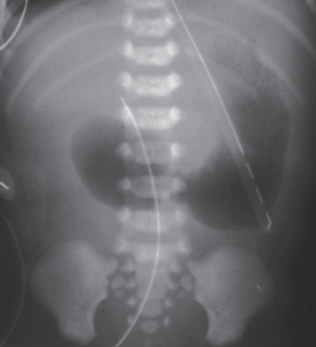

• Fig. 38.24 Duodenal atresia. Abdominal radiograph demonstrates a “double bubble” with air in the dilated stomach and proximal duodenum.

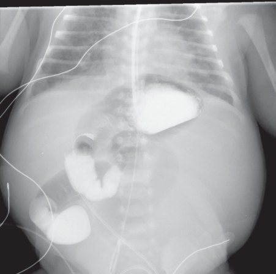

• Fig. 38.25 Jejunal atresia. Abdominal radiograph shows barium opacification of the stomach, duodenum, and proximal jejunum with no air distal to this level.

## PDF page 658 | printed page 649

• Fig. 38.26 Hirschsprung disease. Lateral view from a contrast enema shows a mildly dilated sigmoid colon proximal to the transition zone. The rectum is narrowed with a serrated contour.

Functional Immaturity of the Colon

Functional immaturity of the colon, also known as meconium plug syndrome or small left-colon syndrome, is a benign transient functional obstruction of the colon seen in the newborn period. It is thought to be associated with immaturity of the myenteric plexus ganglia. There is an increased incidence with a history of maternal diabetes mellitus, preeclampsia treated with magnesium sulfate, and prematurity. Functional immaturity of the colon is the most common diagnosis in newborns who fail to pass meconium in the first 48 hours. Abdominal radiography shows a low bowel obstruction with or without air-fluid levels. Water-soluble contrast enema shows tubular filling defects representing meconium plugs. The caliber of the colon is variable; it may be normal in its entirety, or there may be a dilated proximal colon with a small-caliber left colon distal to the level of the splenic flexure and a normal caliber rectum (Fig. 38.27). The contrast enema often accelerates evacuation of retained meconium plugs and resolves the obstruction.

Meconium Ileus

Meconium ileus is caused by abnormal meconium inspissation in the distal ileum and is the earliest clinical manifestation of cystic fibrosis. The abnormally thick meconium in these infants results in a distal small bowel obstruction. Meconium ileus may be complicated by in utero volvulus or perforation with peritonitis. Abdominal radiography demonstrates multiple dilated small bowel loops, often without air-fluid levels. A “soap bubble” appearance of rounded foci of gas may be noted in the right side of the abdomen. Calcified meconium resulting from meconium peritonitis can be

• Fig. 38.27 Small left colon syndrome. Contrast enema demonstrates a small-caliber descending colon. Tubular filling defects in the colon represent meconium plugs.

seen in the abdomen and scrotum. Water-soluble contrast enema should be performed in infants suspected of having meconium ileus. The enema typically demonstrates a microcolon (Fig. 38.28). The contrast enema may have a therapeutic effect in some infants, particularly if contrast refluxes into the distal ileum filled with inspissated meconium.

Ileal Atresia

Ileal atresia may be caused by a vascular accident similar to jejunal atresia or may result from other gastrointestinal anomalies such as meconium ileus. Abdominal radiographs in neonates with ileal atresia usually show a low intestinal obstruction pattern. Contrast enema demonstrates an unused microcolon and may be diagnostic if reflux of contrast into the distal ileum demonstrates the level of the atresia.

### Anorectal Malformation

Anorectal malformations (ARMs) represent a spectrum of abnormalities ranging from a rectoperineal fistula to very complex malformations such as a persistent cloaca and cloacal exstrophy. A persistent cloaca represents a fusion of the rectum, vagina, and urinary tract to create a common channel (or cloaca). This common channel may end in the perineum with one or more perineal openings. The type of cloaca is categorized by the length of the common channel that can be measured endoscopically. The length of the common channel can vary from 1 to 10 cm, and the longer the common channel (>3 cm), the higher the chance for poor bowel control, neurogenic bladder, and reproductive abnormalities.

In the infant with an ARM, imaging plays a significant role in treatment planning.47 Radiographs of the chest,

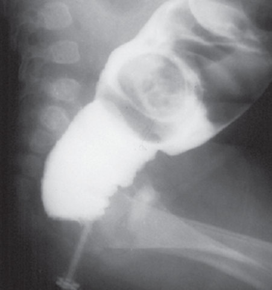

• Fig. 38.26 Hirschsprung disease. Lateral view from a contrast enema shows a mildly dilated sigmoid colon proximal to the transition zone. The rectum is narrowed with a serrated contour.

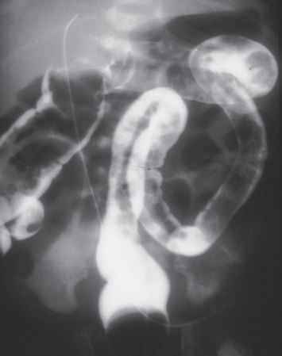

• Fig. 38.27 Small left colon syndrome. Contrast enema demonstrates a small-caliber descending colon. Tubular filling defects in the colon represent meconium plugs.

## PDF page 659

spine, and pelvis may show osseous anomalies. Pelvic radiographs showing the sacrum are extremely important, as congenital anomalies of the sacrum such as partial hypoplasia or scimitar deformity can be associated with a presacral mass and or with a Currarino triad (ARM, presacral mass, and sacral hypoplasia/aplasia).

After birth, a fluoroscopic cloacogram (colostography/ fistulography) can provide anatomic details of the communication among the different pelvic structures. A metallic marker is placed on the perineum to allow measurements between the end of the rectum and the perineum for surgical reconstructive planning. Subsequently, contrast is injected at high manual pressure via the colostomy to opacify the rectum. Further injection may cause reflux of contrast into the vagina (in females) and less frequently also into the bladder via the fistulous connection. These patients usually have a bladder catheter, and some surgeons prefer the initial contrast injection to be made into the bladder with subsequent reflux of contrast into the vagina and rectum. Otherwise, contrast injection through the vesicostomy tube can be performed immediately after the distal colostogram. Together, these images demonstrate all structures connected by the common channel. In male patients, a VCUG has been reported to be as accurate as distal colostogram in the evaluation of ARM.48 High-resolution MRI of the pelvis can help define the level of the rectal pouch, as well as the size, morphology, and degree of development of the sphincteric muscles prior to surgical repair.49 Pelvic MRI also helps in the identification of associated Müllerian duct anomalies, sacral anomalies, and presacral masses.

### Necrotizing Enterocolitis

Necrotizing enterocolitis (NEC), seen predominantly in premature infants, is the most common acquired gastrointestinal emergency in the NICU. Infants usually present with abdominal distention, abdominal tenderness, feeding disturbance, and guaiac-positive stools. Abdominal radiography plays an important role in the diagnosis of NEC. Early radiographic findings of NEC are nonspecific and include bowel dilation and rounded or elongated loops. Focal or asymmetric distribution of fixed bowel dilation may be seen. As the disease progresses, intramural gas in the bowel wall, specific for pneumatosis intestinalis, develops.

Radiographically, pneumatosis intestinalis appears as a “bubbly” pattern or as curvilinear lucencies (Fig. 38.29). This somewhat mottled radiolucency can be difficult to differentiate from stool. Pneumatosis is most commonly seen in the right lower quadrant. Intramural gas may extend into the veins of the bowel wall and then into the portal venous system. Portal venous gas is seen in the porta hepatis as branching, linear lucencies overlying the liver (Fig. 38.30) and is typically a later finding in more severe cases of NEC. Like intramural gas, this finding may be transient and may not correlate with the severity of clinical disease.

When the diagnosis of NEC has been established, serial imaging is performed to evaluate for the complication of

• Fig. 38.28 Meconium ileus with microcolon. Contrast enema demonstrates a microcolon. Filling defects in the terminal ileum are caused by inspissated meconium.

• Fig. 38.29 Necrotizing enterocolitis with pneumatosis intestinalis. Abdominal radiograph demonstrates dilated bowel and diffuse bubbly and curvilinear lucencies.

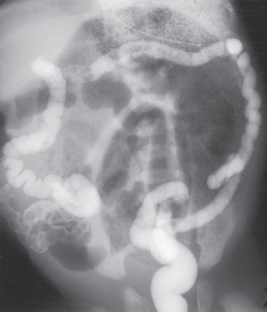

• Fig. 38.28 Meconium ileus with microcolon. Contrast enema demonstrates a microcolon. Filling defects in the terminal ileum are caused by inspissated meconium.

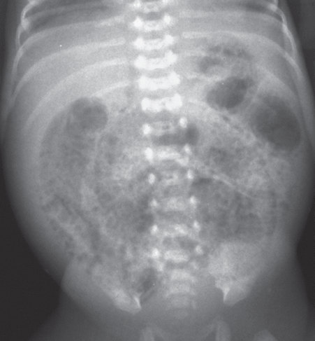

• Fig. 38.29 Necrotizing enterocolitis with pneumatosis intestinalis. Abdominal radiograph demonstrates dilated bowel and diffuse bubbly and curvilinear lucencies.

## PDF page 660 | printed page 651

• Fig. 38.30 Necrotizing enterocolitis with portal venous air. Abdominal radiograph demonstrates branching lucencies overlying the liver. Dilated bowel and diffuse pneumatosis intestinalis.

bowel perforation. A cross-table lateral radiograph or left lateral decubitus radiograph of the abdomen (left side down) is performed to assess for free intraperitoneal air (Fig. 38.31). Free air collects in the least dependent portion of the abdomen and is seen as lucency between bowel loops just beneath the abdominal wall or as collections of gas between the liver and adjacent bowel wall. On the supine view, large amounts of peritoneal air give rise to the “football” sign, where air outlines the superior abdomen with the falciform ligament, creating the appearance of the lacing of a football (Fig. 38.32).

Sonography has been used as an adjunct imaging tool in the diagnosis and management of NEC.50 When paired with physical examination and radiography, abdominal ultrasound (AUS) adds significant independent diagnostic utility for stratification of surgical NEC risk. Specifically, abdominal wall erythema and sonographic findings of bowel wall thickening and echogenic free fluid independently predicted a need for surgical intervention for NEC.51 Pneumatosis intestinalis is seen as fixed hyperechoic foci in a thickened, ill-defined bowel wall that has abnormal vascularity. Portal venous gas is seen as intraluminal echogenic foci within the liver (Fig. 38.33). The presence of focal peritoneal fluid collections or free peritoneal fluid containing internal echoes correlates with bowel perforation and abscess formation or peritonitis.

A delayed complication of NEC is bowel stricture, representing the sequela of necrotic areas of bowel wall. Strictures occur in 20% to 30% of survivors of NEC. Strictures may be single or multiple and are usually located in the colon at the level of the splenic flexure. Water-soluble contrast enema is useful for identifying these sites of focal narrowing (Fig. 38.34) (see Chapter 89).

• Fig. 38.31 Pneumoperitoneum. Lateral decubitus view of the abdomen demonstrates radiolucency outlining the right lobe of the liver and bowel loops.

• Fig. 38.32 Pneumoperitoneum. Supine anteroposterior view of the abdomen shows radiolucency beneath the diaphragm from a large pneumoperitoneum.

### Hepatobiliary Tract

### Biliary Atresia

A frequent clinical challenge is to differentiate biliary atresia from idiopathic neonatal hepatitis (INH), as both present with conjugated hyperbilirubinemia. The principal difference between the two entities is that there is patency of the biliary tree in infants with INH. Biliary atresia is associated with other abnormalities, including choledochal cyst, polysplenia, preduodenal portal vein, cardiac and pulmonary malformations, azygous continuation of the inferior vena cava, and malrotation.

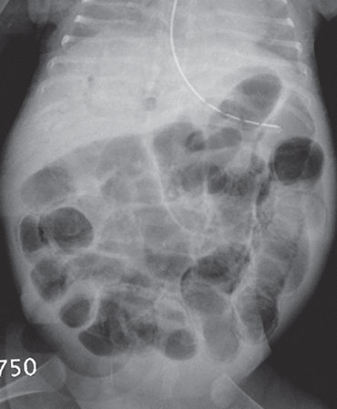

• Fig. 38.30 Necrotizing enterocolitis with portal venous air. Abdominal radiograph demonstrates branching lucencies overlying the liver. Dilated bowel and diffuse pneumatosis intestinalis.

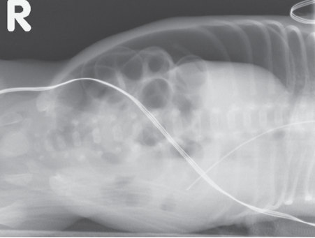

• Fig. 38.31 Pneumoperitoneum. Lateral decubitus view of the abdomen demonstrates radiolucency outlining the right lobe of the liver and bowel loops.

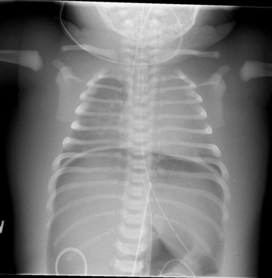

• Fig. 38.32 Pneumoperitoneum. Supine anteroposterior view of the abdomen shows radiolucency beneath the diaphragm from a large pneumoperitoneum.

## PDF page 661

• Fig. 38.33 Portal venous air. Sonogram of the liver demonstrates multiple nonshadowing echogenic foci within the liver from portal venous air.

• Fig. 38.34 Colonic stricture after necrotizing enterocolitis. Image from a contrast enema shows a focal stricture in the splenic flexure.

Sonography is the primary imaging examination for neonatal jaundice, as it can identify alternative etiologies such as choledochal cyst, biliary sludge, and cholelithiasis. The infant should be fasted for at least 3 hours to optimize visualization of a full gallbladder. The gallbladder in infants with biliary atresia might be small, measuring less than 15 to 19 mm when measurements are obtained in the fasted state.52 A normal gallbladder should measure 15 to 30 mm in infants younger than 1 year and should have a thin, defined wall.53,54 The gallbladder is not identified in approximately 80% of patients and is usually small, with an abnormal shape and abnormal wall in the remainder.55 In addition to an absent or abnormal, small, and irregular

gallbladder, other ultrasound findings may be present such as nonvisualization/absence of the common bile duct, presence of microcysts or macrocysts near the porta hepatis, increased hepatic artery diameter (>1.5 mm), peripheral arterialization, and polysplenia. A fibrous remnant of the obliterated biliary duct along the right portal vein may appear as a “triangular cord sign” when this tubular echogenic thickening measures greater than 3 to 4 mm. Although difficult to identify in the neonate, the triangular cord sign in combination with a gallbladder abnormality is reported to be 84% sensitive and 100% specific for biliary atresia.52

Hepatobiliary scintigraphy is a highly sensitive examination used to diagnose biliary atresia.56 The infant is pretreated with phenobarbital to enhance hepatocellular function and improve specificity. Gastrointestinal excretion of the administered isotope excludes biliary atresia, whereas lack of excretion of isotope by 24 hours is highly suggestive of the condition. Cholangiogram is the gold standard for the diagnosis of biliary atresia with findings showing absence of a gallbladder lumen, presence of an atretric gallbladder, or absence of contrast in the biliary ductal system and small bowel.

### Choledochal Cyst

A choledochal cyst is a congenital cystic dilation of the extrahepatic or intrahepatic biliary tree and is a rare cause of neonatal cholestatic jaundice. Biliary atresia should always be ruled out in these infants given the association of these entities and similar clinical presentations.53 Choledochal cysts are classified on the basis of their location, morphology, and the number of cysts. The Todani classification categorizes cysts based on the number, configuration, and location (intra- or extrahepatic) of the ductal dilation.57 Ultrasound is the initial imaging method used to evaluate the size and location of the cyst and to evaluate for additional cystic changes of the biliary tree. The sonographic and cross-sectional imaging appearance includes a focal, rounded, thinwalled cyst (Fig. 38.35A); fusiform dilation of the common bile duct; or cystic segments of the intrahepatic biliary tree (Fig. 38.35B). Magnetic resonance cholangiography is now the gold standard for the evaluation of choledochal cysts, as these images confirm the biliary origin of the cyst and assist with preoperative planning.

### Cholelithiasis

Approximately 10% of all cases of gallstones in children occur in the first 6 months of life. Neonatal cholelithiasis is associated with total parenteral nutrition, furosemide therapy, dehydration, infection, hemolytic anemia, and shortgut syndrome. Neonates who undergo parenteral nutrition are at greatest risk, and gallstones have been reported in up to 40% of such infants. The typical sonographic appearance of a gallstone is a rounded, mobile, echogenic focus within the gallbladder.

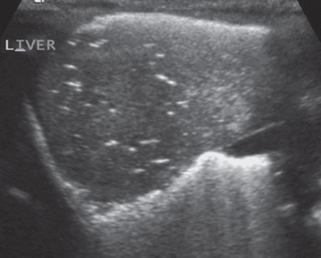

• Fig. 38.33 Portal venous air. Sonogram of the liver demonstrates multiple nonshadowing echogenic foci within the liver from portal venous air.

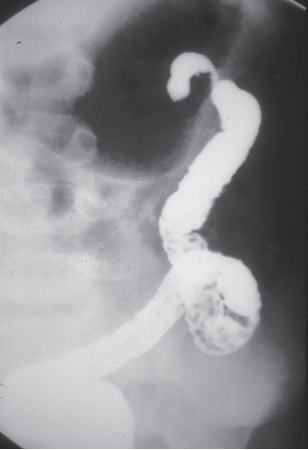

• Fig. 38.34 Colonic stricture after necrotizing enterocolitis. Image from a contrast enema shows a focal stricture in the splenic flexure.

## PDF page 662 | printed page 653

B A

• Fig. 38.35 (A) Choledochal cyst. Transverse sonogram through the porta hepatis demonstrates focal cystic dilation of the common duct. (B) Choledochal cyst. Coronal cross-sectional image of the liver shows fusiform dilation of the biliary tree.

### Hepatic Calcifications

Isolated hepatic calcifications are relatively common in the fetal liver during prenatal sonography and may persist in the neonatal period. Neonatal calcifications may be solitary or multiple and are usually idiopathic. Intrauterine infections such as cytomegalovirus, toxoplasmosis, rubella, herpes, syphilis, and varicella can result in both hepatic calcifications and ascites. Hepatic calcifications can also be seen in congenital malformations and aneuploidy. Subcapsular calcifications may be caused by emboli from the portal or hepatic veins. These may result from umbilical venous catheter complications. Perihepatic calcifications may be secondary to meconium peritonitis.

### Liver Tumors

The most symptomatic hepatic tumor in the neonatal period, infantile hepatic hemangioendothelioma (IHHE), is diagnosed in the first 6 months of life over 80% of patients. Prenatal and postnatal images show very similar findings, making the prenatal diagnosis highly accurate. At sonography, IHHE appears as a complex lesion with solid and complex fluid components and dilated hepatic vasculature; some contain flow in large anechoic vascular spaces and others can show a peripheral ring of vascular flow. IHHE is best evaluated with MRI, where flow voids may be seen in a heterogeneous lesion that enhances centripetally following gadolinium administration. Hepatoblastoma may also present in the newborn period as a soft tissue mass, frequently originating in the right hepatic lobe, which demonstrates heterogeneous enhancement (Fig. 38.36A and B).

### Urinary Tract

Sonography is the initial imaging examination used in the evaluation of urinary tract abnormalities both prior to and

following birth. Fetal MR may prove helpful in better characterization of genitourinary abnormalities, specifically in cases of bladder outlet obstruction and severe oligo-/anhydramnios58 due to its large field of view, higher image resolution, and better visualization of the renal parenchyma. Postnatal MR urography may be used to evaluate complex renal and urinary tract anatomy and suspected urinary tract obstruction; gadolinium-enhanced MR urography allows for functional evaluation that includes an estimation of differential renal function,59 although in many centers a mercaptoacetyltriglycine (MAG3) nuclear medicine study is performed in place of the functional MR urography.

Sonography is the imaging examination of choice for the initial evaluation of suspected urinary tract abnormalities in infants. The neonatal kidney typically demonstrates increased parenchymal echogenicity because of the relatively high number of glomeruli and the increased cellularity. In contrast to a child or adult kidney, the renal parenchyma is often isoechoic or hyperechoic relative to the liver and spleen. The increased parenchymal echogenicity persists until age 3 to 4 months. The neonatal kidney also demonstrates conspicuously hypoechoic pyramids because of the larger medullary volume present. This finding may persist until 1 year of age and should not be confused with a dilated collecting system.

### Urinary Tract Dilatation

Small amounts of fluid may be seen in the renal pelvis of infants in the absence of urinary tract pathology. Urinary tract dilatation (UTD) is identified in 1% to 2% of prenatal ultrasound exams. In 70% to 80% of cases, UTD is transient or physiologic in etiology. In the remaining patients, UTD results from ureteropelvic junction (UPJ) obstruction, vesicoureteral reflux, posterior urethral valves (PUVs)/ bladder outlet obstruction, ureterocele, or ureterovesical

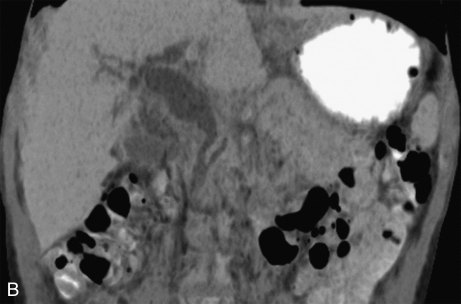

Unmatched source image; PDF page 662. Consult the original caption.

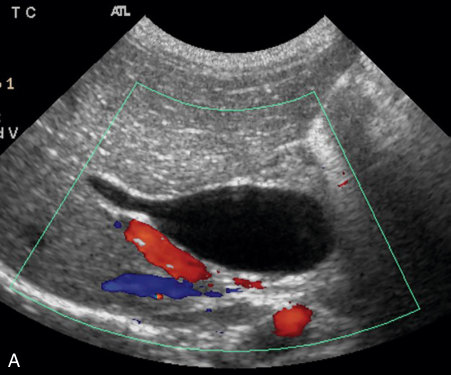

• Fig. 38.35 (A) Choledochal cyst. Transverse sonogram through the porta hepatis demonstrates focal cystic dilation of the common duct. (B) Choledochal cyst. Coronal cross-sectional image of the liver shows fusiform dilation of the biliary tree.

## PDF page 663

B A

• Fig. 38.36 Hepatoblastoma. (A) Axial gadolinium-enhanced T1-weighted image shows a heterogeneously enhancing mass in the right lobe of the liver splaying the right and left branches of the portal vein. (B) Coronal HASTE (half Fourier single-shot turbo spin-echo) image shows scattered internal foci of bright signal in keeping with areas of necrosis.

junction obstruction/nonrefluxing megaureter. Ultrasound evaluation is used to identify patients requiring additional imaging, clinical follow-up, and treatment. Neonates with an anteroposterior renal pelvic diameter (APRPD) of less than 10 mm, with no calyceal or ureteral dilatation, are not at increased risk for urinary tract disease and do not require further follow-up. A ureteral diameter of greater than 4 mm is considered abnormal. The UTD classification system— developed by consensus among urology, nephrology, and radiology societies—is recommended to standardize the description of the severity of both fetal and postnatal collecting system dilatation.60 Seven years after initiation of the UTD classification system, research has shown that UTD classification grading can predict clinical outcomes and has similar to better inter- and intrarater reliability compared to other systems.61 Using this system, investigators have shown that neonates with UTD grades of either normal or P1 had similar outcomes, with central calyceal dilation showing no increased risk for significant uropathy.62 Infants with a UTD grade of P2 or P3 should be evaluated with a VCUG. The normal neonatal kidney may also demonstrate transient increased echogenicity of the medullary pyramids at birth (Fig. 38.37). This finding is usually diffuse and bilateral and resolves within 10 days.

### Obstructive Uropathy

The most common cause of urinary tract obstruction and flank mass in infants is congenital UPJ obstruction. UPJ obstruction is commonly identified on prenatal imaging, but infants may also present after birth with a palpable abdominal mass. Sonography is the initial diagnostic examination in children with suspected UPJ obstruction. The sonographic findings include a dilated intrarenal collecting

• Fig. 38.37 Transient increased medullary echogenicity of the newborn. Longitudinal view through the kidney demonstrates increased medullary echogenicity. The distribution is bilateral and symmetric.

system without ureteral dilation (Fig. 38.38). The obstruction is bilateral in one-fourth to one-third of patients. UPJ obstruction is also associated with a nonfunctional multicystic dysplastic kidney (MCDK), so prompt intervention is required to prevent compromised renal function. Although the diagnosis of UPJ obstruction can be made with a high degree of certainty with sonography, renal scintigraphy with MAG3 renal scan is used to quantify the degree of obstruction and to determine differential renal function. Scintigraphic findings in UPJ obstruction include progressive increase in radionuclide activity within the renal collecting system and delayed excretion. Because UPJ obstruction may be associated with vesicoureteral reflux, the imaging evaluation of infants with the condition should include a VCUG.

PUVs are the most common cause of lower urinary tract obstruction and the leading cause of end-stage renal disease in boys. The valves represent obstructive folds or

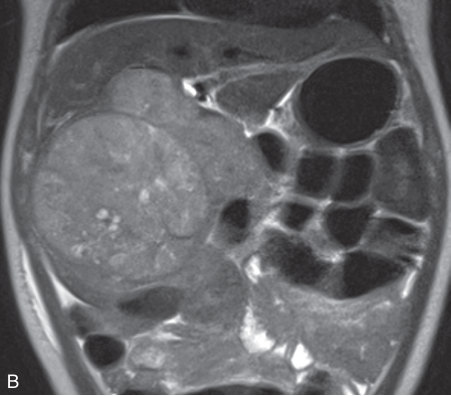

• Fig. 38.37 Transient increased medullary echogenicity of the newborn. Longitudinal view through the kidney demonstrates increased medullary echogenicity. The distribution is bilateral and symmetric.

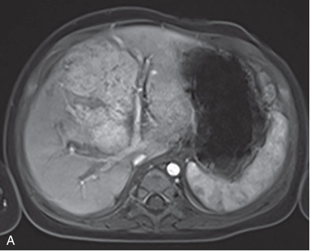

• Fig. 38.36 Hepatoblastoma. (A) Axial gadolinium-enhanced T1-weighted image shows a heterogeneously enhancing mass in the right lobe of the liver splaying the right and left branches of the portal vein. (B) Coronal HASTE (half Fourier single-shot turbo spin-echo) image shows scattered internal foci of bright signal in keeping with areas of necrosis.

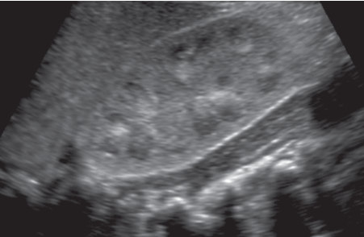

• Fig. 38.37 Transient increased medullary echogenicity of the newborn. Longitudinal view through the kidney demonstrates increased medullary echogenicity. The distribution is bilateral and symmetric.

## PDF page 664 | printed page 655

• Fig. 38.38 Ureteropelvic junction obstruction. Longitudinal view through the right kidney demonstrates marked dilation of the intrarenal collecting system. The ureter was not dilated.

urethral tissue at the level of the prostatic urethra. Although the diagnosis is also often made at prenatal imaging, some infants present after birth with a palpable abdominal mass voiding abnormalities or urinary tract infection. Initial findings include bilateral hydroureteronephrosis and a dilated bladder with a thick, trabeculated wall. If abnormal, the renal parenchyma may show dysplastic changes, including increased echogenicity of the renal parenchyma, loss of corticomedullary differentiation, and small peripheral cortical cysts. The PUV diagnosis is confirmed on a VCUG that demonstrates a dilated posterior urethra and diminution of the urethral caliber distal to the valves (Fig. 38.39). There may be associated vesicoureteral reflux.

### Multicystic Dysplastic Kidney

MCDK results from an insult in early embryologic development that leads to pelvic infundibular atresia. Infants with MCDK usually present with a unilateral palpable flank mass. The sonographic criteria for diagnosing an MCDK include multiple noncommunicating cysts of variable size and absence of renal parenchyma or collecting system (Fig. 38.40). Rarely, the MCDK appears as a single large cyst. Up to 50% of patients have a coexistent contralateral renal abnormality such as UPJ obstruction or vesicoureteral reflux. The natural history of an MCDK is a gradual decrease in the number and size of the cysts over several months or years as the cyst fluid resorbs.

### Autosomal Recessive Polycystic Kidney Disease

Autosomal recessive polycystic kidney disease (ARPKD) is an inherited disorder characterized by nephromegaly, microscopic or macroscopic cystic dilation of the renal collecting system, and periportal hepatic fibrosis. Infants with ARPKD typically present with large palpable abdominal masses or renal insufficiency. The characteristic sonographic appearance is that of symmetric markedly enlarged, hyperechoic kidneys. The increased echogenicity results from the

• Fig. 38.39 Posterior urethral valves. Lateral image from a voiding cystourethrogram shows a dilated posterior urethra and a small-caliber anterior urethra.

• Fig. 38.40 Multicystic dysplastic kidney. Longitudinal view of the right kidney demonstrates multiple cysts of varying sizes that do not communicate with one another.

multiple acoustical interfaces associated with cystic dilation of the renal collecting ducts (Fig. 38.41). High-resolution sonographic equipment may also allow visualization of tiny macroscopic cystic structures. A hypoechoic rim may be noted along the periphery of the kidney, representing compressed normal renal cortex.

### Renal Vein Thrombosis

Renal vein thrombosis (RVT) in neonates has traditionally been associated with hemoconcentration caused by dehydration, sepsis, or maternal diabetes mellitus. This entity has become relatively infrequent. RVT is thought to begin in the small intrarenal veins and progress to the hilum; thrombus within the main renal vein may not be present. RVT may also be seen in infants who develop inferior vena caval

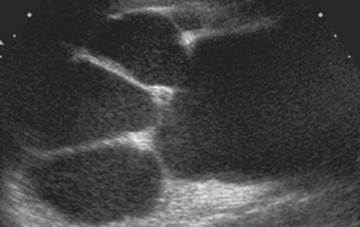

• Fig. 38.38 Ureteropelvic junction obstruction. Longitudinal view through the right kidney demonstrates marked dilation of the intrarenal collecting system. The ureter was not dilated.

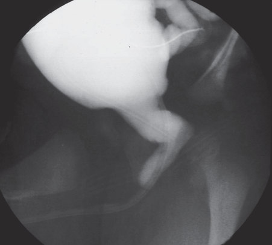

• Fig. 38.39 Posterior urethral valves. Lateral image from a voiding cystourethrogram shows a dilated posterior urethra and a small-caliber anterior urethra.

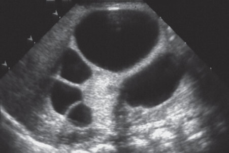

• Fig. 38.40 Multicystic dysplastic kidney. Longitudinal view of the right kidney demonstrates multiple cysts of varying sizes that do not communicate with one another.

## PDF page 665

• Fig. 38.41 Autosomal recessive polycystic kidney disease. Longitudinal view through the kidney demonstrates renal enlargement and lack of normal renal architecture. Note numerous small cysts diffusely.

thrombi associated with an indwelling catheter. The clinical presentation of RVT includes a palpable mass, renal insufficiency, hematuria, or hypertension. In the acute period, enlargement of the involved kidney, diffuse increase in parenchymal echogenicity with echogenic striations, and loss of corticomedullary differentiation are typically seen. Over the next several weeks, the renal parenchymal echogenicity of the involved kidney becomes heterogeneous, and renal size decreases. Doppler examination may show diminished perfusion and high-resistance arterial flow with reversal of diastolic flow.

### Nephrocalcinosis

Nephrocalcinosis refers to the deposition of calcium in the renal parenchyma, most commonly in the medullary pyramids. Most cases of medullary nephrocalcinosis in neonates are the result of increased calcium excretion related to furosemide therapy. This entity may also be seen in association with hypervitaminosis D and distal renal tubular acidosis. Nephrocalcinosis associated with furosemide therapy gradually resolves after the medication is stopped. Sonography is used to diagnose and monitor the evolution of the disease. Initial findings include increased echogenicity without acoustic shadowing in the normally hypoechoic renal pyramids (Fig. 38.42). Medullary nephrocalcinosis is typically seen diffusely throughout both kidneys. In the first few days of life, the normal neonatal kidney may also demonstrate transient increased echogenicity of the medullary pyramids. This finding is usually diffuse and bilateral and resolves within 10 days.

### Adrenal Glands

### Adrenal Hemorrhage

Adrenal hemorrhage is the most common cause of a neonatal adrenal mass. Right-sided hemorrhage occurs far more commonly than left-sided hemorrhage, possibly due to the shorter right adrenal vein. Neonates are at increased risk for

• Fig. 38.42 Medullary nephrocalcinosis. Longitudinal view sonography through the right kidney demonstrates increased medullary echogenicity with posterior acoustic shadowing.

adrenal hemorrhage because of the relatively large size and increased vascularity of the gland in this age group. Conditions associated with adrenal hemorrhage include perinatal asphyxia, sepsis, coagulation disorders, hypotension, and surgery. Although unilateral involvement is more common, clinical manifestations are typically seen only when there is diffuse, bilateral gland involvement, resulting in adrenal cortical insufficiency.

Sonography is the examination of choice to evaluate for suspected adrenal hemorrhage. The sonographic appearance of adrenal hemorrhage is that of an oval or triangular solid mass of variable echotexture. There may be focal or diffuse involvement of one or both adrenal limbs. Adrenal calcifications may develop weeks to months after the hemorrhage. Large adrenal hemorrhages may be difficult to differentiate from a tumor, particularly if calcification is already present. In such cases, follow-up sonographic images show a gradual decrease in size over 1 to 2 weeks (Fig. 38.43).

### Neuroblastoma

Neuroblastoma is the most common neonatal neoplasm and may present in the prenatal or neonatal period. Although perinatal neuroblastoma most often arises from the adrenal gland, a primary lesion can arise from any site in the sympathetic chain. Sonography is usually the initial imaging examination of choice and demonstrates a solid or cystic suprarenal mass that may contain calcifications. CT or MRI offers more precise characterization of the organ of origin and is required for staging (Fig. 38.44). MRI can be useful to assess intraspinal extension. Iodine 123 (123I)-metaiodobenzylguanidine (MIBG) is the first-line functional imaging agent used with uptake seen in 90% of neuroblastomas. 123I-MIBG identifies both the primary tumor and sites of metastatic disease. The addition of single-photon emission CT to 123I-MIBG improves characterization of uptake.63

99mTc-methylene diphosphonate bone scan identifies sites of cortical bone metastases; however, studies suggest that it does not affect disease staging or management

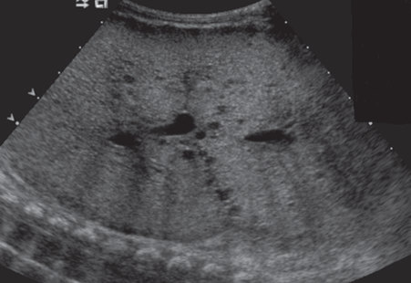

• Fig. 38.41 Autosomal recessive polycystic kidney disease. Longitudinal view through the kidney demonstrates renal enlargement and lack of normal renal architecture. Note numerous small cysts diffusely.

• Fig. 38.42 Medullary nephrocalcinosis. Longitudinal view sonography through the right kidney demonstrates increased medullary echogenicity with posterior acoustic shadowing.

## PDF page 666 | printed page 657

A B

• Fig. 38.43 Adrenal hemorrhage. (A) Doppler color sonography demonstrates a nonvascular cystic adrenal mass. (B) Three-week follow-up sonography demonstrates a normal right kidney and complete involution of the mass, indicative of resolution of adrenal hemorrhage.

• Fig. 38.44 Neuroblastoma. Contrast-enhanced axial computed tomography image through the upper abdomen demonstrates a large right retroperitoneal soft tissue mass originating from the suprarenal region.

compared to MIBG scintigraphy and cross-sectional imaging in MIBG-avid tumors.50,64 Fluorine-fluorodeoxyglucose positron emission tomography CT may be helpful in the evaluation of tumors that fail to or only weakly accumulate 123I-MIBG.63,65

### Brain

Sonography is the primary means of evaluating cranial and neck pathology in the newborn. The most frequent indication for cranial ultrasound is to evaluate for preterm brain injury in premature infants. Sonography is performed at the bedside through the anterior fontanelle with a highfrequency sector transducer.66 Imaging through the anterior fontanelle provides coronal and sagittal images of the near and far-field brain anatomy. Near-field images assess graywhite matter differentiation, extra-axial fluid compartment, meninges, and dural venous sinuses. Far-field images depict ventricles and cisterns and sulcal/gyral morphology. Imaging through the mastoid fontanelle best characterizes the

anatomy of the tentorium, brainstem, and occipital horns and improves detection of findings in the posterior fossa, such as cerebellar hemorrhage. Color, power, and spectral Doppler ultrasound techniques offer effective evaluation of morphology and flow characteristics of large intracranial arteries and veins for sinovenous thrombosis and vascular malformations. Newer scanners and transducers offer novel advanced imaging techniques such as microvessel imaging that may contribute functional insights impacting diagnostic and therapeutic decision-making.67 Evaluation of parenchymal, subarachnoid, and subdural abnormalities is limited on sonographic examination, and they are better characterized with cross-sectional imaging. CT is rarely used and should be limited for emergencies such as evaluation of intracranial hemorrhage and masses with increased intracranial pressure. MRI is used to optimally characterize congenital anomalies, infectious, and neoplastic processes. MRI is more sensitive for detection of cerebellar hemorrhage, even when mastoid views are performed on cranial ultrasound.68 MRI is also the gold standard for evaluation of preterm white matter brain injury but is performed less frequently in light of risks related to transport, need for sedation, and high cost. Although MRI provides optimal anatomic detail, the value of routine MRI screening of preterm infants at term-equivalent or discharge is questioned because findings do not correlate with long-term neurodevelopmental outcomes.69

### Germinal Matrix Hemorrhage

Germinal matrix hemorrhage–intraventricular hemorrhage (GMH-IVH) is seen primarily in premature infants. Infants at highest risk are those with a gestational age of less than 32 weeks or a birth weight of less than 1500 g. Most hemorrhages occur by the first week of life. The site of origin for GMH-IVH is the caudothalamic groove, an area bordered by the ventricular surface of the caudate nucleus and the thalamus. This extremely vascular area is composed of fragile, thin-walled blood vessels with little surrounding connective tissue. Conditions associated with increased intracranial

• Fig. 38.43 Adrenal hemorrhage. (A) Doppler color sonography demonstrates a nonvascular cystic adrenal mass. (B) Three-week follow-up sonography demonstrates a normal right kidney and complete involution of the mass, indicative of resolution of adrenal hemorrhage.

Unmatched source image; PDF page 666. Consult the original caption.

Unmatched source image; PDF page 666. Consult the original caption.

Unmatched source image; PDF page 666. Consult the original caption.

• Fig. 38.44 Neuroblastoma. Contrast-enhanced axial computed tomography image through the upper abdomen demonstrates a large right retroperitoneal soft tissue mass originating from the suprarenal region.

## PDF page 667

blood flow in the premature infant may result in intracranial hemorrhage.

The traditional classification system for GMH is based on the presence of subependymal hemorrhage and IVH, ventriculomegaly, and parenchymal abnormalities. Grade 1 is subependymal hemorrhage only; grade 2 is subependymal hemorrhage and IVH occupying 10% to 50% of the ventricular area; grade 3 is subependymal hemorrhage and IVH occupying at least 50% of the ventricular area; and grade 4 is periventricular hemorrhagic infarction. Periventricular infarcts are thought to be caused by compression of the periventricular veins by the subependymal hemorrhage. Not all IVH results from a GMH; choroid plexus hemorrhage and isolated hemorrhagic venous infarct are alternative etiologies for IVH in the preterm infant.

At sonography, a grade 1 hemorrhage appears as a subependymal echogenic focus inferolateral to the frontal horn of the lateral ventricle (Fig. 38.45). If the subependymal hemorrhage is large, it may efface the ipsilateral lateral ventricle. In grade 2 hemorrhage, blood is seen as echogenic material within the nondilated lateral ventricle (Fig. 38.46). In grade 3 hemorrhage, the IVH expands the ventricle, resulting in ventriculomegaly (Fig. 38.47). Grade 4 hemorrhage is characterized by additional echogenic periventricular abnormalities representing hemorrhagic venous infarct (Fig. 38.48).

Ventriculomegaly is a frequent sequela of intraventricular GMH that results from obliterative arachnoiditis or intraventricular obstruction from clot or debris. The ventriculomegaly may develop soon after the GMH or may be delayed by several weeks. Typically, the trigones and occipital horns of the lateral ventricles dilate before the frontal horns, and the lateral ventricles may dilate alone or to a greater degree than the third and fourth ventricles. The frontotemporal horn ratio has been demonstrated to be a useful twodimensional quantitative biomarker of vetriculomegaly in preterm infants and may help standardize ventricular measurements.70

### Periventricular Leukomalacia

Periventricular leukomalacia (PVL) represents infarction of deep white matter adjacent to the trigones and frontal horns of the lateral ventricles in premature infants. Infants with PVL may also have IVH. Cranial ultrasound performed soon after the infarction is most often normal. The earliest sonographic abnormality is increased periventricular echogenicity (Fig. 38.49). With progression of disease, cavitation may occur, resulting in parenchymal cystic areas (Fig. 38.50). These areas may communicate with the ipsilateral lateral ventricle, resulting in cyst wall collapse and ex vacuo dilatation of the subjacent ventricle. MRI is the most sensitive imaging modality for the assessment of PVL. Peritrigonal areas of hyperintensity are seen on T2-weighted images. The corpus callosum is often thinned or atrophic. In addition, irregularity of the lateral ventricular contour and asymmetric ventricular enlargement may be noted.

• Fig. 38.45 Grade 1 intraventricular hemorrhage. Sagittal view through the lateral ventricle demonstrates a small subependymal hemorrhage at the level of the caudothalamic groove.

• Fig. 38.46 Grade 2 intraventricular hemorrhage. Sagittal view shows a subependymal hemorrhage with some extension into the nondilated ventricle.

### Hypoxic Ischemic Encephalopathy in Term Infants

Hypoxic ischemic encephalopathy is a condition that may result in severe neurologic deficit. Cranial ultrasound may appear normal or show diffuse cerebral edema (Fig. 38.51A). MR with special techniques such as diffusion-weighted imaging (DWI) plays a central role in early diagnosis and prompt intervention. DWI may show cytotoxic edema of hypoxic injury during the acute phase before signal intensity changes are evident on conventional T1- or T2-weighted images. Cytotoxic edema appears as high signal restricted diffusion on DWI and low signal on corresponding diffusion coefficient mapping (Fig. 38.51B). Diffusion restriction on DWI predicts a poor outcome.

• Fig. 38.45 Grade 1 intraventricular hemorrhage. Sagittal view through the lateral ventricle demonstrates a small subependymal hemorrhage at the level of the caudothalamic groove.

• Fig. 38.46 Grade 2 intraventricular hemorrhage. Sagittal view shows a subependymal hemorrhage with some extension into the nondilated ventricle.

## PDF page 668 | printed page 659

• Fig. 38.47 Grade 3 intraventricular hemorrhage (IVH). Sagittal view through the lateral ventricle demonstrates IVH and ventriculomegaly.

• Fig. 38.48 Grade 4 intraventricular hemorrhage (IVH). Coronal view through the lateral ventricles shows a large right IVH with adjacent bright echoes in the parietal lobe from a periventricular venous infarct.

### Lenticulostriate Vasculopathy

Lenticulostriate vasculopathy (LSV) describes the sonographic appearance of echogenic vessels in regions of the basal ganglia and thalamus. Since it was first described in 1988, LSV has been reported in 0.3% to 32% of populations studied. The incidence of LSV has been reported at 15% in neonates <32 weeks of gestational age.71 In the absence of other intracranial pathology, infants with isolated LSV show normal neurodevelopment, and no further imaging is needed. LSV was originally described in newborns with congenital TORCH infections (i.e., toxoplasmosis, other, rubella, cytomegalovirus, and herpes). It has since been described in chromosomal abnormalities, fetal alcohol syndrome, bacterial meningitis, inborn errors of

• Fig. 38.49 Early periventricular leukomalacia (PVL). Sagittal view through the parietal region demonstrates increased periventricular echogenicity from PVL.

• Fig. 38.50 Late periventricular leukomalacia. Sagittal view through the parietal region demonstrates extensive periventricular cystic changes.

metabolism, and perinatal hypoxic-ischemic events. Findings may be bilateral or unilateral and may present up to several weeks of age. Cranial ultrasound shows linear or branching areas of echogenicity corresponding to vessels in the thalami and basal ganglia. (Fig. 38.52).

### Spine

### Occult Spinal Dysraphism

Occult spinal dysraphism is seen in infants with cutaneous anomalies such as skin dimples and deviated gluteal folds; approximately 50% to 80% of patients with occult spinal dysraphism have cutaneous lesions. For those infants <6 months of age with cutaneous stigmata concerning for occult spinal dysraphism, sonographic examination of the spine using a high-frequency linear transducer is performed

• Fig. 38.47 Grade 3 intraventricular hemorrhage (IVH). Sagittal view through the lateral ventricle demonstrates IVH and ventriculomegaly.

• Fig. 38.48 Grade 4 intraventricular hemorrhage (IVH). Coronal view through the lateral ventricles shows a large right IVH with adjacent bright echoes in the parietal lobe from a periventricular venous infarct.

• Fig. 38.49 Early periventricular leukomalacia (PVL). Sagittal view through the parietal region demonstrates increased periventricular echogenicity from PVL.

• Fig. 38.50 Late periventricular leukomalacia. Sagittal view through the parietal region demonstrates extensive periventricular cystic changes.

## PDF page 669

A

• Fig. 38.51 Hypoxic ischemic encephalopathy. (A) Diffuse cerebral edema with slit-like ventricles on coronal ultrasound images. (B) Diffusion restriction in cerebral hemispheres on diffusion-weighted magnetic resonance imaging.

• Fig. 38.52 Lenticulostriate vasculopathy. Longitudinal view through the right thalamus demonstrates branching linear areas of echogenicity.

as a first-line screening exam. The level of the terminal conus medullaris, motion of the conus medullaris and nerve roots, morphology of the filum terminale, and potential tract of a dorsal dermal sinus are evaluated. Normal terminal positioning of the conus medullaris ranges between the superior border of L1 to the top of the L3 vertebral body. If the conus medullaris terminates at the level of the L3 vertebral body or below, MRI should be performed to confirm the diagnosis and better characterize a tethering mass or cyst. (Fig. 38.53A and B). MRI is also recommended as the firstline imaging for infants >6 months because the sonographic

Bwindow for diagnostic imaging is significantly diminished with ossification of the posterior elements.

### Skeletal

### Intrauterine Infection

Intrauterine infection may involve the skeletal system. Congenital rubella and cytomegalovirus infection result in metaphyseal lesions with vertical striations that resemble a celery stalk. Congenital syphilis may cause both periostitis as well as single or multifocal metaphyseal lesions, which vary from radiolucent transverse metaphyseal bands to focal destruction and fragmentation of bone (Fig. 38.54).

### Developmental Dysplasia of the Hip

Developmental dysplasia of the hip (DDH) may be seen in infants with breech presentation in the third trimester, a family history of dysplasia, or other orthopedic problems such as clubfoot and metatarsus adductus. Sonography is the examination of choice for screening infants with known risk factors or an abnormal exam up until 6 months of age. This screening dynamic ultrasound exam is optimally performed after 4 weeks of age when hip maturation improves exam specificity. After the child is 4 to 5 months old, ossification of the femoral epiphysis begins to obscure sonographic landmarks, and radiography becomes more reliable for detection of DDH. After 6 months of age, an AP radiograph of the pelvis with the hips in neutral position is recommended for both diagnosis and follow-up of treated DDH. Sonography directly visualizes the cartilaginous components of the hip, including acetabular morphology

• Fig. 38.51 Hypoxic ischemic encephalopathy. (A) Diffuse cerebral edema with slit-like ventricles on coronal ultrasound images. (B) Diffusion restriction in cerebral hemispheres on diffusion-weighted magnetic resonance imaging.

Unmatched source image; PDF page 669. Consult the original caption.

• Fig. 38.52 Lenticulostriate vasculopathy. Longitudinal view through the right thalamus demonstrates branching linear areas of echogenicity.

## PDF page 670 | printed page 661

A

• Fig. 38.53 Tethered cord. (A) Sagittal sonogram showing a tethered cord terminating at the L5–S1 level (arrow). (B) Sagittal STIR image of the spine shows the tethered cord terminating at L5–S1 with a terminal lipoma (L).

• Fig. 38.54 Congenital syphilis. Anteroposterior view of the upper extremity shows periostitis and radiolucent transverse metaphyseal bands.

and coverage of the femoral head (Fig. 38.55). Hip instability is assessed through dynamic imaging while the hip is adducted and pressure is exerted on the knee to elicit potential posterior hip dislocation.

### Congenital and Developmental Anomalies

Skeletal radiography plays a primary role in the evaluation of congenital and developmental abnormalities of the axial skeleton and extremities. Imaging of a specific site is performed when there is a localized concern, such as craniosynostosis, congenital spinal deformity, radial ray abnormality, or scapular nondescent. When a skeletal dysplasia is suspected, a skeletal survey should be performed. This survey includes lateral views of the skull and spine, as well as AP views of the upper and lower extremities, pelvis, chest, and abdomen.

B

• Fig. 38.55 Developmental dysplasia of the hip. Longitudinal view through the left hip shows a shallow acetabulum and posterolateral subluxation of the cartilaginous femoral head.

### Future Directions

Diagnostic imaging in neonates will continue to grow with advances in hardware and software technology. The increasing use of fetal MRI will facilitate earlier diagnosis and treatment of infants with conditions affecting the brain, spine, heart, chest, and abdomen. MRI evaluation of the newborn will grow with the use of faster sequences and functional imaging. High-quality neonatal body MRI will be possible with completely free-breathing body MRI protocols, obviating the need for breath-suspension, sedation, and general anesthesia. Dedicated neonatal in-NICU scanners show promise to replace adult off-unit conventional 3T MRI

• Fig. 38.53 Tethered cord. (A) Sagittal sonogram showing a tethered cord terminating at the L5–S1 level (arrow). (B) Sagittal STIR image of the spine shows the tethered cord terminating at L5–S1 with a terminal lipoma (L).

• Fig. 38.55 Developmental dysplasia of the hip. Longitudinal view through the left hip shows a shallow acetabulum and posterolateral subluxation of the cartilaginous femoral head.

• Fig. 38.54 Congenital syphilis. Anteroposterior view of the upper extremity shows periostitis and radiolucent transverse metaphyseal bands.

• Fig. 38.55 Developmental dysplasia of the hip. Longitudinal view through the left hip shows a shallow acetabulum and posterolateral subluxation of the cartilaginous femoral head.

## PDF page 671

scanners. Novel postprocessing techniques using artificial intelligence algorithms will facilitate scanning with lower doses of ionizing radiation for infants needing a CT scan. Advances in ultrasound, including novel techniques such as microvessel imaging, elastography, 3D ultrasound, and contrast-enhanced ultrasound, have the potential not only to improve diagnostic sensitivity but also to offer detailed anatomic images of the brain. The use of hand-held ultrasound technology will equip clinicians with real-time, actionable,

Key Points

### • Radiography remains the most widely used imaging

modality in the newborn; the radiation doses to which even the most frequently imaged critically ill neonates are exposed remain a fraction of the annual natural background radiation.

### • Parents and providers should be reassured that the ben-

efits of a medically necessary exam using ionizing radiation far exceed any potential future cancer risk and that the risk of serial exams is not cumulative.

### • Fluoroscopy remains the imaging modality of choice

for diagnosis of midgut malrotation, proximal and distal bowel obstructions, and gastrointestinal and urinary tract fistulae.

### • Ultrasound, the second most widely used imaging modal-

ity in newborns, offers quick, portable, and dynamic cine

### References

1. Shimura N, Kojima S. The lowest radiation dose having molec-

ular changes in the living body dose-response. Dose Response. 2018;16(2):1559325818777326. 2. American Association of Physicists in Medicine. Patient Gonadal

and Fetal Shielding in Diagnostic Imaging: Frequently Asked Questions. 2019:4. Accessed July 26, 2023. https://www.aapm.org/org /policies/documents/CARES_FAQs_Patient_Shielding.pdf 3. McCullough CH. The role of the medical physicist in managing

radiation dose and communicating risk in CT. Am J Roentgenol. 2016;206:1241–1244. 4. Ebenebe CU, Barreau C, Washchkewitz J, et al. Radiation expo-

sure by digital radiographic imaging in very low birth weight infants. J Perinatol. 2019;39(1):115–119. 5. Kartikeswar GAP, Parikh TB, Pandya D, Pandit A. Ion-

izing radiation exposure in the NICU. Indian J Pediatr. 2020;87(2):158–160. 6. Cameron JR. Are X-Rays Safe? Environmental Health Perspectives.

Vol. 91. 1991:45–48. Accessed July 26, 2023. https://ehp.niehs. nih.gov/doi/pdf/10.1289/ehp.919145 7. Longo M, Genovese E, Donatiello S, et al. Quantification of scat-

ter radiation from radiographic procedures in a neonatal intensive care unit. Pediatr Radiol. 2018;48(5):715–721. 8. American Association of Physicists in Medicine Policy PP 25-C.

2018. Accessed July 26, 2023. https://www.aapm.org/org/policie s/details.asp?type=PP&id=439 9. Harvey HB, Brin JA, Frush DP. Informed consent for radiation

risk from CT is unjustified based on current scientific literature. Radiology. 2015;2:321–325.

bedside point-of-care diagnostic information. These collective advances will improve our diagnostic capability and optimize the delivery of safe and timely care for neonates.

### Acknowledgments

The authors acknowledge the contributions of Drs. Carlos Sivit, Claudia Martinez-Rios, and Dayna Weinert, who were authors of this chapter in the previous editions.

imaging of the neonatal brain, urinary tract, abdominal solid organs, and vasculature.

### • Magnetic resonance imaging (MRI) is increasingly

performed prenatally for congenital neurologic, thoracic, and abdominal malformations; postnatal MRI is most widely used for follow-up of these malformations, early detection of hypoxic ischemic change, and cardiac disease.

### • Computed tomography, usually performed without

sedation, offers valuable diagnostic imaging for infants with congenital pulmonary malformations, congenital heart disease involving the aortic arch, coronary arteries, and pulmonary disease not fully characterized radiographically.

10. International Commission on Radiologic Protection Publication

103. 2007;37 (2-4). Accessed April 1, 2022. https://journals.sage pub.com/doi/pdf/10.1177/ANIB_37_2-4 11. Greenwood TJ, Lopez-Costa RI, Rhoades PD, et al. CT dose optimi-

zation in pediatric radiology: a multiyear effort to preserve the benefits of imaging while reducing the risks. Radiographics. 2015;35(5):1539– 1554. 12. Bedoya MA, White AM, Edgar JC, et al. Effect of intravenous

administration of contrast material on serum creatinine levels in neonates. Radiology. 2017;284(2):530–540. 13. FDA Iodine-Containing Contrast Media: Drug Safety Communi-

cation. Accessed July 26, 2023. https://www.fda.gov/drugs/drugsafety-and-availability/fda-recommends-thyroid-monitoringbabies-and-young-children-who-receive-injections-iodine-contai ning#:∼:text=FDA%20recommends%20monitoring%20of%20 pediatric,in%20term%20and%20preterm%20neonates 14. ACR Statement on Use of Iodinated Contrast Material for Medi-

cal Imaging in Young Children and Need for Thyroid Monitoring. Accessed May 19, 2022. https://www.acr.org/Advocacy-and- Economics/ACR-Position-Statements/Use-of-Iodinated-Contrast-Material-for-Medical-Imaging-in-Young-Children 15. American Association of Physicists in Medicine Policy PP 32-A

Position Statement on the Use of Patient Gonadal and Fetal Shielding. 2019. Accessed July 26, 2023. https://www.aapm.org/ org/policies/details.asp?id=468&type=PP 16. Singh Y, Tissot C, Fraga MV, et al. International evidence-based

guidelines on point of care ultrasound (POCUS) for critically ill neonates and children issued by the POCUS working group of the European Society of Paediatric and Neonatal Intensive Care (ESPNIC). Crit Care. 2020;24:65. https://doi.org/10.1186/ s13054-020-2787-9.

## PDF page 672 | printed page 663

17. ACR Manual on Contrast Material . 2021. Accessed July 26, 2023.

https://www.acr.org/-/media/ACR/files/clinical-resources/contrast_ media.pdf 18. Heller BJ, Yudkowitz FS, Lipson S. Can we reduce anesthesia

exposure? Neonatal brain MRI: swaddling vs sedation, a national survey. J Clin Anesth. 2017;38:119–122. 19. Templeton LB, Norton MJ, Goenaga-Diaz EJ, et al. Experience

with a "feed and swaddle" program in infants up to six months of age. Acta Anaesthesiol Scand. 2020;64:63–68. 20. Don Paul JM, Perkins EJ, Pereira-Fantini PM, et al. Surgery and

magnetic resonance imaging increase the risk of hypothermia in infants. J Paediatr Child Health. 2018;54:426–431. 21. Hughes EJ, Winchman T, Padormo F, et al. A dedicated neonatal

brain imaging system. Magn Reson Med. 2017;78(2):794–804. 22. Thiim KR, Singh E, Mukundan S, et al. Clinical experience with

an in-NICU magnetic resonance imaging system. J Perinatol. 2022:1–7. https://doi.org/10.1038/s41372-022-01387-5. Epub ahead of print. PMID: 35459908; PMCID: PMC9026005. 23. Singh Y, Tissot C, Fraga MV, et al. International evidence-based

guidelines on point of care ultrasound (POCUS) for critically ill neonates and children issued by the POCUS working group of the European Society of Paediatric and Neonatal Intensive Care (ESPNIC). Crit Care. 2020;24(1). https://doi.org/10.1186/ s13054-020-2787-9. 24. Nguyen J, Amirnovin R, Ramanathan R, Noori S. The state

of point-of-care ultrasonography use and training in neonatalperinatal medicine and pediatric critical care medicine fellowship programs. J Perinatol. 2016;36(11):972–976. https://doi. org/10.1038/jp.2016.126. 25. Boyd S, Kluckow M. Point of care ultrasound in the neonatal unit:

applications, training and accreditation. Early Hum Dev. 2019;138: 104847. https://doi.org/10.1016/j.earlhumdev.2019.104847. 26. Mirza HS, Logsdon G, Pulickal A, et al. A national survey of neo-

natologists: Barriers and prerequisites to introduce point-of-care ultrasound in neonatal ICUs. Ultrasound Q. 2017;33(4):265– 271. https://doi.org/10.1097/RUQ.0000000000000281. 27. Moss S, Kitchiner DJ, Yoxall CW. Evaluation of echocardiog-

raphy on the neonatal unit. Arch Dis Child Fetal Neonatal Ed. 2003;88(4):F287–F289; discussion F290-1. 28. Singh Y, Bhombal S, Katheria A, et al. The evolution of cardiac

point of care ultrasound for the neonatologist. Eur J Pediatr. 2021;180:3565–3575. https://doi.org/10.1007/s00431-021- 04153-5/Published. 29. Miller LE, Stoller JZ, Fraga MV. Point-of-care ultrasound in the

neonatal ICU. Curr Opin Pediatr. 2020;32(2):216–227. https:// doi.org/10.1097/MOP.0000000000000863. 30. Raimondi F, Yousef N, Migliaro F, et al. Point-of-care lung ultra-

sound in neonatology: classification into descriptive and functional applications. Pediatr Res. 2021;90(3):524–531. https:// doi.org/10.1038/s41390-018-0114-9. 31. Raimondi F, Rodriguez Fanjul J, Aversa S, et al. Lung ultra-

sound for diagnosing pneumothorax in the critically ill neonate. J Pediatr. 2015;175:74–78.e1. https://doi.org/10.1016/j. jpeds.2016.04.018. 32. Fraga MV, Stoller JZ, Glau CL, et al. Seeing is believing:

ultrasound in pediatric procedural performance. Pediatrics. 2019;144(5). https://doi.org/10.1542/peds.2019-1401. 33. Fleming SE, Kim JH. Ultrasound-guided umbilical catheter

insertion in neonates. J Perinatol. 2011;31(5):344–349. https:// doi.org/10.1038/jp.2010.128. 34. Zaghloul N, Watkins L, Choi-Rosen J, et al. The superiority

of point of care ultrasound in localizing central venous line tip

position over time. Eur J Pediatr. 2019;178(2):173–179. https:// doi.org/10.1007/s00431-018-3269-9. 35. Katheria AC, Fleming SE, Kim JH. A randomized controlled

trial of ultrasound-guided peripherally inserted central catheters compared with standard radiograph in neonates. J Perinatol. 2013;33(10):791–794. https://doi.org/10.1038/ jp.2013.58. 36. Schwemmer U, Arzet HA, Trautner H, et al. Ultrasound-

guided arterial cannulation in infants improves success rate. Eur J Anaesthesiol. 2006;23(6):476–480. https://doi.org/10.1017/ S0265021506000275. 37. Ishii S, Shime N, Shibasaki M, Sawa T. Ultrasound-guided

radial artery catheterization in infants and small children. Pediatr Crit Care Med. 2013;14(5):471–473. https://doi.org/10.1097/ PCC.0b013e31828a8657. 38. Tagliaferro T, Bateman D, Ruzal-Shapiro C, et al. Early radiologic

evidence of severe respiratory distress syndrome as a predictor of nasal continuous positive airway pressure failure in extremely low birth weight newborns. J Perinatol. 2015;35:99–103. 39. Hyödynmaa E, Korhonen P, Ahonen S, et al. Frequency and

clinical correlates of radiographic patterns of bronchopulmonary dysplasia in very low birth weight infants by term age. Eur J Pediatr. 2012;171:95–102. 40. Arai H, Ito M, Ito T, et al. Bubbly and cystic appearance on chest

radiograph of extremely preterm infants with bronchopulmonary dysplasia is associated with wheezing disorder. Acta Paediatr. 2020;109:711–719. 41. Higano NS, Bates AJ, Gunatilaka CC, et al. Bronchopulmonary

dysplasia from chest radiographs to magnetic resonance imaging and computed tomography: adding value. Pediatr Radiol. 2022;52:643–660. https://doi.org/10.1007/s00247-021-05250- 1. 42. Stocker JT. Cystic lung disease in infants and children. Fetal Pedi-

atr Pathol. 2009;28:155–184. 43. Lee EY, Vargas SO, Park HJ, et al. Thoracic MDCT findings

of a combined congenital lung lesion: bronchial atresia associated with congenital pulmonary airway malformation. Pediatr Pulmonol. 2021;56(9):2903–2910. https://doi.org/10.1002/ ppul.25556. Epub 2021 Jul 21. PMID: 34196512. 44. Ramirez-Suarez KI, Tierradentro-García O, Otero HJ, et al.

Optimizing neonatal cardiac imaging (magnetic resonance/computed tomography). Pediatr Radiol. 2022;52:661–675. https:// doi.org/10.1007/s00247-021-05201-w. 45. Jadhav SP, Golriz F, Atweh LA, et al. CT angiography of neonates

and infants: comparison of radiation dose and image quality of target mode prospectively ECG-gated 320-MDCT and ungated helical 64-MDCT. AJR Am J Roentgenol. 2015;204(2):W184– W191. https://doi.org/10.2214/AJR.14.12846. PMID: 25615779. 46. Taylor GA. CT appearance of the duodenum and mesenteric ves-

sels in children with normal and abnormal bowel rotation. Pediatr Radiol. 2011;41:1378–1383. 47. Alamo L, et al. Anorectal malformations: finding the pathway out

of the labyrinth. Radiographics. 2013;33:491–512. 48. Karsten K, Rothe K, Märzheuser S. Voiding cystourethrography

in the diagnosis of anorectal malformations. Eur J Pediatr Surg. 2016;26(6):494–499. https://doi.org/10.1055/s-0035-1570102. Epub 2016 Jan 11. PMID: 26752614. 49. Thomeer MG, Devos A, Lequin M, et al. High resolution MRI

for preoperative work-up of neonates with an anorectal malformation: a direct comparison with distal pressure colostography/ fistulography. Euro Radiol. 2015;25(12):3472–3479.

## PDF page 673

50. Chen S, Hu Y, Liu Q, et al. Application of abdominal sonogra-

phy in diagnosis of infants with necrotizing enterocolitis. Medicine (Baltimore). 2019;98(28):e16202. https://doi.org/10.1097/ MD.0000000000016202. PMID: 31305401; PMCID: PMC6641777. 51. Lazow SP, Tracy SA, Staffa SJ, et al. Abdominal ultrasound

findings contribute to a multivariable predictive risk score for surgical necrotizing enterocolitis: a pilot study. Am J Surg. 2021;222(5):1034–1039. https://doi.org/10.1016/j.amjsurg.2021.04.025. Epub 2021 Apr 27. PMID: 33958200. 52. Napolitano M, Franchi-Abella S, Damasio MB, et al. Practical

approach to imaging diagnosis of biliary atresia, part 1: prenatal ultrasound and magnetic resonance imaging and postnatal ultrasound. Pediatr Radiol. 2021;51:314–331. 53. Rozel C, et al. Imaging of biliary disorders in children. Pediatr

Radiol. 2011;41:208–220. 54. Koob M, Pariente D, Habes D, et al. The porta hepatic micro-

cyst: an additional sonographic sign for the diagnosis of biliary atresia. Eur Radiol. 2017;27:1812–1821. 55. Aziz S, et al. Pseudo gallbladder sign in biliary atresia: an imaging

pitfall. Pediatr Radiol. 2011;41:620–626. 56. Kianifar HR, et al. Accuracy of hepatobiliary scintigraphy for

differentiation of neonatal hepatitis from biliary atresia: systematic review and meta-analysis of the literature. Pediatr Radiol. 2013;43(8):905–919. 57. Todani T, et al. Congenital bile duct cysts: classification, opera-

tive procedures, and review of thirty-seven cases including cancer arising from choledochal cyst. J Surg. 1977;134:263. 58. Chauvin NA, Epelman M, Victoria T, Johnson AM. Complex

genitourinary abnormalities on fetal MRI: imaging findings and approach to diagnosis. AJR. 2012;199:W222–W231. 59. Dickerson EC, Dillman JR, Smith EA, et al. Pediatric MR urog-

raphy: indications, techniques, and approach to review. Radiographics. 2015;35(4):1208–1230. https://doi.org/10.1148/ rg.2015140223. PMID: 26172361. 60. Nguyen HT, Benson CB, Bromley B, et al. Multidisciplinary

consensus on the classification of prenatal and postnatal urinary tract dilatation. J Pediatr Urol. 2014;10:982–999. 61. Nguyen HT, Phelps A, Coley B, et al. 2021 update on the

urinary tract dilation (UTD) classification system: clarifications, review of the literature, and practical suggestions. Pediatr

Radiol. 2022;52:740–751. https://doi.org/10.1007/s00247-021- 05263-w. 62. Nelson CP, Lee RS, Trout AT, et al. The association of postnatal

urinary tract dilation risk score with clinical outcomes. J Pediatr Urol. 2019;15:341. e1–e6. 63. Sharp SE, Trout AT, Weiss BD, et al. MIBG in neuroblastoma

diagnostic imaging and therapy. Radiographics. 2016;36:258– 278. 64. Gauguet JM, Pace-Emerson T, Grant FD, et al. Evaluation of the

utility of 99m Tc-MDP bone scintigraphy versus MIBG scintigraphy and cross-sectional imaging for staging with patients with neuroblastoma. Pediatr Blood Cancer. 2017;64:1–7. 65. Bleeker G, Tytgat GA, Adam JA, et al. 123I-MIBG scintigra-

phy and 18F-FDG-PET imaging for diagnosing neuroblastoma. Cochrane Database Syst Rev. 2015;29(9):CD009263. 66. AIUM practice parameter for the performance of neurosonog-

raphy in neonates and infants. J Ultrasound Med. 2020;39:E57– E61. Accessed January 4, 2022. https://www.aium.org/resources/ guidelines/neurosonography.pdf 67. Hwang M, Tierradentro-García LO, Hussaini SH, et al. Ultra-

sound imaging of preterm brain injury: fundamentals and updates. Pediatr Radiol. 2022;52(4):817–836. https://doi. org/10.1007/s00247-021-05191-9. Epub 2021 Oct 14. PMID: 34648071. 68. Ibrahim J, Mir I, Chalak L. Brain imaging in preterm infants

<32 weeks gestation: a clinical review and algorithm for the use of cranial ultrasound and qualitative brain MRI. Pediatr Res. 2018;84:799–806. 69. Ho T, Dukhovny D, Zupancic JAF, et al. Choosing wisely in

newborn medicine: five opportunities to increase value. Pediatrics. 2015;136:e482–e489. 70. Obeid R, Jacobs M, Chang T, et al. The utility of the fronto-tem-

poral horn ratio on cranial ultrasound in premature newborns: a ventriculomegaly marker. Pediatr Res. 2021;89(7):1715–1723. https://doi.org/10.1038/s41390-020-01337-x. Epub 2021 Jan 27. PMID: 33504959. 71. Sisman J, Chalak L, Heyne R, et al. Lenticulostriate vasculopathy

in preterm infants: a new classification, clinical associations and neuwrodevelopmental outcome. J Perinatol. 2018;38:1370–1378 (2018). https://doi.org/10.1038/s41372-018-0206-8.

<!-- SOURCE_LAYOUT_VIEWS -->

## Original layout views and recovered diagrams

Automatic extraction can flatten tables and superscripts. Check the original layout for numeric data, footnotes and image credits. [Source review notes](../../SOURCE_REVIEW_NOTES.md).

### Original source page 643

### Original source page 644

### Original source page 647

### Original source page 648

### Original source page 649

### Original source page 650

### Original source page 651

### Original source page 652

### Original source page 653

### Original source page 654

### Original source page 655

### Original source page 656

### Original source page 657

### Original source page 658

### Original source page 659

### Original source page 660

### Original source page 661

### Original source page 662

### Original source page 663

### Original source page 664

### Original source page 665

### Original source page 666

### Original source page 667

### Original source page 668

### Original source page 669

### Original source page 670

