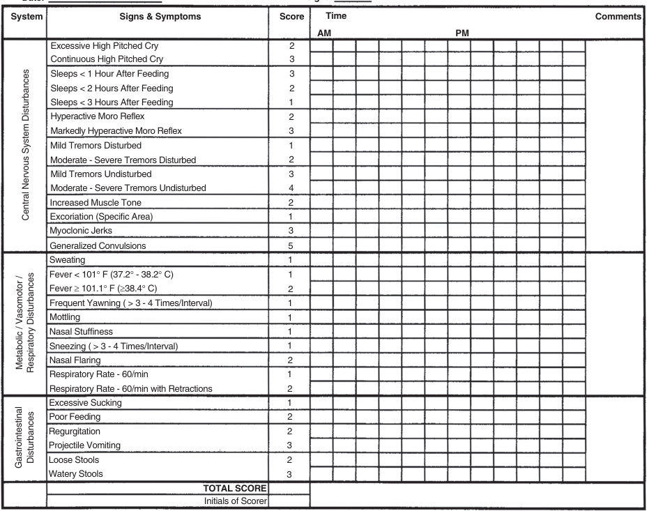
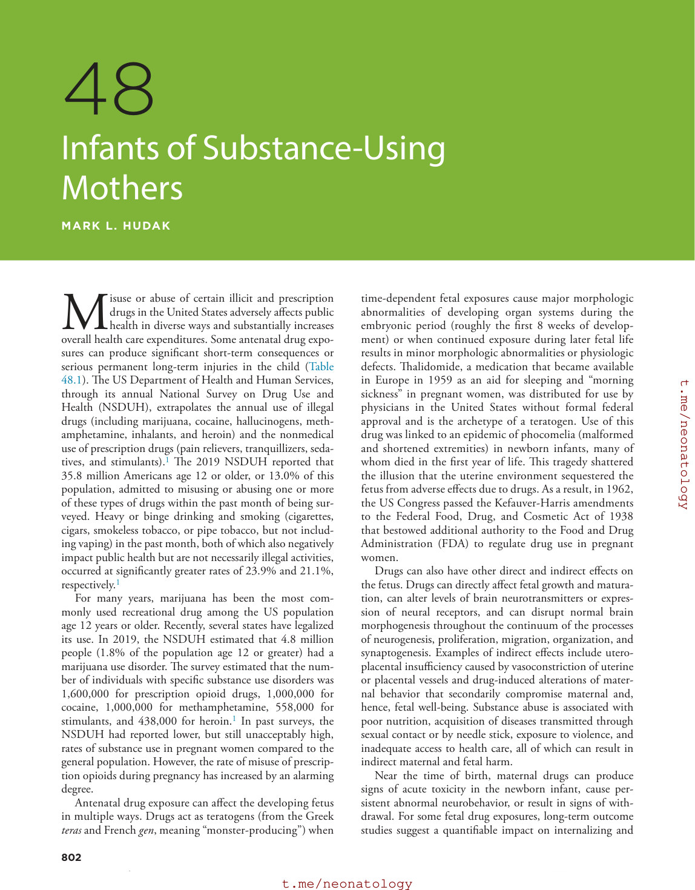
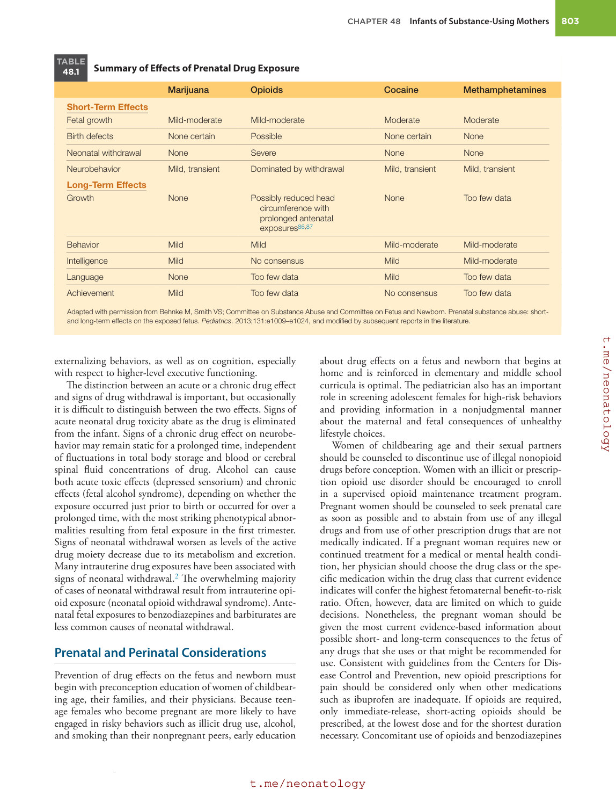
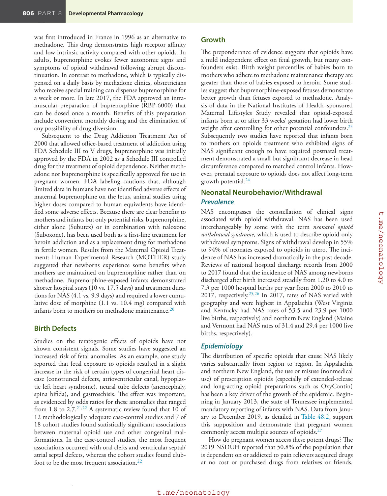
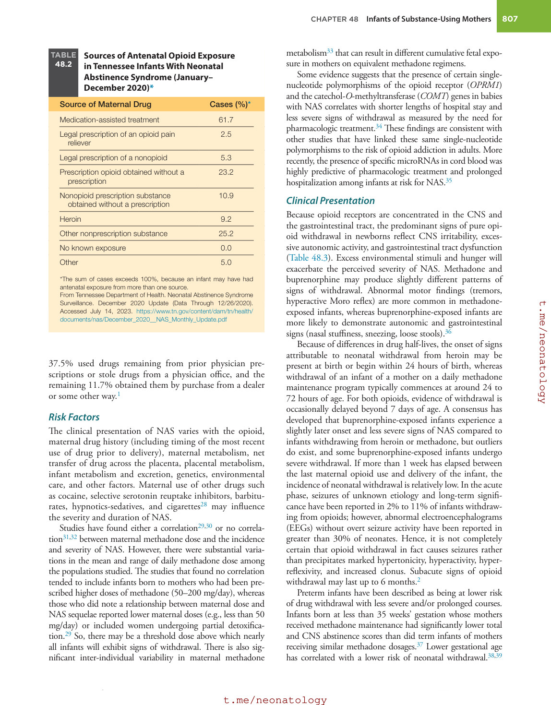
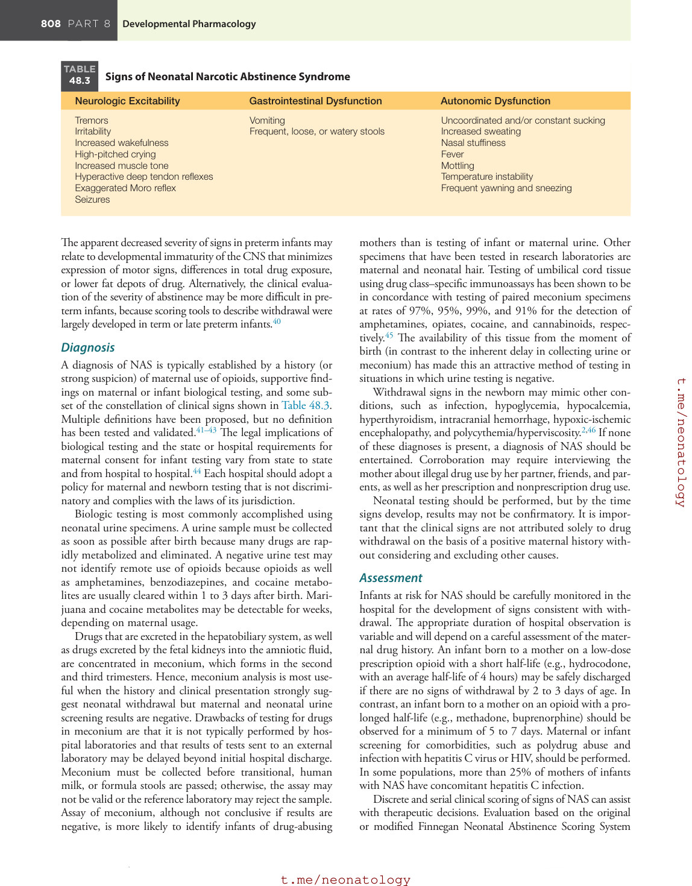
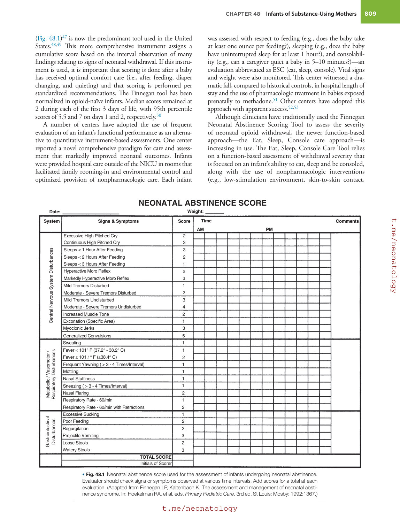
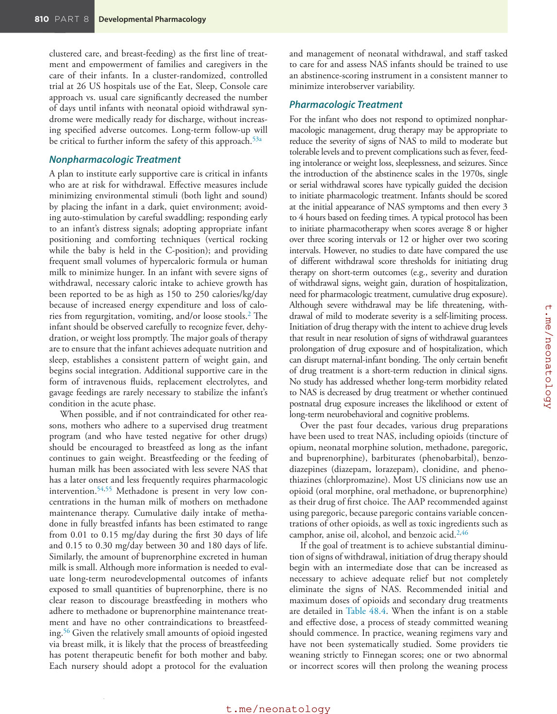
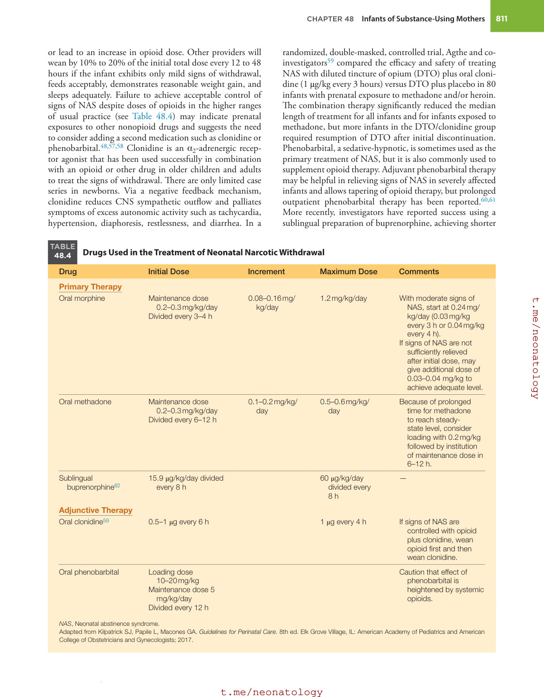
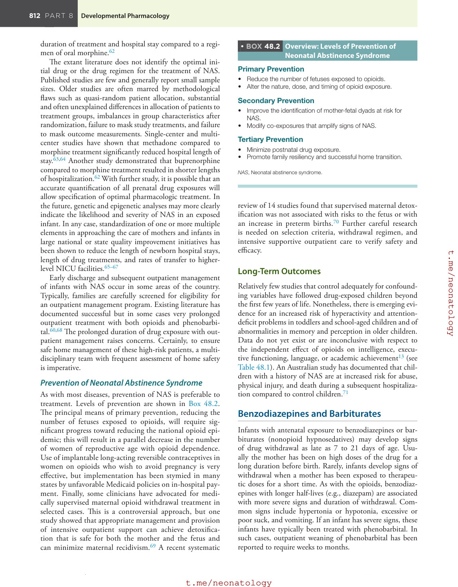

# 48. Infants of Substance-Using Mothers
> [Source credits](../../SOURCE_CREDITS.md).

## Study pillars

### Withdrawal pattern

CNS irritability, autonomic overactivity and gastrointestinal dysfunction. Opioid receptor distribution in the nervous system and gut helps explain the clinical domains.

PDF p. 814

### Diagnostic anchoring

Consider infection and metabolic or neurologic causes as well. Withdrawal can mimic infection, glucose or calcium disturbances and neurologic injury; concurrent causes need consideration.

PDF p. 815

### Specimen timing

Rapid elimination can make urine testing miss earlier exposure. Many drugs clear rapidly; specimen type and timing determine the detection window.

PDF p. 815

### Supportive care

Reduce stimuli, swaddle, comfort and support frequent appropriate feeds. Supportive care targets comfort, nutrition, sleep and growth while watching for dehydration and weight loss.

PDF p. 817

### Medication goals

Reduce signs to a tolerable level while restoring function. The chapter emphasizes function and short-term symptom reduction; it does not establish long-term benefit from drug treatment.

PDF p. 817

## Full source extraction

# 48. Infants of Substance-Using Mothers
> Source attribution: [Source credits](../../SOURCE_CREDITS.md).

## PDF page 809 | printed page 802

48 Infants of Substance-Using Mothers

### MARK L. HUDAK

Misuse or abuse of certain illicit and prescription drugs in the United States adversely affects public health in diverse ways and substantially increases overall health care expenditures. Some antenatal drug exposures can produce significant short-term consequences or serious permanent long-term injuries in the child (Table 48.1). The US Department of Health and Human Services, through its annual National Survey on Drug Use and Health (NSDUH), extrapolates the annual use of illegal drugs (including marijuana, cocaine, hallucinogens, methamphetamine, inhalants, and heroin) and the nonmedical use of prescription drugs (pain relievers, tranquillizers, sedatives, and stimulants).1 The 2019 NSDUH reported that 35.8 million Americans age 12 or older, or 13.0% of this population, admitted to misusing or abusing one or more of these types of drugs within the past month of being surveyed. Heavy or binge drinking and smoking (cigarettes, cigars, smokeless tobacco, or pipe tobacco, but not including vaping) in the past month, both of which also negatively impact public health but are not necessarily illegal activities, occurred at significantly greater rates of 23.9% and 21.1%, respectively.1

For many years, marijuana has been the most commonly used recreational drug among the US population age 12 years or older. Recently, several states have legalized its use. In 2019, the NSDUH estimated that 4.8 million people (1.8% of the population age 12 or greater) had a marijuana use disorder. The survey estimated that the number of individuals with specific substance use disorders was 1,600,000 for prescription opioid drugs, 1,000,000 for cocaine, 1,000,000 for methamphetamine, 558,000 for stimulants, and 438,000 for heroin.1 In past surveys, the NSDUH had reported lower, but still unacceptably high, rates of substance use in pregnant women compared to the general population. However, the rate of misuse of prescription opioids during pregnancy has increased by an alarming degree.

Antenatal drug exposure can affect the developing fetus in multiple ways. Drugs act as teratogens (from the Greek teras and French gen, meaning “monster-producing”) when

802

time-dependent fetal exposures cause major morphologic abnormalities of developing organ systems during the embryonic period (roughly the first 8 weeks of development) or when continued exposure during later fetal life results in minor morphologic abnormalities or physiologic defects. Thalidomide, a medication that became available in Europe in 1959 as an aid for sleeping and “morning sickness” in pregnant women, was distributed for use by physicians in the United States without formal federal approval and is the archetype of a teratogen. Use of this drug was linked to an epidemic of phocomelia (malformed and shortened extremities) in newborn infants, many of whom died in the first year of life. This tragedy shattered the illusion that the uterine environment sequestered the fetus from adverse effects due to drugs. As a result, in 1962, the US Congress passed the Kefauver-Harris amendments to the Federal Food, Drug, and Cosmetic Act of 1938 that bestowed additional authority to the Food and Drug Administration (FDA) to regulate drug use in pregnant women.

Drugs can also have other direct and indirect effects on the fetus. Drugs can directly affect fetal growth and maturation, can alter levels of brain neurotransmitters or expression of neural receptors, and can disrupt normal brain morphogenesis throughout the continuum of the processes of neurogenesis, proliferation, migration, organization, and synaptogenesis. Examples of indirect effects include uteroplacental insufficiency caused by vasoconstriction of uterine or placental vessels and drug-induced alterations of maternal behavior that secondarily compromise maternal and, hence, fetal well-being. Substance abuse is associated with poor nutrition, acquisition of diseases transmitted through sexual contact or by needle stick, exposure to violence, and inadequate access to health care, all of which can result in indirect maternal and fetal harm.

Near the time of birth, maternal drugs can produce signs of acute toxicity in the newborn infant, cause persistent abnormal neurobehavior, or result in signs of withdrawal. For some fetal drug exposures, long-term outcome studies suggest a quantifiable impact on internalizing and

## PDF page 810 | printed page 803

TABLE

Summary of Effects of Prenatal Drug Exposure

48.1

Marijuana Opioids

Short-Term Effects

Fetal growth Mild-moderate Mild-moderate

Birth defects None certain Possible

Neonatal withdrawal None Severe

Neurobehavior Mild, transient Dominated by withdrawal

Long-Term Effects

Growth None Possibly reduced head

circumference with prolonged antenatal exposures86,87

Behavior Mild Mild

Intelligence Mild No consensus

Language None Too few data

Achievement Mild Too few data

Adapted with permission from Behnke M, Smith VS; Committee on Substance Abuse and Committee on Fetus and Newborn. Prenatal substance abuse: shortand long-term effects on the exposed fetus. Pediatrics. 2013;131:e1009–e1024, and modified by subsequent reports in the literature.

externalizing behaviors, as well as on cognition, especially with respect to higher-level executive functioning.

The distinction between an acute or a chronic drug effect and signs of drug withdrawal is important, but occasionally it is difficult to distinguish between the two effects. Signs of acute neonatal drug toxicity abate as the drug is eliminated from the infant. Signs of a chronic drug effect on neurobehavior may remain static for a prolonged time, independent of fluctuations in total body storage and blood or cerebral spinal fluid concentrations of drug. Alcohol can cause both acute toxic effects (depressed sensorium) and chronic effects (fetal alcohol syndrome), depending on whether the exposure occurred just prior to birth or occurred for over a prolonged time, with the most striking phenotypical abnormalities resulting from fetal exposure in the first trimester. Signs of neonatal withdrawal worsen as levels of the active drug moiety decrease due to its metabolism and excretion. Many intrauterine drug exposures have been associated with signs of neonatal withdrawal.2 The overwhelming majority of cases of neonatal withdrawal result from intrauterine opioid exposure (neonatal opioid withdrawal syndrome). Antenatal fetal exposures to benzodiazepines and barbiturates are less common causes of neonatal withdrawal.

### Prenatal and Perinatal Considerations

Prevention of drug effects on the fetus and newborn must begin with preconception education of women of childbearing age, their families, and their physicians. Because teenage females who become pregnant are more likely to have engaged in risky behaviors such as illicit drug use, alcohol, and smoking than their nonpregnant peers, early education

Cocaine Methamphetamines

Moderate Moderate

None certain None

None None

Mild, transient Mild, transient

None Too few data

Mild-moderate Mild-moderate

Mild Mild-moderate

Mild Too few data

No consensus Too few data

about drug effects on a fetus and newborn that begins at home and is reinforced in elementary and middle school curricula is optimal. The pediatrician also has an important role in screening adolescent females for high-risk behaviors and providing information in a nonjudgmental manner about the maternal and fetal consequences of unhealthy lifestyle choices.

Women of childbearing age and their sexual partners should be counseled to discontinue use of illegal nonopioid drugs before conception. Women with an illicit or prescription opioid use disorder should be encouraged to enroll in a supervised opioid maintenance treatment program. Pregnant women should be counseled to seek prenatal care as soon as possible and to abstain from use of any illegal drugs and from use of other prescription drugs that are not medically indicated. If a pregnant woman requires new or continued treatment for a medical or mental health condition, her physician should choose the drug class or the specific medication within the drug class that current evidence indicates will confer the highest fetomaternal benefit-to-risk ratio. Often, however, data are limited on which to guide decisions. Nonetheless, the pregnant woman should be given the most current evidence-based information about possible short- and long-term consequences to the fetus of any drugs that she uses or that might be recommended for use. Consistent with guidelines from the Centers for Disease Control and Prevention, new opioid prescriptions for pain should be considered only when other medications such as ibuprofen are inadequate. If opioids are required, only immediate-release, short-acting opioids should be prescribed, at the lowest dose and for the shortest duration necessary. Concomitant use of opioids and benzodiazepines

## PDF page 811

is contraindicated. These recommendations are particularly critical for women of childbearing age where both a woman and her fetus could be affected by injudicious prescription of opioids.3 The obstetric provider should conduct periodic SBIRT (screening by interview; brief intervention; referral to treatment) procedures for each pregnant woman under their care.4 A short screening interview can help to determine whether a pregnant woman is likely to be engaged in surreptitious drug use. Several short questionnaires, including the 4Ps (Parents, Partner, Past, and Present),5 CAGE- AID,6 and CRAFFT,7 have been validated. The four 4Ps questions are listed in Box 48.1. This screen is positive if the answer to any of the questions is “yes,” indicating that further targeted questioning should be done. A brief intervention consisting of short, focused education and referral to appropriate treatment can be performed for those women who admit to a problem.

If a pregnant woman admits to or is suspected of illicit drug use or abuse, she can be asked to provide informed consent for biologic testing. Urine testing is preferred, and positive tests should be confirmed with mass spectrometry/gas chromatography. The clinician should be aware of limitations of testing. Tests vary widely with respect to the panel of drugs that are assayed. Threshold detection levels are set to avoid false positives, but levels that fall below the threshold due to low dose exposure or a long interval between the most recent exposure and testing will lead to a false-negative result. A positive result may indicate legitimate use of a prescription medication or intense secondhand exposure.

Clinicians should adopt a flexible and nonjudgmental approach to the care of women who abuse illicit drugs or misuse prescription drugs, and they should incorporate appropriate community resources for education (e.g., community support groups) and treatment (e.g., rehabilitation centers) into the care plan. The goals of the provider are threefold: (1) to establish a trusting relationship with each woman so that she continues regular prenatal care to reduce harm to the woman and her fetus without necessarily counseling cessation of the drug (e.g., in the case of a pregnant mother in an opioid maintenance program); (2) to recognize and treat potential comorbidities; and (3) to counsel about the possible maternal and fetal effects of the use of other drugs. In particular, because catastrophic obstetric complications can accompany the use of certain drugs, the pregnant woman should be educated about the signs of antepartum hemorrhage, premature rupture of membranes, premature onset of labor, and meconiumstained amniotic fluid so that prompt diagnosis and treatment can ensue.

Due to guilt or fear of legal action (incarceration, initiation of child welfare proceedings), a pregnant woman with illicit drug use may not have sought prenatal care before presenting with an obstetric complication, the onset of labor, or a medical comorbidity. The legal consequences to a woman abusing illicit drugs or misusing prescription opioids vary across states. Some states have passed punitive legislation,

• BOX 48.1 4Ps Screening Tool

1. Parents: Did any of your parents have problems with

alcohol or other drug use? 2. Partner: Does your partner have a problem with alcohol or

drug use? 3. Past: In the past, have you had difficulties in your life

because of alcohol or other drugs, including prescription medications? 4. Present: In the past month, have you drunk any alcohol or

used other drugs? Any “yes” response should initiate further, more specific

questions. If all of the answers are “no,” the screen is negative. The 4Ps tool is not copyrighted so it can be used at no cost.

whereas others have worked to encourage prenatal access to comprehensive care and treatment without legal repercussions. Emergency room visits and hospital admissions may afford the only windows of opportunity to evaluate such a patient and to refer her for appropriate multidisciplinary treatment. During obstetric-related hospitalizations, providers can counsel a woman about the prevention of future drug-exposed pregnancies, sexually transmitted diseases, and human immunodeficiency virus (HIV) infection.

### Neonatal Considerations

Providers who care for infants during the initial birth hospitalization should understand that maternal self-reporting, restricted implementation of screening procedures, and maternal drug tests do not identify all infants with significant antenatal exposure to drugs. Newborn caregivers should be knowledgeable about patterns of illicit drug abuse or the misuse of prescription drugs in their community. Guidelines for neonatal biologic testing at birth for exposure to illicit drugs are commonly based on associated conditions, such as maternal self-reporting of alcohol or drug use, inadequate or no prenatal care, presence of certain sexually transmitted maternal diseases, premature onset of labor, abruptio placentae, intrauterine growth restriction, congenital malformations, and overt signs of neonatal withdrawal. However, these criteria may result in disproportionate identification and referral of certain minority populations. Moreover, restricting testing of mothers and infants based on these or similar criteria will fail to detect all exposed infants. For these reasons, some have advocated that universal drug testing of all pregnant women or newborns is a reasonable and equitable approach. In 2013, most hospitals in the Cincinnati, Ohio, area implemented a policy of universal maternal testing but allowed the mother to opt out.8 A study at one Cincinnati hospital showed that this approach did identify substance-exposed infants that conventional screening procedures would have missed.9 However, professional organizations such as the American College of Obstetrics and Gynecology have not recommended universal testing. The issue remains controversial.

## PDF page 812 | printed page 805

### Marijuana (Cannabinoids)

Whereas the principal active cannabinoid in marijuana (Δ9-tetrahydrocannabinol) readily crosses the placenta, a major metabolite (11-nor-9-carboxytetrahydrocannabinol) remains sequestered in the maternal circulation.10 However, marijuana remains in the body tissues of chronic users for as long as 30 days and so can result in prolonged fetal exposure.

Fetal exposure to marijuana has not been linked to patterns of congenital malformation. Whether marijuana results in an increased risk of fetal growth restriction is unclear.11,12 If marijuana affects newborn neurobehavior, the effects are subtle. Newborns have not demonstrated signs of true withdrawal secondary to marijuana exposure. No study has discerned an independent effect of prenatal marijuana exposure on childhood growth through adolescence. Multiple studies have suggested that prenatal marijuana exposure exerts long-term effects on behavior (inattention and impulsivity), problem-solving skills, and underachievement in reading and spelling, but not on measured intelligence quotient (IQ) or language.13 However, some preparations of marijuana (and synthetic cannabinoids) available today are much more potent than in the past, so that the results of existing studies that evaluated long-term outcomes of fetal exposure to lower potency marijuana may not accurately reflect current risk.14,15 The American Academy of Pediatrics (AAP) considers maternal marijuana use to be a relative contraindication to breastfeeding. The American College of Obstetrics and Gynecology also discourages marijuana use by lactating mothers.16

### Opioids

Opioids are a class of chemical compounds that activate μ-opioid (but also κ- and δ-opioid) receptors primarily in the central nervous system (CNS) to produce supraspinal analgesia. The term opiate refers to a subclass of alkaloid opioids. Naturally occurring opioids are present in the opium poppy (e.g., morphine) or in the kratom tree (endemic to southeast Asia)17 and also occur endogenously (e.g., enkephalins, endorphins, endomorphins). Opioids can be synthetic (e.g., methadone and fentanyl are synthesized from nonopioid precursors) or semisynthetic in origin (e.g., heroin [diacetyl morphine] and buprenorphine are modifications of natural opioid compounds). Other acute effects of opioids include sedation, euphoria, miosis, respiratory depression, and decreased gastrointestinal motility. Prolonged use results in physical and psychologic dependence. As a class of drugs, opioids demonstrate a narrow therapeutic index within a given patient. However, the observed range in doses that achieve a similar therapeutic effect in a large population is wide because of genetic differences in pharmacokinetics and pharmacodynamics.18 Opioids acutely inhibit the release of noradrenaline at synaptic terminals. The synthetic opioid methadone exerts secondary effects by acting as an N-methyl-d-aspartate receptor antagonist to block the actions of glutamate, the primary excitatory neurotransmitter in the CNS. In patients who have chronic exposure to some opioids, tolerance can develop,

because over time the rate of noradrenaline release increases toward normal. The molecular mechanisms that result in substance abuse disorder and produce signs and symptoms of withdrawal are complex and incompletely understood.

Opioids are variably lipophilic compounds of low molecular weight that cross both blood-brain and placental barriers. Because heroin is more lipophilic than morphine, it crosses the blood-brain barrier more rapidly and causes a greater euphoric “high.” Methadone is well absorbed orally; it has a mean half-life of approximately 1 day so that it produces a sustained effect compared to heroin that has a much shorter half-life of 15 to 30 minutes.

Opioid use in pregnant women carries risks for the mother, fetus, and newborn. Intravenous injection of heroin exposes the mother and her fetus to potential drug overdose, to a greater risk of acute bacterial endocarditis, and, due to contaminated needles, to serious viral infections (e.g., hepatitis C, hepatitis B, HIV). Other direct and indirect prenatal complications of heroin use include extrauterine pregnancies due to salpingo-oophoritis, premature labor, premature rupture of membranes, antepartum hemorrhage, fetal demise, and low birth weight. Mothers who use heroin experience rapid fluctuations in opioid concentrations because of its short half-life, so that the fetus may also suffer intermittent withdrawal effects. Therapeutic opioid maintenance therapy employs an opioid with a long half-life to minimize fluctuations between peak and trough fetal drug levels. A more stable maternal opioid level reduces overall fetal stress.

Maternal opioid detoxification is generally not recommended because of concerns about a possible increased risk of fetal distress and fetal loss during withdrawal, as well as a high rate of maternal recidivism. In situations where a mother does not have access to a supervised opioid maintenance program, the American College of Obstetricians and Gynecologists has stated that medically supervised detoxification may be considered.19 Opioid maintenance therapy with daily methadone (a full μ-opioid agonist and FDA Schedule II controlled drug) for pregnant women can sustain opioid concentrations in the mother and fetus in ranges that minimize opioid craving, suppress abstinence symptomatology, block heroin-induced euphoria, and minimize fetal stress. Other benefits from this once-controversial treatment are optimization of prenatal care and general maternal physical and mental health, as well as the chance to educate the mother and notify newborn care providers about the potential for the infant to show signs of withdrawal. Disadvantages of methadone include greater difficulty in achieving successful detoxification after delivery and a more severe and prolonged course of neonatal abstinence syndrome (NAS) compared, for example, with heroin exposure. These issues have encouraged the development of other opioids as alternative treatments to methadone. It should be noted that in light of the ongoing opioid epidemic, the term NOWS (neonatal opioid withdrawal syndrome) is being widely used as an alternative to NAS.

Buprenorphine is a semisynthetic opioid with partial μ-opioid agonist and κ-opioid antagonist properties; it

## PDF page 813

was first introduced in France in 1996 as an alternative to methadone. This drug demonstrates high receptor affinity and low intrinsic activity compared with other opioids. In adults, buprenorphine evokes fewer autonomic signs and symptoms of opioid withdrawal following abrupt discontinuation. In contrast to methadone, which is typically dispensed on a daily basis by methadone clinics, obstetricians who receive special training can dispense buprenorphine for a week or more. In late 2017, the FDA approved an intramuscular preparation of buprenorphine (RBP-6000) that can be dosed once a month. Benefits of this preparation include convenient monthly dosing and the elimination of any possibility of drug diversion.

Subsequent to the Drug Addiction Treatment Act of 2000 that allowed office-based treatment of addiction using FDA Schedule III to V drugs, buprenorphine was initially approved by the FDA in 2002 as a Schedule III controlled drug for the treatment of opioid dependence. Neither methadone nor buprenorphine is specifically approved for use in pregnant women. FDA labeling cautions that, although limited data in humans have not identified adverse effects of maternal buprenorphine on the fetus, animal studies using higher doses compared to human equivalents have identified some adverse effects. Because there are clear benefits to mothers and infants but only potential risks, buprenorphine, either alone (Subutex) or in combination with naloxone (Suboxone), has been used both as a first-line treatment for heroin addiction and as a replacement drug for methadone in fertile women. Results from the Maternal Opioid Treatment: Human Experimental Research (MOTHER) study suggested that newborns experience some benefits when mothers are maintained on buprenorphine rather than on methadone. Buprenorphine-exposed infants demonstrated shorter hospital stays (10 vs. 17.5 days) and treatment durations for NAS (4.1 vs. 9.9 days) and required a lower cumulative dose of morphine (1.1 vs. 10.4 mg) compared with infants born to mothers on methadone maintenance.20

### Birth Defects

Studies on the teratogenic effects of opioids have not shown consistent signals. Some studies have suggested an increased risk of fetal anomalies. As an example, one study reported that fetal exposure to opioids resulted in a slight increase in the risk of certain types of congenital heart disease (conotruncal defects, atrioventricular canal, hypoplastic left heart syndrome), neural tube defects (anencephaly, spina bifida), and gastroschisis. The effect was important, as evidenced by odds ratios for these anomalies that ranged from 1.8 to 2.7.21,22 A systematic review found that 10 of 12 methodologically adequate case-control studies and 7 of 18 cohort studies found statistically significant associations between maternal opioid use and other congenital malformations. In the case-control studies, the most frequent associations occurred with oral clefts and ventricular septal/ atrial septal defects, whereas the cohort studies found clubfoot to be the most frequent association.22

### Growth

The preponderance of evidence suggests that opioids have a mild independent effect on fetal growth, but many confounders exist. Birth weight percentiles of babies born to mothers who adhere to methadone maintenance therapy are greater than those of babies exposed to heroin. Some studies suggest that buprenorphine-exposed fetuses demonstrate better growth than fetuses exposed to methadone. Analysis of data in the National Institutes of Health–sponsored Maternal Lifestyles Study revealed that opioid-exposed infants born at or after 33 weeks’ gestation had lower birth weight after controlling for other potential confounders.23 Subsequently two studies have reported that infants born to mothers on opioids treatment who exhibited signs of NAS significant enough to have required postnatal treatment demonstrated a small but significant decrease in head circumference compared to matched control infants. However, prenatal exposure to opioids does not affect long-term growth potential.24

### Neonatal Neurobehavior/Withdrawal Prevalence

NAS encompasses the constellation of clinical signs associated with opioid withdrawal. NAS has been used interchangeably by some with the term neonatal opioid withdrawal syndrome, which is used to describe opioid-only withdrawal symptoms. Signs of withdrawal develop in 55% to 94% of neonates exposed to opioids in utero. The incidence of NAS has increased dramatically in the past decade. Reviews of national hospital discharge records from 2000 to 2017 found that the incidence of NAS among newborns discharged after birth increased steadily from 1.20 to 4.0 to 7.3 per 1000 hospital births per year from 2000 to 2010 to 2017, respectively.25,26 In 2017, rates of NAS varied with geography and were highest in Appalachia (West Virginia and Kentucky had NAS rates of 53.5 and 23.9 per 1000 live births, respectively) and northern New England (Maine and Vermont had NAS rates of 31.4 and 29.4 per 1000 live births, respectively).

### Epidemiology

The distribution of specific opioids that cause NAS likely varies substantially from region to region. In Appalachia and northern New England, the use or misuse (nonmedical use) of prescription opioids (especially of extended-release and long-acting opioid preparations such as OxyContin) has been a key driver of the growth of the epidemic. Beginning in January 2013, the state of Tennessee implemented mandatory reporting of infants with NAS. Data from January to December 2019, as detailed in Table 48.2, support this supposition and demonstrate that pregnant women commonly access multiple sources of opioids.27

How do pregnant women access these potent drugs? The 2019 NSDUH reported that 50.8% of the population that is dependent on or addicted to pain relievers acquired drugs at no cost or purchased drugs from relatives or friends,

## PDF page 814 | printed page 807

Sources of Antenatal Opioid Exposure

TABLE

48.2

in Tennessee Infants With Neonatal Abstinence Syndrome (January– December 2020)*

Source of Maternal Drug Cases (%)*

Medication-assisted treatment 61.7

Legal prescription of an opioid pain

2.5

reliever

Legal prescription of a nonopioid 5.3

Prescription opioid obtained without a

23.2

prescription

Nonopioid prescription substance

10.9

obtained without a prescription

Heroin 9.2

Other nonprescription substance 25.2

No known exposure 0.0

Other 5.0

*The sum of cases exceeds 100%, because an infant may have had antenatal exposure from more than one source. From Tennessee Department of Health. Neonatal Abstinence Syndrome Surveillance. December 2020 Update (Data Through 12/26/2020). Accessed July 14, 2023. https://www.tn.gov/content/dam/tn/health/ documents/nas/December_2020__NAS_Monthly_Update.pdf

37.5% used drugs remaining from prior physician prescriptions or stole drugs from a physician office, and the remaining 11.7% obtained them by purchase from a dealer or some other way.1

### Risk Factors

The clinical presentation of NAS varies with the opioid, maternal drug history (including timing of the most recent use of drug prior to delivery), maternal metabolism, net transfer of drug across the placenta, placental metabolism, infant metabolism and excretion, genetics, environmental care, and other factors. Maternal use of other drugs such as cocaine, selective serotonin reuptake inhibitors, barbiturates, hypnotics-sedatives, and cigarettes28 may influence the severity and duration of NAS.

Studies have found either a correlation29,30 or no correlation31,32 between maternal methadone dose and the incidence and severity of NAS. However, there were substantial variations in the mean and range of daily methadone dose among the populations studied. The studies that found no correlation tended to include infants born to mothers who had been prescribed higher doses of methadone (50–200 mg/day), whereas those who did note a relationship between maternal dose and NAS sequelae reported lower maternal doses (e.g., less than 50 mg/day) or included women undergoing partial detoxification.29 So, there may be a threshold dose above which nearly all infants will exhibit signs of withdrawal. There is also significant inter-individual variability in maternal methadone

metabolism33 that can result in different cumulative fetal exposure in mothers on equivalent methadone regimens.

Some evidence suggests that the presence of certain singlenucleotide polymorphisms of the opioid receptor (OPRM1) and the catechol-O-methyltransferase (COMT) genes in babies with NAS correlates with shorter lengths of hospital stay and less severe signs of withdrawal as measured by the need for pharmacologic treatment.34 These findings are consistent with other studies that have linked these same single-nucleotide polymorphisms to the risk of opioid addiction in adults. More recently, the presence of specific microRNAs in cord blood was highly predictive of pharmacologic treatment and prolonged hospitalization among infants at risk for NAS.35

### Clinical Presentation

Because opioid receptors are concentrated in the CNS and the gastrointestinal tract, the predominant signs of pure opioid withdrawal in newborns reflect CNS irritability, excessive autonomic activity, and gastrointestinal tract dysfunction (Table 48.3). Excess environmental stimuli and hunger will exacerbate the perceived severity of NAS. Methadone and buprenorphine may produce slightly different patterns of signs of withdrawal. Abnormal motor findings (tremors, hyperactive Moro reflex) are more common in methadoneexposed infants, whereas buprenorphine-exposed infants are more likely to demonstrate autonomic and gastrointestinal signs (nasal stuffiness, sneezing, loose stools).36

Because of differences in drug half-lives, the onset of signs attributable to neonatal withdrawal from heroin may be present at birth or begin within 24 hours of birth, whereas withdrawal of an infant of a mother on a daily methadone maintenance program typically commences at around 24 to 72 hours of age. For both opioids, evidence of withdrawal is occasionally delayed beyond 7 days of age. A consensus has developed that buprenorphine-exposed infants experience a slightly later onset and less severe signs of NAS compared to infants withdrawing from heroin or methadone, but outliers do exist, and some buprenorphine-exposed infants undergo severe withdrawal. If more than 1 week has elapsed between the last maternal opioid use and delivery of the infant, the incidence of neonatal withdrawal is relatively low. In the acute phase, seizures of unknown etiology and long-term significance have been reported in 2% to 11% of infants withdrawing from opioids; however, abnormal electroencephalograms (EEGs) without overt seizure activity have been reported in greater than 30% of neonates. Hence, it is not completely certain that opioid withdrawal in fact causes seizures rather than precipitates marked hypertonicity, hyperactivity, hyperreflexivity, and increased clonus. Subacute signs of opioid withdrawal may last up to 6 months.2

Preterm infants have been described as being at lower risk of drug withdrawal with less severe and/or prolonged courses. Infants born at less than 35 weeks’ gestation whose mothers received methadone maintenance had significantly lower total and CNS abstinence scores than did term infants of mothers receiving similar methadone dosages.37 Lower gestational age has correlated with a lower risk of neonatal withdrawal.38,39

## PDF page 815

TABLE

Signs of Neonatal Narcotic Abstinence Syndrome

48.3

Neurologic Excitability Gastrointestinal Dysfunction

Tremors Irritability Increased wakefulness High-pitched crying Increased muscle tone Hyperactive deep tendon reflexes Exaggerated Moro reflex Seizures

Vomiting Frequent, loose, or watery stools

The apparent decreased severity of signs in preterm infants may relate to developmental immaturity of the CNS that minimizes expression of motor signs, differences in total drug exposure, or lower fat depots of drug. Alternatively, the clinical evaluation of the severity of abstinence may be more difficult in preterm infants, because scoring tools to describe withdrawal were largely developed in term or late preterm infants.40

### Diagnosis

A diagnosis of NAS is typically established by a history (or strong suspicion) of maternal use of opioids, supportive findings on maternal or infant biological testing, and some subset of the constellation of clinical signs shown in Table 48.3. Multiple definitions have been proposed, but no definition has been tested and validated.41–43 The legal implications of biological testing and the state or hospital requirements for maternal consent for infant testing vary from state to state and from hospital to hospital.44 Each hospital should adopt a policy for maternal and newborn testing that is not discriminatory and complies with the laws of its jurisdiction.

Biologic testing is most commonly accomplished using neonatal urine specimens. A urine sample must be collected as soon as possible after birth because many drugs are rapidly metabolized and eliminated. A negative urine test may not identify remote use of opioids because opioids as well as amphetamines, benzodiazepines, and cocaine metabolites are usually cleared within 1 to 3 days after birth. Marijuana and cocaine metabolites may be detectable for weeks, depending on maternal usage.

Drugs that are excreted in the hepatobiliary system, as well as drugs excreted by the fetal kidneys into the amniotic fluid, are concentrated in meconium, which forms in the second and third trimesters. Hence, meconium analysis is most useful when the history and clinical presentation strongly suggest neonatal withdrawal but maternal and neonatal urine screening results are negative. Drawbacks of testing for drugs in meconium are that it is not typically performed by hospital laboratories and that results of tests sent to an external laboratory may be delayed beyond initial hospital discharge. Meconium must be collected before transitional, human milk, or formula stools are passed; otherwise, the assay may not be valid or the reference laboratory may reject the sample. Assay of meconium, although not conclusive if results are negative, is more likely to identify infants of drug-abusing

Autonomic Dysfunction

Uncoordinated and/or constant sucking Increased sweating Nasal stuffiness Fever Mottling Temperature instability Frequent yawning and sneezing

mothers than is testing of infant or maternal urine. Other specimens that have been tested in research laboratories are maternal and neonatal hair. Testing of umbilical cord tissue using drug class–specific immunoassays has been shown to be in concordance with testing of paired meconium specimens at rates of 97%, 95%, 99%, and 91% for the detection of amphetamines, opiates, cocaine, and cannabinoids, respectively.45 The availability of this tissue from the moment of birth (in contrast to the inherent delay in collecting urine or meconium) has made this an attractive method of testing in situations in which urine testing is negative.

Withdrawal signs in the newborn may mimic other conditions, such as infection, hypoglycemia, hypocalcemia, hyperthyroidism, intracranial hemorrhage, hypoxic-ischemic encephalopathy, and polycythemia/hyperviscosity.2,46 If none of these diagnoses is present, a diagnosis of NAS should be entertained. Corroboration may require interviewing the mother about illegal drug use by her partner, friends, and parents, as well as her prescription and nonprescription drug use.

Neonatal testing should be performed, but by the time signs develop, results may not be confirmatory. It is important that the clinical signs are not attributed solely to drug withdrawal on the basis of a positive maternal history without considering and excluding other causes.

### Assessment

Infants at risk for NAS should be carefully monitored in the hospital for the development of signs consistent with withdrawal. The appropriate duration of hospital observation is variable and will depend on a careful assessment of the maternal drug history. An infant born to a mother on a low-dose prescription opioid with a short half-life (e.g., hydrocodone, with an average half-life of 4 hours) may be safely discharged if there are no signs of withdrawal by 2 to 3 days of age. In contrast, an infant born to a mother on an opioid with a prolonged half-life (e.g., methadone, buprenorphine) should be observed for a minimum of 5 to 7 days. Maternal or infant screening for comorbidities, such as polydrug abuse and infection with hepatitis C virus or HIV, should be performed. In some populations, more than 25% of mothers of infants with NAS have concomitant hepatitis C infection.

Discrete and serial clinical scoring of signs of NAS can assist with therapeutic decisions. Evaluation based on the original or modified Finnegan Neonatal Abstinence Scoring System

## PDF page 816 | printed page 809

(Fig. 48.1)47 is now the predominant tool used in the United States.48,49 This more comprehensive instrument assigns a cumulative score based on the interval observation of many findings relating to signs of neonatal withdrawal. If this instrument is used, it is important that scoring is done after a baby has received optimal comfort care (i.e., after feeding, diaper changing, and quieting) and that scoring is performed per standardized recommendations. The Finnegan tool has been normalized in opioid-naïve infants. Median scores remained at 2 during each of the first 3 days of life, with 95th percentile scores of 5.5 and 7 on days 1 and 2, respectively.50

A number of centers have adopted the use of frequent evaluation of an infant’s functional performance as an alternative to quantitative instrument-based assessments. One center reported a novel comprehensive paradigm for care and assessment that markedly improved neonatal outcomes. Infants were provided hospital care outside of the NICU in rooms that facilitated family rooming-in and environmental control and optimized provision of nonpharmacologic care. Each infant

Weight:

### NEONATAL ABSTINENCE SCORE

Date:

Score Time

System Signs & Symptoms

### AM

Excessive High Pitched Cry Continuous High Pitched Cry

2

3

Sleeps < 1 Hour After Feeding

3

Central Nervous System Disturbances Metabolic / Vasomotor / Respiratory Disturbances Gastrointestinal Disturbances

2

Sleeps < 2 Hours After Feeding

1

Sleeps < 3 Hours After Feeding

Hyperactive Moro Reflex

2

Markedly Hyperactive Moro Reflex

3

1

Mild Tremors Disturbed

2

Moderate - Severe Tremors Disturbed

3

Mild Tremors Undisturbed

4

Moderate - Severe Tremors Undisturbed

2

Increased Muscle Tone

1

Excoriation (Specific Area)

3

Myoclonic Jerks

5

Generalized Convulsions

Sweating

1

Fever < 101 F (37.2 - 38.2 C)

1

Fever 101.1 F ( 38.4 C)

2

Frequent Yawning ( > 3 - 4 Times/Interval)

1

Mottling

1

Nasal Stuffiness

1

1

Sneezing ( > 3 - 4 Times/Interval)

Nasal Flaring

2

Respiratory Rate - 60/min

1

Respiratory Rate - 60/min with Retractions

2

1

Excessive Sucking

Poor Feeding

2

Regurgitation

2

Projectile Vomiting

3

Loose Stools

2

Watery Stools

3

### TOTAL SCORE

Initials of Scorer

• Fig. 48.1 Neonatal abstinence score used for the assessment of infants undergoing neonatal abstinence. Evaluator should check signs or symptoms observed at various time intervals. Add scores for a total at each evaluation. (Adapted from Finnegan LP, Kaltenbach K. The assessment and management of neonatal abstinence syndrome. In: Hoekelman RA, et al, eds. Primary Pediatric Care. 3rd ed. St Louis: Mosby; 1992:1367.)

was assessed with respect to feeding (e.g., does the baby take at least one ounce per feeding?), sleeping (e.g., does the baby have uninterrupted sleep for at least 1 hour?), and consolability (e.g., can a caregiver quiet a baby in 5–10 minutes?)—an evaluation abbreviated as ESC (eat, sleep, console). Vital signs and weight were also monitored. This center witnessed a dramatic fall, compared to historical controls, in hospital length of stay and the use of pharmacologic treatment in babies exposed prenatally to methadone.51 Other centers have adopted this approach with apparent success.52,53

Although clinicians have traditionally used the Finnegan Neonatal Abstinence Scoring Tool to assess the severity of neonatal opioid withdrawal, the newer function-based approach—the Eat, Sleep, Console care approach—is increasing in use. The Eat, Sleep, Console Care Tool relies on a function-based assessment of withdrawal severity that is focused on an infant’s ability to eat, sleep and be consoled, along with the use of nonpharmacologic interventions (e.g., low-stimulation environment, skin-to-skin contact,

Comments

### PM

• Fig. 48.1 Neonatal abstinence score used for the assessment of infants undergoing neonatal abstinence. Evaluator should check signs or symptoms observed at various time intervals. Add scores for a total at each evaluation. (Adapted from Finnegan LP, Kaltenbach K. The assessment and management of neonatal abstinence syndrome. In: Hoekelman RA, et al, eds. Primary Pediatric Care. 3rd ed. St Louis: Mosby; 1992:1367.)

## PDF page 817

clustered care, and breast-feeding) as the first line of treatment and empowerment of families and caregivers in the care of their infants. In a cluster-randomized, controlled trial at 26 US hospitals use of the Eat, Sleep, Console care approach vs. usual care significantly decreased the number of days until infants with neonatal opioid withdrawal syndrome were medically ready for discharge, without increasing specified adverse outcomes. Long-term follow-up will be critical to further inform the safety of this approach.53a

### Nonpharmacologic Treatment

A plan to institute early supportive care is critical in infants who are at risk for withdrawal. Effective measures include minimizing environmental stimuli (both light and sound) by placing the infant in a dark, quiet environment; avoiding auto-stimulation by careful swaddling; responding early to an infant’s distress signals; adopting appropriate infant positioning and comforting techniques (vertical rocking while the baby is held in the C-position); and providing frequent small volumes of hypercaloric formula or human milk to minimize hunger. In an infant with severe signs of withdrawal, necessary caloric intake to achieve growth has been reported to be as high as 150 to 250 calories/kg/day because of increased energy expenditure and loss of calories from regurgitation, vomiting, and/or loose stools.2 The infant should be observed carefully to recognize fever, dehydration, or weight loss promptly. The major goals of therapy are to ensure that the infant achieves adequate nutrition and sleep, establishes a consistent pattern of weight gain, and begins social integration. Additional supportive care in the form of intravenous fluids, replacement electrolytes, and gavage feedings are rarely necessary to stabilize the infant’s condition in the acute phase.

When possible, and if not contraindicated for other reasons, mothers who adhere to a supervised drug treatment program (and who have tested negative for other drugs) should be encouraged to breastfeed as long as the infant continues to gain weight. Breastfeeding or the feeding of human milk has been associated with less severe NAS that has a later onset and less frequently requires pharmacologic intervention.54,55 Methadone is present in very low concentrations in the human milk of mothers on methadone maintenance therapy. Cumulative daily intake of methadone in fully breastfed infants has been estimated to range from 0.01 to 0.15 mg/day during the first 30 days of life and 0.15 to 0.30 mg/day between 30 and 180 days of life. Similarly, the amount of buprenorphine excreted in human milk is small. Although more information is needed to evaluate long-term neurodevelopmental outcomes of infants exposed to small quantities of buprenorphine, there is no clear reason to discourage breastfeeding in mothers who adhere to methadone or buprenorphine maintenance treatment and have no other contraindications to breastfeeding.56 Given the relatively small amounts of opioid ingested via breast milk, it is likely that the process of breastfeeding has potent therapeutic benefit for both mother and baby. Each nursery should adopt a protocol for the evaluation

and management of neonatal withdrawal, and staff tasked to care for and assess NAS infants should be trained to use an abstinence-scoring instrument in a consistent manner to minimize interobserver variability.

### Pharmacologic Treatment

For the infant who does not respond to optimized nonpharmacologic management, drug therapy may be appropriate to reduce the severity of signs of NAS to mild to moderate but tolerable levels and to prevent complications such as fever, feeding intolerance or weight loss, sleeplessness, and seizures. Since the introduction of the abstinence scales in the 1970s, single or serial withdrawal scores have typically guided the decision to initiate pharmacologic treatment. Infants should be scored at the initial appearance of NAS symptoms and then every 3 to 4 hours based on feeding times. A typical protocol has been to initiate pharmacotherapy when scores average 8 or higher over three scoring intervals or 12 or higher over two scoring intervals. However, no studies to date have compared the use of different withdrawal score thresholds for initiating drug therapy on short-term outcomes (e.g., severity and duration of withdrawal signs, weight gain, duration of hospitalization, need for pharmacologic treatment, cumulative drug exposure). Although severe withdrawal may be life threatening, withdrawal of mild to moderate severity is a self-limiting process. Initiation of drug therapy with the intent to achieve drug levels that result in near resolution of signs of withdrawal guarantees prolongation of drug exposure and of hospitalization, which can disrupt maternal-infant bonding. The only certain benefit of drug treatment is a short-term reduction in clinical signs. No study has addressed whether long-term morbidity related to NAS is decreased by drug treatment or whether continued postnatal drug exposure increases the likelihood or extent of long-term neurobehavioral and cognitive problems.

Over the past four decades, various drug preparations have been used to treat NAS, including opioids (tincture of opium, neonatal morphine solution, methadone, paregoric, and buprenorphine), barbiturates (phenobarbital), benzodiazepines (diazepam, lorazepam), clonidine, and phenothiazines (chlorpromazine). Most US clinicians now use an opioid (oral morphine, oral methadone, or buprenorphine) as their drug of first choice. The AAP recommended against using paregoric, because paregoric contains variable concentrations of other opioids, as well as toxic ingredients such as camphor, anise oil, alcohol, and benzoic acid.2,46

If the goal of treatment is to achieve substantial diminution of signs of withdrawal, initiation of drug therapy should begin with an intermediate dose that can be increased as necessary to achieve adequate relief but not completely eliminate the signs of NAS. Recommended initial and maximum doses of opioids and secondary drug treatments are detailed in Table 48.4. When the infant is on a stable and effective dose, a process of steady committed weaning should commence. In practice, weaning regimens vary and have not been systematically studied. Some providers tie weaning strictly to Finnegan scores; one or two abnormal or incorrect scores will then prolong the weaning process

## PDF page 818 | printed page 811

or lead to an increase in opioid dose. Other providers will wean by 10% to 20% of the initial total dose every 12 to 48 hours if the infant exhibits only mild signs of withdrawal, feeds acceptably, demonstrates reasonable weight gain, and sleeps adequately. Failure to achieve acceptable control of signs of NAS despite doses of opioids in the higher ranges of usual practice (see Table 48.4) may indicate prenatal exposures to other nonopioid drugs and suggests the need to consider adding a second medication such as clonidine or phenobarbital.48,57,58 Clonidine is an α2-adrenergic receptor agonist that has been used successfully in combination with an opioid or other drug in older children and adults to treat the signs of withdrawal. There are only limited case series in newborns. Via a negative feedback mechanism, clonidine reduces CNS sympathetic outflow and palliates symptoms of excess autonomic activity such as tachycardia, hypertension, diaphoresis, restlessness, and diarrhea. In a

TABLE

Drugs Used in the Treatment of Neonatal Narcotic Withdrawal

48.4

Drug Initial Dose Increment

Primary Therapy

Oral morphine Maintenance dose

0.08–0.16 mg/

0.2–0.3 mg/kg/day Divided every 3–4 h

kg/day

Oral methadone Maintenance dose

0.1–0.2 mg/kg/

0.2–0.3 mg/kg/day Divided every 6–12 h

day

15.9 μg/kg/day divided

Sublingual

buprenorphine62

every 8 h

Adjunctive Therapy

Oral clonidine59 0.5–1 μg every 6 h

Oral phenobarbital Loading dose

10–20 mg/kg Maintenance dose 5

mg/kg/day Divided every 12 h

NAS, Neonatal abstinence syndrome. Adapted from Kilpatrick SJ, Papile L, Macones GA. Guidelines for Perinatal Care. 8th ed. Elk Grove Village, IL: American Academy of Pediatrics and American College of Obstetricians and Gynecologists; 2017.

randomized, double-masked, controlled trial, Agthe and coinvestigators59 compared the efficacy and safety of treating NAS with diluted tincture of opium (DTO) plus oral clonidine (1 μg/kg every 3 hours) versus DTO plus placebo in 80 infants with prenatal exposure to methadone and/or heroin. The combination therapy significantly reduced the median length of treatment for all infants and for infants exposed to methadone, but more infants in the DTO/clonidine group required resumption of DTO after initial discontinuation. Phenobarbital, a sedative-hypnotic, is sometimes used as the primary treatment of NAS, but it is also commonly used to supplement opioid therapy. Adjuvant phenobarbital therapy may be helpful in relieving signs of NAS in severely affected infants and allows tapering of opioid therapy, but prolonged outpatient phenobarbital therapy has been reported.60,61 More recently, investigators have reported success using a sublingual preparation of buprenorphine, achieving shorter

Maximum Dose Comments

1.2 mg/kg/day With moderate signs of

NAS, start at 0.24 mg/ kg/day (0.03 mg/kg every 3 h or 0.04 mg/kg every 4 h). If signs of NAS are not

sufficiently relieved after initial dose, may give additional dose of 0.03–0.04 mg/kg to achieve adequate level.

0.5–0.6 mg/kg/

Because of prolonged

day

time for methadone to reach steadystate level, consider loading with 0.2 mg/kg followed by institution of maintenance dose in 6–12 h.

60 μg/kg/day

—

divided every 8 h

1 μg every 4 h If signs of NAS are

controlled with opioid plus clonidine, wean opioid first and then wean clonidine.

Caution that effect of

phenobarbital is heightened by systemic opioids.

## PDF page 819

duration of treatment and hospital stay compared to a regimen of oral morphine.62

The extant literature does not identify the optimal initial drug or the drug regimen for the treatment of NAS. Published studies are few and generally report small sample sizes. Older studies are often marred by methodological flaws such as quasi-random patient allocation, substantial and often unexplained differences in allocation of patients to treatment groups, imbalances in group characteristics after randomization, failure to mask study treatments, and failure to mask outcome measurements. Single-center and multicenter studies have shown that methadone compared to morphine treatment significantly reduced hospital length of stay.63,64 Another study demonstrated that buprenorphine compared to morphine treatment resulted in shorter lengths of hospitalization.62 With further study, it is possible that an accurate quantification of all prenatal drug exposures will allow specification of optimal pharmacologic treatment. In the future, genetic and epigenetic analyses may more clearly indicate the likelihood and severity of NAS in an exposed infant. In any case, standardization of one or more multiple elements in approaching the care of mothers and infants in large national or state quality improvement initiatives has been shown to reduce the length of newborn hospital stays, length of drug treatments, and rates of transfer to higherlevel NICU facilities.65–67

Early discharge and subsequent outpatient management of infants with NAS occur in some areas of the country. Typically, families are carefully screened for eligibility for an outpatient management program. Existing literature has documented successful but in some cases very prolonged outpatient treatment with both opioids and phenobarbital.60,68 The prolonged duration of drug exposure with outpatient management raises concerns. Certainly, to ensure safe home management of these high-risk patients, a multidisciplinary team with frequent assessment of home safety is imperative.

### Prevention of Neonatal Abstinence Syndrome

As with most diseases, prevention of NAS is preferable to treatment. Levels of prevention are shown in Box 48.2. The principal means of primary prevention, reducing the number of fetuses exposed to opioids, will require significant progress toward reducing the national opioid epidemic; this will result in a parallel decrease in the number of women of reproductive age with opioid dependence. Use of implantable long-acting reversible contraceptives in women on opioids who wish to avoid pregnancy is very effective, but implementation has been stymied in many states by unfavorable Medicaid policies on in-hospital payment. Finally, some clinicians have advocated for medically supervised maternal opioid withdrawal treatment in selected cases. This is a controversial approach, but one study showed that appropriate management and provision of intensive outpatient support can achieve detoxification that is safe for both the mother and the fetus and can minimize maternal recidivism.69 A recent systematic

• BOX 48.2 Overview: Levels of Prevention of

Neonatal Abstinence Syndrome

Primary Prevention

• Reduce the number of fetuses exposed to opioids. • Alter the nature, dose, and timing of opioid exposure.

Secondary Prevention

• Improve the identification of mother-fetal dyads at risk for

NAS. • Modify co-exposures that amplify signs of NAS.

Tertiary Prevention

• Minimize postnatal drug exposure. • Promote family resiliency and successful home transition.

NAS, Neonatal abstinence syndrome.

review of 14 studies found that supervised maternal detoxification was not associated with risks to the fetus or with an increase in preterm births.70 Further careful research is needed on selection criteria, withdrawal regimen, and intensive supportive outpatient care to verify safety and efficacy.

### Long-Term Outcomes

Relatively few studies that control adequately for confounding variables have followed drug-exposed children beyond the first few years of life. Nonetheless, there is emerging evidence for an increased risk of hyperactivity and attentiondeficit problems in toddlers and school-aged children and of abnormalities in memory and perception in older children. Data do not yet exist or are inconclusive with respect to the independent effect of opioids on intelligence, executive functioning, language, or academic achievement13 (see Table 48.1). An Australian study has documented that children with a history of NAS are at increased risk for abuse, physical injury, and death during a subsequent hospitalization compared to control children.71

### Benzodiazepines and Barbiturates

Infants with antenatal exposure to benzodiazepines or barbiturates (nonopioid hypnosedatives) may develop signs of drug withdrawal as late as 7 to 21 days of age. Usually the mother has been on high doses of the drug for a long duration before birth. Rarely, infants develop signs of withdrawal when a mother has been exposed to therapeutic doses for a short time. As with the opioids, benzodiazepines with longer half-lives (e.g., diazepam) are associated with more severe signs and duration of withdrawal. Common signs include hypertonia or hypotonia, excessive or poor suck, and vomiting. If an infant has severe signs, these infants have typically been treated with phenobarbital. In such cases, outpatient weaning of phenobarbital has been reported to require weeks to months.

## PDF page 820 | printed page 813

### Cocaine

Cocaine (benzoylmethyl-ecgonine) is an alkaloid stimulant drug that is derived from Erythroxylon coca shrub leaves. Its derivative, cocaine hydrochloride, can be snorted as a powder, ingested orally, or administered intravenously. In adults, cocaine can cause convulsions, myocardial infarction, and death. Smoking of “crack” cocaine, an alkaloid free-base form of nearly pure cocaine, became widespread in the 1980s and affected large numbers of women of childbearing age. Inner-city hospitals that provided obstetric and newborn care witnessed rising numbers of cocaineexposed infants. Initially confined to the high-intensity drug-trafficking areas, this epidemic subsequently spread to remote rural areas. Media attention focused on the fate of so-called “crack” babies and unfortunately resulted in dissemination of much information that was later proved false or misleading.

Cocaine alters the norepinephrine, dopamine, and serotonin neurotransmitter pathways. Cocaine inhibits norepinephrine reuptake so that norepinephrine concentration increases in the synaptic cleft and produces tachycardia, arrhythmias, hypertension, vasoconstriction, diaphoresis, and mild tremors through persistent stimulation of the postsynaptic norepinephrine receptors. Similarly, its ability to block dopamine reuptake stimulates dopamine neurotransmission and initially results in neurochemical amplification of the pleasure response, increased alertness, enhanced sense of well-being and self-esteem, and heightened energy and sexual excitement. However, compulsive users soon experience anxiety, depression, and exhaustion, and addicts may exhibit mood disorders, paranoid ideation, and sexual dysfunction. Acute tolerance, rebound mood swings, and cravings are explained by regulatory changes in presynaptic and postsynaptic dopaminergic receptors secondary to persistent use. Cocaine blocks the uptake of tryptophan, hence decreasing endogenous synthesis of serotonin and reducing the perceived need for sleep.

Cocaine readily crosses the placenta and is also excreted in breast milk. Metabolism of cocaine occurs primarily by plasma and hepatic cholinesterases, which produce inactive compounds that are eliminated by the kidneys. In pregnant women, fetuses, and infants, plasma cholinesterase activity is diminished, increasing the half-life of cocaine. The degree to which an individual is susceptible to the effects of cocaine may be related to genetic polymorphisms of the cholinesterase enzyme. The term placenta may also provide a degree of protection for individual fetuses by converting cocaine into less active metabolites, presumably via cholinesterase activity.

Cocaine use during pregnancy adversely affects fetal oxygenation by reducing uterine and placental blood flow and impairing fetal oxygen transfer. Pregnant women who use cocaine are at increased risk for spontaneous abortions, abruptio placentae, premature rupture of the membranes, and death. Transient neonatal ventricular tachycardia has been associated with maternal cocaine use shortly before

delivery. Higher arterial blood pressure and diminished cardiac output and stroke volume, presumably affected by increased norepinephrine levels, have also been reported in full-term, cocaine-exposed infants compared with drug-free infants on the first postnatal day.

### Birth Defects

Animal studies of cocaine exposure show a wide variety of congenital anomalies, including exencephaly, anophthalmia, malformed or missing lenses, cryptorchidism, hydronephrosis, grossly distended bladder, limb reduction defects, ileal atresia, and cardiovascular anomalies. Nonetheless, no consistent teratogenic effect has been found in cocaine-exposed newborns. In the Sprague Dawley rat model, cocaine causes structural anomalies in a dose-dependent manner during late organogenesis or after organogenesis.72 Reduction deformities of the limbs and tail and genital tubercle defects occur as a result of hemorrhagic necrosis, disruption, and amputation of existing and developing structures. The etiology of these structural defects may be related to alterations of fetal, placental, and uterine blood flow that cause fetal vascular disruption. Cocaine-induced ischemia may play a role in the development of intestinal atresia and necrotizing enterocolitis, which has been reported in a small series of term and preterm infants prenatally exposed to cocaine.

### Growth

Cocaine independently reduces fetal growth.73 A large singlesite cohort study that controlled for potential confounders revealed an independent effect of antenatal cocaine exposure in term infants on birth weight, length, and head circumference.74 Data from the National Institutes of Health Maternal Lifestyles Study suggested that the impact of prenatal cocaine exposure on fetal growth may be more pronounced later in gestation, with a cocaine-associated deceleration in growth occurring after 32 weeks’ gestation.23,74 Catch-up growth in early childhood has been observed in some studies and may be a risk factor for later obesity.

### Neurobehavior/Withdrawal

Neurobehavioral abnormalities73,75 frequently occur in neonates with intrauterine cocaine exposure, most frequently on the second or third postnatal days. These abnormalities may include irritability, hyperactivity, tremors, high-pitched cry, excessive sucking, and poor alertness and orientation.76 Because cocaine or its metabolites may be detected in neonatal urine for as long as 7 days after delivery, observed abnormalities in exposed infants may reflect drug effect rather than withdrawal. In an unmasked study, 6%, 14%, and 35% of infants exposed to cocaine only, heroin only, or cocaine plus heroin, respectively, qualified for treatment on the basis of scoring.77 Several studies that used masked evaluators found that cocaine-exposed infants had either no78 or minimal79 withdrawal signs compared with cocaine-naïve infants (i.e.,

## PDF page 821

those never exposed). Eyler and colleagues75 conducted a prospective controlled study of three groups of infants: One group had no documented exposure to cocaine by history or by maternal and infant urine testing; a second group was cocaine exposed but had negative urine screening at birth; and a third group had cocaine metabolites detected in neonatal urine. Observers masked to infant status performed assessments using the Brazelton Neonatal Behavioral Assessment Scale. Infants who were positive for cocaine metabolites did not differ significantly from metabolite-negative infants with a history of exposure or from cocaine-naïve infants. These findings supported neither a withdrawal nor a drug toxicity syndrome. Cocaine-exposed infants have been described as having a higher incidence of abnormal auditory brainstem responses and EEGs compared with unexposed infants.80,81 In another study, infants with heavy exposure to cocaine had similar Brazelton findings at 2 to 3 days of age, as did infants with light or no exposure; however, by 17 days of age, heavily exposed infants were more excitable and demonstrated poorer state regulation.82

An abstinence syndrome after intrauterine exposure to CNS stimulants such as cocaine and amphetamine has not been clearly defined. Many studies that have assessed behavior and neurologic signs in cocaine-exposed infants have used scoring systems that were designed to evaluate opioid withdrawal.

### Long-Term Outcomes

Large prospective studies have begun to show converging evidence for significant, albeit relatively subtle, cocaineassociated deficits in a number of domains of neurobehavioral and neuropsychologic functioning, such as sustained attention, language functioning, and external behaviors. In many of the studies, the observed deficits appear to be statistically robust indicators of cocaine exposure, because they persist even after controlling for numerous environmental confounding variables. Furthermore, in some studies, the

Key Points

• Antenatal substance exposure may act on a developing

fetus as teratogens, inhibitors of somatic growth and organ maturation, and disruptors of central nervous system development; in addition, at or shortly after birth, infants may demonstrate signs of toxicity or withdrawal. • Prenatal exposure to alcohol causes the greatest single

drug-induced, cumulative, preventable intellectual deficit in children. • Infants with prenatal exposure to opioids are at risk to

develop a constellation of signs of withdrawal, known as neonatal abstinence syndrome (NAS), involving primarily the central and autonomic nervous systems and the gastrointestinal system; infants at highest risk at birth are those most recently exposed to long-acting opioids with co-exposures due to maternal smoking or use of selective serotonin reuptake inhibitors.

effects have been shown to be dose dependent, which lends credence to a teratogenic effect.

Significant deficits in executive function may not become apparent until the child reaches late adolescence or young adulthood as complex frontal lobe neurons complete their developmental trajectory of maturation into adulthood. Thus “sleeper effects” of prenatal cocaine exposure may emerge later to affect real-life functionality as these children face increasing demands related to academics, social situations, and acceptance of responsibility for the well-being of themselves and others. Cocaine may have a subtle effect on language. Studies are inconsistent with respect to an effect of cocaine exposure on school achievement.

Mothers who use cocaine often use other drugs that independently or via drug-drug interactions can affect long-term outcomes of interest. Environmental risk factors (e.g., poverty, exposure to domestic violence or community violence) and caregiver attributes also modulate long-term outcomes. The presence of factors that can confer resiliency to the child may countermand any adverse effects of antenatal exposure.

### Amphetamines

Methamphetamine abuse has been reported among pregnant women.83 Methamphetamine is an extremely potent sympathomimetic agent that induces euphoria and increases alertness and self-confidence, because it produces a massive efflux of dopamine in the CNS. Pregnant women who abuse methamphetamine are at increased risk of preterm birth, placental abruption, fetal distress, and intrauterine growth restriction at rates similar to those for pregnant women who use cocaine. In one study, only 4% of infants exposed to methamphetamine were treated for drug withdrawal, but it was not possible to exclude concomitant abuse of other drugs as contributory in all cases.83 There are reports of long-term adverse neurotoxic effects of antenatal methamphetamine exposure on behavior, cognitive skills, and physical dexterity.84,85

• All mothers should be interviewed during prenatal care

for the use of drugs and substances so that appropriate treatment can be provided to minimize risks to the mother and fetus. • The primary treatment of NAS is intensive nonphar-

macologic support and monitoring; infants with severe signs of NAS that significantly compromise feeding and growth, sleeping, and socialization respond to pharmacologic therapy. • Although significant prenatal exposure to alcohol may

have devastating long-term effects, the long-term impact of marijuana, opioids, and cocaine on growth, behavior, intelligence, language, and achievement appear to range from no effect to mild effects and may be modifiable by subsequent environmental exposure and intrinsic resiliency.

## PDF page 822 | printed page 815

### References

1. Substance Abuse and Mental Health Services Administration. Key

Substance Use and Mental Health Indicators in the United States: Results from the 2019 National Survey on Drug Use and Health (HHS Publication No. PEP20-07-01-001, NSDUH Series H-55). Rockville, MD: Center for Behavioral Health Statistics and Quality, Substance Abuse and Mental Health Services Administration; 2020. Accessed August 2, 2023. https://www.samhsa.gov/data 2. Hudak ML, Tan RC. Committee on drugs, committee on

fetus and newborn. Neonatal drug withdrawal. Pediatrics. 2012;129(2):e540–e560. 3. Dowell D, Haegerich TM, Chou R. CDC guideline for prescrib-

ing opioids for chronic pain—United States, 2016. MMWR Recomm Rep (Morb Mortal Wkly Rep). 2016;65(RR–1):1–49. 4. Babor TF, McRee BG, Kassebaum PA, et al. Screening, brief

intervention, and referral to treatment (SBIRT): toward a public health approach to the management of substance abuse. Subst Abus. 2007;28(3):7–30. 5. Chasnoff IJ, McGourty RF, Bailey GW, et al. The 4P’s Plus

screen for substance use in pregnancy: clinical application and outcomes. J Perinatol. 2005;25(6):368–374. 6. Brown RL, Rounds LA. Conjoint screening questionnaires for

alcohol and drug abuse. Wisc Med J. 1995;94:135–140. 7. Knight JF, Shrier LA, Bravender TD, et al. A new brief screen

for adolescent substance abuse. Arch Pediatr Adolesc Med. 1999;153(6):591–596. 8. Ritchie J. Cincinnati Hospitals to Test All Pregnant Women for

Drugs. Accessed August 3, 2023. http://www.bizjournals.com/ cincinnati/news/2013/07/19/cincinnati-hospitals-to-test-all. html?page=all 9. Wexelblatt SL, Ward LP, Torok K, et al. Universal maternal drug

testing in a high-prevalence region of prescription opiate abuse. J Pediatr. 2015;166(3):582–586. 10. Bailey JR, Cunny HC, Paule MG, et al. Fetal disposition of delta

9-tetrahydrocannabinol (THC) during late pregnancy in the rhesus monkey. Toxicol Appl Pharmacol. 1987;90(2):315–321. 11. Ayonrinde OT, Ayonrinde OA, Van Rooyen D, et al. Associa-

tion between gestational cannabis exposure and maternal, perinatal, placental, and childhood outcomes. J Dev Orig Health Dis. 2021;12(5):694–703. 12. Dotters-Katz SK, Smid MC, et al. Risk of neonatal and child-

hood morbidity among preterm infants exposed to marijuana. J Matern Fetal Neonatal Med. 2017;30(24):2933–2939. 13. Behnke M, Smith VS. Committee on Substance Abuse, Committee

on Fetus and Newborn. Prenatal substance abuse: short- and longterm effects on the exposed fetus. Pediatrics. 2013;131:e1009–e1024. 14. ElSohly MA, Mehmedic Z, Foster S, et al. Changes in cannabis

potency over the last 2 decades (1995-2014): analysis of current data in the United States. Biol Psychiatry. 2016;79(7):613–619. 15. Thompson R, DeJong K, Lo J. Marijuana use in pregnancy: a

review. Obstet Gynecol Surv. 2019;74(7):415–428. 16. Committee on Obstetric Practice. Committee opinion no. 722:

marijuana use during pregnancy and lactation. Obstet Gynecol. 2017;130(4):e205–e209. 17. Eldridge WB, Foster C, Wyble L. Neonatal abstinence syndrome

due to maternal kratom use. Pediatrics. 2018;142(6):e20181839. 18. Somogyi AA, Barratt DT, Coller JK. Pharmacogenetics of opi-

oids. Clin Pharmacol Ther. 2007;81(3):429–444. 19. Committee on Obstetric Practice. Committee opinion no. 711:

opioid use and opioid use disorder in pregnancy. Obstet Gynecol. 2017;130(2):e81–e94.

20. Jones HE, Kaltenbach K, Heil SH, et al. Neonatal abstinence

syndrome after methadone or buprenorphine exposure. N Engl J Med. 2010;363:2320–2331. 21. Broussard CS, Rasmussen SA, Reefhuis J, et al. Maternal treat-

ment with opioid analgesics and risk for birth defects. Am J Obstet Gynecol. 2011;204(4):314.e1–314.e11. 22. Lind JN, Interrante JD, Ailes EC, et al. Maternal use of opioids

during pregnancy and congenital malformations: a systematic review. Pediatrics. 2017;139(6):pii: e20164131. 23. Bada HS, Das A, Bauer CR, et al. Gestational cocaine exposure

and intrauterine growth: maternal lifestyle study. Obstet Gynecol. 2002;100(5 Pt 1):916–924. 24. Shankaran S, Lester BM, Das A, et al. Impact of maternal sub-

stance use during pregnancy on childhood outcome. Semin Fetal Neonatal Med. 2007;12(2):143–150. 25. Hirai AH, Ko JY, Owens PL, Stocks C, Patrick SW. Neonatal

abstinence syndrome and maternal opioid-related diagnoses in the US, 2010-2017. JAMA. 2021;325(2):146–155. Erratum in: JAMA. 2021;325(22):2316. 26. Patrick SW, Schumacher RE, Benneyworth BD, et al. Neona-

tal abstinence syndrome and associated health care expenditures: United States, 2000-2009. JAMA. 2012;307(18):1934–1940. 27. Tennessee Department of Health. Drug Dependent Newborns

(Neonatal Abstinence Syndrome) December 2020 Update. Accessed August 3, 2023. https://www.tn.gov/content/dam/tn/health/docum ents/nas/December_2020__NAS_Monthly_Update.pdf 28. Patrick SW, Dudley J, Martin PR, et al. Prescription opioid epi-

demic and infant outcomes. Pediatrics. 2015;135(5):842–850. 29. Dashe JS, Sheffield JS, Olscher DA, et al. Relationship between

maternal methadone dosage and neonatal withdrawal. Obstet Gynecol. 2002;100(6):1244–1249. 30. Smith J, Lafferty M, Boelig RC, et al. Is maternal methadone

dose associated with the severity of neonatal abstinence syndrome? Am J Perinatol. 2020. 31. Cleary BJ, Donnelly J, Strawbridge J, et al. Methadone dose and

neonatal abstinence syndrome—systematic review and metaanalysis. Addiction. 2010;105(12):2071–2084. 32. Seligman NS, Almario CV, Hayes EJ, et al. Relationship between

maternal methadone dose at delivery and neonatal abstinence syndrome. J Pediatr. 2010;157(3):428–433. 33. Drozdick 3rd J, Berghella V, Hill M, et al. Methadone trough lev-

els in pregnancy. Am J Obstet Gynecol. 2002;187(5):1184–1188. 34. Wachman EM, Hayes MJ, Brown MS, et al. Association of

OPMR1 and COMT single-nucleotide polymorphisms with hospital length of study and treatment of neonatal abstinence syndrome. JAMA. 2013;309(17):1821–1827. 35. Mahnke AH, Roberts MH, Leeman L, et al. Prenatal opioid-

exposed infant extracellular miRNA signature obtained at birth predicts severity of neonatal opioid withdrawal syndrome. Sci Rep. 2022;12(1):5941. 36. Gaalema DE, Scott TL, Heil SH, et al. Differences in the pro-

file of neonatal abstinence syndrome signs in methadone- versus buprenorphine-exposed neonates. Addiction. 2013;107:53–62. 37. Doberczak TM, Kandall SR, Wilets I. Neonatal opiate absti-

nence syndrome in term and preterm infants. J Pediatr. 1991;118(6):933–937. 38. Amiri S, Nair J. Gestational age alters assessment of neonatal

abstinence syndrome. Pediatr Rep. 2022;14(1):50–57. 39. Liu AJ, Jones MP, Murray H, et al. Perinatal risk factors for the

neonatal abstinence syndrome in infants born to women on methadone maintenance therapy. Aust N Z J Obstet Gynaecol. 2010;50(3):253–258.

## PDF page 823

40. Finnegan LP, Kron RE, Connaughton JF, et al. Assessment and

treatment of abstinence in the infant of the drug-dependent mother. Int J Clin Pharmacol Biopharm. 1975;12(1–2):19–32. 41. Doherty KM, Scott TA, Morad A, et al. Evaluating defi-

nitions for neonatal abstinence syndrome. Pediatrics. 2021;147(1):e2020007393. 42. Jilani SM, Jones HE, Grossman M, et al. Standardizing the clin-

ical definition of opioid withdrawal in the neonate. J Pediatr. 2022;243:33–39.e1. 43. Jilani SM, Jordan CJ, Jansson LM, Davis JM. Definitions of neona-

tal abstinence syndrome in clinical studies of mothers and infants: an expert literature review. J Perinatol. 2021;41(6):1364–1371. 44. Horowitz RM. Drug use in pregnancy: to test, to tell—legal

implications for the physician. Semin Perinatol. 1991;15(4):324– 330. 45. Montgomery D, Plate C, Alder SC, et al. Testing for fetal expo-

sure to illicit drugs using umbilical cord tissue vs meconium. J Perinatol. 2006;26(1):11–14. 46. Patrick SW, Barfield WD, Poindexter BB; Committee on

Fetus and Newborn, Committee on Substance Use and Prevention. Neonatal opioid withdrawal syndrome. Pediatrics. 2020;146(5):e2020029074. 47. Finnegan LP. Neonatal abstinence. In: Nelson NM, ed. Current

Therapy in Neonatal–Perinatal Medicine. 2nd ed. Toronto: BC Decker; 1990. 48. Sarkar S, Donn DM. Management of neonatal abstinence syn-

drome in neonatal intensive care units: a national survey. J Perinatol. 2006;26(1):15–17. 49. Young LW, Hu Z, Annett RD, et al. Site-level variation in the

characteristics and care of infants with neonatal opioid withdrawal. Pediatrics. 2021;147(1):e2020008839. 50. Zimmermann-Baer U, Nötzli U, Rentsch K, et al. Finnegan

neonatal abstinence coring system: normal values for first 3 days and weeks 5-6 in non-addicted infants. Addiction. 2010;105(3):524–528. 51. Grossman MR, Berkwitt AK, Osborn RR, et al. An initiative to

improve the quality of care of infants with neonatal abstinence syndrome. Pediatrics. 2017;139(6):pii: e20163360. [Epub 2017 May 18]. 52. Hwang SS, Weikel B, Adams J, et al. The Colorado hospitals

substance exposed newborn quality improvement collaborative: standardization of care for opioid-exposed newborns shortens length of stay and reduces number of infants requiring opiate therapy. Hosp Pediatr. 2020;10(9):783–791. 53. Wachman EM, Houghton M, Melvin P, et al. A quality

improvement initiative to implement the eat, sleep, console neonatal opioid withdrawal syndrome care tool in Massachusetts’ PNQIN collaborative. J Perinatol. 2020;40(10):1560–1569. 53a. Young LW, Ounpraseuth ST, Merhar SL, et al; ACT NOW Col-

laborative. Eat, Sleep, Console Approach or Usual Care for Neonatal Opioid Withdrawal. N Engl J Med. 2023;388(25):2326–2337. 54. Abdel-Latif ME, Pinner J, Clews S, et al. Effects of breast

milk on the severity and outcome of neonatal abstinence syndrome among infants of drug-dependent mothers. Pediatrics. 2006;117:e1163–e1169. 55. Isemann B, Meinzen-Derr J, Akinbi H. Maternal and neo-

natal factors impacting response to methadone therapy in infants treated for neonatal abstinence syndrome. J Perinatol. 2011;31(1):25–29. 56. Academy of Breastfeeding Medicine Protocol Committee. ABM

clinical protocol #21: guidelines for breastfeeding and the drugdependent woman. Breastfeed Med. 2009;4(4):225–228.

57. Byerley EM, Mohamed MW, Grindeland CJ, et al. Neonatal

abstinence syndrome practices in the United States. J Pediatr Pharmacol Ther. 2021;26(6):577–583. 58. Merhar SL, Ounpraseuth S, Devlin LA, et al. Phenobarbital and

clonidine as secondary medications for neonatal opioid withdrawal syndrome. Pediatrics. 2021;147(3):e2020017830. 59. Agthe AG, Kim GR, Mathias KB, et al. Clonidine as an adjunct

therapy to opioids for neonatal abstinence syndrome: a randomized, controlled trial. Pediatrics. 2009;123(5):e849–e856. 60. Maalouf FI, Cooper WO, Slaughter JC, et al. Outpatient

pharmacotherapy for neonatal abstinence syndrome. J Pediatr. 2018;199:151–157.e1. 61. Surran B, Visintainer P, Chamberlain S, et al. Efficacy of cloni-

dine versus phenobarbital in reducing neonatal morphine sulfate therapy days for neonatal abstinence syndrome. A prospective randomized clinical trial. J Perinatol. 2013;33:954–959. 62. Kraft WK, Adeniyi-Jones SC, Ehrlich ME. Buprenor-

phine for the neonatal abstinence syndrome. N Engl J Med. 2017;377(10):997–998. 63. Brown MS, Hayes MJ, Thornton LM. Methadone versus mor-

phine for treatment of neonatal abstinence syndrome: a prospective randomized clinical trial. J Perinatol. 2015;35(4):278–283. 64. Davis JM, Shenberger J, Terrin N, et al. Comparison of safety

and efficacy of methadone vs morphine for treatment of neonatal abstinence syndrome: a randomized clinical trial. JAMA Pediatr. 2018;172(8):741–748. 65. DiPietro B, Silcox K, Rost J, et al. Improving outcomes through

a neonatal abstinence syndrome collaborative in Maryland. Am J Perinatol. 2022. 66. Hall ES, Wexelblatt SL, Crowley M, et al. A multicenter cohort

study of treatments and hospital outcomes in neonatal abstinence syndrome. Pediatrics. 2014;134(2):e527–e534. 67. Patrick SW, Schumacher RE, Horbar JD, et al. Improving care for

neonatal abstinence syndrome. Pediatrics. 2016;137(5):e20153835. 68. Backes CH, Backes CR, Gardner D, et al. Neonatal abstinence

syndrome: transitioning methadone-treated infants from an inpatient to an outpatient setting. J Perinatol. 2012;32(6):425–430. 69. Bell J, Towers CV, Hennessy MD, et al. Detoxification from opi-

ate drugs during pregnancy. AJOG. 2016;215:374.e1–374.e6. 70. Towers CV, Terry P, Rackley B, et al. Fetal outcomes with detoxi-

fication from opioid drugs during pregnancy: a systematic review. Am J Perinatol. 2020;37(7):679–688. 71. Uebel H, Wright IM, Burns L, et al. Reasons for rehospitalization

in children who had NAS. Pediatrics. 2015;135:e811–e820. 72. Webster WS, Brown-Woodman PD. Cocaine as a cause of con-

genital malformations of vascular origin: experimental evidence in the rat. Teratology. 1990;41(6):689–697. 73. Bauer CR, Langer JC, Shankaran S, et al. Acute neonatal effects

of cocaine exposure during pregnancy. Arch Pediatr Adolesc Med. 2005;159(9):824–834. 74. Bandstra ES, et al. Intrauterine growth of full-term infants:

impact of prenatal cocaine exposure. Pediatrics. 2001;108:1309. 75. Eyler FD, Behnke M, Garvan CW, et al. Newborn evaluations

of toxicity and withdrawal related to prenatal cocaine exposure. Neurotoxicol Teratol. 2001;23(5):399–411. 76. Eyler FD, Behnke M. Early development of infants exposed to

drugs prenatally. Clin Perinatol. 1999;26(1):107–150. 77. Fulroth R, Phillips B, Durand DJ. Perinatal outcome of infants

exposed to cocaine and/or heroin in utero. Am J Dis Child. 1989;143(8):905–910. 78. Hadeed AJ, Siegel SR. Maternal cocaine use during pregnancy:

effect on the newborn infant. Pediatrics. 1989;84(2):205–210.

## PDF page 824 | printed page 817

79. King TA, Perlman JM, Laptook AR, et al. Neurologic manifesta-

tions of in utero cocaine exposure in near-term and term infants. Pediatrics. 1995;96:259–264. 80. Doberczak TM, Shanzer S, Cutler R, et al. One-year follow-

up of infants with abstinence-associated seizures. Arch Neurol. 1988;45(6):649–653. 81. Tan-Laxa MA, Sison-Switala C, Rintelman W, et al. Abnormal

auditory brainstem response among infants with prenatal cocaine exposure. Pediatrics. 2004;113(2):357–360. 82. Tronick EZ, Frank DA, Cabral H, et al. Late dose-response

effects of prenatal cocaine exposure on newborn neurobehavioral performance. Pediatrics. 1996;98(1):76–83. 83. Smith L, Yonekura ML, Wallace T, et al. Effects of prena-

tal methamphetamine exposure on fetal growth and drug

withdrawal symptoms in infants born at term. J Dev Behav Pediatr. 2003;24(1):17–23. 84. Billing L, Eriksson M, Steneroth G, et al. Predictive indicators for

adjustment in 4-year-old children whose mothers used amphetamine during pregnancy. Child Abuse Negl. 1988;12(4):503–507. 85. Cernerud L, Eriksson M, Jonsson B, et al. Amphetamine addic-

tion during pregnancy: 14-year follow-up of growth and school performance. Acta Paediatr. 1996;85(2):204–208. 86. Kumar N, Rocha FG, Moustafa ASZ, et al. Impact of opioid main-

tenance treatment during pregnancy on neonatal birth weight and head circumference. J Neonatal Perinatal Med. 2021;14(4):475–484. 87. Towers CV, Hyatt BW, Visconti KC, et al. Neonatal head cir-

cumference in newborns with neonatal abstinence syndrome. Pediatrics. 2019;143(1):e20180541.

<!-- SOURCE_LAYOUT_VIEWS -->

## Original layout views and recovered diagrams

Automatic extraction can flatten tables and superscripts. Check the original layout for numeric data, footnotes and image credits. [Source review notes](../../SOURCE_REVIEW_NOTES.md).

### Original source page 809

### Original source page 810

### Original source page 813

### Original source page 814

### Original source page 815

### Original source page 816

### Original source page 817

### Original source page 818

### Original source page 819

