# 55. Intracranial Hemorrhage and Stroke in the Neonate
> [Source credits](../../SOURCE_CREDITS.md).

## Study pillars

### Origin of early hemorrhage

Caudothalamic germinal matrix. The germinal matrix around the caudate is a common origin in preterm infants.

PDF p. 1038

### Serial bedside imaging

Serial cranial ultrasound to assess evolution and ventricular dilatation. Serial ultrasound permits detection, grading and monitoring of posthemorrhagic ventricular dilatation.

PDF p. 1037

### Venous infarction pattern

Cerebral sinovenous thrombosis. The chapter highlights IVH with or without unilateral thalamic hemorrhage as a possible CSVT presentation.

PDF p. 1037

### Focal seizure presentation

Perinatal arterial ischemic stroke. PAIS often presents with focal clonic seizures and warrants appropriate neuroimaging.

PDF p. 1037

### Outcome heterogeneity

Studies differ; grade alone does not determine an individual outcome. The source reviews conflicting low-grade outcome studies and potential contributions of accompanying injury.

PDF p. 1049

## Full source extraction

# 55. Intracranial Hemorrhage and Stroke in the Neonate
> Source attribution: [Source credits](../../SOURCE_CREDITS.md).

## PDF page 1037 | printed page 1033

55 Intracranial Hemorrhage and Stroke in the Neonate

### MEHMET N. CIZMECI AND LINDA S. DE VRIES

### Summary

Germinal matrix hemorrhage-intraventricular hemorrhage (GMH-IVH) continues to be a common form of brain injury in very preterm infants. Despite major advances in neonatology, GMH-IVH remains associated with high rates of neurodevelopmental impairment (NDI), especially when complicated by progressive posthemorrhagic ventricular dilatation (PHVD) and periventricular hemorrhagic infarction (PVHI). Cranial ultrasonography (cUS) is the most widely used neuroimaging modality since the early 1980s for the diagnosis of GMH-IVH. Serial cUS scanning allows early detection and accurate grading of the hemorrhage and monitoring of its complications, especially PHVD. Data are accumulating to suggest that PHVD should be treated before the onset of clinical symptoms. cUS is less sensitive than magnetic resonance imaging (MRI) in identifying hemorrhages in the temporal and occipital regions, coexisting subtle white matter injuries, and small cerebellar hemorrhages (CBHs). Infarction within the territory of a major artery or a branch arising from it around the time of birth is referred to as perinatal stroke. Perinatal arterial ischemic stroke (PAIS) is a form of arterial stroke that usually presents with focal clonic seizures in the first few days after birth. Cerebral sinovenous thrombosis (CSVT) is classified as a venous type of stroke, which may present with IVH with or without unilateral thalamic hemorrhage in a term neonate. The first part of this chapter focuses on GMH-IVH and PHVD in the preterm infant as well as extra-axial hemorrhages in the term infant, whereas the second part focuses on perinatal stroke, mainly PAIS and CSVT.

### Germinal Matrix Hemorrhage– Intraventricular Hemorrhage

### Incidence

GMH-IVH is the most common form of intracranial hemorrhage in the neonatal population and mainly occurs in

very preterm infants.1 The first studies, using computed tomography (CT) scans, were performed in the late 1970s and showed an incidence reaching almost 50% in infants with a birth weight of less than 1500 g.2 Later studies using cUS showed a steady decline in the rates of GMH- IVH in the following decades until the last decade, when it plateaued at around 25%. The decrease in the incidence of GMH-IVH is mainly attributed to improved perinatal and neonatal care practices, increased use of antenatal corticosteroids, and the postnatal use of surfactant.3

Although there are numerous reports on the incidence of GMH-IVH in very preterm infants, there is considerable heterogeneity in the literature, which is largely because of gestational age (GA) differences in these studies. In a recent meta-analysis of 37 studies on 87,993 infants, Lai et al.4 provided GA-based pooled estimates and reported any grade GMH-IVH of around 45% for GA less than 25 weeks, 34% for GA less than 28 weeks, and 17% for GA 28 to 31 weeks. The Vermont Oxford Network (VON) database 2020 report on 47,324 very preterm infants demonstrated that the incidence of severe GMH-IVH (grade 3 or grade 4 according to Papile2) remains at 7.8%.5 The VON database also underscores the close association between the degree of prematurity and risk for GMH-IVH, with around a sevenfold higher risk (50% vs. 7%) in extremely preterm infants less than 27 weeks’ GA compared with those who were born at 27 to 32 weeks’ GA.5

### Screening Method and Timing of Hemorrhage

Accurate timing of GMH-IVH is possible only when serial cUS scans are performed. Recently, Inder et al.6 published a comprehensive review of the application of cUS in preterm infants, outlining the need for more frequent serial cUS to improve the accurate detection of GMH-IVH and its complications. Diagnosis of a hemorrhage of antenatal onset can only be made when the first cUS is performed on the day of admission within the first few hours after delivery.6 cUS studies showed that more than 90% of GMH-IVH occurs within the first 3 days of life and of

1033

## PDF page 1038

those, around half occur within the first 6 hours and twothirds within the first 24 hours of postnatal life. The lesion reaches its maximal extent by 3 to 5 days after initial detection. Only around 10% of cases occur beyond the first week, in contrast to preterm white matter injuries wherein late onset is not uncommon.6

### Neuropathology

GMH-IVH typically originates from the subependymal germinal matrix, which is a highly cellular and vascular region of the developing brain between 23 and 32 weeks of gestation.7 It is described as an “immature vascular rete” because the vessels within this structure are primitive and cannot be classified as arterioles, venules, or capillaries. During the fetal period, the germinal matrix serves as a source of neural precursors that will migrate to the cerebral cortex and thalamus, as well as glial precursors that will produce astrocytes and oligodendroglia. The germinal matrix regresses gradually, with the complete involution of the structure by 34 to 36 weeks of gestation.8

The germinal matrix is mainly supplied by a branch of the anterior cerebral artery known as the Heubner artery. The rest of the blood supply is received from the anterior choroidal artery and the terminal branches of the lateral striate arteries. Venous drainage occurs through fan-shaped medullary veins through which blood flows into the germinal matrix and subsequently into the terminal vein, which is located below the germinal matrix. The anatomic distribution of parenchymal hemorrhages associated with GMH- IVH suggests venous infarction owing to obstruction of these medullary veins. Using susceptibility-weighted imaging (SWI), it was demonstrated that preterm infants with GMH-IVH have higher variability in their vascular anatomy showing a narrower curvature of the terminal portion of subependymal veins, which may be a predisposing factor for GMH-IVH in preterm infants.9

### Germinal Matrix Hemorrhage

The germinal matrix is most abundant over the head and body of the caudate nucleus; thus hemorrhage most commonly originates from the caudothalamic germinal matrix site. However, in the autopsy series and in recent MRI studies, using SWI, small hemorrhages were also detected in the temporal and occipital germinal matrix sites. The size of the GMH changes with the maturity of the infant, that is, larger GMHs occur in less mature infants. The site also varies with maturity, with occurrence over the body of the caudate nucleus in the less mature infant and over the head of the caudate nucleus in the more mature infant. In around half of the preterm infants with GMH-IVH, choroid plexus hemorrhage may also exist, whereas in more mature term infants the choroid plexus may be the primary region of hemorrhage caused by full regression of the germinal matrix by term. When the GMH is followed longitudinally with cUS, a subependymal cyst is commonly seen as a sequel after several weeks. This cyst is often still present at term

equivalent age (TEA) and can be better visualized with cUS than with brain MRI.

### Intraventricular Hemorrhage and Ventricular Dilatation

GMH can cause disruption of the subependymal ventricular lining and spill over into the lateral ventricles to become an IVH. The quantity of IVH can vary considerably and, if large, can lead to acute distension of the lateral ventricles.10 The blood can fill part of or the entire ventricular system, spreading through the foramen of Monro, the third ventricle, the aqueduct of Sylvius, the fourth ventricle, and the foramina of Luschka and Magendie to collect eventually around the brainstem and in the posterior fossa. Clot formation can lead to outflow obstruction at any level, but most commonly at the level of the aqueduct of Sylvius or more diffusely at the level of the arachnoid villi. More gradual progressive ventricular dilatation occurs, especially in those with a large GMH- IVH, which is known as PHVD.10 This can be a transient or persistent event. In a small proportion, it can be rapidly progressive and noncommunicating, usually because of obstruction at the level of the aqueduct of Sylvius or the outlet of the foramina of Luschka and Magendie. Unilateral outflow obstruction at the level of the foramen of Monro can lead to unilateral hydrocephalus (Fig. 55.1). In infants with communicating progressive PHVD, the increase in ventricular size is more gradual and is considered to be caused by obliterative arachnoiditis resulting from blood collecting in the subarachnoid spaces of the posterior fossa, leading to an imbalance between cerebrospinal fluid (CSF) production and reabsorption. Other than these obstructive mechanisms and impaired reabsorption of the CSF, Karimy et al.11 demonstrated in a rat model that GMH-IVH causes a Toll-like receptor-4 and nuclear factor-κB-dependent inflammatory response in the choroid plexus epithelium that is associated with a threefold increase in CSF secretion. These data uncover a previously unrecognized contribution of CSF hypersecretion to the pathogenesis of PHVD.

### Parenchymal Hemorrhage

In around 15% of infants with GMH-IVH, a characteristic ipsilateral periventricular parenchymal hemorrhage is also seen, which is referred to as PVHI.

This phenomenon was previously referred to as grade 4 hemorrhage by Papile et al.2 and thought to be an extension of an ipsilateral large IVH; however, the extension of blood into the parenchyma from the ventricle is now considered unlikely because the ventricular ependymal lining was shown to remain intact in most infants with PVHI. It is now clearly documented that a unilateral periventricular parenchymal lesion accompanying GMH-IVH is caused by hemorrhagic infarction because of periventricular venous stasis followed by congestion and ischemia.12 The incidence of PVHI increases with decreasing GA.5 PVHI is unilateral in 90% of the cases, associated with an ipsilateral grade 3 IVH in more than 80% of the cases, and is most commonly located in the parietal lobe.13

## PDF page 1039 | printed page 1035

A B

• Fig. 55.1 (A) Cranial ultrasonography, coronal view, shows posthemorrhagic ventricular dilation following a large left-sided hemorrhage. (B) Note isolated enlargement of the left occipital horn on the parasagittal view. (C) The magnetic resonance image, T2-weighted, spin-echo sequence still shows evidence of enlargement of the left occipital horn and enlargement of the frontal extracerebral space. Myelination of the posterior limb of the internal capsule is symmetrical and seen as low signal intensity.

Largest PVHI size is usually reached in the first postnatal week.13,14 In rare cases, an atypical presentation either in the fetal period or late neonatal onset is also possible. Testing for thrombophilia, especially factor V Leiden and prothrombin gene mutation, as well as collagen gene mutations including COL4A1 and COL4A2 is recommended in these infants.15

Bassan et al.14 developed a scoring system using cUS by assigning each subject a severity score based on the extent of echogenicity, laterality (unilateral or bilateral), and the presence or absence of a midline shift. The investigators found that higher severity scores were significantly associated with mortality and motor disability. Dudink et al.16 sought to refine the PVHI patterns by relating subtypes to affected veins and evaluated the effects of these anatomic subtypes on the outcome and found that all infants with complete terminal vein infarction developed hemiplegia. The appearance of the PVHI has also changed since the early 1990s. It is possible that advances in perinatal and neonatal care over the past decades are associated with the change in the appearance of the unilateral parenchymal hemorrhage seen over time.13 Instead of a unilateral globular lesion merging with the ventricle and evolving into a single porencephalic cyst in the chronic phase, a smaller, triangular parenchymal lesion can be seen, with the tip of the triangle toward the lateral ventricle. There may be partial or even no communication of the parenchymal hemorrhage with the lateral ventricle. Several weeks later, these lesions evolve into small cystic lesions that are separate from or partially in communication with the lateral ventricle (Figs. 55.2 and 55.3).13 These small cystic lesions not communicating with the ventricle are sometimes mistakenly classified as unilateral cystic periventricular leukomalacia; however, one should keep in mind that these are cystic transformations of PVHI.10

C

### Cerebellar Hemorrhage and Dysmaturation

The incidence of CBH in preterm infants varies widely, primarily because of differences in GA and various neuroimaging techniques used. Similar to GMH-IVH, the incidence of CBH increases with decreasing GA and is reported in up to 9% in very preterm infants less than 32 weeks in cUS studies using the mastoid fontanelle.17 However, MRI is more sensitive than cUS in detecting CBH, and the reported incidence is up to 19% using MRI.17 Gano et al.18 reported a considerably higher incidence of 37% in very preterm infants who were scanned with high-resolution 3T-MRI using the SWI sequence. Based on the size and extent, CBHs can be broadly divided into three categories: punctate CBHs (<4 mm), which are generally detected only on MRI; limited CBHs (>4 mm but <1/3 of the cerebellar hemisphere); and large CBHs (>1/3 of the cerebellar hemisphere).19 It is important to note that cUS through the mastoid window is more successful in making the diagnosis but is still inferior to MRI (Fig. 55.4).10 GMH-IVH has also been shown to be associated with a reduction in cerebellar volume. This is attributed to (1) direct toxicity of blood products, especially hemosiderin, negatively affecting the proliferation of the external granular layer of the cerebellum; and (2) crossed cerebellar diaschisis caused by the loss of cerebral cortical input in the context of supratentorial hemorrhagic brain injury.

### Pathogenesis

The pathogenesis of GMH-IVH is multifactorial, and the contributing factors can be better understood when reviewed under three major categories: vascular, intravascular, and extravascular factors.1 Vascular factors are those caused by insufficient capillary integrity because of being an immature vascular network with a simple endothelial lining

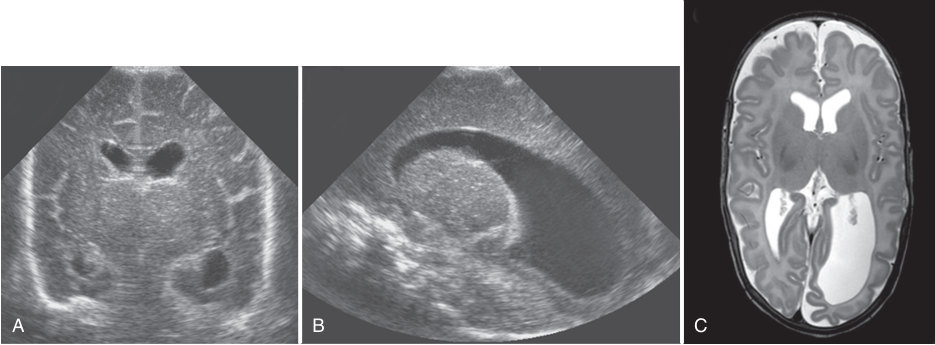

• Fig. 55.1 (A) Cranial ultrasonography, coronal view, shows posthemorrhagic ventricular dilation following a large left-sided hemorrhage. (B) Note isolated enlargement of the left occipital horn on the parasagittal view. (C) The magnetic resonance image, T2-weighted, spin-echo sequence still shows evidence of enlargement of the left occipital horn and enlargement of the frontal extracerebral space. Myelination of the posterior limb of the internal capsule is symmetrical and seen as low signal intensity.

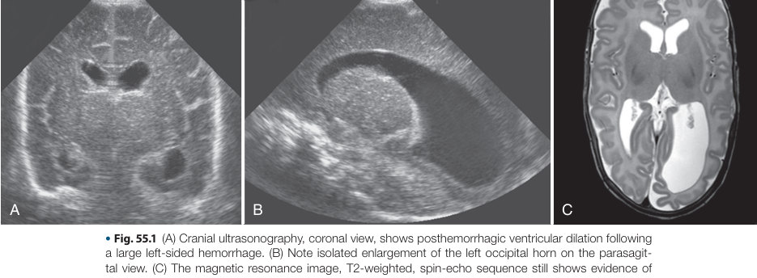

Unmatched source image; PDF page 1039. Consult the original caption.

## PDF page 1040

A B

• Fig. 55.2 (A) Cranial ultrasonography, coronal view, shows intraventricular hemorrhage and parenchymal hemorrhage not in communication with the lateral ventricle. (B) Three weeks later, a single cystic lesion is present after the resolution of the hemorrhage. (C) At term, the cyst is no longer seen.

A B

• Fig. 55.3 (A and B) Cranial ultrasonography, coronal view, shows intraventricular hemorrhage and parenchymal hemorrhage not in communication with the lateral ventricle. (C) At term age, multiple cysts are seen adjacent to the lateral ventricle.

Rt

A

• Fig. 55.4 (A) Cranial ultrasonography, axial scan through the temporal bone, shows a large right cerebellar hemorrhage. (B) The magnetic resonance image, T2-weighted, spin-echo sequence still shows evidence of blood (low signal intensity) at term equivalent age, as well as atrophy of the right cerebellar hemisphere.

and a paucity of tight junction proteins. Recently, variant subependymal venous anatomy has also been shown to be a contributing factor.9 Intravascular factors are caused by either an increase in cerebral venous pressure in the context of prolonged labor, dystocia, respiratory distress, and head

C

C

Bpositioning or a decrease in blood flow because of systemic hypotension or fluctuations in blood pressure in a pressurepassive circulation. Fluctuations in cerebral blood flow can also cause hemorrhagic injury and are generally caused by hypercarbia, rapid volume expansion, hypoglycemia, or a

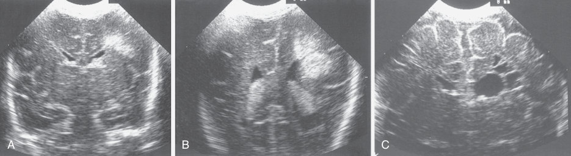

• Fig. 55.3 (A and B) Cranial ultrasonography, coronal view, shows intraventricular hemorrhage and parenchymal hemorrhage not in communication with the lateral ventricle. (C) At term age, multiple cysts are seen adjacent to the lateral ventricle.

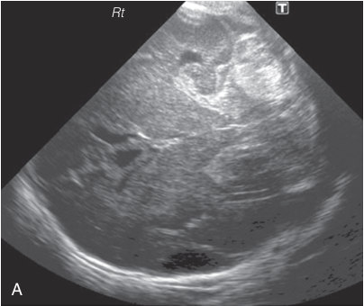

• Fig. 55.4 (A) Cranial ultrasonography, axial scan through the temporal bone, shows a large right cerebellar hemorrhage. (B) The magnetic resonance image, T2-weighted, spin-echo sequence still shows evidence of blood (low signal intensity) at term equivalent age, as well as atrophy of the right cerebellar hemisphere.

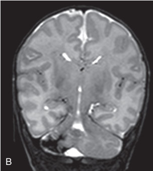

Unmatched source image; PDF page 1040. Consult the original caption.

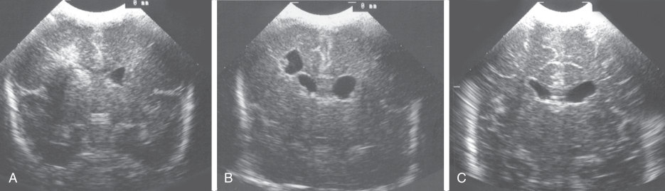

• Fig. 55.2 (A) Cranial ultrasonography, coronal view, shows intraventricular hemorrhage and parenchymal hemorrhage not in communication with the lateral ventricle. (B) Three weeks later, a single cystic lesion is present after the resolution of the hemorrhage. (C) At term, the cyst is no longer seen.

## PDF page 1041 | printed page 1037

rapid decline in hemoglobin. Finally, extravascular factors are a result of deficient extracellular and vascular matrix support such as pericytes.1

Prenatal, intrapartum, and postnatal factors contribute to the pathogenesis of GMH-IVH at different stages. Among them, male gender, the degree of prematurity, lack of antenatal steroids, clinical chorioamnionitis, delivery room resuscitation, prolonged mechanical ventilation, and requirement of inotropes were consistently shown to be associated with GMH-IVH. These will be discussed in detail below.

### Prenatal Factors

Histologic chorioamnionitis and clinical chorioamnionitis are two distinct entities. Histologic chorioamnionitis has been shown by some to increase the risk of GMH-IVH, but not by others.20 In a recent prospective multicenter cohort study, Bierstone et al.20 evaluated 350 very preterm infants less than 32 weeks’ gestation of whom 145 (41.4%) had histologic chorioamnionitis on placental pathologic examination. The authors found that histologic chorioamnionitis was not associated with GMH-IVH, nor was it associated with worse cognitive and motor outcomes assessed by the Bayley-III test at 18 to 24 months corrected. However, a multicenter study from the Canadian Neonatal Network21 showed that clinical chorioamnionitis is associated with an increased risk of early-onset neonatal sepsis (odds ratio [OR] 5.54; 95% confidence interval [CI] 2.87–10.69) and severe IVH (OR 1.62; 95% CI 1.17–2.24). The association remained significant even after adjusting for illness severity. In a population-based prospective cohort of 2085 singleton infants, adverse outcomes were found to be a function of the degree of prematurity and complications leading to preterm birth. Among these, fetal growth restriction did not lead to increased neonatal brain injury on cUS but was associated with increased mortality. Of note, pre-eclampsia has been associated with a reduced risk of GMH-IVH. The protective effect appears to be a result of enhanced in utero maturation of the fetus.

The administration of antenatal steroids has been consistently shown to be a protective factor against the development of GMH-IVH. The effect may be caused by a direct maturational effect on the developing brain, but other factors may also be involved, such as reduction in respiratory distress syndrome (RDS) and decreased need for inotropes. In line with the previous literature, a 2020 meta-analysis of 12 studies on 8475 preterm infants showed the probable association between antenatal corticosteroids and reduced risk of GMH-IVH (risk ratio [RR] 0.58; 95% CI 0.45–0.75).3

### Intrapartum Factors

Mode of Delivery and Resuscitation

Data are controversial on the association between the mode of delivery and GMH-IVH. Prolonged labor rather than the vaginal birth itself has been hypothesized to be the major contributor to the development of GMH-IVH. A recent

study by the German Neonatal Network studied 2203 preterm infants with a birth weight less than 1500 g and GA between 220/7 and 366/7 weeks. Infants were stratified into three categories according to the mode of delivery: (1) planned cesarean section (C/S, n = 1381), (2) vaginal delivery (n = 632), and (3) emergency C/S (n = 190). GMH-IVH was more common in the vaginal delivery (26.6%) and emergency C/S group (31.1%) as compared with planned C/S (17.2%), respectively. In the multivariable model, vaginal delivery (OR 1.7; 95% CI 1.3–2.2, P ≤ .001) and emergency cesarean section (OR 1.9; 95% CI 1.3–2.7, P ≤ .001) were independently associated with increased GMH-IVH risk. The authors concluded that elective C/S is associated with a reduced risk of GMH-IVH in preterm infants less than 30 weeks’ gestational when presenting with preterm labor.22 However, in a large cohort of 20,231 preterm infants less than 34 weeks, C/S was not found to be associated with a reduced risk of GMH-IVH after adjusting for confounding factors (adjusted OR 0.99; 95% CI 0.84–1.17).23

Perinatal hypoxic-ischemic events, such as low Apgar scores, metabolic acidosis, use of bicarbonate, and significant delivery room resuscitation, have been associated with the development of GMH-IVH.8,24 A cohort study of preterm infants born with a birth weight of less than 1000 g and GA less than 30 weeks assessed 8685 infants of whom 1333 (15%) received resuscitation in the delivery room. Infants who received resuscitation had higher odds of grades 3 to 4 GMH-IVH (OR, 1.47; 95% CI 1.23–1.74).24

Cord Clamping Practices

There is an inverse correlation between hemoglobin concentration and cerebral blood flow in neonates, and this observation led to studies on the timing of cord clamping in the delivery room. Although several retrospective studies reported that delayed cord clamping (DCC) was associated with a reduction in GMH-IVH, a large randomized controlled trial by the Australian Placental Transfusion Study Collaborative Group25 did not show an association between DCC and a reduced risk of GMH-IVH. In this trial, investigators randomly assigned preterm infants less than 30 weeks of gestation to either immediate cord clamping (ICC) of the umbilical cord (≤10 seconds after delivery) or DCC (≥60 seconds after delivery). The primary composite outcome was death or major morbidity, defined as severe brain injury on postnatal cUS, severe retinopathy of prematurity, necrotizing enterocolitis, or late-onset sepsis by 36 weeks’ postmenstrual age. Of the 1566 infants who were randomized, there was no significant difference in the incidence of the primary outcome between infants assigned to DCC (37%) and those assigned to ICC (37.2%) (RR 1.00; 95% CI 0.88–1.13; P = .96). There were also no significant differences between the groups in rates of GMH- IVH or late cerebral abnormality on cUS. In a prematurely terminated randomized controlled trial, Katheria et al.26 compared umbilical cord milking (UCM) with DCC and found no significant difference in mortality; however, severe

## PDF page 1042

GMH-IVH was significantly higher in the UCM group than in the DCC group (8% vs. 3%, respectively; risk difference, 5%; 95% CI 1%–9%; P = .02). In the subgroup analysis, among infants born between 23 and 27 weeks’ gestation, severe GMH-IVH was significantly higher with UCM than with DCC (22% vs. 6%, respectively; risk difference 16%; 95% CI 6%–26%; P = .002). Recently, Jasani et al.27 conducted a network meta-analysis comparing different cord management strategies for preterm infants. The investigators assessed a total of 56 studies on 6852 preterm infants and showed that DCC was associated with lower odds of GMH-IVH (25 trials, 3316 participants; 17.8% vs. 15.4%; OR 0.73; 95% CI 0.54–0.97) compared with ICC. Of note, compared with ICC, UCM was also associated with lower odds of GMH-IVH (10 trials, 645 participants; 22.5% vs. 16.2%; OR 0.58; 95% CI 0.38–0.84). There was no significant difference between UCM and DCC for any outcome, and the investigators concluded that further studies directly comparing DCC and UCM are warranted.

Neonatal Transport

Infants who are born outside of a tertiary care center and require neonatal transport are more likely to develop GMH- IVH. A large US database of 67,596 preterm infants showed that the transport group had more GMH-IVH compared with the inborn group (27.4% vs. 13.4%; adjusted OR 1.75; 95% CI 1.64–1.86; P < .001). Severe GMH-IVH was also higher in the transport group compared with the inborn group (44.1% vs. 32.9%; adjusted OR 1.44; 95% CI 1.22–1.70, P = .001).28 A recent observational study by the Neonatal Research Network of Japan studied 15,842 very low birth weight preterm infants and showed a higher incidence of severe GMH-IVH (8.2% vs. 4.1%; OR 3.45; 95% CI 1.16–10.3) in outborn infants.29

Also of note, there seems to be an association between being born at off-peak hours (12 am to 7 am) and neonatal morbidities. In a retrospective population-based cohort study on 47,617 very preterm infants, 9317 (19.6%) infants were born during off-peak hours. After adjusting for maternal, infant, and hospital characteristics, off-peak hour delivery was associated with increased odds of severe GMH-IVH among survivors (OR 1.39; 95% CI 1.23–1.57) and the composite outcomes of death or severe GMH-IVH (OR 1.16; 95% CI 1.07–1.25).30

### Postnatal Factors

Respiratory Disturbances and Treatment Modalities

Respiratory disturbances, and RDS in particular, have been recognized as important risk factors in the development of GMH-IVH. This association is most likely not causal but owing to the complications that occur during mechanical ventilation, such as hypocarbia, hypercarbia, hypoxemia, acidosis, increased need for tracheal suctioning, and pneumothorax. These factors may result in fluctuations in cerebral blood flow and elevated central venous pressure. In a meta-analysis of 22 studies on 1065 preterm infants, there was moderate-quality evidence to show that volume

targeted ventilation (VTV) resulted in a reduction in the primary outcome of death or bronchopulmonary dysplasia at 36 weeks’ gestation and the secondary outcome of grade 3 or 4 GMH-IVH (RR 0.53; 95% CI 0.37–0.77; number needed to treat [NNT] 11; 95% CI 7–25) as well as the combined outcome of periventricular leukomalacia with or without grade 3 or 4 GMH-IVH (RR 0.47; 95% CI 0.27– 0.80; NNT 11; 95% CI 7–33).31 Also of note, delivering high tidal volumes (>6 mL/kg) during the positive pressure ventilation in the delivery room was shown to increase the rate of GMH-IVH and severe GMH-IVH in a prospective observational study.32

Although in some studies, an increased risk of severe GMH-IVH and periventricular leukomalacia was found with the use of high-frequency oscillatory ventilation when compared with conventional ventilation, a 2015 metaanalysis did not show significant differences between the groups. The authors concluded that it is highly likely that many factors, both related to the respiratory intervention itself as well as the individual patient characteristics, interact in complex ways.33 It seems reasonable to choose noninvasive ventilation and less-invasive intervention strategies over invasive mechanical ventilation whenever possible in preterm infants. Because of improvements in ventilatory techniques, including increased use of nasal continuous positive airway pressure (CPAP), hypercarbia and severe acidosis have become less common. In a multicenter randomized controlled trial, 211 preterm infants between 23 and 27 weeks of gestation were randomly assigned to receive surfactant either via a thin endotracheal catheter during CPAP-assisted spontaneous breathing or after endotracheal intubation during mechanical ventilation. A significant reduction in severe GMH-IVH (10.3% vs. 22.1%; P = .02) was seen in infants receiving surfactant via a thin endotracheal catheter during CPAP.34

Cardiovascular and Hemodynamic Factors

The immature brain is considered vulnerable to fluctuations in blood pressure owing to limitations in the autoregulation of cerebral blood flow. Impaired autoregulation renders the cerebral circulation “pressure-passive” and, hence, unprotected from any wide swings in blood pressure. Abrupt increases, decreases, and fluctuations in cerebral blood flow, as well as increases in cerebral venous pressure, result in injury to the vulnerable germinal matrix capillaries. This applies especially to sick preterm infants. Earlier studies using near-infrared spectroscopy (NIRS) showed that NIRS can be used at the bedside to identify premature infants with impaired cerebrovascular autoregulation, that this impairment is relatively common in such infants, and that the presence of this impairment is associated with a high likelihood of occurrence of severe GMH-IVH. Alderliesten et al.35 continuously monitored 30 very preterm infants less than 32 weeks’ gestation for the first 72 hours after birth with NIRS in a case-control study. The authors showed cerebral hyperperfusion in infants with severe GMH-IVH alongside impaired autoregulation and

## PDF page 1043 | printed page 1039

concluded that continuous assessment of regional cerebral oxygenation and arterial blood pressure may identify preterm infants at risk for GMH-IVH and prompt consideration of preventive measures. However, contradicting results were reported by Noori et al.36 in a prospective observational study of 22 extremely preterm infants born less than 27 weeks of gestation. Using targeted echocardiography and NIRS, the investigators found that patients with GMH-IVH tended to have reduced left ventricular output, lower left ventricle stroke volume, cerebral regional oxygen saturation, and higher cerebral fractional oxygen extraction during the first 12 hours of the study. By 28 hours, these variables were similar in infants with or without GMH- IVH, and the middle cerebral artery mean flow velocity was higher in the GMH-IVH group. Cardiac function and cerebral blood flow remained stable in infants who did not develop GMH-IVH within the first 3 postnatal days. The authors concluded that in very preterm infants developing GMH-IVH, lower systemic perfusion and cerebral blood flow followed by an increase in these variables precede the development of GMH-IVH. Recently, the early NIRS multicenter prospective study recruited very preterm infants with a birth weight of less than 1250 g from six tertiary neonatal intensive care units in the United States. Mean arterial blood pressure and cerebral oxygen saturation were continuously monitored until 96 hours of age. Of 103 infants with a mean GA of 26 weeks, infants with adverse outcomes had a lower mean cerebral tissue oxygenation. Infants with adverse outcomes were also more likely to have findings of impaired cerebral autoregulation. The authors concluded that early NIRS monitoring may detect periods of lower cerebral oxygenation and altered cerebral autoregulation, identifying preterm infants at risk for mortality or hemorrhagic injury.37

### Genetic Factors

There is controversy over whether mutations of hemostatic genes predispose preterm infants to GMH-IVH. The factor V Leiden mutation, which renders factor V resistant to cleavage by activated protein C, and the prothrombin G20210A mutation, which was found to be associated with raised plasma concentrations of prothrombin, were suggested to play a role in the development of GMH-IVH. The Gene Targets for Intraventricular Hemorrhage Study Group investigated 224 preterm infants in a prospective study and was unable to confirm previously reported associations of hemostasis gene variants and development of severe IVH (grades 3 and 4 according to Papile et al.2) except for an increased prevalence for the methylenetetrahydrofolate reductase 1298A>C variant.38

Antenatal porencephaly was reported to be associated with a mutation in the collagen gene (COL4A1) that encodes basement membrane protein in a case series.39 Collagen mutations can have a wide range of presentations, including familial porencephaly, hemorrhagic stroke, IVH with parenchymal involvement, as well as extensive supratentorial lesions in combination with cerebellar injury. This

diagnosis can be made antenatally and should be considered in the presence of a supratentorial parenchymal hemorrhage associated with a CBH. It is also important to remember that an atypical presentation of PVHI in preterm infants tends to occur more often in the presence of thrombophilia, and further testing, especially for factor V Leiden and prothrombin gene mutations, is recommended in these infants.15

### Diagnosis

The majority of GMH-IVH in preterm infants occurs within the first 3 days of postnatal life. Of those, almost half occur within the first 6 hours and approximately two-thirds within the first 24 hours. By postnatal 7 days, around 95% of IVH will have occurred, with only a small percentage appearing beyond day 7.1 Three clinical syndromes can be recognized in preterm infants: the first is known as catastrophic deterioration and is characterized by a sudden deterioration in the infant’s clinical state, such as an increase in oxygen requirement or ventilatory settings, deterioration in hemodynamic status, decline in blood pressure, and/or acidosis. More often, however, a drop in hematocrit is seen without a clear change in the infant’s condition. The saltatory syndrome is more common and gradual in onset, presenting with a change in spontaneous general movements. The third and most frequent presentation is the silent or asymptomatic type, which is detected by routine cUS screening without any obvious clinical signs.1

With cUS readily available in modern neonatal units, most high-risk preterm infants have a routine screening soon after admission or within the first few days after birth. In 1978 Papile et al.2 described the neuroimaging findings of 46 very low birth weight infants on CT scans and described four separate grades of hemorrhage as follows: grade 1—subependymal hemorrhage; grade 2—IVH without ventricular dilatation; grade 3—IVH with ventricular dilatation; and grade 4—IVH with parenchymal hemorrhage. This initial classification has been modified by Volpe using cUS scans into three grades and includes a separate notation for the presence of periventricular hemorrhagic infarction (PVHI). In this classification, grade 1 indicates hemorrhage confined to the germinal matrix or minimal intraventricular extension occupying less than 10% of the ventricular area on the parasagittal view, grade 2 indicates IVH occupying 10% to 50% of the ventricular area, and grade 3 represents IVH in greater than 50% of the ventricular area, usually associated with acute ventricular dilatation.1 In a recent consensus article by Mohammad et al.10 these classification systems were revisited with an aim to achieve homogeneity between different disciplines. In this consensus viewpoint, grade 1 represents hemorrhage confined to the germinal matrix region; in grade 2, hemorrhage spills over into the ventricle without causing acute ventricular distension, whereas in grade 3, acute ventricular distension accompanies IVH with an anterior horn width (AHW) measurement of greater than 6 mm. Similar to the Volpe classification, PVHI was defined as

## PDF page 1044

a separate notation in this consensus article (Table 55.1). This type of lesion is classically triangular or fan-shaped, with the apex at the outer border of the lateral ventricle, and in some cases the lesion is globular. The globular type of lesion evolves over 2 to 3 weeks into a porencephalic cyst (Fig. 55.5).

cUS is a noninvasive bedside technique that uses the anterior fontanelle and, increasingly, also the posterior, mastoid, and temporal fontanelle as acoustic windows. The posterior fontanelle improves the detection of small IVHs that accumulate in the posterior horn of the lateral ventricle. The mastoid window allows detection of CBHs with a diameter of greater than 4 mm.17 Good correlations of sonographic

Canadian Consensus Approach to the

TABLE

55.1

Grading of Germinal Matrix Hemorrhage and Intraventricular Hemorrhage

Grade Definition

Grade 1 Hemorrhage confined to the germinal matrix

region There is no blood in the ventricle or choroid

plexus

Grade 2 Hemorrhage in the ventricle without acute

ventricular distension Hemorrhage characteristically fills <50% of the

lateral ventricle

Grade 3 Hemorrhage in the ventricle causing acute

ventricular dilatation (anterior horn width >6 mm) Hemorrhage characteristically fills >50% of the

lateral ventricle

PVHI Ipsilateral periventricular parenchymal

hemorrhage caused by impaired venous drainage (Note that this is a separate notation)

PVHI, Periventricular hemorrhagic infarction.

A B

• Fig. 55.5 Magnetic resonance images, T2-weighted sequence in (A) sagittal plane and (B) coronal plane, with a large intraventricular and intraparenchymal hemorrhage. (C) Diffusion tensor imaging, direction encoded color map only shows the descending corticospinal tract on the unaffected side (blue).

GMH-IVH signs with autopsy findings have been reported for the more severe hemorrhages. With the increased use of MRI, it has become apparent that GMHs at sites other than at the level of the caudate nucleus, such as the roof of the temporal horn, are not always identified using cUS. With cUS, it is also not always possible to be certain about the presence or absence of a small associated IVH. Immediate access to cUS in contrast to MRI, and the fact that the examination can be repeated as often as indicated, still makes cUS the first method of choice.

The timing of the examination depends on the questions raised. An examination within hours after delivery helps in timing the lesion as antenatal or postnatal. A single scan at the end of the first week shows 95% of all hemorrhages as well as their maximum extent. Further serial cUS examinations are required in infants with any degree of hemorrhage to detect the occurrence of posthemorrhagic ventricular dilatation (PHVD), which occurs in around a quarter of infants, and the occurrence of associated white matter injury.1 Several groups recommended different schedules for the performance of cUS scans in preterm infants. In 2020, the American Academy of Pediatrics published a statement on routine neuroimaging of the preterm brain and recommended cUS screening of all preterm infants less than 30 weeks with an initial scan within the first 7 days and repeat scans at 4 to 6 weeks of life and around term or discharge from the hospital.40 However, literature on neuroimaging of the preterm brain shows that these infrequent screening protocols may limit the opportunities for the initiation of neurologic interventions. To address this issue, a joint group of experts published a review article emphasizing more frequent serial cUS to improve the timely recognition of GMH-IVH and associated complications. This review recommends more frequent serial cUS, especially in the most immature infants less than 28 weeks’ gestation, to allow full elucidation of the nature and timing of brain injury and subsequent complications.6 Of note, the authors also recommend obtaining a routine TEA-MRI) in preterm infants

C

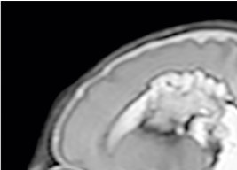

• Fig. 55.5 Magnetic resonance images, T2-weighted sequence in (A) sagittal plane and (B) coronal plane, with a large intraventricular and intraparenchymal hemorrhage. (C) Diffusion tensor imaging, direction encoded color map only shows the descending corticospinal tract on the unaffected side (blue).

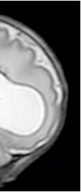

• Fig. 55.5 Magnetic resonance images, T2-weighted sequence in (A) sagittal plane and (B) coronal plane, with a large intraventricular and intraparenchymal hemorrhage. (C) Diffusion tensor imaging, direction encoded color map only shows the descending corticospinal tract on the unaffected side (blue).

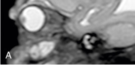

• Fig. 55.5 Magnetic resonance images, T2-weighted sequence in (A) sagittal plane and (B) coronal plane, with a large intraventricular and intraparenchymal hemorrhage. (C) Diffusion tensor imaging, direction encoded color map only shows the descending corticospinal tract on the unaffected side (blue).

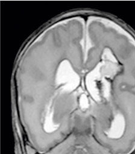

Unmatched source image; PDF page 1044. Consult the original caption.

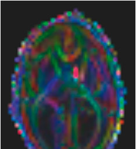

Unmatched source image; PDF page 1044. Consult the original caption.

## PDF page 1045 | printed page 1041

born less than 28 weeks’ gestation and in infants between 28 and 32 weeks’ gestation presenting with significant clinical risk factors and ultrasonographic findings. The details of the proposed cUS schedule are presented in Table 55.2.

### Management

Clinical management of neonates who present with GMH- IVH is mainly supportive, and the mainstay of the treatment is the preservation of cerebral perfusion, early detection of complications, and minimization of further brain injury.1 Minimal handling, prevention of fluctuations in blood pressure and CO2 levels, prevention of asynchrony between the infant and the ventilator, and optimization of any coagulopathy may be warranted in an attempt to prevent extension of the initial hemorrhage. A blood transfusion may be needed in case of a large GMH-IVH associated with a significant drop in hemoglobin. Continuous electroencephalographic monitoring, mostly done with amplitude-integrated electroencephalography, may be helpful in the detection of electrographic only seizures. The use of fibrinolytic therapy in an attempt to resolve the initial clot has been disappointing and can even result in rebleeding.41

Serial cUS scans are indicated to diagnose and monitor PHVD, the most common complication of GMH-IVH, in a timely manner.6 Ventricular dilatation seen on cUS usually precedes the development of clinical symptoms by several weeks. The clinical signs are a bulging fontanelle, split sutures, and a rapid increase in head circumference greater than 2 cm per week. The sunsetting phenomenon of the eyes is a late finding.1,42 PHVD is transient in approximately half of the infants and is persistent or rapidly progressive in the remaining cases. Once it is recognized that the ventricles have begun to enlarge, the baseline size should be measured using cUS. The most widely adopted measurement is that

TABLE

Proposed Ultrasound Screening Protocol in Preterm Infants

55.2

Timing <28 Weeks and/or <1000 g

1st cUS scan Day 1 (optional)

2nd cUS scan 3

3rd cUS scan 7

4th cUS scan 14

Subsequent cUS scan 21

Subsequent cUS scan 28

Subsequent cUS scan Every other week until 34 weeks’ PMA

Subsequent cUS scan At term or discharge

Brain MRI Routine MRI at term

cUS, Cranial ultrasonography; MRI, magnetic resonance imaging; PMA, postmenstrual age. Adapted from Inder TE, de Vries LS, Ferriero DM, et al. Neuroimaging of the preterm brain: review and recommendations. J Pediatr. 2021;237:276-287.e274.

described by Levene and Starte.43 This “ventricular index” (VI) is the longest horizontal distance between the midline and the lateral border of the ventricle measured in a coronal view in the plane of the third ventricle. Another useful measurement is the depth of the frontal horn, or in other words the longest oblique distance, taken just in front of the thalamic notch, the so-called AHW, with a height of greater than 3 mm being used to define ventriculomegaly and one greater than 6 mm representing two standard deviations (SD) above the normal. Measuring the occipital horn, the so-called thalamo-occipital distance (TOD), in a sagittal plane can also be useful because there can be a discrepancy between the anterior and posterior horn widths (see Fig. 55.1). Any measurement greater than 24 mm also suggests severe PHVD.42 Levene’s VI graph has a GA range of 27 to 40 weeks. Because extremely preterm infants less than 27 weeks’ gestation are commonly admitted to neonatal intensive care units today, new reference values for the VI, AHW, and TOD were studied and published in a prospective cohort study of 625 neonates with a median GA of 33.4 weeks (range, 24.7–42.6 weeks).44 These new reference curves are also implemented on intervention charts described by El-Dib et al. (Fig. 55.6).42 Alternative measures are the frontal and occipital horn ratio (FOHR) and the frontal and temporal horn ratio (FTHR), both of which show a strong correlation with ventricular volumes.45

Measurement of the CSF pressure, although not commonly used in clinical practice, can help to make a distinction between infants with progressive PHVD (i.e., those with raised intracranial pressure) and those in whom the dilatation is because of cerebral atrophy (low pressure), but a distinction can also be made based on the shape of the ventricles (ballooning when pressure-driven) and the size of the extracerebral space (large in cerebral atrophy). Raised CSF pressure can cause symptoms, including visual disturbance, seizures,

28–32 Weeks

Day 1 (optional)

4–7

14

28

At term or discharge

Routine MRI at term if significant risk factors

## PDF page 1046

Rt. VI

24

4 6 8 10 12 14 16 18 20 22

High Risk

Moderate Risk

mm mm mm

mm mm mm

24 25 26 27 28 29 30 31 32 33 34 35 36 37 38 39 40 41 42

PMA

mean p97.5 P97 + 4mm

Rt. AHW

0 2 4 6 8 10 12 14 16

High Risk

Moderate Risk

24 25 26 27 28 29 30 31 32 33 34 35 36 37 38 39 40 41 42

PMA

mean p97.5 P97 + 4mm

Rt. TOD

34 32 30 28 26 24 22 20 18 16 14 12 10

High Risk

Moderate Risk

24 25 26 27 28 29 30 31 32 33 34 35 36 37 38 39 40 41 42

PMA

mean p97.5 P97 + 6mm

Yellow Zone Key Criteria:

Green Zone Key Criteria: Ventricular size with the following Ventricular size with the following

VI 97th percentile VI >97th percentile and AHW 6 mm

and AHW >6 mm &/or TOD >25 mm

And Absence of the following clinical criteria: HC growth >2 cm per week Separated sutures Bulging fontanelles

And Absence of the following clinical criteria: HC growth >2 cm per week Separated sutures Bulging fontanelles

Management: Referral to a regional center for neurosurgical review Consider LP 2–3 times cUS 2–3 times a week until stable for 2 weeks then every 1–2 weeks till 34 weeks PMA

Management: Observation in NICU cUS twice a week until stable for 2 weeks then every 1–2 weeks till 34 weeks' PMA

MRI at Term Equivalent

Neurosurgical intervention when no stabilization occurs MRI at Term Equivalent

Consider alterations in NIRS (i.e., decrease cerebral oxygenation) or Doppler US (i.e., Increase in Resistive Index) as additional information that may suggest impairment in cerebral perfusion and more urgent need for intervention.

### • Fig. 55.6 A practical clinical tool to monitor commonly used ventricular measures and proposed risk stratification and management of infants with

posthemorrhagic ventricular dilatation. Individual measures can be plotted in millimeters in the table as well as on the corresponding postmenstrual age in the graph to identify risk zone. AHW, Anterior horn width; cUS, cranial ultrasound; HC, head circumference; MRI, magnetic resonance imaging; NICU, neonatal intensive care unit; PMA, postmenstrual age; TOD, thalamo-occipital distance; VI, ventricular index. (From El-Dib M, Limbrick DD, Inder T, et al. Management of posthemorrhagic ventricular dilatation in the infant born preterm. J Pediatr. 2020;226:16–27.e3.)

Lt. VI

24

4 6 8 10 12 14 16 18 20 22

High Risk

Moderate Risk

24 25 26 27 28 29 30 31 32 33 34 35 36 37 38 39 40 41 42

PMA

mean p97.5 P97 + 4mm

Lt. AHW

0 2 4 6 8 10 12 14 16

High Risk

Moderate Risk

24 25 26 27 28 29 30 31 32 33 34 35 36 37 38 39 40 41 42

PMA

mean p97.5 P97 + 4mm

Lt. TOD

34 32 30 28 26 24 22 20 18 16 14 12 10

High Risk

Moderate Risk

24 25 26 27 28 29 30 31 32 33 34 35 36 37 38 39 40 41 42

PMA

mean p97.5 P97 + 6mm

Red Zone

Key Criteria:

Ventricular size with the following

VI >97th percentile + 4 mm

and AHW >10 mm &/or TOD >25 mm

Or Any of the following clinical criteria HC growth >2 cm per week Separated sutures Bulging fontanelles

Management: Consider LP 2–3 times Neurosurgical intervention including either temporizing measures or VP shunt MRI at Term Equivalent

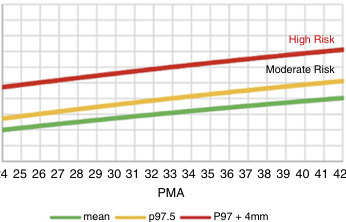

• Fig. 55.6 A practical clinical tool to monitor commonly used ventricular measures and proposed risk stratification and management of infants with posthemorrhagic ventricular dilatation. Individual measures can be plotted in millimeters in the table as well as on the corresponding postmenstrual age in the graph to identify risk zone. AHW, Anterior horn width; cUS, cranial ultrasound; HC, head circumference; MRI, magnetic resonance imaging; NICU, neonatal intensive care unit; PMA, postmenstrual age; TOD, thalamo-occipital distance; VI, ventricular index. (From El-Dib M, Limbrick DD, Inder T, et al. Management of posthemorrhagic ventricular dilatation in the infant born preterm. J Pediatr. 2020;226:16–27.e3.)

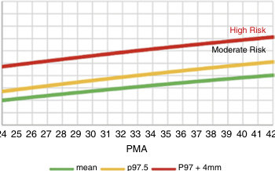

Unmatched source image; PDF page 1046. Consult the original caption.

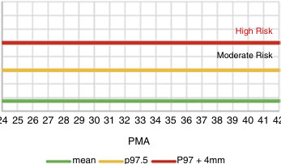

• Fig. 55.6 A practical clinical tool to monitor commonly used ventricular measures and proposed risk stratification and management of infants with posthemorrhagic ventricular dilatation. Individual measures can be plotted in millimeters in the table as well as on the corresponding postmenstrual age in the graph to identify risk zone. AHW, Anterior horn width; cUS, cranial ultrasound; HC, head circumference; MRI, magnetic resonance imaging; NICU, neonatal intensive care unit; PMA, postmenstrual age; TOD, thalamo-occipital distance; VI, ventricular index. (From El-Dib M, Limbrick DD, Inder T, et al. Management of posthemorrhagic ventricular dilatation in the infant born preterm. J Pediatr. 2020;226:16–27.e3.)

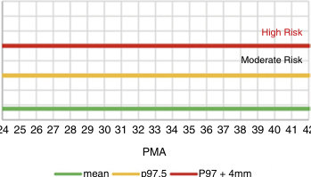

Unmatched source image; PDF page 1046. Consult the original caption.

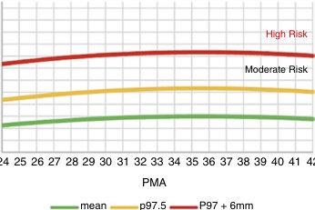

• Fig. 55.6 A practical clinical tool to monitor commonly used ventricular measures and proposed risk stratification and management of infants with posthemorrhagic ventricular dilatation. Individual measures can be plotted in millimeters in the table as well as on the corresponding postmenstrual age in the graph to identify risk zone. AHW, Anterior horn width; cUS, cranial ultrasound; HC, head circumference; MRI, magnetic resonance imaging; NICU, neonatal intensive care unit; PMA, postmenstrual age; TOD, thalamo-occipital distance; VI, ventricular index. (From El-Dib M, Limbrick DD, Inder T, et al. Management of posthemorrhagic ventricular dilatation in the infant born preterm. J Pediatr. 2020;226:16–27.e3.)

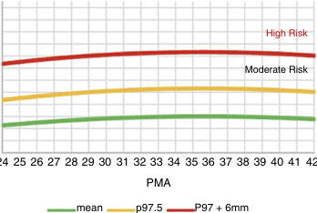

Unmatched source image; PDF page 1046. Consult the original caption.

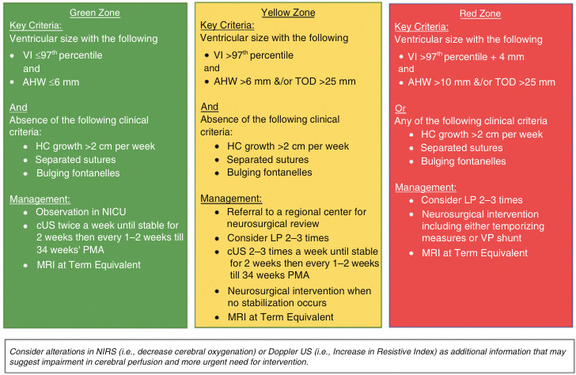

• Fig. 55.6 A practical clinical tool to monitor commonly used ventricular measures and proposed risk stratification and management of infants with posthemorrhagic ventricular dilatation. Individual measures can be plotted in millimeters in the table as well as on the corresponding postmenstrual age in the graph to identify risk zone. AHW, Anterior horn width; cUS, cranial ultrasound; HC, head circumference; MRI, magnetic resonance imaging; NICU, neonatal intensive care unit; PMA, postmenstrual age; TOD, thalamo-occipital distance; VI, ventricular index. (From El-Dib M, Limbrick DD, Inder T, et al. Management of posthemorrhagic ventricular dilatation in the infant born preterm. J Pediatr. 2020;226:16–27.e3.)

## PDF page 1047 | printed page 1043

feeding intolerance, and apneas. In the long term, pressureinduced destruction of neuronal tissue can lead to motor and cognitive impairments.8 Short-term adverse effects on the developing brain have been confirmed using somatosensory and visual evoked potentials, Doppler estimates of cerebral blood flow velocity, and NIRS.46 In a study of nine infants with PHVD, NIRS was used, and a significant increase in cerebral blood flow was measured (15.6%) following a ventricular tap, but without a corresponding change in cerebral metabolic rate of oxygen (1.02 ± 0.41 mL O2/100 g/min).46 CSF levels of IL-8, interferon (IFN)-γ, and soluble Fas were noted to be raised in infants with PHVD and especially so in those with associated white matter injury.47 Other CSF biomarkers were found to be increased in infants with PHVD, including amyloid precursor protein (APP), soluble APP-α, and L1 cell adhesion molecule.48

Accumulating evidence shows that early drainage of CSF alters the natural history and outcome of PHVD. Brouwer et al.49 evaluated the differential impact of GMH-IVH and PHVD on the brain and CSF volumes and diffusion variables in preterm-born infants at TEA. The majority of the infants in this cohort were treated with early interventions. The authors showed that PHVD was independently associated with volumes of deep gray matter (β −1.4 cc; 95% CI −2.3 to −0.5), cerebellum (β −2.7 cc; 95% CI −3.8 to −1.6), ventricles (β +12.7 cc; 95% CI 7.9–17.4), and extracerebral CSF (β −11.2 cc; 95% CI −19.2 to −3.3), and with apparent diffusion constant (ADC) values in occipital, parietooccipital, and parietal white matter (β +0.066 to 0.119 × 10−3 mm2/s) on TEA-MRI (P < .05). No associations were found between GMH-IVH grades 2 and 3 and brain and CSF volumes or ADC values. In summary, PHVD was negatively related to deep gray matter and cerebellar volumes and positively to white matter ADC values on TEA-MRI, despite early intervention for PHVD in the majority of the infants. A recent observational study from Canada and the Netherlands showed results favoring earlier intervention for PHVD. In this study, outcomes were compared at 18 to 24 months between infants with and without intervention in preterm infants undergoing either an early approach in Dutch centers or a late approach in the Canadian center. It is important to note that the common practice in the Dutch centers was to intervene early based on the cUS measurements of the ventricles, whereas intervention decisions were based on the clinical findings of PHVD rather than the cUS measurements in the Canadian center. The study showed that infants undergoing earlier intervention for progressive PHVD, even when eventually requiring a ventriculoperitoneal shunt (VPS), had cognitive and motor outcomes similar to those without intervention, all being within the normal range. In contrast, later intervention was associated with an increased risk of adverse outcomes.50

The initial phase I trial of the drainage, irrigation, and fibrinolytic therapy (DRIFT) study showed a reduced need for VPS insertion of 26% compared with around 60% in previous multicenter studies. The authors concluded that reducing pressure, free iron, and pro-inflammatory and

profibrotic cytokines may reduce periventricular brain damage and hydrocephalus.51 A subsequent randomized controlled trial randomly assigned 70 preterm infants with progressive PHVD who had GAs of 24 to 34 weeks to either (1) DRIFT or (2) tapping of CSF by the ventricular reservoir to control excessive expansion and signs of pressure (standard treatment). The composite outcome of death and VPS was not significantly different (44% vs. 50%, respectively). Of note, 12 (35%) of 34 infants who received DRIFT had secondary IVH compared with 3 (8%) of 36 in the standard group. Secondary IVH was associated with an increased risk for subsequent VPS surgery and more blood transfusions.52 However, when assessed at 2 years corrected age in a follow-up study, of 39 infants assigned to DRIFT, 21 (54%) died or were severely disabled versus 27 of 38 (71%) in the standard group (adjusted OR 0.25; 95% CI 0.08–0.82). Among the survivors, 11 of 35 (31%) in the DRIFT group had severe cognitive disability versus 19 of 32 (59%) in the standard group (adjusted OR 0.17; 95% CI 0.05–0.57). The authors concluded that despite an increase in secondary IVH, DRIFT reduced severe cognitive disability in survivors and overall death or severe disability.53 Recently, the DRIFT investigators further assessed if the cognitive advantage of DRIFT seen at 2 years persisted until 10 years of age. Among survivors, 28 in the DRIFT group and 24 in the standard treatment group were assessed, and the mean cognitive score was 69.3 ± 30.1 in the DRIFT group and 53.7 ± 35.7 in the standard treatment group (unadjusted P = .1; adjusted P = .01, after adjustment for the prespecified variables of gender, birth weight, and IVH grade). Survival without severe cognitive disability was 66% in the DRIFT group and 35% in the standard treatment group (unadjusted P = .019; adjusted P = .003).54 In summary, DRIFT was the first intervention for PHVD to objectively demonstrate sustained cognitive improvement in preterm infants with PHVD.

Although LPs have not been shown to be effective in a meta-analysis to prevent PHVD, the treatment of PHVD interventions typically starts with LPs to decompress the ventricles as the initial step. It has been hypothesized that the physical removal of CSF that contains blood components and protein might mitigate the neuroinflammatory and neurotoxic reactions, decrease deposition of extracellular matrix proteins, and re-establish normal CSF drainage.55 Several retrospective studies in the past two decades have shown the various beneficial effects of intervening earlier based on cUS measurements.50 The ELVIS (Early versus Late Ventricular Intervention Study) trial56 was a multicenter study to address when and how best to intervene in preterm infants with progressive PHVD. In this prospective randomized controlled trial, a total of 126 preterm infants of less than 34 weeks’ GA with progressive PHVD were included between 2006 and 2016. Infants were eligible when they had a GMH-IVH grade 3, with or without PVHI. Recruited infants were randomly allocated to either low-threshold (LT) group (intervention when an increase in VI above the 97th percentile line showing an

## PDF page 1048

increase toward the 97th percentile + 4 mm line, but before crossing the 97th percentile + 4 mm line; and an increase in AHW >6 mm and toward 10 mm and/or TOD >25 mm), or high-threshold (HT) group (intervention when the VI crossed the 97th percentile + 4 mm line and the AHW was >10 mm). Interventions started with lumbar punctures (LP) with a maximum number of 3, and if necessary, this was followed by tapping from a ventricular reservoir, aiming for VI less than 97th percentile line in both study arms within the next 7 to 10 days. Once or twice daily, 10 mL/kg were removed based on cUS measurements. Reservoir taps were continued until ventricular stabilization was documented. An infant with an ongoing requirement of reservoir taps when weight reached 2000 to 2500 g was challenged, and when ongoing punctures were needed, a VPS was inserted because of the requirement of permanent CSF diversion.

The two noteworthy aspects of the ELVIS trial were that in both arms, interventions were solely based on cUS criteria and commenced while the infants were asymptomatic, and that the aim was to effectively reduce the ventricular size to less than 97th percentile in both study arms, whereas the prior studies focused on preventing further ventricular dilatation. Although no further reduction in the need for a VPS in the LT group was found, the need for VPS placement in both study arms was the lowest reported in the literature (19% and 23% in the LT and HT groups, respectively). In the LT group, the number of infants who received temporizing interventions with LPs or ventricular reservoirs was significantly higher than in the HT group. In a subsequent nested substudy, brain injury scores and brain volumes were compared between the groups on TEA-MRIs.57 Among the survivors, MRIs were obtained in 88 infants with an equal number of infants in each study arm. The most significant finding was the smaller ventricular volumes in the LT group. FOHR was lower in the LT group, and infants in the LT arm had lower global brain abnormality scores. After excluding infants with PVHI, the combination of the white matter and gray matter volumes was higher in the LT group, which shows the negative effect of enlarged ventricles on further brain injury. Infants in the HT group also more commonly demonstrated a delay in myelination and more often had thinning of the corpus callosum. Neurodevelopmental outcomes of the ELVIS trial at 2 years corrected age were also recently published.58 In 92% of the surviving infants, outcomes were assessed, and the composite adverse outcome was defined as death, CP, or cognitive/ motor score less than −2 SD on the Bayley Scales of Infant Development, second edition, or the Bayley Scales of Infant and Toddler Development, third edition. Although there was no difference between the LT (35%) and HT (51%) groups with respect to the composite outcome, in the post hoc analysis the LT intervention was associated with a decreased risk of an adverse outcome after correcting for GA, the severity of GMH-IVH, and CBH (adjusted OR 0.24; 95% CI 0.07–0.87; P = .03). These observations support the hypothesis that draining CSF earlier based on

cUS measurements may prevent further brain injury in preterm infants with progressive PHVD.

LPs are followed by temporizing neurosurgical interventions if stabilization or regression of ventricular size does not occur. The American Academy of Neurological Surgeons reported that both a ventricular reservoir and ventriculosubgaleal shunt are acceptable options with similar complication rates. A recent meta-analysis by Lai et al.59 showed that a ventricular access device was the most commonly used temporizing neurosurgical intervention. The pooled rate for conversion to VPS was 60.5% (95% CI 54.9–65.8), moderate-severe NDI 34.8% (95% CI 27.4–42.9), infection 8.2% (95% CI 6.7–10.1), revision 14.6% (95% CI 10.4–20.1), and death 12.9% (95% CI 10.2–16.4). The investigators also found that older age at temporizing neurosurgical procedures was a predictor of conversion to VPS (P < .001) and moderate to severe NDI (P < .01).

Neuroendoscopic lavage (NEL) is a surgical intervention that washes away hemorrhagic intraventricular CSF and removes remnants of blood clots. Irrigation is continued until anatomic landmarks are clearly visualized. This method seems to be more effective than intermittent punctures from a VAD to remove the hemorrhagic CSF.60 However, it is an invasive technique and requires considerable expertise. In a preliminary study, Park et al.61 performed a combination of ventricular drainage with intermittent administration of urokinase to actively dissolve blood clots via a single catheter (6000 IU/mL) for 14 days. Every day, 20 to 25 mL of hemorrhagic CSF was drained. The investigators started this intervention within 3 weeks of GMH-IVH onset and were able to show that this therapy was associated with fewer VPS placements (14%) and better neurodevelopmental outcomes, with no secondary hemorrhages following the procedure.

In 2020, an international group of PHVD researchers published a medical progress article on the effective management of PHVD. The authors stated that combining the evidence from preclinical data showing the ability of early interventions to reverse brain injury, and from clinical data demonstrating improved neurodevelopmental outcomes in centers and trials using ventricular measurements as criteria for interventions, it appears prudent to adopt this evidence into clinical practice.42 Waiting for clinical signs can lead to late intervention and the potential for further brain injury. The investigators developed a practical tool to define risk zones based on the reference charts by Brouwer et al.44 to help the clinician plot ventricular measurements over time to assess risk progress. In this tool, the low-risk infants should be monitored closely and assessed by cUS at least twice weekly until the ventricles are stable for 2 weeks and then every 1 to 2 weeks until 34 weeks’ postmenstrual age. Infants in the moderate-risk group benefit from neurosurgical consultation and 2 to 3 LPs, aiming for the removal of 10 mL/kg of CSF. LPs can be started as soon as infants meet the criteria for measurements of ventricular size. cUS should be performed before and, preferably, also following the LP to assess the effect. Infants who reach the high-risk group

## PDF page 1049 | printed page 1045

may also benefit from 2 to 3 LPs done acutely, while actively planning potential neurosurgical interventions. Temporizing neurosurgical interventions include ventricular reservoir or ventricular subgaleal shunt (likely after the infant’s weight is >700 g) based on center preference. Interventions might also include a VPS, based on such factors as center preferences, age, weight, clinical condition, CSF protein, and red cell count. The authors also recommended a TEA-MRI in all risk groups to better assess the extent of the injury and for better prognostication.

### Outcomes Mortality

Several studies have shown the close association between mortality and the severity of GMH-IVH. In a large retrospective study on 147,823 preterm infants from the United States, mortality rates were 4%, 10%, 18%, and 40%, respectively, for GMH-IVH grades 1, 2, 3, and PVHI.62 In another large cohort study from the United States, extremely preterm infants were divided into two categories by their GAs: 23 to 25 weeks and 26 to 28 weeks. Of the 6638 infants included, 61.8% had no GMH-IVH, and 13.6% had severe GMH-IVH. Risk-adjusted odds of death or, NDI, and death were higher in the lower GA group. Lower GA also increased the odds of death before 30 days for infants with severe hemorrhage.63 In a recent study, one Dutch and two Canadian centers reported a mortality of 40% in infants with PVHI; however, the rate of redirection of care was also high at 78% in this study.13

### Neurodevelopmental Outcomes

Data on long-term neurologic and developmental outcomes mostly focus on infants who had a large GMH-IVH with or without parenchymal involvement, and these follow-up data are mainly obtained from cUS examinations. However, associated white matter injury, especially the noncystic type, may have been missed using cUS. The severity of GMH-IVH, degree of prematurity, the timing of interventions, and requirement of a permanent VPS for progressive PHVD are the major determinants of NDI.1

### Outcomes of Low-Grade Germinal Matrix Hemorrhage-Intraventricular Hemorrhage

In theory, a low-grade GMH-IVH may disrupt the neural and glial precursor cells in the germinal matrix region, cause neuroinflammation and neurotoxic effects on the white matter and impair myelination as well as axonal injury, and lead to cortical and thalamic dysmaturation in the developing brain. However, it remains unclear if infants with low-grade GMH-IVH (grades 1 and 2) will develop long-term sequelae, and it is important to note that several studies suggest similar neurodevelopmental outcomes in infants with low-grade GMH-IVH compared with controls without GMH-IVH. In a longitudinal observational study from 16 centers of the National Institute of Child Health and Human Development Neonatal Research Network, a total of 1472 preterm infants less than 27 weeks’ gestation

were assessed, and low-grade GMH-IVH was not associated with significant differences in the unadjusted or adjusted risk of any adverse neurodevelopmental outcome compared with infants without hemorrhage.64 A more recent multicenter national collaborative study from the United States also found no difference in cognitive function, academic achievement, or behavior between children with low-grade GMH-IVH and those without at age 3, 8, and 18 years.65

In contrast, a regional cohort study of preterm infants born at 23 to 28 weeks’ gestation reported NDI at 2 to 3 years’ corrected age defined as developmental delay, CP, bilateral deafness, or bilateral blindness. Of the 1472 survivors, infants with high-grade GMH-IVH (grade 3 and/or PVHI) had higher rates of developmental delay (17.5%), CP (30%), deafness (8.6%), and blindness (2.2%). Infants with low-grade GMH-IVH (grades 1 and 2) also had increased rates of neurosensory impairment (22% vs. 12.1%), developmental delay (7.8% vs. 3.4%), CP (10.4% vs. 6.5%), and deafness (6% vs. 2.3%) compared with the no IVH group. The authors concluded that low-grade GMH-IVH, even with no documented white matter injury or other late cUS abnormalities, is associated with NDI in extremely preterm infants.66 Law et al.67 also reported an increasing CP rate of 6%, 16%, 33%, and 64% in infants with grades 1, 2, 3, and PVHI, respectively, in a prospectively recruited cohort. In a population-based cohort study, Hollebrandse et al.68 also reported the effect of severity of GMH-IVH on outcomes in a study of 499 extremely preterm infants at 8 years of age. In this study, CP was diagnosed in 8%, 15%, 18%, 26%, and 75% of infants with no GMH-IVH and grades 1, 2, 3, and PVHI, respectively. There was also a trend for increased motor dysfunction with increasing severity of GMH-IVH, from 24% with no hemorrhage, rising to 92% with PVHI. Children with grade 1 or 2 GMH-IVH were at higher risk of developing CP than those without (OR 2.24; 95% CI 1.21–4.16). Increased rates of impairment in intellectual ability and academic skills were observed with high-grade GMH-IVH but not for low-grade GMH-IVH. However, it is important to note that infants with cystic white matter injury were not excluded, and these additional lesions might have caused the motor impairments seen in infants with low-grade GMH-IVH in this cohort. A recent MRI study evaluated the effects of low-grade GMH-IVH on the white matter microstructure in preterm infants using diffusion tensor imaging (DTI). The authors found that white matter microstructural changes also occur in preterm infants with low-grade GMH-IVH and correlate with NDI at 24 months.9

### Outcomes of High-Grade Germinal Matrix Hemorrhage-Intraventricular Hemorrhage

The neurologic deficits of PHVD have been linked to periventricular white matter injury. Using diffusion-based spectrum imaging, Isaacs et al.69 assessed axonal and myelin integrity, fiber density, and extra-fiber pathologies of the white matter in 95 very preterm infants. The researchers showed reduced fiber fraction because of axonal and

## PDF page 1050

myelin injury, increased cellular infiltration, vasogenic edema, and inflammation. These microstructural changes were seen in the corpus callosum, corticospinal tracts, and optic radiations. Larger ventricular size was associated with greater disruption, and postmortem immunohistochemistry confirmed the MRI findings. Similar findings were also observed in a recent retrospective study in extremely preterm infants using DTI.70 In this study, infants with PHVD showed lower fractional anisotropy values in their corpus callosum compared with controls reflecting the impaired microstructure of these commissural nerve fibers that are adjacent to the dilated ventricles. Impaired microstructure of the corpus callosum was shown to be associated with less favorable cognitive and motor scores at 2 years corrected age.

Placement of a permanent VPS is regarded as a significant predictor of NDI as shown in a multicenter observational study that compared the outcomes of extremely low birth weight infants presenting with high-grade GMH-IVH with or without VPS. Of the 562 infants with a grade 3 hemorrhage, 103 (18%) needed a VPS, compared with 125 of the 436 (29%) with a grade 4 hemorrhage (=PVHI). Children with severe GMH-IVH and VPS had significantly lower scores on the neurodevelopmental tests compared with children with no GMH-IVH and children with GMH-IVH of the same grade and no VPS. A mental developmental index (MDI) less than 70 was found in 43% of infants with a grade 3 GMH-IVH without a VPS compared with 60% in those with a VPS. In those with PVHI without a shunt, 48% had an MDI less than 70, compared with 76% of those requiring a VPS. Infants with shunts were at increased risk for CP, and their head circumference was less than the 10th percentile at 18 months’ corrected age. It is important to emphasize that the timing of intervention for PHVD appears to be a more significant factor for the neurodevelopmental outcome than the presence of a VPS as supported by several retrospective observational studies as well as the ELVIS trial.58,71 Overall, infants with a grade 3 GMH-IVH without associated white matter involvement are more likely to do well, and those who have CP usually develop mild bilateral spastic CP affecting the lower extremities more severely than the upper extremities.

Multiple studies have shown that the tissue destruction and related remote effects, the Wallerian degeneration, caused by the presence of PVHI is a major risk factor for NDI. Although both grade 3 and PVHI are regarded as high-grade GMH-IVH, neurodevelopmental outcomes of infants with PVHI are less favorable. Outcome data on PVHI show that these children are at risk of developing significant NDI, depending on the size and especially the site of the lesion. The most common handicap is unilateral spastic CP (=hemiplegia) contralateral to the side of the parenchymal hemorrhage. Bassan et al.72 showed abnormal muscle tone in 60% of the survivors, visual field defects in 26%, developmental delays involving gross motor skills in 73%, fine motor skills in 59%, expressive language in 38%, and cognitive functioning

in 50% of surviving infants. Impairment in daily living and socialization was documented in 33% and 20%, respectively. Higher cUS-based PVHI severity scores predicted microcephaly and abnormalities in gross motor, visual receptive, and cognitive function. In the EPIPAGE study that reported outcomes at 5 years of age for 1812 infants born less than 33 weeks of gestation, CP was diagnosed in 8%, 11%, 19%, and 50% of survivors with grades 1, 2, 3, and PVHI, respectively.73

A recent multicenter study from the Netherlands and Canada did not show a decreasing trend in the incidence of PVHI in the current era; however, it reported slightly improved outcomes in survivors.13 In this study, the presence of PVHI was an independent risk factor for NDI that was observed in around one-third of surviving infants. The CP rate was 42%, which was slightly lower than reported in the literature, and 81% of the infants with CP were functioning at gross motor function classification system (GMFCS) level 1 or 2 and walking independently at 2 years of age. Of note, PVHI size and severity score were negatively associated with gross motor functioning, and infants with trigone involvement were more likely to develop CP. This finding demonstrates the relationship between the location of PVHI and the development of CP.

It is also important to emphasize that, although PVHI lesions in the posterior frontal and parietal lobes can cause motor impairment and CP, anterior frontal lobe and temporal lobe involvements are usually associated with cognitive impairment, visual disturbances, and behavioral problems. Therefore efforts to define the anatomic location of PVHI in detail by using cUS are of paramount importance to predict outcome trajectories and introduce targeted rehabilitation programs early in infancy.16 Early prediction of development of hemiplegia is also possible using neonatal brain MRI. At term, myelination of the posterior limb of the internal capsule (PLIC) should be present in the posterior third (Fig. 55.7). In infants in whom hemiplegia subsequently developed, asymmetry and even a lack of myelination of the PLIC are noted (Fig. 55.8). Using DTI, visualization of the corticospinal tracts is also possible at an early stage and can be used as a predictor of hemiplegia. A small study evaluated preterm infants with PVHI at an early age (≤4 weeks after birth) and TEA-MRI. The involvement of corticospinal tracts was assessed by a visual assessment of the PLIC on DTI. Their PLIC was visually scored as asymmetrical in six and equivocal in one on the early DTI. Thirteen out of 16 infants with typical motor development had a symmetrical PLIC on early DTI; the remaining 3 were equivocal. All infants with hemiplegia had a fractional anisotropy asymmetry index greater than 0.05 (optimal cutoff value) on early DTI.74

### Outcomes of Cerebellar Hemorrhage

Outcome data of preterm infants with a CBH are a reason for concern.75 Limperopoulos et al.75 compared neurodevelopmental outcomes in three groups of premature infants (n = 86; 35 isolated CBH, 35 age-matched controls, and

## PDF page 1051 | printed page 1047

A B

• Fig. 55.7 (A) Magnetic resonance image, T1-weighted sequence, at term age, in the same infant as in Fig. 55.2. A symmetric high signal at the level of the posterior limb of the internal capsule is seen. (B) At a higher level, a small triangular area of high signal intensity is still seen as a sequel of the parenchymal hemorrhage.

A B

• Fig. 55.8 Magnetic resonance image, T1-weighted sequence, at term age, in the same infant as in Fig. 55.3. (A) There is no symmetric high signal at the level of the posterior limb of the internal capsule. (B) A fluidattenuated inversion recovery sequence at 18 months of age shows high signal intensity suggestive of gliosis adjacent to the porencephalic cyst and across the internal capsule.

16 CBH with supratentorial parenchymal injury). Neurologic abnormalities were present in two-thirds of the isolated CBH cases compared with 5% of the infants in the control group. Infants with isolated CBH versus controls had significantly lower scores on all tested measures, including severe motor disabilities (48% vs. 0%), delayed expressive language (42% vs. 0%), delayed receptive language (37% vs. 0%), and cognitive deficits (40% vs. 0%). Isolated CBH was also associated with severe functional limitations

in day-to-day activities. Significant differences were noted between cases of CBH versus controls on autism screening (37% vs. 0%) and internalizing behavioral problems (34% vs. 9%). Developmental, functional, and social-behavioral deficits were more common and severe in infants with vermis injury. However, the neurodevelopmental outcome of infants who had small and punctate lesions in the cerebellum, which can only be recognized with MRI, appears not to be abnormal, at least during the preschool period.

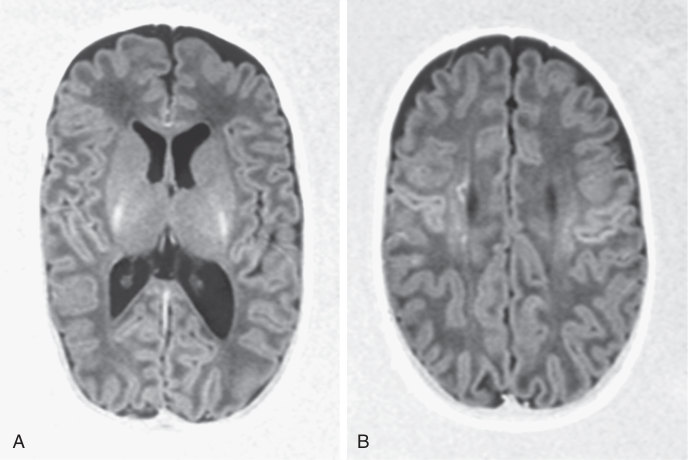

• Fig. 55.7 (A) Magnetic resonance image, T1-weighted sequence, at term age, in the same infant as in Fig. 55.2. A symmetric high signal at the level of the posterior limb of the internal capsule is seen. (B) At a higher level, a small triangular area of high signal intensity is still seen as a sequel of the parenchymal hemorrhage.

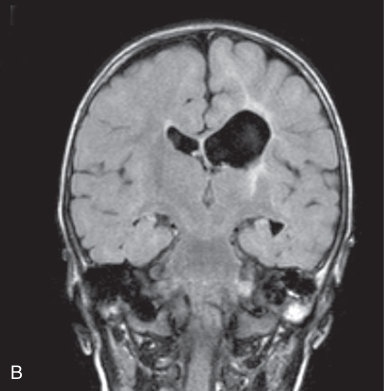

Unmatched source image; PDF page 1051. Consult the original caption.

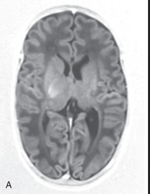

• Fig. 55.8 Magnetic resonance image, T1-weighted sequence, at term age, in the same infant as in Fig. 55.3. (A) There is no symmetric high signal at the level of the posterior limb of the internal capsule. (B) A fluidattenuated inversion recovery sequence at 18 months of age shows high signal intensity suggestive of gliosis adjacent to the porencephalic cyst and across the internal capsule.

## PDF page 1052

In infants with CBH, the neurodevelopmental outcome is closely related to the extent and location of CBH. A recent systematic review investigated infants with isolated CBH and showed high rates of delay in cognitive, motor, language, and behavioral outcomes in 38%, 39%, 41%, and 38%, respectively. Infants with vermis involvement and those with large lesions had the highest risk of adverse outcomes, and infants with punctate CBH had a better prognosis than infants with large CBH.76 A recent multicenter study on CBH in preterm infants, the CHOPIN study,19 assessed outcome data of 177/218 preterm infants at 2 years and showed NDI (defined as an abnormal neurologic exam or suboptimal score in neurodevelopmental tests or child behavior checklist) in 40% with punctate CBH, 51% with limited CBH, and 78% with massive CBH. No significant differences were found for the composite outcome between punctate and limited CBH (P = .42). The risk of an abnormal outcome increased with the increasing size of CBH, and infants with limited CBH showed a more favorable outcome than infants with massive CBH.

A recent study assessed CBH total volume using volumetric MRI and assessed outcomes at 4.5 years. The investigators found that CBH size and location on preterm MRI (median 27.9 weeks) were associated with reduced preschool motor and visuomotor function and more externalizing behavior independent of supratentorial brain injury in a dose-dependent fashion. Thus the volumetric quantification and localization of CBH may provide an opportunity to improve motor and behavioral outcomes by providing targeted intervention.77

### Prevention

Because treatment of GMH-IVH is mainly supportive once it has occurred, prevention of GMH-IVH is of paramount importance. Effective use of antenatal betamethasone before preterm deliveries and gentle care strategies in the neonatal intensive care unit, including minimal handling, minimizing environmental light and noise exposure, and maintaining glucose, pCO2, electrolytes, and body temperature within the optimal range, have been adopted by many centers caring for these infants.1 A multicenter cohort study from two Dutch tertiary centers showed a reduced risk of developing GMH-IVH in infants receiving nursing intervention bundles that consisted of maintaining the head in the midline, lifting the head of the incubator, avoiding flushing and rapid withdrawal of blood, and sudden elevation of the legs during infant care.78 Similarly, in a single-center quality improvement project from the United States, the investigators developed targeted interventions, including the development of potentially better practice guidelines, maintaining the head in the midline position in the first 72 hours, promoting early noninvasive ventilation, consistent use of rescue antenatal betamethasone, and risk-based indomethacin prophylaxis. The outcome measure was the rate of severe GMH-IVH. With the implementation of these measures, the rate of severe GMH-IVH decreased from

14% to 1.2%, with sustained improvement over 2.5 years. Mortality also decreased by 50% during the study period.79 Based on these recent data, these practical strategies seem to have significant potential to reduce the disease burden and should be further studied in large-scale prospective studies and implemented in daily practice.

From a medication standpoint, antenatal steroids, magnesium sulfate, vitamin K, and phenobarbital administration have been hypothesized to be preventive against GMH-IVH in several studies. For the prevention of GMH- IVH, the most effective prophylactic drug seems to be antenatal steroids. A 2020 meta-analysis assessed the effects of administering a course of corticosteroids to women before anticipated preterm birth on fetal and neonatal morbidity and concluded that the use of antenatal corticosteroids probably reduces the risk of GMH-IVH (RR 0.58, 95% CI 0.45–0.75; 8475 infants; 12 studies) with moderatecertainty evidence.3 A 2010 meta-analysis assessed the benefits and harms of giving phenobarbital to women at risk of imminent very preterm birth with the primary aim of preventing GMH-IVH. Analyses of all included trials showed a significant reduction in all grades of GMH-IVH (RR 0.65, 95% CI 0.50–0.83; 9 trials; 1591 women) and severe grades of GMH-IVH (RR 0.41, 95% CI 0.20–0.85; 8 trials; 1527 women) in infants whose mothers had been given prenatal phenobarbital. However, these results were influenced by low-quality trials, which contributed largely to the analysis. When only the two higher-quality trials were included, these beneficial effects disappeared for all grades of GMH-IVH (RR 0.90, 95% CI 0.75–1.08; 2 trials; 945 women) and severe grades of GMH-IVH (RR 1.05, 95% CI 0.60–1.83; 2 trials; 945 women).80 Studies of antenatal administration of magnesium sulfate yield different results. A systematic review published in 2009 involving 6145 fetuses substantially reduced the risk of CP (RR 0.69; 95% CI 0.54–0.87). The NNT to prevent one case of CP was 63 (95% CI 43–155). A significant reduction in the rate of gross motor impairment was also seen (RR 0.61; 95% CI 0.44–0.85; 4 trials; 5980 infants).81 In a multicenter randomized controlled trial from the United States, no significant reduction was found for the incidence of a large GMH-IVH (2.1% vs. 3.2%; RR 0.64; 95% CI 0.38–1.06). Moderate or severe CP occurred significantly less frequently in the magnesium sulfate group compared to the control group (1.9% vs. 3.5%; RR 0.55; 95% CI 0.32–0.95).82 Maternal vitamin K administration was also studied in a meta-analysis and seven trials were included, involving 607 women. Vitamin K administration, either parenterally or orally, to women at risk of imminent preterm birth was associated with a nonsignificant reduction in the overall rate of GMH-IVH (RR 0.76; 95% CI 0.54–1.06) and a significant reduction in severe GMH-IVH (RR 0.58; 95% CI 0.37–0.91). However, when the two quasi-randomized trials were excluded, antenatal vitamin K was associated with a nonsignificant reduction in all grades of GMH-IVH (RR 0.87; 95% CI 0.60–1.26) and a nonsignificant reduction in severe GMH-IVH (RR 0.82; 95% CI 0.49–1.36).83

## PDF page 1053 | printed page 1049

Because persistent patent ductus arteriosus has also been associated with GMH-IVH in preterm infants, prostaglandin inhibitors such as indomethacin and ibuprofen have been studied in several clinical trials in the past two decades. The results of a meta-analysis involving 19 trials of 2872 infants showed a significant reduction in the incidence of high-grade GMH-IVH (pooled RR 0.66 95% CI 0.53– 0.82).84 The children of the original cohort were assessed at 8 years of age, and no effect of indomethacin was seen on long-term outcomes.85 Analysis of the original cohort by gender, however, showed that indomethacin halved the incidence of IVH, eliminated parenchymal hemorrhage, and was associated with higher verbal scores at 3 to 8 years in males.86 In a 2020 meta-analysis of ibuprofen, a possible decrease in the risk of high-grade GMH-IVH in infants receiving prophylactic ibuprofen was shown (RR 0.67; 95% CI 0.45–1.00; 7 trials; 925 infants) with moderate-quality evidence.87

### Other Hemorrhages

Extra-axial hemorrhages in the neonate (e.g., subdural [see also Chapter 28] and subarachnoid hemorrhages) are probably underdiagnosed because they are difficult to recognize using cUS and the clinical signs may be subtle or absent. A significant subdural hemorrhage is most often related to birth trauma, and a small subdural hemorrhage is common when MRI is performed routinely. In a study looking at 88 neonates who had an MRI at a mean age of 21 days, 16 infants had a subdural hemorrhage, 2 subarachnoid hemorrhages, and 6 parenchymal hemorrhages. All neonates with

### L

3

A

B

• Fig. 55.9 (A) Magnetic resonance image, T1-weighted sequence, shows a large collection of blood in the posterior fossa with blood along the tentorium bilaterally (black arrows). (B) At a higher level, extensive cortical highlighting is seen posteriorly and in the region of the sylvian fissure (white arrows). A posterior branch middle cerebral artery infarct is also seen on the right.

intracranial hemorrhage were delivered vaginally, with a prevalence of 26% in vaginal births. In this group, no association was seen with traumatic or assisted birth compared with those with uncomplicated vaginal births, and all cases were asymptomatic.88

Underlying mechanisms can be a tear of the dura, occipital diastasis, or rupture of bridging veins. A tear of the dura can occur after a precipitous delivery or from the use of instrumentation, both of which are not very common with preterm delivery. A dural tear results in extensive bleeding from the adjacent sinus. Occipital diastasis can occur during a vaginal breech delivery with an excessive extension of the neck of the infant, although vaginal breech deliveries are not commonly performed as a consequence of the results of multicenter, randomized studies. Rupture of the bridging veins is the most common etiology of a subdural hemorrhage and may be seen in association with a subarachnoid hemorrhage. Children are usually born at term and present with a full fontanelle, lethargy, apneas, or seizures. In case of a severe hemorrhage, a midline shift may be seen, and surgery needs to be considered. Bedside percutaneous needle aspiration of the extra-axial hematoma may be attempted, which was successful in a recent case series and may be recommended as the treatment of choice in infants who are critically ill and therefore not stable enough to be transferred to the operation room for neurosurgical decompression.89 The diagnosis in emergent cases usually is made using CT or MRI (Fig. 55.9). In these cases, hydrocephalus can develop from an outflow obstruction and may require temporary external drainage, sometimes followed by permanent drainage.

### L

3

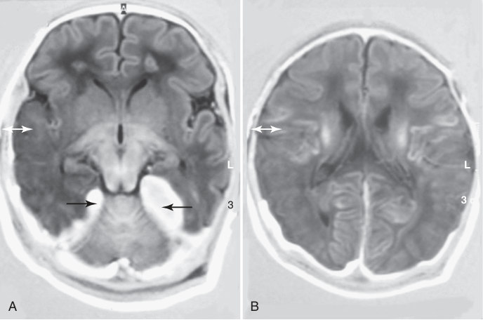

• Fig. 55.9 (A) Magnetic resonance image, T1-weighted sequence, shows a large collection of blood in the posterior fossa with blood along the tentorium bilaterally (black arrows). (B) At a higher level, extensive cortical highlighting is seen posteriorly and in the region of the sylvian fissure (white arrows). A posterior branch middle cerebral artery infarct is also seen on the right.

## PDF page 1054

Small subarachnoid hemorrhages, which are usually asymptomatic, are sometimes seen in preterm infants at postmortem examination. Blood can leak into the subarachnoid space after a GMH-IVH by flowing through the aqueduct into the fourth ventricle and subsequently through the foramina of Luschka and Magendie into the subarachnoid space. Once again, the diagnosis is hard to make using cUS unless the lesion is large. In infants presenting with subarachnoid hemorrhage, hydrocephalus is less commonly seen than in children with a subdural hemorrhage.

### Potential Future Directions

Mesenchymal stromal cell (MSC)-based therapy is emerging as a promising treatment option for neonatal neurologic disorders. In a series of studies, investigators from South Korea assessed whether intraventricular transplantation of human umbilical cord blood-derived MSCs prevents posthemorrhagic ventricular dilatation (PHVD) development in a rat model. It was shown that MSCs significantly reduced the rate of PHVD and brain injury caused by IVH.90 In two subsequent studies, it was shown that significant neuroprotection was demonstrated when MSCs were administered 2 days after the onset of IVH but not after 7 days, and both intraventricular and intravenous routes had similar therapeutic effects.91 The same investigators published the first phase I human trial of MSCs in PHVD, in which nine preterm infants received MSCs in incremental doses and no side effects were observed, confirming the safety and tolerability of MSCs.92 These promising findings resulted in a phase II human trial, which is completed and currently being analyzed (NCT02890953).

There is also considerable basic research to find the ideal biomarker for the early detection of infants at risk of GMH-IVH and its most common complication, PHVD. Plasma, CSF, and urine biomarkers of GMH-IVH and impending PHVD can be used to optimize the timing of interventions in at-risk infants.47 Among them, interleukin (IL)-6, S100β protein, activin, chemokine ligand-18, and brain-type creatine kinase have been shown to be promising for the early detection of infants at risk of developing GMH-IVH. Transforming growth factors β1 and β2, matrix metalloproteinase, glial fibrillary acidic protein, and plasminogen activator inhibitor step forward as early biomarkers of an impending PHVD. The discovery and validation of neonatal biomarkers of hemorrhagic brain injury will be an important step in the evolution of neonatal neuroprotection.93

### Perinatal Stroke

Perinatal stroke can be broadly classified into cerebral sinovenous thrombosis (CSVT) and arterial ischemic stroke (AIS). Both conditions can remain undiagnosed in the neonatal period because presenting symptoms may not always be clear and appropriate imaging is not always performed. Studies tend to exclude preterm infants, even though these also develop

perinatal stroke and, according to a recent population-based study, with a higher incidence than the full-term infant.94 Arteriovenous malformations are discussed in Chapter 77.

### Sinovenous Thrombosis

An incidence of 41 per 100,000 newborn infants with CSVT was found in the Canadian Pediatric Ischemic Stroke Registry but was higher in a population-based study performed in the Netherlands.95,96 Two-thirds of the cases come to medical attention within 48 hours of birth, although symptoms can also develop 10 to 14 days after delivery, sometimes associated with dehydration or infection.95,97 Almost half the children (43%) with CSVT in the Canadian registry were newborns.

### Risk Factors

During the birth process, molding of the skull and overriding of the sutures of the different parts of the skull may occur and affect the underlying sinus, resulting in the occurrence of CSVT. Perinatal asphyxia is a commonly associated risk factor, as reported in 24% of the cases in the Canadian Registry. The superior sagittal sinus and the transverse sinuses are most commonly involved, but in the study by Berfelo et al.,95 the straight sinus was most often affected, and an associated thalamic hemorrhage was common. Involvement of the vein of Galen and the internal cerebral vein has also been reported. The occurrence of associated IVH, especially a unilateral thalamic hemorrhage or periventricular congestion, may help clarify the diagnosis. Wu et al.98 noted that CSVT was significantly more common in full-term infants with IVH and unilateral thalamic hemorrhage (4 of 5) compared with newborns with IVH only (5 of 21). They strongly recommend the diagnosis of CSVT be considered in any full-term neonate presenting with IVH.

Risk factors for CSVT during the first 28 days of life include dehydration, infection, maternal fever/chorioamnionitis, hypoxic–ischemic injury, and thrombophilia.95 In another study, risk factors were analyzed in 30 full-term infants with CSVT.99 They reported that 29% of these newborn infants had been on extracorporeal membrane oxygenation and that 23% had congenital heart disease. Another study also reported development of CSVT in 28% of infants following neonatal surgery for their congenital heart disease, with lower postmenstrual age and weight at time of surgery and use of internal jugular veins as potential risk factors.100 In the study by Wu et al.99 only seven infants were tested for a genetic thrombophilia, and four of these seven were found to be positive. Compression of the superior sagittal sinus has also been suggested to be a possible risk factor.101

### Diagnosis

Seizures are the most common presenting symptoms and were reported in 70% of the infants in both the Dutch study as well as the Canadian Registry. Lethargy is also commonly present. The fontanelle may be full, and the scalp veins may be prominent. Diagnosis can be made using color Doppler

## PDF page 1055 | printed page 1051

A B

• Fig. 55.10 Magnetic resonance imaging scans were obtained at age 12 days, after the development of seizures on day 9. (A) Doppler ultrasound does not show any flow in the superior sagittal sinus. (B) On the midsagittal T2-weighted sequence, a large thrombus is seen at the level of the superior sagittal sinus. (C) Magnetic resonance venography image shows loss of flow at the level of the superior sagittal sinus and straight sinus.

flow ultrasonography, which may demonstrate absent or decreased flow in the affected sinus. Contrast-enhanced CT is no longer recommended, but it can show the so-called empty delta sign, the lack of contrast filling. The best modality is brain MR imaging, especially MR venography, which helps make a definitive diagnosis by demonstrating a reduction or absence of venous flow in the affected venous sinus (Fig. 55.10).

### Management

Besides general management, including treatment of dehydration, seizures, and meningitis, there is no agreement on the use of antithrombotic therapy in this age group, even though recommendations in favor of its use have been made recently. Studies show that regional practices with regard to antithrombotic therapy show considerable variability.102 Different treatment policies were noted, with physicians in the United States being less likely to treat neonates with CSVT with antithrombotic medication compared with physicians at centers in other countries, 25% of these neonates being treated in the United States versus 69% in other countries.102 About 25% of the infants show propagation of the thrombus.97 Whether early anticoagulation therapy in those with involvement of the straight sinus may prevent the development of a thalamic hemorrhage still needs to be assessed, but data from a recent systematic review and meta-analysis suggested a reduction in propagation of the thrombus and no evidence of increased morbidity or mortality.103 The number of infants with CSVT is limited; therefore enrollment in many centers will be required to be able to conduct a randomized study to assess the effect of anticoagulation therapy.

### Outcome

More than 90% of newborns with CSVT survive, with 48% to 61% of survivors having moderate to severe disabilities, and 9% experiencing a recurrence of cerebral or systemic thrombosis.95,97 In the retrospective study by Fitzgerald et al.104 who assessed 42 newborn infants, 57% presented

Cwith seizures and 60% had associated parenchymal infarcts, which were mainly hemorrhagic. Of these 42 infants, 79% had any form of impairment, with 59% having cognitive impairment, 67% cerebral palsy, and 41% epilepsy. Infarction was associated with the presence of later impairment. In the subgroup of infants with an associated thalamic hemorrhage, it is common to see the development of electrical status epilepticus during sleep in early childhood, which has an adverse effect on cognitive outcomes.105 Finally, CSVT can also occur in the preterm infant, with the infant who tends to have no or only subtle symptoms, like irritability or unexplained thrombocytopenia. It is therefore often an incidental finding. Color Doppler US has been shown to have a high sensitivity in detecting neonatal CSVT and can help make the diagnosis.106

### Perinatal Arterial Ischemic Stroke

Because of increased access to neonatal MRI, infarction of a major artery, or a branch arising from it, is better recognized. This condition is often referred to as neonatal arterial ischemic stroke, or perinatal arterial ischemic stroke (PAIS).107 Information about incidence is becoming available with the introduction of neonatal registries.94,107

Cerebral infarction in the neonate has been defined as severe disorganization or even complete disruption of both gray matter and white matter caused by embolic, thrombotic, or ischemic events. In infants dying in the acute stage of the condition, the hemisphere is swollen and deeply congested. There is involvement of both white matter and the cortex, with secondary hemorrhagic infarction in some cases. In infants who survive for longer, contraction of the affected area is seen with softening and cystic degeneration, giving a honeycomb appearance. It is recommended that a distinction be made between a unilateral parenchymal hemorrhage, which usually occurs in the preterm infant and evolves into a porencephalic cyst, and an infarct in the region of the middle cerebral artery, which usually occurs in a term newborn and evolves into an area of parenchymal cavitation. A porencephalic cyst occurring after parenchymal

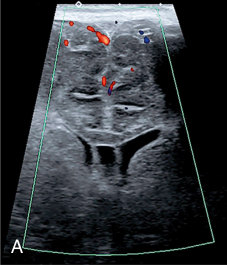

• Fig. 55.10 Magnetic resonance imaging scans were obtained at age 12 days, after the development of seizures on day 9. (A) Doppler ultrasound does not show any flow in the superior sagittal sinus. (B) On the midsagittal T2-weighted sequence, a large thrombus is seen at the level of the superior sagittal sinus. (C) Magnetic resonance venography image shows loss of flow at the level of the superior sagittal sinus and straight sinus.

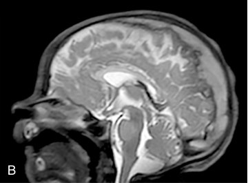

• Fig. 55.10 Magnetic resonance imaging scans were obtained at age 12 days, after the development of seizures on day 9. (A) Doppler ultrasound does not show any flow in the superior sagittal sinus. (B) On the midsagittal T2-weighted sequence, a large thrombus is seen at the level of the superior sagittal sinus. (C) Magnetic resonance venography image shows loss of flow at the level of the superior sagittal sinus and straight sinus.

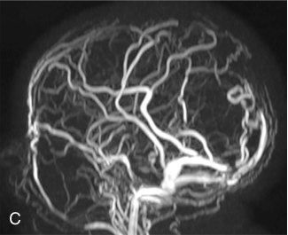

Unmatched source image; PDF page 1055. Consult the original caption.

## PDF page 1056

hemorrhage of antenatal onset has, however, been referred to as fetal stroke, and small porencephalic cysts occurring after antenatal venous infarction have also been included within the spectrum of presumed perinatal stroke.108

Lesions involving the left hemisphere are three to four times more common than those of the right hemisphere. This may be the result of hemodynamic differences early after birth in association with the patent ductus arteriosus or a preferential flow across the left common carotid artery. Middle cerebral artery infarction occurs twice as often as the involvement of any other artery.109 A classification system based on the main artery involved can be used. Infarcts in the territory of the middle cerebral artery were further subdivided into the main branch, cortical branch, and lenticulostriate branch infarction.110 Perforator stroke is especially common in the preterm infants and is often an incidental finding.106

### Incidence

In recent population-based studies, the incidence of PAIS was as high as 20 to 30 per 100,000 newborn infants, which is much higher than reported previously.94,107 Neonatal stroke is the second most common cause of neonatal seizures. Data about focal infarction in preterm infants are scarce.106 In a recent German population-based study, the incidence was 32 per 100,000 preterm infants, higher than for full-term infants.94

### Risk Factors

Newborn infants are susceptible to neonatal stroke because of a number of factors present around the time of delivery, such as the hypercoagulable state of the mother, mechanical stress during delivery, the transient right-to-left intracardiac shunt, and the risk of dehydration during the first few days after delivery, often associated with a high hematocrit and blood viscosity.109 Perinatal complications have been reported in more than 50% of newborn infants who had suffered a perinatal stroke.111,112 In a single-center cohort study, case-matched controls were used, and diverse etiologic factors were noted to be responsible for PAIS in term infants. Infertility, preeclampsia, prolonged rupture of membranes, chorioamnionitis, and hypoglycemia have been identified as independent maternal risk factors.111 In another study, male gender (OR 2.8), family history of seizures (OR 6.5) or neurologic diseases (OR 4.9), and 1 or greater (OR 5.8) and 2 or greater (OR 21.8) intrapartum complications were independently associated with neonatal stroke.112 Although intrapartum factors are common, they are not often severe enough to meet the selection criteria for hypothermia. Cardiac disease, extracorporeal membrane oxygenation, and portal vein thrombosis have all been reported as associated risk factors. Stroke was especially common (31%) among infants with transposition of the great arteries, and this was associated with balloon atrial septostomy.113 Maternal cocaine abuse has also been considered a cause of perinatal stroke. An underlying genetic prothrombotic disorder is no longer considered likely, and extensive investigations

should not be routinely performed. Stroke recurrence is very uncommon. Data on risk factors in preterm infants are scarce.114 Using 3:1 GA matched controls, etiologic factors responsible for perinatal arterial stroke in preterm infants were studied, and it was noted that these were different from those in infants born at term. Twin-twin transfusion syndrome (19% vs. 3%; OR 31.2; 95% CI 2.9–340; P = .005), fetal heart rate abnormality (58% vs. 26%; OR 5.2; 95% CI 1.5–17.6; P = .008), and hypoglycemia (42% vs. 18%; OR 3.9; 95% CI 1.2–12.6; P = .02) were identified as independent risk factors for preterm stroke.114

### Diagnosis

Seizures are the most common presenting symptom of PAIS.115 When a newborn without an obvious history of perinatal asphyxia presents with focal seizures, care should be taken not to miss the diagnosis of PAIS. They are usually of the focal clonic variety, but multifocal tonic or subtle seizures also may be seen (see Chapter 57). Many of the infants show no major clinical neurologic abnormality between seizures. The largest population reported to date consisted of 248 infants, of whom 72% presented with seizures, which were focal in almost all cases, and 26% were admitted because of respiratory problems.115 Symptoms can be very subtle, especially in the preterm infant, and the diagnosis can be easily missed.114 Presentation with a hand preference later in infancy with an area of cavitation on CT or MRI may lead to a diagnosis of a perinatal or in utero AIS, which is now referred to as presumed perinatal ischemic stroke.108

### Neuro-Imaging

The middle cerebral artery is most commonly involved, and the infarct occurs more often on the left than the right side.115 Arterial infarcts of the anterior and posterior cerebral artery are less often diagnosed, possibly because of the lack of clinical symptoms in the neonatal period (Fig. 55.11). Involvement of the smaller branches of the middle cerebral artery is more often seen in preterm infants, resulting in so-called perforator stroke.114 Infarcts can be hemorrhagic in 20% of cases, and bilateral infarcts can be seen in 10% to 15% (Fig. 55.12).

In the absence of abnormalities on cUS, MRI is recommended to confirm or exclude the diagnosis. The diagnostic value of cUS in PAIS has been controversial, and cUS has not been considered reliable in making a diagnosis; this applies especially when the examination is made soon after the clinical presentation. By the end of the first week of postnatal life, a wedge-shaped area of echogenicity, often with a linear demarcation line, restricted to the territory of one of the main arteries, usually becomes apparent.116 Cystic evolution can take place over the next 4 to 6 weeks, often associated with ex-vacuo dilation of the ipsilateral lateral ventricle. Doppler cUS can show asymmetry of arterial pulsations. Decreased pulsations on the affected side can be seen in the acute phase, whereas an increase in size and number of visible vessels in the periphery of the infarct and increased mean blood flow velocity in vessels supplying or

## PDF page 1057 | printed page 1053

A

• Fig. 55.11 Preterm infant, gestational age 32 weeks. (A) Routine ultrasonography image obtained at 2 weeks shows an area of cystic evolution in the region of the left anterior cerebral artery. Mild ex vacuo dilation of the left ventricle is also present. (B) T2-weighted magnetic resonance imaging scan, spin-echo sequence, at age 7 years shows the parenchymal cavity in the same distribution.

A B

• Fig. 55.12 Full-term infant, magnetic resonance imaging (MRI) scans obtained at age 4 days. (A) T1-weighted sequence shows low signal intensity in the distribution of the right middle cerebral artery, suggestive of main branch involvement. (B) Diffusion-weighted imaging scan shows high signal intensity in the same area, as well as a smaller area of high signal intensity in the distribution of the left anterior cerebral artery.

draining the infarcted areas are often seen a few days later, and this is considered to result from luxury perfusion.

The threshold for performing MRI should be low in infants presenting with neonatal seizures. If performed early after the clinical presentation, diffusion-weighted imaging (DWI) is very helpful. This technique reveals abnormalities, indicating cytotoxic edema, at a very early stage, preceding abnormalities seen on conventional MRI. This technique also enables visualization of acute involvement of the corticospinal tracts at the level of the midbrain.117 Several studies have shown that these findings predict Wallerian degeneration and the development of subsequent hemiplegia.117 A repeat scan can show asymmetry at the level of the mesencephalon, which can be seen as early as 4 to 6 weeks after the onset of the infarction and is referred to as Wallerian degeneration. MR angiography, which allows for investigation of the main vascular bed, can be used, and can sometimes show

Bdissection or occlusion of one of the main vessels. This may be rare, however, and this technique may also fail to show small vessel occlusion. EEG showing focal electrographic and electroclinical seizures with ipsilateral suppression of the background activity and focal sharp waves are strongly suggestive of the presence of perinatal stroke.118

Reorganization of the somatosensory cortex can be followed using a combination of transcranial magnetic stimulation and functional MRI.119 Staudt et al.120 showed that when a lesion abolishes the normal contralateral corticospinal control over the paretic hand, the contralesional hemisphere develops (or maintains) fast-conducting ipsilateral corticospinal pathways to the paretic hand. This reorganization with ipsilateral corticospinal tracts can mediate useful hand function. Normal hand function, however, seemed only possible with preserved crossed corticospinal projections from the contralateral hemisphere. Ipsilesional

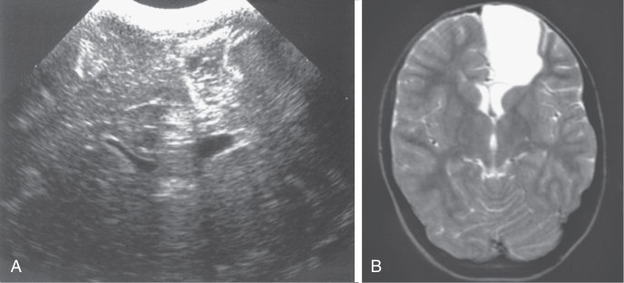

• Fig. 55.11 Preterm infant, gestational age 32 weeks. (A) Routine ultrasonography image obtained at 2 weeks shows an area of cystic evolution in the region of the left anterior cerebral artery. Mild ex vacuo dilation of the left ventricle is also present. (B) T2-weighted magnetic resonance imaging scan, spin-echo sequence, at age 7 years shows the parenchymal cavity in the same distribution.

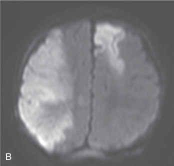

Unmatched source image; PDF page 1057. Consult the original caption.

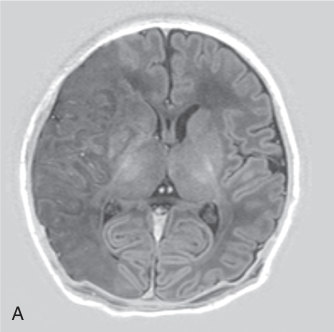

• Fig. 55.12 Full-term infant, magnetic resonance imaging (MRI) scans obtained at age 4 days. (A) T1-weighted sequence shows low signal intensity in the distribution of the right middle cerebral artery, suggestive of main branch involvement. (B) Diffusion-weighted imaging scan shows high signal intensity in the same area, as well as a smaller area of high signal intensity in the distribution of the left anterior cerebral artery.

## PDF page 1058

reorganization is less effective in the restoration of good motor function as opposed to contralesional reorganization.

### Management

Treatment is at present still mainly supportive, with treatment of hypoglycemia and controlling seizures with antiseizure medication, which can in most infants be discontinued before discharge. Symptoms tend to occur beyond the 6-hour window used for hypothermia. Neuroprotective trials are underway, and a safety study with mesenchymal stem cells administered intranasally has been performed in 10 infants.121 A multicenter study is enrolling infants at three sites, administering darbepoetin within a week after stroke onset, and a second dose 1 week later (NCT03171818).

### Outcome

The overall prevalence of cerebral palsy is approximately 2 in every 1000 live births. On the basis of the estimated incidence of perinatal cerebral vascular infarction, it might be expected that this condition is the cause of the neurologic deficit in up to 20% of children with cerebral palsy. This is supported by data showing that 22% of 377 infants with cerebral palsy showed focal arterial infarction on head imaging.122 Neurodevelopmental outcome in most cases is relatively good. Spastic hemiplegia is the most important sequela, particularly after infarction of the main branch of the middle cerebral artery. There is an increased incidence among male infants. The majority of the infants achieve independent walking before 18 months, and those who develop hemiplegia show more involvement of the upper than lower limb with the majority classified as GMFCS I or II. Taking the lesion site and involvement of well-defined brain structures into account, a more precise prediction for

Key Points

• GMH-IVH is still a common problem in extremely pre-

term infants. • PHVD is an important complication of, especially, large

GMH-IVH. • Data are accumulating to suggest that PHVD should be

treated based on cranial ultrasound assessments of the ventricular size before the onset of clinical symptoms.

### References

1. Inder TEPJ, Volpe JJ. Preterm intraventricular hemorrhage/

posthemorrhagic hydrocephalus. In: Volpe JJIT, du Plessis AJ, et al., eds. Volpe’s Neurology of the Newborn. 6th ed. Philadelphia: Elsevier; 2018:637–698. 2. Papile LA, Burstein J, Burstein R, Koffler H. Incidence and

evolution of subependymal and intraventricular hemorrhage: a study of infants with birth weights less than 1,500 gm. J Pediatr. 1978;92(4):529–534. 3. McGoldrick E, Stewart F, Parker R, Dalziel SR. Antena-

tal corticosteroids for accelerating fetal lung maturation for women at risk of preterm birth. Cochrane Database Syst Rev. 2020;12:CD004454.

motor outcome as well as outcome for other domains can be made.110 Looking also at other domains (epilepsy, vision, behavior, and language), almost half (46%) of all infants surviving neonatal stroke were found to be doing well at a median age of 41 months in a large study of 161 infants.110

Deficits in higher-level cognitive skills may first become apparent at school age, and this is more common in males, involvement of the central gray nuclei, and not uncommonly associated with the development of epilepsy.123 Homonymous hemianopia may follow a posterior cerebral artery infarction.124 Outcome data depend very much on the threshold for performing MRI, on the artery involved, and on whether the main branch is involved or only a cortical branch or one of the lenticulostriate branches, the latter being especially common in the preterm inf ant.110,114,125

Post-neonatal epilepsy is a well-known complication and has been reported in 12% to 67% of affected infants.109 Lesions involving the cortex are more likely to be associated with epilepsy. Because epilepsy may first develop later in childhood, the rate of epilepsy will be higher when followup is longer. In a study with a mean follow-up of 8 years and 5 months, 16.4% of the patients developed post-neonatal epilepsy. The mean age at first post-neonatal seizure was 4 years and 2 months (range 1–10 years and 6 months).126

Even though the focus is often on motor outcomes, other outcome parameters are also important, and in a national cohort study, language was impaired in almost half (49%) of the children. Cerebral palsy, low academic skills, active epilepsy, and global intellectual disability were present in 32%, 28%, 11%, and 8%, respectively. Eventually, 59% of children were affected by at least one of the aforementioned conditions.127

• Cerebral venous sinus thrombosis should be suspected

when an IVH with or without a thalamic hemorrhage is seen in a full-term infant. • PAIS occurs in about 20 to 30 per 100,000 full-term

infants and usually presents with focal clonic seizures.

4. Lai GY, Shlobin N, Garcia RM, et al. Global incidence propor-

tion of intraventricular haemorrhage of prematurity: a metaanalysis of studies published 2010-2020. Arch Dis Child Fetal Neonatal Ed. 2022;107(5):513–519. 5. Vermont Oxford Network Database Summary for Infants 501 to

1500 Grams Born in 2020. Burlington, VT: Vermont Oxford Network; 2020. 6. Inder TE, de Vries LS, Ferriero DM, et al. Neuroimaging of

the preterm brain: review and recommendations. J Pediatr. 2021;237:276–287.e274. 7. Ballabh P, de Vries LS. White matter injury in infants with

intraventricular haemorrhage: mechanisms and therapies. Nat Rev Neurol. 2021;17(4):199–214.

## PDF page 1059 | printed page 1055

8. Leijser LM, de Vries LS. Preterm brain injury: germinal matrix-

intraventricular hemorrhage and post-hemorrhagic ventricular dilatation. Handb Clin Neurol. 2019;162:173–199. 9. Tortora D, Severino M, Malova M, et al. Differences in subepen-

dymal vein anatomy may predispose preterm infants to GMH- IVH. Arch Dis Child Fetal Neonatal Ed. 2018;103(1):F59–F65. 10. Mohammad K, Scott JN, Leijser LM, et al. Consensus approach

for standardizing the screening and classification of preterm brain injury diagnosed with cranial ultrasound: a Canadian perspective. Front Pediatr. 2021;9:618236. 11. Karimy JK, Zhang J, Kurland DB, et al. Inflammation-depen-

dent cerebrospinal fluid hypersecretion by the choroid plexus epithelium in posthemorrhagic hydrocephalus. Nat Med. 2017;23(8):997–1003. 12. Takashima S, Mito T, Ando Y. Pathogenesis of periventricu-

lar white matter hemorrhages in preterm infants. Brain Dev. 1986;8(1):25–30. 13. Cizmeci MN, de Vries LS, Ly LG, et al. Periventricular hem-

orrhagic infarction in very preterm infants: characteristic sonographic findings and association with neurodevelopmental outcome at age 2 years. J Pediatr. 2020;217:79–85.e71. 14. Bassan H, Benson CB, Limperopoulos C, et al. Ultrasono-

graphic features and severity scoring of periventricular hemorrhagic infarction in relation to risk factors and outcome. Pediatrics. 2006;117(6):2111–2118. 15. Harteman JC, Groenendaal F, van Haastert IC, et al. Atypical

timing and presentation of periventricular haemorrhagic infarction in preterm infants: the role of thrombophilia. Dev Med Child Neurol. 2012;54(2):140–147. 16. Dudink J, Lequin M, Weisglas-Kuperus N, et al. Venous sub-

types of preterm periventricular haemorrhagic infarction. Arch Dis Child Fetal Neonatal Ed. 2008;93(3):F201–206. 17. Steggerda SJ, Leijser LM, Wiggers-de Bruine FT, et al. Cerebel-

lar injury in preterm infants: incidence and findings on US and MR images. Radiology. 2009;252(1):190–199. 18. Gano D, Ho ML, Partridge JC, et al. Antenatal exposure to

magnesium sulfate is associated with reduced cerebellar hemorrhage in preterm newborns. J Pediatr. 2016;178:68–74. 19. Boswinkel V, Steggerda SJ, Fumagalli M, et al. The CHOPIn

Study: a multicenter study on cerebellar hemorrhage and outcome in preterm infants. Cerebellum. 2019;18(6):989–998. 20. Bierstone D, Wagenaar N, Gano DL, et al. Association of his-

tologic chorioamnionitis with perinatal brain injury and early childhood neurodevelopmental outcomes among preterm neonates. JAMA Pediatr. 2018;172(6):534–541. 21. Soraisham AS, Singhal N, McMillan DD, Canadian Neo-

natal N, et al. A multicenter study on the clinical outcome of chorioamnionitis in preterm infants. Am J Obstet Gynecol. 2009;200(4):372.e371–376. 22. Humberg A, Hartel C, Paul P, et al. Delivery mode and intra-

ventricular hemorrhage risk in very-low-birth-weight infants: Observational data of the German Neonatal Network. Eur J Obstet Gynecol Reprod Biol. 2017;212:144–149. 23. Werner EF, Han CS, Savitz DA, et al. Health outcomes for

vaginal compared with cesarean delivery of appropriately grown preterm neonates. Obstet Gynecol. 2013;121(6):1195–1200. 24. Wyckoff MH, Salhab WA, Heyne RJ, et al. Outcome of extremely

low birth weight infants who received delivery room cardiopulmonary resuscitation. J Pediatr. 2012;160(2):239–244.e232. 25. Tarnow-Mordi W, Morris J, Kirby A, et al. Delayed versus

immediate cord clamping in preterm infants. N Engl J Med. 2017;377(25):2445–2455.

26. Katheria A, Reister F, Essers J, et al. Association of umbilical

cord milking vs delayed umbilical cord clamping with death or severe intraventricular hemorrhage among preterm infants. JAMA. 2019;322(19):1877–1886. 27. Jasani B, Torgalkar R, Ye XY, et al. Association of umbilical

cord management strategies with outcomes of preterm infants: a systematic review and network meta-analysis. JAMA Pediatr. 2021;175(4):e210102. 28. Mohamed MA, Aly H. Transport of premature infants is associ-

ated with increased risk for intraventricular haemorrhage. Arch Dis Child Fetal Neonatal Ed. 2010;95(6):F403–407. 29. Hirata K, Kimura T, Hirano S, et al. Outcomes of outborn

very-low-birth-weight infants in Japan. Arch Dis Child Fetal Neonatal Ed. 2021;106(2):131–136. 30. Jensen EA, Lorch SA. Association between off-peak hour birth

and neonatal morbidity and mortality among very low birth weight infants. J Pediatr. 2017;186:41–48.e44. 31. Klingenberg C, Wheeler KI, McCallion N, et al. Volume-tar-

geted versus pressure-limited ventilation in neonates. Cochrane Database Syst Rev. 2017;10:CD003666. 32. Mian Q, Cheung PY, O’Reilly M, et al. Impact of delivered tidal

volume on the occurrence of intraventricular haemorrhage in preterm infants during positive pressure ventilation in the delivery room. Arch Dis Child Fetal Neonatal Ed. 2019;104(1):F57–F62. 33. Cools F, Offringa M, Askie LM. Elective high frequency oscil-

latory ventilation versus conventional ventilation for acute pulmonary dysfunction in preterm infants. Cochrane Database Syst Rev. 2015;3:CD000104. 34. Kribs A, Roll C, Gopel W, et al. Nonintubated surfactant appli-

cation vs conventional therapy in extremely preterm infants: a randomized clinical trial. JAMA Pediatr. 2015;169(8):723–730. 35. Alderliesten T, Lemmers PM, Smarius JJ, et al. Cerebral oxy-

genation, extraction, and autoregulation in very preterm infants who develop peri-intraventricular hemorrhage. J Pediatr. 2013;162(4):698–704 e692. 36. Noori S, McCoy M, Anderson MP, et al. Changes in cardiac

function and cerebral blood flow in relation to peri/intraventricular hemorrhage in extremely preterm infants. J Pediatr. 2014;164(2):264-270.e261–263. 37. Chock VY, Kwon SH, Ambalavanan N, et al. Cerebral oxy-

genation and autoregulation in preterm infants (Early NIRS Study). J Pediatr. 2020;227:94–100.e101. 38. Aden U, Lin A, Carlo W, et al. Candidate gene analysis: severe

intraventricular hemorrhage in inborn preterm neonates. J Pediatr. 2013;163(5):1503–1506.e1501. 39. de Vries LS, Koopman C, Groenendaal F, et al. COL4A1 muta-

tion in two preterm siblings with antenatal onset of parenchymal hemorrhage. Ann Neurol. 2009;65(1):12–18. 40. Hand IL, Shellhaas RA, Milla SS; Committee on Fetus and New-

born, Section on Neurology, Section on Radiology. Routine neuroimaging of the preterm brain. Pediatrics. 2020;146(5): e2020029082. 41. Robinson S. Neonatal posthemorrhagic hydrocephalus from

prematurity: pathophysiology and current treatment concepts. J Neurosurg Pediatr. 2012;9(3):242–258. 42. El-Dib M, Limbrick Jr DD, Inder T, et al. Management of post-

hemorrhagic ventricular dilatation in the infant born preterm. J Pediatr. 2020;226:16–27.e13. 43. Levene MI, de Vries L. Extension of neonatal intraventricular

haemorrhage. Arch Dis Child. 1984;59(7):631–636. 44. Brouwer MJ, de Vries LS, Groenendaal F, et al. New refer-

ence values for the neonatal cerebral ventricles. Radiology. 2012;262(1):224–233.

## PDF page 1060

45. Radhakrishnan R, Brown BP, Kralik SF, et al. Frontal occipi-

tal and frontal temporal horn ratios: comparison and validation of head ultrasound-derived indexes with MRI and ventricular volumes in infantile ventriculomegaly. AJR Am J Roentgenol. 2019;213(4):925–931. 46. McLachlan PJ, Kishimoto J, Diop M, et al. Investigating the

effects of cerebrospinal fluid removal on cerebral blood flow and oxidative metabolism in infants with post-hemorrhagic ventricular dilatation. Pediatr Res. 2017;82(4):634–641. 47. Schmitz T, Felderhoff-Mueser U, Sifringer M, et al. Expression

of soluble Fas in the cerebrospinal fluid of preterm infants with posthemorrhagic hydrocephalus and cystic white matter damage. J Perinat Med. 2011;39(1):83–88. 48. Morales DM, Silver SA, Morgan CD, et al. Lumbar cerebro-

spinal fluid biomarkers of posthemorrhagic hydrocephalus of prematurity: amyloid precursor protein, soluble amyloid precursor protein alpha, and L1 cell adhesion molecule. Neurosurgery. 2017;80(1):82–90. 49. Brouwer MJ, de Vries LS, Kersbergen KJ, et al. Effects of post-

hemorrhagic ventricular dilatation in the preterm infant on brain volumes and white matter diffusion variables at termequivalent age. J Pediatr. 2016;168:41–49.e41. 50. Leijser LM, Miller SP, van Wezel-Meijler G, et al. Posthemor-

rhagic ventricular dilatation in preterm infants: when best to intervene? Neurology. 2018;90(8):e698–e706. 51. Whitelaw A, Pople I, Cherian S, et al. Phase 1 trial of prevention

of hydrocephalus after intraventricular hemorrhage in newborn infants by drainage, irrigation, and fibrinolytic therapy. Pediatrics. 2003;111(4 Pt 1):759–765. 52. Whitelaw A, Evans D, Carter M, et al. Randomized clinical trial

of prevention of hydrocephalus after intraventricular hemorrhage in preterm infants: brain-washing versus tapping fluid. Pediatrics. 2007;119(5):e1071–1078. 53. Whitelaw A, Jary S, Kmita G, et al. Randomized trial of drain-

age, irrigation and fibrinolytic therapy for premature infants with posthemorrhagic ventricular dilatation: developmental outcome at 2 years. Pediatrics. 2010;125(4):e852–858. 54. Luyt K, Jary SL, Lea CL, et al. Drainage, irrigation and fibrino-

lytic therapy (DRIFT) for posthaemorrhagic ventricular dilatation: 10-year follow-up of a randomised controlled trial. Arch Dis Child Fetal Neonatal Ed. 2020;105(5):466–473. 55. Whitelaw A, Lee-Kelland R. Repeated lumbar or ventricular

punctures in newborns with intraventricular haemorrhage. Cochrane Database Syst Rev. 2017;4:CD000216. 56. de Vries LS, Groenendaal F, Liem KD, et al. Treatment thresh-

olds for intervention in posthaemorrhagic ventricular dilation: a randomised controlled trial. Arch Dis Child Fetal Neonatal Ed. 2019;104(1):F70–F75. 57. Cizmeci MN, Khalili N, Claessens NHP, et al. Assessment of

brain injury and brain volumes after posthemorrhagic ventricular dilatation: a nested substudy of the randomized controlled ELVIS Trial. J Pediatr. 2019;208:191–197.e192. 58. Cizmeci MN, Groenendaal F, Liem KD, et al. Randomized

controlled early versus late ventricular intervention study in posthemorrhagic ventricular dilatation: outcome at 2 years. J Pediatr. 2020;226:28–35.e23. 59. Lai GY, Chu-Kwan W, Westcott AB, et al. Timing of temporiz-

ing neurosurgical treatment in relation to shunting and neurodevelopmental outcomes in posthemorrhagic ventricular dilatation of prematurity: a meta-analysis. J Pediatr. 2021;234:54–64 e20. 60. Schaumann A, Buhrer C, Schulz M, Thomale UW. Neuroendo-

scopic surgery in neonates - indication and results over a 10-year practice. Childs Nerv Syst. 2021;37(11):3541–3548.

61. Park YS, Kotani Y, Kim TK, et al. Efficacy and safety of

intraventricular fibrinolytic therapy for post-intraventricular hemorrhagic hydrocephalus in extreme low birth weight infants: a preliminary clinical study. Childs Nerv Syst. 2021;37(1):69–79. 62. Christian EA, Jin DL, Attenello F, et al. Trends in hospitaliza-

tion of preterm infants with intraventricular hemorrhage and hydrocephalus in the United States, 2000-2010. J Neurosurg Pediatr. 2016;17(3):260–269. 63. Goldstein RF, Cotten CM, Shankaran S, et al. Influence of ges-

tational age on death and neurodevelopmental outcome in premature infants with severe intracranial hemorrhage. J Perinatol. 2013;33(1):25–32. 64. Payne AH, Hintz SR, Hibbs AM, et al. Neurodevelopmental

outcomes of extremely low-gestational-age neonates with lowgrade periventricular-intraventricular hemorrhage. JAMA Pediatr. 2013;167(5):451–459. 65. Ann Wy P, Rettiganti M, Li J, et al. Impact of intraventricu-

lar hemorrhage on cognitive and behavioral outcomes at 18 years of age in low birth weight preterm infants. J Perinatol. 2015;35(7):511–515. 66. Bolisetty S, Dhawan A, Abdel-Latif M, et al. Intraventricular

hemorrhage and neurodevelopmental outcomes in extreme preterm infants. Pediatrics. 2014;133(1):55–62. 67. Law JB, Wood TR, Gogcu S, et al. Intracranial hemorrhage and

2-year neurodevelopmental outcomes in infants born extremely preterm. J Pediatr. 2021;238:124–134.e110. 68. Hollebrandse NL, Spittle AJ, Burnett AC, et al. School-age

outcomes following intraventricular haemorrhage in infants born extremely preterm. Arch Dis Child Fetal Neonatal Ed. 2021;106(1):4–8. 69. Isaacs AM, Neil JJ, McAllister JP, et al. Microstructural peri-

ventricular white matter injury in post-hemorrhagic ventricular dilatation. Neurology. 2021;98(4):e364–e375. 70. Nieuwets A, Cizmeci MN, Groenendaal F, et al. Post-hemor-

rhagic ventricular dilatation affects white matter maturation in extremely preterm infants. Pediatr Res. 2022;92(1):225–232. 71. Brouwer A, Groenendaal F, van Haastert IL, et al. Neurodevel-

opmental outcome of preterm infants with severe intraventricular hemorrhage and therapy for post-hemorrhagic ventricular dilatation. J Pediatr. 2008;152(5):648–654. 72. Bassan H, Limperopoulos C, Visconti K, et al. Neurodevelop-

mental outcome in survivors of periventricular hemorrhagic infarction. Pediatrics. 2007;120(4):785–792. 73. Beaino G, Khoshnood B, Kaminski M, et al. Predictors of

cerebral palsy in very preterm infants: the EPIPAGE prospective population-based cohort study. Dev Med Child Neurol. 2010;52(6):e119–125. 74. Roze E, Benders MJ, Kersbergen KJ, et al. Neonatal DTI

early after birth predicts motor outcome in preterm infants with periventricular hemorrhagic infarction. Pediatr Res. 2015;78(3):298–303. 75. Limperopoulos C, Bassan H, Gauvreau K, et al. Does cerebellar

injury in premature infants contribute to the high prevalence of long-term cognitive, learning, and behavioral disability in survivors? Pediatrics. 2007;120(3):584–593. 76. Hortensius LM, Dijkshoorn ABC, Ecury-Goossen GM,

et al. Neurodevelopmental consequences of preterm isolated cerebellar hemorrhage: a systematic review. Pediatrics. 2018; 142(5):e20180609. 77. Garfinkle J, Guo T, Synnes A, et al. Location and size of preterm

cerebellar hemorrhage and childhood development. Ann Neurol. 2020;88(6):1095–1108.

## PDF page 1061 | printed page 1057

78. de Bijl-Marcus K, Brouwer AJ, De Vries LS, et al. Neona-

tal care bundles are associated with a reduction in the incidence of intraventricular haemorrhage in preterm infants: a multicentre cohort study. Arch Dis Child Fetal Neonatal Ed. 2020;105(4):419–424. 79. Kramer KP, Minot K, Butler C, et al. Reduction of severe intra-

ventricular hemorrhage in preterm infants: a quality improvement project. Pediatrics. 2022;149(3):e2021050652. 80. Crowther CA, Crosby DD, Henderson-Smart DJ. Phe-

nobarbital prior to preterm birth for preventing neonatal periventricular haemorrhage. Cochrane Database Syst Rev. 2010;1:CD000164. 81. Doyle LW, Crowther CA, Middleton P, Marret S. Antenatal

magnesium sulfate and neurologic outcome in preterm infants: a systematic review. Obstet Gynecol. 2009;113(6):1327–1333. 82. Rouse DJ, Hirtz DG, Thom E, et al. A randomized, controlled

trial of magnesium sulfate for the prevention of cerebral palsy. N Engl J Med. 2008;359(9):895–905. 83. Crowther CA, Crosby DD, Henderson-Smart DJ. Vitamin K

prior to preterm birth for preventing neonatal periventricular haemorrhage. Cochrane Database Syst Rev. 2010;1:CD000229. 84. Fowlie PW, Davis PG, McGuire W. Prophylactic intravenous

indomethacin for preventing mortality and morbidity in preterm infants. Cochrane Database Syst Rev. 2010;(7):CD000174. 85. Vohr BR, Allan WC, Westerveld M, et al. School-age outcomes

of very low birth weight infants in the indomethacin intraventricular hemorrhage prevention trial. Pediatrics. 2003;111(4 Pt 1):e340–346. 86. Ment LR, Vohr BR, Makuch RW, et al. Prevention of intraven-

tricular hemorrhage by indomethacin in male preterm infants. J Pediatr. 2004;145(6):832–834. 87. Ohlsson A, Shah SS. Ibuprofen for the prevention of patent

ductus arteriosus in preterm and/or low birth weight infants. Cochrane Database Syst Rev. 2020;1:CD004213. 88. Looney CB, Smith JK, Merck LH, et al. Intracranial hemor-

rhage in asymptomatic neonates: prevalence on MR images and relationship to obstetric and neonatal risk factors. Radiology. 2007;242(2):535–541. 89. Cizmeci MN, Thewissen L, Zecic A, et al. Bedside ultrasound-

guided percutaneous needle aspiration of intra- and extraaxial intracranial hemorrhage in neonates. Neuropediatrics. 2018;49(4):238–245. 90. Ahn SY, Chang YS, Sung DK, et al. Mesenchymal stem cells

prevent hydrocephalus after severe intraventricular hemorrhage. Stroke. 2013;44(2):497–504. 91. Park WS, Sung SI, Ahn SY, et al. Optimal timing of mesenchy-

mal stem cell therapy for neonatal intraventricular hemorrhage. Cell Transplant. 2016;25(6):1131–1144. 92. Ahn SY, Chang YS, Sung SI, Park WS. Mesenchymal stem

cells for severe intraventricular hemorrhage in preterm infants: phase I dose-escalation clinical trial. Stem Cells Transl Med. 2018;7(12):847–856. 93. Douglas-Escobar M, Weiss MD. Biomarkers of brain injury in

the premature infant. Front Neurol. 2012;3:185. 94. Sorg AL, von Kries R, Klemme M, et al. Incidence estimates

of perinatal arterial ischemic stroke in preterm- and term-born infants: a national capture-recapture calculation corrected surveillance study. Neonatology. 2021;118(6):727–733. 95. Berfelo FJ, Kersbergen KJ, van Ommen CH, et al. Neonatal

cerebral sinovenous thrombosis from symptom to outcome. Stroke. 2010;41(7):1382–1388. 96. deVeber G, Andrew M, Adams C, et al. Cerebral sinovenous

thrombosis in children. N Engl J Med. 2001;345(6):417–423.

97. Moharir MD, Shroff M, Stephens D, et al. Anticoagulants in

pediatric cerebral sinovenous thrombosis: a safety and outcome study. Ann Neurol. 2010;67(5):590–599. 98. Wu YW, Hamrick SE, Miller SP, et al. Intraventricular hemor-

rhage in term neonates caused by sinovenous thrombosis. Ann Neurol. 2003;54(1):123–126. 99. Wu YW, Miller SP, Chin K, et al. Multiple risk factors in neo-

natal sinovenous thrombosis. Neurology. 2002;59(3):438–440. 100. Claessens NHP, Noorlag L, Weeke LC, et al. Amplitude-inte-

grated electroencephalography for early recognition of brain injury in neonates with critical congenital heart disease. J Pediatr. 2018;202:199–205.e191. 101. Tan MA, Miller E, Shroff MM, et al. Alleviation of neonatal

sinovenous compression to enhance cerebral venous blood flow. J Child Neurol. 2013;28(5):583–588. 102. Jordan LC, Rafay MF, Smith SE, et al. Antithrombotic treatment

in neonatal cerebral sinovenous thrombosis: results of the International Pediatric Stroke Study. J Pediatr. 2010;156(5):704– 710, 710.e1–710.e2. 103. Bhatt MD, Chan AK. Venous thrombosis in neonates. Fac Rev.

2021;10:20. 104. Fitzgerald KC, Williams LS, Garg BP, et al. Cerebral sinovenous

thrombosis in the neonate. Arch Neurol. 2006;63(3):405–409. 105. van den Munckhof B, Zwart AF, Weeke LC, et al. Perinatal

thalamic injury: MRI predictors of electrical status epilepticus in sleep and long-term neurodevelopment. Neuroimage Clin. 2020;26:102227. 106. Steggerda SJ, de Vries LS. Neonatal stroke in premature neo-

nates. Semin Perinatol. 2021;45(7):151471. 107. Dunbar M, Mineyko A, Hill M, et al. Population based birth

prevalence of disease-specific perinatal stroke. Pediatrics. 2020;146(5):e2020013201. 108. Kirton A, Deveber G, Pontigon AM, et al. Presumed perinatal

ischemic stroke: vascular classification predicts outcomes. Ann Neurol. 2008;63(4):436–443. 109. Dunbar M, Kirton A. Perinatal stroke: mechanisms, manage-

ment, and outcomes of early cerebrovascular brain injury. Lancet Child Adolesc Health. 2018;2(9):666–676. 110. Wagenaar N, Martinez-Biarge M, van der Aa NE, et al. Neuro-

development after perinatal arterial ischemic stroke. Pediatrics. 2018;142(3):e20174164. 111. Harteman JC, Groenendaal F, Kwee A, et al. Risk factors for peri-

natal arterial ischaemic stroke in full-term infants: a case-control study. Arch Dis Child Fetal Neonatal Ed. 2012;97(6):F411–416. 112. Martinez-Biarge M, Cheong JL, Diez-Sebastian J, et al. Risk

factors for neonatal arterial ischemic stroke: the importance of the intrapartum period. J Pediatr. 2016;173:62–68.e61. 113. Miller SP, McQuillen PS, Hamrick S, et al. Abnormal brain

development in newborns with congenital heart disease. N Engl J Med. 2007;357(19):1928–1938. 114. Benders MJ, Groenendaal F, Uiterwaal CS, et al. Maternal and

infant characteristics associated with perinatal arterial stroke in the preterm infant. Stroke. 2007;38(6):1759–1765. 115. Kirton A, Armstrong-Wells J, Chang T, et al. Symptomatic neo-

natal arterial ischemic stroke: the International Pediatric Stroke Study. Pediatrics. 2011;128(6):e1402–1410. 116. Olive G, Agut T, Echeverria-Palacio CM, Arca G, Garcia-Alix A.

Usefulness of cranial ultrasound for detecting neonatal middle cerebral artery stroke. Ultrasound Med Biol. 2019;45(3):885– 890. 117. Kirton A, Shroff M, Visvanathan T, deVeber G. Quantified

corticospinal tract diffusion restriction predicts neonatal stroke outcome. Stroke. 2007;38(3):974–980.

## PDF page 1062

118. Low E, Mathieson SR, Stevenson NJ, et al. Early postnatal EEG

features of perinatal arterial ischaemic stroke with seizures. PLoS One. 2014;9(7):e100973. 119. Kirton A, Metzler MJ, Craig BT, et al. Perinatal stroke: map-

ping and modulating developmental plasticity. Nat Rev Neurol. 2021;17(7):415–432. 120. Staudt M, Gerloff C, Grodd W, et al. Reorganization in con-

genital hemiparesis acquired at different gestational ages. Ann Neurol. 2004;56(6):854–863. 121. Baak LM, Wagenaar N, van der Aa NE, et al. Feasibility and

safety of intranasally administered mesenchymal stromal cells after perinatal arterial ischaemic stroke in the Netherlands (PASSIoN): a first-in-human, open-label intervention study. Lancet Neurol. 2022;21(6):528–536. 122. Wu YW, Croen LA, Shah SJ, et al. Cerebral palsy in a term

population: risk factors and neuroimaging findings. Pediatrics. 2006;118(2):690–697.

123. Murias K, Brooks B, Kirton A, Iaria G. A review of cognitive

outcomes in children following perinatal stroke. Dev Neuropsychol. 2014;39(2):131–157. 124. van der Aa NE, Dudink J, Benders MJ, et al. Neonatal posterior

cerebral artery stroke: clinical presentation, MRI findings, and outcome. Dev Med Child Neurol. 2013;55(3):283–290. 125. Ecury-Goossen GM, Raets MM, Lequin M, et al. Risk factors,

clinical presentation, and neuroimaging findings of neonatal perforator stroke. Stroke. 2013;44(8):2115–2120. 126. Suppiej A, Mastrangelo M, Mastella L, et al. Pediatric epilepsy

following neonatal seizures symptomatic of stroke. Brain Dev. 2016;38(1):27–31. 127. Chabrier S, Peyric E, Drutel L, et al. Multimodal outcome at

7 years of age after neonatal arterial ischemic stroke. J Pediatr. 2016;172:156–161.e153.

<!-- SOURCE_LAYOUT_VIEWS -->

## Original layout views and recovered diagrams

Automatic extraction can flatten tables and superscripts. Check the original layout for numeric data, footnotes and image credits. [Source review notes](../../SOURCE_REVIEW_NOTES.md).

### Original source page 1039

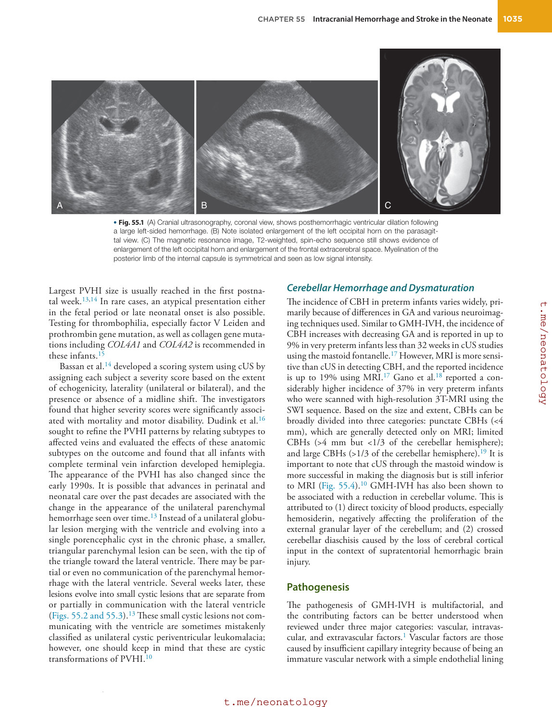

### Original source page 1040

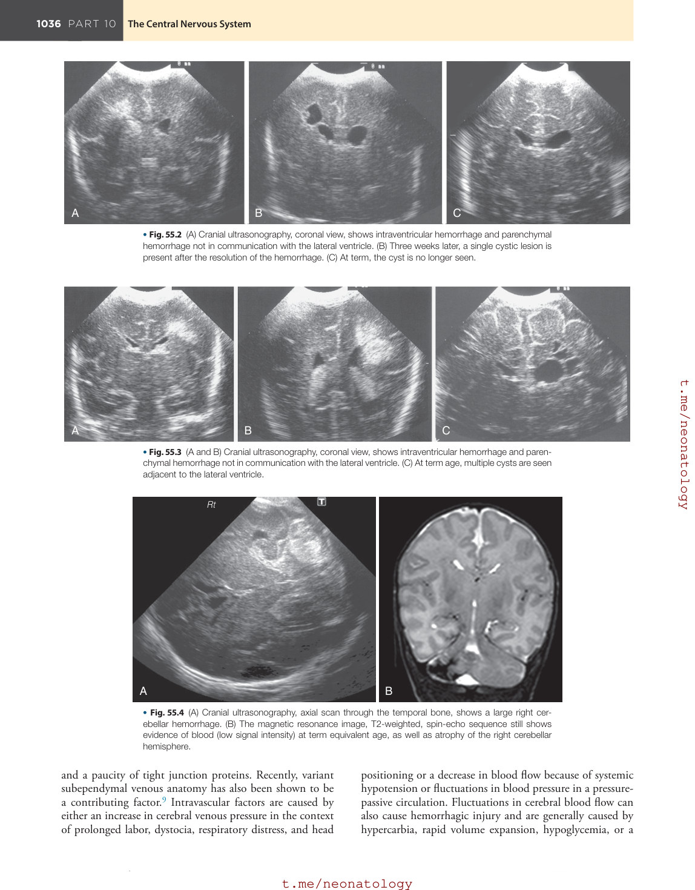

### Original source page 1044

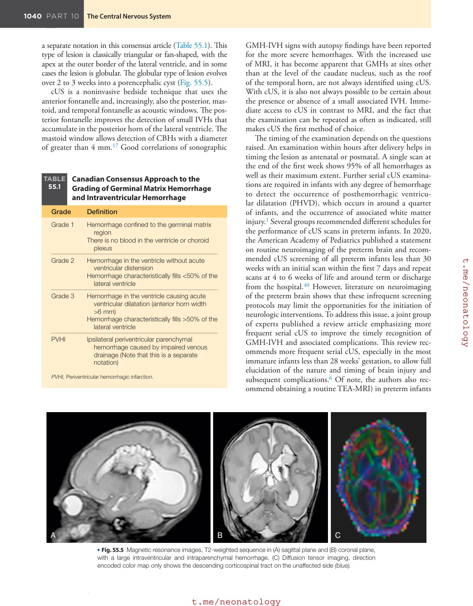

### Original source page 1045

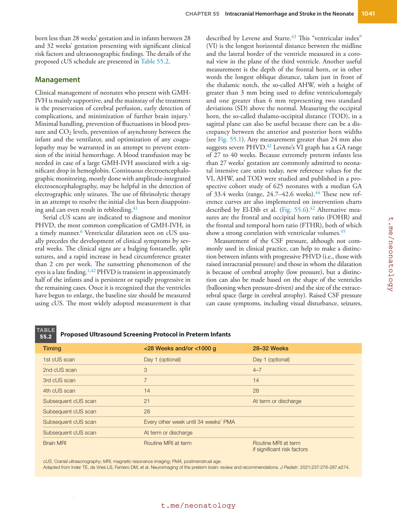

### Original source page 1046

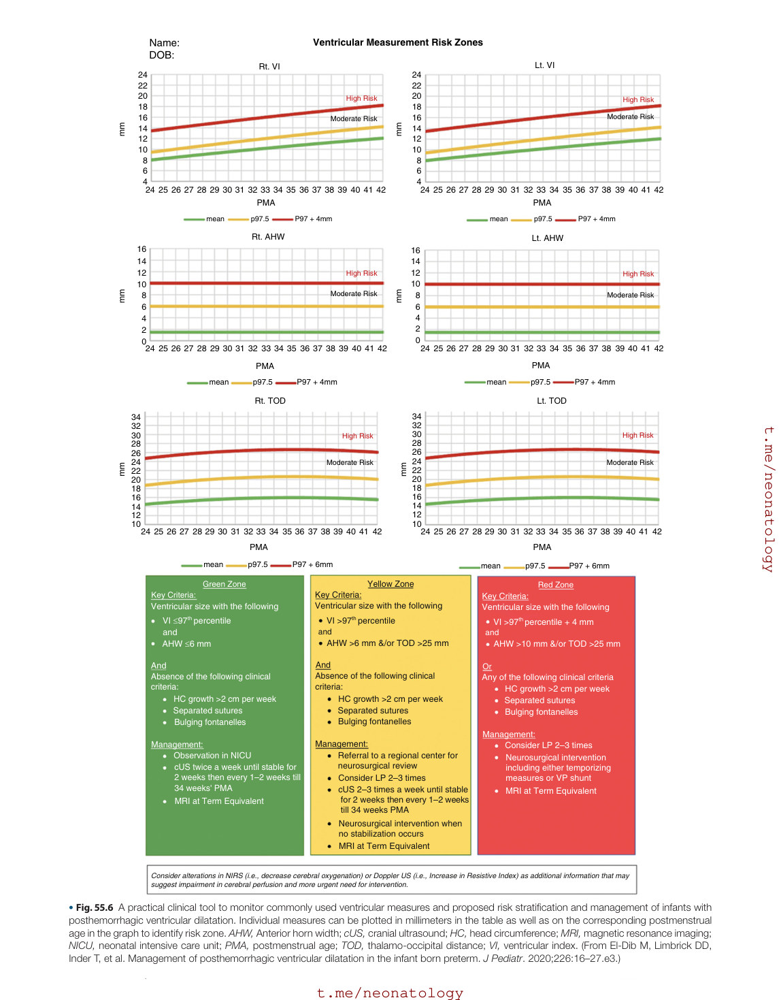

### Original source page 1051

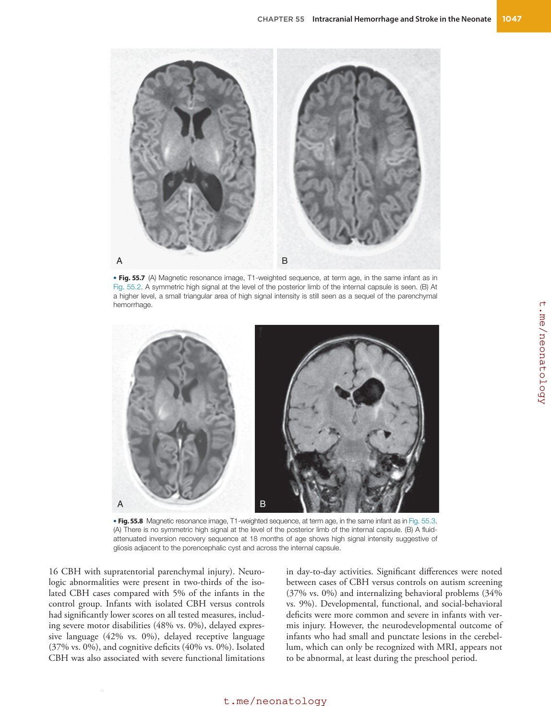

### Original source page 1053

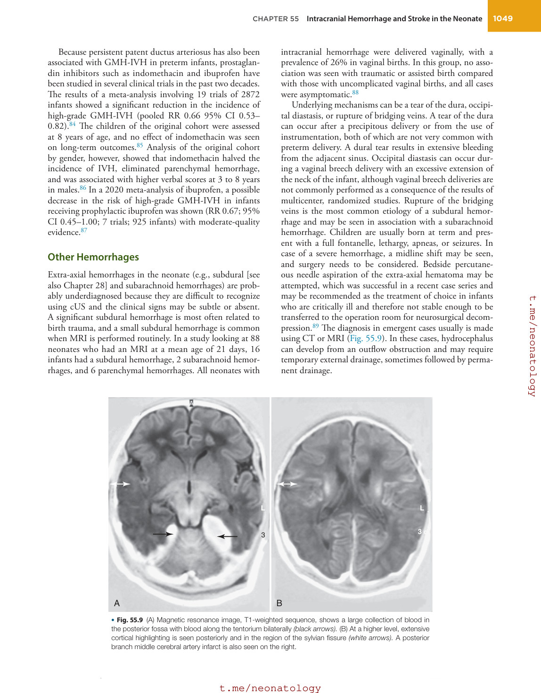

### Original source page 1055

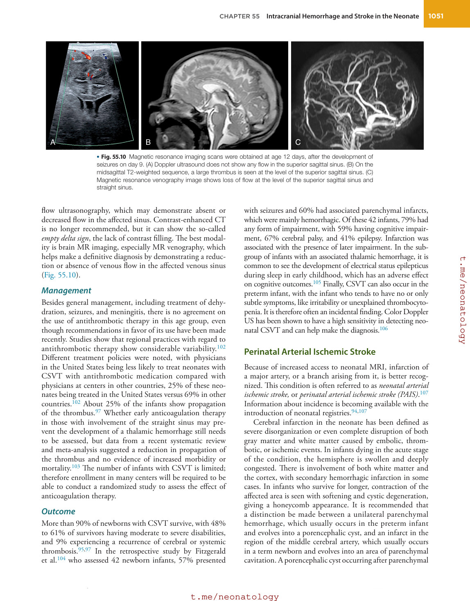

### Original source page 1057

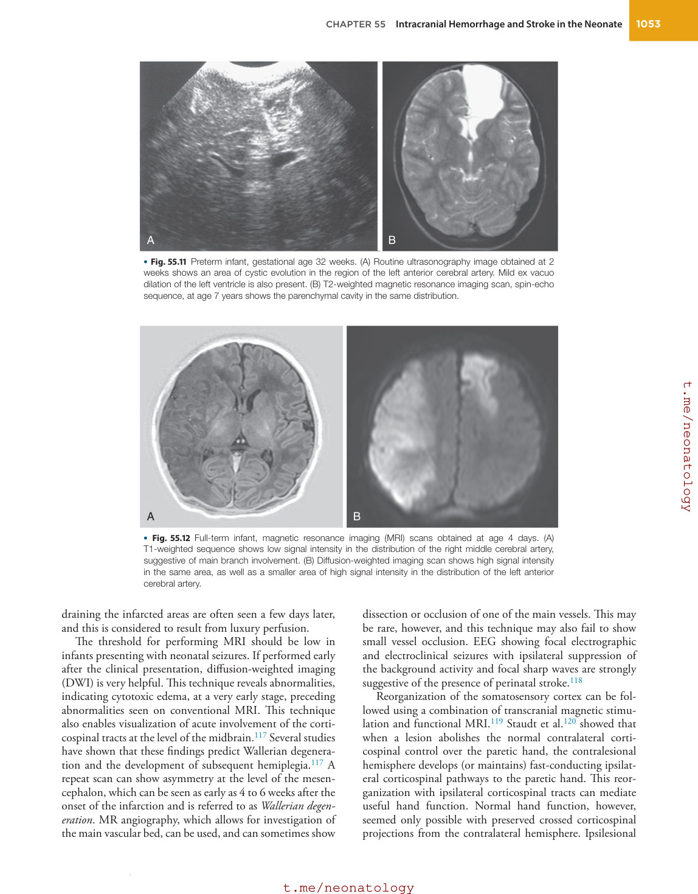
