# 64. Assessment of Neonatal Pulmonary Function
> [Source credits](../../SOURCE_CREDITS.md).

## Study pillars

### Grunting and lung volume

Expiratory braking that helps preserve functional residual capacity. Partial glottic closure retains gas and increases expiratory pressure; after intubation PEEP helps replace this mechanism.

PDF p. 1213

### Carbon dioxide clearance

Increased dead space. Gas trapping and overdistention can increase ineffective ventilation and reduce CO2 elimination.

PDF p. 1215

### Oximetry limitation

Large changes in PaO2 may produce little change in saturation. The flat upper dissociation curve limits discrimination of high arterial oxygen tensions.

PDF p. 1216

### Compliance

Compliance. Compliance relates volume change to pressure change; a stiffer system has lower compliance and greater elastance.

PDF p. 1219

### Time constants

Their resistance-compliance products differ. The time constant reflects resistance multiplied by compliance, with heterogeneous mechanics affecting equilibration.

PDF p. 1222

## Full source extraction

# 64. Assessment of Neonatal Pulmonary Function
> Source attribution: [Source credits](../../SOURCE_CREDITS.md).

## PDF page 1212 | printed page 1210

64 Assessment of Neonatal Pulmonary Function

### JULIANN M. DI FIORE, COLM P. TRAVERS, AND WALDEMAR A. CARLO

Most neonates requiring intensive care present with respiratory signs and symptoms. Although standard techniques for assessing pulmonary function can be applied in a healthy infant, special limitations and problems are encountered in very small or sick neonates. Methods have been developed to evaluate pulmonary function in neonates with suspected abnormalities of the cardiopulmonary system. This section presents a practical and clinical approach to disordered cardiopulmonary function and attempts to help distinguish between heart and lung disease.

### Clinical Observations

Five common physical signs relay indirect information regarding pulmonary function: respiratory rate, retractions, nasal flaring, grunting, and cyanosis.

### Respiratory Rate

Precise monitoring of respiratory rate is invaluable, as deviations from the normal respiratory patterns have been observed with mechanical pulmonary dysfunction, acid-base imbalances, and arterial blood gas abnormalities. During spontaneous breathing, infants can only achieve successful gas exchange within a limited range of respiratory rates. At low rates, decreased alveolar minute ventilation may occur, whereas at high rates and corresponding low tidal volumes (VT), a large proportion of the minute ventilation is wasted in ventilating dead space.

Infants may also adjust the respiratory rate to minimize the work of breathing. The total work of breathing consists of elastic and resistive components. The elastic component represents the work required to stretch the lungs and chest wall during a tidal inspiration, and the resistive component is the work required to overcome friction caused by lung tissue movement and gas flow through the airways. Healthy infants rely on tidal volumes of 6 to 7 mL/kg and approximate respiratory rates of 40 to 60 breaths per minute.

1210

However, during the first hour after birth, respiratory rates may be higher, with approximately 50% of healthy newborns having respiratory rates greater than 60 breaths per minute.1 Newborns with stiff lungs, such as those with respiratory distress syndrome (RDS), attempt to compensate for the increased workload with rapid shallow breathing, whereas patients with increased resistance (e.g., subglottic stenosis) usually exhibit slower and deeper breathing (Fig. 64.1). Periodic breathing is another pattern of irregular respiration manifesting during the first few months of life, initiated by chemoreceptor over-excitation resulting in central apnea followed by short cycles of breathing.2 Obstructed breaths

RR = 70–90 bpm VT = 8–10 mL RR = 20–30 bpm VT = 16–22 mL

Resistive

Inspiratory work of breathing

Resistive

RR = 40–60 bpm VT = 12–14 mL

### ELASTIC

Resistive

### ELASTIC

### ELASTIC

Premature infant (2 kg)

Infant with RDS ↓CL (2 kg)

Infant with subglottic stenosis ↑RL

(2 kg)

• Fig. 64.1 Relative contributions of the elastic and resistive components of the work of breathing in infants with normal pulmonary function, decreased lung compliance (CL), and increased lung resistance (RL). RDS, Respiratory distress syndrome; RR, respiratory rate; VT, tidal volume.

## PDF page 1213 | printed page 1211

often occur at the onset of each ventilatory cycle, indicating the presence of intermittent upper airway closure, as well.

### Retractions

The neonatal chest wall is extremely compliant, and substernal, subcostal, and intercostal retractions are readily observable even with a relatively minor derangement in lung mechanics. Retractions are caused by negative intrapleural pressure generated by the contraction of the diaphragm and other respiratory muscles and the mechanical properties of the lungs and chest wall. In neonates with respiratory distress, retractions become more apparent as the lungs become stiffer. Apart from their characteristic appearance in RDS and other pulmonary diseases, severe retractions can signal complications of respiratory disease such as airway obstruction, misplacement of an endotracheal tube, pneumothorax, or atelectasis (see Chapter 65). Decreased retractions in the presence of adequate inspiratory effort suggest that lung compliance or resistance is improving.

### Nasal Flaring

Nasal flaring is another sign of respiratory distress often observed in infants. The dilation of nostrils produced by contraction of the alae nasi muscles results in a marked reduction in nasal resistance. Because newborns are preferential nose breathers and because nasal resistance contributes substantially to total respiratory system resistance, nasal flaring markedly decreases the work of breathing. Nasal flaring is occasionally observed in the absence of other signs of respiratory distress, particularly during feeding and active sleep. Activation of other respiratory muscles, such as the genioglossus (tongue) and laryngeal muscles, is also important for optimal function of the upper airway. The genioglossus muscle protrudes the tongue and, in part, maintains pharyngeal patency, whereas the laryngeal muscles move the vocal cords and regulate airflow, particularly during expiration.

### Grunting

With normal breathing, the vocal cords abduct to enhance inspiratory flow. In some respiratory disorders and with initiation of air breathing after birth, neonates attempt to close (adduct) their vocal cords during the initial phase of expiration, holding gas in the lungs and producing an elevated transpulmonary pressure in the absence of airflow. The elevated pressure and corresponding increased lung volume result in enhancement of the ventilation/perfusion ratio (V̇/Q̇ ). During the last part of the expiratory phase, gas is expelled from the lungs against partially closed vocal cords, causing an audible grunt. Grunting may be either intermittent or continuous, depending on the severity of lung disease. Grunting can maintain functional residual capacity and partial pressure of arterial oxygen (PaO2) equivalent to the application of continuous distending pressure. Because

endotracheal intubation abolishes grunting, maintenance of lung volume with positive end-expiratory pressure (PEEP) is important following intubation.

### Cyanosis

Central cyanosis, best observed by examining the tongue and oral mucosa, is an important indicator of impaired gas exchange. Clinical detection of cyanosis depends on the total amount of desaturated hemoglobin. Thus patients with anemia may have a low PaO2 without clinically detectable cyanosis, and patients with polycythemia may be clinically cyanotic despite a normal PaO2. Peripheral cyanosis may be normal in neonates but also occurs in situations of decreased cardiac output. The clinical features of cyanosis and their significance are discussed in detail in Part 12, The Cardiovascular System.

### Cardiorespiratory Assessment

### Blood Gas Measurements

Maintaining optimal gas exchange is the primary function of the lung. Thus pulmonary evaluations should include blood gas estimates in addition to measurements of pulmonary mechanics. Both invasive and noninvasive blood gas measurements are available in the neonatal population. Invasive blood gas measurements are the optimal mode for accurate measures of oxygen and carbon dioxide, whereas noninvasive measurements are ideal for continuous documentation of the rapid changes that can occur in this population. Precipitous alterations begin with the initiation of the first breath after normal delivery, resulting in a rapid fall in the partial pressure of carbon dioxide (PaCO2) within minutes of birth. During this time, PaO2 rises quickly to levels of 60 to 90 mm Hg, although some degree of mismatching of V̇/Q̇ is evident during the first day after birth. This is believed to be the result of intracardiac and pulmonary right-to-left shunting. Data in larger groups of infants have characterized the increase in oxygenation following birth by way of pulse oximetry, allowing for further differentiation between preductal and postductal levels (Fig. 64.2).3 (See also Chapter 32.) The speed with which pulmonary ventilation and perfusion are uniformly distributed is an indication of the neonate’s remarkable capacity for maintaining homeostasis. During the early weeks of postnatal life, preterm infants are exceptionally unstable, requiring close monitoring of blood gas status. Pulse oximetry and blood gas measurements are the most widely used clinical methods for assessing pulmonary function in neonates and form the basis for diagnosis and management of cardiorespiratory disease.

### Invasive Blood Gas Measurements Partial Pressure of Alveolar Oxygen and Carbon Dioxide

Changes in partial pressure of alveolar oxygen (PaO2) and PaCO2 can identify disordered pulmonary function in

## PDF page 1214

* *

100

* * *

90

SpO2 (%)

80

Preductal Postductal

70

60

50 1 2 3 4 5 6 7 8

9 10 11 12 13 14 15

Minutes after birth

• Fig. 64.2 A rapid postnatal rise in oxygenation occurs during the normal fetal to neonatal transition. Preductal and postductal levels measured by way of pulse oximetry showed significantly lower postductal than preductal levels at 3, 4, 5, 10, and 15 minutes. *P < .05. SpO2, Oxygen saturation. (From Mariani G, et al. Pre-ductal and postductal O2 saturation in healthy term neonates after birth. J Pediatr. 2007;150:418.)

various clinical situations. PaO2 and PaCO2 values depend on the composition and volume of alveolar gas, the composition and volume of the mixed venous blood, and the mechanisms of pulmonary gas exchange impairment. Alveolar gas composition can be obtained from the following equation:

[

]

PaO2 = PiO2 −PaCO2

FiO2 + 1 −FiO2

R

Rwhere PiO2 is the partial pressure of inspired oxygen (PiO2 = FiO2 × [barometric pressure − water vapor pressure]). At sea level, barometric pressure is 760 mm Hg; at 100% humidity, water vapor pressure is 47 mm Hg. PaCO2 is the partial pressure of alveolar carbon dioxide, and R is the respiratory quotient (usually 0.8). The mechanisms of pulmonary gas exchange impairment include V̇/Q̇ mismatch, shunt, hypoventilation, and diffusion limitation. Appropriate matching of the alveolar gas with the mixed venous blood yields optimal gas exchange. Mixed venous blood composition and volumes are determined by the arterial blood gas content, cardiac output, oxygen consumption, and carbon dioxide production.

Techniques of blood gas determination in infants with RDS are discussed in Chapter 65. Gas exchange during assisted ventilation is discussed in Chapter 66. Acid-base physiology is discussed in Chapter 96.

### Partial Pressure of Arterial Oxygen

Depending on the efficacy of gas exchange, the alveolar oxygen partial pressure (tension) tends to equilibrate with the mixed venous blood, resulting in the PaO2, which determines the degree of oxygen saturation of hemoglobin. In addition to its chemical combination with hemoglobin, oxygen is also dissolved in plasma and red blood cells (RBCs). Most of the oxygen in whole blood is bound to hemoglobin (measured

100

°C ↓ pH ↑ PCO2 ↓ DPG ↓ °C ↑ pH ↓ PCO2 ↑ DPG ↑

20

80

% Oxygen saturation

15

Volume %

60

10

40

5

20

O2 dissolved in plasma

0

0

10 30 50 70 90 100 300 500

Oxygen tension (mm Hg)

• Fig. 64.3 Factors shifting the oxygen dissociation curve of hemoglobin. (Fetal hemoglobin is shifted to the left.) DPG, Diphosphoglycerate; PCO2, partial pressure of carbon dioxide.

clinically as oxygen saturation), whereas the amount of dissolved oxygen is only a small fraction of the total quantity carried in whole blood.

The quantity of oxygen bound to hemoglobin depends on the PaO2 and the oxygen dissociation curve (Fig. 64.3). The blood is almost completely saturated at a PaO2 of 90 to 100 mm Hg. The flattening of the upper portion of the S-shaped dissociation curve makes it virtually impossible to estimate oxygen tension greater than 60 to 80 mm Hg by using arterial oxygen saturation alone. The dissociation curve of fetal hemoglobin (compared with adult hemoglobin) is shifted to the left, and at any PaO2 less than 100 mm Hg, fetal blood binds more oxygen. The shift appears to be the result of the lower affinity of fetal hemoglobin for 2,3-diphosphoglycerate. Note that pH, PaCO2, temperature, and diphosphoglycerate (DPG) content influence the position of the dissociation curve.

The arterial oxygen content (CaO2) is the sum of hemoglobin-bound and dissolved oxygen, as described by the following equation:

CaO2 = (1.37×Hb×SaO2) + (0.003×PaO2)

where the arterial oxygen content is expressed in milliliters per 100 milliliters of blood, 1.37 is the approximate amount of oxygen (in mL) bound to 1 gram of hemoglobin at 100% saturation, Hb is the hemoglobin concentration (g/100 mL), SaO2 is the percentage of hemoglobin bound to oxygen, and 0.003 is the solubility factor of oxygen in plasma (mL/mm Hg). In this equation, the first term (1.37 × Hb × SaO2) is the amount of oxygen bound to hemoglobin. The second term (0.003 × PaO2) is the amount of oxygen dissolved in plasma and RBCs.

Most of the oxygen in the blood is carried by hemoglobin. For example, if an infant has a PaO2 of 80 mm Hg, an SaO2 of 99%, and a hemoglobin concentration of 15 g/100 mL, then CaO2 is the sum of oxygen bound to hemoglobin, (1.37 × 15 × 99)/100 = 20.3 mL, plus the oxygen dissolved in plasma, 0.003 × 80 = 0.24 mL. In this example, just over 1% of oxygen in blood is dissolved in plasma and almost 99% is carried by hemoglobin.

## PDF page 1215 | printed page 1213

The partial pressure of oxygen in arterial blood not only depends on the ability of the lungs to transfer oxygen as determined by alveolar ventilation but also is largely influenced by the V̇/Q̇ . For normal gas exchange, the ventilation and perfusion should be proportional. The ratio should be very close to 1:1; that is, for every milliliter of gas that passes the alveoli, there should be a proportional volume of blood in the pulmonary capillary bed. If the V̇/Q̇ is decreased (as in RDS), only partial oxygenation and CO2 removal from the mixed venous blood will occur. Oxygen supplementation can largely overcome the hypoxemia when the V̇/Q̇ is decreased. If the V̇/Q̇ is high, as in overventilation, the partial pressure of oxygen is increased slightly.

The mechanism of shunting becomes evident when blood bypasses the alveoli, as occurs in congenital cyanotic heart disease, persistent pulmonary hypertension, or atelectasis. Oxygen supplementation does not prevent the hypoxemia produced by such a shunt. Hypoventilation (e.g., caused by apnea) is a common cause of hypoxemia. Diffusion limitation can affect oxygenation slightly, but this mechanism is not a common cause of severe hypoxemia in neonates. Hypoxemia caused by either hypoventilation or diffusion limitation usually can be treated easily with oxygen supplementation.

Three indexes can be used to estimate the degree of oxygenation derangement (see Chapter 67). The arterial-alveolar oxygen tension ratio (PaO2/PAO2 or a/AO2 ratio) has no units, decreases with worsening oxygenation, and can be obtained from the following equation:

Pa P a/A P 1 Fi Pi Fi R R

O O ACO O O O

                

2 2

2 2 2 2

where R is the respiratory quotient. Because [FiO2 + (1 − FiO2)/R] approximates 1.0, and PACO2 approximates PaCO2, the equation can be simplified as follows:

        

2 2 2 2

P a/A O PaO / PiO – PaCO /R

The alveolar-arterial oxygen tension gradient (PAO2 − PaO2 or AaDO2) is expressed in mm Hg, increases with worsening oxygenation, and can be obtained from the equation

                   

2 2 2 2 2 2

1 FiO P A a O PiO PACO FiO PaO R

or



2 2 2 2

PaCO P )O (A – a Pi – O – PaO R

The oxygenation ratio (expressed in mm Hg) decreases with worsening oxygenation, and can be obtained from the following equation:

Oxygenation ratio = PaO2

FiO2

The oxygenation ratio is less often used because it is subject to inaccurate assessment of the oxygenation derangement when PaCO2 varies markedly. Often, it is necessary to correct the degree of oxygenation for the ventilatory support, because oxygenation is strongly influenced by mean airway pressure (Paw) during assisted ventilation. The oxygenation index (OI) is useful under these circumstances. The OI, which increases with worsening oxygenation or increasing Paw, has units of centimeters of water per mm Hg and can be obtained by the following equation:

OI = Paw×FiO2

PaO2 ×100

### Partial Pressure of Arterial Carbon Dioxide

PaCO2 is an important measure of pulmonary function in neonatal respiratory disease. Mechanisms responsible for impairment of pulmonary exchange of CO2 include hypoventilation, V̇/Q̇ mismatch, and shunt. In addition, an increase in dead space, as occurs with alveolar overdistention or gas trapping, impairs CO2 elimination. Because of the high solubility coefficient of CO2, diffusion limitation rarely affects CO2 exchange. As tissue levels of CO2 increase above those of arterial blood, molecules diffuse into the capillaries and are transported in RBCs and plasma. Unlike the S-shaped dissociation curve for O2, the relationship between CO2 tension and content is almost linear over the physiologic range.

### Noninvasive Blood Gas Measurements

See Chapter 37.

### Carbon Dioxide

Noninvasive estimates of CO2 by end-tidal or transcutaneous detectors provide a reasonable alternative to frequent blood gas sampling, allowing for continuous monitoring of CO2 over prolonged periods of time. End-tidal CO2 monitoring is a noninvasive technique that measures CO2 concentration in the gas at the end of expiration. Quantitative measurements of endtidal CO2 have been shown to correlate well with arterial blood gases in term and preterm infants without pulmonary disease and can be useful for detection of rapid changes in exhaled CO2 with data displayed on a breath-by-breath basis.4 When there is minimal pulmonary disease, quantitative end-tidal CO2 monitoring can assist in detection of hypercapnia and hypocapnia. With small tidal volumes and high respiratory rates, end-tidal CO2 may underestimate the true alveolar gas in some neonates. Alternative designs, such as disposable colorimetric end-tidal CO2 detectors, have a high diagnostic accuracy for confirmation of endotracheal tube placement.5 A positive end-tidal CO2 test confirms endotracheal tube placement, and a negative test strongly

## PDF page 1216

suggests esophageal intubation, but falsely negative results frequently occur at birth.6

Transcutaneous CO2 detectors are superior to end-tidal CO2 in ill neonates,4 but sensor preparation, taping, and the need for changes in sensor location may limit their usefulness. Despite the limitations of end-tidal and transcutaneous monitoring of CO2, these methods provide critically important continuous information pertaining to changes in the respiratory system and minimize the need for invasive blood gas sampling.

Several randomized controlled trials have evaluated allowing CO2 to rise to reduce lung injury. Evidence from these randomized controlled trials and meta-analyses indicates that a strategy of permissive hypercapnia using noninvasive respiratory support with continuous positive airway pressure (CPAP) instead of a conventional ventilatory approach reduces death or bronchopulmonary dysplasia (risk difference, −0.04; 95% confidence interval [CI], −0.08 to 0.00; number needed to treat = 25).7

### Oxygen

Maintenance of oxygenation in an acceptable range requires constant monitoring that is not possible with intermittent blood gas measurements. This has led to the widespread implementation of pulse oximetry as a means of continuous noninvasive O2 monitoring (see Chapter 37). Pulse oximetry measures the percentage of hemoglobin molecules that is bound with oxygen. It has a rapid response time and can be used as an estimate of PaO2 for detecting short intermittent hypoxic episodes. However, as shown by the oxyhemoglobin dissociation curve (see Fig. 64.3), oxygen saturation levels above 95% should be prevented in preterm infants requiring supplemental O2 to reduce the risk of hyperoxemia, as hyperoxic values of PaO2 cannot be distinguished beyond that range.

Pulse Oximetry: Optimal Oxygen Saturation Target Range

Studies combining pulse oximetry with automated adjustments in FiO2 show promise in maintaining oxygen levels within a desired range, mainly by reducing exposure to hypoxemia, but the ideal oxygen saturation target range is currently unknown.8 The avoidance of oxygen saturations greater than 95% in very preterm infants is generally accepted, as this target range has been associated with both increased pulmonary complications9 and retinopathy of prematurity (ROP). Five multicenter trials randomized ∼5000 extremely preterm infants to lower (85%–89%) versus higher (91%–95%) oxygen saturation targets; the Surfactant, Positive Pressure, and Oxygenation Randomized Trial (SUPPORT)10 and other trials were designed to identify the optimal oxygen saturation range. The metaanalyses showed a higher rate of death at 18 to 24 months’ corrected age (risk difference [RD] = 0.03, 95% CI, 0.01– 0.05; 4873 infants) and necrotizing enterocolitis, and a lower rate of ROP receiving treatment in the lower oxygen

saturation target group without important subgroup differences.11,12 Despite the increased risk of retinopathy in the higher target group, blindness and other visual outcomes were not affected.11 The combined outcome of death or major disability at 18 to 24 months’ corrected age and other major outcomes including patent ductus arteriosus receiving treatment did not differ between the treatment groups. Based on the findings, guidelines by professional societies and others in many countries have been updated accordingly to recommend targeting oxygen saturations in the low 90s.13

Pulse Oximetry: Screening for Critical Congenital Heart Disease

About 25% of infants with critical congenital heart disease (those who require surgery or catheter intervention during the first year of life) may not be symptomatic soon after birth and are only diagnosed after initial discharge from the newborn nursery unless the recommended oxygen saturation screening is performed. Multiple cohort studies have shown a reasonable detection rate of critical congenital heart disease with oxygen saturation screenings. A sensitivity of around 70% to 75% and specificity and negative predictive values of about 99.9% have been reported using a cutoff oxygen saturation of usually less than 95% at greater than 24 hours after birth as abnormal.14,15 The sensitivity is not higher because oximetry screening is less effective at identifying newborns with obstructive left heart lesions, including hypoplastic left heart syndrome, aortic stenosis, and coarctation of the aorta. Overall, pulse oximetry is highly specific for detection of critical congenital heart disease. Pulse oximetry newborn screening before hospital discharge is widely employed in the United States.

Pulse Oximetry: Perfusion Index

The perfusion index (PI), a noninvasive estimate of tissue perfusion, is obtained by comparing the pulsatile signal with the nonpulsatile signal of the oxygen saturation waveform.16 A perfusion index of less than or equal to 1.24 has been shown to be predictive of high illness severity in newborn infants.17

### Evaluation of Shunting

Desaturated blood from the right side of the heart enters the main pulmonary artery and crosses the ductus arteriosus to the descending aorta when right-to-left ductal shunting occurs. Because the ductus arteriosus almost always enters the aorta after the origin of the right subclavian and carotid arteries, blood arriving at these two sites is well oxygenated, whereas blood from the aorta, and usually the left subclavian artery, is less oxygenated if there is a right-to-left ductal shunt. Thus preductal blood gases can be obtained from the right radial artery, whereas blood in the descending aorta, and usually the left radial artery, can include blood of postductal origin. Alternatively, placement of two pulse

## PDF page 1217 | printed page 1215

oximeters (one on the right hand and the other on the left hand or either foot) also differentiates preductal and postductal PaO2 or oxygen saturation.

Patients with primary (or persistent) pulmonary hypertension of the newborn (PPHN) sometimes have right-toleft shunting through the foramen ovale and the ductus arteriosus. Ductal shunting can be demonstrated by the presence of a simultaneous oxygenation gradient between preductal and postductal arterial blood, whereas foramen ovale shunting affects both preductal and postductal oxygenation. Echocardiography can be used to confirm foramen ovale and ductal shunts.

### Hyperoxia-Hyperventilation Test

The hyperoxia test aids in differentiating between primary lung disease and congenital heart disease with right-to-left shunting. The test is performed by placing the infant in 100% oxygen for 5 to 10 minutes followed by monitoring oxygenation by arterial blood gas or noninvasive measures (see Chapter 65). In patients with primary lung disease, oxygen should diffuse into the poorly ventilated areas and improve oxygenation by 5-10 minutes of oxygen exposure. Persistent hypoxemia after this time period would suggest the presence of right-to-left shunting.

A modification of the hyperoxia test combining hyperoxia with hyperventilation can be used to distinguish between structural congenital heart disease and PPHN, both of which have right-to-left shunting. Inhalation of 100% oxygen improves oxygenation in some patients with PPHN. In response to hyperventilation with 100% oxygen (PaCO2, 25–30 mm Hg), more infants with PPHN achieve PaO2 levels higher than 100 mm Hg. In contrast, patients with anatomically fixed right-to-left shunting rarely generate a PaO2 well above 40 to 50 mm Hg, even with inhalation of 100% oxygen and hyperventilation.

### Respiratory Function

One of the principal functions of the first breaths is to transform the fluid-filled fetal lung from a gasless organ to one with an appropriate functional residual capacity (see Chapter 30). The ability of the lungs to maintain a volume of gas at end-expiration depends on two factors. One is the chest wall, which acts as a support for the lungs, and the other is surfactant, which stabilizes the expanded alveoli. These two factors are not well developed in the premature infant.

The mechanisms responsible for initiation of breathing probably include both environmental and physiologic stimuli. After delivery, the infant is exposed to a cold and tactile environment. In addition, interactions occur among pH, the partial pressure of oxygen (PO2), and the partial pressure of carbon dioxide (PCO2), whose contributions to inducing breathing in the human neonate have yet to be determined. Once initiated, the negative intrathoracic pressure of the first breath must overcome the effects of viscosity of fluid in the airway, surface tension, and tissue resistance.

Radiographic studies of the lung indicate that inflation with air occurs immediately with the first breath. Transient retention of lung fluid might underlie transient tachypnea of the newborn (see Chapter 67). Functional residual capacity is rapidly established, with little change throughout the first week of life.

### Physiologic Measurements

Tests of cardiopulmonary function performed on sick neonates can assist in diagnosis and treatment. Radiographic evaluation of the chest is an integral part of the diagnostic evaluation of respiratory disorders and is discussed in Chapter 38. Measurements of central venous and pulmonary artery pressures could indirectly give useful information regarding pulmonary function but are rarely available in the clinical neonatal setting. Knowledge of pulmonary mechanics may be useful in identifying disease entities and in guiding treatments, whereas plots of airflow, volume, and pressure may provide additional information on a breathby-breath basis.

### Airflow

Many devices are available for estimating airflow in infants. Noninvasive devices can be used for extended periods, yielding qualitative measurements of airflow that are sufficient for cardiorespiratory monitoring. These include devices to estimate chest wall expansion using electrical impedance, strain gauges, or respiratory inductive plethysmography and devices to estimate airflow at the nose by application of a thermistor, nasal cannula, or end-tidal CO2 detector. These devices can give approximations of tidal volume and information regarding the presence or absence of airflow and, when used in conjunction, can distinguish central from obstructive apnea. Respiratory inductive plethysmography is a noninvasive method that can be used to determine respiratory rate, timing, and asynchrony, as well as to estimate airflow and lung volumes. Precise quantitative measurements of airflow needed for the analysis of pulmonary mechanics require an alternative group of devices placed at the nose such as a pneumotachometer or hot-wire anemometer. The pneumotachometer is the gold standard for quantitative measurement of airflow. To accurately measure flow, all air must pass through the pneumotachometer. In a ventilated patient, the pneumotachometer can be attached to an endotracheal tube with leaks minimized by repositioning the infant, using a cuffed tube, or applying gentle pressure to the neck. In a spontaneously breathing infant, the pneumotachometer must be incorporated into a nasal or oral mask that is tightly sealed around the patient’s nose and mouth. The hot-wire anemometer may also become an alternate choice in the measurement of pulmonary mechanics, as improvements in hot-wire anemometer design continue in terms of accuracy and response time (see Chapter 37). After reliable measures of flow are acquired, the flow signal is integrated to calculate volume.

## PDF page 1218

### Lung Volume

The total volume of gas in the lungs and airways can be measured and subdivided into various volumes (Fig. 64.4). The size of the lung compartments is related to the height, weight, and surface area of the subjects. Functional residual capacity (FRC) is the volume of gas in the lungs that is in direct communication with the airways at the end of expiration. The volume of gas in the FRC serves as an oxygen storage compartment in the body and as a buffer so that large changes in alveolar gas tension are reduced. Helium dilution and nitrogen washout techniques have been adapted to measure FRC in infants. The helium dilution technique uses the equilibration between a known volume and concentration of helium and the lung volume to be measured. After gas mixing and equilibration, FRC is calculated using the initial and final concentration of the helium and the initial volume of helium. Similarly, FRC can be estimated by measuring the volume of nitrogen washout from the lungs when nitrogen-free gas is inhaled.

Thoracic gas volume is the total volume of gas in the thorax at the end of expiration and, in contrast to FRC, includes gas that is not in communication with the airways (e.g., gas in pulmonary interstitial emphysema [PIE]). Thoracic gas volume is calculated by measuring pressure and volume changes during respiratory efforts against an occluded airway while the infant is inside a body plethysmograph. With an inspiratory effort, the gas in the lungs expands, the lung volume increases, and the pressure or volume in the box

NORMAL 3-KG INFANT

IRV 64 mL

IC 80 mL

VC 120 mL

}

VT 16 mL

Physiologic dead space

ERV 40 mL

FRC 80 mL

RV 40 mL RV 40 mL

36 A

Respiratory rate/minute Dead space/tidal volume ratio Intraesophageal pressure difference (cm H2O) Compliance (mL/cm H2O) Resistance (cm H2O/liter/sec)

0.3 5

4.4

29 40 1440

Total work/breath (gm.cm) Total work/minute (gm.cm/min)

• Fig. 64.4 Partitioning of lung volumes and other measures of pulmonary function in a normal infant (A) and in an infant with respiratory distress syndrome (B). ERV, Expiratory reserve volume; FRC, functional residual capacity; IC, inspiratory capacity; IRV, inspiratory reserve volume; RV, residual volume; VC, vital capacity; VT, tidal volume. (From Avery M, et al, eds. The Lung and Its Disorders in the Newborn Infant. Philadelphia: Saunders; 1981.)

increases. Because the product of pressure and volume is constant, the pressure changes in the box can be used to determine the lung volume changes, which, when analyzed with the pressure changes in the airway, yield the thoracic gas volume.

Tidal volume, the volume of gas that moves in and out of the lungs during a single breath, can be measured with either a pneumotachometer or a plethysmograph. Vital capacity (the total gas capacity of the lungs) cannot be measured in infants because of lack of cooperation, but crying vital capacity, the maximum volume of air expired in a single breath during crying, has been used as an alternative estimation. Clinical estimation of the crying vital capacity has been used to estimate the severity of disease in respiratory disorders with decreased vital capacity such as RDS.

Dead space, the portion of volume not involved in gas exchange, varies with the incidence of areas of high V̇/Q̇ . The dead space is divided into several compartments. Anatomic dead space is the airway volume not involved in gas exchange and is made up of the air passages from nares to terminal bronchioles. Alveolar dead space is the volume of gas in alveoli that are well ventilated but underperfused. Physiologic dead space is the sum of anatomic and alveolar dead space. In the normal newborn, physiologic dead space is 6 to 8 mL; smaller values are obtained in premature infants. The relationship of dead space to tidal volume (VT) is normally about 0.3. It is important to minimize the dead space added by apparatus for assisted ventilation or

3-KG INFANT WITH RESPIRATORY DISTRESS

IRV 26 mL

IC 40 mL

}

VC 55 mL

VT 14 mL

ERV 15 mL FRC 40 mL

Physiologic dead space

RV 25 mL RV 25 mL

B

70 0.6 18 1.0 23 111 7770

## PDF page 1219 | printed page 1217

measurement of lung function to prevent rebreathing and inadvertent accumulation of carbon dioxide.

### Pressure

Measurements of pressure that produces lung inflation are essential for pulmonary function testing. There are two ways to measure pressure, with the location of the measurement defining the system. Pressure can be determined by placing an esophageal balloon or catheter into the distal third of the esophagus. This measurement reflects pleural or alveolar pressure and is referred to as transpulmonary pressure. The accuracy of this measurement should be verified by demonstrating the absence of a pressure gradient between the airway and esophageal pressure tracings during airway occlusion.

In the case of mechanically ventilated patients, pressure can be measured at the airway opening. This reflects pressure of the entire respiratory system. This is equivalent to pleural or alveolar pressure plus the pressure component due to the chest wall and is known as transrespiratory pressure. It is important to clarify the type of pressure measurement (transpulmonary vs. transrespiratory) when making comparisons of respiratory mechanics between studies. As transrespiratory pressure includes the additional pressure component due to the chest wall, measurements of transrespiratory resistance (described in the following section) will always be higher when compared to transpulmonary resistance.

### Respiratory Mechanics

The challenge of utilizing measures of respiratory mechanics in preterm infants in a clinical setting includes the large intersubject and intrasubject variability. The magnitude of both resistance and compliance may also be dependent on the algorithm chosen. More detailed descriptions of models used in newborn infants are provided in the following text.

### Compliance

Compliance is a measure of elasticity or distensibility (e.g., of the lungs, chest wall, or respiratory system) and is defined as

Compliance = ∆Volume

∆Pressure

Elastance is the reciprocal of compliance. Lung compliance is measured either dynamically or statically depending on the absence or presence of relaxation of the respiratory muscles. Dynamic lung compliance can be measured during spontaneous breathing using devices to measure VT and esophageal pressure as described earlier. With this method, dynamic lung compliance is calculated by dividing the change in VT by the corresponding change in esophageal pressure at points of no airflow (e.g., between end-inspiration and end-expiration). This is represented by the line drawn from point C to point A in Fig. 64.5. End-inspiration and end-expiration are used as quasi static points of

reference for pressure equilibration. At high respiratory rates or increased levels of resistance, pressure does not equilibrate between these two points, resulting in an underestimation of the true compliance.

Alternatively, static lung compliance can be calculated between points of no flow when the respiratory muscles are relaxed by employing occlusion of the airway. This allows for complete equilibration of pressure throughout the system. During the occlusion, static respiratory system compliance can be calculated by dividing the total exhaled volume by the pressure change during the occlusion minus the pressure at end-expiration (Fig. 64.6). An important advantage of this technique is that it does not require an esophageal balloon to measure pressure.

Both dynamic and static compliance, using a single occlusion, assume that compliance is constant throughout the breath. This may not be the case during periods of lung disease or overdistention of the lung during mechanical ventilation. Under these conditions, dynamic compliance underestimates the true compliance. True changes in compliance throughout a breath can be determined by expanding the single occlusion technique to include multiple brief interruptions during the expiratory phase of a breath, also known as the multiple-interruption technique (Figs. 64.7 and 64.8). Using this technique, a decrease in compliance can be seen with increasing pressure as the lung becomes overdistended. In mechanically ventilated infants, compliance measurements should be acquired at the same PEEP and peak inspiratory pressure (PIP) to obtain values at the same section of the pressure-volume curve.

Because lung elasticity depends on lung volume, changes in FRC can alter lung compliance. The degree of elasticity corrected for lung volume or patient size is referred to as specific compliance. Whereas specific lung compliance in the normal neonate (1–2 mL/cmH2O/kg) is comparable with that of the adult when corrected for unit body weight, compliance of the chest wall is relatively much higher in infants.

In addition to compliance, expiratory occlusion can also be used to determine the lung volume above the relaxation volume of the respiratory system (see Fig. 64.6). Expiratory volume clamping is a modification of the occlusion technique in which exhalation is prevented during several breaths at increasing lung volumes. After plotting the corresponding volumes and pressures acquired during each occlusion, the slope of the function represents the compliance of the respiratory system. In addition, the intercept along the volume axis represents the resting volume of the respiratory system.

In neonates, lung compliance is the most important component, because the chest wall is very distensible. Lung compliance is low at the initiation of the first breath even in normal newborns. With the establishment of breathing and with gradual clearance of lung fluid during the first 3 to 6 hours after birth, FRC increases with concomitant improvement in lung compliance. Pathophysiologic factors that can increase the amount of fluid or impede the clearance of lung fluid could delay this improvement. The variability

## PDF page 1220

60

C

F Expiration

50

40

Volume (mL)

D E B

30

20

10

Inspiration

A

0

0

2.5 5 7.5 10

Transpulmonary pressure (cm H2O)

### • Fig. 64.5 Dynamic lung compliance can be calculated as Δ volume/Δ pressure, as shown by the slope

of line AC. Work of breathing is represented as the area inside the section drawn by ABCFA. Resistance (using the Mead-Whittenberger technique) can be calculated as the change in pressure, shown by the difference between points D and B, divided by the change in flow, shown by the difference between points G and H at the same midvolume points.

1

20 20

1

VT

VT

0 10

mL

PaO

2

0

2

10

20

VT

3

0 10

PaO

0

5 10 FRC

PaO

3

FRC –Vr cm H2O

20

VT

0 10

Vr

PaO

0

1 sec

### • Fig. 64.6 Schematic representation (from actual records) of the

changes in lung volume (VT in milliliters) and airway pressure (PaO in cmH2O) during one spontaneous breath and occlusion of the airways during the expiratory phase of the following breath in a ventilated infant. Left, In the three examples shown, occlusion is performed (from top to bottom) at end-inspiration, in the first third of expiration, and in the last third of expiration. After the occlusions (indicated by arrows), PaO gradually rises to a plateau, corresponding to the recoil value of the respiratory system at that lung volume. Right, Plot of the changes in lung volume above the end-expiratory level (functional residual capacity [FRC]) against the corresponding changes in PaO as obtained in the left panel. The slope of the function represents the compliance of the respiratory system, the intercept on the PaO axis represents the internal recoil of the respiratory system at FRC, and the intercept of the VT axis represents the resting volume of the respiratory system (Vr). (From Mortola JP, et al. Measurements of respiratory mechanics in the newborn: a simple approach. Pediatr Pulmonol. 1987;3:123.)

of compliance values in the first 2 hours after birth, in part the result of physiologic variation, could account for the frequent observations of higher respiratory rates in some infants during this period.

60

Expiration

50

Volume (mL)

40

G H

30

20

10

Inspiration

0 –5

–2.5 0 2.5 5

Flow (L/min)

40

30

Volume (mL)

20

Single occlusion Interrupter

10

0 0 4 8 12 16

Pressure (cm H2O)

### • Fig. 64.7 A typical example of the volume-pressure relationships

obtained with both the interrupter and single occlusion techniques. Each point represents the compliance at that particular volume within the breath.

In distressed infants in whom lung compliance is markedly reduced, the compliant chest wall poses a disadvantage in that, as the infant attempts to increase negative intrathoracic pressure, the chest wall collapses (retracts). In addition, the more compliant neonatal airways could predispose the preterm infant to airway collapse during expiration and result in distal gas trapping.

### Resistance

Pulmonary resistance is a measure of the friction encountered by gas flowing through the nasopharynx, trachea, and bronchi and by tissue moving against tissue. The basic definition of resistance states

Resistance = ∆Pressure

∆Flow

Conductance is the reciprocal of resistance. Both airway resistance (the resistance caused by the airways) and viscous resistance (the resistance caused by tissues) contribute to total pulmonary resistance. The most commonly used algorithm to calculate resistance in commercial devices

## PDF page 1221 | printed page 1219

Airway pressure

25

(cm H2O)

0

Pressure

+10

(L/min) Tidal volume (mL)

Flow

0

Insp. ↑

Flow

–10

100

Volume

• Fig. 64.8 Illustration of data collected with the interrupter technique. The top channel is airway pressure proximal to the interrupter valve. The middle and bottom channels represent flow and volume, respectively. Compliance is calculated by dividing the volume above the end-expiratory level by the pressure during the occlusion. Resistance is calculated by dividing this pressure by the flow that preceded the interruption.

for infants is the multiple linear regression technique, also known as the equation of motion or Rohrer’s equation.

The equation of motion defines the relationship among pressure, flow, volume, and the elastic, resistive, and inertial components of the respiratory system. It is represented as

     

· ̈

1 P V R V I V C

where P is the pressure that produces lung inflation, C is compliance, V is volume, R is resistance, V̇ is flow, I is inertance, and V̇. is acceleration. Because the inertial component is considered negligible for clinical considerations, the equation of motion is further simplified with the inertial component often dropped from the equation. This equation assumes a linear relationship that is not usually the case in the preterm infant. Yet, although not optimal, as nonlinear models have not led to improvements in clinically applicable values for respiratory mechanics, the equation of motion continues to be the mode of choice in the clinical and research setting.

The Mead-Whittenberger technique uses the pressurevolume and flow-volume loops generated from pressure, volume, and flow waveforms. By convention, resistance is calculated by dividing the change in pressure by the change in flow at the midvolume point of the breath (see Fig. 64.5). Resistance can be measured at additional volumes throughout the breath by using the occlusion or multiple-interruption technique, as described earlier. In this case, resistance is calculated by dividing the pressure during the occlusion by the flow immediately preceding the occlusion (see Fig. 64.8). These points of pressure and flow can be plotted to represent resistance over a range of volumes throughout the breath. Furthermore, this technique can be used to partition the components of resistance into those due to airflow and those due to viscous tissue resistance.

1 second

The model-dependent effects on resistance for a single breath are shown in Fig. 64.9. The Mead-Whittenberger technique gives the resistance at one point during the breath at midvolume, which approximates peak inspiratory flow. This will correspond to the highest value for resistance for a given breath. The equation of motion uses linear regression to acquire the best fit corresponding to an average overall resistance for the breath. The multiple-interrupter technique can be used to reveal changes in resistance within the breath by plotting multiple pressure and flow points for each breath (where respiration = P/F at each point).

Possible conflicting values of resistance between multiple algorithms for the same breath are primarily due to the presence or absence of a turbulent flow pattern. During periods of low pressure, the frictional contribution of the airway walls is minimized, the corresponding flow regimen is laminar, and the assumption that resistance is constant throughout the breath holds true (see Fig. 64.9). Under these conditions, the deviation among techniques is minimized. As the pressure increases further, the frictional contribution of the airway walls and the divergence of flow caused by branching of the smaller airways are no longer negligible. During this time, the flow regimen changes from laminar to turbulent with a minimal increase in flow. In extreme cases, a point of flow limitation will occur where increasing pressure will be accompanied by no increase in flow. This is a common occurrence in both spontaneously breathing infants with lung disease and mechanically ventilated infants. During a turbulent flow regimen, resistance is no longer constant throughout the breath, and its measurements vary depending on the technique used. Although discrepancies among the algorithms have limited the application of resistance as a diagnostic tool in the clinical setting, useful information can be derived by using multiple techniques to compare breaths before and after an intervention. For example, a resistance measurement extrapolated

## PDF page 1222

8

6

Turbulent flow regimen

4

2

0

–2.5 –1.5 –0.5 –2

–1 –2

Expiration

–4

Pressure (cm H2O)

–6

–8

–10

–12

• Fig. 64.9 During a laminar flow regimen, resistance is constant throughout the breath, and discrepancies between various techniques of measuring resistance are minimized. As the flow regimen changes from laminar to turbulent, resistance is no longer constant throughout the breath and becomes flow dependent. During this time, values of resistance among the various techniques begin to diverge: A, Mead-Whittenberger (200 cmH2O/L/s); B, linear regression (152 cmH2O/L/s); C, nonlinear regression (32 cmH2O/L/s); and D, the linear portion of the curve (106 cmH2O/L/s). (From Di Fiore JM, et al. Respiratory function in infants. In: Haddad G, et al, eds. Basic Mechanisms of Pediatric Respiratory Disease. Toronto: Decker; 2002:165.)

from the linear portion of the pressure-flow curve will give information on changes in the mechanical structure of the airways (e.g., was there dilatation of the airway?). In contrast, resistance measurements during the nonlinear portion of the pressure-flow curve will provide information on changes in resistance caused by dynamic flow patterns (e.g., did increasing PIP result in more turbulence in the airway?).

### Time Constant

The time constant of the respiratory system is the duration (expressed in seconds) necessary for a step (e.g., pressure, volume) change to partially equilibrate throughout the lungs. A duration equivalent to one time constant allows for 63% of the equilibration of the change. Although one time constant is not a very useful parameter in the clinical environment, five time constants are equivalent to the amount of time needed for 99% equilibration of the system. This value can be useful in areas of patient care such as mechanical ventilation (see Chapter 66).

The time constant of the respiratory system can be calculated by using the relationship among the time constant, resistance, and compliance:

Time constant = Resistance × Compliance

Because both compliance and resistance are affected by different volumes and flows or by pulmonary disease, pulmonary mechanics change throughout the respiratory cycle, and a single time constant may not always accurately represent lung mechanics. However, for clinical purposes, linearity is assumed, and single values of compliance, resistance, and time constant usually suffice.

If resistance and compliance values are unknown, the time constant of the respiratory system can also be obtained from the flow-volume plot acquired during a passive

Inspiration A

C B

Laminar flow regimen

D

0.5 1 1.5 2

Flow (L/min)

Time constant = ∆V/∆F or 1/slope

4

3

2

1

Flow (L/min)

0 0 5 10 15 20

–1

Volume (mL)

–2

–3

–4

–5

Expiration

–6

• Fig. 64.10 The time constant of a breath can be represented by the change in volume divided by the change in flow during the expiratory phase of the breath.

exhalation. With this plot, 1/slope during the expiratory phase of the breath is equivalent to the time constant of the respiratory system (Fig. 64.10). Calculation of the time constant using the flow-volume curve assumes that the slope is linear throughout expiration. Flow limitation—as may occur with bronchoconstriction during expiration, postinspiratory activity of the respiratory muscles, or laryngeal adduction—can be identified by convexity toward the volume axis.18 In this case, calculations of a single time constant are no longer valid. Although a numerical value for the time constant cannot be accurately determined under these conditions, X-Y plots of flow and volume can be used to

## PDF page 1223 | printed page 1221

qualitatively characterize pulmonary function. Normal and abnormal flow-volume loops can be used to identify infants with airflow limitation patterns (Fig. 64.11).19

### Forced Expiratory Maneuvers

There is increased interest in long-term airway reactivity and wheezing in preterm infants.20 Measures of airway reactivity are most commonly quantified by the use of forced expiratory maneuvers. The maximal expiratory flow-volume

Flow

Expiration

0

Inspiration

A

Tidal volume

0

B

0

C

0

D

0

E

0

F • Fig. 64.11 Examples of the relationship between tidal flow and volume. (A) Normal lemon-shaped loop. (B) Ski-slope loop observed with expiratory airflow limitation as seen in babies with bronchopulmonary dysplasia. (C) Cigar-shaped loops observed in babies with extrathoracic airway obstruction with inspiratory and expiratory airflow limitation as seen in babies with subglottic stenosis or narrow endotracheal tubes. (D) Bun-shaped loop observed in babies with intrathoracic inspiratory airflow limitation as seen in babies with intraluminal obstruction (close to the carina) or an aberrant vessel compressing the trachea. (E) Crumpled loop as observed in babies with unstable airways or tracheomalacia. (F) Mountain-peaks loop, usually suggestive of an erratic airflow limitation as seen with airway secretions.

relationship can be measured in uncooperative infants by using a respiratory jacket or cuff placed around the chest and abdomen that is suddenly inflated at the end of lung inflation to produce rapid thoracoabdominal compression and forced expiratory flow. Alternatively, sudden exposure of the inflated lung to a negative pressure at the airway opening can be used to produce a forced deflation. During this maneuver, peak expiratory flow, maximal flow at 1 second (forced expiratory volume in the first second, or FEV1) or at FRC, and the patterns of flow-volume curves can be measured using a pneumotachograph. Flow-volume curves can be used to evaluate intrathoracic airway abnormalities and can detect flow limitation missed by the passive expiratory techniques.21

### Forced Oscillation Technique

The forced oscillation technique (FOT) has the advantage of assessing lung function in a noninvasive manner by applying external pressure or flow-based excitation superimposed on spontaneously breathing or mechanically ventilated infants under apneic conditions. The FOT presents a measure of respiratory system impedance (Z), encompassing a real (resistance) and imaginary (reactance) component, which together summarize the dissipative and energy-storing properties of the respiratory system.22 The FOT is feasible in infants; using the FOT, infants with transient tachypnea of the newborn had higher resistance and lower reactance compared to healthy term controls.23

### Electric Impedance Tomography

Electric impedance tomography is a noninvasive radiationfree continuous monitoring technique that can assess lung regional ventilation and perfusion patterns,24,25 but more clinical studies will determine its clinical utility.

### Work of Breathing

The work of breathing is a measure of the energy expended in inflating the lungs and moving the chest wall. In general terms, work is the cumulative product of pressure and the volume of gas moved at each instant. In the normal infant, total pulmonary work has been determined to equal an average value of 1440 g/cm/min. In an infant with respiratory distress, the total pulmonary work can increase as much as sixfold. This becomes most important when considered in terms of the oxygen cost of breathing. The neonate requires a higher caloric expenditure to breathe than does the adult, and the distressed infant requires an even higher caloric expenditure for this function. In the full-term infant, the work of breathing is minimal when the infant has a respiratory rate of 30 breaths per minute. The pressure-volume loop can be used to calculate work of breathing as represented by the area inside the section drawn by ABCFA in Fig. 64.5.

### Limitations

Before any measurements of pulmonary function can be made, a clear understanding of equipment performance is

## PDF page 1224

needed. Although beyond the scope of this chapter, adherence to these guidelines ensures that lung function measurements can be precise and reproducible. When data have been acquired, a multitude of algorithms for measuring pulmonary mechanics is available. A review of the techniques for measuring pulmonary mechanics and function has been published by the American Thoracic Society and the European Respiratory Society.22

Because various algorithms yield different results for the same breath, a wide range of published values for any given patient population has resulted, making it difficult to define ranges for comparison between normal and diseased states. Compounding the issue is the large intrasubject variability of compliance and resistance, which is minimized during mechanical ventilation. This is most likely caused by muscle relaxation and reduced fluctuations in respiratory rate and tidal volume compared with spontaneous respiration.

During mechanical ventilation, leaks around the endotracheal tube, a common occurrence in the neonatal intensive care unit setting, can result in overestimation of resistance and underestimation of elastance. This error is minimized during the expiratory phase of the breath. Given these limitations, measurements of resistance and compliance during the expiratory phase of mechanical breaths with a leak of less than 10% should give the most precise and reproducible values.

Additional confounders that affect respiratory mechanics include sleep state,26 posture,27 endotracheal tube size,28 FRC,29 gender,30 race, and respiratory patterns.31 Errors in data calculation or interpretation can also occur if there are no compensatory modifications in mechanical ventilator settings in response to changes in lung function. This can occur because of overdistention of the lung as compliance improves in response to therapy if PIP is not decreased accordingly. As pressure-volume and flow-volume curves become more readily available on mechanical ventilators, they may become a useful tool, with or without measurements of respiratory mechanics, in distinguishing changes in pulmonary function. Fig. 64.12 shows a simulation of a pressure-volume curve for a mechanically ventilated infant before and after surfactant administration with no change in peak inspiratory pressure. A numerical representation for dynamic compliance would show no change in compliance in response to surfactant administration. In contrast, visualization of the graph reveals improvement in compliance at low pressures, but overdistention of the lung at high pressures as the peak inspiratory pressure was not decreased.

### Clinical Applications

The goal of respiratory support is to optimize oxygenation and CO2 elimination with the lowest possible ventilator settings to minimize lung injury. The use of pulmonary function testing can be a valuable tool in achieving this goal and reducing the incidence of barotrauma. Visualization of pressure-volume curves and measurements of compliance can be used to identify excessive PIP or PEEP leading to

Volume

Before surfactant After surfactant

Pressure

• Fig. 64.12 A representation of the change in compliance in response to surfactant administration. Note that dynamic compliance, as represented by the line, reflects no change. In contrast, visualization of the graph shows improvement in compliance at low volumes and overdistention of the lung after surfactant administration, indicating the need to decrease peak inspiratory pressure.

lung overdistention32 and to distinguish between alveolar collapse and overdistention in determining the most advantageous PEEP.33 Identification of periods with high compliance and low resistance can also improve the likelihood of extubation success in infants recovering from RDS.

Pulmonary function measurements have been used to assess mechanical effects of pharmacologic interventions. For example, albuterol inhalation has been successful in decreasing pulmonary resistance in ventilated preterm babies, and surfactant results in rapid improvement of gas exchange with beneficial effects on dynamic compliance.34 There is currently no evidence that nitric oxide (NO) leads to improvement in baseline respiratory mechanics.35,36 However, infants who received inhaled NO for PPHN had maximal expiratory flows comparable to those who were treated with extracorporeal membrane oxygenation (ECMO), but still lower flows than control subjects.37 Inhaled NO to prevent bronchopulmonary dysplasia (BPD) resulted in decreased need for bronchodilator therapy at 1 year of age, suggesting beneficial effects on airway reactivity.38 Antenatal steroids increase lung compliance39,40 and FRC,40 although there is a diminished response to antenatal steroids if delivery occurs more than 7 days after therapy.41 Last, diuretics and methylxanthines enhance lung function.42,43 Interestingly, improvements in resistance and compliance did not always correlate with better oxygenation.42

Respiratory mechanics have been employed in longitudinal studies to evaluate the clinical course of pulmonary diseases. The occurrence of meconium aspiration syndrome during infancy was associated with alveolar hyperinflation and airway hyperreactivity to exercise at 7 ± 2 years of age.44 Measurements of pulmonary mechanics at 1-year follow-up showed no difference between survivors in trials

## PDF page 1225 | printed page 1223

of high-frequency ventilation versus conventional ventilation.45,46 However, during adolescence, former preterm infants who were randomized to high-frequency oscillatory ventilation had improved respiratory function in several measures, including FEV1, forced vital capacity, peak expiratory flow, diffusing capacity, and impulse-oscillometric findings.47

Hypoxemic respiratory failure has been linked with an increased risk for impaired pulmonary function, particularly in the presence of congenital diaphragmatic hernia or ECMO.48 Decreases in FRC, compliance, and conductance have been shown to be predictive of BPD,19,49,50 with gradual improvements in this cohort as the lungs grow.51,52 Therapeutic agents in evolving or established BPD (e.g., diuretics, bronchodilators, and steroids) have short-term benefits on resistance and compliance, but potential adverse side effects limit their use in neonates.53 Because BPD is a manifestation of prolonged oxygen exposure or barotrauma, pulmonary function measurements and graphical displays may be most helpful in this area to minimize ventilator settings and duration of ventilatory support.

Evidence suggests that preterm birth without development of BPD may have long-term adverse effects on pulmonary function. For example, former preterm infants have deficits in FEV1 into childhood and adolescence.54,55 Even children born moderate or late preterm who never developed BPD had abnormalities in pulmonary function,

Key Points

• Methods developed to evaluate pulmonary function in

neonates include physical signs, cardiovascular assessment, and physiologic measurements. • Pulse oximetry and blood gas measurements are the most

widely used clinical methods for assessing pulmonary function in neonates and form the basis for diagnosis and management of cardiorespiratory disease. • Knowledge of pulmonary mechanics may be useful in

identifying disease entities and in guiding treatments,

### References

1. Kelleher J, Bhat R, Salas AA, et al. Oronasopharyngeal suctioning

versus wiping the mouth and nose at birth: a randomized equivalency trial. Lancet. 2013;382:326–330. 2. Patel M, Mohr M, Lake D, et al. Clinical associations with imma-

ture breathing in preterm infants: part 2-periodic breathing. Pediatr Res. 2016:8028–8034. 3. Mariani G, Dik PB, Ezquer A, et al. Pre-ductal and post-ductal

O2 saturation in healthy term neonates after birth. J Pediatr. 2007;150:418–421. 4. Molloy EJ, Deakins K. Are carbon dioxide detectors useful in

neonates? Arch Dis Child Fetal Neonatal Ed. 2006;91:F295– F298. 5. Wyllie J, Carlo WA. The role of carbon dioxide detectors for

confirmation of endotracheal tube position. Clin Perinatol. 2006;33:111–119.

wheezing, and asthma56–58 with evidence of peripheral airway obstruction.59 Pulmonary function testing in children born preterm independent of BPD showed persistent abnormalities in clinical moderate expiratory flow obstruction even into adulthoood.60,61 Over 50% of children born at less than 26 weeks of gestation continue to have abnormal spirometry as preadolescents.62 Many have asthma and respond to bronchodilators. Some survivors with BPD followed longitudinally continue to have poor improvement in lung function.63

Increased pulmonary arterial resistance is also common during infancy in infants who develop BPD. However, survivors of BPD have comparable right and left ventricular function at 8 to 12 years of age when compared to preterm and term children without evidence of increased pulmonary arterial pressure even after hypoxic exposure.64 Decreased cardiorespiratory fitness can persist into adolescence and adulthood in former preterm infants.65

Even with the current limitations in methodology and confounders in the area of pulmonary function, diagnostic evaluations can be a useful tool in neonatal patient care. Ideally, clinical evaluation should include both numerical values for resistance and compliance in addition to visualization of flow-volume, pressure-volume, and pressure-flow curves. Application of these tools for pulmonary function measurements should complement clinical assessment in the care of infants with pulmonary disorders.

whereas plots of airflow, volume, and pressure may provide additional information on a breath-by-breath basis. • Forced expiratory maneuvers are sensitive to pulmonary

dysfunction after BPD as many children continue to have expiratory flow limitation. Forced oscillation and electric impedance tomography are promising innovative noninvasive techniques that are now being tested in neonates and may become useful to assess pulmonary function.

6. Schmölzer GM, Poulton DA, et al. Assessment of flow waves and

colorimetric CO2 detector for endotracheal tube placement during neonatal resuscitation. Resuscitation. 2011;82:307–312. 7. Schmölzer GM, Kumar M, et al. Non-invasive versus invasive

respiratory support in preterm infants at birth: systematic review and meta-analysis. BMJ. 2013;347:f5980. 8. Bancalari E, Claure N. Control of oxygenation during mechanical

ventilation in the premature infant. Clin Perinatol. 2012;39:563–572. 9. Askie LM, Henderson-Smart DJ, et al. Oxygen-saturation tar-

gets and outcomes in extremely preterm infants. N Engl J Med. 2003;349:959–967. 10. Carlo WA, Finer NN, Walsh MC, et al. Target ranges of oxygen satu-

ration in extremely preterm infants. N Engl J Med. 2010;362:1959– 1969. 11. Askie LM, Darlow BA, Davis PG, et al. Effects of targeting lower

versus higher arterial oxygen saturations on death or disability in preterm infants. Cochrane Database Syst Rev. 2017;4:CD011190.

## PDF page 1226

12. Askie LM, Darlow BA, Finer N, et al. Association between oxy-

gen saturation targeting and death or disability in extremely preterm infants in the neonatal oxygenation prospective metaanalysis collaboration. JAMA. 2018;319:2190–2201. 13. Tarnow-Mordi W, Kirby A. Current Recommendations and

Practice of Oxygen Therapy in Preterm Infants. Oxygen Therapy, Clinics of Perinatology. Vol. 46. Philadelphia: Elsevier; 2019: 621–636. 14. Mahle WT, Newburger JW, Matherne GP, et al. Role of pulse

oximetry in examining newborns for congenital heart disease: a scientific statement from the American Heart Association and American Academy of Pediatrics. Circulation. 2009;120:447– 458. 15. Thangaratinam S, Brown K, et al. Pulse oximetry screening for

critical congenital heart defects in asymptomatic newborn babies: a systematic review and meta-analysis. Lancet. 2012;379:2459– 2464. 16. Sahni R, Schulze KF, et al. Interactions among peripheral per-

fusion, cardiac activity, oxygen saturation, thermal profile and body position in growing low birth weight infants. Acta Paediatr. 2010;99:135–139. 17. De Felice C, Latini G, et al. The pulse oximeter perfusion index

as a predictor for high illness severity in neonates. Eur J Pediatr. 2002;161:561–562. 18. Tepper RS, Morgan WJ, et al. Expiratory flow limitation in infants

with bronchopulmonary dysplasia. J Pediatr. 1986;109:1040– 1046. 19. Bhutani VK, Sivieri EM. Clinical use of pulmonary mechanics

and waveform graphics. Clin Perinatol. 2001;28:487–503. 20. Blanken MO, Rovers MM, Molenaar JM, for the Dutch

RSV Neonatal Network, et al. Respiratory syncytial virus and recurrent wheeze in healthy preterm infants. N Engl J Med. 2013;368:1791–1799. 21. Peterson-Carmichael S, Seddon PC, Cheifetz IM, et al. An offi-

cial American Thoracic Society workshop report: evaluation of respiratory mechanics and function in the pediatric and neonatal intensive care units. Ann Am Thorac Soc. 2016;13(2):S1–S11. 22. Sly PD, Tepper R, et al. Tidal forced expirations. ERS/ATS Task

Force on Standards for Infant Respiratory Function Testing. European Respiratory Society/American Thoracic Society. Eur Resp. 2000;16:741–748. 23. Klinger AP, Travers CP, Martin A, et al. Non-invasive forced

oscillometry to quantify respiratory mechanics in term neonates. Pediatr Res. 2020;88:293–299. 24. Bachmann MC, Morais C, Bugedo G, et al. Electrical impedance

tomography in acute respiratory distress syndrome. Crit Care. 2018;22:263. 25. Tingay DG, Waldmann AD, et al. Electrical impedance tomog-

raphy can identify ventilation and perfusion defects: a neonatal case. Am J Respir Crit Care Med. 2019;199:384–386. 26. Pratl B, Steinbrugger B, et al. Effects of sleep stages on measure-

ments of passive respiratory mechanics in infants with bronchiolitis. Pediatr Pulmonol. 1999;27:273–277. 27. Bhat RY, Leipӓlӓ JA, Singh NRP, et al. Effect of posture on oxy-

genation, lung volume, and respiratory mechanics in premature infants studied before discharge. Pediatrics. 2003;112:29–32. 28. Manczur T, Greenough A, et al. Resistance of pediatric and neo-

natal endotracheal tubes: influence of flow rate, size and shape. Crit Care Med. 2000;28:1595–1598.

29. Gerhardt T, Reifenberg L, et al. Functional residual capacity in

normal neonates and children up to 5 years of age determined by an N2 washout method. Pediatr Res. 1986;20:668–671. 30. Stocks J, Henschen M, et al. Influence of ethnicity and gender on

airway function in preterm infants. Am J Respir Crit Care Med. 1997;156:1855–1862. 31. Galal MW, Habib RH, et al. Effects of rate and amplitude of

breathing on respiratory system elastance and resistance during growth of healthy children. Pediatr Pulmonol. 1998;25:270–277. 32. Fisher JB, Mammel MC, et al. Identifying lung overdistention

during mechanical ventilation by using volume-pressure loops. Pediatr Pulmonol. 1988;5:10–14. 33. Bartholomew KM, Brownlee KG, et al. To PEEP or not to PEEP?

Arch Dis Child Fetal Neonatal Ed. 1994;70:F209–F212. 34. Raffay TM, Brasher M, Place BC, et al. Response to first dose of

inhaled albuterol in mechanically ventilated preterm infants. J Perinatol. 2021;41:1704–1710. 35. Athavale K, Claure N, et al. Acute effects of inhaled nitric oxide

on pulmonary and cardiac function in preterm infants with evolving bronchopulmonary dysplasia. J Perinatol. 2004;24:769–774. 36. Di Fiore JM, Hibbs AM, Zadell AE, et al. The effect of inhaled

nitric oxide on pulmonary function in preterm infants. J Perinatol. 2007;27:766–771. 37. Hoskote AU, Castle RA, Hoo AF, et al. Airway function in

infants treated with inhaled nitric oxide for persistent pulmonary hypertension. Pediatr Pulmonol. 2008;43:22435. 38. Hibbs AM, Walsh MC, Martin RJ, et al. One-year respiratory

outcomes of preterm infants enrolled in the nitric oxide (to prevent) chronic lung disease trial. J Pediatr. 2008;153:525–529. 39. Go M, Schilling D, Nguyen T, et al. Respiratory compliance in

late preterm infants (340/7-346/7 weeks) after antenatal steroid therapy. J Pediatr. 2018;201:21–26. 40. McEvoy C, Bowling S, et al. Functional residual capacity and

passive compliance measurements after antenatal steroid therapy in preterm infants. Pediatr Pulmonol. 2001;31:425–430. 41. McEvoy C, Schilling D, et al. Decreased respiratory compli-

ance in infants less than or equal to 32 weeks gestation, delivered more than 7 days after antenatal steroid therapy. Pediatrics. 2008;121:e1032–e1038. 42. Englehardt B, Elliott S, et al. Short- and long-term effects of

furosemide on lung function in infants with bronchopulmonary dysplasia. J Pediatr. 1986;109:1034–1039. 43. Kao LC, Durand DJ, et al. Oral theophylline and diuretics

improve pulmonary mechanics in infants with bronchopulmonary dysplasia. J Pediatr. 1987;111:439–444. 44. Djemal N, Ammar HB, Masmoudi K, et al. Pulmonary function

in children after neonatal meconium aspiration syndrome. Arch Pediatr. 2008;15:105–110. 45. The HIFI Study Group. High frequency oscillatory ventilation

compared with conventional mechanical ventilation in treatment of respiratory failure in preterm infants: assessment of pulmonary function at 9 months of corrected age. J Pediatr. 1990;116:933– 941. 46. Thomas MR, Rafferty GF, Limb ES, et al. Pulmonary function

at follow-up of very preterm infants from the United Kingdom oscillation study. Am J Respir Crit Care Med. 2004;169:868–872. 47. Zivanovic S, Peacock J, Alcazar-Paris M, et al. Late outcomes of

a randomized trial of high-frequency oscillation in neonates. N Engl J Med. 2014;370:1121–1130.

## PDF page 1227 | printed page 1225

48. Majaesic CM, Jones R, et al. Clinical correlations and pulmonary

function at 8 years of age after severe neonatal respiratory failure. Pediatr Pulmonol. 2007;42:829–837. 49. Goldman SL, Gerhardt T, Sonni R, et al. Early prediction of

chronic lung disease by pulmonary function testing. J Pediatr. 1983;102:613–617. 50. Lui K, Lloyd J, et al. Early changes in respiratory compliance

and resistance during the development of bronchopulmonary dysplasia in the era of surfactant therapy. Pediatr Pulmonol. 2000;30:282–290. 51. Gerhardt T, Hehre D, et al. Serial determination of pulmo-

nary function in infants with chronic lung disease. J Pediatr. 1987;110:448–456. 52. Schmalisch G, Wilitzki S, et al. Development of lung functions

in very low birth weight infants with or without bronchopulmonary dysplasia: longitudinal assessment during the first 15 months of corrected age. BMC Pediatr. 2012;12:37. 53. Greenough A, Pahuja A. Updates on functional characterization

of bronchopulmonary dysplasia—the contribution of lung function testing. Front Med. 2015;2:35. 54. Kotecha SJ, Edwards MO, Watkins WJ, et al. Effect of preterm

birth on later FEV1: a systematic review and meta-analysis. Thorax. 2013;68:760–766. 55. Thunqvist P, Gustafsson PM, Schultz ES, et al. Lung function at

8 to 16 years after moderate-to-late preterm birth: a prospective cohort study. Pediatrics. 2016;137:e20152056. 56. Boyle EM, Poulsen G, Field DJ, et al. Effects of gestational age

at birth on health outcomes at 3 and 5 years of age: population based cohort study. BMJ. 2012;344:e896.

57. Kotecha SJ, Watkins WJ, Paranjothy S, et al. Effect of late pre-

term birth on longitudinal lung spirometry in school age children and adolescents. Thorax. 2012;67:54–61. 58. Yaacoby-Bianu K, Plonsky MT, et al. Effect of late preterm birth

on lung clearance index and respiratory physiology in school-age children. Pediatr Pulmonol. 2019;54:1250–1256. 59. Er I, Gunlemez A Uyan ZS, et al. Evaluation of lung function on

impulse oscillometry in preschool children born late term. Pediatr Int. 2016;58:274–278. 60. Filbrun AG, Popora AP, et al. Longitudinal measures of lung

function in infants with bronchopulmonary dysplasia. Pediatr Pulmonol. 2011;46:369–375. 61. Molgat-Seon Y, Dominelli PB, Peters CM, et al. Analysis of max-

imal expiratory flow-volume curves in adult survivors of preterm birth. Am J Physiol Regul Integr Comp Physiol. 2019;317:R588– R596. 62. Fawke J, Lum S, Kirby J, et al. Lung function and respiratory

symptoms at 11 years in children born extremely preterm: the EPICure study. Am J Respir Crit Care Med. 2010;182:237–245. 63. Levin JC, Sheils CA, et al. Lung function trajectories in children

with post-prematurity respiratory disease; identifying risk factors for abnormal growth. Respir Res. 2021;10:143. 64. Suchita J, Wilson DG, et al. Cardiovascular function in children

who had chronic lung disease of prematurity. Arch Dis Child Fetal Neonatal Ed. 2014;99:F373–F379. 65. Ferreira I, Gbatu PT, et al. Gestational age and cardiorespiratory

fitness in individuals born at term: a life course study. J Am Heart Assoc. 2017;6:e006467.

<!-- SOURCE_LAYOUT_VIEWS -->

## Original layout views and recovered diagrams

Automatic extraction can flatten tables and superscripts. Check the original layout for numeric data, footnotes and image credits. [Source review notes](../../SOURCE_REVIEW_NOTES.md).

### Original source page 1212

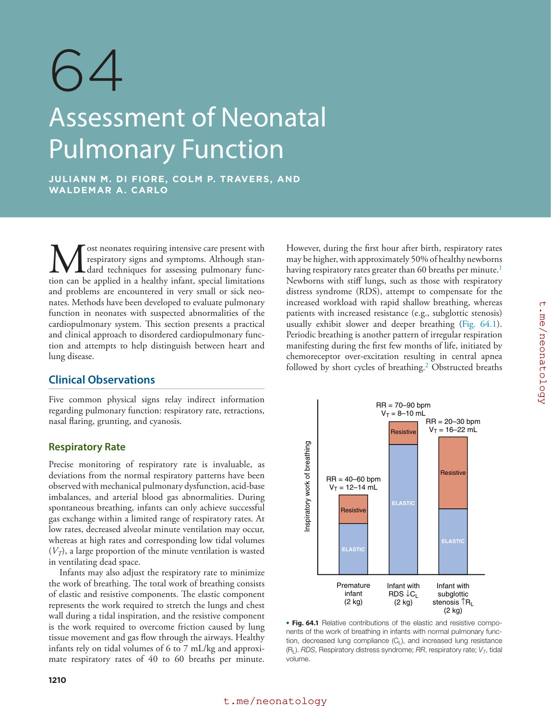

### Original source page 1214

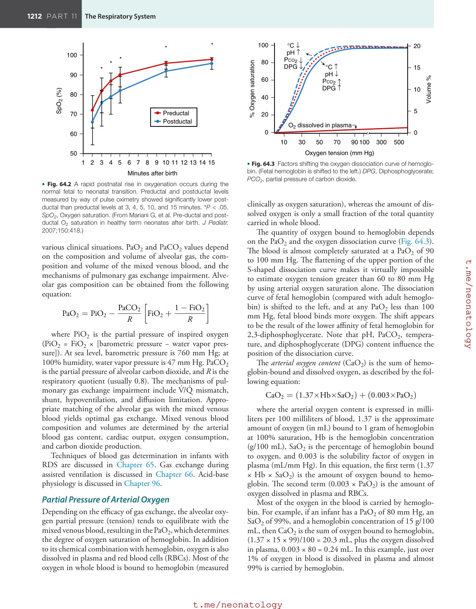

### Original source page 1218

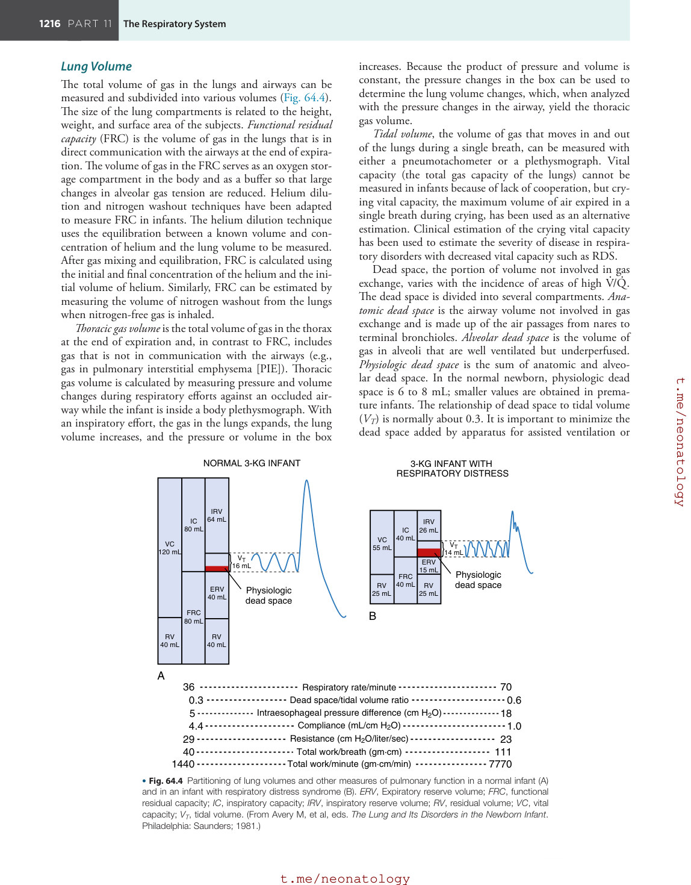

### Original source page 1220

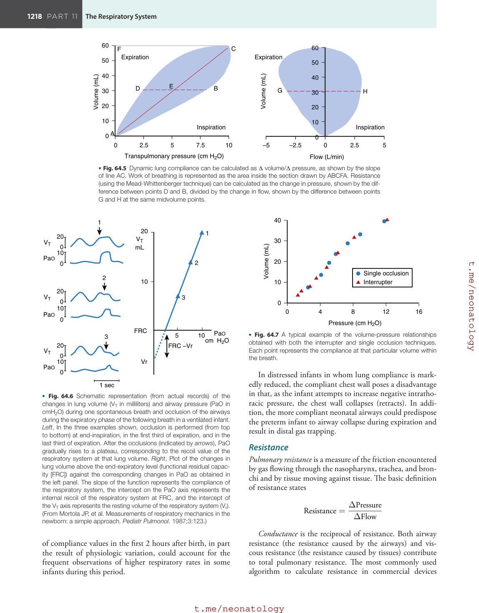

### Original source page 1222

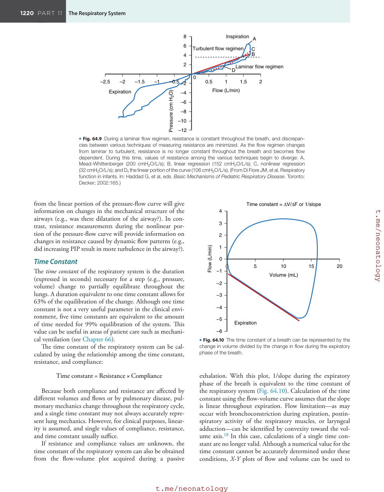

### Original source page 1224

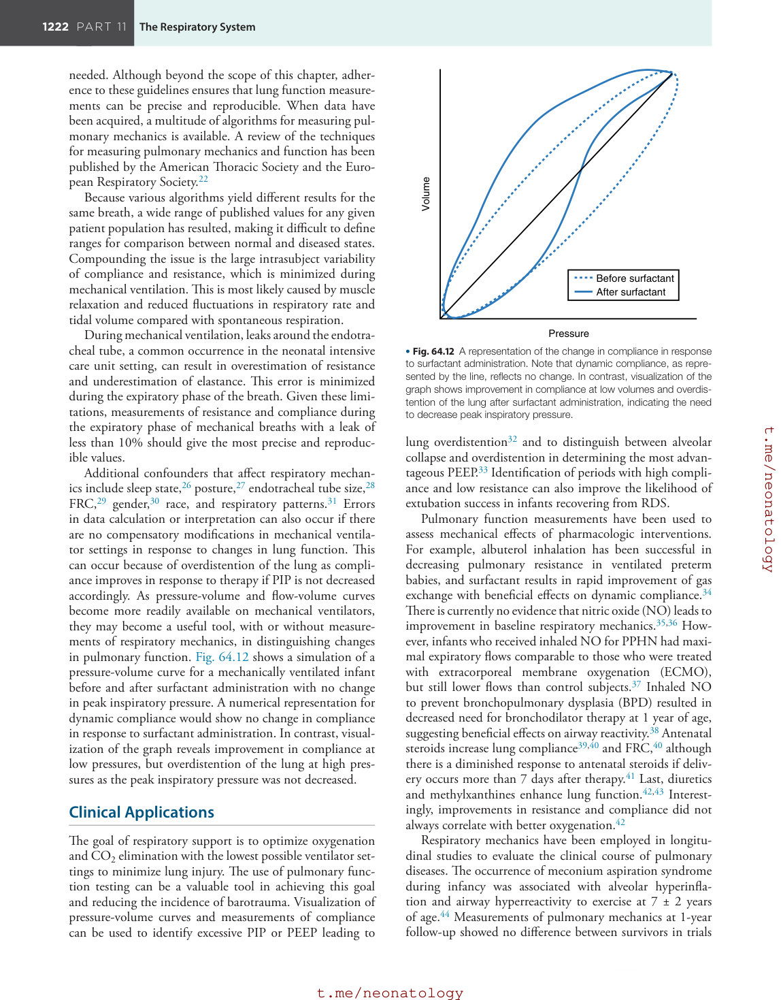

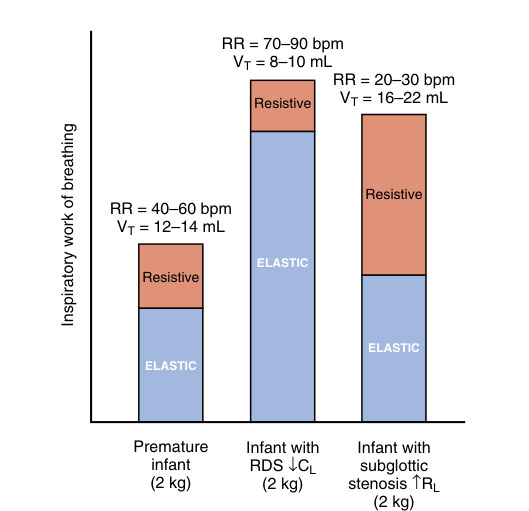

• Fig. 64.1 Relative contributions of the elastic and resistive components of the work of breathing in infants with normal pulmonary function, decreased lung compliance (CL), and increased lung resistance (RL). RDS, Respiratory distress syndrome; RR, respiratory rate; VT, tidal volume.

PDF p. 1212

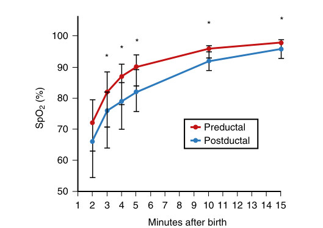

• Fig. 64.2 A rapid postnatal rise in oxygenation occurs during the normal fetal to neonatal transition. Preductal and postductal levels measured by way of pulse oximetry showed significantly lower postductal than preductal levels at 3, 4, 5, 10, and 15 minutes. *P < .05. SpO2, Oxygen saturation. (From Mariani G, et al. Pre-ductal and postductal O2 saturation in healthy term neonates after birth. J Pediatr. 2007;150:418.)

PDF p. 1214

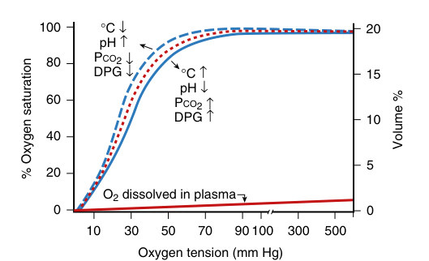

• Fig. 64.3 Factors shifting the oxygen dissociation curve of hemoglobin. (Fetal hemoglobin is shifted to the left.) DPG, Diphosphoglycerate; PCO2, partial pressure of carbon dioxide.

PDF p. 1214

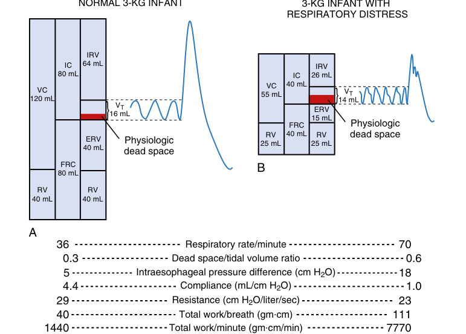

• Fig. 64.4 Partitioning of lung volumes and other measures of pulmonary function in a normal infant (A) and in an infant with respiratory distress syndrome (B). ERV, Expiratory reserve volume; FRC, functional residual capacity; IC, inspiratory capacity; IRV, inspiratory reserve volume; RV, residual volume; VC, vital capacity; VT, tidal volume. (From Avery M, et al, eds. The Lung and Its Disorders in the Newborn Infant. Philadelphia: Saunders; 1981.)

PDF p. 1218

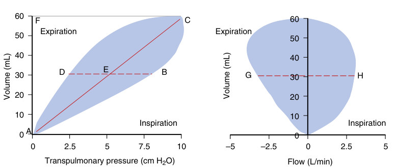

• Fig. 64.5 Dynamic lung compliance can be calculated as Δ volume/Δ pressure, as shown by the slope of line AC. Work of breathing is represented as the area inside the section drawn by ABCFA. Resistance (using the Mead-Whittenberger technique) can be calculated as the change in pressure, shown by the difference between points D and B, divided by the change in flow, shown by the difference between points G and H at the same midvolume points.

PDF p. 1220

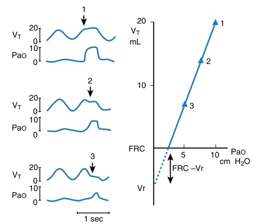

• Fig. 64.6 Schematic representation (from actual records) of the changes in lung volume (VT in milliliters) and airway pressure (PaO in cmH2O) during one spontaneous breath and occlusion of the airways during the expiratory phase of the following breath in a ventilated infant. Left, In the three examples shown, occlusion is performed (from top to bottom) at end-inspiration, in the first third of expiration, and in the last third of expiration. After the occlusions (indicated by arrows), PaO gradually rises to a plateau, corresponding to the recoil value of the respiratory system at that lung volume. Right, Plot of the changes in lung volume above the end-expiratory level (functional residual capacity [FRC]) against the corresponding changes in PaO as obtained in the left panel. The slope of the function represents the compliance of the respiratory system, the intercept on the PaO axis represents the internal recoil of the respiratory system at FRC, and the intercept of the VT axis represents the resting volume of the respiratory system (Vr). (From Mortola JP, et al. Measurements of respiratory mechanics in the newborn: a simple approach. Pediatr Pulmonol. 1987;3:123.)

PDF p. 1220

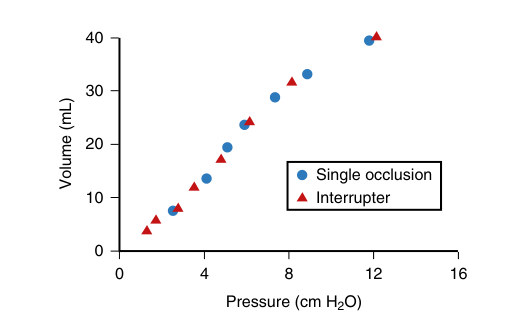

• Fig. 64.7 A typical example of the volume-pressure relationships obtained with both the interrupter and single occlusion techniques. Each point represents the compliance at that particular volume within the breath.

PDF p. 1220

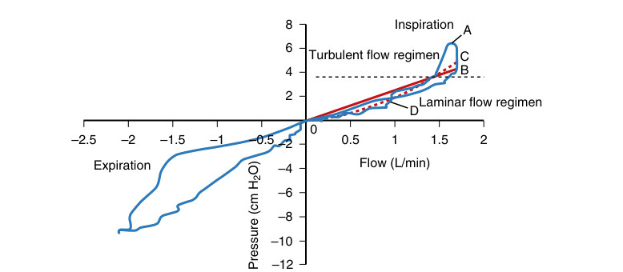

• Fig. 64.9 During a laminar flow regimen, resistance is constant throughout the breath, and discrepancies between various techniques of measuring resistance are minimized. As the flow regimen changes from laminar to turbulent, resistance is no longer constant throughout the breath and becomes flow dependent. During this time, values of resistance among the various techniques begin to diverge: A, Mead-Whittenberger (200 cmH2O/L/s); B, linear regression (152 cmH2O/L/s); C, nonlinear regression (32 cmH2O/L/s); and D, the linear portion of the curve (106 cmH2O/L/s). (From Di Fiore JM, et al. Respiratory function in infants. In: Haddad G, et al, eds. Basic Mechanisms of Pediatric Respiratory Disease. Toronto: Decker; 2002:165.)

PDF p. 1222

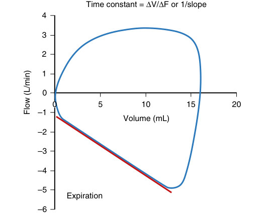

• Fig. 64.10 The time constant of a breath can be represented by the change in volume divided by the change in flow during the expiratory phase of the breath.

PDF p. 1222

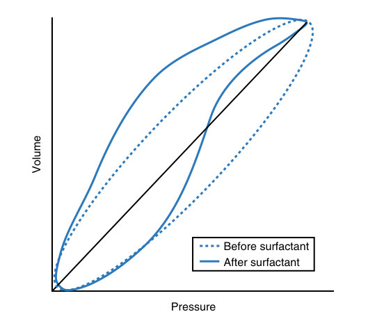

• Fig. 64.12 A representation of the change in compliance in response to surfactant administration. Note that dynamic compliance, as represented by the line, reflects no change. In contrast, visualization of the graph shows improvement in compliance at low volumes and overdistention of the lung after surfactant administration, indicating the need to decrease peak inspiratory pressure.

PDF p. 1224
