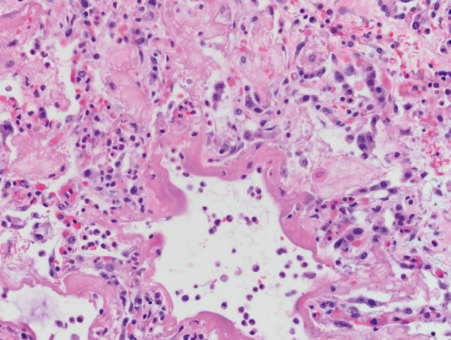
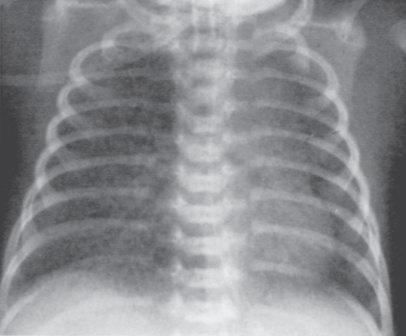
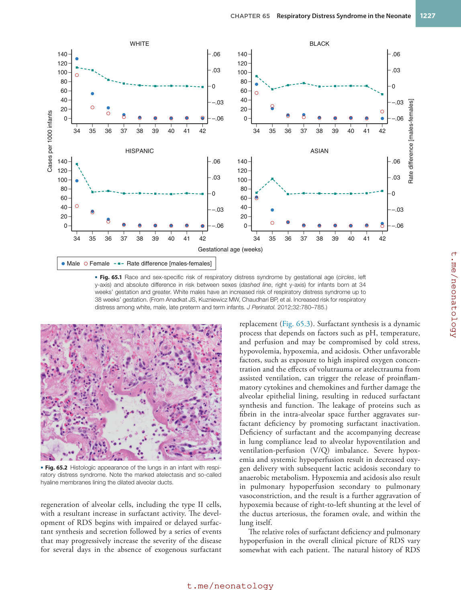
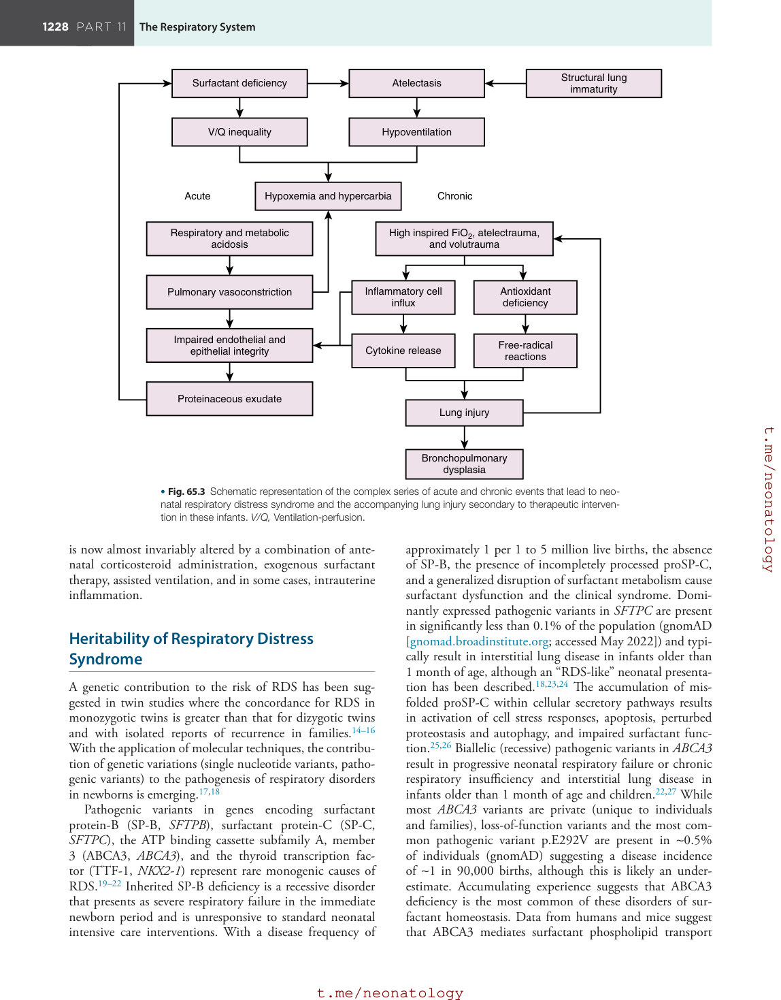
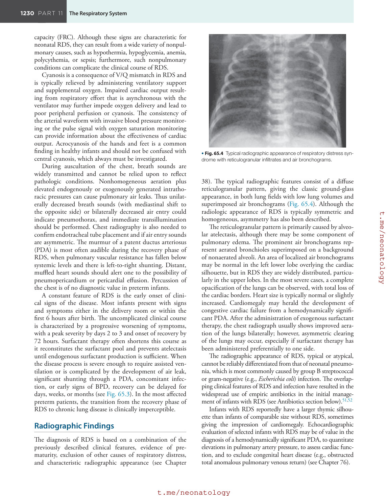
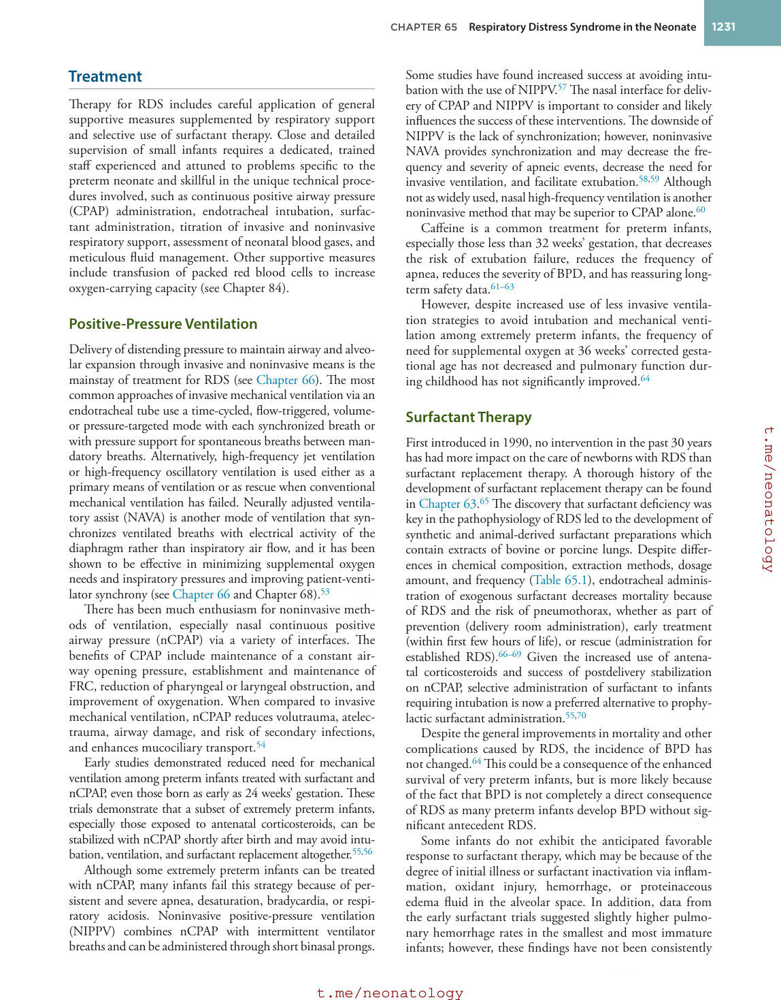
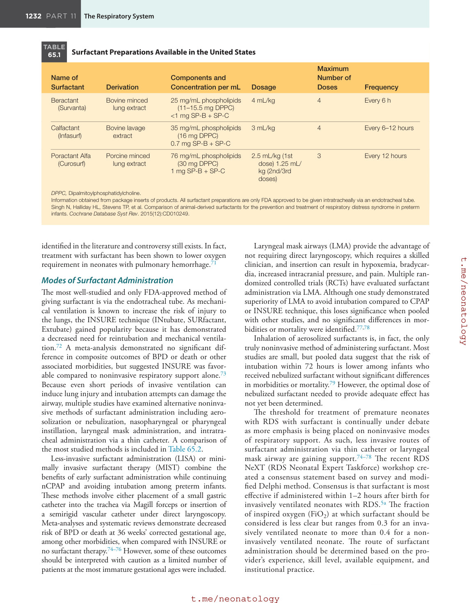
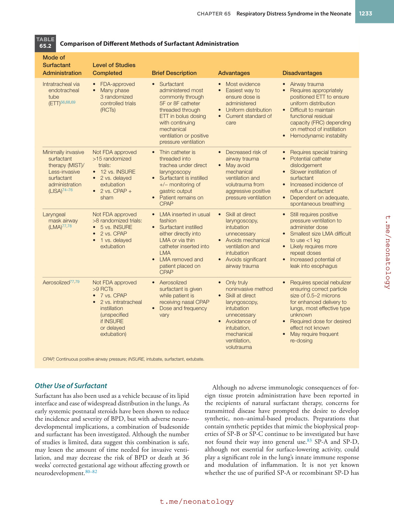
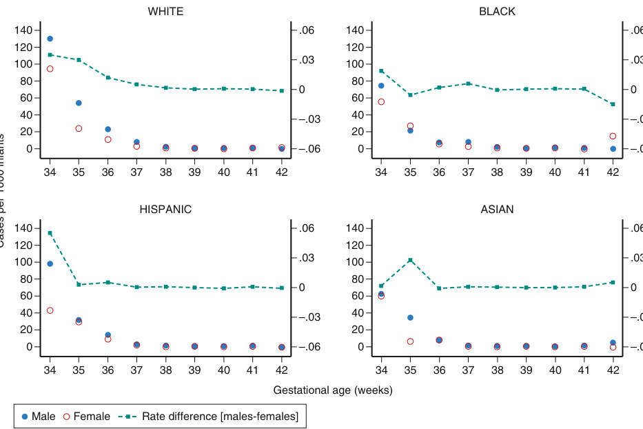
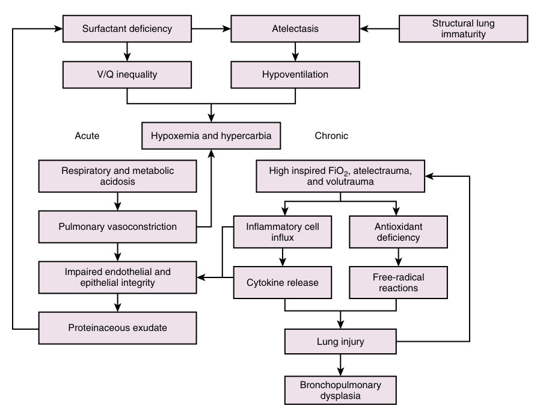

# 65. Respiratory Distress Syndrome in the Neonate
> [Source credits](../../SOURCE_CREDITS.md).

## Study pillars

### Surfactant deficiency

Insufficient surfactant synthesis or secretion. Surfactant deficiency promotes collapse, hypoventilation and ventilation-perfusion imbalance; injury and protein leak can further inactivate surfactant.

PDF p. 1229

### Antenatal maturation

Antenatal corticosteroids. Antenatal corticosteroids induce developmentally regulated proteins and reduce incidence and severity of RDS in appropriate preterm-risk settings.

PDF p. 1231

### Radiographic pattern

Low volumes, diffuse ground-glass pattern and air bronchograms. Diffuse atelectasis produces ground-glass opacity with aerated bronchi against poorly aerated alveoli.

PDF p. 1232

### Replacement therapy

Reduced RDS mortality and pneumothorax risk, without guaranteed prevention of BPD. Surfactant replacement improves important acute outcomes; BPD remains multifactorial and can follow limited early RDS.

PDF p. 1233

### Less-invasive delivery

LISA or MIST. LISA/MIST aims to deliver surfactant while preserving spontaneous breathing and CPAP support, limiting invasive ventilation exposure.

PDF p. 1234

## Full source extraction

# 65. Respiratory Distress Syndrome in the Neonate
> Source attribution: [Source credits](../../SOURCE_CREDITS.md).

## PDF page 1228 | printed page 1226

65 Respiratory Distress Syndrome in the Neonate

### MEGAN LAGOSKI, AARON HAMVAS, AND JENNIFER A. WAMBACH

Enormous strides have been made in understanding the pathophysiology of respiratory distress syndrome (RDS) and the role of surfactant in its cause and treatment (see Chapter 63). Nevertheless, RDS, formerly referred to as hyaline membrane disease, remains a dominant clinical problem among preterm neonates despite the introduction of pharmacologic acceleration of pulmonary maturity using antenatal corticosteroids and the development of surfactant replacement therapy in the 1990s.1,2 The incidence of complications in the survivors of RDS remains significant and continues to be differentially represented between infants of varying ancestries.3,4 These include intracranial hemorrhage, late-onset sepsis, necrotizing enterocolitis, severe retinopathy of prematurity, and bronchopulmonary dysplasia (BPD). It is often impossible to determine whether these disorders may result as the sequelae of RDS, its treatment, or the underlying prematurity. In this section, the clinical features and evaluation of infants with RDS are discussed, and therapeutic approaches other than assisted ventilation (see Chapter 66) are outlined. Other recommendations and details can be found in the recent consensus guidelines for RDS.5,5a

### Incidence

RDS is one of the most common causes of morbidity and mortality in preterm neonates, although lack of a precise definition among infants with very low birth weight necessitates cautious interpretation of statistics regarding incidence, mortality, and outcome.6,7 The diagnosis can be established pathologically or by biochemical documentation of surfactant deficiency; nonetheless, most series refer only to a combination of clinical and radiographic features. Without biochemical evidence of surfactant deficiency, it is difficult to clinically diagnose RDS in infants with extremely low birth weight. The term respiratory insufficiency of prematurity had been used in some centers for infants who require oxygen and ventilator support in the absence of typical radiographic evidence of RDS. The term

1226

respiratory instability of prematurity has been proposed to describe very low birth weight infants who require some respiratory support but may have additional contributing factors such as inconsistent central respiratory drive or poor inspiratory effort.6

RDS occurs throughout the world and has a slight male predominance.8 The greatest risk factors appear to be early gestational age and low birth weight; however, European descent, late preterm delivery (35–36 weeks), or elective delivery in the absence of labor are also prominent risk factors.8,9 Given the associated adverse respiratory outcomes of late preterm and early term births, initiatives to delay elective deliveries until 39 weeks’ gestation have been successful in reducing pulmonary and nonpulmonary morbidity in these infants.10 Infants born to mothers with diabetes also have an increased risk for RDS.11

The incidence of RDS is inversely proportional to gestational age: nearly all infants born at 22 to 24 weeks’ gestation have RDS, decreasing to approximately 25% in infants with birth weights between 1251 and 1500 g.12,13 Even infants of 34 weeks’ gestation and greater, especially males of European descent, have a discernible risk of RDS that decreases from ∼10% at 34 weeks to less than 1% at 37 weeks (Fig. 65.1).8

### Pathophysiology

The lungs of infants who succumb from RDS have a characteristic uniformly ruddy and airless appearance, macroscopically resembling hepatic tissue. On microscopic examination, the striking feature is diffuse atelectasis such that only a few widely dilated alveoli are readily distinguishable (Fig. 65.2). An eosinophilic membrane lines the visible airspaces that usually constitute terminal bronchioles and alveolar ducts. This characteristic membrane (from which the term hyaline membrane disease is derived) consists of a fibrinous matrix of materials derived from the blood and contains cellular debris derived from injured epithelium. The recovery phase is characterized by

## PDF page 1229 | printed page 1227

WHITE

.06

140

140

120

120

.03

100

100

80

0

60

40

–.03

20

Cases per 1000 infants

–.06

0

34

35 36 37 38 39 40 41 42

HISPANIC

.06

140

140

120

120

.03

100

100

80

0

60

40

–.03

20

0

–.06

34

35 36 37 38 39 40 41 42

Gestational age (weeks)

Male Female Rate difference [males-females]

• Fig. 65.1 Race and sex-specific risk of respiratory distress syndrome by gestational age (circles, left y-axis) and absolute difference in risk between sexes (dashed line, right y-axis) for infants born at 34 weeks’ gestation and greater. White males have an increased risk of respiratory distress syndrome up to 38 weeks’ gestation. (From Anadkat JS, Kuzniewicz MW, Chaudhari BP, et al. Increased risk for respiratory distress among white, male, late preterm and term infants. J Perinatol. 2012;32:780–785.)

• Fig. 65.2 Histologic appearance of the lungs in an infant with respiratory distress syndrome. Note the marked atelectasis and so-called hyaline membranes lining the dilated alveolar ducts.

regeneration of alveolar cells, including the type II cells, with a resultant increase in surfactant activity. The development of RDS begins with impaired or delayed surfactant synthesis and secretion followed by a series of events that may progressively increase the severity of the disease for several days in the absence of exogenous surfactant

BLACK

.06

.03

80

0

60

40

–.03

Rate difference [males-females]

20

–.06

0

34

35 36 37 38 39 40 41 42

ASIAN

.06

.03

80

0

60

40

–.03

20

0

–.06

34

35 36 37 38 39 40 41 42

replacement (Fig. 65.3). Surfactant synthesis is a dynamic process that depends on factors such as pH, temperature, and perfusion and may be compromised by cold stress, hypovolemia, hypoxemia, and acidosis. Other unfavorable factors, such as exposure to high inspired oxygen concentration and the effects of volutrauma or atelectrauma from assisted ventilation, can trigger the release of proinflammatory cytokines and chemokines and further damage the alveolar epithelial lining, resulting in reduced surfactant synthesis and function. The leakage of proteins such as fibrin in the intra-alveolar space further aggravates surfactant deficiency by promoting surfactant inactivation. Deficiency of surfactant and the accompanying decrease in lung compliance lead to alveolar hypoventilation and ventilation-perfusion (V/Q) imbalance. Severe hypoxemia and systemic hypoperfusion result in decreased oxygen delivery with subsequent lactic acidosis secondary to anaerobic metabolism. Hypoxemia and acidosis also result in pulmonary hypoperfusion secondary to pulmonary vasoconstriction, and the result is a further aggravation of hypoxemia because of right-to-left shunting at the level of the ductus arteriosus, the foramen ovale, and within the lung itself.

The relative roles of surfactant deficiency and pulmonary hypoperfusion in the overall clinical picture of RDS vary somewhat with each patient. The natural history of RDS

• Fig. 65.2 Histologic appearance of the lungs in an infant with respiratory distress syndrome. Note the marked atelectasis and so-called hyaline membranes lining the dilated alveolar ducts.

## PDF page 1230

Surfactant deficiency

Atelectasis

V/Q inequality

Hypoventilation

Hypoxemia and hypercarbia

Acute

High inspired FiO2, atelectrauma,

Respiratory and metabolic acidosis

Inflammatory cell influx

Pulmonary vasoconstriction

Impaired endothelial and epithelial integrity

Cytokine release

Proteinaceous exudate

• Fig. 65.3 Schematic representation of the complex series of acute and chronic events that lead to neonatal respiratory distress syndrome and the accompanying lung injury secondary to therapeutic intervention in these infants. V/Q, Ventilation-perfusion.

is now almost invariably altered by a combination of antenatal corticosteroid administration, exogenous surfactant therapy, assisted ventilation, and in some cases, intrauterine inflammation.

### Heritability of Respiratory Distress Syndrome

A genetic contribution to the risk of RDS has been suggested in twin studies where the concordance for RDS in monozygotic twins is greater than that for dizygotic twins and with isolated reports of recurrence in families.14–16 With the application of molecular techniques, the contribution of genetic variations (single nucleotide variants, pathogenic variants) to the pathogenesis of respiratory disorders in newborns is emerging.17,18

Pathogenic variants in genes encoding surfactant protein-B (SP-B, SFTPB), surfactant protein-C (SP-C, SFTPC), the ATP binding cassette subfamily A, member 3 (ABCA3, ABCA3), and the thyroid transcription factor (TTF-1, NKX2-1) represent rare monogenic causes of RDS.19–22 Inherited SP-B deficiency is a recessive disorder that presents as severe respiratory failure in the immediate newborn period and is unresponsive to standard neonatal intensive care interventions. With a disease frequency of

Structural lung immaturity

Chronic

and volutrauma

Antioxidant deficiency

Free-radical reactions

Lung injury

Bronchopulmonary dysplasia

approximately 1 per 1 to 5 million live births, the absence of SP-B, the presence of incompletely processed proSP-C, and a generalized disruption of surfactant metabolism cause surfactant dysfunction and the clinical syndrome. Dominantly expressed pathogenic variants in SFTPC are present in significantly less than 0.1% of the population (gnomAD [gnomad.broadinstitute.org; accessed May 2022]) and typically result in interstitial lung disease in infants older than 1 month of age, although an “RDS-like” neonatal presentation has been described.18,23,24 The accumulation of misfolded proSP-C within cellular secretory pathways results in activation of cell stress responses, apoptosis, perturbed proteostasis and autophagy, and impaired surfactant function.25,26 Biallelic (recessive) pathogenic variants in ABCA3 result in progressive neonatal respiratory failure or chronic respiratory insufficiency and interstitial lung disease in infants older than 1 month of age and children.22,27 While most ABCA3 variants are private (unique to individuals and families), loss-of-function variants and the most common pathogenic variant p.E292V are present in ∼0.5% of individuals (gnomAD) suggesting a disease incidence of ∼1 in 90,000 births, although this is likely an underestimate. Accumulating experience suggests that ABCA3 deficiency is the most common of these disorders of surfactant homeostasis. Data from humans and mice suggest that ABCA3 mediates surfactant phospholipid transport

## PDF page 1231 | printed page 1229

(primarily phosphatidylcholine and phosphatidylglycerol) into lamellar bodies, and thus dysfunction of phospholipid transport into the lamellar body leads to reduced surfactant function.28–30 Dominantly expressed pathogenic variants in NKX2-1 were first identified in the context of benign hereditary chorea, but since then, they have also been recognized in lethal and nonlethal neonatal RDS as well as interstitial lung disease in older children.19,31,32 A triad of neurologic disease, characterized by hypotonia, developmental delay and movement disorders, congenital hypothyroidism, and RDS has been termed the brain-thyroid-lung syndrome, but any single organ presentation or combination thereof may be the initial and only manifestation of the syndrome. Pathogenic variants in NKX2-1 are rare, and the frequency of disease is unknown. Disruption in structural lung development and/or decreased expression of surfactant-associated genes are the postulated mechanisms of disease.

Large-scale cohort-based resequencing efforts have demonstrated an over-representation of heterozygous (monoallelic), predicted deleterious variants in ABCA3 in newborns 34 weeks and greater with RDS, suggesting that these variants are modifiers for the risk or severity of respiratory disease in developmentally susceptible newborns.17,18,24,33 These efforts have not identified an unequivocal contribution of rare or common variants in the surfactant protein-B or -C genes to RDS in newborns, suggesting that if these genes play a role in RDS, it is likely to be through interactions with variants in other lung-associated genes. Exome and genome sequencing are increasingly being used in the neonatal intensive care unit and will yield additional insights into candidate genes that not only account for the heritability of RDS but provide insight into systemic disorders with prominent respiratory manifestations.34–38

### Prevention: Pharmacologic Acceleration of Pulmonary Maturation

In the early 1970s, Liggins, while studying the effects of steroids on premature labor in lambs, noticed the lack of RDS and increased survival in preterm animals prenatally exposed to steroids. The effects of various catecholamines as well as aminophylline and thyroid hormone have been studied; however, the most successful method to induce fetal lung maturation is prenatal corticosteroid administration (see Chapter 63).39

If premature delivery of an infant appears probable or necessary, lung maturity can be hastened pharmacologically. Accelerated lung maturation occurs with physiologic stress levels of corticosteroids via receptor-mediated induction of specific developmentally regulated proteins, including those associated with surfactant synthesis. Steroids, when administered to the mother at least 24 to 48 hours before delivery, decrease the incidence and severity of RDS.40 Corticosteroids appear to be most effective before 34 weeks’ gestation and when administered at least 24 hours and no longer than 7 days before delivery. Because corticosteroid therapy for

less than 24 hours is still associated with significant reductions in neonatal mortality, RDS, and intraventricular hemorrhage (IVH), without increasing the risk of infection to the mother or fetus, antenatal steroids should always be considered unless immediate delivery is anticipated.41 Data regarding the risks and benefits of antenatal corticosteroid administration for late preterm infants born at 34 to 36 weeks’ gestation are more equivocal. The clear short-term benefits of a reduction in respiratory complications may be outweighed by more uncertain impacts on longer-term neurodevelopmental outcomes, but further data are required to come to a more certain conclusion.42–44

Less clear are the effects of repeated courses of antenatal corticosteroids on the short- and long-term outcomes of preterm infants. Early retrospective studies suggested decreased fetal growth and adverse neurodevelopmental outcomes, but subsequent analyses have suggested short-term benefits without long-term harm on childhood outcomes.45 Further, the use of a rescue course of corticosteroids in the setting of premature rupture of membranes remains controversial.41,46

Although preterm infants as early as 23 weeks’ estimated gestation may benefit from antenatal corticosteroid exposure, their use before 23 weeks’ gestation also remains controversial. Regardless, the topic of prenatal corticosteroids is an important component of the joint neonatal-obstetrical counseling and approach to these anticipated early gestation deliveries.47–49

In the 1990s, the observation that thyroid hormone could augment lung development and surfactant production in vitro prompted trials of antenatally administered thyrotropin-releasing hormone (TRH). However, these trials failed to demonstrate a benefit and also raised concerns for adverse consequences on neurodevelopment, thereby significantly dampening enthusiasm for this therapy.50

### Clinical Features

The classic clinical presentation of RDS includes grunting respirations, retractions, nasal flaring, cyanosis, and increased oxygen requirement, together with diagnostic radiographic findings and onset of symptoms shortly after birth. The respiratory rate is usually regular and increased well above the normal range of 30 to 60 breaths/min. These infants usually show progression of respiratory symptoms and require supplemental oxygen. The presence of apneic episodes at this early stage is an ominous sign that could reflect thermal instability or sepsis, but more often is a sign of hypoxemia and respiratory failure. This characteristic picture is modified in many infants with low birth weight as a result of the early administration of exogenous surfactant and immediate noninvasive or invasive assisted ventilation.

Retractions are prominent and are the result of the compliant rib cage collapsing on inspiration as the infant generates high negative intrathoracic pressures to expand the poorly compliant lungs. The typical expiratory grunt is an early feature and may subsequently disappear. Grunting results from partial closure of the glottis during expiration and in this way acts to trap alveolar air and maintain functional residual

## PDF page 1232

capacity (FRC). Although these signs are characteristic for neonatal RDS, they can result from a wide variety of nonpulmonary causes, such as hypothermia, hypoglycemia, anemia, polycythemia, or sepsis; furthermore, such nonpulmonary conditions can complicate the clinical course of RDS.

Cyanosis is a consequence of V/Q mismatch in RDS and is typically relieved by administering ventilatory support and supplemental oxygen. Impaired cardiac output resulting from respiratory effort that is asynchronous with the ventilator may further impede oxygen delivery and lead to poor peripheral perfusion or cyanosis. The consistency of the arterial waveform with invasive blood pressure monitoring or the pulse signal with oxygen saturation monitoring can provide information about the effectiveness of cardiac output. Acrocyanosis of the hands and feet is a common finding in healthy infants and should not be confused with central cyanosis, which always must be investigated.

During auscultation of the chest, breath sounds are widely transmitted and cannot be relied upon to reflect pathologic conditions. Nonhomogeneous aeration plus elevated endogenously or exogenously generated intrathoracic pressures can cause pulmonary air leaks. Thus unilaterally decreased breath sounds (with mediastinal shift to the opposite side) or bilaterally decreased air entry could indicate pneumothorax, and immediate transillumination should be performed. Chest radiography is also needed to confirm endotracheal tube placement and if air entry sounds are asymmetric. The murmur of a patent ductus arteriosus (PDA) is most often audible during the recovery phase of RDS, when pulmonary vascular resistance has fallen below systemic levels and there is left-to-right shunting. Distant, muffled heart sounds should alert one to the possibility of pneumopericardium or pericardial effusion. Percussion of the chest is of no diagnostic value in preterm infants.

A constant feature of RDS is the early onset of clinical signs of the disease. Most infants present with signs and symptoms either in the delivery room or within the first 6 hours after birth. The uncomplicated clinical course is characterized by a progressive worsening of symptoms, with a peak severity by days 2 to 3 and onset of recovery by 72 hours. Surfactant therapy often shortens this course as it reconstitutes the surfactant pool and prevents atelectasis until endogenous surfactant production is sufficient. When the disease process is severe enough to require assisted ventilation or is complicated by the development of air leak, significant shunting through a PDA, concomitant infection, or early signs of BPD, recovery can be delayed for days, weeks, or months (see Fig. 65.3). In the most affected preterm patients, the transition from the recovery phase of RDS to chronic lung disease is clinically imperceptible.

### Radiographic Findings

The diagnosis of RDS is based on a combination of the previously described clinical features, evidence of prematurity, exclusion of other causes of respiratory distress, and characteristic radiographic appearance (see Chapter

• Fig. 65.4 Typical radiographic appearance of respiratory distress syndrome with reticulogranular infiltrates and air bronchograms.

38). The typical radiographic features consist of a diffuse reticulogranular pattern, giving the classic ground-glass appearance, in both lung fields with low lung volumes and superimposed air bronchograms (Fig. 65.4). Although the radiologic appearance of RDS is typically symmetric and homogeneous, asymmetry has also been described.

The reticulogranular pattern is primarily caused by alveolar atelectasis, although there may be some component of pulmonary edema. The prominent air bronchograms represent aerated bronchioles superimposed on a background of nonaerated alveoli. An area of localized air bronchograms may be normal in the left lower lobe overlying the cardiac silhouette, but in RDS they are widely distributed, particularly in the upper lobes. In the most severe cases, a complete opacification of the lungs can be observed, with total loss of the cardiac borders. Heart size is typically normal or slightly increased. Cardiomegaly may herald the development of congestive cardiac failure from a hemodynamically significant PDA. After the administration of exogenous surfactant therapy, the chest radiograph usually shows improved aeration of the lungs bilaterally; however, asymmetric clearing of the lungs may occur, especially if surfactant therapy has been administered preferentially to one side.

The radiographic appearance of RDS, typical or atypical, cannot be reliably differentiated from that of neonatal pneumonia, which is most commonly caused by group B streptococcal or gram-negative (e.g., Escherichia coli) infection. The overlapping clinical features of RDS and infection have resulted in the widespread use of empiric antibiotics in the initial management of infants with RDS (see Antibiotics section below).51,52

Infants with RDS reportedly have a larger thymic silhouette than infants of comparable size without RDS, sometimes giving the impression of cardiomegaly. Echocardiographic evaluation of selected infants with RDS may be of value in the diagnosis of a hemodynamically significant PDA, to quantitate elevations in pulmonary artery pressure, to assess cardiac function, and to exclude congenital heart disease (e.g., obstructed total anomalous pulmonary venous return) (see Chapter 76).

• Fig. 65.4 Typical radiographic appearance of respiratory distress syndrome with reticulogranular infiltrates and air bronchograms.

## PDF page 1233 | printed page 1231

### Treatment

Therapy for RDS includes careful application of general supportive measures supplemented by respiratory support and selective use of surfactant therapy. Close and detailed supervision of small infants requires a dedicated, trained staff experienced and attuned to problems specific to the preterm neonate and skillful in the unique technical procedures involved, such as continuous positive airway pressure (CPAP) administration, endotracheal intubation, surfactant administration, titration of invasive and noninvasive respiratory support, assessment of neonatal blood gases, and meticulous fluid management. Other supportive measures include transfusion of packed red blood cells to increase oxygen-carrying capacity (see Chapter 84).

### Positive-Pressure Ventilation

Delivery of distending pressure to maintain airway and alveolar expansion through invasive and noninvasive means is the mainstay of treatment for RDS (see Chapter 66). The most common approaches of invasive mechanical ventilation via an endotracheal tube use a time-cycled, flow-triggered, volumeor pressure-targeted mode with each synchronized breath or with pressure support for spontaneous breaths between mandatory breaths. Alternatively, high-frequency jet ventilation or high-frequency oscillatory ventilation is used either as a primary means of ventilation or as rescue when conventional mechanical ventilation has failed. Neurally adjusted ventilatory assist (NAVA) is another mode of ventilation that synchronizes ventilated breaths with electrical activity of the diaphragm rather than inspiratory air flow, and it has been shown to be effective in minimizing supplemental oxygen needs and inspiratory pressures and improving patient-ventilator synchrony (see Chapter 66 and Chapter 68).53

There has been much enthusiasm for noninvasive methods of ventilation, especially nasal continuous positive airway pressure (nCPAP) via a variety of interfaces. The benefits of CPAP include maintenance of a constant airway opening pressure, establishment and maintenance of FRC, reduction of pharyngeal or laryngeal obstruction, and improvement of oxygenation. When compared to invasive mechanical ventilation, nCPAP reduces volutrauma, atelectrauma, airway damage, and risk of secondary infections, and enhances mucociliary transport.54

Early studies demonstrated reduced need for mechanical ventilation among preterm infants treated with surfactant and nCPAP, even those born as early as 24 weeks’ gestation. These trials demonstrate that a subset of extremely preterm infants, especially those exposed to antenatal corticosteroids, can be stabilized with nCPAP shortly after birth and may avoid intubation, ventilation, and surfactant replacement altogether.55,56

Although some extremely preterm infants can be treated with nCPAP, many infants fail this strategy because of persistent and severe apnea, desaturation, bradycardia, or respiratory acidosis. Noninvasive positive-pressure ventilation (NIPPV) combines nCPAP with intermittent ventilator breaths and can be administered through short binasal prongs.

Some studies have found increased success at avoiding intubation with the use of NIPPV.57 The nasal interface for delivery of CPAP and NIPPV is important to consider and likely influences the success of these interventions. The downside of NIPPV is the lack of synchronization; however, noninvasive NAVA provides synchronization and may decrease the frequency and severity of apneic events, decrease the need for invasive ventilation, and facilitate extubation.58,59 Although not as widely used, nasal high-frequency ventilation is another noninvasive method that may be superior to CPAP alone.60

Caffeine is a common treatment for preterm infants, especially those less than 32 weeks’ gestation, that decreases the risk of extubation failure, reduces the frequency of apnea, reduces the severity of BPD, and has reassuring longterm safety data.61–63

However, despite increased use of less invasive ventilation strategies to avoid intubation and mechanical ventilation among extremely preterm infants, the frequency of need for supplemental oxygen at 36 weeks’ corrected gestational age has not decreased and pulmonary function during childhood has not significantly improved.64

### Surfactant Therapy

First introduced in 1990, no intervention in the past 30 years has had more impact on the care of newborns with RDS than surfactant replacement therapy. A thorough history of the development of surfactant replacement therapy can be found in Chapter 63.65 The discovery that surfactant deficiency was key in the pathophysiology of RDS led to the development of synthetic and animal-derived surfactant preparations which contain extracts of bovine or porcine lungs. Despite differences in chemical composition, extraction methods, dosage amount, and frequency (Table 65.1), endotracheal administration of exogenous surfactant decreases mortality because of RDS and the risk of pneumothorax, whether as part of prevention (delivery room administration), early treatment (within first few hours of life), or rescue (administration for established RDS).66–69 Given the increased use of antenatal corticosteroids and success of postdelivery stabilization on nCPAP, selective administration of surfactant to infants requiring intubation is now a preferred alternative to prophylactic surfactant administration.55,70

Despite the general improvements in mortality and other complications caused by RDS, the incidence of BPD has not changed.64 This could be a consequence of the enhanced survival of very preterm infants, but is more likely because of the fact that BPD is not completely a direct consequence of RDS as many preterm infants develop BPD without significant antecedent RDS.

Some infants do not exhibit the anticipated favorable response to surfactant therapy, which may be because of the degree of initial illness or surfactant inactivation via inflammation, oxidant injury, hemorrhage, or proteinaceous edema fluid in the alveolar space. In addition, data from the early surfactant trials suggested slightly higher pulmonary hemorrhage rates in the smallest and most immature infants; however, these findings have not been consistently

## PDF page 1234

TABLE

Surfactant Preparations Available in the United States

65.1

Name of Surfactant Derivation

Components and Concentration per mL

Beractant

Bovine minced

25 mg/mL phospholipids

(Survanta)

lung extract

(11–15.5 mg DPPC) <1 mg SP-B + SP-C

Calfactant

Bovine lavage

35 mg/mL phospholipids

(Infasurf)

extract

(16 mg DPPC) 0.7 mg SP-B + SP-C

Poractant Alfa

Porcine minced

76 mg/mL phospholipids

(Curosurf)

lung extract

(30 mg DPPC) 1 mg SP-B + SP-C

DPPC, Dipalmitoylphosphatidylcholine. Information obtained from package inserts of products. All surfactant preparations are only FDA approved to be given intratracheally via an endotracheal tube. Singh N, Halliday HL, Stevens TP, et al. Comparison of animal-derived surfactants for the prevention and treatment of respiratory distress syndrome in preterm infants. Cochrane Database Syst Rev. 2015(12):CD010249.

identified in the literature and controversy still exists. In fact, treatment with surfactant has been shown to lower oxygen requirement in neonates with pulmonary hemorrhage.71

### Modes of Surfactant Administration

The most well-studied and only FDA-approved method of giving surfactant is via the endotracheal tube. As mechanical ventilation is known to increase the risk of injury to the lungs, the INSURE technique (INtubate, SURfactant, Extubate) gained popularity because it has demonstrated a decreased need for reintubation and mechanical ventilation.72 A meta-analysis demonstrated no significant difference in composite outcomes of BPD or death or other associated morbidities, but suggested INSURE was favorable compared to noninvasive respiratory support alone.73 Because even short periods of invasive ventilation can induce lung injury and intubation attempts can damage the airway, multiple studies have examined alternative noninvasive methods of surfactant administration including aerosolization or nebulization, nasopharyngeal or pharyngeal instillation, laryngeal mask administration, and intratracheal administration via a thin catheter. A comparison of the most studied methods is included in Table 65.2.

Less-invasive surfactant administration (LISA) or minimally invasive surfactant therapy (MIST) combine the benefits of early surfactant administration while continuing nCPAP and avoiding intubation among preterm infants. These methods involve either placement of a small gastric catheter into the trachea via Magill forceps or insertion of a semirigid vascular catheter under direct laryngoscopy. Meta-analyses and systematic reviews demonstrate decreased risk of BPD or death at 36 weeks’ corrected gestational age, among other morbidities, when compared with INSURE or no surfactant therapy.74–76 However, some of these outcomes should be interpreted with caution as a limited number of patients at the most immature gestational ages were included.

Maximum Number of Doses Frequency

Dosage

4 mL/kg 4 Every 6 h

3 mL/kg 4 Every 6–12 hours

2.5 mL/kg (1st

3 Every 12 hours

dose) 1.25 mL/ kg (2nd/3rd doses)

Laryngeal mask airways (LMA) provide the advantage of not requiring direct laryngoscopy, which requires a skilled clinician, and insertion can result in hypoxemia, bradycardia, increased intracranial pressure, and pain. Multiple randomized controlled trials (RCTs) have evaluated surfactant administration via LMA. Although one study demonstrated superiority of LMA to avoid intubation compared to CPAP or INSURE technique, this loses significance when pooled with other studies, and no significant differences in morbidities or mortality were identified.77,78

Inhalation of aerosolized surfactants is, in fact, the only truly noninvasive method of administering surfactant. Most studies are small, but pooled data suggest that the risk of intubation within 72 hours is lower among infants who received nebulized surfactant without significant differences in morbidities or mortality.79 However, the optimal dose of nebulized surfactant needed to provide adequate effect has not yet been determined.

The threshold for treatment of premature neonates with RDS with surfactant is continually under debate as more emphasis is being placed on noninvasive modes of respiratory support. As such, less invasive routes of surfactant administration via thin catheter or laryngeal mask airway are gaining support.74–78 The recent RDS NeXT (RDS Neonatal Expert Taskforce) workshop created a consensus statement based on survey and modified Delphi method. Consensus is that surfactant is most effective if administered within 1–2 hours after birth for invasively ventilated neonates with RDS.5a The fraction of inspired oxygen (FiO2) at which surfactant should be considered is less clear but ranges from 0.3 for an invasively ventilated neonate to more than 0.4 for a noninvasively ventilated neonate. The route of surfactant administration should be determined based on the provider’s experience, skill level, available equipment, and institutional practice.

## PDF page 1235 | printed page 1233

TABLE

### Comparison of Different Methods of Surfactant Administration

65.2

Mode of Surfactant Administration

Level of Studies Completed Brief Description

Intratracheal via

• FDA-approved • Many phase

• Surfactant

endotracheal tube (ETT)56,68,69

administered most commonly through 5F or 8F catheter threaded through ETT in bolus dosing with continuing mechanical ventilation or positive pressure ventilation

3 randomized controlled trials (RCTs)

Minimally invasive

Not FDA approved >15 randomized

• Thin catheter is

surfactant therapy (MIST)/ Less-invasive surfactant administration (LISA)74–76

threaded into trachea under direct laryngoscopy • Surfactant is instilled

trials: • 12 vs. INSURE • 2 vs. delayed

extubation • 2 vs. CPAP +

+/− monitoring of gastric output • Patient remains on

sham

CPAP

Laryngeal

Not FDA approved >8 randomized trials: • 5 vs. INSURE • 2 vs. CPAP • 1 vs. delayed

• LMA inserted in usual

mask airway (LMA)77,78

fashion • Surfactant instilled

either directly into LMA or via thin catheter inserted into LMA • LMA removed and

extubation

patient placed on CPAP

Aerosolized77,79 Not FDA approved >9 RCTs • 7 vs. CPAP • 2 vs. intratracheal

• Aerosolized

surfactant is given while patient is receiving nasal CPAP • Dose and frequency

instillation (unspecified if INSURE or delayed extubation)

vary

CPAP, Continuous positive airway pressure; INSURE, intubate, surfactant, extubate.

### Other Use of Surfactant

Surfactant has also been used as a vehicle because of its lipid interface and ease of widespread distribution in the lungs. As early systemic postnatal steroids have been shown to reduce the incidence and severity of BPD, but with adverse neurodevelopmental implications, a combination of budesonide and surfactant has been investigated. Although the number of studies is limited, data suggest this combination is safe, may lessen the amount of time needed for invasive ventilation, and may decrease the risk of BPD or death at 36 weeks’ corrected gestational age without affecting growth or neurodevelopment.80–82

Advantages Disadvantages

• Most evidence • Easiest way to

• Airway trauma • Requires appropriately

ensure dose is administered • Uniform distribution • Current standard of

positioned ETT to ensure uniform distribution • Difficult to maintain

functional residual capacity (FRC) depending on method of instillation • Hemodynamic instability

care

• Decreased risk of

• Requires special training • Potential catheter

airway trauma • May avoid

dislodgement • Slower instillation of

mechanical ventilation and volutrauma from aggressive positive pressure ventilation

surfactant • Increased incidence of

reflux of surfactant • Dependent on adequate,

spontaneous breathing

• Skill at direct

• Still requires positive

laryngoscopy, intubation unnecessary • Avoids mechanical

pressure ventilation to administer dose • Smallest size LMA difficult

to use <1 kg • Likely requires more

ventilation and intubation • Avoids significant

repeat doses • Increased potential of

airway trauma

leak into esophagus

• Only truly

• Requires special nebulizer

noninvasive method • Skill at direct

ensuring correct particle size of 0.5–2 microns for enhanced delivery to lungs, most effective type unknown • Required dose for desired

laryngoscopy, intubation unnecessary • Avoidance of

intubation, mechanical ventilation, volutrauma

effect not known • May require frequent

re-dosing

Although no adverse immunologic consequences of foreign tissue protein administration have been reported in the recipients of natural surfactant therapy, concerns for transmitted disease have prompted the desire to develop synthetic, non–animal-based products. Preparations that contain synthetic peptides that mimic the biophysical properties of SP-B or SP-C continue to be investigated but have not found their way into general use.83 SP-A and SP-D, although not essential for surface-lowering activity, could play a significant role in the lung’s innate immune response and modulation of inflammation. It is not yet known whether the use of purified SP-A or recombinant SP-D has

## PDF page 1236

a therapeutic role in neonatal lung disease, although clinical trials are ongoing. The combination of a new generation of surfactants along with gentler ventilation strategies could hold promise for improving pulmonary outcomes for preterm infants in the future.

### Inhaled Nitric Oxide Therapy

Inhaled nitric oxide (iNO), currently approved for treatment of hypoxic respiratory failure in near-term and fullterm infants, has been proposed as a potential intervention in preterm infants at risk for developing BPD or with RDS that is complicated by pulmonary hypertension (see Chapter 73). Although individual trials have exhibited variable results in survival without BPD, meta-analyses and randomized clinical trials have failed to clearly demonstrate improved respiratory or neurodevelopmental outcomes associated with routine use of iNO in preterm infants.84,85 However, when pulmonary hypertension accompanies RDS, or with decreased vascular surface area and pulmonary hypoplasia resulting from oligohydramnios and prolonged rupture of membranes, early use of iNO may improve oxygenation and survival.86,87 An echocardiogram is recommended to confirm clinical suspicion of pulmonary hypertension in preterm infants.88,89

### Assessment of Blood Gas Status

The ability to accurately monitor gas exchange is essential in all cases of neonatal respiratory disease (see Chapter 37 and Chapter 64). In its most basic form, this involves intermittent arterial sampling, usually via an indwelling umbilical arterial catheter or, less commonly, a peripheral (e.g., radial or posterior tibial) arterial line. Infants with RDS requiring a significantly increased inspired oxygen concentration or assisted ventilation should have blood gases sampled as often as their clinical condition dictates. A strategy of “permissive hypercapnia” has been used in attempts to reduce lung injury in preterm infants. In general, PaCO2 is maintained in the 45 to 55 mm Hg range with a pH of at least 7.25, although in the most immature infants these ranges have been relaxed to minimize the degree of ventilatory support in an effort to decrease ventilation-associated morbidities.90

### Noninvasive Monitoring

Pulse oximetry is an indirect measure of the percentage of oxygen-saturated arterial hemoglobin and is the standard of care for noninvasive and continuous monitoring. It typically uses a microprocessor-based pulse oximeter consisting of a light-emitting probe attached to a distal extremity of the infant. Oxygen saturation is computed from the light absorption characteristics of the pulsatile flow (containing both oxygenated and deoxygenated hemoglobin) as it passes beneath the probe. The monitor readings closely correlate with saturation measurements obtained from arterial samples. However, for infants with moderate or severe RDS,

noninvasive measurement remains an important adjunct rather than a substitute for arterial blood gas sampling. One should bear in mind that a normal arterial oxygen tension or saturation does not ensure adequate tissue oxygen delivery, because oxygen delivery is dependent on cardiac output and oxygen content of the blood. Hence, interpretation of gas exchange should always be correlated with a thorough clinical assessment.

The major disadvantage of pulse oximetry is that changes in saturation are small on the flat portion of the hemoglobin dissociation curve at PaO2 values greater than approximately 60 mm Hg (depending on the fetal hemoglobin content, acidosis, temperature, and other factors affecting position of the hemoglobin dissociation curve). More recently, it has been suggested that pulse oximetry may be less accurate and occult hypoxemia may occur slightly more frequently in children of African descent.91,92

There is continuing debate as to the most appropriate target oxygen saturation ranges in the early neonatal period with several large trials demonstrating the tradeoff of significant decreases in severe retinopathy of prematurity with lower saturations between 85% and 89% but a lower incidence of necrotizing enterocolitis and mortality with saturations between 90% and 95%.93–95 Therefore values of O2 saturations in the upper 80s to low to mid 90s seem to be a reasonable goal. Significant variability in even resting oxygen saturations in some infants provides a significant challenge to administer the appropriate amount of oxygen to remain within these constraints, but automated oxygen titration systems that are under development show promise.96

A major effect of pulse oximetry has been the ability to rapidly optimize respiratory care and drastically reduce the time required to determine optimum inspired oxygen concentrations, levels of CPAP, and ventilator settings. Other benefits include the ability to assess responses to all procedures, including surfactant instillation, as well as excessive handling. Complications such as pneumothorax, endotracheal tube dislodgement, disconnection from oxygen supply, or ventilator malfunction are rapidly recognized so that immediate corrective treatment can be performed. Episodes of hypoxemia or desaturation can occur spontaneously or accompany feedings and have complex etiologies, as discussed in Chapter 68. Noninvasive monitoring of oxygenation allows such episodes to be identified and their relationship to apnea and bradycardia recorded.

Noninvasive Carbon Dioxide Monitoring

Although not used as universally as pulse oximetry, noninvasive methods for monitoring carbon dioxide levels can also provide an important adjunct to blood gas monitoring (see Chapter 37). Capnography has become the standard of care in resuscitation situations for accurately and rapidly demonstrating that the endotracheal tube is in the airway. Quantitative end-tidal CO2 monitoring, though routinely used during anesthesia, is useful for following trends but

## PDF page 1237 | printed page 1235

is not always reliable in preterm infants. Transcutaneous PCO2 monitoring is also very useful for monitoring trends, especially when trying to optimize the ventilatory settings when initiating conventional or high-frequency ventilation. The possible association of PaCO2 levels of less than 30 mm Hg with periventricular leukomalacia in preterm infants demonstrates the need for careful CO2 monitoring.97

Near-Infrared Spectroscopy (NIRS)

NIRS provides a noninvasive assessment of cerebral oxygenation that can be used for following trends in cerebral hemodynamics. Although the algorithms are becoming more refined to account for noncerebral tissue (e.g., scalp, skull), early studies have suggested that cerebral hypoxia is associated with low electrical activity and intracranial hemorrhage, but the impact on longer term neurodevelopmental outcomes has not been determined.98,99

Emerging Wireless Technology

There is enthusiasm for wireless sensor technology under development that can monitor multiple domains such as blood pressure and temperature in addition to the standard ECG and respiratory waveforms.100

### Arterial Sampling

Umbilical artery catheterization should be performed by an experienced clinician and under strict surgical sterile technique. Once the umbilical arteries have been identified by their anatomic characteristics, one of the vessels is dilated with the use of an iris forceps. The catheter is then gently advanced to a predetermined length estimated to place its tip at a high (T6–T8) or low (L3–L4) position. Several methods have been developed to estimate the length of catheter to be inserted to achieve proper placement; however, radiologic or ultrasound confirmation of catheter position is still imperative.

Although umbilical artery catheters still form the basic means of arterial sampling in infants with RDS, the list of catheter-related complications is formidable. The most common visible problem from an umbilical arterial line is blanching or cyanosis of part or all of a distal extremity or the buttock area, resulting either from vasospasm or a thrombotic or embolic incident. This complication may be reduced by high placement of the umbilical artery catheter tip at the level of T6-T8 as opposed to lower placement at L3-L4 just above the aortic bifurcation.

Tyson and associates observed frequent thromboatheromatous complications resulting from umbilical artery catheters in neonates at autopsy.101 Small amounts of heparin added to the continuous infusion appear to reduce the risk of arterial thrombi. Hypertension can result if a renal artery is involved. A rare complication of indwelling arterial umbilical catheters is aneurysmal dilation with dissection of the abdominal aorta, which can be diagnosed by careful ultrasound examination. Retrograde blood flow into the proximal aorta can occur during flushing of radial and umbilical artery lines and result in transient blood pressure elevation; therefore routine flushing should be performed with a small volume over a period of several seconds.

The risk of catheter-associated bloodstream infection increases significantly the longer the catheter remains in place; thus limiting the number of days umbilical catheters remain in place reduces the risk of infection and catheterassociated thrombosis.102 All these complications illustrate the importance of applying careful techniques for the insertion and removal of indwelling arterial catheters and the need for less hazardous methods of monitoring blood gases.

Peripheral arterial catheters, most commonly placed in the radial artery, can also be used for arterial blood sampling. The Allen test should be performed before the insertion of a radial artery line to establish the presence of adequate collateral circulation to the fingers. Similar to umbilical artery catheters, the most common complication of peripheral arterial catheters is blanching or cyanosis of part or all of a distal extremity, resulting from vasospasm or a thromboembolic event.

### Acid-Base Therapy

A change in acid-base balance should prompt a rapid determination of the type of imbalance, respiratory or metabolic, and a thorough evaluation of the cause (see Chapter 96). Acidosis, respiratory or metabolic, especially when coupled with hypoxia, can cause pulmonary arterial vasoconstriction and V/Q abnormalities, decreased cardiac output, or both. Metabolic acidosis out of proportion to the degree of respiratory distress might signify hypoperfusion, sepsis, or IVH. Although sodium bicarbonate was historically used to correct metabolic acidosis, its routine use has not been shown to improve morbidity or mortality among preterm infants and may be associated with increased risk for adverse neonatal outcomes.103 Treatment of metabolic acidosis depends on the underlying etiology (e.g., lactic acidosis, renal tubular acidosis), and therapy should be targeted accordingly.

Respiratory acidosis requires measures to increase minute ventilation, often requiring assisted ventilation, and serial blood gases should be performed to titrate respiratory support. Administration of sodium bicarbonate to infants with respiratory acidosis is not indicated and could further increase the PCO2.

### Cardiovascular Management

Comprehensive management of patients with RDS includes a close evaluation and monitoring of the cardiovascular system. An in-depth understanding of the physical and physiologic interactions between the cardiovascular and pulmonary systems in the mechanically ventilated patient is paramount. For example, after surfactant administration, with the improvement in the mechanical properties of the lungs, an unrecognized overdistension of the lungs by excessive mechanical ventilation support can decrease systemic venous return to the heart and result in decreased cardiac output. Radiographically, a typical squeezed-heart silhouette and flattened diaphragm are found. These findings may also be present in an infant receiving high-frequency ventilation with high mean airway pressure. A thorough clinical evaluation should include sequential assessment of vital

## PDF page 1238

signs, peripheral pulses, capillary refill, and urine output as surrogate markers of adequate cardiac output.

Myocardial dysfunction secondary to ischemia or hypoperfusion may be present and could lead to decreased peripheral perfusion with lactic acidemia and metabolic acidosis. Systemic hypotension is common in the early stages of RDS; thus continuous monitoring of systemic blood pressure by means of an indwelling arterial catheter is of utmost importance in neonates with moderate to severe RDS. Noninvasive intermittent monitoring of systemic blood pressure should be reserved for the mildly affected neonate. Judicious use of crystalloids for intravascular expansion and vasopressor support are often indicated. In patients with persistent hypotension not responsive to fluid therapy or pressors (e.g., dopamine), serum cortisol levels should be measured and treatment with stress doses of hydrocortisone should be considered.

Failure of the ductus arteriosus to close is a common complication in preterm infants with RDS and has been linked to worsening respiratory distress and acidosis. Clinically, the presence of a hemodynamically significant PDA is heralded by a widened pulse pressure, an active precordium, and bounding peripheral pulses. A heart murmur on the left subclavicular area and the back is often present. On the chest radiograph, cardiomegaly might signal the presence of a hemodynamically significant PDA with congestive heart failure. With clinical suspicion, a confirmatory echocardiogram, which should demonstrate evidence of pulmonary overcirculation, such as left atrial enlargement, is usually obtained. The decision whether to proceed with pharmacologic closure of the ductus arteriosus with a prostaglandin synthesis inhibitor such as indomethacin or ibuprofen remains controversial. Fluid restriction, vasopressors, and a loop diuretic (e.g., furosemide) may be indicated for the medical management of a hemodynamically significant PDA with congestive heart failure (see Chapter 75).

### Antibiotics

Neonatal pneumonia (most commonly caused by group B streptococci or gram-negative organisms) can be indistinguishable

Key Points

• Antenatal corticosteroids enhance surfactant production

as well as lung parenchymal maturation and reduce comorbidities such as intraventricular hemorrhage. • Respiratory distress syndrome (RDS) results from a

developmental deficiency of pulmonary surfactant production that may be aggravated by maternal diabetes and perinatal hypoxia-ischemia.

from RDS both clinically and radiographically. Such infection usually is acquired around the time of delivery, either through ascending infection or passage through a colonized genital tract. Prenatal features suggestive of neonatal infection include maternal fever, prolonged rupture of membranes, and clinical evidence of chorioamnionitis. The suspicion for bacterial infection is raised by a history of maternal genital colonization with group B streptococcus in an inadequately treated mother.

The potentially fulminant course of neonatal pneumonia, especially in preterm infants, and the difficulty in distinguishing it from RDS have led to the widespread practice that infants with significant respiratory distress receive empiric antibiotics.51,52 A more judicious approach to empiric antibiotic use for term and late preterm neonates at risk for earlyonset sepsis has been recommended with development of a sepsis risk calculator.104 Early empiric antibiotic administration can also be limited for preterm infants less than 36 weeks’ gestation who are deemed to be low risk for early-onset sepsis as defined by cesarean delivery without labor or membrane rupture before delivery and no intrapartum concerns for intrauterine infection or nonreassuring fetal status.105

In the neonate, persistent hypotension, metabolic acidosis, early onset of apnea, neutropenia, or neutrophilia accompanied by an increase in immature neutrophils (left shift) are clinical findings suggestive of systemic infection. Nonetheless, the absence of these features does not definitively exclude the diagnosis of sepsis or pneumonia. Ampicillin combined with an aminoglycoside is the most commonly prescribed antibiotic regimen and may be discontinued after 36 hours based on blood culture results and clinical course of the neonate.106,107 Prolonged empiric antibiotic exposure for preterm neonates is associated with increased risks of necrotizing enterocolitis and mortality.108,109

Despite substantial improvements in the treatment of RDS, prevention of preterm birth is still the ultimate goal and will have significant impact on the prevention of RDS. In the meantime, understanding the interactions of the intrauterine environment and genetic determinants of lung development with the pathogenesis of RDS is essential to develop mechanism-specific interventions.

• RDS, pulmonary immaturity, and the complications of

their management remain common causes of acute and longer-term morbidity. • Various techniques of surfactant replacement, respiratory

support including continuous positive airway pressure (CPAP), and other supportive therapy are the mainstays of treatment.

## PDF page 1239 | printed page 1237

### References

1. Donda K, Vijayakanthi N, Dapaah-Siakwan F, et al. Trends in

epidemiology and outcomes of respiratory distress syndrome in the United States. Pediatr Pulmonol. 2019;54(4):405–414. 2. Bell EF. The Tiniest Babies Registry: a registry of survivors

born weighing less than 400 grams. Semin Fetal Neonatal Med. 2022:101326. 3. Rysavy MA, Li L, Bell EF, et al. Between-hospital variation in

treatment and outcomes in extremely preterm infants. N Engl J Med. 2015;372(19):1801–1811. 4. Travers CP, Carlo WA, McDonald SA, et al. Racial/ethnic dis-

parities among extremely preterm infants in the United States from 2002 to 2016. JAMA Netw Open. 2020;3(6):e206757. 5. Sweet DG, Carnielli V, Greisen G, et al. European consen-

sus guidelines on the management of respiratory distress syndrome—2019 update. Neonatology. 2019;115(4):432–450. 5a. Bhandari V, Black R, Gandhi B, et al. RDS-NExT workshop:

consensus statements for the use of surfactant in preterm neonates with RDS. J Perinatol. 2023;43(8):982–990. 6. Bancalari EH, Jobe AH. The respiratory course of extremely

preterm infants: a dilemma for diagnosis and terminology. J Pediatr. 2012;161(4):585–588. 7. Laughon M, Allred EN, Bose C, et al. Patterns of respiratory

disease during the first 2 postnatal weeks in extremely premature infants. Pediatrics. 2009;123(4):1124–1131. 8. Anadkat JS, Kuzniewicz MW, Chaudhari BP, Cole FS, Hamvas

A. Increased risk for respiratory distress among white, male, late preterm and term infants. J Perinatol. 2012;32(10):780–785. 9. Tita AT, Landon MB, Spong CY, et al. Timing of elective repeat

cesarean delivery at term and neonatal outcomes. N Engl J Med. 2009;360(2):111–120. 10. Donovan EF, Lannon C, Bailit J, et al. A statewide initiative to

reduce inappropriate scheduled births at 36(0/7)-38(6/7) weeks’ gestation. Am J Obstet Gynecol. 2010;202(3):243.e241–e248. 11. Yildiz Atar H, Baatz JE, Ryan RM. Molecular mechanisms of

maternal diabetes effects on fetal and neonatal surfactant. Children. 2021;8(4). 12. St Clair C, Norwitz ER, Woensdregt K, et al. The probability

of neonatal respiratory distress syndrome as a function of gestational age and lecithin/sphingomyelin ratio. Am J Perinatol. 2008;25(8):473–480. 13. Stoll BJ, Hansen NI, Bell EF, et al. Neonatal outcomes of

extremely preterm infants from the NICHD Neonatal Research Network. Pediatrics. 2010;126(3):443–456. 14. Levit O, Jiang Y, Bizzarro MJ, et al. The genetic susceptibility to

respiratory distress syndrome. Pediatr Res. 2009;66(6):693–697. 15. Myrianthopoulos NC, Churchill JA, Baszynski AJ. Respira-

tory distress syndrome in twins. Acta Genet Med Gemellol. 1971;20(2):199–204. 16. Shen CL, Zhang Q, Meyer Hudson J, et al. Genetic factors con-

tribute to risk for neonatal respiratory distress syndrome among moderately preterm, late preterm, and term infants. J Pediatr. 2016;172:69–74.e62. 17. Naderi HM, Murray JC, Dagle JM. Single mutations in ABCA3

increase the risk for neonatal respiratory distress syndrome in late preterm infants (gestational age 34-36 weeks). Am J Med Genet. 2014;164A(10):2676–2678. 18. Wambach JA, Wegner DJ, Depass K, et al. Single ABCA3 muta-

tions increase risk for neonatal respiratory distress syndrome. Pediatrics. 2012;130(6):e1575–e1582. 19. Hamvas A, Deterding RR, Wert SE, et al. Heterogeneous pul-

monary phenotypes associated with mutations in the thyroid

transcription factor gene NKX2-1. Chest. 2013;144(3):794– 804. 20. Nogee LM, de Mello DE, Dehner LP, Colten HR. Brief report:

deficiency of pulmonary surfactant protein B in congenital alveolar proteinosis. N Engl J Med. 1993;328(6):406–410. 21. Nogee LM, Dunbar 3rd AE, Wert SE, et al. A mutation in the

surfactant protein C gene associated with familial interstitial lung disease. N Engl J Med. 2001;344(8):573–579. 22. Shulenin S, Nogee LM, Annilo T, et al. ABCA3 gene muta-

tions in newborns with fatal surfactant deficiency. N Engl J Med. 2004;350(13):1296–1303. 23. Cameron HS, Somaschini M, Carrera P, et al. A common

mutation in the surfactant protein C gene associated with lung disease. J Pediatr. 2005;146(3):370–375. 24. Garmany TH, Wambach JA, Heins HB, et al. Population and

disease-based prevalence of the common mutations associated with surfactant deficiency. Pediatr Res. 2008;63(6):645–649. 25. Mulugeta S, Nguyen V, Russo SJ, et al. A surfactant protein

C precursor protein BRICHOS domain mutation causes endoplasmic reticulum stress, proteasome dysfunction, and caspase 3 activation. Am J Respir Cell Mol Biol. 2005;32(6):521–530. 26. Alysandratos KD, Russo SJ, Petcherski A, et al. Patient-specific

iPSCs carrying an SFTPC mutation reveal the intrinsic alveolar epithelial dysfunction at the inception of interstitial lung disease. Cell Rep. 2021;36(9):109636. 27. Wambach JA, Casey AM, Fishman MP, et al. Genotype-phe-

notype correlations for infants and children with ABCA3 deficiency. Am J Respir Crit Care Med. 2014;189(12):1538–1543. 28. Fitzgerald ML, Xavier R, Haley KJ, et al. ABCA3 inactivation

in mice causes respiratory failure, loss of pulmonary surfactant, and depletion of lung phosphatidylglycerol. J Lipid Res. 2007;48(3):621–632. 29. Garmany TH, Moxley MA, White FV, et al. Surfactant compo-

sition and function in patients with ABCA3 mutations. Pediatr Res. 2006;59(6):801–805. 30. Griese M, Kirmeier HG, Liebisch G, et al. Surfactant lipidomics

in healthy children and childhood interstitial lung disease. PLoS One. 2015;10(2):e0117985. 31. Devriendt K, Vanhole C, Matthijs G, de Zegher F. Deletion

of thyroid transcription factor-1 gene in an infant with neonatal thyroid dysfunction and respiratory failure. N Engl J Med. 1998;338(18):1317–1318. 32. Willemsen MA, Breedveld GJ, Wouda S, et al. Brain-thyroid-

lung syndrome: a patient with a severe multi-system disorder due to a de novo mutation in the thyroid transcription factor 1 gene. Eur J Pediatr. 2005;164(1):28–30. 33. Wittmann T, Frixel S, Hoppner S, et al. Increased risk of inter-

stitial lung disease in children with a single R288K variant of ABCA3. Mol Med. 2016;22:183–191. 34. Knowles MR, Leigh MW, Ostrowski LE, et al. Exome sequenc-

ing identifies mutations in CCDC114 as a cause of primary ciliary dyskinesia. Am J Hum Genet. 2013;92(1):99–106. 35. Li J, Yu KH, Oehlert J, et al. Exome sequencing of neona-

tal blood spots and the identification of genes implicated in bronchopulmonary dysplasia. Am J Respir Crit Care Med. 2015;192(5):589–596. 36. Hamvas A, Feng R, Bi Y, et al. Exome sequencing identifies

gene variants and networks associated with extreme respiratory outcomes following preterm birth. BMC Genet. 2018;19(1):94. 37. Karolak JA, Gambin T, Szafranski P, Stankiewicz P. Potential

interactions between the TBX4-FGF10 and SHH-FOXF1 signaling during human lung development revealed using ChIPseq. Respir Res. 2021;22(1):26.

## PDF page 1240

38. Seidl E, Schramm D, Schön C, et al. Pulmonary alveolar pro-

teinosis due to heterozygous mutation in OAS1: Whole lung lavages for long-term bridging to hematopoietic stem cell transplantation. Pediatr Pulmonol. 2022;57(1):273–277. 39. Liggins GC, Howie RN. A controlled trial of antepartum glu-

cocorticoid treatment for prevention of the respiratory distress syndrome in premature infants. Pediatrics. 1972;50(4):515–525. 40. Roberts D, Brown J, Medley N, Dalziel SR. Antenatal corticoste-

roids for accelerating fetal lung maturation for women at risk of preterm birth. Cochrane Database Syst Rev. 2017;3:CD004454. 41. Committee on Obstetric Practice. Committee Opinion No.

713: antenatal corticosteroid therapy for fetal maturation. Obstet Gynecol. 2017;130(2):e102–e109. 42. Gyamfi-Bannerman C, Thom EA, Blackwell SC, et al. Antena-

tal betamethasone for women at risk for late preterm delivery. N Engl J Med. 2016;374(14):1311–1320. 43. McGoldrick E, Stewart F, Parker R, Dalziel SR. Antena-

tal corticosteroids for accelerating fetal lung maturation for women at risk of preterm birth. Cochrane Database Syst Rev. 2020;12:CD004454. 44. Ninan K, Liyanage SK, Murphy KE, et al. Evaluation of long-

term outcomes associated with preterm exposure to antenatal corticosteroids: a systematic review and meta-analysis. JAMA Pediatr. 2022:e220483. 45. Walters A, McKinlay C, Middleton P, et al. Repeat doses of

prenatal corticosteroids for women at risk of preterm birth for improving neonatal health outcomes. Cochrane Database Syst Rev. 2022;4:CD003935. 46. Gyamfi-Bannerman C, Son M. Preterm premature rupture of

membranes and the rate of neonatal sepsis after two courses of antenatal corticosteroids. Obstet Gynecol. 2014;124(5):999– 1003. 47. Carlo WA, McDonald SA, Fanaroff AA, et al. Association of

antenatal corticosteroids with mortality and neurodevelopmental outcomes among infants born at 22 to 25 weeks’ gestation. JAMA. 2011;306(21):2348–2358. 48. Rysavy MA, Bell EF, Iams JD, et al. Discordance in antenatal

corticosteroid use and resuscitation following extremely preterm birth. J Pediatr. 2019;208:156–162.e155. 49. Wapner RJ. Antenatal corticosteroids for periviable birth. Semin

Perinatol. 2013;37(6):410–413. 50. Crowther CA, Alfirevic Z, Han S, Haslam RR. Thyrotropin-

releasing hormone added to corticosteroids for women at risk of preterm birth for preventing neonatal respiratory disease. Cochrane Database Syst Rev. 2013;11:cd000019. 51. Charron AC, Carl MA, Warner BB, et al. Determinants of ini-

tial antibiotic duration in very low birth weight neonates. Infect Dis Ther. 2019;8(2):209–217. 52. Flannery DD, Ross RK, Mukhopadhyay S, et al. Temporal

trends and center variation in early antibiotic use among premature infants. JAMA Netw Open. 2018;1(1):e180164. 53. Beck J, Sinderby C. Neurally adjusted ventilatory assist in new-

borns. Clin Perinatol. 2021;48(4):783–811. 54. Aly H. Ventilation without tracheal intubation. Pediatrics.

2009;124(2):786–789. 55. Dunn MS, Kaempf J, de Klerk A, et al. Randomized trial com-

paring 3 approaches to the initial respiratory management of preterm neonates. Pediatrics. 2011;128(5):e1069–e1076. 56. SUPPORT Study Group of the Eunice Kennedy Shriver

NICHD Neonatal Research Network, Finer NN, Carlo WA, Walsh MC, et al. Early CPAP versus surfactant in extremely preterm infants. N Engl J Med. 2010;362(21):1970–1979.

57. Lemyre B, Davis PG, De Paoli AG, Kirpalani H. Nasal intermit-

tent positive pressure ventilation (NIPPV) versus nasal continuous positive airway pressure (NCPAP) for preterm neonates after extubation. Cochrane Database Syst Rev. 2017;2:CD003212. 58. Firestone K, Horany BA, de Leon-Belden L, Stein H. Nasal con-

tinuous positive airway pressure versus noninvasive NAVA in preterm neonates with apnea of prematurity: a pilot study with a novel approach. J Perinatol. 2020;40(8):1211–1215. 59. Shin SH, Shin SH, Kim SH, et al. Noninvasive neurally adjusted

ventilation in postextubation stabilization of preterm infants: a randomized controlled study. J Pediatr. 2022;247:53–59.e1. 60. Li J, Li X, Huang X, Zhang Z. Noninvasive high-frequency

oscillatory ventilation as respiratory support in preterm infants: a meta-analysis of randomized controlled trials. Respir Res. 2019;20(1):58. 61. Ferguson KN, Roberts CT, Manley BJ, Davis PG. Interven-

tions to improve rates of successful extubation in preterm infants: a systematic review and meta-analysis. JAMA Pediatr. 2017;171(2):165–174. 62. Schmidt B, Roberts RS, Anderson PJ, et al. Academic perfor-

mance, motor function, and behavior 11 years after neonatal caffeine citrate therapy for apnea of prematurity: an 11-year follow-up of the CAP randomized clinical trial. JAMA Pediatr. 2017;171(6):564–572. 63. Schmidt B, Roberts RS, Davis P, et al. Caffeine therapy for

apnea of prematurity. N Engl J Med. 2006;354(20):2112–2121. 64. Doyle LW, Carse E, Adams AM, et al. Ventilation in extremely

preterm infants and respiratory function at 8 years. N Engl J Med. 2017;377(4):329–337. 65. Halliday HL. Surfactants: past, present and future. J Perinatol.

2008;28(suppl 1):S47–S56. 66. Ardell S, Pfister RH, Soll R. Animal derived surfactant extract

versus protein free synthetic surfactant for the prevention and treatment of respiratory distress syndrome. Cochrane Database Syst Rev. 2015;(5):CD000144. 67. Bahadue FL, Soll R. Early versus delayed selective surfactant

treatment for neonatal respiratory distress syndrome. Cochrane Database Syst Rev. 2012;11:CD001456. 68. Jobe AH. Pulmonary surfactant therapy. N Engl J Med.

1993;328(12):861–868. 69. Singh N, Halliday HL, Stevens TP, et al. Comparison of animal-

derived surfactants for the prevention and treatment of respiratory distress syndrome in preterm infants. Cochrane Database Syst Rev. 2015;(12):CD010249. 70. Rojas-Reyes MX, Morley CJ, Soll R. Prophylactic versus selective

use of surfactant in preventing morbidity and mortality in preterm infants. Cochrane Database Syst Rev. 2012;(3):CD000510. 71. Bozdag S, Dilli D, Gokmen T, Dilmen U. Comparison of two

natural surfactants for pulmonary hemorrhage in very lowbirth-weight infants: a randomized controlled trial. Am J Perinatol. 2015;32(3):211–218. 72. Fortas F, Loi B, Centorrino R, et al. Enhanced INSURE

(ENSURE): an updated and standardised reference for surfactant administration. Eur J Pediatr. 2022;181(3):1269–1275. 73. Isayama T, Chai-Adisaksopha C, McDonald SD. Noninvasive

ventilation with vs without early surfactant to prevent chronic lung disease in preterm infants: a systematic review and metaanalysis. JAMA Pediatr. 2015;169(8):731–739. 74. Abdel-Latif ME, Davis PG, Wheeler KI, et al. Surfactant

therapy via thin catheter in preterm infants with or at risk of respiratory distress syndrome. Cochrane Database Syst Rev. 2021;5:CD011672.

## PDF page 1241 | printed page 1239

75. Dargaville PA, Kamlin COF, Orsini F, et al. Effect of mini-

mally invasive surfactant therapy vs sham treatment on death or bronchopulmonary dysplasia in preterm infants with respiratory distress syndrome: the OPTIMIST—a randomized clinical trial. JAMA. 2021;326(24):2478–2487. 76. Wu X, Feng Z, Kong J, et al. Efficacy and safety of surfactant

administration via thin catheter in preterm infants with neonatal respiratory distress syndrome: a systematic review and metaanalysis. Pediatr Pulmonol. 2021;56(9):3013–3025. 77. Devi U, Roberts KD, Pandita A. A systematic review of surfac-

tant delivery via laryngeal mask airway, pharyngeal instillation, and aerosolization: methods, limitations, and outcomes. Pediatr Pulmonol. 2022;57(1):9–19. 78. Al Ali RA, Gautam B, Miller MR, et al. Laryngeal mask air-

way for surfactant administration versus standard treatment methods in preterm neonates with respiratory distress syndrome: a systematic review and meta-analysis. Am J Perinatol. 2022;39(13):1433–1440. 79. Gaertner VD, Thomann J, Bassler D, Ruegger CM. Sur-

factant nebulization to prevent intubation in preterm infants: a systematic review and meta-analysis. Pediatrics. 2021;148(5):e2021052504. 80. Kuo HT, Lin HC, Tsai CH, et al. A follow-up study of pre-

term infants given budesonide using surfactant as a vehicle to prevent chronic lung disease in preterm infants. J Pediatr. 2010;156(4):537–541. 81. Yeh TF, Chen CM, Wu SY, et al. Intratracheal administration

of budesonide/surfactant to prevent bronchopulmonary dysplasia. Am J Respir Crit Care Med. 2016;193(1):86–95. 82. Kothe TB, Sadiq FH, Burleyson N, et al. Surfactant and

budesonide for respiratory distress syndrome: an observational study. Pediatr Res. 2020;87(5):940–945. 83. Johansson J, Curstedt T. Synthetic surfactants with SP-B and

SP-C analogues to enable worldwide treatment of neonatal respiratory distress syndrome and other lung diseases. J Intern Med. 2019;285(2):165–186. 84. Barrington KJ, Finer N, Pennaforte T. Inhaled nitric oxide for

respiratory failure in preterm infants. Cochrane Database Syst Rev. 2017;1:CD000509. 85. Hasan SU, Potenziano J, Konduri GG, et al. Effect of inhaled

nitric oxide on survival without bronchopulmonary dysplasia in preterm infants: a randomized clinical trial. JAMA Pediatr. 2017;171(11):1081–1089. 86. Abman SH, Hansmann G, Archer SL, et al. Pediatric pul-

monary hypertension: guidelines from the American Heart Association and American Thoracic Society. Circulation. 2015;132(21):2037–2099. 87. Baczynski M, Ginty S, Weisz DE, et al. Short-term and long-

term outcomes of preterm neonates with acute severe pulmonary hypertension following rescue treatment with inhaled nitric oxide. Arch Dis Child Fetal Neonatal Ed. 2017;102(6):F508–F514. 88. Ahmed MS, Giesinger RE, Ibrahim M, et al. Clinical and

echocardiography predictors of response to inhaled nitric oxide in hypoxic preterm neonates. J Paediatr Child Health. 2019;55(7):753–761. 89. Vieira F, Makoni M, Szyld E, Sekar K. The controversy persists:

is there a qualification criterion to utilize inhaled nitric oxide in pre-term newborns? Front Pediatr. 2021;9:631765. 90. Mariani G, Cifuentes J, Carlo WA. Randomized trial of permis-

sive hypercapnia in preterm infants. Pediatrics. 1999;104(5 Pt 1):1082–1088. 91. Andrist E, Nuppnau M, Barbaro RP, et al. Association of race

with pulse oximetry accuracy in hospitalized children. JAMA Netw Open. 2022;5(3):e224584.

92. Vesoulis Z, Tims A, Lodhi H,L, et al. Racial discrepancy

in pulse oximeter accuracy in preterm infants. J Perinatol. 2022;42(1):79–85. 93. Askie LM, Darlow BA, Davis PG, et al. Effects of target-

ing lower versus higher arterial oxygen saturations on death or disability in preterm infants. Cochrane Database Syst Rev. 2017;4:CD011190. 94. Foglia EE, Carper B, Gantz M, et al. Association between pol-

icy changes for oxygen saturation alarm settings and neonatal morbidity and mortality in infants born very preterm. J Pediatr. 2019;209:17–22.e12. 95. SUPPORT Study Group of the Eunice Kennedy Shriver

NICHD Neonatal Research Network, Carlo WA, Finer NN, Walsh MC, et al. Target ranges of oxygen saturation in extremely preterm infants. N Engl J Med. 2010;362(21):1959– 1969. 96. Sturrock S, Ambulkar H, Williams EE, et al. A randomised

crossover trial of closed loop automated oxygen control in preterm, ventilated infants. Acta Paediatr. 2021;110(3):833– 837. 97. Shankaran S, Langer JC, Kazzi SN, et al. Cumulative index of

exposure to hypocarbia and hyperoxia as risk factors for periventricular leukomalacia in low birth weight infants. Pediatrics. 2006;118(4):1654–1659. 98. Plomgaard AM, Alderliesten T, Austin T, et al. Early biomark-

ers of brain injury and cerebral hypo- and hyperoxia in the Safe- BoosC II trial. PLoS One. 2017;12(3):e0173440. 99. Plomgaard AM, Schwarz CE, Claris O, et al. Early cerebral

hypoxia in extremely preterm infants and neurodevelopmental impairment at 2 year of age: a post hoc analysis of the SafeBoosC II trial. PLoS One. 2022;17(1):e0262640. 100. Chung HU, Rwei AY, Hourlier-Fargette A, et al. Skin-inter-

faced biosensors for advanced wireless physiological monitoring in neonatal and pediatric intensive-care units. Nat Med. 2020;26(3):418–429. 101. Tyson JE, deSa DJ, Moore S. Thromboatheromatous complica-

tions of umbilical arterial catheterization in the newborn period. Clinicopathological study. Arch Dis Child. 1976;51(10):744– 754. 102. Butler-O’Hara M, D’Angio CT, Hoey H, Stevens TP. An evi-

dence-based catheter bundle alters central venous catheter strategy in newborn infants. J Pediatr. 2012;160(6):972–977.e972. 103. Aschner JL, Poland RL. Sodium bicarbonate: basically useless

therapy. Pediatrics. 2008;122(4):831–835. 104. Kuzniewicz MW, Puopolo KM, Fischer A, et al. A quantitative,

risk-based approach to the management of neonatal early-onset sepsis. JAMA Pediatr. 2017;171(4):365–371. 105. Flannery DD, Mukhopadhyay S, Morales KH, et al. Delivery

characteristics and the risk of early-onset neonatal sepsis. Pediatrics. 2022;149(2). 106. Kuzniewicz MW, Mukhopadhyay S, Li S, et al. Time to posi-

tivity of neonatal blood cultures for early-onset sepsis. Pediatr Infect Dis J. 2020;39(7):634–640. 107. Mukhopadhyay S, Briker SM, Flannery DD, et al. Time to posi-

tivity of blood cultures in neonatal late-onset bacteraemia. Arch Dis Child Fetal Neonatal Ed. 2022;107(6):583–588. 108. Cotten CM, Taylor S, Stoll B, et al. Prolonged duration of ini-

tial empirical antibiotic treatment is associated with increased rates of necrotizing enterocolitis and death for extremely low birth weight infants. Pediatrics. 2009;123(1):58–66. 109. Kuppala VS, Meinzen-Derr J, Morrow AL, Schibler KR.

Prolonged initial empirical antibiotic treatment is associated with adverse outcomes in premature infants. J Pediatr. 2011;159(5):720–725.

<!-- SOURCE_LAYOUT_VIEWS -->

## Original layout views and recovered diagrams

Automatic extraction can flatten tables and superscripts. Check the original layout for numeric data, footnotes and image credits. [Source review notes](../../SOURCE_REVIEW_NOTES.md).

### Original source page 1229

### Original source page 1230

### Original source page 1232

### Original source page 1233

### Original source page 1234

### Original source page 1235

• Fig. 65.1 Race and sex-specific risk of respiratory distress syndrome by gestational age (circles, left y-axis) and absolute difference in risk between sexes (dashed line, right y-axis) for infants born at 34 weeks’ gestation and greater. White males have an increased risk of respiratory distress syndrome up to 38 weeks’ gestation. (From Anadkat JS, Kuzniewicz MW, Chaudhari BP, et al. Increased risk for respiratory distress among white, male, late preterm and term infants. J Perinatol. 2012;32:780–785.)

PDF p. 1229

• Fig. 65.3 Schematic representation of the complex series of acute and chronic events that lead to neonatal respiratory distress syndrome and the accompanying lung injury secondary to therapeutic intervention in these infants. V/Q, Ventilation-perfusion.

PDF p. 1230
