# 70. Bronchopulmonary Dysplasia in the Neonate
> [Source credits](../../SOURCE_CREDITS.md).

## Study pillars

### Changing disease definition

Definitions and local oxygen practices can change classification and predicted risk. BPD definitions evolved with treatment and survival; different criteria have limitations and can affect comparisons.

PDF p. 1332

### Developmental lung injury

Impaired alveolar and vascular development. Modern BPD often reflects arrested or disrupted development and reduced gas-exchange surface area.

PDF p. 1336

### Pulmonary vascular complication

Early echocardiographic assessment and prevention of hypoxemia. Pulmonary hypertension can complicate severe BPD; oxygenation during sleep, feeding and activity matters.

PDF p. 1342

### Growth and lung development

Optimize nutrient density and monitor weight, length and head growth. Increased demand and interrupted feeding can impair growth; malnutrition can delay alveolar development and weaning.

PDF p. 1343

### Steroid decisions

Use clearly defined goals after assessing benefits and adverse effects. Steroids can have short-term anti-inflammatory effects, but long-term respiratory outcomes in established BPD are not established and adverse effects matter.

PDF p. 1342

## Full source extraction

# 70. Bronchopulmonary Dysplasia in the Neonate
> Source attribution: [Source credits](../../SOURCE_CREDITS.md).

## PDF page 1332 | printed page 1330

70 Bronchopulmonary Dysplasia in the Neonate

### AUGUSTO F. SCHMIDT AND EDUARDO H. BANCALARI

The introduction of mechanical ventilation for the management of premature infants with severe respiratory distress syndrome (RDS) in the 1960s changed the natural course of the disease, resulting in increased survival of smaller and sicker infants, many of whom had severe chronic lung damage. Northway and associates were the first to describe this condition in 1967 and introduced the term bronchopulmonary dysplasia (BPD).1 All these infants had severe respiratory failure and received prolonged mechanical ventilation with high airway pressures and fraction of inspired oxygen (Fio2). Since then, the advancements in neonatal and perinatal medicine have resulted in increasing survival of extremely preterm infants and evolution in the clinical presentation of BPD to a milder form of chronic lung disease.

### Epidemiology of Bronchopulmonary Dysplasia

BPD continues to be the most important respiratory complication of preterm birth, and it is associated with long-term respiratory dysfunction and other serious comorbidities. Prematurity is the most important risk factor for BPD, with infants born at less than 28 weeks’ gestation being at greatest risk (Fig. 70.1).2 According to the data from the Eunice Kennedy Shriver National Institute of Child Health and Human Development (NICHD) Neonatal Research Network (NRN), the incidence of BPD in this group was close to 40% in 2008, with some increase in incidence of BPD over the past few years.3 The stable or increasing incidence of BPD is likely caused by increasing survival of extremely preterm infants, with more infants surviving with milder forms of BPD as compared to before (Fig. 70.2).4 The incidence of BPD varies widely among different centers5 not only because of differences in clinical practices and population characteristics but also according to the definition used.6

1330

### Definition of Bronchopulmonary Dysplasia

Since Northway’s first description of BPD for the clinical and radiographic course of a group of preterm infants with severe respiratory failure, the definition of BPD has been modified multiple times to reflect changes in patient population and to better predict pulmonary outcomes. Initial definitions of BPD consisted of oxygen use along with radiographic pictures consistent with BPD at 28 days.7 With increasing survival of more immature infants over time, the implication of oxygen use at 28 days was questioned, and oxygen requirement at 36 weeks was shown to be a more accurate predictor of long-term pulmonary outcomes. In 2001, a workshop conducted by the National Institutes of Health (NIH) proposed a severity-based definition of BPD into three categories based on the duration and level of oxygen therapy required, which were revised in 2018 to incorporate newer modalities of respiratory support used in the neonatal intensive care unit (NICU) (Table 70.1).8 The assessment of severity of BPD adds richness to the outcome measure and identifies a spectrum of adverse pulmonary and neurodevelopmental outcomes. As the severity of BPD increases, the incidence of adverse events also increases. The use of supplemental oxygen as a criterion to define severity of BPD has some limitations. The use of supplemental oxygen in these infants is not always consistent and can affect the reported incidence of BPD. However, with the results of the oxygen trials, the use of supplemental oxygen has become much more consistent among different centers. A more recent classification criteria based on data from the NICHD NRN showed that the modality of support, irrespective of level of oxygen therapy, was a better predictor for death or severe long term respiratory morbidity. Both of these definitions may classify as BPD in some infants with nonpulmonary causes of respiratory failure such as central apnea or airway complications and may exclude infants dying secondary to severe respiratory failure before 36 weeks.6 These definitions also do not account for the

## PDF page 1333 | printed page 1331

70

%BPD among survivors to 36w PMA

60

50

40

30

20

10

0

22w 23w 24w 25w

Grade 2 Grade 1 No BPD

• Fig. 70.1 Incidence of bronchopulmonary dysplasia (BPD) by the 2016 NIH Workshop definition among infants born at gestational age 22 to 28 weeks who survived to 36 weeks’ postmenstrual age (PMA) in the Neonatal Research Network between January 1, 2013, and December 31, 2018. (Data adapted from Bell EF, Hintz SR, Hansen NI, et al. Mortality, in-hospital morbidity, care practices, and 2-year outcomes for extremely preterm infants in the US, 2013–2018. JAMA. 2022;327[3]:248–263.)

2003-2007 0 10 20 30 40 50 60 70 80 90 100

%BPD among survivors to 36w PMA

22w

24w 25w

23w

1993-1997

1998-2002

• Fig. 70.2 Trends in the incidence of bronchopulmonary dysplasia (BPD) defined as oxygen at 36 weeks’ postmenstrual age (PMA) in infants born at gestational age 22–28 weeks and alive at 36 weeks’ PMA in the Neonatal Research Network between January 1, 1993, and December 31, 2018. (Data adapted from Bell EF, Hintz SR, Hansen NI, et al. Mortality, in-hospital morbidity, care practices, and 2-year outcomes for extremely preterm infants in the US, 2013-2018. JAMA. 2022;327[3]:248–263; Stoll BJ, Hansen NI, Bell EF, et al. Trends in care practices, morbidity, and mortality of extremely preterm neonates, 1993–2012. JAMA. 2015;314[10]:1039–1051.)

fact that many preterm infants that are classified as not having BPD will have abnormal lung function into adulthood.9 Definitions of BPD are currently evolving in an attempt to categorize infants by severity of disease that can both classify and guide early management and also predict long-term respiratory outcomes. New advanced imaging techniques, such as lung magnetic resonance imaging (MRI), are promising for disease categorization and identification of BPD phenotypes but are still in development.10

### Pathogenesis

BPD, as described originally by Northway and colleagues, resulted from injury to the developing lung secondary to prolonged mechanical ventilation with high airway pressures and inspired oxygen concentrations. In contrast, BPD is currently mostly seen in extremely preterm infants in late canalicular or early saccular stage of lung development at

26w 27w

28w All

Grade 3

2008-2012 2013-2018 26w 27w 28w All

birth. Multiple pathogenic factors, including pre- and postnatal infections, mechanical trauma from positive pressure ventilation, oxygen toxicity, and pulmonary edema secondary to increased pulmonary blood flow from a patent ductus arteriosus (PDA), may act on the immature alveolar and vascular structures of the developing lung. The complex interplay of lung development, injury by pathogenic factors, and reparative processes results in the morphologic and functional lung alterations characteristic of BPD (Fig. 70.3).

### Prenatal Factors

Prematurity is by far the most important risk factor for the development of BPD. The prevalence of BPD is inversely related to gestational age and birth weight, strongly suggesting that abnormal lung development following preterm birth plays a critical role in the pathogenesis of BPD.11

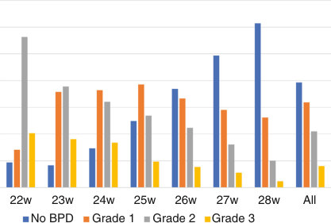

• Fig. 70.1 Incidence of bronchopulmonary dysplasia (BPD) by the 2016 NIH Workshop definition among infants born at gestational age 22 to 28 weeks who survived to 36 weeks’ postmenstrual age (PMA) in the Neonatal Research Network between January 1, 2013, and December 31, 2018. (Data adapted from Bell EF, Hintz SR, Hansen NI, et al. Mortality, in-hospital morbidity, care practices, and 2-year outcomes for extremely preterm infants in the US, 2013–2018. JAMA. 2022;327[3]:248–263.)

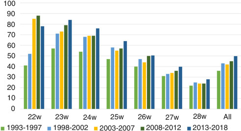

• Fig. 70.2 Trends in the incidence of bronchopulmonary dysplasia (BPD) defined as oxygen at 36 weeks’ postmenstrual age (PMA) in infants born at gestational age 22–28 weeks and alive at 36 weeks’ PMA in the Neonatal Research Network between January 1, 1993, and December 31, 2018. (Data adapted from Bell EF, Hintz SR, Hansen NI, et al. Mortality, in-hospital morbidity, care practices, and 2-year outcomes for extremely preterm infants in the US, 2013-2018. JAMA. 2022;327[3]:248–263; Stoll BJ, Hansen NI, Bell EF, et al. Trends in care practices, morbidity, and mortality of extremely preterm neonates, 1993–2012. JAMA. 2015;314[10]:1039–1051.)

## PDF page 1334

TABLE

### Definition of Bronchopulmonary Dysplasia: Diagnostic Criteria

### 70.1

NICHD Workshop 2018

Mode of Support

Mild BPD Noninvasive PPV OR NC ≥3 L/min

NC 1–3 L/min OR Oxygen hood

NC <1 L/min

Moderate BPD Invasive PPV Noninvasive PPV OR NC ≥3 L/min

NC 1–3 L/min OR Oxygen hood

NC 1 L/min

Severe BPD Invasive PPV

Noninvasive PPV OR NC ≥3 L/min

BPD, Bronchopulmonary dysplasia; NC, nasal cannula; NICHD, National Institute of Child Health and Human Development; OR, odds ratio; PPV, positive pressure ventilation. Adapted from Jobe AH, Bancalari E. Bronchopulmonary dysplasia. Am J Respir Crit Care Med. 2001;163:1723; Higgins RD, Jobe AH, Koso-Thomas M, et al. Bronchopulmonary dysplasia: executive summary of a workshop. J Pediatr. 2018;197:300; and Jensen EA, Dysart K, Gantz MG, et al. The diagnosis of bronchopulmonary dysplasia in very preterm infants. an evidence-based approach. Am J Resp Crit Care Med. 2019;200(6):751.

### Bronchopulmonary Dysplasia Pathogenesis

Extreme Prematurity

Antenatal Factors - IUGR, placental dysfunction - Chorioamnionitis - Bacterial colonization - Maternal hypertension/preeclampsia - Maternal smoking/drugs - Genetic predisposition

Lung Injury/Developmental Arrest Airway-Vascular Damage Decreased Alveoli and Capillaries

Respiratory Failure Pulmonary Hypertension

Repair/Regeneration

Chronic Respiratory Disease: BPD

### • Fig. 70.3 Algorithm for pathogenesis of bronchopulmonary dysplasia. BPD, Bronchopulmonary dyspla-

sia; IUGR, intrauterine growth restriction. (Modified from Abman S, Bancalari E, Jobe A. The evolution of bronchopulmonary dysplasia after 50 years. Am J Respir Crit Care Med. 2017;195[4]:421.)

Epidemiologic studies have identified male gender, White race, and maternal smoking and hypertension as additional risk factors associated with increased risk for BPD.12,13 Intrauterine growth restriction is also associated with increased risk for BPD, likely secondary to impaired alveolar and vascular growth.14 The role of maternal chorioamnionitis in the risk for BPD has been unclear, with multiple studies showing increased risk for BPD in infants born to mothers with evidence for chorioamnionitis; others, however, have failed to show such association.15 The effect of chorioamnionitis on the fetal lung varies from inflammation and lung injury

Prospective NICHD Data 2019 Fio2

21% NC ≤2 L/min

22%–29%

22%–70%

21% Noninvasive PPV OR NC >2 L/min 22%–29%

≥30%

>70%

>21% Invasive PPV

≥30%

Postnatal Factors

- Severe respiratory failure - Mechanical ventilation - Supplemental oxygen - Infection/sepsis - Patent ductus arteriosus - Nutritional deficiencies

Early Respiratory Death

Disease Resolution

to enhanced lung maturation depending on fetal inflammatory response, the organism causing the infection, and the severity and duration of infection.16 The inconsistency in results is also compounded by the imprecision in the diagnosis of chorioamnionitis.

### Postnatal Factors Mechanical Trauma

Although high-peak inspiratory pressure is one of the factors implicated as a cause of BPD, it is difficult to separate the role of the high pressures from the underlying lung

## PDF page 1335 | printed page 1333

disease on the chronic lung damage. The damaging effect of high airway pressure and large tidal volume on the surfactant-deficient lung was demonstrated in preterm lambs. Lung compliance was decreased after ventilation with excessive tidal volumes given before surfactant replacement.17 Experimental evidence strongly suggests that excessive tidal volumes can damage the lung, initiate an inflammatory cascade, and interfere with normal lung development.18 The deleterious effect of prolonged ventilation on long-term lung development was shown in preterm lambs, where chronic noninjurious mechanical ventilation for 6 days resulted in persistent alveolar simplification at 5 months of age.19

Although injury from mechanical ventilation continues to be an important factor in the pathogenesis of BPD, today most premature infants who require prolonged ventilation because of milder respiratory failure or poor respiratory effort receive lower airway pressures. A more gentle ventilation approach minimizes but does not completely prevent the inflammatory activation and damage in the lungs.20 Therefore, although mechanical trauma appears to play a lesser role, developmental alteration of lung growth by less injurious respiratory support continues to be a contributor among the multiple factors leading to the development of milder BPD.

### Oxygen Toxicity

Clinical and experimental evidence suggested that pulmonary oxygen toxicity was a major factor in the pathogenesis of the severe original BPD. Although many tissues can be injured by high oxygen concentrations, the lung is exposed directly to the highest partial pressure of oxygen. The precise concentration of oxygen that is toxic to the immature lung probably depends on several variables, including gestational age, nutritional and endocrine status, and duration of exposure to oxygen and other oxidants. Although a safe level of inspired oxygen has not been established, any concentration in excess of what the fetal lung is exposed to in utero may increase the risk of lung damage when administered over a long period of time.

The pulmonary changes of oxygen toxicity are nonspecific and consist of atelectasis, edema, alveolar hemorrhage, inflammation, fibrin deposition, and thickening of alveolar membranes. There is early damage to capillary endothelium in animals, and plasma leaks into interstitial and alveolar spaces. Pulmonary surfactant can be inactivated by protein in the airspaces, adding to the risk of atelectasis. Type 1 alveolar lining cells can be injured early, and bronchiolar and tracheal ciliated cells can also be damaged by oxygen. Our understanding of the effects of oxygen on lung development are largely derived from the exposure of neonatal rodents to prolonged hyperoxia. Neonatal rodents are, however, more sensitive to oxygen and will die after 3 days of exposure to 100% oxygen, whereas preterm newborns may survive for weeks. Moreover, preconditioning by inflammation, infection, and hypoxia, which frequently occur in preterm newborns, decreases mortality from oxygen in neonatal rodents. Although oxygen remains a contributor to the development of BPD, the use of antenatal corticosteroids, surfactant, and

more careful oxygen titration has limited the role of oxygen in the development of mild BPD.

### Postnatal Infection and Colonization

There is ample evidence supporting the role of infections in the development of BPD, especially in very small infants, in whom nosocomial infections are associated with a marked increase in the risk of BPD.21 Postnatal adenovirus and cytomegalovirus infection have also been associated with increased risk of BPD.22 Antenatal colonization with ureaplasma has been evaluated as one of the possible risk factors for BPD. Experimental studies in animal models have shown that colonization of fetal lung with ureaplasma resulted in increased inflammation, fibrosis, impaired alveolar development, and immune modulation with decreased regulatory T cells and polarization toward a T-helper 1 phenotype.23 Several studies have suggested an association between Ureaplasma urealyticum tracheal colonization at birth and the development of BPD in very premature infants. Although treatment with azithromycin has been shown to eradicate ureaplasma from colonized infants, the results on development of BPD have been inconsistent.24,25

The presence of an airway microbiome at birth has been demonstrated, and dysbiosis with decreased abundance of Lactobacilli and increases in Proteobacteria and Firmicutes have been associated with progression of BPD. Causal relationships, however, have not been demonstrated, and more studies, including manipulation of airway microbiome and its effects on BPD, are needed.26

### Patent Ductus Arteriosus and Pulmonary Edema

There is an association between the presence of moderate-tolarge PDA for at least 7 days and an increased risk for BPD (Fig. 70.4).27 This may be secondary to increased pulmonary blood flow producing an increase in interstitial fluid and a decrease in pulmonary compliance, and increased airway resistance. This can prolong the need for mechanical ventilation with higher ventilatory pressures and oxygen concentrations, increasing the risk for BPD. Despite epidemiologic evidence of an association between PDA and BPD, prospective clinical trials to evaluate early closure of the PDA have failed to show a decrease in the incidence of BPD.28

Infants with BPD have a predisposition to fluid accumulation in their lungs. Possible causes are an increase in pulmonary vascular resistance, low plasma oncotic pressure, and increased capillary permeability, which favor the extravascular accumulation of fluid. Pulmonary vascular pressure can be increased because of remodeling of the pulmonary vessels, which is aggravated by hypoxemia and hypercapnia. Fluid accumulation can also be secondary to the left ventricular dysfunction that has been described in patients with chronic respiratory failure. Capillary permeability might be increased secondary to the effects of high inspired oxygen concentrations, mechanical trauma, increased flow caused by a PDA, and inflammation on the capillary endothelium. The abnormal accumulation of lung fluid in infants with BPD further compromises lung function, perpetuating

## PDF page 1336

100

OR for BPD

10

1

0.1

GA per week

Female

PDA

BW per 100 g

• Fig. 70.4 Perinatal and postnatal risk factors for bronchopulmonary dysplasia (BPD) defined as 28 days’ duration of oxygen dependency during hospitalization. Obtained by logistic regression analysis from all extremely premature infants born at University of Miami Jackson Memorial Medical Center during the period 1995–2000. (N = 505 alive at 28 days; birth weight [BW], 500–1000 g; gestational age [GA], 23–32 weeks). OR, Odds ratio; PDA, patent ductus arteriosus; RDS, respiratory distress syndrome. (From Bancalari E, Claure N, Sosenko IR. Bronchopulmonary dysplasia: changes in pathogenesis, epidemiology and definition. Semin Neonatol. 2003;8:63.)

a cycle in which more aggressive respiratory assistance is required, which produces further lung damage.

### Other Factors

The possibility of a genetic predisposition to BPD has been evaluated in recent years. Studies evaluating twin pairs have shown that genetic factors contributed to a significant proportion of the variance in risk for BPD. The efforts to identify specific candidate genes using genome-wide association studies have so far not been successful.29

There is also evidence that vitamin A deficiency could increase the risk for BPD in preterm infants. Vitamin A levels are lower in infants who develop BPD when compared to those who recovered without lung sequelae. This possible association is supported by the similarities between some of the airway epithelial changes observed in severe BPD and vitamin A deficiency and by the clinical evidence that vitamin A administration during the weeks after birth reduces the risk of BPD.30

Early adrenal insufficiency has also been suggested as a contributing factor in the development of BPD in the smallest infants. Infants with lower cortisol levels in the first week of life have an increased incidence of PDA, more lung inflammation, and an increased incidence of BPD.31 Early hydrocortisone supplementation has been shown to increase survival without BPD, but the increased incidence of sepsis in the smallest treated infants has prevented adoption of this treatment.32

### Final Common Pathway

Inflammation plays a crucial role in the development of BPD and can be triggered by multiple factors, such as oxygen, mechanical ventilation, PDA, and infections. Multiple studies have shown the presence of inflammatory cells, proinflammatory cytokines such as chemokines, interleukin, leukotrienes, platelet-activating factor, and other mediators in infants with BPD. Increased desmosine excretion in the urine during the first week of life has been described

Sepsis

PDA + sepsis

Chorioamnionitis

Severe RDS

in infants who subsequently develop BPD, indicating increased elastin degradation resulting from lung inflammation and injury. Increased concentrations of inflammatory mediators could contribute to the bronchoconstriction and vasoconstriction and the increased vascular permeability characteristic of these infants. The inflammatory reaction might also be responsible for the decreased alveolar and capillary formation characteristic of infants with BPD.33 This is a key component in the pathogenesis of BPD and results in a reduction in alveolar number and gas exchange surface area, as well as a decrease in lung capillaries.

### Pathology

The pathologic picture of BPD has evolved significantly over the past few decades. Most of the infants with BPD nowadays are extremely premature and have milder forms of BPD. These infants have diffuse injury with little emphysema or fibrosis. The characteristic morphologic changes in lungs with mild BPD are reduced number and simplified alveoli, decreased and dysmorphic capillaries, and a reduction in the gas exchange surface area (Figs. 70.5 and 70.6).34

A small number of these infants still go on to require prolonged mechanical ventilation and high oxygen and end up with the classic severe BPD. On histologic examination, these lungs show areas of emphysema, sometimes coalescing into larger cystic areas, surrounded by areas of atelectasis, interstitial edema, an increase in fibrous tissue, and widespread bronchial and bronchiolar mucosal hyperplasia and metaplasia (Fig. 70.7). Often, there are vascular changes of pulmonary hypertension, such as medial muscle hypertrophy and elastic degeneration. There also may be evidence of right ventricular hypertrophy and, in some cases, left ventricular hypertrophy as well.

### Clinical Presentation

In their original description of BPD, also often called old BPD, Northway and colleagues described the clinical, radiographic, and pathologic course of a group of infants with

## PDF page 1337 | printed page 1335

• Fig. 70.5 Lung tissue section (autopsy) from a term +5 months child. This specimen shows numerous secondary crests and alveolar structures within the airspaces and alveolar ducts (AD), yielding a pattern of increased acinar complexity. b, Bronchiole. (From Coalson JJ. Pathology of new bronchopulmonary dysplasia. Semin Neonatol. 2003;8[1]:73–81.)

• Fig. 70.6 Lung tissue section (biopsy) from an infant with new bronchopulmonary dysplasia showing enlarged airspaces including alveolar ducts (AD) and scattered alveolar structures (arrow) lacking additional branching, resulting in acinar simplification. (From Coalson JJ. Pathology of new bronchopulmonary dysplasia. Semin Neonatol. 2003;8[1]:73–81.)

• Fig. 70.7 Low-magnification view showing areas of emphysema alternating with areas of partial collapse. (From Bancalari E, et al. Barotrauma to the lung. In Milunsky A, et al., eds. Advances in Perinatal Medicine. New York: Plenum; 1982:181, with permission of Springer Science and Business Media.)

• Fig. 70.8 Chest radiograph shows areas of hyperinflation and emphysema with adjacent dense areas of atelectasis. This picture is characteristic of old bronchopulmonary dysplasia.

severe RDS requiring mechanical ventilation with high airway pressures and oxygen concentrations. The respiratory course of these infants evolved from the initial severe RDS to final stage of chronic lung disease with a high incidence of cor pulmonale and mortality. The radiographic picture of these infants with severe chronic lung disease was characterized by increased densities secondary to areas of collapse and fibrosis, with adjacent large emphysematous areas (Fig. 70.8).

The clinical picture of BPD has evolved significantly in the past few decades because of the increasing survival of extremely premature infants and improvements in the care of these infants. Most of these infants initially have mild respiratory failure requiring continuous positive airway pressure (CPAP) or ventilation with low pressures and oxygen concentrations. In these cases, the functional and radiographic changes are usually milder, revealing more diffuse haziness without the marked changes observed in the severe forms of BPD (Fig. 70.9). This entity has been termed new BPD.33 Most of these infants show a slow but steady improvement in their lung function and radiographic changes and, after variable periods, can be weaned from respiratory support and supplemental oxygen before discharge.

A small group of preterm infants has atypical respiratory course with inadequate response to surfactant and continued severe respiratory failure requiring mechanical ventilation with high airway pressures and oxygen concentrations. Their respiratory course is often complicated by pulmonary air leaks, secondary pulmonary or systemic infections, and recurrent pulmonary edema because of PDA or inflammation, progressing to severe BPD. The radiographic picture of these infants commonly resembles that of old BPD. These

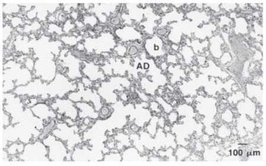

• Fig. 70.5 Lung tissue section (autopsy) from a term +5 months child. This specimen shows numerous secondary crests and alveolar structures within the airspaces and alveolar ducts (AD), yielding a pattern of increased acinar complexity. b, Bronchiole. (From Coalson JJ. Pathology of new bronchopulmonary dysplasia. Semin Neonatol. 2003;8[1]:73–81.)

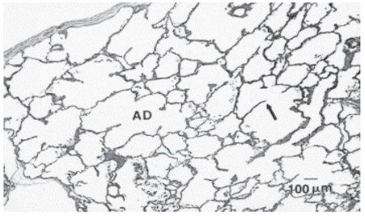

• Fig. 70.6 Lung tissue section (biopsy) from an infant with new bronchopulmonary dysplasia showing enlarged airspaces including alveolar ducts (AD) and scattered alveolar structures (arrow) lacking additional branching, resulting in acinar simplification. (From Coalson JJ. Pathology of new bronchopulmonary dysplasia. Semin Neonatol. 2003;8[1]:73–81.)

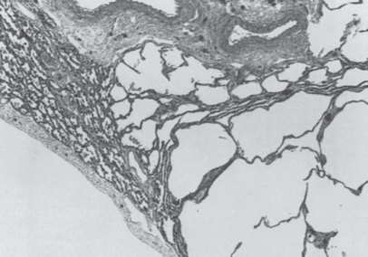

• Fig. 70.7 Low-magnification view showing areas of emphysema alternating with areas of partial collapse. (From Bancalari E, et al. Barotrauma to the lung. In Milunsky A, et al., eds. Advances in Perinatal Medicine. New York: Plenum; 1982:181, with permission of Springer Science and Business Media.)

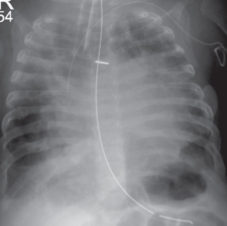

• Fig. 70.8 Chest radiograph shows areas of hyperinflation and emphysema with adjacent dense areas of atelectasis. This picture is characteristic of old bronchopulmonary dysplasia.

## PDF page 1338

• Fig. 70.9 Chest radiograph from an infant with new bronchopulmonary dysplasia showing generalized homogenous opacities with an interstitial pattern.

infants commonly develop pulmonary hypertension and signs of right heart failure. In these infants, severe airway damage with bronchomalacia can lead to dynamic airway obstruction, especially during episodes of agitation and increased intrathoracic pressure.35 Furthermore, anastomoses between the systemic and pulmonary circulations can aggravate their pulmonary hypertension.

Because of the respiratory failure, infants with BPD take oral feedings with difficulty and often require nasogastric or orogastric feeding. Weight gain is usually less than the expected normal even when they receive an appropriate amount of calories appropriate for their age. This lower weight gain can be a result of chronic hypoxia and the higher energy expenditure required by the increased work of breathing.

The diagnosis of BPD is based on the clinical and radiographic course described earlier, but these signs are not specific for any given etiology. For this reason, specific etiologies that could lead or contribute to the lung damage must be considered before concluding that the infant has BPD. Among these, one must rule out congenital heart disease, congenital pulmonary anomalies, chemical pneumonitis resulting from recurrent aspiration, cystic fibrosis, or disorders of surfactant homeostasis.

### Imaging in Bronchopulmonary Dysplasia

Chest radiograph is the most common and accessible imaging modality for diagnosis and assessment of BPD. Radiographs allow for quick evaluation of the pulmonary parenchyma, airways, and endotracheal tube placement in intubated infants and remain the standard imaging for initial evaluation of lung disease and potential complications such as infection and pneumothorax.

Computed tomography (CT) of the chest allows assessment of the pulmonary parenchyma with greater resolution but with the downside of large exposure to radiation. Prospective studies have shown correlation of chest CT imaging

findings with clinical outcomes, including duration of oxygen therapy and ventilatory impairment.36 Because of radiation exposure and difficulty in transporting the most critical infants, chest CT is usually reserved for assessment of lung disease in infants with more severe BPD in which differential diagnoses are being considered.

Lung ultrasound is an emerging technique that can be performed at bedside as a point-of-care evaluation. Most studies have focused on assessment of early lung disease severity. More recently, lung ultrasound findings have been shown to be predictive of BPD.37 The main limitations of lung ultrasound are its operator dependency, lack of standardized protocols for imaging acquisition and assessment, and lack of data on its predictive ability for long-term outcomes. Further studies are warranted to assess the utility of lung ultrasound in the prediction and management of BPD.

MRI of the lung has been classically limited because of the multiple air-tissue interfaces and low density of the lung. Newer techniques such as ultra-short echo MRI have allowed better assessment of the lung parenchyma as well as dynamic assessment of the airways for tracheobronchomalacia, a common co-morbidity in severe BPD. Lung MRI has shown good correlation with disease severity and is predictive of the respiratory support at discharge. Hyperpolarized gas MRI can also provide functional and microstructural assessments of the lungs that are not available through other imaging methods. These techniques have the potential to aid in disease classification, prediction of long-term outcomes, and use for selection of patients and assessment of therapies for clinical trials but are still in development stage.10

### Prediction of Bronchopulmonary Dysplasia

Studies have been performed to develop scores that can predict the risk for BPD in ventilated preterm infants.38 Most of these scores include the state of maturation of the infant and factors that reflect the severity of the initial respiratory failure. These scores are helpful in identifying patients for clinical trials and could become more useful in the future if effective early preventive therapies become available.

### Pulmonary Function

The disruption of pulmonary function in BPD reflects the structural alterations of the lungs, with the degree of pulmonary function abnormalities varying depending on age and the severity of lung injury. The early clinical course of infants who later develop severe BPD is marked by low compliance, low to normal functional residual capacity (FRC), and high airway resistance. These alterations in pulmonary function during the first weeks of life have been used with some success to improve the accuracy of BPD prediction models.39

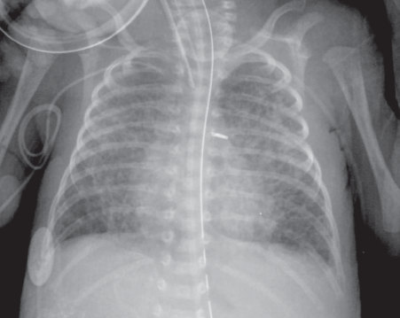

• Fig. 70.9 Chest radiograph from an infant with new bronchopulmonary dysplasia showing generalized homogenous opacities with an interstitial pattern.

## PDF page 1339 | printed page 1337

In infants with severe BPD, FRC increases to above normal range with age reflecting gas trapping secondary to small airway obstruction. These infants have abnormal distribution of inspired gas, reflecting involvement of the small airways, but in infants with milder forms of BPD, the distribution of the inspired gas is usually normal as measured by nitrogen clearance delay.

Infants with severe BPD characteristically have increased airway resistance and airway hyperreactivity. Multiple factors contribute to airway changes, including bronchiolar epithelial hyperplasia and metaplasia, mucosal edema secondary to trauma, oxygen toxicity, pulmonary edema secondary to PDA, and infection. These infants can also have bronchoconstriction resulting from smooth muscle hypertrophy. In some infants, tracheobronchomalacia develops, which is responsible for marked airway obstruction, especially during periods of agitation and increased intrathoracic pressure. Increased airway resistance can alter the time constant of different regions of the lung and impair the distribution of the inspired gas, favoring uneven lung expansion.

The lung compliance in BPD is decreased because of fibrosis, edema, overdistention, and collapse of lung parenchyma. It is also possible that some of these infants have a decreased concentration or inactivation of surfactant on the alveolar surface. In addition, the airway obstruction results in frequency dependence of dynamic compliance, thereby compliance decreases at higher respiratory rates.

The high resistance and decreased compliance result in a markedly increased work of breathing that contributes to the hypoventilation and hypercapnia frequently observed in these infants. Minute ventilation is usually increased, but because of the lower lung compliance, this is accomplished with a smaller tidal volume and a higher respiratory rate than normal. Thus there is an increase in dead space ventilation that also contributes to alveolar hypoventilation and CO2 retention. The increased Paco2 is also secondary to an increased alveolar-arterial CO2 gradient produced by ventilation-perfusion mismatch and increased alveolar dead space. Chronic hypercapnia often results in an increased serum bicarbonate concentration that tends to compensate for the respiratory acidosis. This increase in base is often exaggerated by the use of loop diuretics.

Infants with severe BPD have hypoxemia and require supplemental oxygen to maintain acceptable oxygenation levels. The hypoxemia results from a combination of ventilation-perfusion mismatch and alveolar hypoventilation. The oxygen requirement decreases gradually as the disease process improves, but it can increase during feedings, agitation, or episodes of pulmonary infection or edema.

### Prevention of Bronchopulmonary Dysplasia

There is a wide variation in the incidence of BPD among different centers, suggesting that certain steps in the management

of preterm infants can influence the risk of BPD.5 Because BPD is a multifactorial disease, effective prevention requires a combination of strategies to limit lung and vascular injury and promote normal development (Table 70.2).

Because BPD is exclusively seen in preterm infants, any strategy that can prolong pregnancy will reduce the incidence of BPD, but attempts to develop these strategies so far have not been very successful. Administration of antenatal steroids to promote maturation of surfactant system has been shown to reduce the incidence and severity of RDS, but clinical trials have failed to show protection from BPD.40 The effect of antenatal corticosteroids on long-term lung development is the result of a complex interaction of multiple factors, including increased survival of more preterm infants that are more likely to develop BPD, transient impairment of alveolarization, and timing between antenatal corticosteroid administration and delivery, which will modulate early lung injury

Strategies for Prevention of

TABLE

70.2

Bronchopulmonary Dysplasia

Strategies From Randomized Clinical Trials/ Meta-Analyses

Vitamin A30 RR: 0.87 (CI 0.77–0.99)a

OR: 0.83 (CI 0.71–0.96)a,b

Noninvasive respiratory

support42

Lower oxygen target47 RR: 0.87 (CI 0.81–0.94)a,c

RR: 0.86 (CI 0.78–0.96)a

High-frequency oscillatory

ventilation46

Postnatal dexamethasone

Early49 RR 0.79 (CI 0.71–0.88)a

Late50 RR 0.76 (CI 0.66–0.88)a

Postnatal hydrocortisone32 OR: 1⋅48 (1⋅02–2⋅16)d,e

RR: 0.58 (0.44–0.77)b,d

Postnatal surfactant +

budesonide59

Strategies With Inconclusive Evidence

Antenatal steroids

Exogenous surfactant

Caffeine for apnea or extubationf

Volume-targeted ventilationf

Inhaled nitric oxide

Early PDA closure

Stem cell treatment

aMeta-analysis. bBPD or death. cBPD: oxygen at 36 weeks. dRandomized controlled trial. eSurvival without BPD. fLacking data from trials with BPD as primary outcome BPD, Bronchopulmonary dysplasia; OR, odds ratio; PDA, patent ductus arteriosus; RR, risk ratio.

## PDF page 1340

responses to mechanical ventilation. Together, those factors likely reduce early lung injury and have contributed to the lower incidence of severe BPD.

There is significant evidence from animal studies suggesting that aggressive use of respiratory support at birth, even for a short duration, may result in lung injury18; therefore the effort should be directed to reduce the infant’s exposure to high airway pressures, tidal volumes, and inspired oxygen, as much as possible. Surfactant replacement therapy after endotracheal intubation has been shown to decrease mortality, the incidence of severe RDS, and the need for aggressive ventilation but has failed to show a reduction in the incidence of BPD, likely because of increased survival of more preterm infants. Surfactant replacement therapy also likely contributed to the lower incidence of severe BPD. To decrease the risk of lung injury associated with positive pressure ventilation during surfactant replacement, multiple less-invasive methods of surfactant instillation, like nebulization or less-invasive surfactant administration (LISA), are currently being evaluated, showing some reduction in the incidence of BPD.41

Although the use of early CPAP to reduce the use of mechanical ventilation has been shown to have a small effect on reducing the incidence of death or BPD,42 a large proportion of the more premature infants fail CPAP and require invasive ventilation. Nasal positive pressure ventilation (NIPPV) has been evaluated as an alternative mode of noninvasive ventilation to avoid endotracheal intubation. The effect of NIPPV on the incidence of BPD has been inconsistent among trials, with recent large randomized clinical trials (RCTs) failing to show a reduction in the incidence of BPD with its use. Interpretation of these trials is confounded by the wide range of devices and interfaces used, and especially by the inconsistent use of synchronization strategies.43 High-flow nasal cannula (HFNC) is another mode of noninvasive respiratory support that has been evaluated because of its ease of use and lower risk of injury to nares when compared with CPAP. There is increasing evidence that the HFNC is inferior to nasal continuous positive airway pressure (NCPAP) as the primary mode of respiratory support after birth, with increased risk of treatment failure and a trend toward increased incidence of BPD.44 These data suggest the type of respiratory support for each infant should be individualized, with close monitoring of the respiratory status over time.

Because a large number of preterm infants require invasive mechanical ventilation, it is crucial to limit their exposure to excessive pressure and tidal volume. The use of volume-targeted ventilation has been shown to reduce the duration of mechanical ventilation and the combined outcome of death or BPD.45 Although there are some data suggesting that high-frequency ventilation can reduce lung injury, it has not been shown to be consistently effective in reducing the incidence of BPD.46

Because oxygen is an important factor in the pathogenesis of BPD, continuous monitoring of arterial oxygen saturation by pulse oximetry (Spo2) should be a standard

practice to titrate oxygen supplementation and reduce exposure. To find the optimum target Spo2 range, three large multicenter trials have compared the effect of different target Spo2 ranges on mortality and neonatal morbidities. A meta-analysis of these trials showed a small but significant reduction in the incidence of BPD in the lower target group. However, the lower target was associated with a higher incidence of mortality and necrotizing enterocolitis (NEC), suggesting a need to strike a critical balance when targeting Spo2.47

Presently, there is no agreement among clinicians regarding the role of different PDA management strategies in the development of BPD. Although some epidemiologic data suggest that the persistence of a hemodynamically significant PDA is associated with an increased incidence of BPD,27 the results of prospective clinical trials to evaluate whether early closure of the PDA would improve pulmonary outcomes have not confirmed this hypothesis. Further studies are necessary to identify the best timing and method for closure of hemodynamically significant PDAs.

Postnatal growth failure is common in infants at high risk for BPD, and undernutrition has been associated with impaired lung growth in animal models. Despite a paucity of clinical evidence, a nutritional strategy consisting of judicious fluid restriction while providing adequate macro- and micronutrients and preventing growth failure is recommended. There is some evidence that exclusive breast-milk feeding is associated with a lower incidence of BPD.48

Administration of postnatal systemic corticosteroids during the early stages of respiratory failure to prevent its progression to BPD has been well studied, with several reports showing rapid improvement in lung function, facilitating weaning from the ventilator, and decreasing the risk of BPD.49,50 Many potential mechanisms for these beneficial effects include enhanced production of surfactant and antioxidant enzymes, decreased bronchospasm, decreased pulmonary and bronchial edema and fibrosis, improved vitamin A status, and decreased responses of inflammatory cells and mediators in the injured lung. Potential complications of prolonged steroid therapy include masking signs of infection, arterial hypertension, hyperglycemia, increased proteolysis, adrenocortical suppression, somatic and lung growth suppression, and hypertrophic cardiomyopathy. Most importantly, long-term follow-up studies suggest that infants who received early high-dose postnatal dexamethasone therapy have a worse neurologic outcome than control infants.51

The recognition of potential side effects of early highdose postnatal dexamethasone led to a shift in use toward shorter courses with lower doses and given beyond the first weeks of life. It appears that this strategy may offer advantages and fewer side effects than the previous more aggressive treatment strategy, confirming the potential role of low-dose dexamethasone therapy specifically for infants at high risk for BPD.50 Long-term data for this strategy are, however, limited by the small number of patients randomized with long-term data and the frequent use of steroids outside the

## PDF page 1341 | printed page 1339

protocol in trials that have attempted to address this issue.52 A meta-regression analysis reported a significant effect modification by risk for BPD. With a risk for BPD less than 33%, corticosteroid treatment increased the chance of death or cerebral palsy, whereas when the risk for BPD exceeded 60%, corticosteroid treatment reduced this risk.53

In an attempt to avoid the potential neurotoxic effects of dexamethasone, systemic hydrocortisone treatment has been evaluated as an alternative for prevention of BPD because of its lower neurotoxic effects. Earlier trials evaluating the use of hydrocortisone soon after birth in extremely preterm infants showed improvement in respiratory outcomes but with an increased risk of gastrointestinal perforation. More recent evidence suggests that a lower dose may improve respiratory outcomes without increasing the risk of gastrointestinal perforation or neurodevelopmental impairment in early childhood, but with a potential increased risk of sepsis in the most preterm infants.32,54 Most recent available data demonstrate that among mechanically ventilated very preterm infants, administration of a 22-day course of systemic hydrocortisone between 7 and 14 days after birth, compared with a placebo, did not improve the composite outcome of death or BPD at 36 weeks’ postmenstrual age. These findings do not support the use of hydrocortisone for this indication.55 On the other hand, a 10-day course of hydrocortisone after the second week of life does not decrease the incidence of BPD.56 To induce the beneficial effects on the lung but minimize the systemic side effects, steroids have been administered locally, either alone by nebulization or by direct tracheal instillation with an exogenous surfactant. Nebulized budesonide, started in the first day of life, has been shown to decrease the incidence of BPD at 36 weeks without a detriment to neurodevelopmental outcomes but at the expense of increased mortality, and therefore is not recommended.57 Only one trial examined the role of inhaled budesonide started at the first week of life in preventing BPD with no effect, and no trials have examined long-term outcomes with these strategies.58 Intratracheal budesonide mixed with surfactant has been successfully used to prevent BPD in randomized trials with no adverse neurologic outcomes in a limited number of patients.59,60 This strategy is now being evaluated in larger multicenter trials to include neurodevelopmental outcomes.

A network meta-analysis of different postnatal corticosteroid regimens, including systemic, inhaled, and intratracheal steroids, suggested that dexamethasone started between 7 and 14 days at medium cumulative doses of 2 to 4 mg/kg is the most effective strategy in preventing BPD.61 This strategy, however, is supported by low-quality evidence and also lacks long-term data on neurodevelopmental outcomes. Although the avoidance of steroids may in fact be detrimental to a class of infants at high risk for BPD, the optimal drug, age of treatment, dose schedule, and duration of therapy still needs to be established.

The administration of caffeine to wean infants from mechanical ventilation and to treat apnea of prematurity has been associated with a significant reduction in the

incidence of BPD.62 Some of the possible mechanisms of this beneficial effect are shorter duration of mechanical ventilation and the anti-inflammatory or diuretic effects of caffeine. Vitamin A supplementation has been shown to result in a small reduction in the incidence of BPD, likely because of its role in lung development and repair of respiratory epithelium after injury.30 Because endogenous nitric oxide is required for alveolar and vascular development, and low-dose inhaled nitric oxide supplementation in animal models of BPD inhibits inflammation and reduces lung injury, clinical trials have evaluated low-dose inhaled nitric oxide supplementation for the prevention of BPD. These studies have provided inconsistent results, with a systematic review showing no significant effect of inhaled nitric oxide on BPD.63

Increasing knowledge of molecular pathways of alveolar and vascular development has resulted in the development of innovative strategies for prevention of BPD. Mesenchymal stem cells are one of these strategies, with multiple reports of their effectiveness in prevention as well as treatment of hyperoxia-induced lung injury in animal models.64,65 The results from a preliminary phase 1 clinical study have been promising, but additional work is needed to better understand its mechanism of action, safety, and efficacy in preterm infants.

### Management of Established Bronchopulmonary Dysplasia

Prevention of further lung damage is the cornerstone of management by avoiding, as much as possible, all factors that predispose the lung to more injury. There is a lack of good-quality evidence for managing infants with BPD, resulting in significant variation in treatment practices.

### Respiratory Support

During the initial phase of respiratory failure, the goal is to avoid unnecessary intubation and mechanical ventilation– associated lung injury. When mechanical ventilation is used, the lowest peak airway pressure necessary to obtain adequate ventilation must be applied. The tidal volume should be closely monitored with avoidance of excessively low (Vt <3 mL/kg) or excessively high tidal volumes (Vt >7 mL/kg) during acute phase of illness. Inspiratory times between 0.3 and 0.5 seconds are used, because shorter inspiratory times can exaggerate the maldistribution of the inspired gas, whereas longer inspiratory times may increase the risk of airspace rupture and cardiovascular side effects. An end-expiratory pressure between 4 and 8 cm H2O is usually applied to achieve lung recruitment without causing more overdistension.

Adequacy of gas exchange should be monitored closely to avoid large fluctuations in ventilation and oxygenation status. The arterial oxygen tension (Pao2) and arterial carbon dioxide tension (Paco2) measured in arterial blood are

## PDF page 1342

considered the reference standards, but the results from the samples obtained by arterial puncture should be interpreted carefully, because the infant frequently responds to pain with crying or apnea. Pulse oximeters offer the most reliable estimate of arterial oxygenation and have the advantages of simplicity of use and the possibility of assessing oxygenation continuously. Although there are no conclusive data in the literature on the optimal level of oxygenation for these infants, in general, it is recommended to maintain the oxygen saturation in the range of 90% to 95% to minimize the risk of oxygen exposure and toxicity and prevent hypoxemia with associated risk of morbidities.47 The ideal range of Paco2 for infants with BPD is not established, but avoidance of values higher than 55 and less than 40 mm Hg during the initial period after birth is warranted to limit changes in cerebral perfusion.

Weaning these patients from the ventilator is often difficult and must be accomplished gradually. When the patient can maintain an acceptable Spo2 and Paco2 with low peak pressures (15–18 cm H2O) and Fio2 lower than 0.3 to 0.4, the ventilator rate is gradually reduced to allow the infant to perform an increasing proportion of the respiratory work. During the process of weaning, sometimes it may be necessary to increase the Fio2. Concurrently, the Paco2 can rise, but as long as the pH is within acceptable limits, some degree of hypercapnia must be tolerated to wean these infants from the ventilator. In small infants, caffeine can be used as a respiratory stimulant during the weaning phase and before extubation.62 The use of NCPAP or NIPPV after extubation can stabilize respiratory function and reduce the need to reinstitute mechanical ventilation.

Infants with established BPD and chronic respiratory failure commonly have increased dead space, heterogeneous areas of different lung compliance, and higher airway resistance necessitating longer inspiratory times and higher tidal volumes compared with those used during the early stages of illness. In some of the infants with severe airway obstruction, especially those with bronchomalacia, the use of high positive end-expiratory pressure levels of 6 to 10 cm H2O may help reduce expiratory airway resistance and improve alveolar ventilation.

Although it is necessary to reduce the Fio2 as quickly as possible to prevent oxygen toxicity, it is also important to maintain the Spo2 above 90% to ensure adequate tissue oxygenation and prevent the pulmonary hypertension and cor pulmonale that can result from chronic hypoxemia. Furthermore, infants with BPD might respond to episodes of acute hypoxemia with increased airway and vascular resistance. Because oxygen consumption increases and Pao2 may decrease during feedings, it may be necessary to provide a higher Fio2 to prevent hypoxemia. Oxygen therapy may be required for several weeks or months and some of these patients are discharged home on oxygen therapy. This practice requires a supportive family and home environment to be accomplished safely and successfully.

### Bronchodilator Therapy

Infants with severe BPD can have airway smooth muscle hypertrophy and airway hyperreactivity. Because hypoxia can increase airway resistance in these patients, maintenance of adequate oxygenation is important to avoid bronchoconstriction. Bronchodilators, most of them β-agonists, administered by inhalation have been shown to reduce airway resistance in infants with BPD. However, their safety and efficacy have not been evaluated in RCTs. Their effect is usually short-lived, and many of these drugs have cardiovascular side effects such as tachycardia, hypertension, and possible arrhythmias. Because of this, it is preferred to limit their use to the management of acute exacerbations of airway obstruction.

### Corticosteroid Therapy

Systemic or inhaled steroids are commonly used in infants with severe BPD, both as short-term therapy for acute exacerbation as well as chronic therapy. The potential short-term benefits include decrease in inflammation, airway edema, capillary leakage, and lung fibrosis. The effects of steroids in infants with established BPD on long-term respiratory outcomes have not been evaluated. As described previously, chronic use of steroids is associated with significant side effects; therefore their use should be limited with clearly defined goals after due consideration of risks and benefits of this therapy.

### Management of Pulmonary Hypertension in Bronchopulmonary Dysplasia

The clinical course of infants with severe BPD is frequently complicated by pulmonary hypertension,66 thereby necessitating the need for close monitoring and early diagnosis by echocardiogram. Oxygen therapy to prevent hypoxemia is probably the most important first step to reduce pulmonary hypertension in these infants. Because pulmonary vascular resistance is extremely sensitive to changes in alveolar Po2 in infants with BPD, it is important to ensure normal oxygenation, not only when the infant is quiet or asleep but also when the infant is performing physical activity such as feeding and crying.

Despite increasing use of pulmonary vasodilators, the evidence for their efficacy in infants with pulmonary hypertension with BPD is very limited. These therapies include inhaled nitric oxide (iNO), phosphodiesterase inhibitors (sildenafil), endothelin receptor antagonists, and calcium channel blockers (nifedipine). Inhaled nitric oxide is commonly used as a pulmonary vasodilator in acute-onset pulmonary hypertension and has been shown to decrease pulmonary vascular resistance, although its effect on longterm outcomes has not been evaluated. The potential role of iNO in the prevention of BPD has been evaluated in multiple trials with no clear long-term benefits so far.67 Sildenafil, a phosphodiesterase-5 inhibitor, is mostly used as long-term

## PDF page 1343 | printed page 1341

therapy for pulmonary hypertension in infants with BPD. There are limited data on safety or effectiveness of this drug in this population, but some clinical reports suggest that the therapy is safe and may be effective. Nifedipine, a calcium channel blocker, decreases pulmonary vascular resistance but is also a systemic vasodilator and can produce depression of myocardial contractility.68 Other agents like endothelin receptor antagonists and prostacyclin analogs have been tried in infants who fail to respond to initial treatment, but their efficacy and safety have not been established.

Infants with severe BPD are at higher risk of developing acquired pulmonary vein stenosis, which may further complicate pulmonary hypertension associated with BPD. Infants with pulmonary vein stenosis are at higher risk for mortality than infants with severe BPD alone. Regular surveillance for this complication among infants with BPD has been proposed.69

### Fluid Management

Infants with BPD have a poor tolerance for excessive or even normal amounts of fluid intake and have a tendency to accumulate excessive interstitial fluid in the lung. This can lead to a deterioration of pulmonary function, with exaggeration of hypoxemia and hypercapnia and longer ventilator dependency.

To avoid this, water and salt intake should be limited to provide the calories necessary for metabolic needs and growth. When increased lung water persists despite fluid restriction, diuretic therapy can be used successfully. The use of diuretics in infants with BPD can be associated with an acute improvement in lung compliance and decrease in resistance, but blood gases do not always show improvement. There is wide variation in the use of diuretics in preterm infants without impact of these practices in long-term outcomes.70 Complications of chronic diuretic therapy include potential ototoxicity, hypokalemia, hyponatremia, metabolic alkalosis, hypercalciuria with nephrocalcinosis, and hypochloremia. The role of diuretics in long-term pulmonary outcomes has not been established.

Because increased metabolic demands in infants with severe BPD may be associated with low arterial oxygen tension, it is important to maintain a relatively normal blood hemoglobin concentration. This may be accomplished with blood transfusions or by the administration of recombinant erythropoietin and by reducing the number of laboratory studies.

### Nutrition

Infants with BPD frequently have impaired growth because of increased metabolic demand partially caused by increased work of breathing, growth suppression from frequent postnatal steroid and diuretic use, and frequent interruptions in oral feedings caused by exacerbation of respiratory failure. Malnutrition can delay somatic growth and the development of new alveoli, making successful weaning from mechanical ventilation less likely. The malnourished patient may also

be more prone to infection and oxygen toxicity. Decreased caloric intake potentiates oxygen-induced lung damage and can interfere with cell multiplication and lung growth. For these reasons, an aggressive approach should be taken toward supplying a parenteral or oral caloric intake that is adequate for growth. High-calorie formulas and supplements of protein, calcium, phosphorus, and zinc can be used to maximize the intake of calories while restricting fluid intake to prevent congestive heart failure and pulmonary edema.

Adequacy of nutrition should be closely monitored, and growth charts for weight, head circumference, and length must be kept. Rib fractures noted on routine chest radiographs, together with generalized bone demineralization, are often observed in infants with BPD and are usually a manifestation of rickets. The cause could relate to deficiency of calcium or vitamin D or to the calciuria resulting from longterm diuretic therapy. Administration of extra calcium and vitamin D is necessary to prevent rickets in these infants.

Infants who receive exclusively parenteral nutrition for prolonged periods may be more susceptible to developing deficiency of specific nutrients, such as vitamins A and E, and trace elements such as iron, copper, zinc, and selenium, all of which play a role in antioxidant function, protection against infection, and lung repair.

Gastroesophageal reflux is often observed in infants with BPD, and when severe, may contribute to the chronic inflammatory process and lung damage. When severe reflux is documented, antireflux management might be indicated to alleviate respiratory symptoms.

### Control of Infection

Any infection can have serious consequences for the child with BPD, and bacterial, viral, or fungal infection generally results in a setback. As a result, the child must be closely watched for early evidence of infection. Tracheal secretions may be collected for culture and Gram stain in intubated infants, and a change in the quality and quantity of secretions indicates possible infection. A complete blood count, blood culture, and chest radiograph are obtained if pneumonia is suspected.

Although it is difficult to distinguish between colonization of the airway and true infection, this distinction is important because overtreatment with antibiotics can result in the emergence of resistant and more virulent organisms. Selection of antibiotics is based on the sensitivity of the implicated organism, and treatment is continued until the infection has been controlled. Measures to prevent pulmonary nosocomial infections are important. These include careful hand washing before handling the airway, maintenance of sterility of the respiratory equipment, and isolation from individuals with respiratory infections.

### Infant Stimulation

The infant with severe BPD could be ventilator dependent for many months and thus deprived of normal parental

## PDF page 1344

stimulation. Developmental delays are common and are compounded if any gross neurologic disability exists. A wellorganized program of infant stimulation can help the infant achieve maximum potential. Such a program instructs the caretakers in helping the infant with various social, language, cognitive, and motor skills. As a child grows, speech therapy is useful in teaching communication skills, which are especially important for children with a tracheostomy. Beanbag chairs, strollers, and other adaptive tools are used to mobilize the child and teach gross motor skills. Progress is monitored by periodic developmental evaluations, and emphasis is placed on areas in which delay is evident.

### Parental Support

The parents of an infant with severe BPD lose considerable control of their child to the hospital staff, particularly in areas related to medical care. Parental participation is critical for the child’s development and for establishment of normal relationships. Therefore parents are encouraged to visit as frequently as possible and to participate in the dayto-day care of their child. They are educated about relevant medical equipment and procedures. In time, many can assume responsibility for procedures such as chest physiotherapy and tracheal suctioning, in addition to holding and playing with their child. During the prolonged hospitalization, every effort must be made to assign a permanent physician and nursing team to oversee the child’s care and be available for continuing parental support. Parental support groups may also be a valuable resource for these families.

### Outcome

The outcome of infants with BPD has improved in part because of better management but mainly because of the milder presentation of the disease. The mortality rate for infants with BPD is low. When death occurs, it is usually the result of severe respiratory failure, intercurrent infections, or intractable pulmonary hypertension and cor pulmonale. With adequate nutrition, somatic growth, and control of infection and heart failure, gradual improvement in pulmonary function may be accompanied by resolution of cor pulmonale and radiographic evidence of healing.

Key Points

• Since its first description more than half a century ago,

bronchopulmonary dysplasia (BPD) continues to be the most important respiratory complication of preterm birth. • Advancements in obstetric and neonatal care over time

have altered the patient population at risk, thereby modifying the pathogenic factors and clinical course of BPD. • The new milder form of BPD is the end result of a com-

plex interplay of altered alveolar and vascular development, injury, and reparative processes in a premature lung.

Lower respiratory tract infections are common during childhood in patients with BPD. Among survivors of BPD, hospitalizations for episodes of wheezing suggestive of bronchiolitis or asthma are common during the first 2 years of life, and infection with respiratory syncytial virus (RSV) can be life threatening and for this reason it is recommended that all infants with BPD receive palivizumab during RSV season. Acute radiographic evidence of hyperinflation can be difficult to appreciate in infants with severe BPD who generally are already in a state of pulmonary hyperinflation. Such episodes of bronchiolitis are often accompanied by focal, transient areas of atelectasis.

Children with a history of severe BPD have impaired pulmonary function lasting for many years even though they may be asymptomatic.9,71 Northway and associates reevaluated pulmonary function in their original cohort of infants with severe BPD reported in 1967.72 At a mean age of 18 years, these adolescents and young adults still exhibited some evidence of pulmonary dysfunction, including airway obstruction and hyperactivity, as well as hyperinflation. Infants and toddlers with severe BPD also have decreased pulmonary diffusing capacity consistent with decreased alveolar capillary surface area.73 This is critical in light of the data showing that lung function trajectory seems to be determined early in life and starting at a lower lung function quartile may set preterm infants for early onset obstructive pulmonary disease. The ultimate clinical consequences of these findings remain to be determined. In a study using 3He magnetic resonance, it was found that infants with BPD evaluated at 10 to 14 years of age had similar alveolar dimensions as term controls or preterm infants without BPD.74 These interesting findings suggest that infants with BPD can have catch-up alveolarization, but lung function trajectories of preterm infants have been reported to remain impaired at least through adolescence.75

Infants with severe BPD also have more neurodevelopmental sequelae when compared with similar control groups, and they exhibit transiently impaired growth curves. These neurodevelopmental impairments persist at 8 years of age, with 54% requiring special education classes compared with 37% of survivors born at very low birth weight without BPD.76 Neurodevelopmental prognosis also depends on the severity of the BPD and on other associated risk factors that could be present in these infants.

• With increasing knowledge of the pathophysiology

of BPD, the role of many of the proposed prevention strategies, such as different respiratory support modalities, patent ductus arteriosus (PDA) management, or postnatal steroids, is being re-evaluated. New prevention strategies, such as stem cells and IGF-1, are being investigated. • Management of infants with BPD requires a multidis-

ciplinary approach to optimize lung and other organ development.

## PDF page 1345 | printed page 1343

### • Because of the multifactorial pathogenesis of BPD future

prevention and management of this complication is likely to involve multiple therapeutic strategies tailored

### References

1. Northway Jr WH, Rosan RC, Porter DY. Pulmonary disease

following respirator therapy of hyaline-membrane disease. Bronchopulmonary dysplasia. N Engl J Med. 1967;276(7):357–368. https://doi.org/10.1056/NEJM196702162760701. 2. Bell EF, Hintz SR, Hansen NI, et al. Mortality, in-hospital mor-

bidity, care practices, and 2-year outcomes for extremely preterm infants in the US, 2013-2018. JAMA. 2022;327(3):248–263. https://doi.org/10.1001/jama.2021.23580. 3. Stoll BJ, Hansen NI, Bell EF, et al. Trends in care practices, mor-

bidity, and mortality of extremely preterm neonates, 1993-2012. JAMA. 2015;314(10):1039–1051. https://doi.org/10.1001/ jama.2015.10244. 4. Jensen EA, Edwards EM, Greenberg LT, et al. Severity of bron-

chopulmonary dysplasia among very preterm infants in the United States. Pediatrics. 2021;148(1):e2020030007. https://doi. org/10.1542/peds.2020-030007. 5. Lapcharoensap W, Gage SC, Kan P, et al. Hospital variation and

risk factors for bronchopulmonary dysplasia in a populationbased cohort. JAMA Pediatr. 2015;169(2):e143676. https://doi. org/10.1001/jamapediatrics.2014.3676. 6. Poindexter BB, Feng R, Schmidt B, et al. Comparisons and limi-

tations of current definitions of bronchopulmonary dysplasia for the Prematurity and Respiratory Outcomes Program. Ann Am Thorac Soc. 2015;12(12):1822–1830. https://doi.org/10.1513/ AnnalsATS.201504-218OC. 7. Bancalari E, Abdenour GE, Feller R, Gannon J. Bronchopul-

monary dysplasia: clinical presentation. J Pediatr. 1979;95(5 Pt 2):819–823. https://doi.org/10.1016/s0022-3476(79)80442-4. 8. Higgins RD, Jobe AH, Koso-Thomas M, et al. Broncho-

pulmonary dysplasia: executive summary of a workshop. J Pediatr. 2018;197:300–308. https://doi.org/10.1016/j. jpeds.2018.01.043. 9. Jordan BK, McEvoy CT. Trajectories of lung function in infants

and children: setting a course for lifelong lung health. Pediatrics. 2020;146(4):e20200417. https://doi.org/10.1542/peds.2020-0417. 10. Higano NS, Ruoss JL, Woods JC. Modern pulmonary imaging of

bronchopulmonary dysplasia. J Perinatol. 2021;41(4):707–717. https://doi.org/10.1038/s41372-021-00929-7. 11. Jobe AH. The new bronchopulmonary dysplasia. Curr Opin

Pediatr. 2011;23(2):167–172. https://doi.org/10.1097/ MOP.0b013e3283423e6b. 12. Klinger G, Sokolover N, Boyko V, et al. Perinatal risk factors

for bronchopulmonary dysplasia in a national cohort of verylow-birthweight infants. Am J Obstet Gynecol. 2013;208(2):115. e1–e9. https://doi.org/10.1016/j.ajog.2012.11.026. 13. Morrow LA, Wagner BD, Ingram DA, et al. Antenatal determi-

nants of bronchopulmonary dysplasia and late respiratory disease in preterm infants. Am J Respir Crit Care Med. 2017;196(3):364– 374. https://doi.org/10.1164/rccm.201612-2414OC. 14. Sehgal A, Gwini SM, Menahem S, et al. Preterm growth restric-

tion and bronchopulmonary dysplasia: the vascular hypothesis and related physiology. J Physiol. 2019;597(4):1209–1220. https://doi.org/10.1113/JP276040. 15. Villamor-Martinez E, Alvarez-Fuente M, Ghazi AMT, et al. Asso-

ciation of chorioamnionitis with bronchopulmonary dysplasia

to different BPD genotypes and phenotypes and acting at different mechanisms and stages of the disease process.

among preterm infants: a systematic review, meta-analysis, and metaregression. JAMA Netw Open. 2019;2(11):e1914611. https:// doi.org/10.1001/jamanetworkopen.2019.14611. 16. Jobe AH. Effects of chorioamnionitis on the fetal lung. Clin

Perinatol. 2012;39(3):441–457. https://doi.org/10.1016/j. clp.2012.06.010. 17. Hillman NH, Kallapur SG, Pillow JJ, et al. Inhibitors of inflam-

mation and endogenous surfactant pool size as modulators of lung injury with initiation of ventilation in preterm sheep. Resp Res. 2010;11:151. https://doi.org/Artn 151.10.1186/1465-9921-11- 151. 18. Hillman NH, Moss TJ, Kallapur SG, et al. Brief, large tidal vol-

ume ventilation initiates lung injury and a systemic response in fetal sheep. Am J Respir Crit Care Med. 2007;176(6):575–581. https://doi.org/10.1164/rccm.200701-051OC. 19. Dahl MJ, Bowen S, Aoki T, et al. Former preterm lambs have persis-

tent alveolar simplification at 2 and 5 months corrected postnatal age. Am J Physiol Lung Cell Mol Physiol. 2018;315(5):L816– L833. https://doi.org/10.1152/ajplung.00249.2018. 20. Hillman NH, Moss TJ, Nitsos I, Jobe AH. Moderate tidal vol-

umes and oxygen exposure during initiation of ventilation in preterm fetal sheep. Pediatr Res. 2012;72(6):593–599. https://doi. org/10.1038/pr.2012.135. 21. Kim SH, Han YS, Chun J, Lee MH, Sung TJ. Risk factors that

affect the degree of bronchopulmonary dysplasia: comparison by severity in the same gestational age. PLoS One. 2020;15(7): e0235901. https://doi.org/10.1371/journal.pone.0235901. 22. Kelly MS, Benjamin DK, Puopolo KM, et al. Postnatal cytomeg-

alovirus infection and the risk for bronchopulmonary dysplasia. JAMA Pediatr. 2015;169(12):e153785. https://doi.org/10.1001/ jamapediatrics.2015.3785. 23. Senthamaraikannan P, Presicce P, Rueda CM, et al. Intra-amni-

otic ureaplasma parvum-induced maternal and fetal inflammation and immune responses in rhesus macaques. J Infect Dis. 2016;214(10):1597–1604. https://doi.org/10.1093/infdis/ jiw408. 24. Viscardi RM, Kallapur SG. Role of ureaplasma respiratory tract

colonization in bronchopulmonary dysplasia pathogenesis: current concepts and update. Clin Perinatol. 2015;42(4):719–738. https://doi.org/10.1016/j.clp.2015.08.003. 25. Viscardi RM, Terrin ML, Magder LS, et al. Randomised trial of

azithromycin to eradicate Ureaplasma in preterm infants. Arch Dis Child Fetal Neonatal Ed. 2020;105(6):615–622. https://doi. org/10.1136/archdischild-2019-318122. 26. Pammi M, Lal CV, Wagner BD, et al. Airway microbiome and

development of bronchopulmonary dysplasia in preterm infants: a systematic review. J Pediatr. 2019;204:126–133 e2. https://doi. org/10.1016/j.jpeds.2018.08.042. 27. Clyman RI, Hills NK, Liebowitz M, Johng S. Relationship

between duration of infant exposure to a moderate-to-large patent ductus arteriosus shunt and the risk of developing bronchopulmonary dysplasia or death before 36 weeks. Am J Perinatol. 2020;37(2):216–223. https://doi.org/10.1055/s-0039-1697672. 28. Ohlsson A, Walia R, Shah SS. Ibuprofen for the treatment of

patent ductus arteriosus in preterm or low birth weight (or both) infants. Cochrane Database Syst Rev. 2018;9:CD003481. https:// doi.org/10.1002/14651858.CD003481.pub7.

## PDF page 1346

29. Lal CV, Ambalavanan N. Genetic predisposition to bronchopul-

monary dysplasia. Sem Perinatol. 2015;39(8):584–591. https:// doi.org/10.1053/j.semperi.2015.09.004. 30. Darlow BA, Graham PJ, Rojas-Reyes MX. Vitamin A supple-

mentation to prevent mortality and short- and long-term morbidity in very low birth weight infants. Cochrane Database Syst Rev. 2016;8:CD000501. https://doi.org/10.1002/14651858. CD000501.pub4. 31. Watterberg KL, Scott SM, Backstrom C, et al. Links between

early adrenal function and respiratory outcome in preterm infants: airway inflammation and patent ductus arteriosus. Pediatrics. 2000;105(2):320–324. https://doi.org/10.1542/peds.105.2.320. 32. Baud O, Maury L, Lebail F, et al. Effect of early low-dose

hydrocortisone on survival without bronchopulmonary dysplasia in extremely preterm infants (PREMILOC): a doubleblind, placebo-controlled, multicentre, randomised trial. Lancet. 2016;387(10030):1827–1836. https://doi.org/10.1016/S0140- 6736(16)00202-6. 33. Jobe AJ. The new BPD: an arrest of lung development. Pediatr

Res. 1999;46(6):641–643. https://doi.org/10.1203/00006450- 199912000-00007. 34. Coalson JJ, Winter V, deLemos RA. Decreased alveolarization in

baboon survivors with bronchopulmonary dysplasia. Am J Respir Crit Care Med. 1995;152(2):640–646. https://doi.org/10.1164/ ajrccm.152.2.7633720. 35. Abman SH, Collaco JM, Shepherd EG, et al. Interdisciplin-

ary care of children with severe bronchopulmonary dysplasia. J Pediatr. 2017;181:12–28.e1. https://doi.org/10.1016/j. jpeds.2016.10.082. 36. van Mastrigt E, Kakar E, Ciet P, et al. Structural and functional

ventilatory impairment in infants with severe bronchopulmonary dysplasia. Pediatr Pulmonol. 2017;52(8):1029–1037. https://doi. org/10.1002/ppul.23696. 37. Mohamed A, Mohsen N, Diambomba Y, et al. Lung ultra-

sound for prediction of bronchopulmonary dysplasia in extreme preterm neonates: a prospective diagnostic cohort study. J Pediatr. 2021;238:187–192.e2. https://doi.org/10.1016/j. jpeds.2021.06.079. 38. Laughon M, Allred EN, Bose C, et al. Patterns of respiratory

disease during the first 2 postnatal weeks in extremely premature infants. Pediatrics. 2009;123(4):1124–1131. https://doi. org/123/4/1124 [pii]. 10.1542/peds.2008-0862. 39. May C, Kennedy C, Milner AD, et al. Lung function abnor-

malities in infants developing bronchopulmonary dysplasia. Arch Dis Child. 2011;96(11):1014–1019. https://doi.org/10.1136/ adc.2011.212332. 40. McGoldrick E, Stewart F, Parker R, Dalziel SR. Antenatal cortico-

steroids for accelerating fetal lung maturation for women at risk of preterm birth. Cochrane Database Syst Rev. 2020;12:CD004454. https://doi.org/10.1002/14651858.CD004454.pub4. 41. Isayama T, Iwami H, McDonald S, Beyene J. Association of

noninvasive ventilation strategies with mortality and bronchopulmonary dysplasia among preterm infants: a systematic review and meta-analysis. JAMA. 2016;316(6):611–624. https://doi. org/10.1001/jama.2016.10708. 42. Fischer HS, Buhrer C. Avoiding endotracheal ventilation to pre-

vent bronchopulmonary dysplasia: a meta-analysis. Pediatrics. 2013;132(5):e1351–e1360. https://doi.org/10.1542/peds.2013- 1880. 43. Kirpalani H, Millar D, Lemyre B, et al. A trial comparing

noninvasive ventilation strategies in preterm infants. N Engl

J Med. 2013;369(7):611–620. https://doi.org/10.1056/NEJ- Moa1214533. 44. Wilkinson D, Andersen C, O’Donnell CP, et al. High flow

nasal cannula for respiratory support in preterm infants. Cochrane Database Syst Rev. 2016;2:CD006405. https://doi. org/10.1002/14651858.CD006405.pub3. 45. Klingenberg C, Wheeler KI, McCallion N, et al. Volume-

targeted versus pressure-limited ventilation in neonates. Cochrane Database Syst Rev. 2017;10:CD003666. https://doi. org/10.1002/14651858.CD003666.pub4. 46. Cools F, Offringa M, Askie LM. Elective high frequency oscil-

latory ventilation versus conventional ventilation for acute pulmonary dysfunction in preterm infants. Cochrane Database Syst Rev. 2015;3:CD000104. https://doi.org/10.1002/14651858. CD000104.pub4. 47. Askie LM, Darlow BA, Davis PG, et al. Effects of targeting lower

versus higher arterial oxygen saturations on death or disability in preterm infants. Cochrane Database Syst Rev. 2017;4:CD011190. https://doi.org/10.1002/14651858.CD011190.pub2. 48. Spiegler J, Preuss M, Gebauer C, et al. Does breastmilk influ-

ence the development of bronchopulmonary dysplasia? J Pediatr. 2016;169:76–80.e4. https://doi.org/10.1016/j. jpeds.2015.10.080. 49. Doyle LW, Ehrenkranz RA, Halliday HL. Early (< 8 days) post-

natal corticosteroids for preventing chronic lung disease in preterm infants. Cochrane Database Syst Rev. 2014;5:CD001146. https://doi.org/10.1002/14651858.CD001146.pub4. 50. Doyle LW, Cheong JL, Hay S, et al. Late (>/= 7 days) sys-

temic postnatal corticosteroids for prevention of bronchopulmonary dysplasia in preterm infants. Cochrane Database Syst Rev. 2021;11:CD001145. https://doi.org/10.1002/14651858. CD001145.pub5. 51. Yeh TF, Lin YJ, Lin HC, et al. Outcomes at school age after post-

natal dexamethasone therapy for lung disease of prematurity. N Engl J Med. 2004;350(13):1304–1313. https://doi.org/10.1056/ NEJMoa032089. 52. Doyle LW, Davis PG, Morley CJ, Investigators DS, et al. Out-

come at 2 years of age of infants from the DART study: a multicenter, international, randomized, controlled trial of low-dose dexamethasone. Pediatrics. 2007;119(4):716–721. https://doi. org/10.1542/peds.2006-2806. 53. Doyle LW, Halliday HL, Ehrenkranz RA, et al. An update on

the impact of postnatal systemic corticosteroids on mortality and cerebral palsy in preterm infants: effect modification by risk of bronchopulmonary dysplasia. J Pediatr. 2014;165(6):1258– 1260. https://doi.org/10.1016/j.jpeds.2014.07.049. 54. Baud O, Trousson C, Biran V, et al. Association between early

low-dose hydrocortisone therapy in extremely preterm neonates and neurodevelopmental outcomes at 2 years of age. JAMA. 2017;317(13):1329–1337. https://doi.org/10.1001/ jama.2017.2692. 55. Onland W, Cools F, Kroon A, et al. Effect of hydrocorti-

sone therapy initiated 7 to 14 days after birth on mortality or bronchopulmonary dysplasia among very preterm infants receiving mechanical ventilation: a randomized clinical trial. JAMA. 2019;321(4):354–363. https://doi.org/10.1001/ jama.2018.21443. 56. Watterberg KL, Walsh MC, Li L, et al. Hydrocortisone to

improve survival without bronchopulmonary dysplasia. N Engl J Med. 2022;386(12):1121–1131. https://doi.org/10.1056/NEJ- Moa2114897.

## PDF page 1347 | printed page 1345

57. Bassler D, Shinwell ES, Hallman M, et al. Long-term effects of

inhaled budesonide for bronchopulmonary dysplasia. N Engl J Med. 2018;378(2):148–157. https://doi.org/10.1056/NEJ- Moa1708831. 58. Doyle LW. Postnatal corticosteroids to prevent or treat bron-

chopulmonary dysplasia. Neonatology. 2021;118(2):244–251. https://doi.org/10.1159/000515950. 59. Yeh TF, Chen CM, Wu SY, et al. Intratracheal administration

of budesonide/surfactant to prevent bronchopulmonary dysplasia. Am J Respir Crit Care Med. 2016;193(1):86–95. https://doi. org/10.1164/rccm.201505-0861OC. 60. Anderson CD, Kothe TB, Josephsen JB, et al. Budesonide mixed

with surfactant did not affect neurodevelopmental outcomes at 6 or 18 months corrected age in observational cohorts. J Perinatol. 2021;41(7):1681–1689. https://doi.org/10.1038/s41372-021- 01066-x. 61. Ramaswamy VV, Bandyopadhyay T, Nanda D, et al. Assessment

of postnatal corticosteroids for the prevention of bronchopulmonary dysplasia in preterm neonates: a systematic review and network meta-analysis. JAMA Pediatr. 2021;175(6):e206826. https://doi.org/10.1001/jamapediatrics.2020.6826. 62. Schmidt B, Roberts RS, Davis P, et al. Caffeine therapy for apnea

of prematurity. N Engl J Med. 2006;354(20):2112–2121. https:// doi.org/10.1056/NEJMoa054065. 63. van der Graaf M, Rojer LA, Helbing W, et al. EXPRESS: silde-

nafil for bronchopulmonary dysplasia and pulmonary hypertension: a meta-analysis. Pulm Circ. 2019:2045894019837875. https://doi.org/10.1177/2045894019837875. 64. Sutsko RP, Young KC, Ribeiro A, et al. Long-term reparative

effects of mesenchymal stem cell therapy following neonatal hyperoxia-induced lung injury. Pediatr Res. 2013;73(1):46–53. https://doi.org/10.1038/pr.2012.152. 65. Augustine S, Avey MT, Harrison B, et al. Mesenchymal stromal

cell therapy in bronchopulmonary dysplasia: systematic review and meta-analysis of preclinical studies. Stem Cells Transl Med. 2017;6(12):2079–2093. https://doi.org/10.1002/sctm.17-0126. 66. Mourani PM, Sontag MK, Younoszai A, et al. Early pulmonary

vascular disease in preterm infants at risk for bronchopulmonary dysplasia. Am J Respir Crit Care Med. 2015;191(1):87–95. https://doi.org/10.1164/rccm.201409-1594OC.

67. Donohue PK, Gilmore MM, Cristofalo E, et al. Inhaled

nitric oxide in preterm infants: a systematic review. Pediatrics. 2011;127(2):e414–e422. https://doi.org/10.1542/peds.2010- 3428. 68. Sitbon O, Humbert M, Jais X, et al. Long-term response to cal-

cium channel blockers in idiopathic pulmonary arterial hypertension. Circulation. 2005;111(23):3105–3111. https://doi. org/10.1161/CIRCULATIONAHA.104.488486. 69. Swier NL, Richards B, Cua CL, et al. Pulmonary vein stenosis in

neonates with severe bronchopulmonary dysplasia. Am J Perinatol. 2016;33(7):671–677. https://doi.org/10.1055/s-0035-1571201. 70. Bamat NA, Nelin TD, Eichenwald EC, et al. Loop diuretics in

severe bronchopulmonary dysplasia: cumulative use and associations with mortality and age at discharge. J Pediatr. 2021;231:43– 49.e3. https://doi.org/10.1016/j.jpeds.2020.10.073. 71. Fawke J, Lum S, Kirkby J, et al. Lung function and respiratory

symptoms at 11 years in children born extremely preterm: the EPICure study. Am J Respir Crit Care Med. 2010;182(2):237– 245. https://doi.org/10.1164/rccm.200912-1806OC. 72. Northway Jr WH, Moss RB, Carlisle KB, et al. Late pul-

monary sequelae of bronchopulmonary dysplasia. N Engl J Med. 1990;323(26):1793–1799. https://doi.org/10.1056/ NEJM199012273232603. 73. Balinotti JE, Chakr VC, Tiller C, et al. Growth of lung paren-

chyma in infants and toddlers with chronic lung disease of infancy. Am J Respir Crit Care Med. 2010;181(10):1093–1105. https://doi.org/10.1164/rccm.200908-1190OC. 74. Narayanan M, Beardsmore CS, Owers-Bradley J, et al. Catch-up

alveolarization in ex-preterm children: evidence from (3)He magnetic resonance. Am J Respir Crit Care Med. 2013;187(10):1104– 1109. https://doi.org/10.1164/rccm.201210-1850OC. 75. Simpson SJ, Turkovic L, Wilson AC, et al. Lung function

trajectories throughout childhood in survivors of very preterm birth: a longitudinal cohort study. Lancet Child Adolesc Health. 2018;2(5):350–359. https://doi.org/10.1016/S2352- 4642(18)30064-6. 76. Short EJ, Klein NK, Lewis BA, et al. Cognitive and academic

consequences of bronchopulmonary dysplasia and very low birth weight: 8-year-old outcomes. Pediatrics. 2003;112(5):e359.

<!-- SOURCE_LAYOUT_VIEWS -->

## Original layout views and recovered diagrams

Automatic extraction can flatten tables and superscripts. Check the original layout for numeric data, footnotes and image credits. [Source review notes](../../SOURCE_REVIEW_NOTES.md).

### Original source page 1332

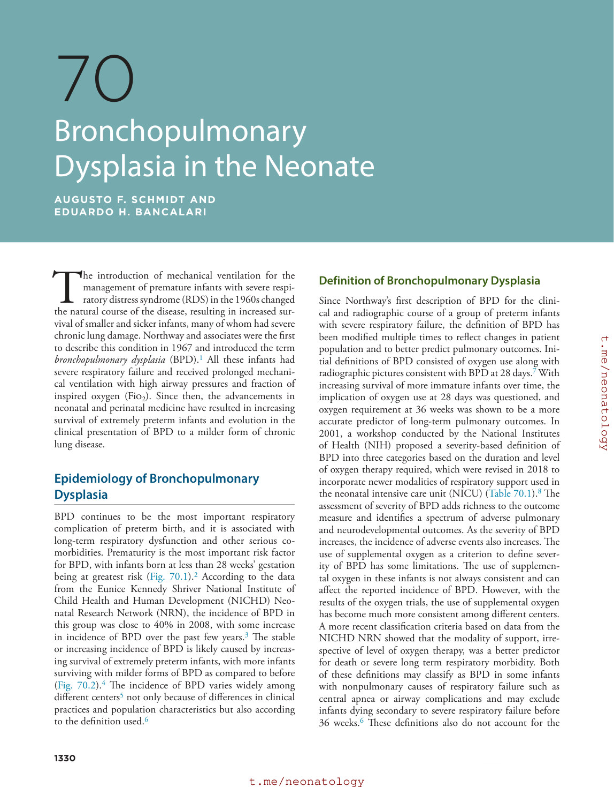

### Original source page 1333

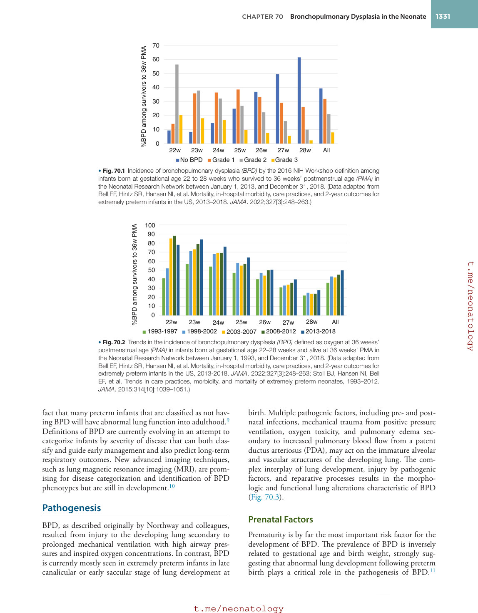

### Original source page 1334

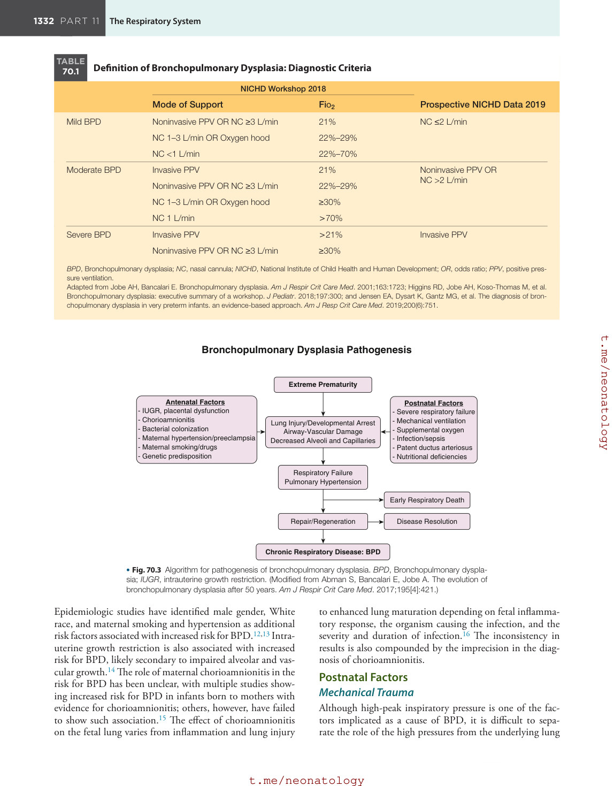

### Original source page 1336

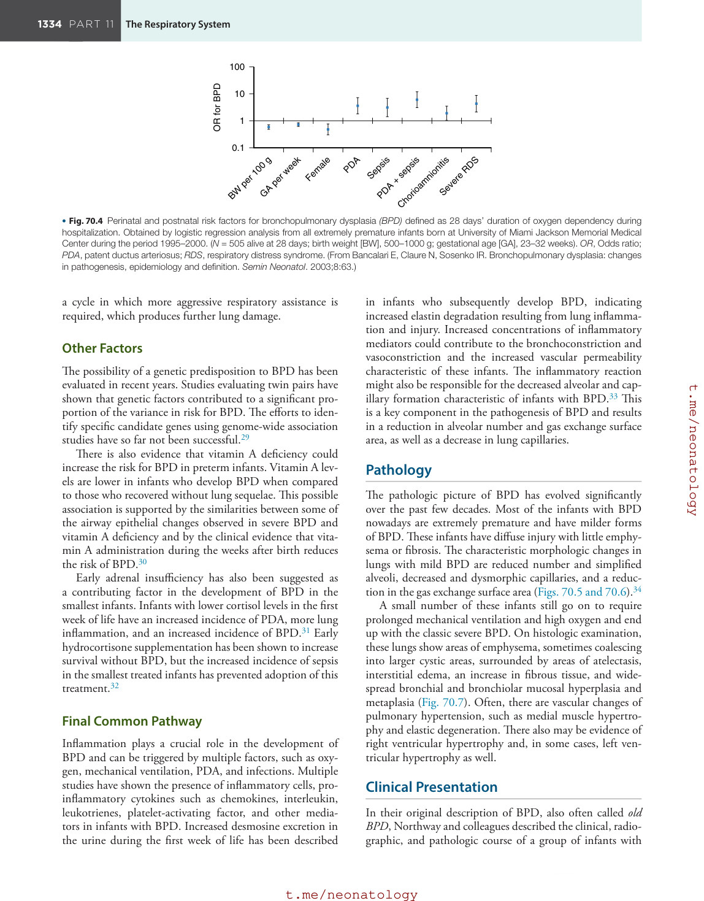

### Original source page 1337

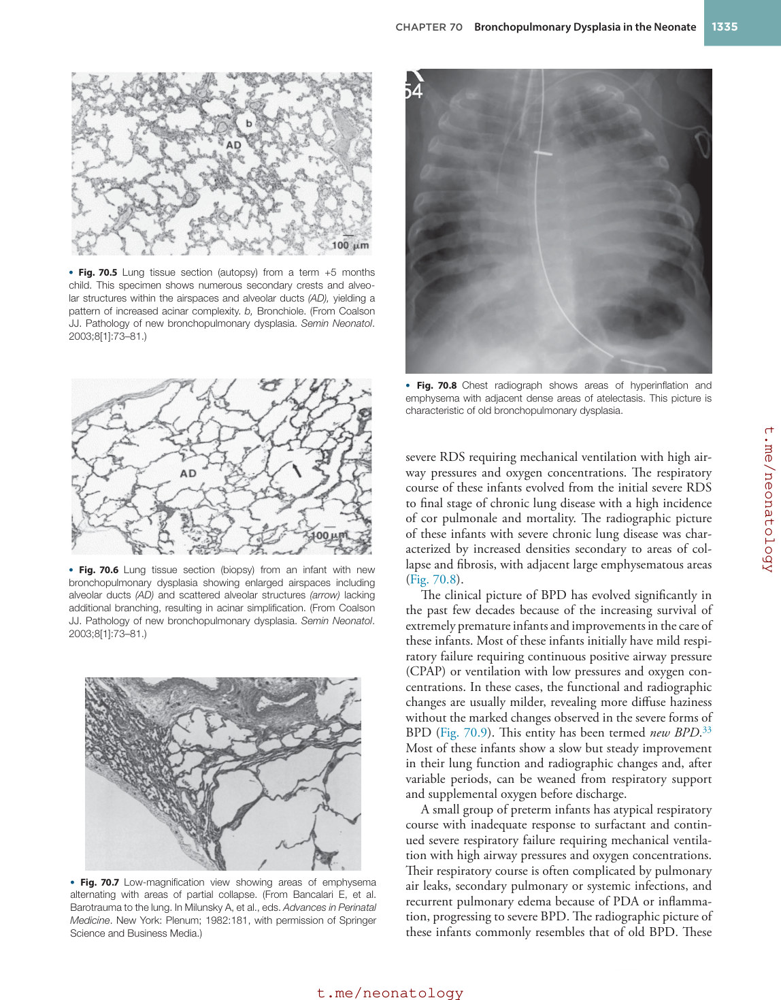

### Original source page 1338

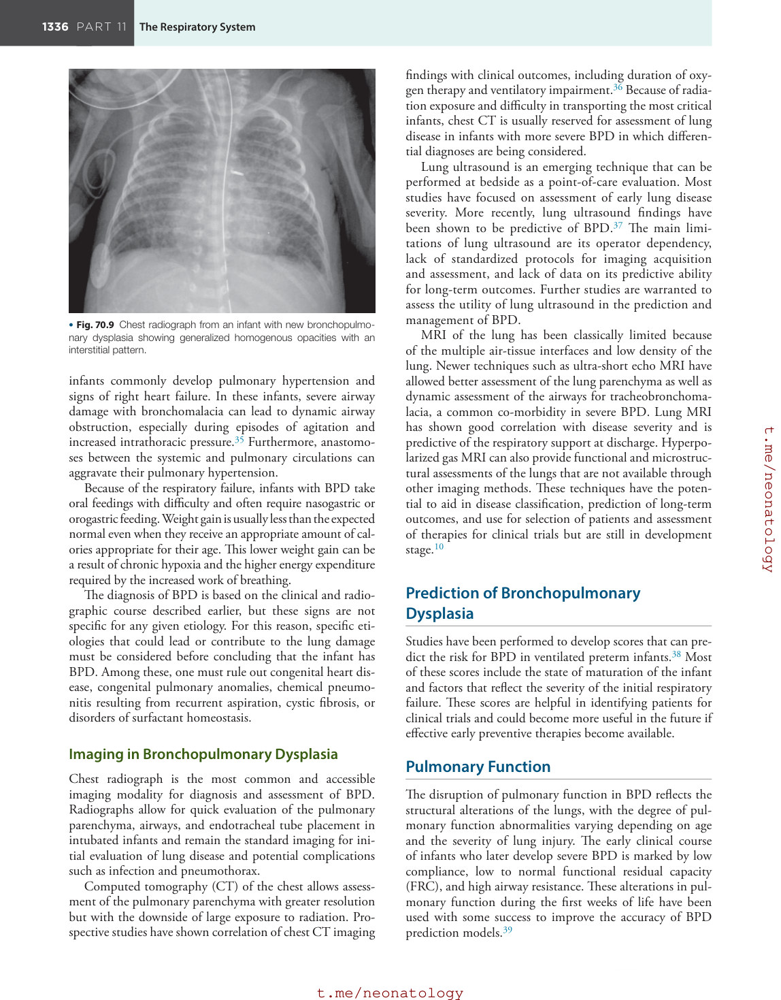

### Original source page 1339

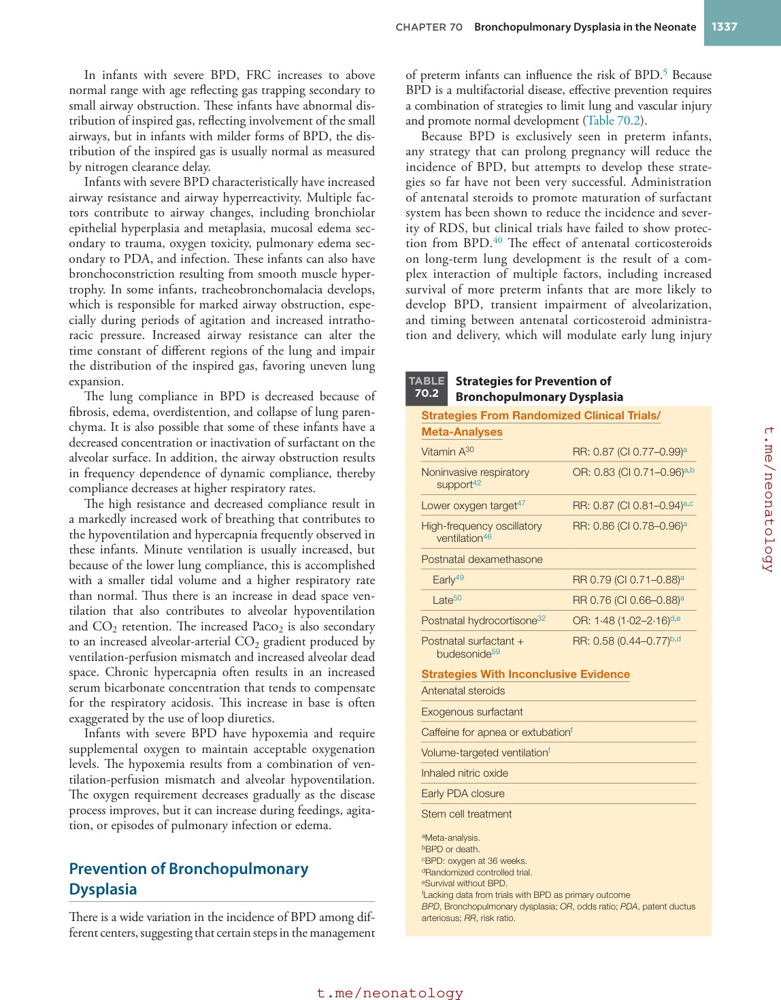

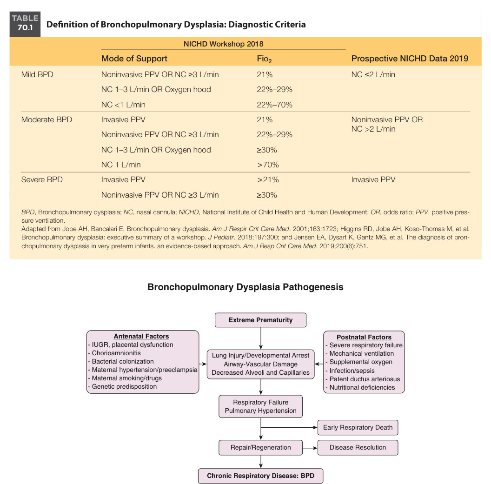

• Fig. 70.3 Algorithm for pathogenesis of bronchopulmonary dysplasia. BPD, Bronchopulmonary dysplasia; IUGR, intrauterine growth restriction. (Modified from Abman S, Bancalari E, Jobe A. The evolution of bronchopulmonary dysplasia after 50 years. Am J Respir Crit Care Med. 2017;195[4]:421.)

PDF p. 1334

• Fig. 70.4 Perinatal and postnatal risk factors for bronchopulmonary dysplasia (BPD) defined as 28 days’ duration of oxygen dependency during hospitalization. Obtained by logistic regression analysis from all extremely premature infants born at University of Miami Jackson Memorial Medical Center during the period 1995–2000. (N = 505 alive at 28 days; birth weight [BW], 500–1000 g; gestational age [GA], 23–32 weeks). OR, Odds ratio; PDA, patent ductus arteriosus; RDS, respiratory distress syndrome. (From Bancalari E, Claure N, Sosenko IR. Bronchopulmonary dysplasia: changes in pathogenesis, epidemiology and definition. Semin Neonatol. 2003;8:63.)

PDF p. 1336
